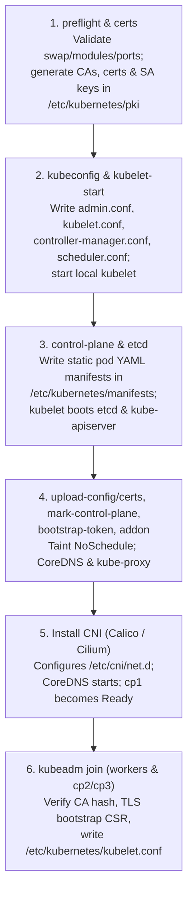

# 5.4 Bare-metal Kubernetes from scratch with kubeadm (lab)

| | |
|---|---|
| Level | Intermediate |
| Priority tier | 0 |
| Lab venue | 3 VMs minimum (1 control plane, 2 workers) with 2 vCPU/4 GB each; 5 VMs for the HA variant; internet access or a mirror; optional GPU node |
| Part | Part 5: Kubernetes |
| Status | Drafted, labs **untested** |

## Why this matters for AI infrastructure

Many GPU clusters (on-premises DGX/HGX, colocation, some GPU clouds) are not managed Kubernetes: you install and operate Kubernetes yourself, often with kubeadm, Kubespray, BCM or a vendor distribution. Even if you later use a managed service, building a cluster by hand once teaches what every component does, what must be true of a node (kernel modules, sysctls, swap, runtime, cgroups), how certificates and kubeconfigs fit together, and how to diagnose the failures that appear when a worker will not join or the CNI will not start. This lab is the foundation for the following chapters (the API, controllers, the kubelet, networking, storage, upgrades) and for adding GPUs in Part 11.

## Prerequisites and outcomes

Needs 5.1 to 5.3 and Linux administration (Part 1), networking (Part 2). After this lab you can:

- Prepare nodes (OS settings, kernel modules, sysctls, swap, time, hostnames, firewall, container runtime) and explain why each step is needed.
- Install `kubeadm`, `kubelet`, `kubectl` at matching versions; run `kubeadm init` with a config file; understand every phase and artefact it produces (certificates, kubeconfigs, static pod manifests, bootstrap tokens, CoreDNS/kube-proxy add-ons).
- Install a CNI, join workers, label/taint nodes, deploy a test application and Service, and verify cluster health.
- Build a highly available control plane (3 API servers behind a virtual IP or load balancer, stacked etcd) and add/remove control-plane nodes.
- Add a GPU node and verify GPU scheduling (preview of Part 11).
- Troubleshoot the common failure modes of kubeadm clusters.

## 1. Plan the cluster

| Role | Hostname | Spec (lab) | Notes |
|---|---|---|---|
| Control plane | `cp1` (and `cp2`, `cp3` for HA) | 2 vCPU, 4 GB, 40 GB SSD | etcd stacked; static IPs |
| Workers | `w1`, `w2` | 2 vCPU, 4 GB | CPU workers |
| GPU worker (optional) | `gpu1` | NVIDIA GPU, driver installed, 8+ vCPU | Added in section 9 |
| API VIP (HA) | `k8s-api.lab.local` / `10.0.0.100` | kube-vip or HAProxy+keepalived | `controlPlaneEndpoint` |

Decide up front (they are hard to change later):

- **Kubernetes version** (use one minor version consistently for kubeadm, kubelet, kubectl; skew policy: kubelet may be up to 3 minor versions older than the API server in recent releases, kubectl ±1).
- **Pod CIDR** (for example `10.244.0.0/16`) and **Service CIDR** (`10.96.0.0/12`); they must not overlap with node networks, VPNs or each other; size the pod CIDR for the largest cluster (`/16` gives 256 nodes of `/24`).
- **CNI** choice (Calico, Cilium, Flannel; 5.13 to 5.15). Some CNIs require specific pod CIDRs or kernel features.
- **Runtime**: containerd with systemd cgroup driver (5.2).
- **Control plane endpoint**: set `--control-plane-endpoint` at init if you will ever add control-plane nodes; changing it later is painful.
- **Network**: node-to-node connectivity on required ports (see table), unique hostnames, MAC addresses and `product_uuid` (`/sys/class/dmi/id/product_uuid`), DNS or `/etc/hosts` entries.

| Direction | Port | Purpose |
|---|---|---|
| Control plane inbound | 6443 | Kubernetes API (all) |
| | 2379-2380 | etcd (control plane nodes only) |
| | 10250 | kubelet API (control plane/self) |
| | 10259, 10257 | scheduler, controller-manager (local) |
| Worker inbound | 10250 | kubelet API |
| | 30000-32767 | NodePort Services |
| All nodes | CNI-specific | VXLAN UDP 4789/8472, BGP TCP 179, Wireguard UDP 51820, etc. |

## 2. Prepare every node

Run on all nodes (as root or with sudo). Names and versions below are examples; verify against current docs.

```bash
# 1. Hostnames and name resolution
sudo hostnamectl set-hostname cp1
cat <<EOF | sudo tee -a /etc/hosts
10.0.0.11 cp1
10.0.0.12 cp2
10.0.0.13 cp3
10.0.0.21 w1
10.0.0.22 w2
10.0.0.100 k8s-api.lab.local
EOF

# 2. Time sync (certificates and etcd need accurate clocks)
sudo apt-get update && sudo apt-get install -y chrony && sudo systemctl enable --now chrony

# 3. Disable swap (kubelet refuses to start with swap enabled by default)
sudo swapoff -a
sudo sed -i.bak '/\sswap\s/ s/^/#/' /etc/fstab
# (Swap support exists as a feature gate (NodeSwap); keep it off for GPU/ML nodes unless you have a reason.)

# 4. Kernel modules
cat <<EOF | sudo tee /etc/modules-load.d/k8s.conf
overlay
br_netfilter
EOF
sudo modprobe overlay && sudo modprobe br_netfilter

# 5. Sysctls
cat <<EOF | sudo tee /etc/sysctl.d/99-k8s.conf
net.bridge.bridge-nf-call-iptables  = 1
net.bridge.bridge-nf-call-ip6tables = 1
net.ipv4.ip_forward                 = 1
fs.inotify.max_user_watches         = 524288
fs.inotify.max_user_instances       = 8192
vm.max_map_count                    = 262144
EOF
sudo sysctl --system

# 6. Verify cgroup v2 and unique identifiers
stat -fc %T /sys/fs/cgroup           # cgroup2fs
cat /sys/class/dmi/id/product_uuid
ip link show | grep link/ether       # MACs unique across nodes

# 7. Firewall: either allow the ports above or disable ufw/firewalld in a lab
sudo ufw disable 2>/dev/null || true
```

Why each matters: `br_netfilter` and the bridge sysctls let iptables see bridged pod traffic (needed for Services and NetworkPolicy); `ip_forward` lets the node route pod traffic; swap breaks memory accounting assumptions for scheduling and QoS; `overlay` is the container filesystem; inotify limits prevent "too many open files" errors for kubelet and log shippers on busy nodes; correct time prevents certificate and Raft problems.

### Container runtime (containerd)

```bash
sudo apt-get install -y containerd             # or from Docker's repo for newer versions
sudo mkdir -p /etc/containerd
containerd config default | sudo tee /etc/containerd/config.toml >/dev/null
sudo sed -i 's/SystemdCgroup = false/SystemdCgroup = true/' /etc/containerd/config.toml
# Optionally set sandbox_image to your mirror, e.g. registry.k8s.io/pause:3.9
sudo systemctl enable containerd && sudo systemctl restart containerd
sudo crictl config --set runtime-endpoint=unix:///run/containerd/containerd.sock
```

### Kubernetes packages

```bash
sudo apt-get install -y apt-transport-https ca-certificates curl gpg
sudo mkdir -p -m 755 /etc/apt/keyrings
curl -fsSL https://pkgs.k8s.io/core:/stable:/v1.30/deb/Release.key | sudo gpg --dearmor -o /etc/apt/keyrings/kubernetes-apt-keyring.gpg
echo 'deb [signed-by=/etc/apt/keyrings/kubernetes-apt-keyring.gpg] https://pkgs.k8s.io/core:/stable:/v1.30/deb/ /' | sudo tee /etc/apt/sources.list.d/kubernetes.list
sudo apt-get update
sudo apt-get install -y kubelet kubeadm kubectl
sudo apt-mark hold kubelet kubeadm kubectl      # prevent surprise upgrades (upgrades are deliberate, 5.20)
sudo systemctl enable --now kubelet              # it will crash-loop until kubeadm init/join provides config: expected
```

(Use the repository minor version you intend to run; the URL embeds it. The old `apt.kubernetes.io` repos are deprecated.)

## 3. Initialise the first control-plane node

Use a configuration file so choices are explicit and reviewable (store it in Git):

```yaml
# kubeadm-config.yaml
apiVersion: kubeadm.k8s.io/v1beta4
kind: InitConfiguration
localAPIEndpoint:
  advertiseAddress: 10.0.0.11
  bindPort: 6443
nodeRegistration:
  criSocket: unix:///run/containerd/containerd.sock
  name: cp1
  kubeletExtraArgs:
    - name: node-ip
      value: 10.0.0.11
---
apiVersion: kubeadm.k8s.io/v1beta4
kind: ClusterConfiguration
kubernetesVersion: v1.30.4
clusterName: lab
controlPlaneEndpoint: "k8s-api.lab.local:6443"     # use cp1:6443 for a single control plane you won't expand
networking:
  podSubnet: 10.244.0.0/16
  serviceSubnet: 10.96.0.0/12
  dnsDomain: cluster.local
apiServer:
  certSANs: ["k8s-api.lab.local", "10.0.0.100", "10.0.0.11"]
  extraArgs:
    - name: audit-log-path
      value: /var/log/kubernetes/audit.log
etcd:
  local:
    dataDir: /var/lib/etcd
---
apiVersion: kubelet.config.k8s.io/v1beta1
kind: KubeletConfiguration
cgroupDriver: systemd
serverTLSBootstrap: true             # kubelet serving certs via CSR (approve them; see 5.21)
```

```bash
sudo kubeadm config images pull --config kubeadm-config.yaml        # pre-pull control-plane images
sudo kubeadm init --config kubeadm-config.yaml --upload-certs 2>&1 | tee kubeadm-init.log
mkdir -p $HOME/.kube
sudo cp -i /etc/kubernetes/admin.conf $HOME/.kube/config && sudo chown $(id -u):$(id -g) $HOME/.kube/config
kubectl get nodes         # cp1 NotReady until a CNI is installed
```

### What `kubeadm init` did (phases)



| Phase | Result |
|---|---|
| `preflight` | Checks: root, ports free, swap off, runtime reachable, kernel modules, cgroup driver |
| `certs` | Cluster CA, API server serving cert (with SANs), kubelet client, front-proxy CA/cert, etcd CA/server/peer certs, service-account key pair in `/etc/kubernetes/pki` (valid 1 year for leaf certs by default, CA 10 years) |
| `kubeconfig` | `admin.conf`, `super-admin.conf`, `kubelet.conf`, `controller-manager.conf`, `scheduler.conf` in `/etc/kubernetes` |
| `kubelet-start` | Writes `/var/lib/kubelet/config.yaml` and flags, starts the kubelet |
| `control-plane` | Writes **static pod manifests** `kube-apiserver.yaml`, `kube-controller-manager.yaml`, `kube-scheduler.yaml` in `/etc/kubernetes/manifests`; the kubelet runs them |
| `etcd` | Static pod manifest for the local etcd member |
| `upload-config` / `upload-certs` | Stores ClusterConfiguration in a ConfigMap (`kube-system/kubeadm-config`); optionally encrypts control-plane certs in a Secret for joining other control-plane nodes (valid 2 hours) |
| `mark-control-plane` | Labels `node-role.kubernetes.io/control-plane` and taints `NoSchedule` |
| `bootstrap-token` | Creates a bootstrap token Secret for workers to join; RBAC for TLS bootstrapping and CSR auto-approval |
| `addon` | Installs **CoreDNS** (Deployment) and **kube-proxy** (DaemonSet) |

Explore the artefacts:

```bash
ls /etc/kubernetes /etc/kubernetes/manifests /etc/kubernetes/pki
sudo cat /etc/kubernetes/manifests/kube-apiserver.yaml | head -60       # flags: authorization-mode, admission plugins, etcd servers, certs
sudo kubeadm certs check-expiration
kubectl -n kube-system get pods -o wide
kubectl -n kube-system get cm kubeadm-config -o yaml | head -40
kubectl -n kube-system get cm kubelet-config -o yaml | head -30
```

## 4. Install a CNI

Nodes stay `NotReady` until a CNI configures `/etc/cni/net.d`. Example with Calico (operator-based; Cilium and Flannel are alternatives, 5.13 to 5.14):

```bash
kubectl create -f https://raw.githubusercontent.com/projectcalico/calico/v3.28.0/manifests/tigera-operator.yaml
cat <<EOF | kubectl create -f -
apiVersion: operator.tigera.io/v1
kind: Installation
metadata: { name: default }
spec:
  calicoNetwork:
    ipPools:
      - blockSize: 26
        cidr: 10.244.0.0/16
        encapsulation: VXLANCrossSubnet
        natOutgoing: Enabled
        nodeSelector: all()
EOF
kubectl get pods -A -w          # wait for calico-system, coredns Running
kubectl get nodes               # cp1 Ready
```

Match the CNI's pod pool to `podSubnet` in the kubeadm config. For Cilium use `cilium install --set ipam.operator.clusterPoolIPv4PodCIDRList=10.244.0.0/16` (and optionally kube-proxy replacement). Verify with a connectivity test (`cilium connectivity test`, or two pods pinging each other across nodes).

## 5. Join workers

On `cp1` get the join command (token valid 24 h by default):

```bash
kubeadm token create --print-join-command
# or build it: token + CA cert hash
openssl x509 -pubkey -in /etc/kubernetes/pki/ca.crt | openssl rsa -pubin -outform der 2>/dev/null | openssl dgst -sha256 -hex | sed 's/^.* //'
```

On each worker (after section 2 preparation):

```bash
sudo kubeadm join k8s-api.lab.local:6443 --token abcdef.0123456789abcdef \
  --discovery-token-ca-cert-hash sha256:<hash> --node-name w1
```

Or via a JoinConfiguration file for repeatability (`discovery.bootstrapToken`, `nodeRegistration`, `kubeletExtraArgs`). The `--discovery-token-ca-cert-hash` pins the cluster CA so a worker cannot be tricked into joining a rogue API server. What happens: the kubelet performs **TLS bootstrapping**: uses the bootstrap token to submit a CSR for a client certificate; the controller manager's CSR approver signs it; the kubelet writes `/etc/kubernetes/kubelet.conf` and registers the Node object. With `serverTLSBootstrap: true`, kubelet *serving* certificate CSRs require manual approval (`kubectl get csr`; `kubectl certificate approve <name>`), otherwise `kubectl logs/exec` fail certificate verification.

```bash
kubectl get nodes -o wide
kubectl label node w1 node-role.kubernetes.io/worker=
kubectl get csr
```

## 6. Verify the cluster

```bash
kubectl get nodes -o wide
kubectl get pods -A
kubectl get --raw='/readyz?verbose'
kubectl run nginx --image=nginx:1.27 --port=80
kubectl expose pod nginx --port=80 --type=NodePort
kubectl get svc nginx
curl http://<any-node-ip>:<nodeport>
kubectl create deployment web --image=nginx:1.27 --replicas=4
kubectl get pods -o wide                                   # spread across workers
kubectl run -it --rm dns --image=busybox:1.36 --restart=Never -- nslookup kubernetes.default
kubectl run -it --rm net --image=nicolaka/netshoot --restart=Never -- curl -s web.default.svc.cluster.local
kubectl top nodes                                          # needs metrics-server (install it, section 10)
```

Smoke tests to automate: all nodes Ready; all kube-system pods Running; DNS resolves; pod-to-pod across nodes; Service ClusterIP and NodePort reachable; a PVC binds (after installing a storage provisioner, 5.17).

### Everyday `kubectl` context, `last-applied-configuration`, `attach`, and shell completion

Once `$HOME/.kube/config` is in place, *Kubernetes: Up and Running* (3rd edition, Chapter 4) highlights four `kubectl` workflows that save time on a new cluster (untested here):

- **Contexts (`set-context` and `use-context`)**: instead of typing `--namespace` on every command, save a context that binds a default namespace (and optionally `--users` or `--clusters`) in `$HOME/.kube/config` and switch to it:

```bash
kubectl config set-context my-context --namespace=mystuff
kubectl config use-context my-context
```

- **Inspecting and editing `kubectl apply` state (`view-last-applied`, `edit-last-applied`, `set-last-applied`)**: `kubectl apply` stores the previous declarative configuration inside the `kubectl.kubernetes.io/last-applied-configuration` annotation on each object so it can compute three-way merges on future applies. You can inspect or manipulate that recorded state directly:

```bash
kubectl apply -f myobj.yaml view-last-applied
kubectl apply -f myobj.yaml edit-last-applied
kubectl apply -f myobj.yaml set-last-applied
```

- **Attaching to a running container process (`kubectl attach`)**: when a minimal container has no `/bin/sh` or `bash` for `kubectl exec`, `kubectl attach -it <pod-name>` attaches your terminal directly to PID 1's standard input/output streams (like `kubectl logs -f` plus `stdin`).
- **Bash tab completion (`kubectl completion bash`)**: after installing the `bash-completion` package (`apt-get install bash-completion`, `yum install bash-completion`, or `brew install bash-completion`), enable tab completion for commands and resource names in the current shell or persist it in `${HOME}/.bashrc`:

```bash
source <(kubectl completion bash)
echo "source <(kubectl completion bash)" >> ${HOME}/.bashrc
```

## 7. High-availability control plane (stacked etcd)

Requirements: a stable API endpoint (VIP or load balancer) from the start (`controlPlaneEndpoint`), and three control-plane nodes.

### kube-vip (static pod on control-plane nodes)

```bash
# On cp1, before kubeadm init (or after, with a fixed IP), generate the manifest:
export VIP=10.0.0.100 INTERFACE=eth0
sudo ctr image pull ghcr.io/kube-vip/kube-vip:v0.8.0
sudo ctr run --rm --net-host ghcr.io/kube-vip/kube-vip:v0.8.0 vip /kube-vip manifest pod \
  --interface $INTERFACE --address $VIP --controlplane --arp --leaderElection | sudo tee /etc/kubernetes/manifests/kube-vip.yaml
```

(HAProxy + keepalived on dedicated or colocated nodes is the classic alternative; cloud load balancers for cloud-hosted VMs. Note kube-vip on kubeadm 1.29+ needs the `super-admin.conf` workaround during first init; follow the project's current docs.)

### Join additional control-plane nodes

```bash
# From cp1, output of `kubeadm init --upload-certs` included a certificate key; or regenerate:
sudo kubeadm init phase upload-certs --upload-certs        # prints a new certificate key
kubeadm token create --print-join-command                  # base join command

# On cp2 and cp3 (prepared like all nodes):
sudo kubeadm join k8s-api.lab.local:6443 --token <t> --discovery-token-ca-cert-hash sha256:<h> \
  --control-plane --certificate-key <key> --apiserver-advertise-address 10.0.0.12
```

Verify etcd membership and API availability:

```bash
kubectl get nodes
kubectl -n kube-system get pods -l component=etcd -o wide
kubectl -n kube-system exec etcd-cp1 -- etcdctl --endpoints=https://127.0.0.1:2379 \
  --cacert=/etc/kubernetes/pki/etcd/ca.crt --cert=/etc/kubernetes/pki/etcd/peer.crt --key=/etc/kubernetes/pki/etcd/peer.key \
  member list -w table
# failover test: power off cp1 and run `kubectl get nodes` against the VIP; the VIP should move; leader election elects new scheduler/controller leaders (kubectl get lease -n kube-system)
```

Operating HA: keep an odd number of control-plane nodes; replace failed etcd members with `etcdctl member remove/add` and `kubeadm join --control-plane` (or `kubeadm reset` + re-join); never run two control-plane nodes (worse than one for quorum); spread across failure domains; back up etcd (5.20). Taints: control-plane nodes are tainted `NoSchedule`; remove only in labs (`kubectl taint nodes --all node-role.kubernetes.io/control-plane-`).

## 8. Alternatives to kubeadm for bare metal (for context)

| Tool | Approach | When |
|---|---|---|
| **kubeadm** | Minimal bootstrapper, you assemble everything else | Learning, custom builds, clear control; basis for others |
| **Kubespray** | Ansible-driven kubeadm-based installer with HA, CNI choices, addons | Bare-metal fleets with Ansible expertise (4.3 to 4.17) |
| **RKE2/K3s (Rancher)** | Packaged distributions, simple single-binary installs, secure defaults | Edge/small clusters, quick HA, FIPS (RKE2) |
| **Talos Linux** | Immutable API-managed OS for Kubernetes | Declarative node management, no SSH |
| **OpenShift** | Opinionated platform with operators, registry, auth | Enterprise platforms |
| **Cluster API (CAPI)** | Declarative clusters as Kubernetes objects (with providers: metal3, vSphere, cloud) | Fleet automation (5.35) |
| **NVIDIA Base Command Manager (BCM) / DeepOps** | Cluster management with Kubernetes and Slurm deployment for DGX/HGX | NVIDIA reference environments (Part 8) |
| **Managed services** | GKE/EKS/AKS, provider-managed Kubernetes on GPU clouds | When you do not want to run the control plane (5.34) |

In *Production Kubernetes* Chapters 1 and 2 (*Path to Production* and *Deployment Models*), Josh Rosso, Rich Lander, Alexander Brand, and John Harris frame this choice through two architectural analogies:
- **Kubernetes is the foundation ("the engine"), not the finished house ("the driveable car", `PK` Chapter 1):** Core `kubernetes/kubernetes` intentionally focuses on container orchestration and exposes plug-in interfaces—**CRI** (runtime), **CNI** (networking), **CSI** (storage), and **CPI** (Cloud Provider Interface, moving historical "in-tree" cloud integrations out-of-tree)—while leaving service routing, observability, secret management, CI/CD, and multi-tenancy to the surrounding **application platform** you assemble on top.
- **Managed Services vs. Prebuilt Installers vs. Roll Your Own, and Bare Metal vs. Virtualization (`PK` Chapter 2):**
  1. *Managed Services (GKE, EKS, AKS):* Lowest operational burden for the control plane, at the cost of provider-imposed limits on control-plane flags, Kubernetes versions, and custom hardware topologies.
  2. *Prebuilt Installers (Kubespray, RKE2, OpenShift, Cluster API) vs. Roll Your Own (`kubeadm` + Packer + Ansible):* Rolling your own or using bare metal gives total control over kernel parameters, custom GPUDirect RDMA/InfiniBand fabrics, and control-plane flags, but requires automating what virtualization previously gave you for free (PXE booting via **Matchbox**/**MAAS**/**Tinkerbell**/**BCM**, out-of-band IPMI/Redfish power management, BGP/L2 load balancing via **MetalLB**/**kube-vip**, and building immutable node images with **Packer + Ansible**).
  3. *Environment tiers (`Development`, `Testing` with automated `< 1 week` TTL reapers, `Staging`, and `Production`) and Cluster Sizing (`Few Large` vs. `Many Small`, `PK` Chapter 2):* Fewer large clusters reduce control-plane overhead and improve bin-packing (using tainted **node pools** for GPU or high-memory hardware), whereas many smaller clusters reduce blast radius and control-plane scaling bottlenecks (detailed in Chapter 5.19).

## 9. Adding a GPU worker (preview of Part 11)

Prepare the node like any worker plus the GPU stack:

1. Install the NVIDIA driver on the host (4.17, Part 10) and verify `nvidia-smi`.
2. Install the NVIDIA Container Toolkit, configure containerd (`nvidia-ctk runtime configure --runtime=containerd`), restart (5.2).
3. `kubeadm join` as a worker.
4. Install the NVIDIA device plugin (or the GPU Operator with `driver.enabled=false`):

```bash
helm repo add nvdp https://nvidia.github.io/k8s-device-plugin && helm repo update
helm upgrade -i nvdp nvdp/nvidia-device-plugin -n nvidia-device-plugin --create-namespace --version 0.16.2 \
  --set gfd.enabled=true
kubectl get nodes -o json | jq '.items[] | {name:.metadata.name, gpu:.status.allocatable["nvidia.com/gpu"]}'
cat <<EOF | kubectl apply -f -
apiVersion: v1
kind: Pod
metadata: { name: gpu-smoke }
spec:
  restartPolicy: Never
  containers:
    - name: cuda
      image: nvcr.io/nvidia/cuda:12.4.1-base-ubuntu22.04
      command: ["nvidia-smi"]
      resources: { limits: { nvidia.com/gpu: 1 } }
EOF
kubectl logs gpu-smoke
```

Taint the GPU node (`kubectl taint node gpu1 nvidia.com/gpu=present:NoSchedule`) and add a matching toleration to GPU workloads so CPU-only pods stay off (5.18).

## 10. Day-1 add-ons

```bash
# metrics-server (kubectl top, HPA); on kubeadm labs add --kubelet-insecure-tls only if you did not approve kubelet serving CSRs
kubectl apply -f https://github.com/kubernetes-sigs/metrics-server/releases/latest/download/components.yaml
# a storage provisioner for labs (local-path); production uses CSI (5.17)
kubectl apply -f https://raw.githubusercontent.com/rancher/local-path-provisioner/v0.0.28/deploy/local-path-storage.yaml
kubectl patch storageclass local-path -p '{"metadata":{"annotations":{"storageclass.kubernetes.io/is-default-class":"true"}}}'
# ingress controller + load balancer for bare metal: MetalLB (L2/BGP) + ingress-nginx (5.12)
```

Commit manifests/values to Git and reconcile with GitOps (4.26) rather than applying by hand.

## 11. Troubleshooting kubeadm clusters

| Symptom | Likely cause | Commands |
|---|---|---|
| `kubeadm init` hangs at "waiting for the kubelet to boot up the control plane" | Kubelet crash-looping: swap on, cgroup driver mismatch, runtime not running, wrong CRI socket, images not pulled | `journalctl -u kubelet -f`, `crictl ps -a`, `systemctl status containerd`, `swapon --show` |
| Control-plane pods CrashLoopBackOff | Wrong `advertiseAddress`, port in use, etcd data dir stale from a previous install | `crictl logs`, `kubeadm reset` + `rm -rf /var/lib/etcd` and re-init |
| `node NotReady`, `network plugin is not ready: cni config uninitialized` | CNI not installed or failing | `ls /etc/cni/net.d`, CNI pod logs, pod CIDR mismatch |
| Worker `join` fails: "couldn't validate the identity of the API server" | CA hash wrong, token expired, endpoint unreachable/DNS | recreate token, check `curl -k https://k8s-api:6443/healthz`, firewall |
| `x509: certificate is valid for ..., not <name>` | API cert SANs missing the address you use | Re-generate with `certSANs`, or use the right name |
| `kubectl logs/exec` fail with TLS errors | Kubelet serving CSRs unapproved (serverTLSBootstrap) | `kubectl get csr`, approve; or install an approver |
| CoreDNS Pending/CrashLoop | No CNI yet; `/etc/resolv.conf` loops (127.0.0.53) | `kubectl -n kube-system logs deploy/coredns`, set kubelet `resolvConf` to `/run/systemd/resolve/resolv.conf` |
| Pods cannot reach Services | `br_netfilter`/sysctl missing, kube-proxy mode, CNI policy | `sysctl net.bridge.bridge-nf-call-iptables`, `iptables-save \| grep KUBE-SVC`, kube-proxy logs |
| Pod-to-pod across nodes fails | Overlay port blocked, MTU mismatch, wrong pod CIDR | `tcpdump`, `ping -M do -s`, CNI status |
| Time skew errors, certificate "not yet valid" | NTP broken | `chronyc tracking` |
| Join of control-plane fails: "certificate key not found" | `--upload-certs` secret expired (2 h) | `kubeadm init phase upload-certs --upload-certs` |
| `etcdserver: request timed out` | Slow disk, CPU starvation, network | etcd metrics, `iostat`, move etcd to SSD |
| Stuck node after `kubeadm reset` | Leftover CNI config, iptables, etcd data, kubelet state | `sudo kubeadm reset -f; rm -rf /etc/cni/net.d ~/.kube; iptables -F; ipvsadm --clear; reboot` |

Reset a node to start over:

```bash
sudo kubeadm reset -f
sudo rm -rf /etc/cni/net.d /var/lib/etcd /var/lib/kubelet/* $HOME/.kube
sudo iptables -F && sudo iptables -t nat -F && sudo iptables -t mangle -F && sudo iptables -X
sudo systemctl restart containerd
```

## 12. Automation and reproducibility

Hand-built is for learning. For repeatable clusters: (1) bake the preparation steps into an Ansible role or image (4.11, 4.17); (2) keep `kubeadm` config files in Git; (3) use Terraform to create VMs (4.20, 4.27) and output an inventory; (4) consider Kubespray or Cluster API; (5) pin versions, mirror packages and images; (6) write a validation playbook (5.25, 4.17).

```yaml
# sketch: Ansible tasks for node prep
- name: Kernel modules
  community.general.modprobe: { name: "{{ item }}", state: present, persistent: present }
  loop: [overlay, br_netfilter]
- name: Sysctls
  ansible.posix.sysctl: { name: "{{ item.k }}", value: "{{ item.v }}", sysctl_file: /etc/sysctl.d/99-k8s.conf, reload: true }
  loop:
    - { k: net.bridge.bridge-nf-call-iptables, v: 1 }
    - { k: net.ipv4.ip_forward, v: 1 }
- name: Disable swap
  ansible.builtin.command: swapoff -a
  when: ansible_swaptotal_mb > 0
- ansible.posix.mount: { name: swap, fstype: swap, state: absent }
```

## 13. Lab checklist

First, run the self-checking Python lab (`code/part05/kubeadm_bootstrap_validator_lab.py`) locally. It verifies the node preflight and CIDR non-overlap validator (`validate_node_preflight_and_cidrs`: checking `swapoff -a`, `overlay` & `br_netfilter` kernel modules, bridge/forwarding sysctls, `systemd` cgroup driver alignment, and non-overlapping `node_cidr`/`pod_subnet`/`service_subnet` + CNI pool matching) and the `kubeadm join` credential verifier (`verify_kubeadm_join_credentials`: checking `[a-z0-9]{6}.[a-z0-9]{16}` bootstrap token format, `--discovery-token-ca-cert-hash` pinning, and the 2-hour `--upload-certs` key expiry).

```bash
python3 code/part05/kubeadm_bootstrap_validator_lab.py
```

Next, on your lab VMs (all interactive shell steps below are `untested here`), work through this checklist:

1. Provision VMs and prepare them as in section 2; write down the version matrix and CIDRs; verify prerequisites with a script.
2. Install containerd with `SystemdCgroup = true`; verify with `crictl info`.
3. Install kubeadm/kubelet/kubectl pinned; write `kubeadm-config.yaml`; run `kubeadm init`; inspect `/etc/kubernetes` artefacts, certificates (`openssl x509 -in apiserver.crt -noout -text | grep -A1 'Subject Alternative'`), and static pod manifests.
4. Install the CNI; watch nodes become Ready; join two workers; approve CSRs if using serving-cert bootstrap.
5. Deploy nginx Deployment + Service + NodePort; test from outside; test DNS and cross-node pod networking; run a `netshoot` debugging pod.
6. Practice failure cases: stop containerd on a worker; stop kubelet; break the pod CIDR; wrong cgroup driver; expire a token and rejoin; time skew; read the symptoms and fix.
7. Convert to HA: add kube-vip/HAProxy, join cp2 and cp3, kill cp1 and verify API continuity and leader election.
8. Take an etcd snapshot and test restore on a spare VM (5.20).
9. Add a GPU node (or simulate with a fake extended resource via `kubectl patch node ... --subresource=status`), install the device plugin, run the smoke pod.
10. Rebuild the whole cluster from your Ansible role + config in under an hour; record timings.
11. Tear down with `kubeadm reset` and verify nothing remains.

## 14. Common mistakes

- Skipping `SystemdCgroup`, swap-off, or kernel modules, then debugging kubelet crash loops.
- Forgetting `controlPlaneEndpoint` before the first init, making HA conversion painful.
- Pod CIDR overlapping with the node or corporate network; CNI and kubeadm pod CIDRs mismatched.
- Mixed Kubernetes versions beyond skew policy; unheld packages auto-upgrading.
- Joining nodes with expired tokens or the wrong CA hash and "fixing" it with `--discovery-token-unsafe-skip-ca-verification`.
- Leaving the control plane schedulable in production, or putting workloads on etcd nodes.
- Not approving kubelet serving CSRs (then using insecure kubelet TLS flags everywhere).
- Treating a single control plane as production; no etcd backups.
- Pulling images from the Internet on every node with no mirror (rate limits, outages).

## 15. Interview angles

- "Walk me through bootstrapping a cluster with kubeadm. What do the phases do? Which files and certificates are created?"
- "Why must swap be off? What are the prerequisite sysctls and modules?"
- "How does a worker securely join? What are the token and CA hash for?"
- "How do you build an HA control plane with kubeadm? Why an odd number of etcd members?"
- "A node is NotReady with 'cni config uninitialized'. What do you check?"
- "How do you rotate certificates and what expires after a year?" (5.21)
- "kubeadm vs Kubespray vs managed Kubernetes for a GPU cluster?"

## Exercises

1. **Cluster Network Planning (`podSubnet`, `serviceSubnet`, `controlPlaneEndpoint`) and Linux Node Preparation (`KUR` Ch. 3 & Appendix A):** Using `validate_node_preflight_and_cidrs()` in `code/part05/kubeadm_bootstrap_validator.py`, explain why `podSubnet` (`10.244.0.0/16`), `serviceSubnet` (`10.96.0.0/12`), and the host network (`10.0.0.0/24`) must never overlap, why `controlPlaneEndpoint` (`k8s-api.lab.local:6443`) must be set before `kubeadm init`, and why each step in Section 2 (`swapoff -a`, `overlay` & `br_netfilter`, `bridge-nf-call-iptables = 1`, `ip_forward = 1`, `SystemdCgroup = true`, `apt-mark hold`) is required.
2. **Inside `kubeadm init`: The 11 Phases, PKI Certificates, Kubeconfigs, and Static Pod Manifests:** Trace `KUBEADM_INIT_PHASES` in `code/part05/kubeadm_bootstrap_validator.py` (`preflight -> certs -> kubeconfig -> kubelet-start -> control-plane -> etcd -> upload-config -> upload-certs -> mark-control-plane -> bootstrap-token -> addon`), listing the exact files created in `/etc/kubernetes/pki/`, `/etc/kubernetes/manifests/`, and `/etc/kubernetes/*.conf`.
3. **Installing the CNI (`Calico` / `Cilium`) and Secure Worker TLS Bootstrapping (`kubeadm join`):** Using `verify_kubeadm_join_credentials()` in `code/part05/kubeadm_bootstrap_validator.py`, explain why `cp1` stays `NotReady` and `coredns` stays `Pending` until a CNI is installed, how `--token` (`[a-z0-9]{6}.[a-z0-9]{16}`) and `--discovery-token-ca-cert-hash sha256:<hex>` prevent a rogue API server MITM attack during `kubeadm join`, and how `serverTLSBootstrap: true` affects `kubectl logs`/`exec`.
4. **High-Availability Control Plane (`kube-vip` / `HAProxy`, `--control-plane`, `--upload-certs`) and `etcd` Membership:** Trace how `kube-vip` provides a floating ARP/BGP virtual IP (`10.0.0.100`) as a static pod on `cp1..cp3`, how `--upload-certs` encrypts control-plane PKI keys into a short-lived (2-hour) Secret for `kubeadm join --control-plane --certificate-key <key>`, and how to verify the 3-member `etcd` cluster and leader failover when `cp1` is powered off.
5. **Adding a Bare-Metal GPU Worker Node and Everyday `kubectl` Power Workflows (`KUR` Chapter 4):** Trace the 4-step sequence in Section 9 to join `gpu1` (`nvidia-smi` -> `nvidia-ctk runtime configure --runtime=containerd` -> `kubeadm join` -> `nvidia-device-plugin` + `nvidia.com/gpu=present:NoSchedule` taint), and write the `KUR` Chapter 4 commands for `kubectl config set-context`/`use-context`, `kubectl apply view-last-applied`/`edit-last-applied`/`set-last-applied`, `kubectl attach`, and `kubectl completion bash`.
6. **Comparing Deployment Models (`PK` Chapters 1 & 2) and Troubleshooting `kubeadm` Failure Modes:** Compare Managed Kubernetes, Prebuilt Installers (`Kubespray`, `RKE2`, `Cluster API`, `BCM`), and `kubeadm` + Packer/Ansible across control, toil, and bare-metal requirements (`PK` Ch. 1–2), and diagnose three classic failures from Section 11: (a) `kubeadm init` hanging waiting for `kubelet`, (b) CoreDNS crash-looping on `/etc/resolv.conf` `127.0.0.53`, and (c) dirty state left behind after `kubeadm reset`.

## Checkpoint questions (20)

<details>
<summary>1. Why must `swap` be disabled (`swapoff -a`), and why are the `overlay` and `br_netfilter` kernel modules plus `net.bridge.bridge-nf-call-iptables = 1` required on every node?</summary>

- **`swapoff -a`:** By default, `kubelet` refuses to start if swap is active because Kubernetes QoS classes (`Guaranteed`, `Burstable`) and memory eviction thresholds expect deterministic physical RAM accounting (`memory.max`), and swapping a latency-sensitive GPU training process to disk destroys gang-synchronous step times.
- **`overlay` module:** Provides the `overlayfs` union filesystem used by `containerd` / `CRI-O` for container root filesystems.
- **`br_netfilter` + `net.bridge.bridge-nf-call-iptables = 1` + `net.ipv4.ip_forward = 1`:** Ensures that L2 bridged Pod traffic traversing a Linux bridge is passed through the host's `netfilter`/`iptables` chains (required for `kube-proxy` `ClusterIP` Service DNAT and CNI `NetworkPolicy` enforcement) and that the kernel routes packets between Pod and host interfaces.
</details>

<details>
<summary>2. Why does `systemctl enable --now kubelet` crash-loop immediately after installing the `kubelet` package, before `kubeadm init` or `kubeadm join` is run?</summary>

This is completely normal and expected: the `kubelet` systemd unit requires `/var/lib/kubelet/config.yaml` and `/etc/kubernetes/kubelet.conf` (or `--bootstrap-kubeconfig`), which **do not exist until `kubeadm init` or `kubeadm join` generates them** during the `kubeconfig` and `kubelet-start` phases.
</details>

<details>
<summary>3. Why should you always set `controlPlaneEndpoint: "k8s-api.lab.local:6443"` and `apiServer.certSANs` in `ClusterConfiguration` even if you start with a single control-plane node?</summary>

`controlPlaneEndpoint` sets the canonical DNS/VIP address written into `kubeadm-config`, `cluster-info`, and every node's `kubelet.conf`. If you initialize `cp1` using `cp1`'s raw node IP (`10.0.0.11:6443`) without `controlPlaneEndpoint`, converting the cluster to a 3-node HA control plane later requires manually regenerating API server certificates (`certSANs`), editing ConfigMaps, and rewriting `/etc/kubernetes/kubelet.conf` on every worker node. Pointing `controlPlaneEndpoint` at a DNS name or VIP (`10.0.0.100:6443`) from Day 1 makes adding `cp2` and `cp3` a single `kubeadm join --control-plane` command.
</details>

<details>
<summary>4. Walk through the 11 phases of `kubeadm init` and the directories they populate on `cp1`.</summary>

1. **`preflight`:** Validates root privileges, swap off, free ports (`6443`, `2379–2380`, `10250–10259`), kernel modules, and CRI socket reachability.
2. **`certs`:** Generates the cluster CA, etcd CA, front-proxy CA, ServiceAccount keypair (`sa.key`/`sa.pub`), and leaf TLS certificates in **`/etc/kubernetes/pki/`**.
3. **`kubeconfig`:** Generates `admin.conf`, `super-admin.conf`, `kubelet.conf`, `controller-manager.conf`, and `scheduler.conf` in **`/etc/kubernetes/`**.
4. **`kubelet-start`:** Writes `/var/lib/kubelet/config.yaml` and starts `kubelet`.
5. **`control-plane`:** Writes Static Pod manifests (`kube-apiserver.yaml`, `kube-controller-manager.yaml`, `kube-scheduler.yaml`) into **`/etc/kubernetes/manifests/`**.
6. **`etcd`:** Writes the Static Pod manifest **`/etc/kubernetes/manifests/etcd.yaml`** (`dataDir: /var/lib/etcd`).
7. **`upload-config`:** Uploads `ClusterConfiguration` and `KubeletConfiguration` to `kube-system` ConfigMaps (`kubeadm-config`, `kubelet-config`).
8. **`upload-certs`:** When `--upload-certs` is passed, encrypts control-plane PKI private keys into the `kube-system/kubeadm-certs` Secret with a **2-hour TTL**.
9. **`mark-control-plane`:** Applies label `node-role.kubernetes.io/control-plane` and taint `node-role.kubernetes.io/control-plane:NoSchedule`.
10. **`bootstrap-token`:** Creates a 24-hour bootstrap token Secret in `kube-system` and RBAC rules for node TLS bootstrapping.
11. **`addon`:** Deploys the **`coredns`** Deployment/Service and **`kube-proxy`** DaemonSet.
</details>

<details>
<summary>5. What are the default lifetimes of the CA certificates and leaf certificates created by `kubeadm` in `/etc/kubernetes/pki`, and how do you check or renew them?</summary>

- **Root CAs (`ca.crt`, `etcd/ca.crt`, `front-proxy-ca.crt`):** Valid for **10 years**.
- **Leaf certificates (`apiserver.crt`, `apiserver-kubelet-client.crt`, `front-proxy-client.crt`, `etcd/server.crt`, `etcd/peer.crt`):** Valid for **1 year** (and automatically renewed during `kubeadm upgrade apply`).
- **Check expiration:** `sudo kubeadm certs check-expiration`.
- **Manual renewal:** `sudo kubeadm certs renew all` followed by restarting the control-plane static pods (`crictl stopp` or moving manifests out and back into `/etc/kubernetes/manifests/`).
</details>

<details>
<summary>6. Why does `cp1` remain `NotReady` and `coredns` remain `Pending` right after `kubeadm init` finishes?</summary>

`kubeadm init` intentionally does **not** install a CNI plugin. Until a CNI plugin (Calico, Cilium, Flannel) installs its configuration into `/etc/cni/net.d/`, `kubelet`'s network readiness check fails (`network plugin is not ready: cni config uninitialized`), keeping the Node condition `Ready=False` (`node.kubernetes.io/not-ready:NoSchedule` taint)—which in turn prevents the `coredns` Deployment pods from being scheduled. As soon as the CNI DaemonSet writes `/etc/cni/net.d/` and starts, `cp1` turns `Ready` and `coredns` transitions to `Running`.
</details>

<details>
<summary>7. How do `--token` and `--discovery-token-ca-cert-hash` work together during `kubeadm join`?</summary>

When a new worker runs `kubeadm join k8s-api.lab.local:6443 --token <id>.<secret> --discovery-token-ca-cert-hash sha256:<hash>`:
1. The worker fetches the public `cluster-info` ConfigMap (which contains the cluster's root `ca.crt` and is signed with a JWS signature using the bootstrap `<secret>`).
2. The worker hashes the public key of `ca.crt` with SHA-256 and verifies it equals **`--discovery-token-ca-cert-hash`**—preventing a Man-in-the-Middle attacker from spoofing the API server.
3. Using the now-trusted `ca.crt` and the bootstrap token (valid for **24 hours** by default), `kubelet` connects over TLS to `kube-apiserver`, submits a **Certificate Signing Request (`CSR`)** for its own unique `system:node:<hostname>` client certificate, receives the signed cert from `kube-controller-manager`'s `csrapproving` controller, and writes **`/etc/kubernetes/kubelet.conf`**.
</details>

<details>
<summary>8. What does `serverTLSBootstrap: true` in `KubeletConfiguration` do, and what happens if you forget to approve the resulting CSRs?</summary>

By default, `kubelet` generates a **self-signed** serving certificate for its HTTPS API on port `10250`—which means `kube-apiserver` (or `metrics-server`) cannot cryptographically verify the kubelet's serving certificate without `--kubelet-insecure-tls`. Setting **`serverTLSBootstrap: true`** instructs each `kubelet` to submit a `CertificateSigningRequest` (`kubernetes.io/kubelet-serving`) signed by the cluster CA. Until you approve those CSRs (`kubectl get csr && kubectl certificate approve <csr-name>`, or run `kubelet-csr-approver`), **`kubectl logs`, `kubectl exec`, `kubectl port-forward`, and `metrics-server` will fail with TLS certificate verification errors**.
</details>

<details>
<summary>9. In *Kubernetes: Up and Running* Chapter 4, how do you create and switch `kubectl` contexts, and how do you inspect the `last-applied-configuration` annotation?</summary>

- **Create and switch contexts:**
  ```bash
  kubectl config set-context my-context --namespace=mystuff
  kubectl config use-context my-context
  ```
- **Inspect or edit the client-side `kubectl.kubernetes.io/last-applied-configuration` annotation:**
  - `kubectl apply -f myobj.yaml view-last-applied`
  - `kubectl apply -f myobj.yaml edit-last-applied`
  - `kubectl apply -f myobj.yaml set-last-applied`
</details>

<details>
<summary>10. In `KUR` Chapter 4, what is the difference between `kubectl exec` and `kubectl attach`?</summary>

- **`kubectl exec -it <pod> -- /bin/sh`:** Spawns a **brand-new process** inside the running container's namespaces and cgroups (requires a shell or binary like `/bin/sh` to exist inside the container image, so it fails on `scratch` or `distroless` images).
- **`kubectl attach -it <pod>`:** Attaches your terminal directly to the `stdin`/`stdout`/`stderr` streams of the **already-running PID 1 main container process** without spawning a new binary inside the container.
</details>

<details>
<summary>11. How does `kube-vip` provide a highly available control-plane endpoint on bare metal without an external hardware load balancer?</summary>

`kube-vip` runs as a **Static Pod** (`/etc/kubernetes/manifests/kube-vip.yaml`) alongside `kube-apiserver` on all 3 control-plane nodes (`cp1`, `cp2`, `cp3`). Using Kubernetes Lease leader election (in ARP/L2 mode) or BGP peering (in L3 mode), the elected `kube-vip` leader binds the virtual IP (`10.0.0.100` / `k8s-api.lab.local`) to its network interface and answers ARP requests (send gratuitous ARP on failover). If `cp1` goes down, `cp2` or `cp3` wins the Lease within seconds and claims `10.0.0.100` seamlessly.
</details>

<details>
<summary>12. How does joining a second control-plane node (`cp2`) differ from joining a worker node (`w1`), and what happens if `--upload-certs` was run more than 2 hours ago?</summary>

Joining a control-plane node requires passing **`--control-plane --certificate-key <64-char-hex-key>`** in addition to `--token` and `--discovery-token-ca-cert-hash`. `kubeadm` uses `<certificate-key>` to download and decrypt the cluster CA private key (`ca.key`), `etcd/ca.key`, and ServiceAccount key (`sa.key`) from the `kube-system/kubeadm-certs` Secret so `cp2` can mint its own local static pod certificates and join the stacked `etcd` Raft cluster. For security, `kubeadm` automatically deletes the `kubeadm-certs` Secret after **2 hours**; if it has expired, run **`sudo kubeadm init phase upload-certs --upload-certs`** on `cp1` to generate a fresh 2-hour key.
</details>

<details>
<summary>13. Why does `coredns` enter `CrashLoopBackOff` with `loop ... detected` on Ubuntu nodes running `systemd-resolved`, and how does `kubeadm` / `kubelet` handle it?</summary>

On Ubuntu hosts using `systemd-resolved`, `/etc/resolv.conf` points to the local stub resolver **`nameserver 127.0.0.53`**. When `coredns` pods inherit `/etc/resolv.conf` from the node to forward external DNS queries, `127.0.0.53` inside the `coredns` pod's own network namespace points back to the `coredns` pod itself—creating an infinite forwarding loop caught by CoreDNS's `loop` plugin. Fix it by setting `resolvConf: /run/systemd/resolve/resolv.conf` in `KubeletConfiguration` (which `kubeadm` auto-detects when `systemd-resolved` is active at init time).
</details>

<details>
<summary>14. Why must every node in a Kubernetes cluster have a unique hostname, MAC address, and `/sys/class/dmi/id/product_uuid`?</summary>

`kubelet` and cloud/network plugins use the hostname, primary interface MAC address, and SMBIOS `product_uuid` to uniquely identify each `Node` object, allocate per-node Pod CIDR blocks, and track volume attachments. If two VMs are cloned from the same template without regenerating MAC addresses, `product_uuid`, and `/etc/machine-id` (or hostnames), the second node will overwrite the first node's registration in `kube-apiserver`, causing erratic `Ready`/`NotReady` flapping and broken Pod routing.
</details>

<details>
<summary>15. Why must `apt-mark hold kubelet kubeadm kubectl` be run immediately after installing the Kubernetes packages?</summary>

Without `apt-mark hold`, an unattended `apt-get upgrade` or security patching job on a node will silently upgrade `kubelet` and `kubeadm` to the latest patch or minor version in the repository—violating Kubernetes's version skew policy (`kubelet` must never be newer than `kube-apiserver`) or restarting `kubelet` outside a controlled maintenance drain.
</details>

<details>
<summary>16. What are the exact steps to add a bare-metal GPU worker node (`gpu1`) to a `kubeadm` cluster and protect it from CPU-only pods?</summary>

1. Prepare OS prerequisites (disable swap, load `overlay`/`br_netfilter`, sysctls, chrony, `containerd` with `SystemdCgroup = true`).
2. Install the host **NVIDIA GPU driver** (`nvidia-smi` working) and **NVIDIA Container Toolkit**, then run `sudo nvidia-ctk runtime configure --runtime=containerd` and restart `containerd`.
3. Run `sudo kubeadm join ...` to join the cluster.
4. Taint the node: **`kubectl taint node gpu1 nvidia.com/gpu=present:NoSchedule`**.
5. Deploy the **NVIDIA Device Plugin** (or GPU Operator with `driver.enabled=false`) and verify `status.allocatable["nvidia.com/gpu"]` reports the expected GPU count.
</details>

<details>
<summary>17. In *Production Kubernetes* Chapters 1 and 2, why is Kubernetes described as an \"engine\" or \"foundation\" rather than a finished PaaS like Heroku or Cloud Foundry?</summary>

Prebuilt PaaS offerings (`Heroku`, `Cloud Foundry`) give developers a "move-in-ready apartment" for 12-factor web apps, but break down as soon as you need custom GPU scheduling, RDMA networking, DaemonSets, or stateful distributed operators. Kubernetes instead provides a modular **foundation** with standardized plug-in interfaces (**CRI, CNI, CSI, CPI, Device Plugins, Webhooks, CRDs**) so platform engineers can build a custom application/AI platform aligned to their exact hardware and organizational needs.
</details>

<details>
<summary>18. In `PK` Chapter 2, what virtualization conveniences do you lose when running Kubernetes on Bare Metal, and what tools replace them?</summary>

On bare metal, you lose cloud/hypervisor APIs for instant VM cloning, virtual networks, cloud load balancers (`Service type=LoadBalancer`), and elastic block storage. You replace them with:
- **PXE / Image Provisioning & BMC control:** NVIDIA Base Command Manager (`BCM`), Canonical MAAS, Tinkerbell, Matchbox, or Metal3 (`Cluster API Provider Metal3`) driving IPMI/Redfish.
- **OS & Node Consistency:** Immutable golden images built with **Packer + Ansible** (or Talos Linux / Flatcar).
- **Service Load Balancing:** **MetalLB** or **Cilium BGP / L2 announcements** or **kube-vip**.
- **Storage:** Local NVMe CSI (`topolvm`, `openebs-localpv`) + distributed/parallel filesystems (`Ceph-CSI`, `Lustre`, `WEKA`, `VAST`).
</details>

<details>
<summary>19. Why is running `sudo kubeadm reset -f` alone NOT sufficient to completely clean a node before re-initializing or switching CNI plugins?</summary>

`kubeadm reset -f` stops `kubelet`, removes static pod containers, and cleans `/etc/kubernetes` and `/var/lib/kubelet`, **but it does NOT delete `/etc/cni/net.d/*`, CNI virtual interfaces (`cali*`, `cilium_*`, `flannel.1`, `cni0`), or `iptables` / `IPVS` rules**. Leftover `/etc/cni/net.d/10-calico.conflist` files or stale `KUBE-SVC-*` iptables chains will break the next install. Always follow `kubeadm reset -f` with `rm -rf /etc/cni/net.d /var/lib/etcd $HOME/.kube`, flush `iptables`/`ipvsadm`, and restart `containerd` (or reboot the node).
</details>

<details>
<summary>20. How do you replace a permanently failed control-plane node (`cp2`) in a 3-node stacked-etcd `kubeadm` cluster?</summary>

Because 2 of 3 `etcd` members (`cp1` and `cp3`) are still alive, the cluster retains Raft quorum (`2/3`):
1. Delete the dead Kubernetes Node object: `kubectl delete node cp2`.
2. Connect to `etcd-cp1` with `etcdctl member list` to find the dead `cp2` member ID, and remove it from the Raft cluster: **`etcdctl member remove <cp2-member-id>`** (and clean up its entry in `kubeadm-config` `ClusterStatus` if present on older versions).
3. Provision a fresh replacement host, run `sudo kubeadm init phase upload-certs --upload-certs` on `cp1`, and join the new node with `sudo kubeadm join ... --control-plane --certificate-key <key>`.
</details>

## Sources and review notes

- **Sources read in full:**
  - `kubernetes-up-and-running-3rd-edition` — Brendan Burns, Joe Beda, Kelsey Hightower & Lachlan Evenson, *Kubernetes: Up and Running*, 3rd ed., **Chapter 3: Deploying a Kubernetes Cluster** (cluster setup, `kubectl version`, `get/describe nodes`, `kube-system` components), **Chapter 4: Common kubectl Commands** (read in full: namespaces, contexts `set-context`/`use-context`, `kubectl get/describe`, `kubectl apply` and `view-last-applied`/`edit-last-applied`/`set-last-applied`, `kubectl delete`, labels, `logs`/`exec`/`attach`/`cp`/`port-forward`, `kubectl top`, and `kubectl completion bash`), and **Appendix A: Building a Raspberry Pi Kubernetes Cluster** (bare-metal cluster assembly).
  - `production-kubernetes` — Josh Rosso, Rich Lander, Alexander Brand & John Harris, *Production Kubernetes*, **Chapter 1: Path to Production** (read in full: core Kubernetes components, CRI/CNI/CSI/CPI plug-in interfaces, in-tree vs out-of-tree providers, and building an application platform on Kubernetes) and **Chapter 2: Deployment Models** (read in full: Managed Services vs Prebuilt Installers vs Roll Your Own, bare-metal vs virtualization trade-offs, HA control plane and etcd topologies, Dev/Testing/Staging/Prod cluster tiers, and Packer + Ansible machine image automation).
- **Run here:** `python3 code/part05/kubeadm_bootstrap_validator_lab.py` (2 passed, 0 failed).
- **Explicitly labelled inferences:** The `validate_node_preflight_and_cidrs` (`SystemdCgroup=true`) and `verify_kubeadm_join_credentials` models in `code/part05/kubeadm_bootstrap_validator.py` and the `kubeadm-config.yaml` (`v1beta3` / `v1beta4`), Calico `Installation`, `kube-vip`, and Ansible node-prep snippets are the author's constructions synthesizing `KUR` Chapters 3–4, `PK` Chapters 1–2, and upstream `kubeadm` documentation (plus original study items 21, 22, 23, 24, 25, 26, 27, 28, 29, 30, 31, 32, 33, 34, and 35).
- **Not verified on live hardware:** Live `kubeadm init`, `kubeadm join`, Calico/Cilium, `kube-vip`, and NVIDIA device plugin executions (`v1.30.4`, `10.0.0.11..100`, `10.244.0.0/16`, `10.96.0.0/12`, `524288`, `8192`, `262144`, `v3.28.0`, `blockSize: 26`, `v0.8.0`, `0.16.2`, `v0.0.28`, `127.0.0.53`, `24 h` token, `2 h` upload-certs, `1 year` leaf certs, `10 years` CA) are marked (`untested here`) where not executed by `kubeadm_bootstrap_validator_lab.py`.
