# 5.5 The API server and etcd: how a request becomes cluster state

| | |
|---|---|
| Level | Advanced |
| Priority tier | 0 |
| Lab venue | Control-plane access on a kubeadm/kind cluster; `kubectl`, `etcdctl`, `curl`, `jq` |
| Part | Part 5: Kubernetes |
| Status | Drafted, labs **untested** |

## Why this matters for AI infrastructure

Picture a 512-GPU training job that starts all at once. In seconds, it creates hundreds of pods and thousands of objects: pods, services, configmaps and events. Each node's kubelet and each controller keeps a watch open, so it hears about every change. Schedulers and batch systems list large collections, and monitoring tools poll the cluster on a timer. The control plane absorbs all of this load, even though no GPU is faulty. The load itself is the problem.

When the API server or etcd becomes the bottleneck, the whole platform degrades. Pods linger in Pending, `kubectl` times out, and controllers fall behind what is really happening. In the worst case, leader elections thrash and workloads are evicted for no good reason. A senior platform engineer must understand exactly how a request flows through the API server. That means knowing how etcd stores and serves data, which metrics reveal trouble, and how to scale and protect these two components. This chapter gives you that picture, one layer at a time.

## Prerequisites and outcomes

This chapter builds on 5.3, so review that chapter first. The checklist below is a self-check, not a test you must pass in order. Each line names one ability a platform engineer uses when the control plane misbehaves. If a line feels unfamiliar, read the matching section again slowly, and try the command on a cluster you own.

- Walk the request pipeline in kube-apiserver. You can name each stage (authentication, authorisation, admission, validation, storage, response, audit) and find where each plugin plugs in.
- Navigate the REST API by its groups, versions, resources, subresources and verbs. You can call the raw API with `kubectl --raw`, `proxy` or `curl`, and read API discovery and OpenAPI.
- Explain `resourceVersion`, optimistic concurrency (409), `generation` against `observedGeneration`, list and watch semantics, bookmarks, the watch cache, pagination, and why informers exist.
- Use server-side apply and field managers. You can explain how create, update, patch and apply differ, and how each one handles conflicts.
- Describe API Priority and Fairness and tune it. You can read the key API server and etcd metrics.
- Explain etcd internals (Raft, WAL, snapshots, MVCC revisions, compaction, defragmentation, quotas and leases). You can also operate etcd through health checks, member management, backup and restore, and performance tuning.
- Diagnose control-plane saturation, and apply scaling practices for large GPU clusters.

## 1. The API surface

Before you can follow a request, you need a map of where requests can go. Every object in the cluster has an address in the API, and the address follows a pattern. Once you can read the pattern, a URL in a log stops being noise and becomes a sentence you can translate.

### Groups, versions, kinds, resources

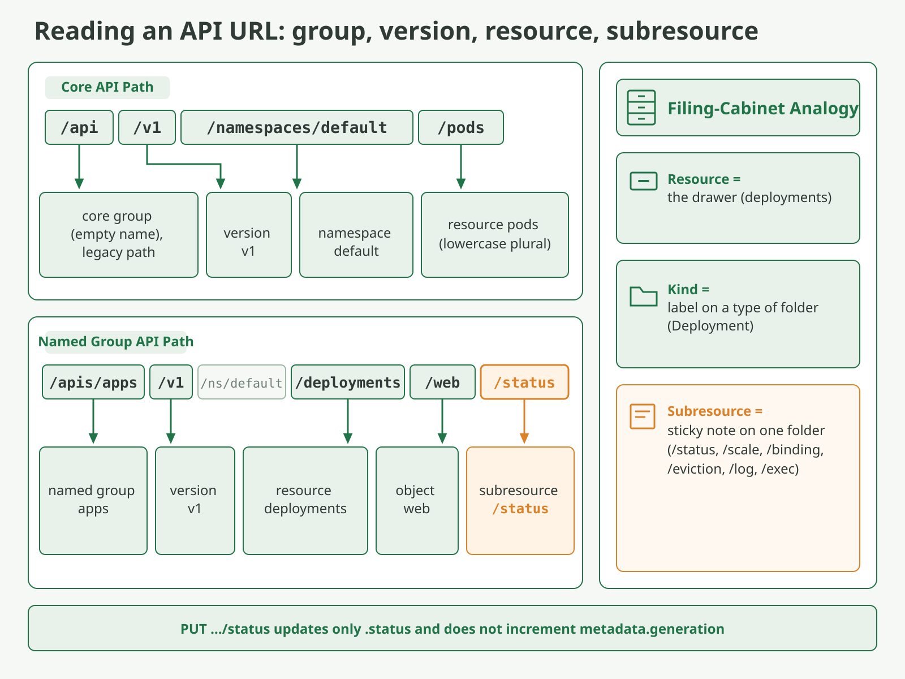

*Figure 5.5.1. Core group objects live under api v1 and named groups under apis, with subresources hanging off one object.*

Every object in the API belongs to a group and a version. The core group sits under `/api/v1`, and it holds pods, nodes, services, configmaps, secrets and PVCs. Named groups sit under `/apis`. The `apps/v1` group holds deployments, statefulsets and daemonsets. The `batch/v1` group holds jobs and cronjobs. Other named groups include `networking.k8s.io/v1`, `rbac.authorization.k8s.io/v1`, `storage.k8s.io/v1`, `scheduling.k8s.io/v1`, `apiextensions.k8s.io/v1`, `node.k8s.io/v1`, `coordination.k8s.io/v1` for leases, and `flowcontrol.apiserver.k8s.io/v1`. Custom resource definitions add groups of their own, such as `kueue.x-k8s.io` and `nvidia.com`.

Three words cause confusion here. A kind is the type, such as Deployment. A resource is the REST collection that holds those objects, such as deployments. A subresource hangs off a single object, such as `/status`, `/scale`, `/binding`, `/eviction`, `/log`, `/exec`, `/portforward`, `/token` and `/ephemeralcontainers`. A helpful way to keep them apart is a filing cabinet. The kind is the label on a type of folder, the resource is the drawer that holds all of those folders, and a subresource is a sticky note attached to one particular folder.

Run the commands below against a live cluster. Each one asks the API a different question, so you can see the same structure from several sides.

```bash
kubectl proxy --port=8001 &
curl -s localhost:8001/ | jq '.paths | length'
curl -s localhost:8001/api/v1 | jq '.resources[] | {name, namespaced, kind, verbs}' | head -40
curl -s localhost:8001/apis/apps/v1/namespaces/default/deployments | jq '.items[].metadata.name'
kubectl get --raw /apis | jq '.groups[].name' | head -40
kubectl get --raw /openapi/v3 | jq '.paths | keys | length'
kubectl api-resources --verbs=list --namespaced=false -o name | head
kubectl explain deployment.spec.strategy --api-version=apps/v1
```

Each line shows a different slice of the same API. Some show the root paths and the groups. Others show the resources in one group, or the OpenAPI document and the field documentation behind them. The `kubectl proxy` line starts a small local server that forwards requests with your credentials, so the `curl` lines can run without extra login steps.

### Versioning and conversion

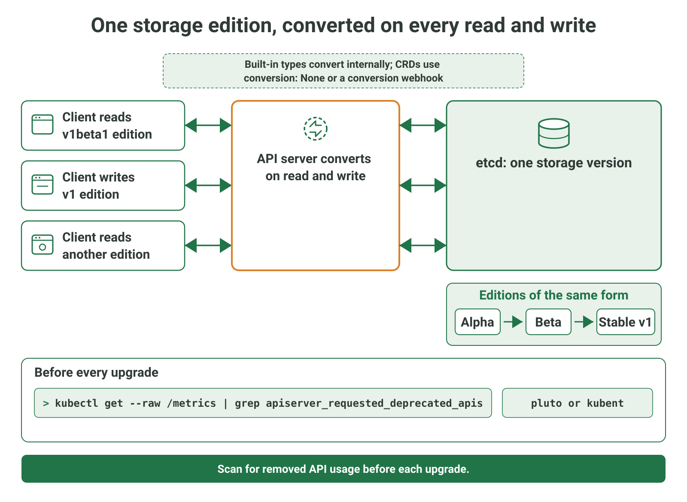

*Figure 5.5.2. A resource is stored in one storage version, and the API server converts objects when a client reads or writes another edition.*

A resource can be served in several versions, moving from alpha to beta to stable `v1`. Think of versions as different editions of the same form. An older edition may have fewer fields, and a newer one may rename a field. The cluster stores the object in exactly one edition, called the storage version. When a client reads or writes a different edition, the API server converts the object on the way. Built-in types convert internally. For CRDs, you choose `conversion: None` or a conversion webhook.

Deprecated APIs are removed on a published schedule. The `extensions/v1beta1` Ingress and the `batch/v1beta1` CronJob are examples. Before you upgrade Kubernetes, scan for removed API usage. You can run `kubectl get --raw /metrics | grep apiserver_requested_deprecated_apis`, or use tools such as `pluto` and `kubent`. Then migrate your manifests and operators. Stored objects that still use an old storage version are re-written with `kubectl-convert` or by the storage version migrator.

Run the deprecated API scan before every upgrade, and fix each manifest it finds. The scan is cheap, and an upgrade that breaks a controller is expensive.

### Verbs and HTTP mapping

Every API call uses a verb, and each verb maps to an HTTP method. You will meet these verbs in API logs and audit records, so the table below is worth keeping nearby. When a log line says `list pods` and the method is `GET`, the table tells you what the server was asked to do.

| Verb | HTTP | Notes |
|---|---|---|
| get | GET `/…/name` | |
| list | GET `/…/resources` | `limit`, `continue` for pagination; `labelSelector`, `fieldSelector`; `resourceVersion` semantics matter (below) |
| watch | GET `?watch=1&resourceVersion=N` | Streams events (ADDED, MODIFIED, DELETED, BOOKMARK, ERROR) |
| create | POST | 201 or 409 AlreadyExists |
| update | PUT | Full replace; needs current `resourceVersion` (else 409) |
| patch | PATCH | JSON Patch, JSON Merge Patch, Strategic Merge Patch (built-in types), or **Apply** patch (`application/apply-patch+yaml`) for server-side apply |
| delete / deletecollection | DELETE | Grace period, propagation policy, preconditions |
| proxy, exec, attach, portforward, log | GET/POST/WebSocket/SPDY | Streaming subresources proxied to kubelet |

Notice that `update` fails with 409 unless it carries the current `resourceVersion`. That single rule protects you from overwriting someone else's change without noticing. List and watch depend on `resourceVersion` too, as the next sections explain.

## 2. The request pipeline

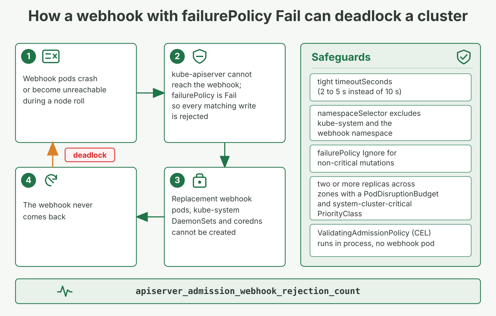

*Figure 5.5.3. A webhook that blocks the pods needed to restart itself deadlocks the cluster, so scope it, time-limit it and replicate it.*

A request can be rejected at several points on its way in. Think of the API server as a building with a series of security desks. You show your badge at the front door, then the guard checks what you are allowed to do, then a clerk may stamp or change your form, and only then does the record go into the filing room. Knowing the order of those desks tells you where to look when a call fails. The diagram shows the path.

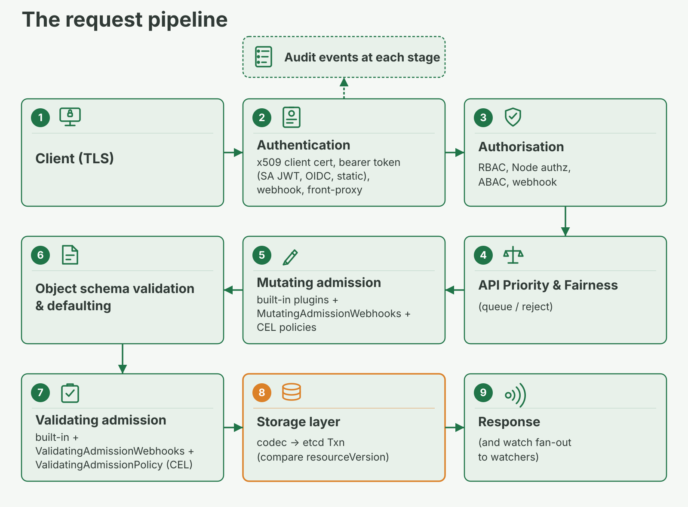

*Figure 5.5.4. The request pipeline, as a diagram.*

Stage 1 is authentication, which decides who is making the request. It produces a user, groups and extra fields. Clients can present a client certificate, which the kubeadm admin, the kubelet and the controller-manager all use. ServiceAccount tokens are projected, audience-bound JWTs with a short life, and the API server verifies them with its ServiceAccount signing key. A JWT is a signed token that carries its own claims, so the server can check it without asking anyone. OIDC id tokens from an identity provider work too, as do webhook token review and authenticating proxy headers. An anonymous request becomes `system:anonymous`, unless you turn anonymous access off.

Stage 2, authorisation, then decides whether the request is allowed. RBAC is the default, and chapter 5.16 covers it. The Node authorizer lets a kubelet read only the objects related to pods bound to its own node. Webhook authorizers can add their own rules. To check a decision, run `kubectl auth can-i` or `kubectl auth whoami`. Note that authentication answers "who are you?" and authorisation answers "may you do this?". A request can pass the first and still fail the second, and the 403 response tells you that.

Stage 3 is API Priority and Fairness. It sorts each request into a priority level and a flow, applies concurrency limits, and queues requests that must wait. Section 6 covers it in detail. It sits before admission on purpose. When the server is busy, it is cheaper to turn a request away at this desk than to run webhooks for it first, and the rejected client gets a clear signal to back off.

Stage 4, mutating admission, can change the object before it is stored. The built-in plugins include `ServiceAccount`, `DefaultStorageClass`, `LimitRanger`, `DefaultTolerationSeconds` and `MutatingAdmissionWebhook`. Webhooks add more. Sidecar injectors such as Istio are one kind, policy mutators such as Kyverno are another, and GPU-related mutators are a third. The plugins run in order, and a plugin can be called again under the reinvocation policy. The reinvocation policy matters when an earlier mutation can be changed by a later one, so the first plugin may need to run again to see the final state.

Stage 5 is schema validation. The server validates the object against the OpenAPI schema. It checks types and required fields. For CRDs, unknown fields are either rejected or pruned, depending on `preserveUnknownFields` and the structural schema. Pruning means the server silently removes a field it does not recognize, which can surprise you if you misspelled it. Field validation levels `Strict`, `Warn` and `Ignore` decide how strict this step is. `Strict` rejects the request, `Warn` accepts it and sends a warning back, and `Ignore` accepts it quietly.

Stage 6, validating admission, checks the object without changing it. The built-ins include `ResourceQuota`, `PodSecurity` and `NodeRestriction`. Webhooks such as OPA Gatekeeper and Kyverno run here too. `ValidatingAdmissionPolicy` runs CEL in process, so it has no webhook latency. CEL is a small expression language, and the policy is a rule written in it that the API server evaluates itself.

Stage 7, persistence, encodes the object and writes it to etcd in one transaction. For an update, the transaction is conditional on `resourceVersion`. Either the stored version still matches what the client read, or the write fails. Secrets can be encrypted at rest at this point, through `EncryptionConfiguration` with AES-CBC or AES-GCM, or through KMS v2 envelope encryption.

Stage 8 is the response. The revision written to etcd becomes the object's `resourceVersion`. The watch cache then pushes the change to every watcher, so the rest of the cluster learns about the change within moments.

A worked example makes the stages concrete. Suppose a training engineer runs `kubectl scale deployment inference-api --replicas=<n>` to add capacity. The kubectl client turns that into an HTTP PATCH against the Deployment's `scale` subresource. The request arrives with the engineer's client certificate, so authentication identifies the user. RBAC then checks whether that user may patch `deployments/scale` in that namespace. APF places the request in a flow for that user, and the request either runs at once or waits in a queue. Mutating admission runs next, and it may add defaults. Schema validation checks the new replica count is a number. Validating admission checks the ResourceQuota, so a scale-up cannot exceed the namespace budget. Only then does etcd receive a conditional write. The Deployment controller hears about the new spec through its watch, and it creates the missing ReplicaSet pods. Every step in that chain is a place where the request can stop, and the audit log records which one.

Admission webhooks are a common source of outages. Suppose a webhook is slow or down, and its `failurePolicy` is `Fail`. Then every matching write is blocked, including writes for node and system pods. Those are the very pods that would bring the webhook back, so the cluster can deadlock itself. To prevent this, set a tight `timeoutSeconds`, and scope the webhook with `namespaceSelector/objectSelector`. Exclude `kube-system` and the webhook's own namespace. Use `failurePolicy: Ignore` for mutations that are not critical. Run several replicas behind PodDisruptionBudgets, and watch `apiserver_admission_webhook_rejection_count` and the webhook duration.

The book Kubernetes: Up and Running, Chapter 17 (Extending Kubernetes), walks through building and registering external admission webhooks for a custom resource. The authors are Brendan Burns, Joe Beda, Kelsey Hightower and Lachlan Evenson. Their example resource is `apiVersion: beta.kuar.com/v1, kind: LoadTest`. A custom resource like this lets you teach the cluster a new kind of object, and the webhook is the guard that checks each one.

The first step is TLS. Because kube-apiserver calls admission webhooks only over HTTPS, the webhook server must present a certificate. That certificate must be signed by a CA trusted by `caBundle` in the webhook configuration. You can also get the certificate from the Kubernetes `certificates.k8s.io` API. Submit a `CertificateSigningRequest` (`CSR`), run `kubectl certificate approve validating-controller.default`, and extract the certificate with `.status.certificate | base64 -d > server.crt`. The result is a certificate the API server will trust, because the cluster itself signed it.

The second step is the AdmissionReview protocol. Take a ValidatingWebhookConfiguration that intercepts `CREATE` on `loadtests` through `validator.kuar.com`. The kube-apiserver sends an AdmissionReview JSON payload that contains `request.object`. The webhook replies with `response.uid` and `response.allowed: true|false`, and it adds `status.message` when it rejects the request. The `uid` ties the reply to the request, so the server knows which question the answer belongs to. A MutatingWebhookConfiguration works differently. It defaults `spec.paths` to `["/index.html"]` when the field is missing. The webhook returns `response.allowed: true`, `response.patchType: "JSONPatch"` and a base64-encoded JSONPatch array, such as `[{"op": "add", "path": "/spec/paths", "value": ["/index.html"]}]`. A JSON Patch is a short list of edit instructions, so the server applies only the change, not a whole new object.

The third step is to recognise three patterns of API extension from Chapter 17. The first is Just Data, which stores structured configuration in a CRD and validates it with an OpenAPI schema and webhooks. The second is Controllers, which watch a CRD such as `LoadTest` and reconcile Pods and Services to match it. The third is Compilers or Abstractions, which translate a high-level declarative object into lower-level Kubernetes primitives. Each pattern asks for a different amount of code, and you should pick the simplest one that solves your problem.

Before you write a webhook, decide which of these three patterns your extension needs.

## 3. resourceVersion, generation and concurrency

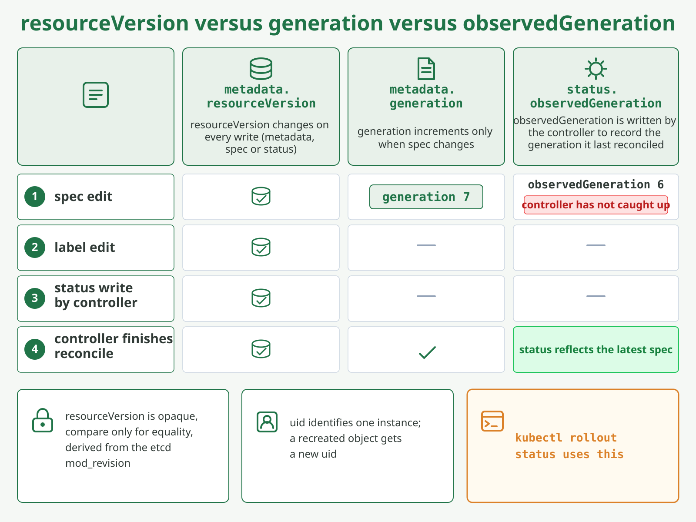

*Figure 5.5.5. resourceVersion changes on every write, generation only on spec changes, and observedGeneration shows how far the controller has caught up.*

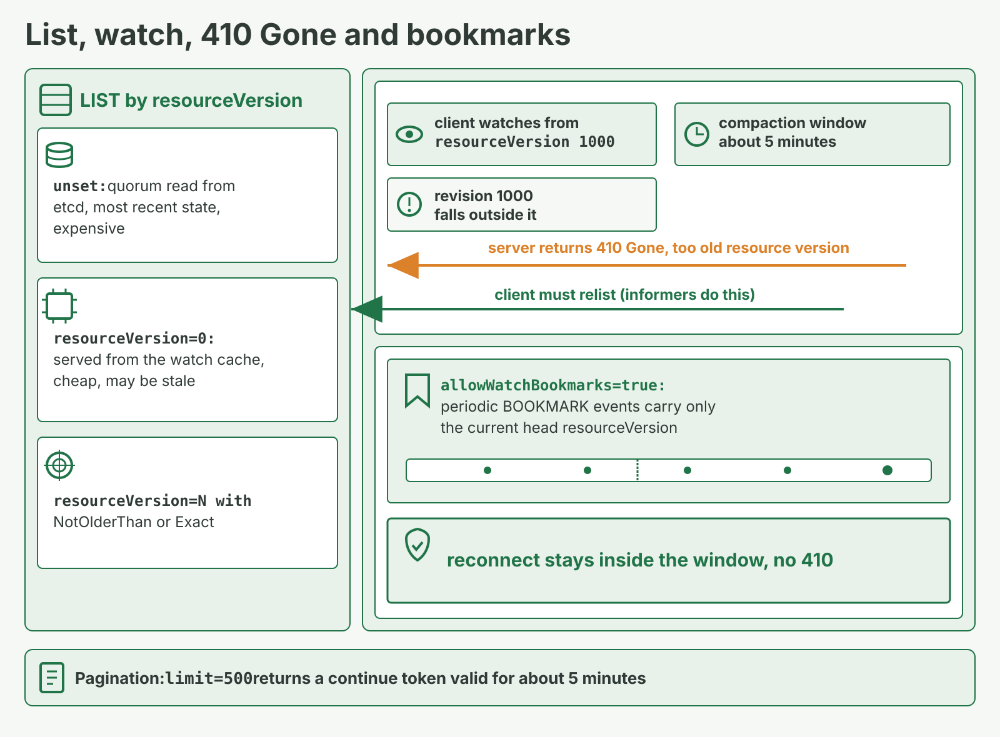

*Figure 5.5.6. Bookmarks keep a watch client's resume point inside the compaction window so it avoids 410 Gone and a full relist.*

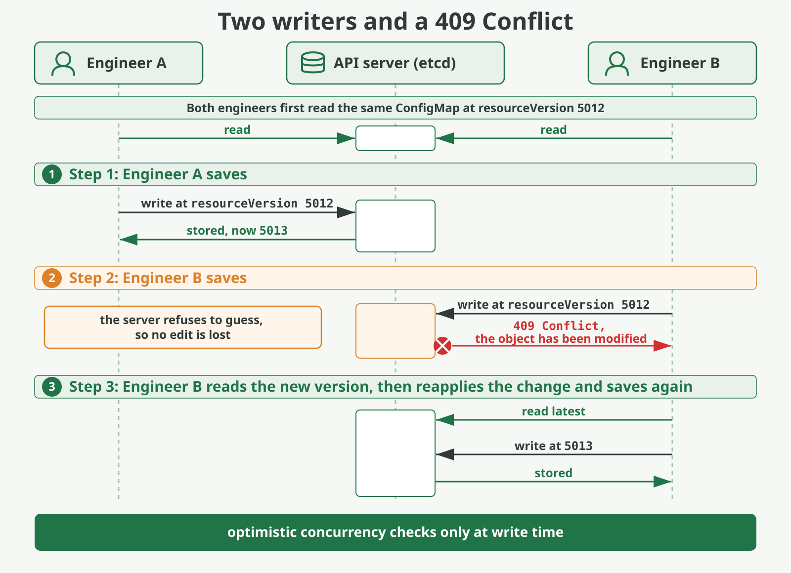

*Figure 5.5.7. The API server refuses a write made against a stale resourceVersion, so a second save cannot silently erase the first.*

Two clients can read the same object, change it, and write it back. Without a check, the second write can silently erase the first. Picture two engineers editing one shared document. The second one saves last, and the first engineer's edits vanish with no warning. The `resourceVersion` field is the check that prevents this, and it works like a version stamp on that document.

The `metadata.resourceVersion` field is an opaque string. Do not parse it or compare it, except for equality. It changes on every write, and it is derived from etcd's global revision. It does three jobs. Job 1 is optimistic concurrency. An update that includes `resourceVersion=X` succeeds only if the stored object is still at X. Otherwise the server returns `409 Conflict` with the message "the object has been modified; please apply your changes to the latest version". Controllers handle that by retrying with `retry.RetryOnConflict`. The word optimistic means the server assumes nobody else is editing, and it checks only at write time. That is cheap, because nothing is locked while you think. Job 2 marks the point where a watch resumes. Job 3 keeps list results consistent with the cache.

Here is the first job in practice. Engineer A reads a ConfigMap and notes its `resourceVersion`. Engineer B reads the same ConfigMap, with the same `resourceVersion`, and changes a different key. Engineer A saves first, and the stored version moves on. When Engineer B saves, the server compares the version in the request with the version now stored. The two no longer match, so the server refuses the write with 409 Conflict. Engineer B then reads the new version, reapplies the change, and saves again. Nobody's edit was lost, because the server refused to guess. A controller does the same thing in code, which is why `RetryOnConflict` is a loop around a read and a write, not a single write.

The `metadata.generation` field increments when `spec` changes, but not when `status` or metadata changes. The spec is what you asked for, and the status is what the system reports back. Controllers write `status.observedGeneration`, so you can tell whether the status reflects the latest spec. If the generation is 7 and the observed generation is still 6, the controller has not caught up yet. The `kubectl rollout status` command uses this field.

The `metadata.uid` field identifies one object instance. A recreated object gets a new UID, even when the name is the same. ownerReferences use the UID, so a controller does not adopt the wrong object. A name can be reused after a delete, but a UID never is, which makes it the reliable identity of the instance.

List semantics depend on the `resourceVersion` you pass. With it unset, the server returns the most recent state. It does a quorum read from etcd, which is expensive. With `resourceVersion="0"`, the server returns any version held in the watch cache. That is cheap, but the data may be stale. With `resourceVersion=N`, you can add `resourceVersionMatch=NotOlderThan` or `Exact`. Informers start with an initial list, using RV=0 or the latest version, and then watch from that version. You will see this choice again in the exercises, so it is worth remembering the trade-off: fresh data costs an etcd round trip, and cached data costs freshness.

Pagination uses `limit=500`, which returns a `continue` token. That token stays valid for a compaction window of about 5 minutes. A large list without pagination can exhaust API server memory, and that is a classic cause of outages. Streaming lists, called watch-list, reduce memory use in newer releases.

A watch is a long HTTP stream of JSON or protobuf events. A client resumes from the last `resourceVersion` it saw. The server keeps only a bounded history, in the watch cache and inside the etcd compaction window. If a client falls too far behind, the server returns `410 Gone` with the message "too old resource version", and the client must relist. Bookmarks prevent this. With `allowWatchBookmarks=true`, the server sends periodic BOOKMARK events that carry a recent `resourceVersion`, so a reconnecting client stays inside the window. Informers in client-go handle list, watch, resync, indexers and shared caches, and they relist on 410. A custom client that runs `kubectl get` in a loop overloads the API server, because each loop is a full list that the informer would have avoided.

Selectors on list and watch cut the traffic. `labelSelector` and `fieldSelector=spec.nodeName=...` filter the results on the server. Kubelets watch only the pods with their own node name. Heavy clients should filter as much as they can, and use metadata-only watches with `PartialObjectMetadata` where possible. Filtering on the server means the bytes never cross the network, so both sides save work.

If your client polls the API with `kubectl get` in a loop, replace the loop with an informer. A loop asks the same question again and again, while an informer asks once and then listens for changes.

## 4. Writing objects: create, update, patch, apply

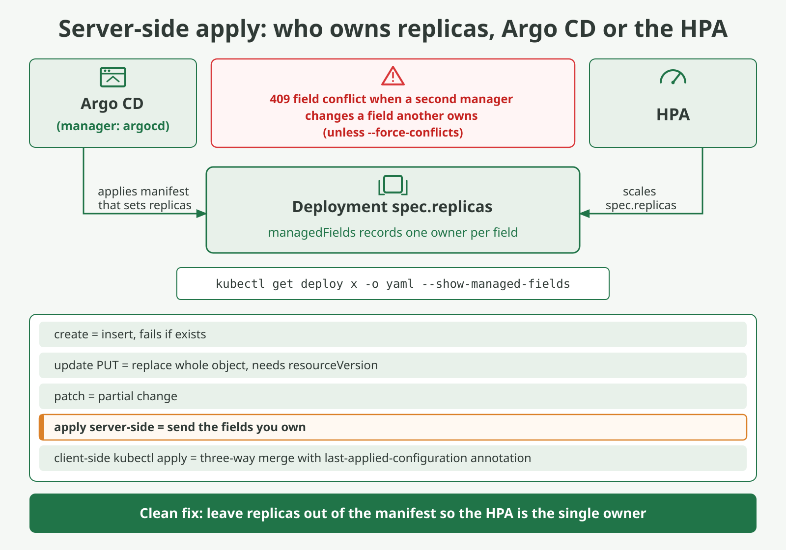

*Figure 5.5.8. Server-side apply tracks field owners, so removing replicas from the manifest avoids a fight with the HPA.*

Writing an object is not one operation. Each verb changes the object in a different way, and your choice decides who wins when two actors touch the same field. The table compares the options. Read it as a list of trade-offs, not a ranking, because each option fits a different job.

| Operation | Semantics | When |
|---|---|---|
| `create` | Insert; fails if exists | Imperative creation |
| `update` (PUT) | Replace entire object; needs RV | Controllers that own the whole object; beware lost updates |
| `patch` (merge/strategic/JSON patch) | Partial change; strategic merge understands list merge keys for built-ins | `kubectl patch`, small edits |
| **`apply` (server-side)** | Declarative: send the *fields you own*; server merges and tracks ownership in `managedFields` per field manager; conflicts reported when another manager owns a field (use `--force-conflicts` deliberately) | GitOps tools, operators, `kubectl apply --server-side` |
| Client-side `kubectl apply` | Three-way merge using the `last-applied-configuration` annotation | Legacy default; prefer server-side apply for large objects and CRDs |

A replace, or PUT, is the bluntest tool. It sends the whole object and says "make it look exactly like this". That is dangerous when someone else also edits the object, because your full copy wins over their changes. A patch is more surgical. It sends only the fields you want to change. Apply goes one step further. You send the fields you own, and the server keeps a record of who owns each field.

Field managers matter when several actors touch one object, such as Argo CD, Terraform, the HPA and operators. The manager that last applied a field owns it. A controller can change a field that a manifest still sets, and then the two conflict. For example, the HPA scales `spec.replicas`. An applied manifest conflicts with that change, unless the manifest leaves the field out. Leaving the field out is the clean answer, because the field then has one owner, the HPA. To inspect ownership, run `kubectl get deploy x -o yaml --show-managed-fields`. See 4.25 and 4.26 for more guidance on ownership.

Deleting is also a choice. `DELETE` takes a `propagationPolicy` of `Foreground`, `Background` or `Orphan`, plus a `gracePeriodSeconds`. Foreground deletes the dependents first and then the owner. Background deletes the owner first and lets the garbage collector clean up the rest. Orphan leaves the dependents running with no owner. An object with finalizers gets a `deletionTimestamp`, and it stays until the controllers remove those finalizers. A finalizer is a note that says "do not finish deleting me until this cleanup is done". This is a common cause of namespaces, PVCs and custom resources stuck in Terminating. The command `kubectl delete --force --grace-period=0` skips graceful termination for pods. That is dangerous for StatefulSets and for shared storage, because the cluster stops waiting for the old pod to confirm it has stopped.

Before you force-delete a pod, check whether it belongs to a StatefulSet or uses shared storage. If it does, the force delete can let a second copy start while the first is still writing to the same disk.

## 5. Audit, authn/z debugging and security notes

A namespace disappears overnight. Who deleted it? Audit logs and the auth debugging tools answer that. When something changes that nobody remembers changing, the audit log is the record of who asked for what, and when.

Audit logging uses a policy file. The policy selects which events to record for each resource and user, at one of three levels: Metadata, Request or RequestResponse. Metadata records who did what. Request also records the body of the request. RequestResponse records the response too. The backends are a file with rotation, or a webhook. Audit logs help with forensics, compliance and noisy clients. Tune the policy so that it does not record high-volume reads of secrets at RequestResponse level, because that floods the log and exposes the data it records.

To debug authentication and authorisation, run `kubectl auth can-i create pods --as=system:serviceaccount:team-a:trainer -n team-a`. This asks the server to answer the question for another identity, so you do not need to log in as that account. Run `kubectl auth whoami` to see who you are, and add `--v=8` to see the raw requests. The API server logs at `--v=2` by default. Its audit events record the reason for each 401 or 403. A 401 means the server did not know who you were. A 403 means it knew, and the answer was no.

For production, disable anonymous auth. The insecure port has been removed. Protect `/metrics` and `/debug/pprof` with RBAC, for example through the `system:monitoring` role. Those endpoints reveal internal detail that an attacker can use to plan an attack.

Use bound projected tokens instead of legacy long-lived secrets. They are short-lived and audience-specific, so a token stolen from one pod cannot be replayed against another service. Disable `automountServiceAccountToken` where a pod does not need it. Chapter 5.16 covers this.

Configure `EncryptionConfiguration` with a KMS v2 provider to encrypt Secrets. The provider can come from a cloud KMS or from Vault. Rotate the keys on a schedule. To verify the encryption, read a raw etcd value with `etcdctl get /registry/secrets/...`. An encrypted value starts with `k8s:enc:`. If you see readable text after that prefix, the Secret is not encrypted.

The API server endpoint should not sit on the Internet. Put it behind private endpoints, a VPN or a bastion, and authorised networks. Client certificates and tokens are bearer credentials, which means whoever holds one can use it. A bearer credential works like cash, because it does not ask who is carrying it. Keep the endpoint on a private network, so an attacker cannot even reach the door to try the credential.

## 6. API Priority and Fairness (APF)

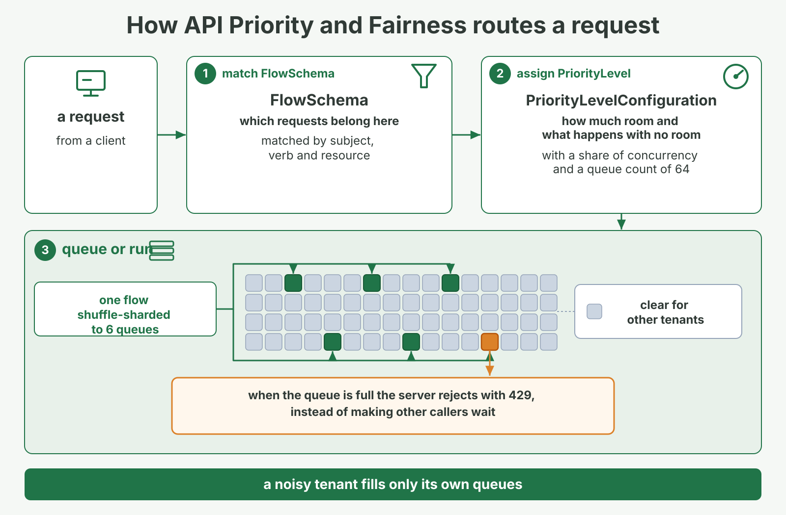

*Figure 5.5.9. API Priority and Fairness routes each request to a priority level and shuffle-shards it into a few queues, so one noisy client cannot starve the rest.*

Imagine a busy restaurant with one kitchen. One large party orders everything at once and blocks the line for everyone else. APF is the host who splits the kitchen's capacity between groups, so one party cannot starve the rest. It replaced the crude `--max-requests-inflight` limits, which treated all traffic as one pool. A single noisy client could drain that pool and deny service to the critical components that keep the cluster alive.

A request first matches a FlowSchema, based on its subject, verb and resource. The FlowSchema sends the request to a PriorityLevelConfiguration. That level holds a share of concurrency, plus queues and a queue length. Inside a level, requests form flows. A flow is distinguished by user or namespace, as set by the `distinguisherMethod`. Flows are fair-queued by shuffle sharding, so a noisy tenant fills only some of the queues. The built-in levels are `exempt` (system masters), `node-high`, `system`, `leader-election`, `workload-high`, `workload-low`, `global-default` and `catch-all`.

The commands below list the FlowSchemas and priority levels, dump the live priority levels, and show the APF metrics. Run the list commands first to see what the cluster already has. Then read the metrics to see how much each level is waiting or rejecting.

```bash
kubectl get flowschemas
kubectl get prioritylevelconfigurations
kubectl get --raw /debug/api_priority_and_fairness/dump_priority_levels
kubectl get --raw /metrics | grep -E 'apiserver_flowcontrol_(request_wait_duration|rejected_requests|current_inqueue|dispatched_requests)' | head
```

The next example defines a priority level for batch controllers. A FlowSchema routes requests from the Kueue controller manager and the training operator to that level. A PriorityLevelConfiguration only matters once a FlowSchema routes requests to it, so you should read the two objects together. The first document is the lane, with its share of capacity and its queues. The second document is the sign that sends traffic into that lane.

```yaml
apiVersion: flowcontrol.apiserver.k8s.io/v1
kind: PriorityLevelConfiguration
metadata: { name: batch-controllers }
spec:
  type: Limited
  limited:
    nominalConcurrencyShares: 30
    lendablePercent: 20
    limitResponse:
      type: Queue
      queuing: { queues: 64, handSize: 6, queueLengthLimit: 50 }
---
apiVersion: flowcontrol.apiserver.k8s.io/v1
kind: FlowSchema
metadata: { name: kueue-and-training-operators }
spec:
  priorityLevelConfiguration: { name: batch-controllers }
  matchingPrecedence: 800
  distinguisherMethod: { type: ByUser }
  rules:
    - subjects:
        - kind: ServiceAccount
          serviceAccount: { name: kueue-controller-manager, namespace: kueue-system }
        - kind: ServiceAccount
          serviceAccount: { name: training-operator, namespace: kubeflow }
      resourceRules:
        - verbs: ["*"]
          apiGroups: ["*"]
          resources: ["*"]
          namespaces: ["*"]
```

Read the YAML as a pair of questions. The FlowSchema asks, "which requests belong here?" Its rules name the two service accounts and match every verb and resource. The PriorityLevelConfiguration answers, "how much room do they get, and what happens when there is no room?" Here the answer is a limited share of concurrency, with 64 queues and a short queue length. When the queue is full, the server rejects the request rather than making every other caller wait. The `matchingPrecedence` value decides which FlowSchema wins when two could match, and a lower number is checked first.

APF trouble shows up in a few ways that you can spot. Clients receive HTTP 429 responses with `Retry-After`. The metric `apiserver_flowcontrol_request_wait_duration_seconds` rises. Controllers also log "Waited for ... due to client-side throttling" when their client-go QPS and burst limits are too low. The fix for that is to raise `--kube-api-qps` and `--kube-api-burst` on controllers and schedulers in big clusters. For the server side, give critical components dedicated levels, constrain noisy clients such as unfiltered list loops, and add API server capacity. Notice that the two kinds of throttling have different owners. Server-side APF is the cluster's decision. Client-side throttling is the client's own limit, and you change it in the client's configuration.

Before you raise any limit, give the noisy client its own level and check whether it is listing too much. Raising a limit only hides the waste, and the same list loop will simply saturate the new limit too.

## 7. etcd internals

### Deployment models for etcd

etcd is the database behind every object in a cluster. It is a distributed store. It uses a consensus algorithm to keep one copy of the cluster state on several machines. Consensus depends on reliable network links between the etcd members, and those members need low latency. Two choices shape the deployment. One is whether etcd runs on dedicated machines or shares them with the control plane. The other is whether etcd runs in a container or directly on the host.

On the network side, the default etcd settings suit the latency inside a single datacenter. If you spread etcd across several datacenters, test the average round-trip time between members. Tune the heartbeat interval and the election timeout if you need to. Do not spread etcd clusters across regions, because that is strongly discouraged. For better availability, keep your datacenters close together, inside one region.

Start the placement decision with cluster size, meaning the number of worker nodes in each cluster. If etcd slows down, your control over the cluster's resources slows down too. Workloads that do not depend on the Kubernetes API keep running during etcd trouble. The control plane must still stay healthy, though. A car that keeps rolling with a broken steering wheel gives little comfort. When a large cluster puts heavy read and write demand on etcd, give etcd its own machines. That removes resource contention with the other control plane components. What counts as large depends on the size of the control plane machines. Still, anything above 50 worker nodes deserves the question. For clusters with over 200 workers, plan for dedicated etcd from the start. For smaller clusters, colocated etcd saves management overhead and infrastructure cost. Kubeadm supports that model and handles its concerns.

For colocated etcd, run it in a container. Kubeadm supports and tests that setup, so it is your best option. With dedicated machines, you have two choices. You can install etcd on the host. That lets you bake it into machine images, and it removes the need for a container runtime on those hosts. Or you can run etcd in a container, with a container runtime and kubelet on the machines and a static manifest that starts etcd. That follows the same patterns and install methods as the other control plane components. Repeated patterns help in complex systems, so this choice comes down largely to preference.

### Data model and Raft

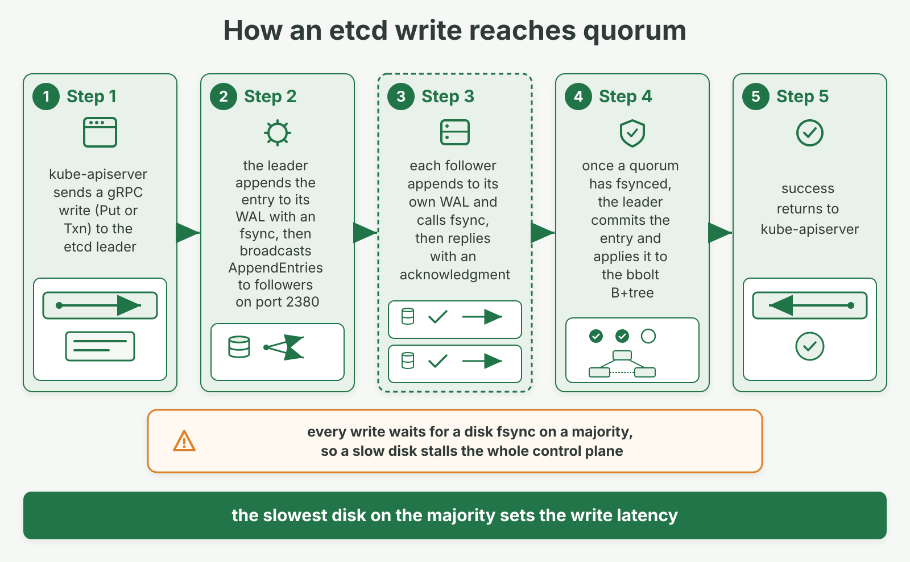

*Figure 5.5.10. Every etcd write waits for a disk fsync on a majority of members, so disk latency sets the speed of the whole control plane.*

etcd is a replicated, linearizable key-value store. Its members use Raft, a consensus algorithm. The idea is simple. One member is the leader, and it accepts every write. Before the leader confirms a write, a majority of members must have saved it. Here is the sequence. One leader accepts writes and appends them to its log, the WAL, which is the write-ahead log. A write-ahead log records each change on disk before the change takes effect, so a crash can be replayed. The leader replicates the entries to followers. Once a majority has persisted an entry, with an `fsync` per commit, the leader commits it. An fsync is the call that forces data out of memory onto the physical disk. It then applies the entry to the state machine, which is a bbolt B+tree. bbolt is the embedded storage engine that holds etcd's data on disk.

Reads can be linearizable, through the leader or the read index. That is the default for Kubernetes quorum reads. A linearizable read sees the newest committed write, even if a moment ago another client wrote it. Reads can also be serializable, which means they are served locally and may be stale. Heartbeats and election timeouts default to 100 ms and 1000 ms, so the network must be fast. A heartbeat is the leader's regular "I am still here" message. If followers stop hearing it for the election timeout, they start a new election. A leader that cannot keep up triggers elections, and those show up as API latency spikes.

Quorum arithmetic governs every operation, as chapter 5.3 explains. Three members tolerate one failure, and five tolerate two. An even number of members adds cost without adding tolerance. A four-member cluster still needs three votes to make a majority, so it survives only one failure, the same as three members. Never add a member before you remove a dead one, because the cluster size and quorum rise while a member is down. Learner members are non-voting, so they can catch up safely before they are promoted. A learner copies the data without counting toward the majority, so it cannot break quorum while it is still behind.

### MVCC, revisions, compaction, defrag

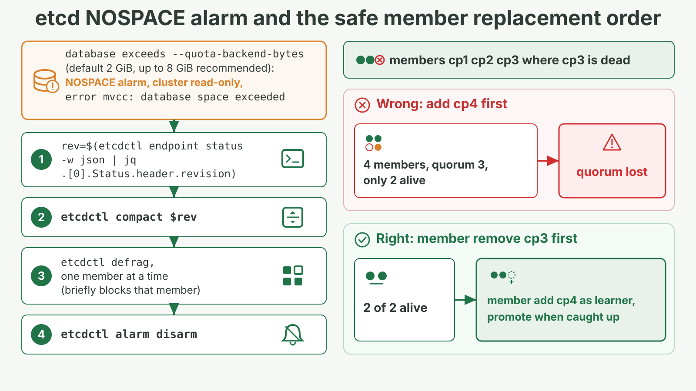

*Figure 5.5.11. Compact, defragment and disarm to clear NOSPACE, and always remove a dead member before adding its replacement.*

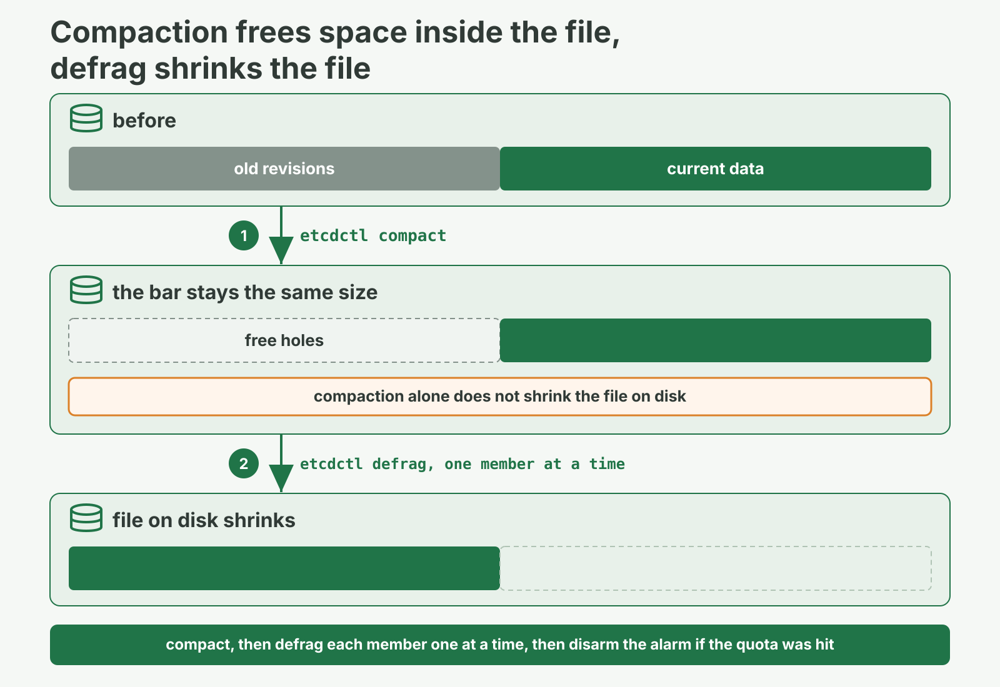

*Figure 5.5.12. Compaction frees old revisions inside the etcd file, but only defragmentation shrinks the file on disk.*

Each write creates a new revision. A revision is a cluster-wide counter that only goes up. MVCC stands for multi-version concurrency control, a way of keeping several versions of a key at once so readers never block writers. etcd keeps a history of key versions for watches and consistent reads, and the Kubernetes `resourceVersion` comes from that revision. The history grows until compaction discards revisions older than a chosen point. The API server runs compaction every 5 minutes by default, controlled by `--etcd-compaction-interval`. Compaction frees logical space, but the bbolt file does not shrink until defragmentation runs. The space is freed inside the file, and it becomes reusable, but the file on disk stays the same size. Think of a warehouse where old boxes are emptied but still take up floor space. The shelves can hold new stock, and the building is no smaller until someone rearranges the racks and sells the spare room. Run `etcdctl defrag` one member at a time, because it briefly blocks that member. The database quota, set by `--quota-backend-bytes`, defaults to 2 GiB and is recommended up to 8 GiB. When the database exceeds the quota, etcd raises a `NOSPACE` alarm and becomes read-only until you free space. Compact, defragment and disarm the alarm, in that order.

The commands below check member health, list alarms, and compact and defragment the store. Run them from a control-plane node. The variable `EP` holds the endpoint and the certificate flags, so every line uses the same connection settings.

```bash
export ETCDCTL_API=3
EP="--endpoints=https://127.0.0.1:2379 --cacert=/etc/kubernetes/pki/etcd/ca.crt --cert=/etc/kubernetes/pki/etcd/server.crt --key=/etc/kubernetes/pki/etcd/server.key"
etcdctl $EP endpoint status -w table               # leader, db size, raft index, version
etcdctl $EP endpoint health --cluster
etcdctl $EP member list -w table
etcdctl $EP alarm list
rev=$(etcdctl $EP endpoint status -w json | jq '.[0].Status.header.revision'); etcdctl $EP compact $rev
etcdctl $EP defrag                                 # per member, sequentially
etcdctl $EP get /registry/ --prefix --keys-only | awk -F/ '{print $3}' | sort | uniq -c | sort -rn | head -15    # which resource types dominate
etcdctl $EP get /registry/namespaces/default       # protobuf-encoded value (binary)
```

The first lines show the status, health and membership. The compaction and defragmentation steps come next. The compaction line reads the current revision from the status and then compacts up to it, so only the newest history survives. The last two commands tell you which resource types take the most space, and they show that a stored value is protobuf-encoded binary. When you see binary output, that is normal, and it is not a sign of corruption.

### What lives in etcd

Keys live under `/registry/<resource>/...`. For namespaced objects, the key is `/registry/pods/<ns>/<name>`. Leases hold node heartbeats and leader election state. Events churn quickly and expire after one hour. Many clusters move events into a separate etcd cluster with `--etcd-servers-overrides=/events#https://...`. CRD custom resources live under `/registry/<group>/<resource>/...`.

An object can be up to about 1.5 MiB, the etcd request size limit. Large ConfigMaps and Secrets, and huge custom resources such as Argo Workflows with a large status, hurt performance. Huge Pod lists do the same. Avoid three patterns. Do not store blobs, logs or metrics in objects. Do not update status every second across tens of thousands of objects. And do not create thousands of Events per second. Each of those patterns turns etcd into a log file, and etcd is built for small, careful writes.

### Encrypting Secrets in etcd

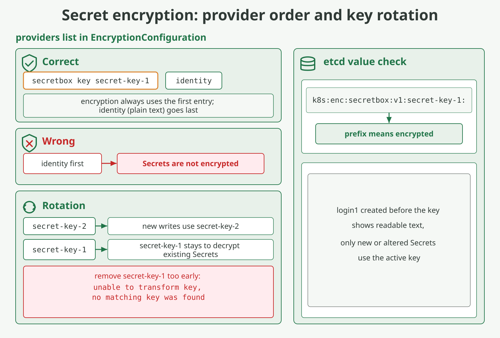

*Figure 5.5.13. The first provider encrypts, later providers only decrypt, so keep old keys until every Secret is rewritten.*

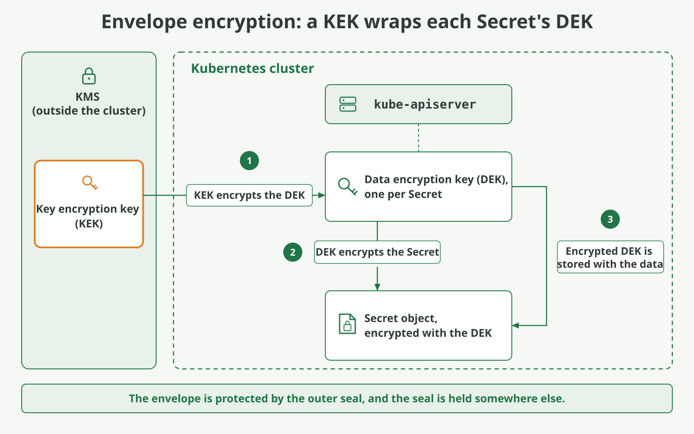

*Figure 5.5.14. Envelope encryption wraps each Secret's data key with a key encryption key held in an external KMS, so the wrapped key can be stored with the data.*

Like most Kubernetes objects, Secrets are stored in etcd. By default, Kubernetes does not encrypt Secret data before it reaches etcd. That does not mean the data is exposed the moment someone touches the hardware. Encryption at rest still protects a removed drive. The weak point is access to the running host.

Suppose an attacker signs in over `ssh` and gains root on the kube-apiserver node. The attacker can run a small wrapper around `etcdctl` that uses the cluster's own certificates. The script below assumes the certificate paths that kubeadm sets by default. The point of the script is that anyone with root on that host already holds everything they need to read etcd.

```bash
#!/bin/bash
# Change this based on location of etcd nodes
ENDPOINTS='192.168.3.43:2379'
ETCDCTL_API=3 etcdctl \
--endpoints=${ENDPOINTS} \
--cacert="/etc/kubernetes/pki/etcd/ca.crt" \
--cert="/etc/kubernetes/pki/apiserver-etcd-client.crt" \
--key="/etc/kubernetes/pki/apiserver-etcd-client.key" \
${@}
```

With that script, reading a Secret takes one command. Here it reads a Secret named `login1`, and the values appear in plain text:

```
# ./etcdctl-script get /registry/secrets/default/login1
/registry/secrets/default/login1
k8s
v1Secret
login1default"*$6c991b48-036c-48f8-8be3-58175913915c2bB
0kubectl.kubernetes.io/last-applied-configuration{"apiVersion":"v1","data":
{"dbkey":"YmVhcmNhbm9lCg==","dbuser":"aGVwdGlvCg=="},"kind":"Secret",
"metadata":{"annotations":{},"name":"login1","namespace":"default"},
"type":"Opaque"}
z
dbkey
bearcanoe
dbuserheptio
Opaque"
```

With that, the attacker has read the Secret `login1`. The values are base64 text in the manifest, and base64 is an encoding, not encryption, so anyone can decode them. Take a moment to notice how little effort this took.

Plain storage can be acceptable in some setups. If etcd runs outside the API server, a hypervisor separates the two. An attacker would then need root on the etcd node, find the data, and read it. Or they would need root on the API server, find the etcd certificates, and impersonate the API server to read from etcd. Both paths assume that other breaches came first. In practice, an RBAC mistake or an application compromise is more likely to expose a Secret first.

Many platform operators still choose to go further. Kubernetes can encrypt Secret data at the Kubernetes layer before it rests in etcd, which adds depth to your defence. There are two models: static-key encryption and envelope encryption.

With static-key encryption, the kube-apiserver encrypts Secrets with a key you provide. It uses that key to encrypt every Secret object before it persists the object to etcd. The key lives in an `EncryptionConfiguration`. If an attacker reads etcd, they see only encrypted data. You can create keys with providers such as `secretbox`, `aescbc` and `aesgcm`. Each provider has trade-offs, so work with your security team to choose. If you must meet FIPS requirements, weigh the choice carefully. The book's example uses `secretbox`, a fairly performant and secure option. Kubernetes issue #81127 discusses some of these considerations.

To set up static-key encryption, generate a 32-byte key. The model is symmetric, so one key both encrypts and decrypts. Enterprises generate keys in different ways. On a Linux host, `/dev/urandom` works if you are satisfied with its entropy.

```bash
head -c 32 /dev/urandom | base64
```

Add an `EncryptionConfiguration` with that key to every node that runs kube-apiserver. Deliver the file with configuration management such as Ansible, or with `KubeadmConfigSpec` when you use Cluster API. That way, you can add, delete and rotate keys. The example assumes the file lives at `/etc/kubernetes/pki/secrets/encryption-config.yaml`.

```
apiVersion: apiserver.config.k8s.io/v1
kind: EncryptionConfiguration
resources:
- resources:
- secrets
providers:
- secretbox:
keys:
- name: secret-key-1
secret: u7mcOcHKbFh9eVluB18hbFIsVfwpvgbXv650QacDYXA==
# identity is a required (default) provider
- identity: {}
```

The providers list is ordered. Encryption always uses the first key, and decryption tries keys in the order listed. The `identity` provider is the plain-text one, and it belongs last. If it comes first, Secrets will not be encrypted, because the server will always pick the plain-text option for writing.

Every kube-apiserver must load this file. Add the flag to `/etc/kubernetes/manifests/kube-apiserver.yaml`.

```
--encryption-provider-config=/etc/kubernetes/pki/secrets/encryption-config.yaml
```

After the kube-apiserver restarts, Secrets are encrypted before they reach etcd. For static Pods, a change to the manifest triggers that restart. Once you move past experimentation, pre-provision hosts with this file and enable `encryption-provider` by default. With Cluster API, the EncryptionConfiguration ends up in user data, so make sure that user data is encrypted. With kubeadm, add the flag to the `apiServer` section of a `ClusterConfiguration`. Otherwise, make sure your server startup includes the flag.

To validate the encryption, apply a new Secret named `login2` and read it back from etcd.

```
# ./etcdctl-script get /registry/secrets/default/login2
/registry/secrets/default/login2
k8s:enc:secretbox:v1:secret-key-1:
```

The rest of that output is unreadable binary data, so the data is fully encrypted in etcd. The prefix names the provider, `secretbox`, and the key, `secret-key-1`, that did the encryption. Kubernetes needs that information because several providers and keys can be active at once. An object created before the key existed still shows up in plain text.

```
# ./etcdctl-script get /registry/secrets/default/login1
/registry/secrets/default/login1
k8s
```

This shows two important points. First, `login1` is not encrypted. Only new or altered Secrets use the active key. Second, when an unencrypted object passes back through the kube-apiserver, there is no provider or key mapping, so no decryption is attempted.

Rotate encryption keys over a defined span. Suppose you rotate every three months. You add a new key at the top of the list. The new key goes first, so every new write uses it, while the old key stays in the list to read what is already stored.

```
- secretbox:
keys:
- name: secret-key-2
secret: xgI5XTIRQHN/C6mlS43MuAWTSzuwkGSvIDmEcw6DDl8=
- name: secret-key-1
secret: u7mcOcHKbFh9eVluB18hbFIsVfwpvgbXv650QacDYXA=
```

Do not remove `secret-key-1`. It no longer encrypts new data, but it still decrypts existing Secrets. The new key sits first, so all new encryption uses it. Updated Secrets are re-encrypted with the new key over time. Until then, the old key stays in the list as a fallback. If you delete the old key too early, clients see this error.

```
Error from server (InternalError): Internal error occurred: unable to transform
key "/registry/secrets/default/login1": no matching key was found for the
provided Secretbox transformer
```

Each step toward more defence changes how attacks work. Static-key encryption is clearly better than no encryption. However, the encryption key lives on the same host as the API server. Many deployments run etcd and kube-apiserver on one host. With root access there, an attacker could decrypt the data they read from etcd. Ideally, do not rely only on static-key encryption at rest. If that is unacceptable, consider an external secret store or a KMS plug-in, both covered next.

Kubernetes 1.10 and later can integrate with a KMS for envelope encryption. This model uses two keys. The key encryption key (KEK) lives outside the cluster, in a KMS. The data encryption key (DEK) encrypts each Secret. Each Secret object gets its own DEK, and the KEK encrypts the DEKs. Because the KEK encrypts the DEKs, they can be stored with the data. As a result, kube-apiserver does not need to know many keys. This model has several benefits. An envelope is a wrapper, so the inner letter is protected by the outer seal, and the seal is held somewhere else.

- The KMS sits outside Kubernetes, which adds isolation.
- Centralized KEKs make key rotation easier.
- Separating the DEK and KEK means Secret data is never sent to or known by the KMS.
- The KMS is concerned only with decrypting DEKs.
- Encrypted DEKs are easy to store alongside their Secrets.

KMS plug-ins run as a privileged container with a gRPC server that talks to a remote KMS. That container runs only on master nodes where kube-apiserver is present. As with static-key encryption, add an `EncryptionConfiguration` to the master nodes. This time, use a `kms` provider.

```
apiVersion: apiserver.config.k8s.io/v1
kind: EncryptionConfiguration
resources:
- resources:
- secrets
providers:
- kms:
name: myKmsPlugin
endpoint: unix:///tmp/socketfile.sock
cachesize: 100
timeout: 3s
# required, but not used for encryption
- identity: {}
```

Save the file on each master node at `/etc/kubernetes/pki/secrets/encryption-config.yaml`. Then update the kube-apiserver arguments.

```
--encryption-provider-config=/etc/kubernetes/pki/secrets/encryption-config.yaml
```

Changing that value should restart kube-apiserver. If it does not, a restart is required for the change to take effect.

The design is viable, but KMS plug-in implementations are scarce, and the ones that exist are immature. The book notes these points as of when it was written. There were no tagged releases for the `aws-encryption-provider` or the `k8s-cloudkms-plugin`. Azure's `kubernetes-kms` plug-in had notable limits, such as no support for key rotation. The only cloud provider-agnostic option, `kubernetes-vault-kms-plugin`, was partially implemented and had been archived. Outside a managed service such as GKE, where Google supplies and supports the plug-in, usage may prove unstable. Check the current state of any plug-in before you depend on it.

### Performance factors and tuning

Disk is the dominant factor. Watch WAL fsync latency in `etcd_disk_wal_fsync_duration_seconds`, where a p99 below 10 ms is a common target. Also watch backend commit latency in `etcd_disk_backend_commit_duration_seconds`. Use dedicated NVMe or SSD storage, with a separate device for the WAL if possible. Avoid noisy neighbours, network-attached slow disks and swap. The reason disk matters so much is that every write waits for fsync on a majority. A slow disk on the majority makes every write slow.

CPU and memory needs are modest, but etcd must not be starved. It benefits when its working set stays in the page cache, so keep RAM at or above about twice the database size. The page cache is the memory the kernel uses to hold recently read files, so a large cache means etcd rarely has to go to disk for reads.

The network needs low latency and high reliability between members. Keep members in the same region or datacenter, ideally with rack-aware topology. Cross-AZ links inside one metro are acceptable for Kubernetes. Cross-region links are not.

On high-latency networks, increase `--heartbeat-interval` and `--election-timeout`. Keep the election timeout 5 to 10 times the heartbeat. The rule keeps a slow but healthy network from triggering elections that nobody needed.

Snapshot count and compaction are controlled by `--snapshot-count` and `--auto-compaction-*`, although Kubernetes handles compaction itself. At very large scale, run a separate etcd for events, and sometimes for leases.

Client behaviour matters too. Reduce write amplification. Write amplification means one small change causes many writes. Avoid controllers that update status without a reason, choose patch or update with care, and set sensible resync periods. Paginate lists, and use watches with filters.

Watch these metrics: `etcd_server_has_leader`, `etcd_server_leader_changes_seen_total`, `etcd_server_proposals_failed_total`, `etcd_mvcc_db_total_size_in_bytes`, `etcd_network_peer_round_trip_time_seconds` and `grpc_server_handled_total`. Add the `apiserver_storage_*` metrics too, such as `apiserver_storage_db_total_size_in_bytes`, and `etcd_request_duration_seconds` as the API server sees it. A rise in leader changes is often the first sign of a slow disk or a network problem, so it is a good early alarm.

### Backup, restore, and member operations

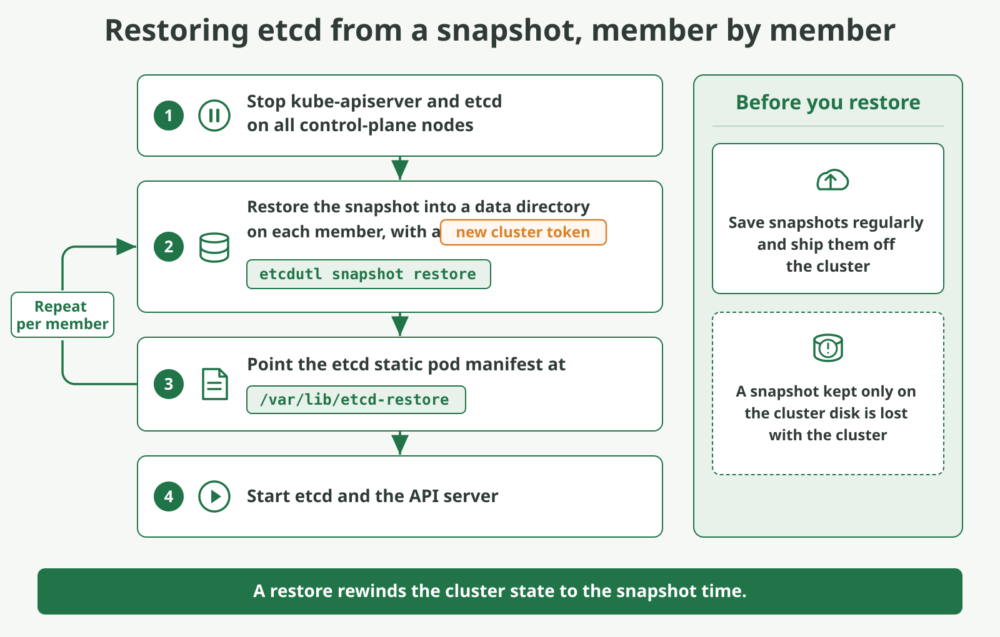

*Figure 5.5.15. Restoring etcd from a snapshot means stopping the control plane, restoring each member with a new cluster token, and restarting from the restored data directory.*

Take snapshots regularly. Run the save on a healthy member, schedule it, and ship the file off the cluster. A snapshot stored only on the cluster's own disk is lost with the cluster. The commands below save a snapshot, check it, restore it and replace a dead member.

```bash
# Snapshot (run on a healthy member; schedule it and ship off-cluster)
etcdctl $EP snapshot save /backup/etcd-$(date +%F-%H%M).db
etcdutl snapshot status /backup/etcd-....db -w table      # integrity (etcdutl is the offline tool in newer releases)

# Restore (conceptually: stop kube-apiserver and etcd on all control-plane nodes, restore data dir on each member with a new cluster token, restart)
etcdutl snapshot restore /backup/etcd-....db --name cp1 \
  --initial-cluster cp1=https://10.0.0.11:2380,cp2=https://10.0.0.12:2380,cp3=https://10.0.0.13:2380 \
  --initial-cluster-token etcd-cluster-restore --initial-advertise-peer-urls https://10.0.0.11:2380 --data-dir /var/lib/etcd-restore
# then point the etcd static pod manifest at /var/lib/etcd-restore and start; repeat per member

# Replace a dead member (HA)
etcdctl $EP member remove <id>      # FIRST remove the dead member
etcdctl $EP member add cp4 --peer-urls=https://10.0.0.14:2380      # then add the new one (as --learner then promote in newer versions)
```

The snapshot status line is a quick integrity check. A snapshot you cannot read is worthless, so check it right after you take it. The restore block is a sketch of the steps, and the comment above it gives the order. Restoring means stopping kube-apiserver and etcd on every control-plane node. You restore the data directory on each member with a new cluster token, and then you restart. The new token keeps the restored members from accidentally joining an old cluster. The replace-a-member block shows the right order. Remove the dead member first, so the cluster returns to an odd number of healthy members. Then add the new one.

Restoring etcd rewinds the cluster to the snapshot time. Objects created after the snapshot are lost. Pods can reappear or disappear relative to what is really running, and kubelets reconcile the difference. Coordinate a freeze of the controllers first, and expect orphaned cloud resources, as chapter 5.20 describes.

Practise restores on a scratch cluster before you need one. A restore you have never run is a guess, and the middle of an outage is the worst time to learn the steps.

## 8. API server operations and scaling

kubeadm sets these flags through `ClusterConfiguration.apiServer.extraArgs`. Each flag controls one dial on the server. You do not need to memorize them all. Learn the groups, so you know which dial to look at when a symptom points to a particular area.

| Flag | What it controls |
|---|---|
| `--etcd-servers`, `--etcd-servers-overrides`, `--etcd-compaction-interval` | etcd location, a separate events store, compaction interval |
| `--max-requests-inflight`, `--max-mutating-requests-inflight` | Request limits when APF is disabled; with APF, they bound the total |
| `--request-timeout`, `--min-request-timeout` | Request timeouts, and the minimum timeout for watches |
| `--watch-cache`, `--default-watch-cache-size`, `--watch-cache-sizes=pods#5000` | Watch cache, with a bigger cache for hot resources |
| `--audit-policy-file`, `--audit-log-path`, `--audit-log-maxage` | Audit policy, log location, log retention |
| `--encryption-provider-config` | Encryption of data at rest |
| `--enable-admission-plugins`, `--disable-admission-plugins` | Which admission plugins run |
| `--feature-gates` | Feature gates; avoid alpha features in production |

You scale out with several API servers behind a load balancer. The servers are stateless, but each keeps its own watch cache and etcd connections. Long watches need sticky connections, and the load balancer idle timeout must exceed the watch timeouts, or clients reconnect in a storm. A reconnect storm is what happens when thousands of clients drop their connections at once and all try to rebuild them together. You scale up with more CPU and RAM, because memory is dominated by watch caches and list responses. The aggregation layer and webhooks add latency and failure modes, so monitor them.

The table lists eight levers for a GPU cluster of 1,000 to 5,000 nodes. Decide which ones your cluster needs before you buy hardware. Bigger control-plane machines help little with a list storm, and cutting list traffic helps little with a slow disk. Match the lever to the bottleneck you measured, and do not guess.

| Lever | What to do |
|---|---|
| 1. Control-plane machines | Dedicated machines (for example, 16+ vCPU, 64+ GB) with NVMe for etcd; three or five API servers. |
| 2. Events and compaction | Separate events etcd; tuned compaction; a defrag schedule. |
| 3. Client QPS and APF | Raise QPS and burst for the scheduler and controllers; APF levels for batch controllers and tenants. |
| 4. Client traffic | Filter and paginate; replace polling with informers; use `PartialObjectMetadata` watches; avoid cluster-wide list loops from dashboards. |
| 5. Object churn | Fewer, larger batch pods (indexed Jobs, JobSet); avoid per-pod ConfigMaps and Secrets; consolidate Services (EndpointSlices already help); tune `nodeStatusReportFrequency` and `nodeLeaseDurationSeconds` at huge node counts. |
| 6. Admission webhooks | Tight timeouts, scoping, high availability. |
| 7. Upgrades | Releases with streaming lists and consistent cache reads, which use less memory. |
| 8. Cluster count | Split into multiple clusters beyond ~5k nodes (chapter 5.35). |

Work through the levers that match your bottleneck first, rather than changing all eight at once. Changing everything at once makes it impossible to tell which change helped, and it can hide a regression you introduced.

## 9. Diagnosing control-plane saturation

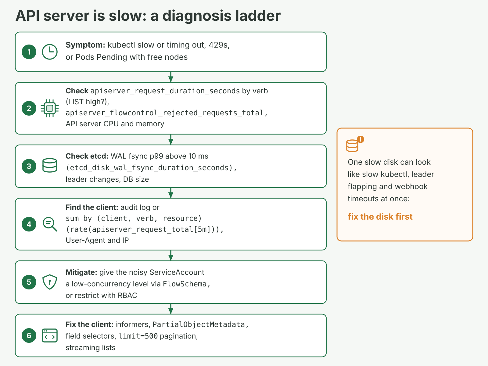

*Figure 5.5.16. Start from the user symptom, confirm with metrics, find the noisy client in the audit log, then fix it at the source.*

When the platform slows down, match the symptom to a cause in the table below. Each row names the metric or log to check and the fix that usually follows. Start from what users see, because that is the symptom you can confirm first. Then work toward the metric that explains it.

| Symptom | Metrics/logs | Likely cause | Fix |
|---|---|---|---|
| `kubectl` slow/timeouts | `apiserver_request_duration_seconds{verb="LIST"}` high, API server CPU/memory | Unfiltered large LISTs, expensive webhooks, APF queues | Find client via audit/`apiserver_request_total` by user-agent; paginate/filter; APF |
| 429 responses | `apiserver_flowcontrol_rejected_requests_total` | Priority level concurrency exhausted | Add levels/shares, throttle noisy client |
| Pods Pending but nodes free | Scheduler logs/metrics; `scheduler_pending_pods`; API write latency | Scheduler throttled by client QPS; API/etcd slow; scheduling plugin latency | Raise scheduler QPS/burst; fix etcd; profile plugins |
| Leader election flaps | `leader_election_master_status`, controller logs "leaderelection lost" | etcd/API latency > lease renew deadline | Fix disk/network; raise lease durations cautiously |
| etcd "mvcc: database space exceeded" | `etcd_mvcc_db_total_size_in_bytes`, `alarm list` | Quota exceeded: churn without compaction/defrag; huge objects | Compact, defrag, disarm, raise quota, reduce churn |
| etcd "took too long to execute" | WAL fsync p99 high | Slow disk, CPU steal, noisy neighbour | Move to NVMe, isolate, check `iostat` |
| API server OOM | Memory graphs | Large watch caches, huge list responses, too many watchers | More RAM, watch cache sizing, limit list sizes, streaming lists |
| Watch gaps, 410 Gone loops | Client logs | Clients lagging behind compaction/watch cache window | Bookmarks, informers, reduce lag |
| `context deadline exceeded` to webhooks | `apiserver_admission_webhook_admission_duration_seconds` | Webhook slow/down | Timeouts, failurePolicy, scale webhook |
| Event storms | `etcd` key counts for events; `kubectl get events` rate | Crash loops, flapping probes, scheduler failures | Fix root cause; separate events etcd; event rate limiting |

Start with the metric named in the matching row. If the metric points at a client, the audit log shows which one is sending the traffic. Many saturation problems have one root cause that shows up in several rows. A slow disk, for example, can look like slow `kubectl`, leader flapping and webhook timeouts all at once. Fix the disk first, then recheck the other rows.

The debugging toolkit gives you the endpoints and tools to confirm a cause. Use `kubectl get --raw /metrics`, and `/debug/pprof` for CPU and heap profiles through `go tool pprof`. The `/livez?verbose` and `/readyz?verbose` endpoints report health in detail. Audit logs, `kubectl top` and `etcdctl` checks help too. You can raise the API server to `-v=4` for a short time. Prometheus rules from kube-prometheus, such as `KubeAPIErrorBudgetBurn`, `etcdHighCommitDurations` and `etcdInsufficientMembers`, alert you to these problems automatically. Turn the verbosity back down afterward, because verbose logs are expensive to keep.

## 10. Lab

Start with the self-checking Python lab. You run it locally first, because it tests the models before you touch a real cluster. It checks the etcd MVCC revision store and kube-apiserver's optimistic concurrency. The `EtcdMVCCSimulator` tests monotonic revisions, the HTTP `409 Conflict` on a stale `resourceVersion`, compaction, and the `410 Gone` versus `BOOKMARK` watch resumption. It also detects Server-Side Apply field-ownership conflicts with `evaluate_ssa_field_ownership` on `managedFields`. Last, it works out API Priority and Fairness concurrency allocation with `compute_apf_concurrency_limit`.

```bash
python3 code/part05/apiserver_etcd_mvcc_lab.py
```

Next, you should work on a `kind` or `kubeadm` cluster. The interactive shell steps below were not run on live hardware, so check each result yourself. Work through these exercises in order, because later steps assume the earlier ones worked.

1. Start `kubectl proxy`. Use `curl` to read the discovery documents and list pods. Get one pod, and create a ConfigMap with `curl -X POST`. Watch with `?watch=1`, and read the response headers and the chunked events. Then repeat the same steps with `kubectl get --raw`.
2. Set `-v=8` and apply a Deployment. Map each HTTP call to a stage in the pipeline. Enable audit logging with a policy that records `RequestResponse` for ConfigMaps in one namespace. Read the events for authentication, the authorization decision and the stage timings.
3. Get a ConfigMap, then update it twice from two shells. Use a stale `resourceVersion` each time with `kubectl replace`, and observe the 409. Next, use `kubectl patch` instead. Then repeat the exercise with server-side apply from two field managers, and trigger a conflict.
4. Open a watch from an old resourceVersion. Write enough changes to pass the compaction point first, or use a very old RV. Observe the `410 Gone`. Use `allowWatchBookmarks` to compare. Then write a 20-line Python client with the `kubernetes` library. Build it once with an informer-like relist, and once without.
5. Add a mutating webhook, which is a tiny Python server that adds a label. Add a validating webhook that rejects a field. Deploy the webhooks with `failurePolicy: Fail`, then stop the webhook and see the writes blocked. Fix the problem with scoping and with `Ignore`. Last, try the same logic with ValidatingAdmissionPolicy (CEL).
6. Create a FlowSchema and a PriorityLevelConfiguration for a test service account. Generate load with a looped `kubectl get pods -A`, using many parallel clients. Watch the `apiserver_flowcontrol_*` metrics and the 429s, and compare them with the default catch-all.
7. With `etcdctl`, list the key prefixes and count them per resource type. Read a Secret value and confirm that it is encrypted, both before and after you enable `EncryptionConfiguration`. Inspect the etcd metrics endpoint. Then take a snapshot and verify it.
8. Churn a ConfigMap quickly to grow the database. Compare the DB size with the in-use size. Compact and defragment the store. Then, on a throwaway cluster with a tiny quota, trigger a NOSPACE alarm and clear it.
9. Snapshot a kind or kubeadm lab cluster. Create some objects, and then restore the snapshot on a spare control plane. Observe which objects vanish, and note the steps and timings.
10. Start with three etcd members. Stop one, then stop two, and observe how the API behaves for reads and writes. Replace a member the correct way, by removing it first and then adding the new one. Then try the incorrect way, adding first. Compare the two results in the lab.
11. Use `kube-burner` or `clusterloader2` to create thousands of objects and pods. Use fake nodes from `KWOK` to test scale without real machines. Watch the API and etcd metrics, and find the first bottleneck. Tune the watch cache, the QPS or the APF settings, and then test again.
12. Import a control-plane dashboard. Define alerts for API p99 latency, the 5xx ratio, etcd fsync, DB size, leader changes and APF rejections.
13. Clean up the lab.

## 11. Common mistakes

Most of these mistakes look harmless when you make them. Each one works fine on a small cluster and fails only when the load grows, which is why they survive so long in production.

- Treating `resourceVersion` as a number to compare. Polling with `kubectl get` loops instead of watching. Running unfiltered cluster-wide lists.
- Setting webhooks to `failurePolicy: Fail` with no namespace exclusions, a single replica, or slow endpoints.
- Running etcd on shared or network disks. Skipping monitoring of fsync latency and DB size, and never defragmenting. Having no backups, or backups that were never tested.
- Using an even number of etcd members. Adding a member before you remove a dead one. Spreading etcd across high-latency links.
- Storing large blobs or state in ConfigMaps, CRs or annotations. Writing status too often. Creating Events without a bound.
- Running `kubectl delete --force` on pods of StatefulSets or on pods with RWO volumes. Before you remove finalizers, check why they are there.
- Ignoring API deprecations until an upgrade breaks controllers.
- Exposing the API server publicly. Leaving anonymous auth on. Keeping unencrypted Secrets in etcd.
- Leaving the client-go default QPS (5/10) on custom controllers that handle thousands of objects.

## 12. Interview angles

You can use these questions to check what you have learned. Each one points back to a section above. Answer each one out loud, in two or three sentences, before you check the section.

- "Describe the lifecycle of an API request in kube-apiserver."
- "What are mutating and validating admission? What happens when a webhook is down?"
- "Explain resourceVersion and optimistic concurrency. What causes a 409? What is a 410 Gone?"
- "How do watches and informers reduce API server load?"
- "How does etcd achieve consistency? What is quorum? Why odd member counts?"
- "How do you back up and restore etcd? What are the consequences of a restore?"
- "The API server is slow. How do you find out why?" (metrics, audit, APF, etcd fsync, noisy list clients.)
- "What is server-side apply and why do GitOps tools use it?"
- "How would you prepare the control plane for a 5,000-node GPU cluster?"

## Exercises

These exercises connect the chapter's ideas to the code and to the cluster. Work through them in order, and note what you observe. Each one gives you a situation and a question. Answer in your own words, then check the code.

1. Explain the URL paths for the core group (`/api/v1/...`) and for named groups (`/apis/<group>/<version>/...`). Explain the difference between a Kind (`Deployment`) and a resource (`deployments`). Describe how kube-apiserver converts between several served versions (`v1alpha1`, `v1beta1`, `v1`) and the single storage version persisted in etcd. Finally, explain how to detect deprecated APIs before a cluster upgrade. This exercise draws on groups, versions, kinds, resources, subresources and storage version conversion in Programming Kubernetes, Chapter 2.
2. Trace a `POST` request through authentication, authorization, APF, mutating admission, OpenAPI schema validation, validating admission, etcd persistence with KMS v2 encryption, and watch fan-out. Then explain how a `MutatingWebhookConfiguration` with a `JSONPatch` response differs from a `ValidatingWebhookConfiguration`. Explain how both differ from the in-process `ValidatingAdmissionPolicy` (CEL). Use Kubernetes: Up and Running, Chapter 17, as your reference.
3. Use `EtcdMVCCSimulator` in `code/part05/apiserver_etcd_mvcc.py` to explain how `metadata.resourceVersion` maps to etcd's global MVCC revision. Explain why a stale `PUT` returns `409 Conflict`. Explain why a watch that falls behind the compacted revision returns `410 Gone`. Explain how `allowWatchBookmarks=true` prevents `410 Gone` on quiet resources. Finally, explain the difference between a `LIST` with `resourceVersion=""` (a quorum read) and one with `resourceVersion="0"` (the watch cache).
4. Use `evaluate_ssa_field_ownership()` in `code/part05/apiserver_etcd_mvcc.py` to compare client-side `kubectl apply`, which relies on the `last-applied-configuration` annotation, with Server-Side Apply, which uses `application/apply-patch+yaml` and `metadata.managedFields`. Then trace what happens when Argo CD and an HPA both touch `/spec/replicas`.
5. Use `compute_apf_concurrency_limit()` in `code/part05/apiserver_etcd_mvcc.py` to trace the `batch-controllers` PriorityLevelConfiguration and the `kueue-and-training-operators` FlowSchema from section 6. Explain `nominalConcurrencyShares`, `lendablePercent` and shuffle sharding (`queues: 64, handSize: 6`). Finally, explain how to tell server-side APF `429` throttling apart from client-side `client-go` QPS and burst throttling.
6. Explain Raft and the write-ahead log (`WAL`) in etcd. Explain why etcd compaction alone does not shrink the on-disk `bbolt` file until `etcdctl defrag` runs. Explain how to clear an `etcdserver: mvcc: database space exceeded` (`NOSPACE`) alarm. Explain why a dead etcd member must be removed before you add its replacement. Then list the 8 scaling levers from section 8 for a 5,000-node GPU cluster.

## Checkpoint questions (20)

<details>
<summary>1. What is the difference between a Kubernetes API `Kind`, a `Resource`, and a `Subresource`, and how do Core and Named API URL paths differ (Programming Kubernetes, Chapter 2)?</summary>

- The core (legacy) API group, with the empty name `""`, is served under `/api/v1/...`. For example, `/api/v1/namespaces/default/pods`.
- Named API groups, such as `apps`, `batch`, `networking.k8s.io` and CRDs, are served under `/apis/<group>/<version>/...`. For example, `/apis/apps/v1/namespaces/default/deployments`.
- A Kind, such as `Deployment` or `Pod`, is the PascalCase type name inside `kind:`. A resource, such as `deployments` or `pods`, is the lowercase plural noun in the URL path.
- A subresource, such as `/status`, `/scale`, `/logs`, `/exec`, `/binding` or `/eviction`, hangs off one object instance. It has its own RBAC rules and behaviour. For example, `PUT /.../deployments/web/status` updates only `.status`, and it does not increment `.metadata.generation`.
</details>

<details>
<summary>2. When a CRD or built-in resource serves three API versions (`v1alpha1`, `v1beta1`, `v1`), how many versions are stored in `etcd`?</summary>

Exactly one version is persisted in etcd, the one marked `storage: true`. A CRD can set `served: true` on several versions, such as `v1alpha1`, `v1beta1` and `v1`. That lets old and new clients read and write with the schema they prefer, over the default HTTPS port `6443`. The kube-apiserver converts each object on the fly into the single storage version before it writes to etcd. The conversion uses a `Webhook` conversion service, or `None` for schema-only conversion.
</details>

<details>
<summary>3. Why do Mutating Admission plugins always run BEFORE Validating Admission plugins in `kube-apiserver`?</summary>

Mutating plugins run first because they can change the object. Examples include injecting a sidecar container, adding default resource limits with `LimitRanger`, or setting `runtimeClassName: nvidia`. Validating admission, which covers `ValidatingAdmissionWebhook`, `ValidatingAdmissionPolicy` and `ResourceQuota`, must see the final mutated object. That way, a mutation cannot break security or quota policy. kube-apiserver also validates the object against the OpenAPI schema after mutating admission, so a broken webhook patch is caught right away.
</details>

<details>
<summary>4. In *Kubernetes: Up and Running* Chapter 17, how does a `MutatingAdmissionWebhook` return modifications to `kube-apiserver`?</summary>

When kube-apiserver sends an `AdmissionReview` HTTPS POST to a `MutatingAdmissionWebhook`, the webhook reads `request.object`. It replies with an `AdmissionResponse` that has three fields. The `allowed` field is `true`. The `patchType` field is `"JSONPatch"`. The `patch` field is a base64-encoded RFC 6902 JSON Patch array, such as `[{"op": "add", "path": "/spec/paths", "value": ["/index.html"]}]`.
</details>

<details>
<summary>5. How can a misconfigured `ValidatingAdmissionWebhook` or `MutatingAdmissionWebhook` take down an entire Kubernetes cluster, and what five safeguards prevent it?</summary>

A webhook configured with `failurePolicy: Fail` that matches all namespaces (`*`) and Pods can take down the whole cluster. If its own Pods crash or become unreachable during a node roll, kube-apiserver rejects every Pod creation. That includes the webhook's replacement Pods, the `kube-system` DaemonSets and `coredns`, which makes a total cluster deadlock. Five safeguards prevent this.

1. Exclude `kube-system` and the webhook's own namespace with a `namespaceSelector`, for example `matchExpressions: [{key: kubernetes.io/metadata.name, operator: NotIn, values: [kube-system, webhook-ns]}]`.
2. Set a short `timeoutSeconds`, such as `2` to `5` seconds, rather than the 10-second default.
3. Run $\ge 2$ webhook replicas across zones, with a `PodDisruptionBudget` and the `system-cluster-critical` `PriorityClass`.
4. Prefer the in-process `ValidatingAdmissionPolicy` (`CEL`), and `MutatingAdmissionPolicy`, when you do not need external HTTP calls. They add zero network latency and have zero webhook Pod dependency.
5. Use `failurePolicy: Ignore` for mutations that are not critical.
</details>

<details>
<summary>6. Compare `metadata.resourceVersion`, `metadata.generation`, and `status.observedGeneration`.</summary>

- `metadata.resourceVersion` is an opaque string backed by etcd's MVCC `mod_revision`. It changes on every single write to the object, whether to metadata, spec or status. It drives optimistic concurrency (`409 Conflict`) and watch resumption.
- `metadata.generation` is an integer counter, 1, 2, 3 and so on. It increments only when `.spec` changes. It never changes when `.status` or the labels and annotations in `.metadata` change.
- `status.observedGeneration` is written by the controller into `.status`. It records the `metadata.generation` that the controller reconciled most recently. When `status.observedGeneration == metadata.generation`, the controller's status report reflects the latest desired spec.
</details>

<details>
<summary>7. What is the difference between a `LIST` request with `resourceVersion` unset vs. `resourceVersion="0"`?</summary>

- With `resourceVersion` unset (`""`, the default), the server does a linearizable quorum read from etcd, or a consistent read from cache through the etcd read index. That guarantees the most up-to-date state, at the cost of an etcd round trip.
- With `resourceVersion="0"`, the server serves the response straight from the kube-apiserver's in-memory watch cache, without touching etcd. That is orders of magnitude faster and cheaper on etcd. The cached snapshot may be slightly behind, though, if the watch briefly lagged.
</details>

<details>
<summary>8. Why does a watch client receive HTTP `410 Gone` (`too old resource version`), and how do Watch Bookmarks (`allowWatchBookmarks=true`) prevent it?</summary>

etcd and the kube-apiserver watch cache keep only a sliding window of historical revisions. The default etcd compaction runs every 5 minutes. If a client opens or reconnects a watch with `?watch=1&resourceVersion=1000`, and revision `1000` has already been compacted away, kube-apiserver returns `410 Gone`. The client informer must then perform a full `LIST` to resynchronise.

On quiet resources, or on heavily filtered watches where no matching object changes for hours, the client's last-seen `resourceVersion` can fall behind the 5-minute compaction window when the connection drops. Setting `allowWatchBookmarks=true` fixes that. kube-apiserver periodically sends lightweight synthetic `BOOKMARK` events. Each one carries only the current head `resourceVersion`, with no object payload. The client's resume point stays fresh, so reconnects never hit `410 Gone`.
</details>

<details>
<summary>9. Compare Client-Side `kubectl apply` (`last-applied-configuration`) with Server-Side Apply (`SSA`, `managedFields`).</summary>

- Client-side `kubectl apply` stores a full copy of the previous manifest in the `kubectl.kubernetes.io/last-applied-configuration` annotation. That fails on objects over 256 KiB, such as large CRDs. The client computes a three-way merge.
- Server-Side Apply (`kubectl apply --server-side`, `PatchType: application/apply-patch+yaml`) sends your declared intent straight to kube-apiserver. The server merges the fields and records per-field ownership in `metadata.managedFields`, under managers such as `manager: argocd` and `manager: kube-controller-manager`. If a second actor tries to change a field that another manager owns, kube-apiserver returns a 409 field conflict, unless you pass `--force-conflicts`. That stops controllers and GitOps tools from silently overwriting each other's fields.
</details>

<details>
<summary>10. How does API Priority and Fairness (`APF`) protect `kube-apiserver` from noisy tenants, and what is Shuffle Sharding?</summary>

1. Every incoming request matches a `FlowSchema`, by user, ServiceAccount, namespace, verb and resource. The FlowSchema assigns the request to a `PriorityLevelConfiguration`, such as `system`, `node-high`, `leader-election`, `workload-high`, `batch-controllers` or `global-default`. It also computes a flow distinguisher, either `ByUser` or `ByNamespace`.
2. Each `PriorityLevelConfiguration` gets a guaranteed slice of the server's total concurrency limit, based on `nominalConcurrencyShares`. It can borrow more with `lendablePercent`.
3. Inside a queued level with `64` queues, **Shuffle Sharding** hashes each flow's distinguisher to a pseudo-random subset of `handSize` queues, such as `6` of `64`. The request goes into the shortest of those `6` queues. Even if one buggy script in `team-a` floods the API server, it fills only its `6` queues. The other `58` queues stay clear for other tenants.
</details>

<details>
<summary>11. How do you tell whether a slow Kubernetes controller is being throttled by Server-Side APF vs. Client-Side `client-go` rate limiting?</summary>

- Client-side `client-go` throttling is the most common case on custom operators. The controller's own logs print `Waited for 1.04s due to client-side throttling, not priority and fairness`. By default, client-go sets `QPS = 5` and `Burst = 10`, which is very low. Raise `cfg.QPS` or `--kube-api-qps`, for example to `50`–`100`. Raise `cfg.Burst` or `--kube-api-burst`, for example to `100`–`200`.
- Server-side APF queueing and rejection show up in kube-apiserver metrics. Watch `apiserver_flowcontrol_rejected_requests_total`, which counts HTTP `429 Too Many Requests`, and `apiserver_flowcontrol_request_wait_duration_seconds`.
</details>

<details>
<summary>12. How does `etcd` execute a write using Raft, and why is disk `fsync` latency the #1 determinant of `etcd` performance?</summary>

1. A client, kube-apiserver, sends a gRPC write (`Put` or `Txn`) to etcd. The write is forwarded to the Raft leader.
2. The leader appends the entry to its local Write-Ahead Log (`WAL`) on disk, with an `fsync`. It then broadcasts `AppendEntries` RPCs to all follower members on `:2380`.
3. Each follower appends the entry to its own WAL and calls `fsync` before it replies with an acknowledgment.
4. Once a quorum, $\lfloor N/2 \rfloor + 1$, of members has fsynced the WAL entry, the leader commits it. It applies the entry to its `bbolt` B+tree key-value store and returns success to kube-apiserver.

Every single write needs a synchronous disk `fsync` on a majority of members. Slow or contended disks, where `etcd_disk_wal_fsync_duration_seconds` p99 is above 10 ms, stall the entire Kubernetes control plane at once. They also trigger Raft leader elections.
</details>

<details>
<summary>13. What is the difference between `etcd` Compaction and Defragmentation (`defrag`), and why do you need both?</summary>

- Compaction (`etcdctl compact <rev>`, run automatically every 5 minutes by kube-apiserver) marks historical MVCC revisions older than `<rev>` as logically dead. Their pages inside the `bbolt` B+tree can then be reused by new etcd writes. However, compaction does NOT shrink the on-disk `/var/lib/etcd/member/snap/db` file, and it does not return bytes to the filesystem.
- Defragmentation (`etcdctl defrag`, run sequentially, one member at a time) rewrites the `bbolt` database file without the free holes. That shrinks the actual file size on disk. Defrag briefly blocks reads and writes on the member it runs on. So always run it one member at a time: followers first, then transfer leadership and defragment the old leader.
</details>

<details>
<summary>14. What happens when `etcd` hits `--quota-backend-bytes` (default `2 GiB`, max recommended `8 GiB`), and how do you recover?</summary>

When any member's `bbolt` database reaches `--quota-backend-bytes`, etcd raises a cluster-wide `NOSPACE` alarm. The whole cluster then goes into maintenance read-only mode. Every `PUT`, `POST` and `DELETE` request fails with `mvcc: database space exceeded`. To recover:

1. Find the current revision: `rev=$(etcdctl endpoint status -w json | jq '.[0].Status.header.revision')`.
2. Compact the old history: `etcdctl compact $rev`.
3. Defragment every member so the DB shrinks below the quota: `etcdctl defrag --cluster`, or member by member.
4. Disarm the alarm so writes resume: `etcdctl alarm disarm`.
</details>

<details>
<summary>15. Why must you ALWAYS remove a dead `etcd` member BEFORE adding its replacement in a 3-node cluster?</summary>

Suppose you have a three-member etcd cluster, `cp1`, `cp2` and `cp3`, and `cp3` dies. Two of the three are alive, so the quorum is 2 and the cluster stays up. If you run `etcdctl member add cp4` before you remove `cp3`, and without `--learner`, the membership jumps to four members at once. With `cp3` dead and `cp4` not yet started, only 2 of 4 are alive. A four-member cluster needs $\lfloor 4/2 \rfloor + 1 = 3$ for quorum. That is an immediate quorum loss, since 2 < 3, and it takes the cluster down.

Instead, run `etcdctl member remove <cp3-id>` first. That leaves 2 of 2 alive. Then add `cp4`, or add `cp4` as a non-voting `--learner` and promote it once it has caught up.
</details>

<details>
<summary>16. How do you encrypt Kubernetes `Secret`s at rest in `etcd` (`EncryptionConfiguration`), and how do you verify it is working?</summary>

By default, Kubernetes Secret objects are stored in etcd as unencrypted Protobuf or base64 values. Pass `--encryption-provider-config=/etc/kubernetes/enc/enc.yaml` to kube-apiserver. Its `EncryptionConfiguration` should specify a `kms` (v2) provider, or `aesgcm` or `aescbc`, and list it before the `identity: {}` fallback provider. Then every newly written Secret is encrypted before it leaves kube-apiserver.

- Verify it in etcd. Run `etcdctl get /registry/secrets/default/my-secret`. The raw value should start with the `k8s:enc:kms:v2:` prefix, or `k8s:enc:aesgcm:v1:`, rather than plaintext.
- Encrypt existing Secrets. Run `kubectl get secrets --all-namespaces -o json | kubectl replace -f -`.
</details>

<details>
<summary>17. Why do large GPU clusters (>1,000 nodes) run a separate `etcd` instance for `/registry/events` (`--etcd-servers-overrides`)?</summary>

During a 2,000-pod distributed training launch, image pulls, probe checks and network hiccups can generate tens of thousands of Kubernetes Event writes per minute. Events have a one-hour TTL, and they are non-critical troubleshooting telemetry. Sharing the main etcd cluster still costs you, though. Event writes consume WAL `fsync` IOPS. They bloat the MVCC revision counter, which speeds up compaction and can cause `410 Gone` watch resets on Pods and Nodes. They also risk triggering a `NOSPACE` quota alarm. Passing `--etcd-servers-overrides=/events#https://etcd-events:2379` to kube-apiserver isolates all Event churn on a dedicated etcd instance.
</details>

<details>
<summary>18. What are the three Audit Policy levels in `kube-apiserver`, and why shouldn't you log `Secret`s or `TokenReview`s at `RequestResponse`?</summary>

The four audit levels are `None` (do not log), `Metadata` (log user, timestamp, resource, verb and status code, but not the request or response body), `Request` (metadata plus the request body), and `RequestResponse` (metadata plus both the request and response bodies).

If you log `secrets` or `tokenreviews` at `Request` or `RequestResponse` level, every Secret plaintext and bearer token in the cluster is written in cleartext to `/var/log/kubernetes/audit.log` and to your SIEM. Logging `RequestResponse` on high-volume `watch` and `list` endpoints also saturates disk I/O and CPU. Always log `secrets` and `tokenreviews` at `Metadata` level only.
</details>

<details>
<summary>19. What happens to cluster state and running workloads when you restore `etcd` from a snapshot taken 2 hours ago?</summary>

Restoring an etcd snapshot with `etcdutl snapshot restore` rewinds the cluster's desired state to the snapshot time. In this case, that is 2 hours ago.

- Any Pod, Job, Deployment, PVC or Secret created in the last 2 hours disappears from etcd. When kubelets reconnect to kube-apiserver, they find pods running locally that the server no longer knows about, so they terminate those containers.
- Any Pod or Deployment deleted in the last 2 hours reappears in etcd. Controllers and kubelets then recreate it.
- Cloud resources, such as LoadBalancers and disks, provisioned in the last 2 hours become orphaned in the cloud account.
</details>

<details>
<summary>20. A cluster operator reports that `kubectl get pods -A` takes 15 seconds and `kube-apiserver` memory usage is spiking to 32 GB. How do you diagnose and fix it?</summary>

1. Check `apiserver_request_duration_seconds` and `apiserver_response_sizes` by verb and resource. The usual cause is a rogue client, such as a monitoring script, a dashboard or a poorly written controller. It sends unpaginated, unfiltered `LIST` requests on `pods`, `events` or large CRDs in a tight loop, without using an Informer watch cache.
2. Identify the culprit client by its `User-Agent` and IP. Query `sum by (client, verb, resource) (rate(apiserver_request_total[5m]))`, or inspect the audit log.
3. Mitigate right away. Restrict the noisy ServiceAccount with APF, using a FlowSchema that routes it to a low-concurrency PriorityLevelConfiguration, or restrict it with RBAC. Refactor the client to use SharedInformers, `PartialObjectMetadata`, field selectors and pagination with `limit=500`. On recent Kubernetes versions, enable **WatchList (streaming lists)**.
</details>

## Sources and review notes

- **Sources read in full:**
  - `production-kubernetes` — Josh Rosso, Rich Lander, Alexander Brand & John Harris, *Production Kubernetes*, **Chapters 1 and 2** (control-plane components, deployment models, and `etcd`/`kube-apiserver` operational considerations).
  - `production-kubernetes` — Josh Rosso, Rich Lander, Alexander Brand & John Harris, *Production Kubernetes*, **Chapter 7: Secret Management** (read in full: the etcd threat model, static-key and envelope encryption of Secret data, and key rotation).
  - `kubernetes-up-and-running-3rd-edition` — Brendan Burns, Joe Beda, Kelsey Hightower & Lachlan Evenson, *Kubernetes: Up and Running*, 3rd ed., **Chapter 17: Extending Kubernetes** (read in full: custom resources `LoadTest`, API extension patterns Just Data / Controllers / Compilers, OpenAPI validation, TLS CSR generation via `certificates.k8s.io`, `ValidatingWebhookConfiguration`, and `MutatingWebhookConfiguration` returning base64 `JSONPatch`).
  - `kubernetes-programming-with-go-programming-kubernetes-clients-and-operators-using-go-and-the-kuberne` — Stefan Schimanski & Michael Hausenblas, *Programming Kubernetes*, **Chapter 2: Kubernetes API Operations** (API groups, versions, kinds, resources, subresources, optimistic concurrency `resourceVersion`, and `kube-apiserver` request processing).
  - `nvidia-devops` (`volume-03/01-k8s-control-plane-scheduling-masterclass.md`): API machinery, `resourceVersion`, optimistic concurrency, watch mechanics, `etcd` quorum and failure scenarios, `etcdctl` cheatsheet, and API Priority and Fairness (`APF`).
- **Run here:** `python3 code/part05/apiserver_etcd_mvcc_lab.py` (3 passed, 0 failed).
- **Explicitly labelled inferences:** The `EtcdMVCCSimulator`, `evaluate_ssa_field_ownership`, and `compute_apf_concurrency_limit` models in `code/part05/apiserver_etcd_mvcc.py` and the `batch-controllers` APF `PriorityLevelConfiguration`/`FlowSchema` are the author's constructions synthesizing *Production Kubernetes* Chapters 1–2, *Kubernetes: Up and Running* Chapter 17, *Kubernetes Programming with Go* Chapter 2, and `volume-03/01` (plus original study items 21, 22, 23, 24, 25, 26, 27, 28, 29, 30, 31, 32, 33, 34, 35, 36, 37, 38, 39, and 40).
- **Not verified on live hardware:** Live `kubectl proxy`, `curl`, `etcdctl`, `etcdutl`, `kube-burner`, and `KWOK` executions (`512`-GPU job, `:8001`, `409` Conflict, `410` Gone, `429`, `limit=500`, `5 minutes` compaction, `nominalConcurrencyShares: 30`, `lendablePercent: 20`, `queues: 64, handSize: 6, queueLengthLimit: 50`, `matchingPrecedence: 800`, `100 ms`/`1000 ms`, `2 GiB`/`8 GiB`, `1.5 MiB`, `p99 < 10 ms`, `10.0.0.11..14:2380`, `pods#5000`, `16+ vCPU, 64+ GB`, `5k` nodes / `150k` pods, QPS `5/10`) are marked (`untested here`) where not executed by `apiserver_etcd_mvcc_lab.py`.
