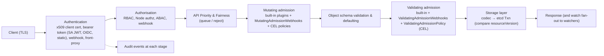

# 5.5 The API server and etcd: how a request becomes cluster state

| | |
|---|---|
| Level | Advanced |
| Priority tier | 0 |
| Lab venue | Control-plane access on a kubeadm/kind cluster; `kubectl`, `etcdctl`, `curl`, `jq` |
| Part | Part 5: Kubernetes |
| Status | Drafted, labs **untested** |

## Why this matters for AI infrastructure

Large training jobs turn the control plane into a stress test: a 512-GPU job can create hundreds of pods and thousands of objects (pods, services, configmaps, events) in seconds, each node's kubelet and each controller keeps watches open, schedulers and batch systems list large collections, and monitoring tools poll. When the API server or etcd becomes the bottleneck, the whole platform degrades even though no GPU is faulty: pods linger in Pending, `kubectl` times out, controllers lag, and in the worst case leader elections thrash and workloads are evicted. A senior platform engineer must understand exactly how a request flows through the API server, how etcd stores and serves data, what metrics reveal trouble, and how to scale and protect these two components.

## Prerequisites and outcomes

Needs 5.3. After this chapter you can:

- Walk the request pipeline in kube-apiserver (authentication, authorisation, admission, validation, storage, response, audit) and identify where each plugin plugs in.
- Navigate the REST API (groups, versions, resources, subresources, verbs), use the raw API with `kubectl --raw`/`proxy`/`curl`, and read API discovery and OpenAPI.
- Explain `resourceVersion`, optimistic concurrency (409), `generation` vs `observedGeneration`, list/watch semantics, bookmarks, the watch cache, pagination and why informers exist.
- Use server-side apply and field managers; explain create/update/patch/apply differences and conflict handling.
- Describe API Priority and Fairness and tune it; read the key API server and etcd metrics.
- Explain etcd internals (Raft, WAL, snapshots, MVCC revisions, compaction, defragmentation, quotas, leases) and operate it (health, member management, backup/restore, performance tuning).
- Diagnose control-plane saturation and apply scaling practices for large GPU clusters.

## 1. The API surface

### Groups, versions, kinds, resources

The API is organised by **group/version**: core (`/api/v1`: pods, nodes, services, configmaps, secrets, PVCs...), named groups (`/apis/apps/v1`: deployments, statefulsets, daemonsets; `batch/v1`: jobs, cronjobs; `networking.k8s.io/v1`; `rbac.authorization.k8s.io/v1`; `storage.k8s.io/v1`; `scheduling.k8s.io/v1`; `apiextensions.k8s.io/v1`; `node.k8s.io/v1`; `coordination.k8s.io/v1` leases; `flowcontrol.apiserver.k8s.io/v1`; plus CRD groups like `kueue.x-k8s.io`, `nvidia.com`). A **kind** is the type (Deployment); a **resource** is its REST collection (`deployments`); **subresources** hang off objects: `/status`, `/scale`, `/binding`, `/eviction`, `/log`, `/exec`, `/portforward`, `/token`, `/ephemeralcontainers`.

```bash
kubectl proxy --port=8001 &
curl -s localhost:8001/ | jq '.paths | length'
curl -s localhost:8001/api/v1 | jq '.resources[] | {name, namespaced, kind, verbs}' | head -40
curl -s localhost:8001/apis/apps/v1/namespaces/default/deployments | jq '.items[].metadata.name'
kubectl get --raw /apis | jq '.groups[].name' | head -40
kubectl get --raw /openapi/v3 | jq '.paths | keys | length'
kubectl api-resources --verbs=list --namespaced=false -o name | head
kubectl explain deployment.spec.strategy --api-version=apps/v1
```

### Versioning and conversion

Each resource has multiple served versions (alpha → beta → stable `v1`) but exactly one **storage version** persisted in etcd. The API server converts between versions on read/write (for built-in types via internal conversion; for CRDs via `conversion: None` or a conversion webhook). Deprecated APIs are removed on a documented schedule (for example `extensions/v1beta1` Ingress, `batch/v1beta1` CronJob); before upgrading Kubernetes, scan for removed API usage (`kubectl get --raw /metrics | grep apiserver_requested_deprecated_apis`, tools like `pluto`, `kubent`) and migrate manifests and operators. Stored objects in old storage versions are re-written via `kubectl-convert` or by the storage version migrator.

### Verbs and HTTP mapping

| Verb | HTTP | Notes |
|---|---|---|
| get | GET `/…/name` | |
| list | GET `/…/resources` | `limit`, `continue` for pagination; `labelSelector`, `fieldSelector`; `resourceVersion` semantics matter (below) |
| watch | GET `?watch=1&resourceVersion=N` | Streams events (ADDED, MODIFIED, DELETED, BOOKMARK, ERROR) |
| create | POST | 201 or 409 AlreadyExists |
| update | PUT | Full replace; needs current `resourceVersion` (else 409) |
| patch | PATCH | JSON Patch, JSON Merge Patch, Strategic Merge Patch (built-in types), or **Apply** patch (`application/apply-patch+yaml`) for server-side apply |
| delete / deletecollection | DELETE | Grace period, propagation policy, preconditions |
| proxy, exec, attach, portforward, log | GET/POST/WebSocket/SPDY | Streaming subresources proxied to kubelet |

## 2. The request pipeline



1. **Authentication** determines *who* (user, groups, extra). Methods: client certificates (kubeadm admin, kubelet, controller-manager use these), ServiceAccount tokens (projected, audience-bound, short-lived JWTs verified by the API server's SA signing key), OIDC (id tokens from IdP), webhook token review, authenticating proxy headers. Anonymous requests are `system:anonymous` unless disabled.
2. **Authorisation** decides *whether*: RBAC (the default, 5.16), the Node authorizer (kubelets may read only objects related to pods bound to them), and webhook authorizers. `kubectl auth can-i` and `kubectl auth whoami` help.
3. **API Priority and Fairness** classifies requests into priority levels and flows; applies concurrency limits and queuing (section 6).
4. **Mutating admission** modifies objects: built-ins (`ServiceAccount`, `DefaultStorageClass`, `LimitRanger`, `DefaultTolerationSeconds`, `MutatingAdmissionWebhook`) and webhooks (sidecar injectors like Istio, policy mutators like Kyverno, GPU-related mutators). Called in order, may be re-invoked (reinvocation policy).
5. **Schema validation** against OpenAPI (types, required fields; unknown fields rejected or pruned for CRDs depending on `preserveUnknownFields`/structural schema; field validation levels `Strict`/`Warn`/`Ignore`).
6. **Validating admission**: built-ins (`ResourceQuota`, `PodSecurity`, `NodeRestriction`), webhooks (OPA Gatekeeper, Kyverno), and **ValidatingAdmissionPolicy** (in-process CEL, no webhook latency).
7. **Persistence**: encode and write with a transaction in etcd, conditional on `resourceVersion` (for updates). Secrets can be encrypted at rest here via `EncryptionConfiguration` (AES-CBC/GCM, KMS v2 envelope encryption).
8. **Response and fan-out**: the written revision becomes the object's `resourceVersion`; the watch cache pushes events to all watchers.

Webhook caveats: admission webhooks are a common source of outages: a slow or down webhook with `failurePolicy: Fail` blocks all matching writes (including node and system pods); set tight `timeoutSeconds`, scope with `namespaceSelector/objectSelector`, exclude `kube-system`/own namespace, use `failurePolicy: Ignore` for non-critical mutations, run multiple replicas with PDBs, and monitor `apiserver_admission_webhook_rejection_count` and duration.

## 3. resourceVersion, generation and concurrency

- **`metadata.resourceVersion`** is an opaque string (do not parse or compare except equality) that changes on every write; internally derived from etcd's global revision. Uses: (1) **optimistic concurrency**: an update including `resourceVersion=X` succeeds only if the stored object is still X, else `409 Conflict` ("the object has been modified; please apply your changes to the latest version"); controllers retry using `retry.RetryOnConflict`. (2) **watch resume points**. (3) **cache consistency** in list semantics.
- **`metadata.generation`** increments when `spec` changes (not status/metadata); controllers write `status.observedGeneration` so you can tell whether status reflects the latest spec (`kubectl rollout status` uses this).
- **`metadata.uid`** identifies an object instance (recreated objects have new UIDs; ownerReferences use UID to avoid adopting the wrong object).
- **List semantics**: `resourceVersion` unset → "most recent" (quorum read from etcd; expensive); `resourceVersion="0"` → any cached version from the watch cache (cheap, may be stale); `resourceVersion=N` with `resourceVersionMatch=NotOlderThan|Exact`. Informers do an initial list (RV=0 or latest) then watch from that RV.
- **Pagination**: `limit=500` returns a `continue` token valid for a compaction window (~5 minutes); large lists without pagination can blow up API server memory (a classic outage cause). Streaming lists (watch-list) reduce memory in newer releases.
- **Watch**: HTTP chunked stream of JSON/protobuf events; clients resume from the last seen RV; the server only retains a bounded history in the watch cache and etcd compaction window; if the client is too far behind it receives **410 Gone** ("too old resource version") and must relist. **Bookmarks** (`allowWatchBookmarks=true`) are periodic events carrying a recent RV so a reconnecting client doesn't fall out of window. **Informers** (client-go) implement list+watch+resync+indexers+shared caches and relist on 410; custom clients that poll with `kubectl get` in a loop overload the API server.
- **Server-side filtering**: selectors on list/watch (`labelSelector`, `fieldSelector=spec.nodeName=...`) reduce traffic; kubelets watch only pods with their node name; heavy clients should filter and use `metadata`-only watches (PartialObjectMetadata) where possible.

## 4. Writing objects: create, update, patch, apply

| Operation | Semantics | When |
|---|---|---|
| `create` | Insert; fails if exists | Imperative creation |
| `update` (PUT) | Replace entire object; needs RV | Controllers that own the whole object; beware lost updates |
| `patch` (merge/strategic/JSON patch) | Partial change; strategic merge understands list merge keys for built-ins | `kubectl patch`, small edits |
| **`apply` (server-side)** | Declarative: send the *fields you own*; server merges and tracks ownership in `managedFields` per field manager; conflicts reported when another manager owns a field (use `--force-conflicts` deliberately) | GitOps tools, operators, `kubectl apply --server-side` |
| Client-side `kubectl apply` | Three-way merge using the `last-applied-configuration` annotation | Legacy default; prefer server-side apply for large objects and CRDs |

Field managers matter in multi-actor environments (Argo CD, Terraform, HPA, operators): the manager that last applied a field owns it; unmanaged mutations by controllers (e.g., HPA scaling `spec.replicas`) conflict with applied manifests unless the manifest omits that field. Inspect with `kubectl get deploy x -o yaml --show-managed-fields`. See 4.25/4.26 for ownership guidance.

Deletion: `DELETE` with `propagationPolicy` (`Foreground`, `Background`, `Orphan`) and `gracePeriodSeconds`; objects with **finalizers** get `deletionTimestamp` and remain until controllers remove the finalizers (common cause of stuck Terminating namespaces/PVCs/CRs). `kubectl delete --force --grace-period=0` bypasses graceful termination for pods (dangerous for StatefulSets and shared storage).

## 5. Audit, authn/z debugging and security notes

- **Audit logging**: policy file selecting which events (Metadata, Request, RequestResponse) to record per resource/user; backends: file (with rotation) or webhook. Essential for forensics ("who deleted that namespace?"), compliance, and understanding noisy clients. Tune to avoid logging high-volume reads of secrets at RequestResponse level.
- **Debug auth**: `kubectl auth can-i create pods --as=system:serviceaccount:team-a:trainer -n team-a`, `kubectl auth whoami`, `--v=8` to see requests, API server logs (`--v=2` default), audit events for 401/403 reasons.
- **Anonymous and insecure ports**: disable anonymous auth for production; the insecure port was removed; protect `/metrics` and `/debug/pprof` (RBAC `system:monitoring`).
- **Service account tokens**: use bound projected tokens (short-lived, audience-specific) instead of legacy long-lived secrets; disable `automountServiceAccountToken` where not needed (5.16).
- **Encryption at rest**: configure `EncryptionConfiguration` with a KMS v2 provider (cloud KMS/Vault) for Secrets; rotate keys; verify by reading raw etcd values (`etcdctl get /registry/secrets/...` should show `k8s:enc:`).
- **Network exposure**: the API server endpoint should not be on the Internet; use private endpoints/VPN/bastion, authorised networks; client certificates and tokens are bearer credentials.

## 6. API Priority and Fairness (APF)

APF replaced the crude `--max-requests-inflight` limits. Requests are matched by **FlowSchemas** (subject, verb, resource) to a **PriorityLevelConfiguration** (shares of concurrency, queues, queue length); within a level, **flows** (distinguished by user or namespace, `distinguisherMethod`) are fair-queued by shuffle sharding so a noisy tenant fills only some queues. Built-in levels: `exempt` (system masters), `node-high`, `system`, `leader-election`, `workload-high`, `workload-low`, `global-default`, `catch-all`.

```bash
kubectl get flowschemas
kubectl get prioritylevelconfigurations
kubectl get --raw /debug/api_priority_and_fairness/dump_priority_levels
kubectl get --raw /metrics | grep -E 'apiserver_flowcontrol_(request_wait_duration|rejected_requests|current_inqueue|dispatched_requests)' | head
```

```yaml
apiVersion: flowcontrol.apiserver.k8s.io/v1
kind: PriorityLevelConfiguration
metadata: { name: batch-controllers }
spec:
  type: Limited
  limited:
    nominalConcurrencyShares: 30
    lendablePercent: 20
    limitResponse:
      type: Queue
      queuing: { queues: 64, handSize: 6, queueLengthLimit: 50 }
---
apiVersion: flowcontrol.apiserver.k8s.io/v1
kind: FlowSchema
metadata: { name: kueue-and-training-operators }
spec:
  priorityLevelConfiguration: { name: batch-controllers }
  matchingPrecedence: 800
  distinguisherMethod: { type: ByUser }
  rules:
    - subjects:
        - kind: ServiceAccount
          serviceAccount: { name: kueue-controller-manager, namespace: kueue-system }
        - kind: ServiceAccount
          serviceAccount: { name: training-operator, namespace: kubeflow }
      resourceRules:
        - verbs: ["*"]
          apiGroups: ["*"]
          resources: ["*"]
          namespaces: ["*"]
```

A PriorityLevelConfiguration only matters once a FlowSchema routes requests to it. Symptoms of APF trouble: HTTP 429 responses with `Retry-After`, rising `apiserver_flowcontrol_request_wait_duration_seconds`, controllers logging client-side throttling ("Waited for ... due to client-side throttling") because client-go QPS/burst limits are too low (raise `--kube-api-qps`/`--kube-api-burst` on controllers/schedulers for big clusters). Fix by giving critical components (scheduler, kubelets, controllers) dedicated levels, constraining noisy clients (unfiltered list loops), and increasing API server capacity.

## 7. etcd internals

### Data model and Raft

etcd is a replicated, linearizable key-value store. Cluster members use **Raft**: one **leader** accepts writes, appends them to its log (**WAL**), replicates to followers, and commits once a majority has persisted them (an `fsync` per commit), then applies to the state machine (bbolt B+tree). Reads can be linearizable (via the leader / read index, default for Kubernetes "quorum" reads) or serializable (local, possibly stale). Heartbeats and election timeouts (default 100 ms/1000 ms) require low network latency; a leader that cannot keep up triggers elections, visible as API latency spikes.

Quorum arithmetic and operations (from 5.3): 3 members tolerate 1 failure, 5 tolerate 2; even numbers add cost without tolerance; **never add a member before removing a dead one** (the cluster size and quorum would rise while a member is down). Learner members (non-voting) allow safe catch-up before promotion.

### MVCC, revisions, compaction, defrag

Each write creates a new **revision** (a cluster-wide monotonic counter); etcd keeps a history of key versions for watch and consistent reads. The Kubernetes `resourceVersion` is derived from the revision. History grows until **compaction** discards revisions older than a point (the API server runs periodic compaction, default every 5 minutes, `--etcd-compaction-interval`); compaction frees logical space but the bbolt file does not shrink until **defragmentation** (`etcdctl defrag`, one member at a time, blocks that member briefly). A **database quota** (`--quota-backend-bytes`, default 2 GiB; recommended up to 8 GiB) raises an alarm `NOSPACE` when exceeded, after which etcd becomes read-only until space is freed (compact + defrag + `alarm disarm`).

```bash
export ETCDCTL_API=3
EP="--endpoints=https://127.0.0.1:2379 --cacert=/etc/kubernetes/pki/etcd/ca.crt --cert=/etc/kubernetes/pki/etcd/server.crt --key=/etc/kubernetes/pki/etcd/server.key"
etcdctl $EP endpoint status -w table               # leader, db size, raft index, version
etcdctl $EP endpoint health --cluster
etcdctl $EP member list -w table
etcdctl $EP alarm list
rev=$(etcdctl $EP endpoint status -w json | jq '.[0].Status.header.revision'); etcdctl $EP compact $rev
etcdctl $EP defrag                                 # per member, sequentially
etcdctl $EP get /registry/ --prefix --keys-only | awk -F/ '{print $3}' | sort | uniq -c | sort -rn | head -15    # which resource types dominate
etcdctl $EP get /registry/namespaces/default       # protobuf-encoded value (binary)
```

### What lives in etcd

Keys under `/registry/<resource>/...` (for namespaced: `/registry/pods/<ns>/<name>`), leases (node heartbeats, leader election), events (high churn, 1-hour TTL: often moved to a **separate etcd cluster** via `--etcd-servers-overrides=/events#https://...`), CRD custom resources (`/registry/<group>/<resource>/...`). Sizes: objects up to ~1.5 MiB limit (etcd request size limit); large ConfigMaps/Secrets and huge CRs (e.g., Argo Workflows with big status, huge Pod lists) hurt performance. Anti-patterns: storing blobs, logs or metrics in objects; very high-frequency status updates (every second per pod) across tens of thousands of objects; thousands of Events per second.

### Performance factors and tuning

- **Disk**: the dominant factor. WAL fsync latency (`etcd_disk_wal_fsync_duration_seconds`; p99 < 10 ms is a common target) and backend commit (`etcd_disk_backend_commit_duration_seconds`). Use dedicated NVMe/SSD, a separate device for the WAL if possible, no noisy neighbours, no network-attached slow disks, no swap.
- **CPU and memory**: modest but must not be starved; etcd benefits from having its working set in page cache (RAM ≥ db size × ~2).
- **Network**: low latency and high reliability between members (same region/datacenter, ideally same rack topology awareness); cross-AZ is acceptable in a metro, cross-region is not for Kubernetes.
- **Heartbeat/election tuning** (`--heartbeat-interval`, `--election-timeout`): increase on high-latency networks (keep election timeout 5-10× heartbeat).
- **Snapshot count and compaction**: `--snapshot-count`, `--auto-compaction-*`; Kubernetes handles compaction itself.
- **Separate etcd for events** and sometimes for leases at very large scale.
- **Client behaviour**: reduce write amplification (avoid controllers updating status needlessly, use patch vs update thoughtfully, set sensible resync periods), paginate lists, use watches with filters.
- **Observability**: `etcd_server_has_leader`, `etcd_server_leader_changes_seen_total`, `etcd_server_proposals_failed_total`, `etcd_mvcc_db_total_size_in_bytes`, `etcd_network_peer_round_trip_time_seconds`, `grpc_server_handled_total`, plus `apiserver_storage_*` metrics (`apiserver_storage_db_total_size_in_bytes`, `etcd_request_duration_seconds` from the API server's view).

### Backup, restore, and member operations

```bash
# Snapshot (run on a healthy member; schedule it and ship off-cluster)
etcdctl $EP snapshot save /backup/etcd-$(date +%F-%H%M).db
etcdutl snapshot status /backup/etcd-....db -w table      # integrity (etcdutl is the offline tool in newer releases)

# Restore (conceptually: stop kube-apiserver and etcd on all control-plane nodes, restore data dir on each member with a new cluster token, restart)
etcdutl snapshot restore /backup/etcd-....db --name cp1 \
  --initial-cluster cp1=https://10.0.0.11:2380,cp2=https://10.0.0.12:2380,cp3=https://10.0.0.13:2380 \
  --initial-cluster-token etcd-cluster-restore --initial-advertise-peer-urls https://10.0.0.11:2380 --data-dir /var/lib/etcd-restore
# then point the etcd static pod manifest at /var/lib/etcd-restore and start; repeat per member

# Replace a dead member (HA)
etcdctl $EP member remove <id>      # FIRST remove the dead member
etcdctl $EP member add cp4 --peer-urls=https://10.0.0.14:2380      # then add the new one (as --learner then promote in newer versions)
```

Restoring etcd rewinds the cluster to the snapshot time: objects created after are lost (pods reappear/disappear relative to reality; kubelets reconcile); coordinate with a freeze of controllers and expect orphaned cloud resources (5.20). Practise restoring on a scratch cluster.

## 8. API server operations and scaling

Key flags and settings (kubeadm exposes them through `ClusterConfiguration.apiServer.extraArgs`):

- `--etcd-servers`, `--etcd-servers-overrides` (events), `--etcd-compaction-interval`.
- `--max-requests-inflight`, `--max-mutating-requests-inflight` (used when APF disabled; with APF they bound total), `--request-timeout`, `--min-request-timeout` (watch).
- `--watch-cache`, `--default-watch-cache-size`, `--watch-cache-sizes=pods#5000` (bigger caches for hot resources).
- `--audit-policy-file`, `--audit-log-path`, `--audit-log-maxage`.
- `--encryption-provider-config`.
- `--enable-admission-plugins`, `--disable-admission-plugins`.
- `--feature-gates` (stable-by-default features per version; avoid alpha in production).
- Horizontal scale: multiple API servers behind a load balancer (stateless); each has its own watch cache and connections to etcd; sticky connections for long watches; ensure the LB idle timeout > watch timeouts, or clients reconnect storm.
- Vertical: CPU/RAM; API server memory is dominated by watch caches and list responses.
- **Aggregation layer** and webhooks add latency and failure modes; monitor them.

Scaling levers for 1,000 to 5,000 node GPU clusters:

1. Dedicated control-plane machines (e.g., 16+ vCPU, 64+ GB) with NVMe for etcd; three or five API servers.
2. Separate events etcd; compaction tuned; defrag schedule.
3. Larger client QPS/burst for scheduler/controllers; APF levels for batch controllers and tenants.
4. Filter and paginate clients; replace polling with informers; use `PartialObjectMetadata` watches in custom controllers; avoid cluster-wide list loops from dashboards.
5. Reduce object churn: batch Job design (fewer, larger pods; indexed Jobs; JobSet), avoid per-pod ConfigMaps/Secrets, consolidate Services (EndpointSlices already help), tune kubelet status update frequency (`nodeStatusReportFrequency`, `nodeLeaseDurationSeconds`) at huge node counts.
6. Admission webhook hygiene (timeouts, scoping, HA).
7. Upgrade to releases with streaming lists / consistent reads from cache for lower memory.
8. Split into multiple clusters beyond ~5k nodes (5.35).

## 9. Diagnosing control-plane saturation

| Symptom | Metrics/logs | Likely cause | Fix |
|---|---|---|---|
| `kubectl` slow/timeouts | `apiserver_request_duration_seconds{verb="LIST"}` high, API server CPU/memory | Unfiltered large LISTs, expensive webhooks, APF queues | Find client via audit/`apiserver_request_total` by user-agent; paginate/filter; APF |
| 429 responses | `apiserver_flowcontrol_rejected_requests_total` | Priority level concurrency exhausted | Add levels/shares, throttle noisy client |
| Pods Pending but nodes free | Scheduler logs/metrics; `scheduler_pending_pods`; API write latency | Scheduler throttled by client QPS; API/etcd slow; scheduling plugin latency | Raise scheduler QPS/burst; fix etcd; profile plugins |
| Leader election flaps | `leader_election_master_status`, controller logs "leaderelection lost" | etcd/API latency > lease renew deadline | Fix disk/network; raise lease durations cautiously |
| etcd "mvcc: database space exceeded" | `etcd_mvcc_db_total_size_in_bytes`, `alarm list` | Quota exceeded: churn without compaction/defrag; huge objects | Compact, defrag, disarm, raise quota, reduce churn |
| etcd "took too long to execute" | WAL fsync p99 high | Slow disk, CPU steal, noisy neighbour | Move to NVMe, isolate, check `iostat` |
| API server OOM | Memory graphs | Large watch caches, huge list responses, too many watchers | More RAM, watch cache sizing, limit list sizes, streaming lists |
| Watch gaps, 410 Gone loops | Client logs | Clients lagging behind compaction/watch cache window | Bookmarks, informers, reduce lag |
| `context deadline exceeded` to webhooks | `apiserver_admission_webhook_admission_duration_seconds` | Webhook slow/down | Timeouts, failurePolicy, scale webhook |
| Event storms | `etcd` key counts for events; `kubectl get events` rate | Crash loops, flapping probes, scheduler failures | Fix root cause; separate events etcd; event rate limiting |

Debugging toolkit: `kubectl get --raw /metrics`, `/debug/pprof` (CPU/heap profiles via `go tool pprof`), `/livez?verbose`, `/readyz?verbose`, audit logs, `kubectl top`, API server `-v=4` temporarily, `etcdctl` checks, Prometheus rules from kube-prometheus (`KubeAPIErrorBudgetBurn`, `etcdHighCommitDurations`, `etcdInsufficientMembers`).

## 10. Lab (untested)

1. **Raw API tour**: start `kubectl proxy`; `curl` discovery docs, list pods, get a pod, create a ConfigMap with `curl -X POST`, watch with `?watch=1`; read response headers and chunked events; then repeat with `kubectl get --raw`.
2. **Pipeline observation**: set `-v=8`; apply a Deployment; map HTTP calls to stages; enable audit logging with a policy that records `RequestResponse` for ConfigMaps in one namespace; read the events for authentication, authorization decision and stage timings.
3. **Optimistic concurrency**: get a ConfigMap, update it twice from two shells using stale `resourceVersion` (`kubectl replace`); observe 409; use `kubectl patch` instead; repeat with server-side apply from two field managers and trigger a conflict.
4. **Watch semantics**: open a watch from an old resourceVersion after enough writes to exceed compaction (or via a very old RV) and observe `410 Gone`; use `allowWatchBookmarks`; write a 20-line Python client using the `kubernetes` library with and without an informer-like relist.
5. **Admission**: add a mutating webhook (tiny Python server) that adds a label and a validating webhook that rejects a field; deploy with `failurePolicy: Fail` and stop the webhook to see writes blocked; fix with scoping and `Ignore`; try the same logic using ValidatingAdmissionPolicy (CEL).
6. **APF**: create a FlowSchema/PriorityLevelConfiguration for a test service account; generate load with a looped `kubectl get pods -A` (many parallel clients) and observe `apiserver_flowcontrol_*` metrics and 429s; compare with the default catch-all.
7. **etcd exploration**: with `etcdctl` list key prefixes, count per resource type, read a Secret value and confirm encryption (before/after enabling `EncryptionConfiguration`); inspect `etcd` metrics endpoint; take and verify a snapshot.
8. **Compaction and defrag**: churn a ConfigMap rapidly to grow the DB; observe DB size vs in-use size; compact and defrag; trigger and clear a NOSPACE alarm in a throwaway cluster with a tiny quota.
9. **Restore drill**: snapshot a kind/kubeadm lab cluster, create objects, restore to the snapshot on a spare control plane and observe which objects vanish; note the steps and timings.
10. **HA etcd**: with 3 members, stop one, then two; observe API behaviour (reads vs writes); replace a member correctly (remove then add) and incorrectly (add first) in a lab and compare.
11. **Load**: use `kube-burner` or `clusterloader2` to create thousands of objects/pods (fake nodes via `KWOK` for scale testing without real machines); watch API/etcd metrics, find the first bottleneck, tune (watch cache, QPS, APF) and re-test.
12. **Dashboards and alerts**: import a control-plane dashboard; define alerts for API p99 latency, 5xx ratio, etcd fsync, DB size, leader changes, APF rejections.
13. **Clean up**.

Mark tested only after execution.

## 11. Common mistakes

- Treating `resourceVersion` as a number to compare; polling with `kubectl get` loops instead of watching; unfiltered cluster-wide lists.
- Webhooks with `failurePolicy: Fail`, no namespace exclusions, single replica, slow endpoints.
- Running etcd on shared or network disks; no monitoring of fsync latency and DB size; never defragmenting; no backups, or untested ones.
- Even-numbered etcd clusters; adding a member before removing a dead one; spreading etcd across high-latency links.
- Storing large blobs/state in ConfigMaps, CRs or annotations; high-frequency status writes; unbounded Event creation.
- Using `kubectl delete --force` on pods of StatefulSets or with RWO volumes; removing finalizers blindly.
- Ignoring API deprecations until an upgrade breaks controllers.
- Exposing the API server publicly; leaving anonymous auth on; unencrypted Secrets in etcd.
- Leaving client-go default QPS (5/10) on custom controllers handling thousands of objects.

## 12. Interview angles

- "Describe the lifecycle of an API request in kube-apiserver." 
- "What are mutating and validating admission? What happens when a webhook is down?" 
- "Explain resourceVersion and optimistic concurrency. What causes a 409? What is a 410 Gone?" 
- "How do watches and informers reduce API server load?" 
- "How does etcd achieve consistency? What is quorum? Why odd member counts?" 
- "How do you back up and restore etcd? What are the consequences of a restore?" 
- "The API server is slow. How do you find out why?" (metrics, audit, APF, etcd fsync, noisy list clients.)
- "What is server-side apply and why do GitOps tools use it?" 
- "How would you prepare the control plane for a 5,000-node GPU cluster?" 

## 13. Checkpoint questions (40)

1. Which component only talks to etcd? **A:** kube-apiserver.
2. Order of API pipeline? **A:** Authn → authz → (APF) → mutating admission → validation → validating admission → persist.
3. What are the admission plugin types? **A:** Mutating and validating (built-in, webhook, CEL policy).
4. What is the storage version? **A:** The version persisted in etcd.
5. How are CRD versions converted? **A:** None or conversion webhook.
6. What does a 409 mean on update? **A:** Stale resourceVersion/conflict.
7. What does 410 Gone on watch mean? **A:** Requested RV too old; relist.
8. What is `generation`? **A:** Increments on spec changes.
9. What is `observedGeneration`? **A:** Spec generation the controller last processed.
10. What are bookmarks? **A:** Periodic events carrying RV to keep watches resumable.
11. What do informers do? **A:** List+watch with local cache and work queue.
12. What is pagination for? **A:** Limit memory/latency of large lists (`limit`/`continue`).
13. Server-side apply tracks what? **A:** Field ownership per manager.
14. What are finalizers? **A:** Keys that block deletion until cleaned.
15. What is `propagationPolicy`? **A:** How dependents are deleted.
16. What is the audit policy? **A:** Rules deciding what to record.
17. What is APF? **A:** Priority/fairness queueing of API requests.
18. What links requests to priority levels? **A:** FlowSchemas.
19. Default API server port? **A:** 6443.
20. What protects Secrets at rest? **A:** `EncryptionConfiguration` (KMS).
21. Raft requirement for commit? **A:** Majority persisted.
22. Quorum for 5 members? **A:** 3.
23. Why odd member counts? **A:** Even numbers add no fault tolerance.
24. What is the WAL? **A:** Write-ahead log persisted before commit.
25. What is compaction? **A:** Discarding old revisions.
26. What is defrag? **A:** Reclaiming file space after compaction.
27. etcd default DB quota? **A:** 2 GiB (configurable, ≤8 GiB advised).
28. What alarm appears when full? **A:** NOSPACE.
29. Key etcd latency metric? **A:** WAL fsync duration.
30. Where are events best stored at scale? **A:** Separate etcd cluster.
31. Max object size? **A:** ~1.5 MiB.
32. Safe replace order for a dead member? **A:** Remove dead first, then add.
33. What does snapshot restore do to state? **A:** Rewinds to snapshot time.
34. Tool for offline snapshot restore? **A:** `etcdutl`.
35. Why webhooks are risky? **A:** Failure/latency blocks writes.
36. What is ValidatingAdmissionPolicy? **A:** In-process CEL validation without webhooks.
37. What does `resourceVersion="0"` list mean? **A:** Serve from watch cache (possibly stale).
38. How does kubelet limit watches? **A:** Field selector on `spec.nodeName`.
39. What causes client-side throttling? **A:** Low client QPS/burst settings.
40. When shard clusters? **A:** Beyond ~5k nodes/150k pods or for isolation.

## 14. Sources and review notes

**Written in original words.** Principal sources:

- Josh Rosso, Rich Lander, Alex Brand and John Harris, *Production Kubernetes* (chapters 1 and 2 on control plane components and deployment models, with etcd and API server operational considerations).
- Brendan Burns et al., *Kubernetes: Up and Running* (3rd edition; chapter on the Kubernetes API and extending Kubernetes).
- The author's `nvidia-devops` repository, volume 03 (control plane masterclass: API machinery, resourceVersion, optimistic concurrency, watch mechanics, etcd quorum and failure scenarios, etcdctl cheatsheet, API Priority and Fairness).
- Kubernetes documentation (API concepts, admission, APF, audit) and etcd documentation (Raft, maintenance, performance).
- Examples are the author's constructions.

**Flagged for verification before publishing:** flag names and defaults (compaction interval, quota, heartbeat/election timeouts), APF API versions and built-in level names, streaming-list and consistent-read-from-cache feature status per release, `etcdutl` vs `etcdctl snapshot` command split, metric names, and every command listing; all labs are **untested**.
