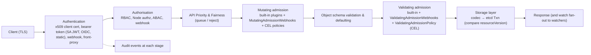

# 5.5 The API server and etcd: how a request becomes cluster state

| | |
|---|---|
| Level | Advanced |
| Priority tier | 0 |
| Lab venue | Control-plane access on a kubeadm/kind cluster; `kubectl`, `etcdctl`, `curl`, `jq` |
| Part | Part 5: Kubernetes |
| Status | Drafted, labs **untested** |

## Why this matters for AI infrastructure

Large training jobs turn the control plane into a stress test: a 512-GPU job can create hundreds of pods and thousands of objects (pods, services, configmaps, events) in seconds, each node's kubelet and each controller keeps watches open, schedulers and batch systems list large collections, and monitoring tools poll. When the API server or etcd becomes the bottleneck, the whole platform degrades even though no GPU is faulty: pods linger in Pending, `kubectl` times out, controllers lag, and in the worst case leader elections thrash and workloads are evicted. A senior platform engineer must understand exactly how a request flows through the API server, how etcd stores and serves data, what metrics reveal trouble, and how to scale and protect these two components.

## Prerequisites and outcomes

Needs 5.3. After this chapter you can:

- Walk the request pipeline in kube-apiserver (authentication, authorisation, admission, validation, storage, response, audit) and identify where each plugin plugs in.
- Navigate the REST API (groups, versions, resources, subresources, verbs), use the raw API with `kubectl --raw`/`proxy`/`curl`, and read API discovery and OpenAPI.
- Explain `resourceVersion`, optimistic concurrency (409), `generation` vs `observedGeneration`, list/watch semantics, bookmarks, the watch cache, pagination and why informers exist.
- Use server-side apply and field managers; explain create/update/patch/apply differences and conflict handling.
- Describe API Priority and Fairness and tune it; read the key API server and etcd metrics.
- Explain etcd internals (Raft, WAL, snapshots, MVCC revisions, compaction, defragmentation, quotas, leases) and operate it (health, member management, backup/restore, performance tuning).
- Diagnose control-plane saturation and apply scaling practices for large GPU clusters.

## 1. The API surface

### Groups, versions, kinds, resources

The API is organised by **group/version**: core (`/api/v1`: pods, nodes, services, configmaps, secrets, PVCs...), named groups (`/apis/apps/v1`: deployments, statefulsets, daemonsets; `batch/v1`: jobs, cronjobs; `networking.k8s.io/v1`; `rbac.authorization.k8s.io/v1`; `storage.k8s.io/v1`; `scheduling.k8s.io/v1`; `apiextensions.k8s.io/v1`; `node.k8s.io/v1`; `coordination.k8s.io/v1` leases; `flowcontrol.apiserver.k8s.io/v1`; plus CRD groups like `kueue.x-k8s.io`, `nvidia.com`). A **kind** is the type (Deployment); a **resource** is its REST collection (`deployments`); **subresources** hang off objects: `/status`, `/scale`, `/binding`, `/eviction`, `/log`, `/exec`, `/portforward`, `/token`, `/ephemeralcontainers`.

```bash
kubectl proxy --port=8001 &
curl -s localhost:8001/ | jq '.paths | length'
curl -s localhost:8001/api/v1 | jq '.resources[] | {name, namespaced, kind, verbs}' | head -40
curl -s localhost:8001/apis/apps/v1/namespaces/default/deployments | jq '.items[].metadata.name'
kubectl get --raw /apis | jq '.groups[].name' | head -40
kubectl get --raw /openapi/v3 | jq '.paths | keys | length'
kubectl api-resources --verbs=list --namespaced=false -o name | head
kubectl explain deployment.spec.strategy --api-version=apps/v1
```

### Versioning and conversion

Each resource has multiple served versions (alpha → beta → stable `v1`) but exactly one **storage version** persisted in etcd. The API server converts between versions on read/write (for built-in types via internal conversion; for CRDs via `conversion: None` or a conversion webhook). Deprecated APIs are removed on a documented schedule (for example `extensions/v1beta1` Ingress, `batch/v1beta1` CronJob); before upgrading Kubernetes, scan for removed API usage (`kubectl get --raw /metrics | grep apiserver_requested_deprecated_apis`, tools like `pluto`, `kubent`) and migrate manifests and operators. Stored objects in old storage versions are re-written via `kubectl-convert` or by the storage version migrator.

### Verbs and HTTP mapping

| Verb | HTTP | Notes |
|---|---|---|
| get | GET `/…/name` | |
| list | GET `/…/resources` | `limit`, `continue` for pagination; `labelSelector`, `fieldSelector`; `resourceVersion` semantics matter (below) |
| watch | GET `?watch=1&resourceVersion=N` | Streams events (ADDED, MODIFIED, DELETED, BOOKMARK, ERROR) |
| create | POST | 201 or 409 AlreadyExists |
| update | PUT | Full replace; needs current `resourceVersion` (else 409) |
| patch | PATCH | JSON Patch, JSON Merge Patch, Strategic Merge Patch (built-in types), or **Apply** patch (`application/apply-patch+yaml`) for server-side apply |
| delete / deletecollection | DELETE | Grace period, propagation policy, preconditions |
| proxy, exec, attach, portforward, log | GET/POST/WebSocket/SPDY | Streaming subresources proxied to kubelet |

## 2. The request pipeline



1. **Authentication** determines *who* (user, groups, extra). Methods: client certificates (kubeadm admin, kubelet, controller-manager use these), ServiceAccount tokens (projected, audience-bound, short-lived JWTs verified by the API server's SA signing key), OIDC (id tokens from IdP), webhook token review, authenticating proxy headers. Anonymous requests are `system:anonymous` unless disabled.
2. **Authorisation** decides *whether*: RBAC (the default, 5.16), the Node authorizer (kubelets may read only objects related to pods bound to them), and webhook authorizers. `kubectl auth can-i` and `kubectl auth whoami` help.
3. **API Priority and Fairness** classifies requests into priority levels and flows; applies concurrency limits and queuing (section 6).
4. **Mutating admission** modifies objects: built-ins (`ServiceAccount`, `DefaultStorageClass`, `LimitRanger`, `DefaultTolerationSeconds`, `MutatingAdmissionWebhook`) and webhooks (sidecar injectors like Istio, policy mutators like Kyverno, GPU-related mutators). Called in order, may be re-invoked (reinvocation policy).
5. **Schema validation** against OpenAPI (types, required fields; unknown fields rejected or pruned for CRDs depending on `preserveUnknownFields`/structural schema; field validation levels `Strict`/`Warn`/`Ignore`).
6. **Validating admission**: built-ins (`ResourceQuota`, `PodSecurity`, `NodeRestriction`), webhooks (OPA Gatekeeper, Kyverno), and **ValidatingAdmissionPolicy** (in-process CEL, no webhook latency).
7. **Persistence**: encode and write with a transaction in etcd, conditional on `resourceVersion` (for updates). Secrets can be encrypted at rest here via `EncryptionConfiguration` (AES-CBC/GCM, KMS v2 envelope encryption).
8. **Response and fan-out**: the written revision becomes the object's `resourceVersion`; the watch cache pushes events to all watchers.

Webhook caveats: admission webhooks are a common source of outages: a slow or down webhook with `failurePolicy: Fail` blocks all matching writes (including node and system pods); set tight `timeoutSeconds`, scope with `namespaceSelector/objectSelector`, exclude `kube-system`/own namespace, use `failurePolicy: Ignore` for non-critical mutations, run multiple replicas with PDBs, and monitor `apiserver_admission_webhook_rejection_count` and duration.

In *Kubernetes: Up and Running* Chapter 17 (*Extending Kubernetes*), Brendan Burns, Joe Beda, Kelsey Hightower, and Lachlan Evenson walk through the end-to-end mechanics of building and registering external admission webhooks for a custom resource (`apiVersion: beta.kuar.com/v1, kind: LoadTest`):
1. **TLS requirement & Certificate Signing Request (`CSR`):** Because `kube-apiserver` only calls admission webhooks over HTTPS, the webhook server must present a certificate signed by a CA trusted by `caBundle` in the webhook configuration (or signed via the Kubernetes `certificates.k8s.io` API by submitting a `CertificateSigningRequest`, running `kubectl certificate approve validating-controller.default`, and extracting `.status.certificate | base64 -d > server.crt`).
2. **`AdmissionReview` request/response protocol:** For a **`ValidatingWebhookConfiguration`** (`validator.kuar.com` intercepting `CREATE` on `loadtests`), `kube-apiserver` sends an `AdmissionReview` JSON payload containing `request.object` and expects a JSON response with `response.uid` and `response.allowed: true|false` (plus `status.message` on rejection). For a **`MutatingWebhookConfiguration`** (defaulting `spec.paths` to `["/index.html"]` when omitted), the webhook returns `response.allowed: true`, `response.patchType: "JSONPatch"`, and a base64-encoded **`JSONPatch`** array (`[{"op": "add", "path": "/spec/paths", "value": ["/index.html"]}]`).
3. **Three patterns of API extension (`KUR` Chapter 17):** (a) **Just Data** (storing structured configuration in a CRD validated by OpenAPI schema and webhooks), (b) **Controllers** (watching a CRD like `LoadTest` and reconciling Pods/Services to match), and (c) **Compilers / Abstractions** (translating a high-level declarative object into lower-level Kubernetes primitives).

## 3. resourceVersion, generation and concurrency

- **`metadata.resourceVersion`** is an opaque string (do not parse or compare except equality) that changes on every write; internally derived from etcd's global revision. Uses: (1) **optimistic concurrency**: an update including `resourceVersion=X` succeeds only if the stored object is still X, else `409 Conflict` ("the object has been modified; please apply your changes to the latest version"); controllers retry using `retry.RetryOnConflict`. (2) **watch resume points**. (3) **cache consistency** in list semantics.
- **`metadata.generation`** increments when `spec` changes (not status/metadata); controllers write `status.observedGeneration` so you can tell whether status reflects the latest spec (`kubectl rollout status` uses this).
- **`metadata.uid`** identifies an object instance (recreated objects have new UIDs; ownerReferences use UID to avoid adopting the wrong object).
- **List semantics**: `resourceVersion` unset → "most recent" (quorum read from etcd; expensive); `resourceVersion="0"` → any cached version from the watch cache (cheap, may be stale); `resourceVersion=N` with `resourceVersionMatch=NotOlderThan|Exact`. Informers do an initial list (RV=0 or latest) then watch from that RV.
- **Pagination**: `limit=500` returns a `continue` token valid for a compaction window (~5 minutes); large lists without pagination can blow up API server memory (a classic outage cause). Streaming lists (watch-list) reduce memory in newer releases.
- **Watch**: HTTP chunked stream of JSON/protobuf events; clients resume from the last seen RV; the server only retains a bounded history in the watch cache and etcd compaction window; if the client is too far behind it receives **410 Gone** ("too old resource version") and must relist. **Bookmarks** (`allowWatchBookmarks=true`) are periodic events carrying a recent RV so a reconnecting client doesn't fall out of window. **Informers** (client-go) implement list+watch+resync+indexers+shared caches and relist on 410; custom clients that poll with `kubectl get` in a loop overload the API server.
- **Server-side filtering**: selectors on list/watch (`labelSelector`, `fieldSelector=spec.nodeName=...`) reduce traffic; kubelets watch only pods with their node name; heavy clients should filter and use `metadata`-only watches (PartialObjectMetadata) where possible.

## 4. Writing objects: create, update, patch, apply

| Operation | Semantics | When |
|---|---|---|
| `create` | Insert; fails if exists | Imperative creation |
| `update` (PUT) | Replace entire object; needs RV | Controllers that own the whole object; beware lost updates |
| `patch` (merge/strategic/JSON patch) | Partial change; strategic merge understands list merge keys for built-ins | `kubectl patch`, small edits |
| **`apply` (server-side)** | Declarative: send the *fields you own*; server merges and tracks ownership in `managedFields` per field manager; conflicts reported when another manager owns a field (use `--force-conflicts` deliberately) | GitOps tools, operators, `kubectl apply --server-side` |
| Client-side `kubectl apply` | Three-way merge using the `last-applied-configuration` annotation | Legacy default; prefer server-side apply for large objects and CRDs |

Field managers matter in multi-actor environments (Argo CD, Terraform, HPA, operators): the manager that last applied a field owns it; unmanaged mutations by controllers (e.g., HPA scaling `spec.replicas`) conflict with applied manifests unless the manifest omits that field. Inspect with `kubectl get deploy x -o yaml --show-managed-fields`. See 4.25/4.26 for ownership guidance.

Deletion: `DELETE` with `propagationPolicy` (`Foreground`, `Background`, `Orphan`) and `gracePeriodSeconds`; objects with **finalizers** get `deletionTimestamp` and remain until controllers remove the finalizers (common cause of stuck Terminating namespaces/PVCs/CRs). `kubectl delete --force --grace-period=0` bypasses graceful termination for pods (dangerous for StatefulSets and shared storage).

## 5. Audit, authn/z debugging and security notes

- **Audit logging**: policy file selecting which events (Metadata, Request, RequestResponse) to record per resource/user; backends: file (with rotation) or webhook. Essential for forensics ("who deleted that namespace?"), compliance, and understanding noisy clients. Tune to avoid logging high-volume reads of secrets at RequestResponse level.
- **Debug auth**: `kubectl auth can-i create pods --as=system:serviceaccount:team-a:trainer -n team-a`, `kubectl auth whoami`, `--v=8` to see requests, API server logs (`--v=2` default), audit events for 401/403 reasons.
- **Anonymous and insecure ports**: disable anonymous auth for production; the insecure port was removed; protect `/metrics` and `/debug/pprof` (RBAC `system:monitoring`).
- **Service account tokens**: use bound projected tokens (short-lived, audience-specific) instead of legacy long-lived secrets; disable `automountServiceAccountToken` where not needed (5.16).
- **Encryption at rest**: configure `EncryptionConfiguration` with a KMS v2 provider (cloud KMS/Vault) for Secrets; rotate keys; verify by reading raw etcd values (`etcdctl get /registry/secrets/...` should show `k8s:enc:`).
- **Network exposure**: the API server endpoint should not be on the Internet; use private endpoints/VPN/bastion, authorised networks; client certificates and tokens are bearer credentials.

## 6. API Priority and Fairness (APF)

APF replaced the crude `--max-requests-inflight` limits. Requests are matched by **FlowSchemas** (subject, verb, resource) to a **PriorityLevelConfiguration** (shares of concurrency, queues, queue length); within a level, **flows** (distinguished by user or namespace, `distinguisherMethod`) are fair-queued by shuffle sharding so a noisy tenant fills only some queues. Built-in levels: `exempt` (system masters), `node-high`, `system`, `leader-election`, `workload-high`, `workload-low`, `global-default`, `catch-all`.

```bash
kubectl get flowschemas
kubectl get prioritylevelconfigurations
kubectl get --raw /debug/api_priority_and_fairness/dump_priority_levels
kubectl get --raw /metrics | grep -E 'apiserver_flowcontrol_(request_wait_duration|rejected_requests|current_inqueue|dispatched_requests)' | head
```

```yaml
apiVersion: flowcontrol.apiserver.k8s.io/v1
kind: PriorityLevelConfiguration
metadata: { name: batch-controllers }
spec:
  type: Limited
  limited:
    nominalConcurrencyShares: 30
    lendablePercent: 20
    limitResponse:
      type: Queue
      queuing: { queues: 64, handSize: 6, queueLengthLimit: 50 }
---
apiVersion: flowcontrol.apiserver.k8s.io/v1
kind: FlowSchema
metadata: { name: kueue-and-training-operators }
spec:
  priorityLevelConfiguration: { name: batch-controllers }
  matchingPrecedence: 800
  distinguisherMethod: { type: ByUser }
  rules:
    - subjects:
        - kind: ServiceAccount
          serviceAccount: { name: kueue-controller-manager, namespace: kueue-system }
        - kind: ServiceAccount
          serviceAccount: { name: training-operator, namespace: kubeflow }
      resourceRules:
        - verbs: ["*"]
          apiGroups: ["*"]
          resources: ["*"]
          namespaces: ["*"]
```

A PriorityLevelConfiguration only matters once a FlowSchema routes requests to it. Symptoms of APF trouble: HTTP 429 responses with `Retry-After`, rising `apiserver_flowcontrol_request_wait_duration_seconds`, controllers logging client-side throttling ("Waited for ... due to client-side throttling") because client-go QPS/burst limits are too low (raise `--kube-api-qps`/`--kube-api-burst` on controllers/schedulers for big clusters). Fix by giving critical components (scheduler, kubelets, controllers) dedicated levels, constraining noisy clients (unfiltered list loops), and increasing API server capacity.

## 7. etcd internals

### Deployment models for etcd

etcd is the database for every object in a cluster. It is a distributed store that uses a consensus algorithm to keep a copy of cluster state on several machines. Consensus depends on reliable network connections between the etcd nodes, and those nodes have strict latency needs. Two architectural choices shape the deployment: whether etcd runs on dedicated machines or shares them with the control plane, and whether it runs in a container or directly on the host.

**Network considerations.** The default etcd settings are designed for the latency inside a single datacenter. If you spread etcd across several datacenters, test the average round-trip time between members. Tune the heartbeat interval and the election timeout if you need to. Do not spread etcd clusters across different regions. The book strongly discourages it. If you use several datacenters for better availability, keep them close together within one region.

**Dedicated versus colocated.** Start with cluster size, meaning the number of worker nodes you run per cluster. If etcd performance suffers, your ability to control the cluster's resources suffers too. Workloads that do not depend on the Kubernetes API keep running during etcd trouble. Even so, the control plane must stay healthy. A car that keeps rolling with a broken steering wheel gives little comfort. If larger clusters place heavy read and write demand on etcd, dedicate machines to it. That removes resource contention with the other control plane components. A cluster is "large" depending on the size of its control plane machines, but anything above 50 worker nodes deserves the question. For clusters with over 200 workers, plan for dedicated etcd from the start. For smaller clusters, colocated etcd saves management overhead and infrastructure cost. Kubeadm supports that model and handles its concerns.

**Containerized versus on host.** For colocated etcd, run it in a container. Kubeadm supports and tests that setup, so it is your best option. With dedicated machines, you have two options. You can install etcd on the host, which lets you bake it into machine images and removes the need for a container runtime on those hosts. Or you can run etcd in a container, with a container runtime and kubelet on the machines and a static manifest to start etcd. That follows the same patterns and install methods as the other control plane components. Repeated patterns help in complex systems, so this choice comes down largely to preference.

### Data model and Raft

etcd is a replicated, linearizable key-value store. Cluster members use **Raft**: one **leader** accepts writes, appends them to its log (**WAL**), replicates to followers, and commits once a majority has persisted them (an `fsync` per commit), then applies to the state machine (bbolt B+tree). Reads can be linearizable (via the leader / read index, default for Kubernetes "quorum" reads) or serializable (local, possibly stale). Heartbeats and election timeouts (default 100 ms/1000 ms) require low network latency; a leader that cannot keep up triggers elections, visible as API latency spikes.

Quorum arithmetic and operations (from 5.3): 3 members tolerate 1 failure, 5 tolerate 2; even numbers add cost without tolerance; **never add a member before removing a dead one** (the cluster size and quorum would rise while a member is down). Learner members (non-voting) allow safe catch-up before promotion.

### MVCC, revisions, compaction, defrag

Each write creates a new **revision** (a cluster-wide monotonic counter); etcd keeps a history of key versions for watch and consistent reads. The Kubernetes `resourceVersion` is derived from the revision. History grows until **compaction** discards revisions older than a point (the API server runs periodic compaction, default every 5 minutes, `--etcd-compaction-interval`); compaction frees logical space but the bbolt file does not shrink until **defragmentation** (`etcdctl defrag`, one member at a time, blocks that member briefly). A **database quota** (`--quota-backend-bytes`, default 2 GiB; recommended up to 8 GiB) raises an alarm `NOSPACE` when exceeded, after which etcd becomes read-only until space is freed (compact + defrag + `alarm disarm`).

```bash
export ETCDCTL_API=3
EP="--endpoints=https://127.0.0.1:2379 --cacert=/etc/kubernetes/pki/etcd/ca.crt --cert=/etc/kubernetes/pki/etcd/server.crt --key=/etc/kubernetes/pki/etcd/server.key"
etcdctl $EP endpoint status -w table               # leader, db size, raft index, version
etcdctl $EP endpoint health --cluster
etcdctl $EP member list -w table
etcdctl $EP alarm list
rev=$(etcdctl $EP endpoint status -w json | jq '.[0].Status.header.revision'); etcdctl $EP compact $rev
etcdctl $EP defrag                                 # per member, sequentially
etcdctl $EP get /registry/ --prefix --keys-only | awk -F/ '{print $3}' | sort | uniq -c | sort -rn | head -15    # which resource types dominate
etcdctl $EP get /registry/namespaces/default       # protobuf-encoded value (binary)
```

### What lives in etcd

Keys under `/registry/<resource>/...` (for namespaced: `/registry/pods/<ns>/<name>`), leases (node heartbeats, leader election), events (high churn, 1-hour TTL: often moved to a **separate etcd cluster** via `--etcd-servers-overrides=/events#https://...`), CRD custom resources (`/registry/<group>/<resource>/...`). Sizes: objects up to ~1.5 MiB limit (etcd request size limit); large ConfigMaps/Secrets and huge CRs (e.g., Argo Workflows with big status, huge Pod lists) hurt performance. Anti-patterns: storing blobs, logs or metrics in objects; very high-frequency status updates (every second per pod) across tens of thousands of objects; thousands of Events per second.

### Performance factors and tuning

- **Disk**: the dominant factor. WAL fsync latency (`etcd_disk_wal_fsync_duration_seconds`; p99 < 10 ms is a common target) and backend commit (`etcd_disk_backend_commit_duration_seconds`). Use dedicated NVMe/SSD, a separate device for the WAL if possible, no noisy neighbours, no network-attached slow disks, no swap.
- **CPU and memory**: modest but must not be starved; etcd benefits from having its working set in page cache (RAM ≥ db size × ~2).
- **Network**: low latency and high reliability between members (same region/datacenter, ideally same rack topology awareness); cross-AZ is acceptable in a metro, cross-region is not for Kubernetes.
- **Heartbeat/election tuning** (`--heartbeat-interval`, `--election-timeout`): increase on high-latency networks (keep election timeout 5-10× heartbeat).
- **Snapshot count and compaction**: `--snapshot-count`, `--auto-compaction-*`; Kubernetes handles compaction itself.
- **Separate etcd for events** and sometimes for leases at very large scale.
- **Client behaviour**: reduce write amplification (avoid controllers updating status needlessly, use patch vs update thoughtfully, set sensible resync periods), paginate lists, use watches with filters.
- **Observability**: `etcd_server_has_leader`, `etcd_server_leader_changes_seen_total`, `etcd_server_proposals_failed_total`, `etcd_mvcc_db_total_size_in_bytes`, `etcd_network_peer_round_trip_time_seconds`, `grpc_server_handled_total`, plus `apiserver_storage_*` metrics (`apiserver_storage_db_total_size_in_bytes`, `etcd_request_duration_seconds` from the API server's view).

### Backup, restore, and member operations

```bash
# Snapshot (run on a healthy member; schedule it and ship off-cluster)
etcdctl $EP snapshot save /backup/etcd-$(date +%F-%H%M).db
etcdutl snapshot status /backup/etcd-....db -w table      # integrity (etcdutl is the offline tool in newer releases)

# Restore (conceptually: stop kube-apiserver and etcd on all control-plane nodes, restore data dir on each member with a new cluster token, restart)
etcdutl snapshot restore /backup/etcd-....db --name cp1 \
  --initial-cluster cp1=https://10.0.0.11:2380,cp2=https://10.0.0.12:2380,cp3=https://10.0.0.13:2380 \
  --initial-cluster-token etcd-cluster-restore --initial-advertise-peer-urls https://10.0.0.11:2380 --data-dir /var/lib/etcd-restore
# then point the etcd static pod manifest at /var/lib/etcd-restore and start; repeat per member

# Replace a dead member (HA)
etcdctl $EP member remove <id>      # FIRST remove the dead member
etcdctl $EP member add cp4 --peer-urls=https://10.0.0.14:2380      # then add the new one (as --learner then promote in newer versions)
```

Restoring etcd rewinds the cluster to the snapshot time: objects created after are lost (pods reappear/disappear relative to reality; kubelets reconcile); coordinate with a freeze of controllers and expect orphaned cloud resources (5.20). Practise restoring on a scratch cluster.

## 8. API server operations and scaling

Key flags and settings (kubeadm exposes them through `ClusterConfiguration.apiServer.extraArgs`):

- `--etcd-servers`, `--etcd-servers-overrides` (events), `--etcd-compaction-interval`.
- `--max-requests-inflight`, `--max-mutating-requests-inflight` (used when APF disabled; with APF they bound total), `--request-timeout`, `--min-request-timeout` (watch).
- `--watch-cache`, `--default-watch-cache-size`, `--watch-cache-sizes=pods#5000` (bigger caches for hot resources).
- `--audit-policy-file`, `--audit-log-path`, `--audit-log-maxage`.
- `--encryption-provider-config`.
- `--enable-admission-plugins`, `--disable-admission-plugins`.
- `--feature-gates` (stable-by-default features per version; avoid alpha in production).
- Horizontal scale: multiple API servers behind a load balancer (stateless); each has its own watch cache and connections to etcd; sticky connections for long watches; ensure the LB idle timeout > watch timeouts, or clients reconnect storm.
- Vertical: CPU/RAM; API server memory is dominated by watch caches and list responses.
- **Aggregation layer** and webhooks add latency and failure modes; monitor them.

Scaling levers for 1,000 to 5,000 node GPU clusters:

1. Dedicated control-plane machines (e.g., 16+ vCPU, 64+ GB) with NVMe for etcd; three or five API servers.
2. Separate events etcd; compaction tuned; defrag schedule.
3. Larger client QPS/burst for scheduler/controllers; APF levels for batch controllers and tenants.
4. Filter and paginate clients; replace polling with informers; use `PartialObjectMetadata` watches in custom controllers; avoid cluster-wide list loops from dashboards.
5. Reduce object churn: batch Job design (fewer, larger pods; indexed Jobs; JobSet), avoid per-pod ConfigMaps/Secrets, consolidate Services (EndpointSlices already help), tune kubelet status update frequency (`nodeStatusReportFrequency`, `nodeLeaseDurationSeconds`) at huge node counts.
6. Admission webhook hygiene (timeouts, scoping, HA).
7. Upgrade to releases with streaming lists / consistent reads from cache for lower memory.
8. Split into multiple clusters beyond ~5k nodes (5.35).

## 9. Diagnosing control-plane saturation

| Symptom | Metrics/logs | Likely cause | Fix |
|---|---|---|---|
| `kubectl` slow/timeouts | `apiserver_request_duration_seconds{verb="LIST"}` high, API server CPU/memory | Unfiltered large LISTs, expensive webhooks, APF queues | Find client via audit/`apiserver_request_total` by user-agent; paginate/filter; APF |
| 429 responses | `apiserver_flowcontrol_rejected_requests_total` | Priority level concurrency exhausted | Add levels/shares, throttle noisy client |
| Pods Pending but nodes free | Scheduler logs/metrics; `scheduler_pending_pods`; API write latency | Scheduler throttled by client QPS; API/etcd slow; scheduling plugin latency | Raise scheduler QPS/burst; fix etcd; profile plugins |
| Leader election flaps | `leader_election_master_status`, controller logs "leaderelection lost" | etcd/API latency > lease renew deadline | Fix disk/network; raise lease durations cautiously |
| etcd "mvcc: database space exceeded" | `etcd_mvcc_db_total_size_in_bytes`, `alarm list` | Quota exceeded: churn without compaction/defrag; huge objects | Compact, defrag, disarm, raise quota, reduce churn |
| etcd "took too long to execute" | WAL fsync p99 high | Slow disk, CPU steal, noisy neighbour | Move to NVMe, isolate, check `iostat` |
| API server OOM | Memory graphs | Large watch caches, huge list responses, too many watchers | More RAM, watch cache sizing, limit list sizes, streaming lists |
| Watch gaps, 410 Gone loops | Client logs | Clients lagging behind compaction/watch cache window | Bookmarks, informers, reduce lag |
| `context deadline exceeded` to webhooks | `apiserver_admission_webhook_admission_duration_seconds` | Webhook slow/down | Timeouts, failurePolicy, scale webhook |
| Event storms | `etcd` key counts for events; `kubectl get events` rate | Crash loops, flapping probes, scheduler failures | Fix root cause; separate events etcd; event rate limiting |

Debugging toolkit: `kubectl get --raw /metrics`, `/debug/pprof` (CPU/heap profiles via `go tool pprof`), `/livez?verbose`, `/readyz?verbose`, audit logs, `kubectl top`, API server `-v=4` temporarily, `etcdctl` checks, Prometheus rules from kube-prometheus (`KubeAPIErrorBudgetBurn`, `etcdHighCommitDurations`, `etcdInsufficientMembers`).

## 10. Lab

First, run the self-checking Python lab (`code/part05/apiserver_etcd_mvcc_lab.py`) locally. It verifies the `etcd` MVCC revision store and `kube-apiserver` optimistic concurrency (`EtcdMVCCSimulator`: testing monotonic revisions, HTTP `409 Conflict` on stale `resourceVersion`, compaction, and `410 Gone` vs `BOOKMARK` watch resumption), Server-Side Apply field-ownership conflict detection (`evaluate_ssa_field_ownership` on `managedFields`), and API Priority and Fairness concurrency allocation (`compute_apf_concurrency_limit`).

```bash
python3 code/part05/apiserver_etcd_mvcc_lab.py
```

Next, on a `kind` or `kubeadm` cluster (all interactive shell steps below are `untested here`), work through these exercises:

1. **Raw API tour**: start `kubectl proxy`; `curl` discovery docs, list pods, get a pod, create a ConfigMap with `curl -X POST`, watch with `?watch=1`; read response headers and chunked events; then repeat with `kubectl get --raw`.
2. **Pipeline observation**: set `-v=8`; apply a Deployment; map HTTP calls to stages; enable audit logging with a policy that records `RequestResponse` for ConfigMaps in one namespace; read the events for authentication, authorization decision and stage timings.
3. **Optimistic concurrency**: get a ConfigMap, update it twice from two shells using stale `resourceVersion` (`kubectl replace`); observe 409; use `kubectl patch` instead; repeat with server-side apply from two field managers and trigger a conflict.
4. **Watch semantics**: open a watch from an old resourceVersion after enough writes to exceed compaction (or via a very old RV) and observe `410 Gone`; use `allowWatchBookmarks`; write a 20-line Python client using the `kubernetes` library with and without an informer-like relist.
5. **Admission**: add a mutating webhook (tiny Python server) that adds a label and a validating webhook that rejects a field; deploy with `failurePolicy: Fail` and stop the webhook to see writes blocked; fix with scoping and `Ignore`; try the same logic using ValidatingAdmissionPolicy (CEL).
6. **APF**: create a FlowSchema/PriorityLevelConfiguration for a test service account; generate load with a looped `kubectl get pods -A` (many parallel clients) and observe `apiserver_flowcontrol_*` metrics and 429s; compare with the default catch-all.
7. **etcd exploration**: with `etcdctl` list key prefixes, count per resource type, read a Secret value and confirm encryption (before/after enabling `EncryptionConfiguration`); inspect `etcd` metrics endpoint; take and verify a snapshot.
8. **Compaction and defrag**: churn a ConfigMap rapidly to grow the DB; observe DB size vs in-use size; compact and defrag; trigger and clear a NOSPACE alarm in a throwaway cluster with a tiny quota.
9. **Restore drill**: snapshot a kind/kubeadm lab cluster, create objects, restore to the snapshot on a spare control plane and observe which objects vanish; note the steps and timings.
10. **HA etcd**: with 3 members, stop one, then two; observe API behaviour (reads vs writes); replace a member correctly (remove then add) and incorrectly (add first) in a lab and compare.
11. **Load**: use `kube-burner` or `clusterloader2` to create thousands of objects/pods (fake nodes via `KWOK` for scale testing without real machines); watch API/etcd metrics, find the first bottleneck, tune (watch cache, QPS, APF) and re-test.
12. **Dashboards and alerts**: import a control-plane dashboard; define alerts for API p99 latency, 5xx ratio, etcd fsync, DB size, leader changes, APF rejections.
13. **Clean up**.

## 11. Common mistakes

- Treating `resourceVersion` as a number to compare; polling with `kubectl get` loops instead of watching; unfiltered cluster-wide lists.
- Webhooks with `failurePolicy: Fail`, no namespace exclusions, single replica, slow endpoints.
- Running etcd on shared or network disks; no monitoring of fsync latency and DB size; never defragmenting; no backups, or untested ones.
- Even-numbered etcd clusters; adding a member before removing a dead one; spreading etcd across high-latency links.
- Storing large blobs/state in ConfigMaps, CRs or annotations; high-frequency status writes; unbounded Event creation.
- Using `kubectl delete --force` on pods of StatefulSets or with RWO volumes; removing finalizers blindly.
- Ignoring API deprecations until an upgrade breaks controllers.
- Exposing the API server publicly; leaving anonymous auth on; unencrypted Secrets in etcd.
- Leaving client-go default QPS (5/10) on custom controllers handling thousands of objects.

## 12. Interview angles

- "Describe the lifecycle of an API request in kube-apiserver."
- "What are mutating and validating admission? What happens when a webhook is down?"
- "Explain resourceVersion and optimistic concurrency. What causes a 409? What is a 410 Gone?"
- "How do watches and informers reduce API server load?"
- "How does etcd achieve consistency? What is quorum? Why odd member counts?"
- "How do you back up and restore etcd? What are the consequences of a restore?"
- "The API server is slow. How do you find out why?" (metrics, audit, APF, etcd fsync, noisy list clients.)
- "What is server-side apply and why do GitOps tools use it?"
- "How would you prepare the control plane for a 5,000-node GPU cluster?"

## Exercises

1. **Navigating the Kubernetes REST API (`Groups`, `Versions`, `Kinds`, `Resources`, `Subresources`, and Storage Version Conversion, `KPG` Ch. 2):** Explain the URL mapping for core (`/api/v1/...`) vs named groups (`/apis/<group>/<version>/...`), the difference between a `Kind` (`Deployment`) and a `resource` (`deployments`), how `kube-apiserver` converts between multiple served versions (`v1alpha1`, `v1beta1`, `v1`) and the single **storage version** persisted in `etcd`, and how to detect deprecated APIs before a cluster upgrade.
2. **The `kube-apiserver` Request Pipeline and Admission Webhooks vs. CEL (`KUR` Chapter 17):** Trace a `POST` request through Authentication -> Authorization -> APF -> Mutating Admission -> OpenAPI Schema Validation -> Validating Admission -> `etcd` persistence & KMS v2 encryption -> Watch fan-out, and explain how `MutatingWebhookConfiguration` (`JSONPatch` response) and `ValidatingWebhookConfiguration` (`KUR` Ch. 17) differ from in-process `ValidatingAdmissionPolicy` (CEL).
3. **`resourceVersion`, Optimistic Concurrency (`409 Conflict`), Watch Semantics (`410 Gone`, `BOOKMARK`), and `LIST` Cache Modes:** Using `EtcdMVCCSimulator` in `code/part05/apiserver_etcd_mvcc.py`, explain how `metadata.resourceVersion` maps to `etcd`'s global MVCC revision, why a stale `PUT` returns `409 Conflict`, why a watch behind the compacted revision returns `410 Gone`, how `allowWatchBookmarks=true` prevents `410 Gone` on quiet resources, and the difference between `LIST` with `resourceVersion=""` (quorum read) vs `resourceVersion="0"` (watch cache).
4. **Writing Objects: `PUT` (`update`) vs. `PATCH` (Strategic/Merge/JSON) vs. Server-Side Apply (`managedFields`):** Using `evaluate_ssa_field_ownership()` in `code/part05/apiserver_etcd_mvcc.py`, compare client-side `kubectl apply` (`last-applied-configuration` annotation) with Server-Side Apply (`application/apply-patch+yaml`, `metadata.managedFields`), and trace what happens when Argo CD and an HPA both touch `/spec/replicas`.
5. **API Priority and Fairness (`APF`: `FlowSchema` and `PriorityLevelConfiguration`):** Using `compute_apf_concurrency_limit()` in `code/part05/apiserver_etcd_mvcc.py`, trace the `batch-controllers` `PriorityLevelConfiguration` and `kueue-and-training-operators` `FlowSchema` in Section 6, explaining `nominalConcurrencyShares`, `lendablePercent`, shuffle sharding (`queues: 64, handSize: 6`), and how to distinguish server-side APF `429` throttling from client-side `client-go` QPS/burst throttling.
6. **`etcd` Internals (`Raft`, `WAL`, `MVCC`, `Compaction`, `Defrag`, `NOSPACE`), Member Replacement, and 5,000-Node GPU Control-Plane Scaling:** Explain why `etcd` compaction alone does not shrink the on-disk `bbolt` file until `etcdctl defrag` runs, how to clear an `etcdserver: mvcc: database space exceeded` (`NOSPACE`) alarm, why a dead `etcd` member must be **removed before adding** a replacement, and list the 8 scaling levers in Section 8 for a 5,000-node GPU cluster.

## Checkpoint questions (20)

<details>
<summary>1. What is the difference between a Kubernetes API `Kind`, a `Resource`, and a `Subresource`, and how do Core and Named API URL paths differ (`KPG` Chapter 2)?</summary>

- **Core (legacy) API group (`""`):** Served under **`/api/v1/...`** (e.g., `/api/v1/namespaces/default/pods`).
- **Named API groups (`apps`, `batch`, `networking.k8s.io`, CRDs):** Served under **`/apis/<group>/<version>/...`** (e.g., `/apis/apps/v1/namespaces/default/deployments`).
- **Kind vs. Resource:** A **Kind** (`Deployment`, `Pod`) is the PascalCase Go/JSON type name inside `kind:`; a **Resource** (`deployments`, `pods`) is the lowercase plural HTTP collection noun in the URL path.
- **Subresource (`/status`, `/scale`, `/logs`, `/exec`, `/binding`, `/eviction`):** A scoped endpoint hanging off an individual resource instance that has its own RBAC rules and behavior (for example, `PUT /.../deployments/web/status` updates only `.status` without incrementing `.metadata.generation`).
</details>

<details>
<summary>2. When a CRD or built-in resource serves three API versions (`v1alpha1`, `v1beta1`, `v1`), how many versions are stored in `etcd`?</summary>

**Exactly one version—the designated `storage: true` version—is persisted in `etcd`.** A CRD can mark `served: true` on multiple versions (`v1alpha1`, `v1beta1`, `v1`) so old and new clients can read and write using their preferred schema (over default HTTPS port `6443`), while `kube-apiserver` converts objects on the fly (via a `Webhook` conversion service or `None` schema-only conversion) into the single **storage version** before writing to `etcd`.
</details>

<details>
<summary>3. Why do Mutating Admission plugins always run BEFORE Validating Admission plugins in `kube-apiserver`?</summary>

Because a mutating plugin or `MutatingAdmissionWebhook` can modify the object (for example, injecting a sidecar container, adding default resource limits via `LimitRanger`, or setting `runtimeClassName: nvidia`), **validating admission (`ValidatingAdmissionWebhook` / `ValidatingAdmissionPolicy` / `ResourceQuota`) must see the final mutated object** so a mutation cannot violate cluster security or quota policies. Furthermore, `kube-apiserver` validates the object against the OpenAPI schema *after* mutating admission so broken webhook patches are caught immediately.
</details>

<details>
<summary>4. In *Kubernetes: Up and Running* Chapter 17, how does a `MutatingAdmissionWebhook` return modifications to `kube-apiserver`?</summary>

When `kube-apiserver` sends an `AdmissionReview` HTTPS POST request to a `MutatingAdmissionWebhook`, the webhook inspects `request.object` and returns an `AdmissionResponse` with:
- `allowed: true`
- `patchType: "JSONPatch"`
- `patch`: a **base64-encoded RFC 6902 JSON Patch array** (for example, `[{"op": "add", "path": "/spec/paths", "value": ["/index.html"]}]`).
</details>

<details>
<summary>5. How can a misconfigured `ValidatingAdmissionWebhook` or `MutatingAdmissionWebhook` take down an entire Kubernetes cluster, and what five safeguards prevent it?</summary>

If a webhook is configured with **`failurePolicy: Fail`** and matches all namespaces (`*`) and Pods, and the webhook's own Pods crash or become unreachable during a node roll, `kube-apiserver` rejects all Pod creations—**including the webhook's own replacement Pods, `kube-system` DaemonSets, and `coredns`** (a total cluster deadlock). Five mandatory safeguards:
1. **Exclude `kube-system` and the webhook's own namespace** via `namespaceSelector` (`matchExpressions: [{key: kubernetes.io/metadata.name, operator: NotIn, values: [kube-system, webhook-ns]}]`).
2. Set a short **`timeoutSeconds` (e.g., `2`–`5` seconds)** rather than the 10-second default.
3. Run **$\ge 2$ webhook replicas** across zones with a `PodDisruptionBudget` and `system-cluster-critical` `PriorityClass`.
4. Prefer in-process **`ValidatingAdmissionPolicy` (`CEL`)** (and `MutatingAdmissionPolicy`) whenever external HTTP calls are not needed—zero network latency and zero webhook pod dependency.
5. Use `failurePolicy: Ignore` for non-security-critical mutations.
</details>

<details>
<summary>6. Compare `metadata.resourceVersion`, `metadata.generation`, and `status.observedGeneration`.</summary>

- **`metadata.resourceVersion`:** Opaque string backed by `etcd`'s MVCC `mod_revision`; **changes on every single write to the object** (including `metadata`, `spec`, or `status` updates). Used for optimistic concurrency (`409 Conflict`) and watch resumption.
- **`metadata.generation`:** Integer counter (`1, 2, 3...`) that increments **only when `.spec` changes** (never when `.status` or `.metadata` labels/annotations change).
- **`status.observedGeneration`:** Written by the controller into `.status` to record which `metadata.generation` it has most recently reconciled. When `status.observedGeneration == metadata.generation`, you know the controller's status report reflects the latest desired spec.
</details>

<details>
<summary>7. What is the difference between a `LIST` request with `resourceVersion` unset vs. `resourceVersion="0"`?</summary>

- **`resourceVersion` unset (`""`, default):** Performs a **linearizable quorum read from `etcd`** (or consistent read from cache via etcd read-index), guaranteeing the most up-to-date cluster state at the cost of an `etcd` round-trip.
- **`resourceVersion="0"`:** Serves the response **directly from `kube-apiserver`'s in-memory watch cache** without touching `etcd`. It is orders of magnitude faster and cheaper on `etcd`, though the cached snapshot may be slightly behind if the API server watch briefly lagged.
</details>

<details>
<summary>8. Why does a watch client receive HTTP `410 Gone` (`too old resource version`), and how do Watch Bookmarks (`allowWatchBookmarks=true`) prevent it?</summary>

`etcd` and `kube-apiserver`'s watch cache only keep a sliding window of historical revisions (default `etcd` compaction runs every **5 minutes**). If a client opens or reconnects a watch `?watch=1&resourceVersion=1000` and revision `1000` has already been compacted away, `kube-apiserver` returns **`410 Gone`**, forcing the client informer to perform a full `LIST` to re-synchronize.
On quiet resources (or heavily filtered watches where no matching object changes for hours), a client's last-seen `resourceVersion` would naturally fall behind the 5-minute compaction window if the connection drops. Enabling **`allowWatchBookmarks=true`** causes `kube-apiserver` to periodically send lightweight synthetic **`BOOKMARK`** events containing only the current head `resourceVersion` (zero object payload), keeping the client's resume bookmark fresh so reconnects never hit `410 Gone`.
</details>

<details>
<summary>9. Compare Client-Side `kubectl apply` (`last-applied-configuration`) with Server-Side Apply (`SSA`, `managedFields`).</summary>

- **Client-Side `kubectl apply`:** Stores a full copy of the previous YAML/JSON manifest in the **`kubectl.kubernetes.io/last-applied-configuration`** annotation (failing on objects > 256 KiB like large CRDs) and computes a 3-way merge on the client.
- **Server-Side Apply (`kubectl apply --server-side`, `PatchType: application/apply-patch+yaml`):** Sends your declarative intent directly to `kube-apiserver`, which merges fields on the server and records **per-field ownership inside `metadata.managedFields`** (`manager: argocd`, `manager: kube-controller-manager`). If a second actor tries to modify a field owned by another manager, `kube-apiserver` returns a **409 field conflict** unless `--force-conflicts` is specified, preventing controllers and GitOps tools from silently overwriting each other's fields.
</details>

<details>
<summary>10. How does API Priority and Fairness (`APF`) protect `kube-apiserver` from noisy tenants, and what is Shuffle Sharding?</summary>

1. Every incoming request matches a **`FlowSchema`** (by user, ServiceAccount, namespace, verb, and resource) which assigns it to a **`PriorityLevelConfiguration`** (e.g., `system`, `node-high`, `leader-election`, `workload-high`, `batch-controllers`, `global-default`) and computes a **flow distinguisher** (`ByUser` or `ByNamespace`).
2. Each `PriorityLevelConfiguration` gets a guaranteed slice of the server's total concurrency limit based on `nominalConcurrencyShares` (with optional borrowing via `lendablePercent`).
3. Within a queued priority level (e.g., `64` queues), **Shuffle Sharding** hashes each flow's distinguisher to a pseudo-random subset of **`handSize` queues (e.g., `6` of `64`)** and enqueues the request into the shortest of those 6 queues. Even if one buggy script in `team-a` floods the API server, it only fills its 6 queues while 58 queues remain clear for other tenants.
</details>

<details>
<summary>11. How do you tell whether a slow Kubernetes controller is being throttled by Server-Side APF vs. Client-Side `client-go` rate limiting?</summary>

- **Client-Side `client-go` throttling (most common on custom operators):** The controller's own logs print `Waited for 1.04s due to client-side throttling, not priority and fairness`. By default, `client-go` sets a tiny **`QPS = 5` and `Burst = 10`**. Fix it by raising `cfg.QPS` / `--kube-api-qps` (e.g., `50`–`100`) and `cfg.Burst` / `--kube-api-burst` (`100`–`200`).
- **Server-Side APF queueing/rejection:** Visible on `kube-apiserver` metrics via `apiserver_flowcontrol_rejected_requests_total` (HTTP `429 Too Many Requests`) and `apiserver_flowcontrol_request_wait_duration_seconds`.
</details>

<details>
<summary>12. How does `etcd` execute a write using Raft, and why is disk `fsync` latency the #1 determinant of `etcd` performance?</summary>

1. A client (`kube-apiserver`) sends a gRPC write (`Put`/`Txn`) to `etcd` (forwarded to the **Raft leader**).
2. The Raft leader appends the entry to its local **Write-Ahead Log (`WAL`)** on disk (`fsync`) and broadcasts `AppendEntries` RPCs to all follower members (`:2380`).
3. Each follower appends the entry to its own `WAL` and calls **`fsync`** before replying with an acknowledgment.
4. Once a **quorum ($\lfloor N/2 \rfloor + 1$)** of members has `fsync`ed the WAL entry, the leader commits the entry, applies it to its **`bbolt` B+tree** key-value store, and returns success to `kube-apiserver`.
Because **every single write requires a synchronous disk `fsync` on a majority of members**, slow or contended disks (`etcd_disk_wal_fsync_duration_seconds` p99 > 10 ms) immediately stall the entire Kubernetes control plane and trigger Raft leader elections.
</details>

<details>
<summary>13. What is the difference between `etcd` Compaction and Defragmentation (`defrag`), and why do you need both?</summary>

- **Compaction (`etcdctl compact <rev>`, run automatically every 5 minutes by `kube-apiserver`):** Marks historical MVCC revisions older than `<rev>` as logically dead so their pages inside the `bbolt` B+tree can be reused by future `etcd` writes. However, **compaction does NOT shrink the on-disk `/var/lib/etcd/member/snap/db` file size** or return bytes to the OS filesystem.
- **Defragmentation (`etcdctl defrag`, run sequentially one member at a time):** Rewrites the `bbolt` database file without the free holes, shrinking the actual file size on disk. Because `defrag` briefly blocks reads and writes on the target member while rewriting the file, always run `defrag` **one member at a time** (followers first, then transfer leadership and defrag the old leader).
</details>

<details>
<summary>14. What happens when `etcd` hits `--quota-backend-bytes` (default `2 GiB`, max recommended `8 GiB`), and how do you recover?</summary>

When any member's `bbolt` database size reaches `--quota-backend-bytes`, `etcd` raises a cluster-wide **`NOSPACE` alarm** and puts the entire cluster into **maintenance read-only mode**—all `PUT`/`POST`/`DELETE` requests fail with `mvcc: database space exceeded`. To recover:
1. Find the current revision: `rev=$(etcdctl endpoint status -w json | jq '.[0].Status.header.revision')`.
2. Compact old history: **`etcdctl compact $rev`**.
3. Defragment every member to shrink the DB below quota: **`etcdctl defrag --cluster`** (or member-by-member).
4. Disarm the alarm so writes resume: **`etcdctl alarm disarm`**.
</details>

<details>
<summary>15. Why must you ALWAYS remove a dead `etcd` member BEFORE adding its replacement in a 3-node cluster?</summary>

Suppose you have a 3-member `etcd` cluster (`cp1`, `cp2`, `cp3`) and `cp3` dies (`2` of `3` alive -> quorum is `2`, cluster is still up). If you run `etcdctl member add cp4` **before** removing `cp3` (and without `--learner`), the cluster membership immediately becomes **4 members** (with `cp3` dead and `cp4` not yet started = only `2` of `4` alive), while **quorum for a 4-member cluster jumps to $\lfloor 4/2 \rfloor + 1 = 3$**. You have just caused an immediate quorum loss (`2 < 3`) and taken down the cluster.
Instead, **first** run `etcdctl member remove <cp3-id>` (`2` of `2` alive), and **then** add `cp4` (or add `cp4` as a non-voting **`--learner`** first and promote it once caught up).
</details>

<details>
<summary>16. How do you encrypt Kubernetes `Secret`s at rest in `etcd` (`EncryptionConfiguration`), and how do you verify it is working?</summary>

By default, Kubernetes `Secret` objects are stored in `etcd` as **unencrypted** Protobuf/base64 values. Passing `--encryption-provider-config=/etc/kubernetes/enc/enc.yaml` to `kube-apiserver` with an `EncryptionConfiguration` specifying a **`kms` (v2)** provider (or `aesgcm`/`aescbc`) listed *before* the `identity: {}` fallback provider encrypts every newly written `Secret` before it leaves `kube-apiserver`.
- **Verify in `etcd`:** Run `etcdctl get /registry/secrets/default/my-secret` and confirm the raw value starts with the **`k8s:enc:kms:v2:`** (or `k8s:enc:aesgcm:v1:`) prefix rather than plaintext.
- **Encrypt existing Secrets:** Run `kubectl get secrets --all-namespaces -o json | kubectl replace -f -`.
</details>

<details>
<summary>17. Why do large GPU clusters (>1,000 nodes) run a separate `etcd` instance for `/registry/events` (`--etcd-servers-overrides`)?</summary>

During a 2,000-pod distributed training launch, image pulls, probe checks, or network hiccups can generate **tens of thousands of Kubernetes `Event` writes per minute**. Although `Event`s have a 1-hour TTL and are non-critical troubleshooting telemetry, if they share the main `etcd` cluster they consume WAL `fsync` IOPS, bloat the MVCC revision counter (accelerating compaction and causing `410 Gone` watch resets on Pods/Nodes), and risk triggering a `NOSPACE` quota alarm. Passing **`--etcd-servers-overrides=/events#https://etcd-events:2379`** on `kube-apiserver` isolates all `Event` churn onto a dedicated `etcd` instance.
</details>

<details>
<summary>18. What are the three Audit Policy levels in `kube-apiserver`, and why shouldn't you log `Secret`s or `TokenReview`s at `RequestResponse`?</summary>

The four audit levels are `None` (do not log), **`Metadata`** (log user, timestamp, resource, verb, and status code, but *not* the request/response body), **`Request`** (metadata + request body), and **`RequestResponse`** (metadata + both request and response bodies).
If you log `secrets` or `tokenreviews` at `Request` or `RequestResponse` level, **every secret plaintext and bearer token in the cluster is written in cleartext into `/var/log/kubernetes/audit.log` and your SIEM**—and logging `RequestResponse` on high-volume `watch`/`list` endpoints will saturate disk I/O and CPU. Always log `secrets` and `tokenreviews` at **`Metadata`** level only.
</details>

<details>
<summary>19. What happens to cluster state and running workloads when you restore `etcd` from a snapshot taken 2 hours ago?</summary>

Restoring an `etcd` snapshot (`etcdutl snapshot restore`) **rewinds the entire cluster's desired state back to 2 hours ago**:
- Any Pod, Job, Deployment, PVC, or Secret created in the last 2 hours **disappears from `etcd`**. When `kubelet`s reconnect to `kube-apiserver`, they see pods running locally on the node that no longer exist in `kube-apiserver` and **terminate those containers**.
- Any Pod or Deployment deleted in the last 2 hours **reappears in `etcd`**, causing controllers and `kubelet`s to recreate it.
- Cloud resources (LoadBalancers, disks) provisioned in the last 2 hours become orphaned in the cloud account.
</details>

<details>
<summary>20. A cluster operator reports that `kubectl get pods -A` takes 15 seconds and `kube-apiserver` memory usage is spiking to 32 GB. How do you diagnose and fix it?</summary>

1. **Check `apiserver_request_duration_seconds` and `apiserver_response_sizes` by verb and resource:** Almost always caused by a rogue client (a monitoring script, dashboard, or poorly written controller) running unpaginated, unfiltered **`LIST` requests on `pods`, `events`, or large CRDs** in a tight loop without using an Informer watch cache.
2. **Identify the culprit client `User-Agent` and IP:** Query `sum by (client, verb, resource) (rate(apiserver_request_total[5m]))` or inspect the audit log.
3. **Mitigate immediately:** Restrict the noisy ServiceAccount via **APF (`FlowSchema` -> low-concurrency `PriorityLevelConfiguration`)** or RBAC, refactor the client to use SharedInformers / `PartialObjectMetadata` / field selectors / pagination (`limit=500`), and enable **WatchList (streaming lists)** on recent Kubernetes versions.
</details>

## Sources and review notes

- **Sources read in full:**
  - `production-kubernetes` — Josh Rosso, Rich Lander, Alexander Brand & John Harris, *Production Kubernetes*, **Chapters 1 and 2** (control-plane components, deployment models, and `etcd`/`kube-apiserver` operational considerations).
  - `kubernetes-up-and-running-3rd-edition` — Brendan Burns, Joe Beda, Kelsey Hightower & Lachlan Evenson, *Kubernetes: Up and Running*, 3rd ed., **Chapter 17: Extending Kubernetes** (read in full: custom resources `LoadTest`, API extension patterns Just Data / Controllers / Compilers, OpenAPI validation, TLS CSR generation via `certificates.k8s.io`, `ValidatingWebhookConfiguration`, and `MutatingWebhookConfiguration` returning base64 `JSONPatch`).
  - `kubernetes-programming-with-go-programming-kubernetes-clients-and-operators-using-go-and-the-kuberne` — Stefan Schimanski & Michael Hausenblas, *Programming Kubernetes*, **Chapter 2: Kubernetes API Operations** (API groups, versions, kinds, resources, subresources, optimistic concurrency `resourceVersion`, and `kube-apiserver` request processing).
  - `nvidia-devops` (`volume-03/01-k8s-control-plane-scheduling-masterclass.md`): API machinery, `resourceVersion`, optimistic concurrency, watch mechanics, `etcd` quorum and failure scenarios, `etcdctl` cheatsheet, and API Priority and Fairness (`APF`).
- **Run here:** `python3 code/part05/apiserver_etcd_mvcc_lab.py` (3 passed, 0 failed).
- **Explicitly labelled inferences:** The `EtcdMVCCSimulator`, `evaluate_ssa_field_ownership`, and `compute_apf_concurrency_limit` models in `code/part05/apiserver_etcd_mvcc.py` and the `batch-controllers` APF `PriorityLevelConfiguration`/`FlowSchema` are the author's constructions synthesizing `PK` Chapters 1–2, `KUR` Chapter 17, `KPG` Chapter 2, and `volume-03/01` (plus original study items 21, 22, 23, 24, 25, 26, 27, 28, 29, 30, 31, 32, 33, 34, 35, 36, 37, 38, 39, and 40).
- **Not verified on live hardware:** Live `kubectl proxy`, `curl`, `etcdctl`, `etcdutl`, `kube-burner`, and `KWOK` executions (`512`-GPU job, `:8001`, `409` Conflict, `410` Gone, `429`, `limit=500`, `5 minutes` compaction, `nominalConcurrencyShares: 30`, `lendablePercent: 20`, `queues: 64, handSize: 6, queueLengthLimit: 50`, `matchingPrecedence: 800`, `100 ms`/`1000 ms`, `2 GiB`/`8 GiB`, `1.5 MiB`, `p99 < 10 ms`, `10.0.0.11..14:2380`, `pods#5000`, `16+ vCPU, 64+ GB`, `5k` nodes / `150k` pods, QPS `5/10`) are marked (`untested here`) where not executed by `apiserver_etcd_mvcc_lab.py`.
