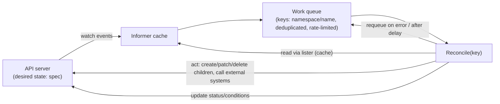

# 5.6 Controllers and the reconcile loop: how Kubernetes thinks

| | |
|---|---|
| Level | Intermediate |
| Priority tier | 0 |
| Lab venue | kind cluster, kubectl; `kubernetes` Python client or client-go for a toy controller; optional kube-controller-manager logs |
| Part | Part 5: Kubernetes |
| Status | Drafted, labs **untested** |

## Why this matters for AI infrastructure

Picture an inference server that crashes at 2 a.m. and comes back on its own. Something noticed the failure and fixed it. In Kubernetes, that something is a controller. Deployments keep inference servers at the right replica count. Jobs retry failed training pods, and StatefulSets give distributed workers stable identities. The node controller evicts pods from dead GPU nodes, and the Endpoints controller keeps load balancers pointed at ready replicas. The GPU Operator, Kueue, KubeRay and the Training Operator are controllers too, and you will install, debug and sometimes write them. If you understand the reconcile loop deeply, you can predict what the system will do after a failure. You can explain "why did it restart my pod?", read operator logs, and design custom controllers (5.29 to 5.33) that behave well at scale.

## Prerequisites and outcomes

This chapter builds on 5.3 and 5.5, so review those first. When you finish, you should be able to do the following.

- Define a controller precisely as a loop that observes cluster state, compares it with desired state, and acts to shrink the difference. Contrast that loop with imperative orchestration and event-driven scripts.
- Explain level-triggered and edge-triggered logic, and why idempotent reconciliation matters.
- Describe the `client-go` machinery: reflectors, informers, shared index caches, listers, work queues with rate limiting, workers and resync.
- Trace the built-in controllers end to end: Deployment → ReplicaSet → Pod; StatefulSet; DaemonSet; Job/CronJob; node lifecycle; EndpointSlice; namespace and garbage collection; HPA.
- Use `ownerReferences`, labels and selectors, finalizers, conditions and `observedGeneration` correctly.
- Explain leader election and high availability (HA) for controllers, and diagnose controller lag, hot loops and conflicts.
- Apply controller thinking to design safe automation, including GPU health remediation.

## 1. The controller pattern

You delete a pod that belongs to a Deployment, and a replacement appears within moments. Nobody typed a command to create it. That behavior comes from the controller pattern, and it is the idea behind everything else in this chapter.

> A controller watches the state of the cluster and makes or requests changes where needed. Each controller tries to move the current cluster state closer to the desired state.

Think of a thermostat. You set the desired temperature, which plays the role of the `spec`. The sensor reading plays the role of the `status`. The loop switches the heater on or off based on the difference, not on a button press. Five properties make this pattern robust.

The first property is declarative input. You state *what* you want, and controllers decide *how*. They keep deciding for as long as the object exists.

The second property is **level-triggered** logic. The reconcile function takes the current world and the desired spec, computes the difference, and acts on it. It never depends on having seen every event. Missed events, restarts and duplicated events are all harmless, because the next pass recomputes the same difference. Edge-triggered systems react to events such as "pod died," so they fail when such an event is lost.

The third property is idempotence and convergence. Acting twice leaves the same result. Repeated reconciliation either converges to the desired state or reports why it cannot.

The fourth property is single responsibility with loose coupling. Each controller owns one concern and talks to the others only through the API, by writing child objects and updating status. Simple controllers chain together to produce complex behavior. A Deployment creates a ReplicaSet, which creates Pods. The scheduler binds those Pods, and the kubelet runs them.

The fifth property is self-healing and drift correction. Manual changes to controller-owned objects get reverted. If you delete a ReplicaSet's pod, a new one is created. If you edit a pod template that a Deployment manages, the Deployment overwrites your edit.



The reconcile function is deliberately small. Given an object key, it returns nil, returns an error (which triggers a retry with backoff), or asks to requeue after a delay. Inside, it re-reads the object, computes the desired children, compares them with the observed children, and makes minimal changes. When a controller undoes a change you made by hand, edit the object that owns it instead.

## 2. The machinery: informers and work queues

Hundreds of controllers in a large cluster all need to know about the same objects. If each one asked the API server for a full list on every decision, the API server would carry an enormous load. The machinery below exists to prevent that.

Controllers use `client-go`, and `controller-runtime` builds on top of it (see 5.31). The reflector performs a LIST of a resource, then a WATCH that starts from the returned resourceVersion. It handles reconnects, and it relists when it receives `410 Gone` (covered in 5.5). Its changes flow into a DeltaFIFO.

The informer consumes those deltas and updates an in-memory indexer. An indexer is a thread-safe store with optional indexes, such as pods by node name. The informer then invokes event handlers: `OnAdd`, `OnUpdate` and `OnDelete`. Shared informers are created once per resource type per process. Many controllers share them, so one watch connection serves all of them.

A lister gives read-only access to that local cache. Reconcile logic reads from listers, which are cheap and may be slightly stale, and it writes to the API server directly. Stale reads are tolerated because writes are conditional on `resourceVersion`, and reconciliation repeats.

Resync is a safety net. It periodically re-delivers every cached object as an update event, even when nothing changed. In kube-controller-manager's informers, the default period is 10 hours, and you can configure it.

Event handlers enqueue the key of the affected object, written `namespace/name`, or the key of its owner. They do not enqueue the object itself. The work queue deduplicates keys, so many events for one object collapse into one pending key. It also keeps one worker per key at a time. It supports rate-limited requeues, with exponential backoff on error, bucket limiters and delayed adds.

Workers run as N goroutines. Each one pops a key, calls `Reconcile`, and then calls `Forget` or `AddRateLimited`, depending on the result. Event handlers also map secondary resources to their owners. When a Pod changes, the handler enqueues its owning ReplicaSet. When a Node changes, it enqueues the pods or DaemonSets that node affects. This watch-children, reconcile-parent pattern sits at the center of every operator.

Local caches matter for scale. With 5,000 nodes and 150,000 pods, hundreds of controllers cannot each issue LIST calls for every decision. The informer pattern keeps one watch per type per process, and each read from the local cache costs O(1). Your own controllers should follow the same split: read from listers, and write to the API server. As you read the rest of this section, keep that split in mind.

## 3. Built-in controllers (a tour)

### Deployment → ReplicaSet → Pod

When you roll out a new image, old pods disappear while new ones come up. The chain from Deployment to ReplicaSet to Pod does that work, and it is worth knowing well.

The Deployment controller owns ReplicaSets. For each unique pod template hash, it keeps one ReplicaSet named `<deployment>-<hash>`. When the template changes, it creates a new ReplicaSet and shifts replicas between the old and new ones. The shift follows the strategy. `RollingUpdate` uses `maxSurge` and `maxUnavailable`, given as percentages or counts. `Recreate` replaces the pods instead. The controller tracks `progressDeadlineSeconds` and sets conditions named `Progressing`, `Available` and `ReplicaFailure`. The `revisionHistoryLimit` setting keeps old ReplicaSets, so you can roll back with `kubectl rollout undo`. The `minReadySeconds` setting delays counting a pod as available.

The ReplicaSet controller makes the number of pods that match its selector equal to `spec.replicas`. It creates pods from its template and deletes the extras. When it has to choose, it prefers pods that are unscheduled, not ready, recently created, or on nodes with more replicas. It uses ownerReferences to adopt or orphan pods.

Creating a pod is just writing a Pod object. The scheduler and kubelet take it from there.

Try these commands to watch the chain at work.

```bash
kubectl create deployment web --image=nginx:1.27 --replicas=3
kubectl get deploy,rs,pods -l app=web -o wide
kubectl get rs -l app=web -o jsonpath='{range .items[*]}{.metadata.name}{" owner="}{.metadata.ownerReferences[0].name}{"\n"}{end}'
kubectl set image deploy/web nginx=nginx:1.27.1      # new ReplicaSet, rolling shift
kubectl rollout status deploy/web; kubectl rollout history deploy/web; kubectl rollout undo deploy/web
kubectl delete pod -l app=web --wait=false           # ReplicaSet recreates them
```

Notice that the image change creates a new ReplicaSet, while the Deployment keeps its name.

### StatefulSet

A StatefulSet suits workloads where each replica needs its own identity, network address and storage. Pods are named `<name>-0` through `<name>-N-1`. Each one keeps a stable network ID through a headless Service. Each pod gets its own PVCs from `volumeClaimTemplates`, and those claims survive pod deletion.

The `podManagementPolicy` sets the order. `OrderedReady` creates and scales pods in order, and it waits for each pod to become Ready. `Parallel` starts pods without that wait. Updates use `RollingUpdate`, which goes in reverse ordinal order and can use `partition` for canaries, or they use `OnDelete`.

The controller never runs two pods with the same ordinal. It never deletes PVCs automatically, unless `persistentVolumeClaimRetentionPolicy` says so. Teams use StatefulSets for databases, Zookeeper and etcd, and for some distributed training coordinators.

### DaemonSet

A DaemonSet ensures one pod per eligible node. Eligibility comes from `nodeSelector` or affinity, together with tolerations. The controller creates pods with node affinity for each node, and the default scheduler places them, as it has since 1.12. The controller also handles nodes being added and removed, and it does rolling updates with `maxUnavailable` and `maxSurge`. In GPU clusters, the DaemonSets you will meet include the NVIDIA device plugin, the DCGM exporter, GPU feature discovery, CNI agents, log shippers and node-problem-detector.

### Job and CronJob

The Job controller runs pods to completion. Its settings include `completions`, `parallelism`, `backoffLimit`, `activeDeadlineSeconds` and `ttlSecondsAfterFinished`. With `completionMode: Indexed`, each pod gets a `JOB_COMPLETION_INDEX`, which suits sharded work and distributed training workers. The `podFailurePolicy` setting treats specific exit codes or disruptions differently. For example, you can keep node-drain evictions from counting toward the backoff. The `suspend` setting lets queue managers such as Kueue create Jobs in a suspended state and unsuspend them on admission. `managedBy` and elastic scaling appear in newer releases.

The CronJob controller creates Jobs on a schedule. Its `concurrencyPolicy` takes `Allow`, `Forbid` or `Replace`. You also set `startingDeadlineSeconds`, history limits and time zones. Training operators such as PyTorchJob, MPIJob, RayJob and JobSet build on the same ideas, with gang semantics.

### Node lifecycle and eviction

The node lifecycle controller watches Node leases and status. If heartbeats stop for `node-monitor-grace-period`, which defaults to 40 s, the controller sets the Node `Ready` condition to `Unknown`. It also adds the taint `node.kubernetes.io/unreachable:NoExecute`, or `not-ready`.

Pods tolerate those taints for `tolerationSeconds`, which defaults to 300 s. The `DefaultTolerationSeconds` admission plugin adds that toleration automatically. When the period ends, taint-based eviction deletes the pods, so controllers can recreate them elsewhere. The NoExecute manager carries out this eviction.

For GPU training, you often change these values. Elastic jobs may use shorter tolerations for quick recovery. Longer tolerations ride out brief network flaps. Pods with local state need explicit handling.

A deleted pod on an unreachable node stays stuck in `Terminating` until the kubelet returns, the node object is deleted, or someone force deletes the pod. StatefulSets do not replace pods that are stuck terminating, because that would risk split-brain, unless the node is confirmed gone. Newer releases handle non-graceful shutdowns with the `node.kubernetes.io/out-of-service` taint.

### EndpointSlice and Service controllers

The EndpointSlice controller watches Services and Pods. For each Service, it maintains EndpointSlices that list ready pod IPs, along with `serving` and `terminating` states. It updates them when pods become Ready or NotReady, so readiness probes decide where traffic goes. `kube-proxy` consumes these slices (see 5.10). The Service controller, which runs in cloud-controller-manager, provisions cloud load balancers for `type: LoadBalancer`.

### Namespace, garbage collector, TTL, PV/PVC, HPA and others

The namespace controller deletes all content when a namespace is deleted. That is why a namespace can stay stuck in `Terminating` when finalizers or unavailable APIs block it. The garbage collector deletes dependents whose owners are gone, following `ownerReferences` and `blockOwnerDeletion`. TTL-after-finished removes completed Jobs and Pods.

The PersistentVolume controller binds PVCs to PVs, provisions volumes through external provisioners, and handles reclaim policies. The attach/detach controller and the expand controller coordinate with CSI (5.17). The HorizontalPodAutoscaler controller polls metrics every 15 s by default, and it adjusts the `scale` subresource of Deployments, StatefulSets and CRDs (5.23). Many other controllers exist too, including the ResourceQuota controller, the ServiceAccount and token controllers, CSR approving and signing, ClusterRole aggregation and Lease garbage collection.

To list them, run `kube-controller-manager --help | grep -A100 controllers`, or read the startup log lines that say "Started ... controller". When an object changes without your input, first check which controller in this list owns it.

## 4. Owners, selectors, finalizers, conditions

### Reconciliation loops and the loose link to Pods

A reconciliation loop compares two things. The desired state is what you asked for, such as three replicas of a `kuard` Pod. The current state is what the cluster shows right now, such as two running `kuard` Pods. The loop keeps observing and acts to close the gap, here by creating one more `kuard` Pod.

The same single loop also handles a manual scale up or down, a node failure, and a node that rejoins the cluster after being absent. That is why this pattern is so useful. It is goal driven and self-healing, yet it fits in a few lines of logic. Reconciliation loops appear all over Kubernetes, including the built-in controllers in this chapter.

Decoupling is a key theme in Kubernetes. The core concepts are modular, so each one can be swapped or replaced with another component. The link between a ReplicaSet and its Pods is loosely coupled. The ReplicaSet creates and manages the Pods, but the two remain decoupled objects. It identifies its Pods with label queries, and it creates them through the same Pod API you use directly. Decoupling enables several important behaviors, covered in the subsections that follow.

### ownerReferences and adoption

Child objects carry `ownerReferences`, a list of entries with `apiVersion`, `kind`, `name`, `uid`, `controller: true` and `blockOwnerDeletion: true`. Each object has exactly one controller owner. A controller manages objects it owns. It can also adopt objects that match its selector, provided those objects have no other controller owner.

Deleting an owner triggers garbage collection of its dependents, depending on `propagationPolicy`. If you change a Deployment's selector labels, or relabel pods, you can orphan pods or set two controllers fighting over them. The selector of an `apps/v1` Deployment is immutable after creation. Running `kubectl delete rs web-abc --cascade=orphan` leaves the pods running and without an owner. `ReplicaSet` controllers then re-adopt any matching pods.

Two commands show a pod's owner and detach the pod from its `ReplicaSet`.

```bash
kubectl get pod web-xxxx -o jsonpath='{.metadata.ownerReferences}' | jq
kubectl label pod web-xxxx app-                # remove the label: ReplicaSet no longer matches it → orphaned and replaced (a debugging trick: isolate a bad pod without deleting it)
```

Removing the label orphans the pod, and the `ReplicaSet` replaces it. You can isolate a bad pod this way without deleting it.

*Kubernetes: Up and Running*, Chapters 9 to 12, cover ReplicaSets, Deployments, DaemonSets and Jobs. *Kubernetes Programming with Go* covers the same ground in Chapters 3 and 6. Together they describe four practical mechanics for how built-in controllers use labels and `ownerReferences`.

The first mechanic is quarantining and adopting pods, from *Kubernetes: Up and Running*, Chapter 9. A `ReplicaSet` finds its pods by evaluating its `spec.selector` label query against the informer cache. Removing the matching label from a misbehaving pod, with `kubectl label pod kuard-xxxx app-`, makes the `ReplicaSet` controller release that pod. The pod is orphaned, so it keeps running in isolation. You can `kubectl exec` into it or capture a core dump or GPU memory dump. At the same time, the controller creates a fresh replacement, which keeps `replicas` at the target. The reverse also holds. If a bare pod carries labels that match an active `ReplicaSet` and has no controller `ownerReference`, the `ReplicaSet` controller adopts it by patching `metadata.ownerReferences`. Adoption sets `Controller: pointer.BoolPtr(true)` and `BlockOwnerDeletion: pointer.BoolPtr(true)`, which live in `k8s.io/apimachinery/pkg/apis/meta/v1`. *Kubernetes Programming with Go* covers these types in Chapter 3. The repository models this behavior in `reconcile_replicaset()`, in `code/part05/controller_reconcile_simulator.py`.

The second mechanic is client compatibility during a `RollingUpdate`, from *Kubernetes: Up and Running*, Chapter 10. During a Deployment `RollingUpdate` with `25% max unavailable, 25% max surge`, both `v1` and `v2` `ReplicaSet` pods serve traffic at the same time. Even after the `v1` pods terminate, external clients, mobile clients or JavaScript clients may still run `v1` code. Every service API and database schema must therefore stay backward compatible across adjacent versions. `kubectl rollout undo` works in an emergency. You can also inspect a revision with `kubectl rollout history deployment kuard --revision=2`. Reverting the YAML in Git and running `kubectl apply` keeps source control aligned with the live cluster.

The third mechanic is node-label driven DaemonSet reconciliation, from *Kubernetes: Up and Running*, Chapter 11. Instead of using pod anti-affinity hacks on a `ReplicaSet` to place one agent per node, a DaemonSet such as `fluentd`, `nvidia-device-plugin` or `dcgm-exporter` reconciles node additions and label changes on its own. Suppose a DaemonSet specifies `nodeSelector: { ssd: "true" }`, or `nvidia.com/gpu.present: "true"`. Labeling a node with `kubectl label nodes node01 ssd=true` makes the DaemonSet controller schedule the daemon pod onto that node right away. Removing the label terminates the pod.

The fourth mechanic covers the Job patterns, from *Kubernetes: Up and Running*, Chapter 12 (Table 12-1), and the restart policy.

- One-shot (`completions: 1, parallelism: 1`) runs database migrations or smoke tests, such as `--keygen-enable --keygen-exit-on-complete --keygen-num-to-gen=3`.
- Parallel fixed completions (`completions: 10, parallelism: 5`) processes a fixed batch. Five pods run at a time until 10 total completions succeed.
- Work queue with parallel consumers (`completions` unset, `parallelism: 5`) has workers pull items from a queue service, `memq` at `/memq/server/queues/keygen`, until the queue is empty and the workers exit `0`.
- `restartPolicy: OnFailure` and `Never` behave differently. Pods inside a Job cannot use `restartPolicy: Always`. With `OnFailure`, a crashing container, such as one run with `--keygen-exit-code=1`, is restarted in place on the same node by the `kubelet`. The `RESTARTS` counter increments on the same Pod. With `Never`, the failed Pod stays intact (`Status: Error`) for log inspection. The Job controller creates a brand-new replacement Pod instead. The replacements appear with names such as `oneshot-4kfdt` and `oneshot-8x2p1`, and the Job controller keeps creating them until `backoffLimit` is reached.

### Finalizers

Strings in `metadata.finalizers` block deletion. The API server sets `deletionTimestamp` and keeps the object until its owning controller removes each finalizer after cleanup. Examples include `kubernetes.io/pv-protection`, `foregroundDeletion`, `batch.kubernetes.io/job-tracking`, and your operator's `example.com/cleanup`.

A resource stuck in `Terminating` almost always has an unfulfilled finalizer. Fix the controller that should remove it, not only the finalizer list. Removing a finalizer by hand skips the cleanup, which can leak cloud disks, IPs and load balancers.

### Status and conditions

By convention, `status.conditions[]` entries carry `type`, `status` (`True`, `False` or `Unknown`), `reason` (a CamelCase, machine-readable value), `message`, `lastTransitionTime` and `observedGeneration`. Consumers such as `kubectl wait --for=condition=Available`, GitOps health checks and Kueue rely on them.

A good controller sets Ready, Progressing or Degraded style conditions, each with an actionable reason. It writes `status` through the `/status` subresource, so spec edits and status writes do not conflict. When you build your own controller, use `/status` for status writes from the start.

## 5. Leader election and HA

Controller managers, schedulers and most operators run several replicas, but only one instance is active at a time. A Lease object (`coordination.k8s.io/v1`) decides which instance that is. Candidates try to acquire or renew the lease by updating `holderIdentity` and `renewTime`.

The defaults are `leaseDuration` 15 s, `renewDeadline` 10 s and `retryPeriod` 2 s. Failover therefore takes roughly 15 to 30 s. If the leader cannot renew, because of API or etcd slowness, CPU starvation or network trouble, it exits on purpose so that another replica can take over. Frequent restarts with "leaderelection lost" messages point to API or etcd latency, which is covered in 5.5.

Sharding controllers across replicas is possible, but you have to design it, for example with consistent hashing of keys. To check the current leader, list the leases and read the holder of the controller manager lease.

```bash
kubectl get lease -n kube-system
kubectl get lease kube-controller-manager -n kube-system -o jsonpath='{.spec.holderIdentity}{"\n"}'
```

If your controller runs with several replicas, stop the leader and confirm that the lease holder changes.

## 6. Failure modes and diagnostics

A controller problem usually shows up as a symptom on an object: a rollout that stalls, a pod that keeps coming back, or a namespace that never finishes deleting. The table below maps each symptom to its likely cause and to the check that confirms it.

| Symptom | Likely cause | How to check |
|---|---|---|
| Object stuck, no events | Controller not running (leader missing), RBAC denies it, webhook blocks writes | Controller logs, `kubectl get lease`, API audit, admission webhooks |
| Deployment rollout stuck | New pods Pending/CrashLoop, readiness never passes, `maxUnavailable: 0` with no capacity, quota exceeded | `kubectl rollout status`, `describe rs`, events, `ProgressDeadlineExceeded` condition |
| Pod keeps being recreated | Controller reconciling a crash/eviction; or two controllers fighting over the same object | `ownerReferences`, controller logs, `managedFields` |
| Reconcile hot loop | Controller updates the object every pass (non-idempotent write, status change triggers itself) | Rate of writes in audit, metrics, `resourceVersion` churn; add change detection, ignore status-only updates (predicates) |
| Controller lag | Work queue depth high, workers too few, slow external calls | `workqueue_depth`, `workqueue_queue_duration_seconds`, `workqueue_work_duration_seconds` |
| 409 Conflict errors in logs | Concurrent writers | Expected occasionally; excessive means fighting actors or stale cache; use patch/SSA |
| Namespace stuck Terminating | Finalizers, unavailable aggregated API (metrics.k8s.io), CRD instances blocked | `kubectl get ns x -o json \| jq .status.conditions`, `kubectl api-resources` errors |
| Pods Terminating forever on a dead node | kubelet unreachable | Wait for node deletion, force delete only if sure the node is down; `out-of-service` taint |
| Replicas flap after HPA | HPA and manifest both set replicas (GitOps) | Omit `replicas` in GitOps manifests, or `ignoreDifferences` |
| Orphans after delete | `--cascade=orphan`, missing ownerRefs in custom controllers | GC rules |

You can use the table as a starting point, because some symptoms have more than one possible cause. Start with the row that matches your symptom. If the controller uses controller-runtime, it exposes metrics you can chart. These include `controller_runtime_reconcile_total{result}`, `controller_runtime_reconcile_time_seconds`, `controller_runtime_active_workers`, `workqueue_*` and `rest_client_requests_total`, along with the leader election gauges.

## 7. Designing safe automation with the controller mindset

Suppose you write a script that cordons a node every time an alert fires. One false alarm could then take down the cluster. The principles below apply when you write a controller or an automation script, including remediation of GPU faults.

1. Observe the current state, compare it with the desired state, and act minimally. Never assume your last action succeeded. Recompute from the current state each time.
2. Make actions idempotent. Cordon a node only if it is not already cordoned, label with a stable key, and create objects only if they are missing.
3. Rate-limit and back off, so you avoid tight loops against the API or external systems. Use jitter.
4. Bound the blast radius. Cap how many nodes you will cordon, drain or reboot at once, because a controller reacting to a fleet-wide false alarm can take down the cluster. Implement budgets, and require health signals from multiple sources.
5. Record intent in the API, using annotations or conditions, so humans and other controllers can see it. Avoid hidden state.
6. Fail safe. When you are uncertain, do nothing, and surface a condition or event instead of making destructive changes.
7. Respect ownership. Do not modify objects that other controllers own. Modify their inputs instead.
8. Use finalizers for external cleanup, with timeouts and metrics, so they cannot wedge deletion forever.
9. Use leader election and graceful shutdown for HA.
10. Test with chaos. Kill the controller mid-action, drop events, delay the API, and confirm that the system converges.

Consider a GPU node health controller, covered in 5.32. It watches Node conditions published by node-problem-detector and DCGM. After sustained Xid errors, it cordons the node. It then creates a drain request, which PodDisruptionBudgets and a global concurrency budget limit. It annotates the node with the reason, and it uncordons the node only after a health-check Job passes. Every step is an idempotent reconcile based on observed conditions. It is not a script that reacts to an alert once.

Before you let a remediation controller act on alerts, give it a budget and multiple independent health signals.

## 8. Lab

Start with the self-checking Python lab. You can run it locally, before you touch a cluster, and it verifies three models from this chapter. The first is the deduplicating, rate-limited `WorkQueue` (`DeduplicatingWorkQueue`), which models the collapse of keys in `dirty` and `processing`, along with exponential backoff. The second is the level-triggered `ReplicaSet` reconciler (`reconcile_replicaset`). It models label-removal pod quarantining, adoption of ownerless pods and replica convergence, as covered in *Kubernetes: Up and Running*, Chapter 9. The third is the budget-bounded GPU fault remediation controller (`reconcile_gpu_node_remediation`, Section 7).

```bash
python3 code/part05/controller_reconcile_simulator_lab.py
```

Next, work through these exercises on a `kind` or `kubeadm` cluster. All interactive shell steps below are `untested here`.

1. Create a Deployment. List its owned ReplicaSet and Pods with their ownerReferences. Delete a pod, scale the Deployment, and change the image, while you watch `kubectl get rs,pods -w`. Match the events from `kubectl describe` to the controllers that produced them. Read the `kube-controller-manager` logs at `-v=4` for the deployment and replicaset controllers. On kubeadm, you enable that by editing the static pod flag.
2. Test level- versus edge-triggered behavior. Stop the controller manager by moving its static pod manifest away. Delete some pods and scale the Deployment. Restore the controller manager, and watch it converge even though it never saw those events.
3. Practice adoption and orphaning. Remove a pod's label to orphan it, and observe the replacement. Relabel the pod to re-adopt it. Delete a ReplicaSet with `--cascade=orphan`, and examine the ownerReferences.
4. Compare rollout strategies. Build a Deployment with `maxSurge: 25%` and `maxUnavailable: 0`, using an image with a failing readiness probe. Watch for `ProgressDeadlineExceeded`. Run `kubectl rollout undo`, then test `Recreate`.
5. Work with a StatefulSet. Create one with a headless Service and `volumeClaimTemplates`. Delete a pod, and confirm that its identity and PVC survive. Scale down and up. Test `partition` updates, then try `Parallel`.
6. Run Jobs. Create an indexed Job with `parallelism: 4`, `completions: 8` and a `backoffLimit`. Add a `podFailurePolicy` that ignores disruption failures. Set `suspend: true`, then unsuspend the Job. Simulate failures with exit codes.
7. Test node failure. On a multi-node lab, stop the kubelet on a worker. Watch the taints, `tolerationSeconds`, pod eviction and rescheduling. Compare how a Deployment, a StatefulSet and a bare Pod behave.
8. Work with finalizers. Create a ConfigMap with a custom finalizer, delete it, and observe `deletionTimestamp`. Remove the finalizer. Then create a namespace that holds a CR with a finalizer, watch the namespace stay Terminating, and fix it.
9. Build a toy controller of about 50 lines, in Python with `kubernetes` informers or in Go with client-go. It should ensure that every namespace labelled `team=*` has a default ResourceQuota ConfigMap. Make it level-triggered and idempotent. Kill it, restart it, and then add leader election with a Lease.
10. Observe your controllers. Scrape the controller-manager metrics `workqueue_depth` and `workqueue_retries_total`. Create load with hundreds of Jobs, chart the queue depth and latency, and identify the slowest controller.
11. Test leader election. Find the lease holders. Kill the leader pod and measure the failover time. Slow the API by CPU-throttling etcd in a lab, and watch for "leaderelection lost".
12. Do a design exercise. Write the reconcile pseudocode for a "cordon-on-GPU-fault" controller with budgets. List its inputs, outputs, idempotency, failure behavior and metrics.
13. Clean up.

## 9. Common mistakes

Watch for these mistakes in your own controllers and in your manifests.

- Writing controllers that react to events (edge-triggered) and keep internal state, instead of recomputing from the API.
- Updating status in a way that triggers another reconcile of the same object endlessly, with no predicates or change detection.
- Having many controllers LIST from the API server instead of using shared informers.
- Not setting ownerReferences on children, which causes orphans and leaks, or setting two controller owners.
- Relying on finalizers without making sure the controller will run at deletion time, such as uninstalling the operator before deleting its CRs.
- Ignoring `409 Conflict` responses, or retrying without backoff.
- Letting remediation controllers act on every alert without budgets.
- Running controllers without leader election, or with long lease durations that slow failover.
- Mixing GitOps-declared replica counts with HPA.
- Treating `kubectl delete pod` as a fix for something a controller will recreate identically.

## 10. Interview angles

- What is a Kubernetes controller? Explain the reconcile loop, and why it is level-triggered.
- How do informers, caches and work queues reduce load on the API server?
- Walk through what happens when you delete a pod owned by a ReplicaSet. What happens when a node dies?
- How does a Deployment roll out a new version? What are `maxSurge` and `maxUnavailable`?
- What are ownerReferences and finalizers? Why is your namespace stuck Terminating?
- How does leader election work, and what happens during failover?
- How would you design a controller that cordons unhealthy GPU nodes safely?
- Why do we have both Deployment and ReplicaSet?

## Exercises

1. In your own words, explain why Kubernetes controllers are level-triggered reconcile loops, not edge-triggered event handlers. Describe how the loop compares observed cluster state against `spec` in `Reconcile(namespace/name)`. Then trace how a controller converges after it was stopped while 3 pods were deleted and `replicas` was scaled.
2. Trace the client-go path through `Reflector`, `DeltaFIFO`, `SharedInformer`, `Indexer`/`Lister` and `WorkQueue`. Using `DeduplicatingWorkQueue` in `code/part05/controller_reconcile_simulator.py`, explain how `SharedInformer`s share a single watch stream across controllers. Explain why `Reconcile` reads from local `Lister` caches (`O(1)`) but writes directly to `kube-apiserver`. Then explain how the `dirty` and `processing` sets inside the work queue deduplicate keys and stop two workers from reconciling the same key at once. Use the client-go internals in *Kubernetes Programming with Go*, Chapter 6, as your reference for the machinery.
3. Compare, in your own words, how each workload reconciles Pods. Cover `Deployment` with `RollingUpdate` (`maxSurge`/`maxUnavailable`) against `Recreate`. Cover `StatefulSet` with `OrderedReady` against `Parallel`, along with `volumeClaimTemplates`, the headless Service and `partition` canaries. Cover `DaemonSet` driven by node labels, such as `fluentd` and `dcgm-exporter`. Finally, cover `Job` and `CronJob`, using the three patterns from *Kubernetes: Up and Running*, Chapter 12, plus `Indexed` completion mode, `podFailurePolicy`, `suspend`, and `restartPolicy: OnFailure` against `Never`.
4. Cover `ownerReferences`, label quarantining versus adoption (*Kubernetes: Up and Running*, Chapter 9, and *Kubernetes Programming with Go*, Chapter 3), `finalizers` and `status.conditions`. Using `reconcile_replicaset()` in `code/part05/controller_reconcile_simulator.py`, trace what happens in two cases. In the first, an engineer removes `app=web` from a misbehaving Pod with `kubectl label pod web-xxxx app-`. In the second, someone creates an ownerless Pod with `app=web`. Then explain why `status.conditions` (`observedGeneration`) is written through the `/status` subresource.
5. Trace the `node-lifecycle-controller` timeline. It starts with the `40s` `node-monitor-grace-period`, moves to the `node.kubernetes.io/unreachable:NoExecute` taint, and ends with the `300s` `tolerationSeconds` eviction. Explain why Pods on an unreachable node stay stuck in `Terminating`, which blocks StatefulSet replacement until the node returns or carries `node.kubernetes.io/out-of-service`. Then trace `Lease` leader election with its `15s` `leaseDuration`, `10s` `renewDeadline` and `2s` `retryPeriod`.
6. Using `reconcile_gpu_node_remediation()` in `code/part05/controller_reconcile_simulator.py`, explain what causes a reconcile hot loop, and how `GenerationChangedPredicate` and `/status` subresources prevent one. Explain how to unstick a `Terminating` namespace. Then explain how to design a safe GPU fault remediation controller with a global concurrency budget (`max_concurrent_cordons`).

## Checkpoint questions (20)

<details>
<summary>1. Why does `Reconcile(ctx, req)` accept only a `namespace/name` key instead of the event payload (`ADDED` / `MODIFIED` / `DELETED` + old/new object)?</summary>

Passing only the key is how the design enforces **level-triggered reconciliation**. Two things make it work for you:
1. The object may change 5 more times between the moment an event is enqueued and the moment a worker pops the key. The `WorkQueue` collapses all of those changes into one deduplicated key.
2. When `Reconcile(key)` runs, it reads the latest snapshot of the object and its children from the local Informer `Lister` cache. It compares that snapshot with the desired state and acts on the current difference. If the object is gone (`apierrors.IsNotFound(err)`), `Reconcile` knows it was deleted and returns `nil`.
</details>

<details>
<summary>2. Trace the path of a watch event through `client-go`: `Reflector` -> `DeltaFIFO` -> `SharedInformer` -> `Indexer` -> `ResourceEventHandler` -> `WorkQueue` -> `Worker` (*Kubernetes Programming with Go*, Chapter 6).</summary>

1. `Reflector` lists the resource from `kube-apiserver` at a `resourceVersion` and opens a `WATCH` stream. It pushes `(DeltaType, Object)` items into a `DeltaFIFO` queue.
2. `SharedInformer` pops items from the `DeltaFIFO`, updates the thread-safe local `Indexer` cache, and fires the registered `ResourceEventHandler` callbacks (`OnAdd`, `OnUpdate`, `OnDelete`).
3. `ResourceEventHandler` extracts the `namespace/name` key of the object, or of its parent owner through `ownerReferences`. It then calls `queue.Add(key)` on the rate-limiting `WorkQueue`.
4. `Worker` goroutines call `queue.Get()`, run `Reconcile(key)`, and call `queue.Done(key)`. They then call `queue.Forget(key)` on success, or `queue.AddRateLimited(key)` on error, which applies exponential backoff. You can follow these four hops when you need to find where an event gets stuck.
</details>

<details>
<summary>3. How does a `client-go` `WorkQueue` prevent two worker goroutines from reconciling the exact same object (`default/web`) at the same time?</summary>

The `WorkQueue` keeps two internal sets next to its FIFO slice (`queue`): `dirty` and `processing`.
- When `Add("default/web")` is called, the key goes into `dirty`. If the key is not already in `processing`, it is appended to `queue`. Adding the same key again while it sits in `dirty` does nothing. That is the deduplication.
- When Worker 1 calls `Get()`, the key leaves `dirty` and moves into `processing`.
- If another watch event for `"default/web"` arrives while Worker 1 is still running `Reconcile`, the key goes back into `dirty`. It is not appended to `queue`, because it is in `processing`.
- Only when Worker 1 finishes and calls `Done("default/web")` does the queue see the key in `dirty` and re-append it to `queue`, for one more sequential pass.
</details>

<details>
<summary>4. What is the \"Watch Children, Enqueue Parent\" pattern in Kubernetes controllers?</summary>

A `ReplicaSet` controller reconciles `ReplicaSet` objects, but it must react right away when a child `Pod` crashes or is deleted. Rather than write a separate reconcile loop for Pods, it registers an Informer event handler on Pods. That handler inspects `pod.metadata.ownerReferences` where `controller: true`, finds the owning ReplicaSet's `namespace/name`, and enqueues that key into the ReplicaSet work queue (`EnqueueRequestForOwner` in `controller-runtime`).
</details>

<details>
<summary>5. Why does Kubernetes separate `Deployment` and `ReplicaSet` into two distinct controllers instead of having `Deployment` manage Pods directly (*Kubernetes: Up and Running*, Chapters 9 and 10)?</summary>

Each controller does one job. A `ReplicaSet` keeps $N$ identical Pods running for a single, immutable pod template hash, such as `kuard-2738859366`. A `Deployment` handles the change from one version to the next by orchestrating several ReplicaSets. It scales the new ReplicaSet (`v2`) up while it scales the old one (`v1`) down, following `maxSurge` and `maxUnavailable`. It also tracks `revisionHistoryLimit`, which makes an instant rollback possible with `kubectl rollout undo`.
</details>

<details>
<summary>6. In *Kubernetes: Up and Running*, Chapter 9, how do you quarantine a misbehaving Pod for live debugging without its `ReplicaSet` terminating it or leaving your service under-replicated?</summary>

Remove the label that matches the `ReplicaSet`'s selector, or change it:
```bash
kubectl label pod web-xxxx app-
```
On its next reconcile pass, the `ReplicaSet` controller sees that `web-xxxx` no longer matches `app=web`. It removes the ownerReference, which orphans `web-xxxx` so it keeps running untouched. You can then use `kubectl exec`, `nsenter` or `nvidia-smi` to inspect it. At the same time, the controller creates a new healthy Pod, so the service stays at full capacity.
</details>

<details>
<summary>7. When a `ReplicaSet` scales down (for example, from 5 replicas to 3), how does the `ReplicaSet` controller choose which 2 Pods to delete first?</summary>

The controller does not delete pods at random. It sorts the candidates and deletes the least valuable or most problematic pods first, in this order:
1. Unscheduled (`Pending`) pods, where `spec.nodeName == ""`, go before scheduled pods.
2. Pods with the annotation `controller.kubernetes.io/pod-deletion-cost` go next, lowest integer cost first.
3. Pods on nodes with more replicas of this ReplicaSet go next, which keeps the surviving replicas spread across nodes.
4. Not-Ready pods go before Ready pods.
5. Pods that have been Ready for the shortest time go last. That means the newest pods, or those with higher restart counts.
</details>

<details>
<summary>8. How does a `StatefulSet` differ from a `Deployment` in pod naming, network identity, storage, and scaling order?</summary>

- Pods get stable ordinal names, `<name>-0`, `<name>-1`, up to `<name>-(N-1)`. They also get deterministic hostnames instead of random hashes.
- A headless Service (`clusterIP: None`) gives each pod a stable DNS name: `<pod-name>.<service-name>.<ns>.svc.cluster.local`.
- `volumeClaimTemplates` create a dedicated PVC (`data-<name>-0`) for each ordinal. That PVC stays bound to `<name>-0` across restarts and rescheduling onto other nodes.
- With `podManagementPolicy: OrderedReady`, the StatefulSet scales up from `0 -> 1 -> 2`, waiting for each pod to become Ready. It scales down in reverse, `2 -> 1 -> 0`, and rolls updates in reverse too. An optional `partition: K` canary gate means only ordinals $\ge K$ update.
</details>

<details>
<summary>9. Why does a `StatefulSet` refuse to replace a Pod on a dead/unreachable node while the Pod is stuck in `Terminating`, and how does the `node.kubernetes.io/out-of-service` taint solve this?</summary>

A StatefulSet guarantees at most one Pod per ordinal index, such as `web-0`. That rule prevents two writers from corrupting the same database volume, a failure known as split-brain. So the StatefulSet controller does not create a replacement `web-0` on another node until the kubelet on the old node confirms that the old `web-0` container has stopped. If the old node crashed or lost its network, `web-0` stays stuck in `Terminating` indefinitely.
Once an admin or fencing automation confirms that the dead host is powered off, through IPMI/Redfish or a cloud API, the taint `node.kubernetes.io/out-of-service=nodeshutdown:NoExecute` tells the control plane that the node is fenced. The control plane then force-completes pod termination and detaches volumes. That lets the StatefulSet and multi-node GPU jobs reschedule cleanly.
</details>

<details>
<summary>10. In *Kubernetes: Up and Running*, Chapter 12, what are the three `Job` concurrency patterns, and how does `completionMode: Indexed` work for distributed training?</summary>

The three patterns in *Kubernetes: Up and Running*, Chapter 12 (Table 12-1), are these:
- One-shot (`completions: 1, parallelism: 1`) runs a single Pod to exit `0`.
- Parallel fixed completions (`completions: N, parallelism: M`) runs up to $M$ Pods at once, until $N$ total successful completions occur.
- Work queue with parallel consumers (`completions` unset, `parallelism: M`) has $M$ workers pull tasks from an external queue until it is empty.

With `completionMode: Indexed`, which is used for multi-node PyTorch or MPI training, each Pod gets a unique, stable index from `0` to `completions - 1`. The index appears in `JOB_COMPLETION_INDEX` and in the pod hostname `<job>-<index>`. It maps directly to `RANK` or `NODE_RANK` in distributed training, without needing a StatefulSet.
</details>

<details>
<summary>11. In a Kubernetes `Job`, what is the difference between `restartPolicy: OnFailure` and `restartPolicy: Never` (*Kubernetes: Up and Running*, Chapter 12), and what does `podFailurePolicy` add?</summary>

- `restartPolicy: OnFailure`: If the container exits non-zero, the local `kubelet` restarts it in place on the same node, with exponential crash-loop backoff. This continues until the container succeeds or the Job's `backoffLimit` is reached.
- `restartPolicy: Never`: If the container exits non-zero, the `kubelet` leaves the failed Pod untouched, which keeps its logs and node placement for post-mortem debugging. The Job controller creates a new replacement Pod, which `kube-scheduler` can place on a different, healthy GPU node. You can inspect the failed Pod afterward, because it is still there.
- `podFailurePolicy` lets you write rules based on container exit codes. For example, exit code `42` means a non-retryable config error, so the rule is `FailJob` immediately, without wasting GPU hours on retries. It also matches Pod conditions such as `DisruptionTarget`. A node drain or spot preemption maps to `Ignore`, so infrastructure evictions do not use up the Job's `backoffLimit`.
</details>

<details>
<summary>12. How does `suspend: true` on a `Job` (or `JobSet` / `PyTorchJob`) enable batch queue managers like `Kueue`?</summary>

When a user submits a Job managed by Kueue, a mutating admission webhook sets `spec.suspend: true` at creation. While `suspend` is true, the built-in Job controller creates zero Pods. That way, unqueued jobs do not flood `kube-scheduler` or partially claim GPUs, which could deadlock. Once Kueue verifies that there is enough `ClusterQueue` GPU quota for the entire job, which is gang admission, it patches `spec.suspend: false` and injects nodeSelector/flavor labels. That triggers the Job controller to create all the Pods at once.
</details>

<details>
<summary>13. What fields belong in an `OwnerReference` (*Kubernetes Programming with Go*, Chapter 3), and what is the difference between `controller: true` and `blockOwnerDeletion: true`?</summary>

An `OwnerReference` (`metav1.OwnerReference`) contains `apiVersion`, `kind`, `name`, `uid`, `controller` (a `*bool`) and `blockOwnerDeletion` (also a `*bool`). The two flags do different jobs:
- `controller: true` marks this owner as the managing controller of the child. An object can have several ownerReferences for garbage collection, but at most one entry may have `controller: true`.
- `blockOwnerDeletion: true` matters under Foreground cascading deletion. The garbage collector keeps the owner in `Terminating`, under the `foregroundDeletion` finalizer, until every child with `blockOwnerDeletion: true` has been deleted.
</details>

<details>
<summary>14. What causes a \"Reconcile Hot Loop\" in a custom controller, and what two practices prevent it?</summary>

A reconcile hot loop happens when `Reconcile(key)` writes to the object, or to its `.status`, on every pass, even when nothing meaningful changed. Examples include writing `status.lastChecked = time.Now()`, or re-applying a child spec with unsorted slice elements. Each write increments `metadata.resourceVersion`, fires an `OnUpdate` watch event back into the Informer, and re-enqueues `key` in an endless, tight loop.

Two practices prevent it:
1. Write only when the state actually differs. Never put wall-clock timestamps that change on every pass into `status`. Update `lastTransitionTime` only when a condition's `status` flips between `True`, `False` and `Unknown`.
2. Use `GenerationChangedPredicate`, or ignore status-only updates, on the primary resource watch. Updating `/status` does not increment `metadata.generation`, so it no longer re-triggers `Reconcile`.
</details>

<details>
<summary>15. Why does a `Namespace` get stuck in `Terminating` state, and how do you diagnose and resolve it safely?</summary>

When you delete a Namespace, the namespace controller must delete every resource inside it before it removes the `kubernetes` finalizer from `namespace.spec.finalizers`. A namespace can get stuck in `Terminating` for two reasons.
1. A resource inside the namespace has an unfulfilled finalizer. For example, a CRD instance whose operator was already uninstalled, or a PVC that is still mounted. Find it with:
   `kubectl api-resources --verbs=list --namespaced -o name | xargs -n 1 kubectl get --show-kind --ignore-not-found -n <ns>`
2. An unavailable `APIService` blocks the namespace controller. If you are stuck on a namespace, check this cause second. An aggregated API server, such as a broken `metrics-server` or a custom adapter, can be the cause. The controller cannot list resources in that API group to verify the namespace is empty. If `kubectl get apiservices` shows an `APIService` with `AVAILABLE = False`, fix it or delete it. The namespace then finishes deleting immediately. `kubectl get ns <ns> -o json | jq .status.conditions` shows the exact blocker.
</details>

<details>
<summary>16. What are the default `Lease` leader-election timings (`leaseDuration`, `renewDeadline`, `retryPeriod`), and why does a leader controller deliberately `os.Exit(1)` if it loses its lease?</summary>

- The defaults are `leaseDuration` = 15s, `renewDeadline` = 10s and `retryPeriod` = 2s.
- The old leader exits as soon as it fails to renew within `renewDeadline` (10s). Suppose it hit a network partition or a GC pause, and it kept running its worker goroutines after `leaseDuration` (15s) expired. A standby replica would then acquire the Lease, and two active leaders would reconcile the cluster at once. That is split-brain. Crashing as soon as `renewDeadline` expires stops all worker goroutines before the new leader takes over at 15s.
</details>

<details>
<summary>17. Which Prometheus metrics tell you that a controller inside `kube-controller-manager` or an Operator is falling behind?</summary>

1. `workqueue_depth{name="<controller>"}` counts the keys waiting in the queue for a worker. It should return to `0` after bursts. A depth that keeps climbing means the workers cannot keep up.
2. `workqueue_queue_duration_seconds_bucket` shows how long keys wait in the queue before a worker pops them.
3. `workqueue_work_duration_seconds_bucket`, which is `controller_runtime_reconcile_time_seconds`, shows how long each `Reconcile` run takes. You can chart all four metrics side by side.
4. `workqueue_retries_total`, which is `controller_runtime_reconcile_errors_total`, gives the rate of failed reconciles that trigger exponential backoff requeues.
</details>

<details>
<summary>18. What is the role of the `Informer` Resync Period (`resyncPeriod`, default 10 hours in `kube-controller-manager`), and why shouldn't you set it to 5 seconds?</summary>

At each `resyncPeriod`, the Informer walks every object in its local cache and fires synthetic `OnUpdate(oldObj, newObj)` events, where `oldObj == newObj`. This re-enqueues each object as a safety net against bugs or missed external state changes. Set the period to 5 seconds in a large cluster, and the controller re-reconciles every single object every 5 seconds. That burns CPU and API server write QPS for no reason. Use watches for Kubernetes resources. Use a targeted `RequeueAfter` only for specific objects that wait on external operations that cannot be watched. If you are tempted to shorten the resync period to chase a bug, look for the bug in the watch logic instead.
</details>

<details>
<summary>19. Why must an automated GPU node health remediation controller enforce a global concurrency budget (`max_concurrent_cordons` / disruption budget)?</summary>

Suppose a bad NCCL environment variable, a faulty DCGM exporter upgrade, or a power or cooling spike makes 80% of the nodes in a 500-node GPU cluster report a health alert at once. That is 400 nodes. Without a blast-radius concurrency budget, such as never cordoning or draining more than 2 nodes or 5% of the pool without human approval, a naive remediation controller cordons and drains all 400 GPU nodes. A false alarm or a minor issue then becomes a total cluster outage.
</details>

<details>
<summary>20. Why does running `kubectl edit pod` or `kubectl delete pod` rarely fix a configuration bug on a workload managed by a `Deployment` or `DaemonSet`?</summary>

The Pod is owned by a ReplicaSet or DaemonSet controller, through its `ownerReferences`. Deleting the Pod only makes the controller create an identical new Pod from the unchanged `spec.template`, usually within milliseconds. You must always modify the top-level owning controller's `spec.template`, in the Deployment, StatefulSet, DaemonSet or Job YAML in Git. Then the controller rolls out the fix.
</details>

## Sources and review notes

- **Sources read in full:**
  - `kubernetes-up-and-running-3rd-edition` — Brendan Burns, Joe Beda, Kelsey Hightower & Lachlan Evenson, *Kubernetes: Up and Running*, 3rd ed., **Chapter 9: ReplicaSets** (read in full: reconciliation loops, decoupling Pods and ReplicaSets via label selectors, adopting existing containers, quarantining misbehaving containers via label removal, scaling ReplicaSets), **Chapter 10: Deployments** (read in full: managing ReplicaSets, `RollingUpdate` `maxSurge`/`maxUnavailable` vs `Recreate`, rollout history `--revision` and `rollout undo`, client backward compatibility), **Chapter 11: DaemonSets** (read in full:DaemonSet scheduler, `fluentd` per-node agent, `nodeSelector` `ssd=true` node labeling, rolling updates), **Chapter 12: Jobs** (read in full: `Job` object, One-shot / Parallel fixed completions / Work queue with parallel consumers `memq` `keygen`, `restartPolicy: OnFailure` vs `Never`, and `CronJob`), and **Chapter 17: Extending Kubernetes** (controller pattern).
  - `kubernetes-programming-with-go-programming-kubernetes-clients-and-operators-using-go-and-the-kuberne` — Philippe Martin, *Kubernetes Programming with Go*, **Chapter 3: Working with API Resources in Go** (labels, selectors, `OwnerReference` `Controller` and `BlockOwnerDeletion`, taints/tolerations, `DeploymentSpec`/`DeploymentStatus`) and **Chapter 6: The Client-go Library** (Reflectors, DeltaFIFO, SharedInformers, Indexers/Listers, and WorkQueues).
  - `nvidia-devops` (`volume-03/01-k8s-control-plane-scheduling-masterclass.md`): control plane, reconcile loop, and scheduling internals.
- **Run here:** `python3 code/part05/controller_reconcile_simulator_lab.py` (5 passed, 0 failed).
- **Explicitly labelled inferences:** The `DeduplicatingWorkQueue`, `reconcile_replicaset`, and `reconcile_gpu_node_remediation` models in `code/part05/controller_reconcile_simulator.py` and the GPU health remediation controller design (Section 7) are the author's constructions synthesizing *Kubernetes: Up and Running* Chapters 9–12 and 17, and *Kubernetes Programming with Go* Chapters 3 and 6 (plus original study items 21, 22, 23, 24, 25, 26, 27, 28, 29, 30, 31, 32, 33, 34, and 35).
- **Not verified on live hardware:** Live `kubectl` and `kube-controller-manager` executions (`10 hours` resync, `5,000` nodes / `150,000` pods, `nginx:1.27` / `1.27.1`, `1.12`, `40 s` grace, `300 s` tolerations, `15 s` HPA poll, `15 s` leaseDuration / `10 s` renewDeadline / `2 s` retryPeriod / `15 to 30 s` failover, `409` Conflict, `-v=4`, `maxSurge: 25%`, `parallelism: 4, completions: 8`, `~50`-line toy controller) are marked (`untested here`) where not executed by `controller_reconcile_simulator_lab.py`.
