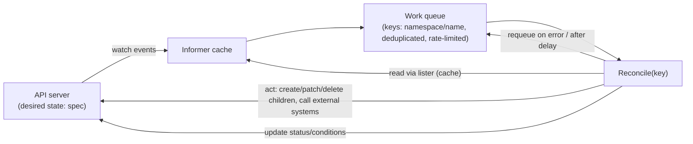

# 5.6 Controllers and the reconcile loop: how Kubernetes thinks

| | |
|---|---|
| Level | Intermediate |
| Priority tier | 0 |
| Lab venue | kind cluster, kubectl; `kubernetes` Python client or client-go for a toy controller; optional kube-controller-manager logs |
| Part | Part 5: Kubernetes |
| Status | Drafted, labs **untested** |

## Why this matters for AI infrastructure

Almost everything that makes Kubernetes useful for AI is a controller: Deployments keep inference servers at the right replica count, Jobs retry failed training pods, StatefulSets give distributed workers stable identities, the node controller evicts pods from dead GPU nodes, the Endpoints controller keeps load balancers pointed at ready replicas, and the GPU Operator, Kueue, KubeRay and the Training Operator are all controllers you will install, debug and sometimes write. If you understand the reconcile loop deeply, you can predict what the system will do after a failure, explain "why did it restart my pod?", read operator logs, and design custom controllers (5.29 to 5.33) that behave well at scale.

## Prerequisites and outcomes

Needs 5.3 and 5.5. After this chapter you can:

- Define a controller precisely: a loop that observes cluster state, compares to desired state, and acts to reduce the difference; contrast with imperative orchestration and event-driven scripts.
- Explain level-triggered vs edge-triggered logic and why idempotent reconciliation matters.
- Describe client-go machinery: reflectors, informers, shared index caches, listers, work queues with rate limiting, workers, resync.
- Trace the built-in controllers end to end: Deployment → ReplicaSet → Pod; StatefulSet; DaemonSet; Job/CronJob; node lifecycle; EndpointSlice; namespace and garbage collection; HPA.
- Use ownerReferences, labels/selectors, finalizers, conditions and `observedGeneration` correctly.
- Explain leader election and HA of controllers; diagnose controller lag, hot loops and conflicts.
- Apply controller-thinking to design safe automation (including GPU health remediation).

## 1. The controller pattern

> A controller watches the state of the cluster and makes or requests changes where needed. Each controller tries to move the current cluster state closer to the desired state.

Think of a thermostat: the desired temperature is the `spec`; the sensor reading is the `status`; the loop turns the heater on or off based on the difference, not on a button press. Properties that make this robust:

- **Declarative input**: users state *what* they want; controllers decide *how* and keep deciding forever.
- **Level-triggered**: the reconcile function takes the *current* world and *desired* spec, computes the diff, and acts. It does not depend on having seen every event. Missed events, restarts and duplicated events are all harmless because the next pass recomputes the same diff. (Edge-triggered systems, which react to "pod died" events, fail if the event is lost.)
- **Idempotent and convergent**: acting twice leaves the same result; repeated reconciliation converges to the desired state or reports why not.
- **Single responsibility and loose coupling**: each controller owns one concern and communicates only through the API (writing child objects, updating status). Chains of simple controllers produce complex behaviour (Deployment creates ReplicaSet creates Pods; the scheduler binds; the kubelet runs).
- **Self-healing and drift correction**: manual changes to controller-owned objects are reverted (if a ReplicaSet's pod is deleted, a new one is created; if you edit a pod template managed by a Deployment, the Deployment overwrites it).



The reconcile function signature is deliberately minimal: given an object key, return nil, an error (retry with backoff), or "requeue after X". It should re-read the object, compute desired children, compare with observed children, and make minimal changes.

## 2. The machinery: informers and work queues

controllers use `client-go` (and `controller-runtime` on top of it, 5.31):

- **Reflector**: performs a LIST of a resource, then a WATCH from the returned resourceVersion, handling reconnects and `410 Gone` by relisting (5.5). It pushes changes into a DeltaFIFO.
- **Informer / SharedInformer**: consumes deltas, updates an in-memory **indexer** (thread-safe store with optional indexes, e.g., pods by node name), and invokes event handlers (`OnAdd`, `OnUpdate`, `OnDelete`). **Shared** informers are created once per resource type per process and shared by many controllers (one watch connection serves all).
- **Lister**: read-only access to the local cache. Reconcile logic reads from listers (cheap, possibly slightly stale) and writes to the API server directly. Stale reads are tolerated because writes are conditional (`resourceVersion`) and reconciliation repeats.
- **Resync period**: periodically re-delivers all cached objects as update events even if unchanged (default 10 hours in kube-controller-manager informers; configurable), as a safety net.
- **Work queue**: event handlers enqueue the *key* (`namespace/name`) of the affected object (or of its owner), not the object. The queue **deduplicates** (many events for one object collapse into one pending key), preserves "one worker at a time per key" semantics, and supports **rate-limited requeues** (exponential backoff on error, bucket limiters) and delayed adds.
- **Workers**: N goroutines pop keys, call `Reconcile`, and `Forget`/`AddRateLimited` depending on the result.
- **Event handlers map secondary resources to owners**: when a Pod changes, enqueue its owning ReplicaSet; when a Node changes, enqueue pods or DaemonSets affected. This "watch children, reconcile parent" pattern is central to every operator.

Why local caches matter: with 5,000 nodes and 150,000 pods, hundreds of controllers cannot each issue LIST calls per decision; the informer pattern means one watch per type per process and O(1) local reads.

## 3. Built-in controllers (a tour)

### Deployment → ReplicaSet → Pod

- The **Deployment controller** owns ReplicaSets; for each unique pod template hash it keeps a ReplicaSet (`<deployment>-<hash>`). On a template change it creates a new ReplicaSet and shifts replicas between old and new according to the **strategy**: `RollingUpdate` with `maxSurge` and `maxUnavailable` (percentages or counts), or `Recreate`. It tracks `progressDeadlineSeconds` and sets conditions (`Progressing`, `Available`, `ReplicaFailure`). `revisionHistoryLimit` keeps old ReplicaSets for rollback (`kubectl rollout undo`). `minReadySeconds` delays counting a pod as available.
- The **ReplicaSet controller** ensures the number of pods matching its selector equals `spec.replicas`, creating pods from its template and deleting extras (preferring unscheduled, not-ready, recently created, or on nodes with more replicas); it uses ownerReferences to adopt/orphan pods.
- **Pod creation** is just writing a Pod object; the scheduler and kubelet take it from there.

```bash
kubectl create deployment web --image=nginx:1.27 --replicas=3
kubectl get deploy,rs,pods -l app=web -o wide
kubectl get rs -l app=web -o jsonpath='{range .items[*]}{.metadata.name}{" owner="}{.metadata.ownerReferences[0].name}{"\n"}{end}'
kubectl set image deploy/web nginx=nginx:1.27.1      # new ReplicaSet, rolling shift
kubectl rollout status deploy/web; kubectl rollout history deploy/web; kubectl rollout undo deploy/web
kubectl delete pod -l app=web --wait=false           # ReplicaSet recreates them
```

### StatefulSet

Ordered, stable identity: pods named `<name>-0..N-1`, stable network IDs via a headless Service, per-pod PVCs from `volumeClaimTemplates` that survive pod deletion. `podManagementPolicy: OrderedReady` (create/scale in order, wait for Ready) vs `Parallel`; update strategies `RollingUpdate` (reverse ordinal, with `partition` for canaries) and `OnDelete`. The controller never runs two pods with the same ordinal and never deletes PVCs automatically unless `persistentVolumeClaimRetentionPolicy` says so. Used for databases, Zookeeper/etcd, and some distributed training coordinators.

### DaemonSet

Ensures one pod per eligible node (selected by `nodeSelector`/affinity, tolerations). Controller creates pods with node affinity for each node (scheduled by the default scheduler since 1.12), handles node add/remove, and does rolling updates (`maxUnavailable`, `maxSurge`). In GPU clusters: NVIDIA device plugin, DCGM exporter, GPU feature discovery, CNI agents, log shippers, node-problem-detector.

### Job and CronJob

The **Job controller** runs pods to completion: `completions`, `parallelism`, `backoffLimit`, `activeDeadlineSeconds`, `ttlSecondsAfterFinished`, `completionMode: Indexed` (each pod gets `JOB_COMPLETION_INDEX`, used for sharded work and for distributed training workers), `podFailurePolicy` (treat specific exit codes/disruptions differently: e.g., don't count node-drain evictions toward backoff), `suspend` (queue managers like Kueue create Jobs suspended and unsuspend on admission), `managedBy` and elastic scaling in newer releases. **CronJob controller** creates Jobs on schedules with `concurrencyPolicy` (`Allow`, `Forbid`, `Replace`), `startingDeadlineSeconds`, history limits and time zones. Training operators (PyTorchJob, MPIJob, RayJob, JobSet) build on the same ideas with gang semantics.

### Node lifecycle and eviction

The **node lifecycle controller** watches Node leases/status; if heartbeats stop for `node-monitor-grace-period` (default 40 s) it sets the Node `Ready` condition to `Unknown` and adds taints `node.kubernetes.io/unreachable:NoExecute` (or `not-ready`). Pods tolerate these taints for `tolerationSeconds` (default 300 s, added automatically by the `DefaultTolerationSeconds` admission plugin), after which the **taint-based eviction** (NoExecute manager) deletes them so controllers can recreate them elsewhere. For GPU training you often change this: shorter tolerations for quick recovery in elastic jobs, longer ones to ride out brief network flaps, and explicit handling for pods with local state. A deleted pod object on an unreachable node is stuck `Terminating` until the kubelet returns or the node object is deleted (or a force delete); StatefulSets do not replace pods stuck terminating, to avoid split-brain, unless the node is confirmed gone (non-graceful shutdown handling in newer releases with the `node.kubernetes.io/out-of-service` taint).

### EndpointSlice and Service controllers

The **EndpointSlice controller** watches Services and Pods; for each Service it maintains EndpointSlices listing ready pod IPs (and `serving`, `terminating` states), updated when pods become Ready/NotReady (readiness probes drive traffic). `kube-proxy` consumes these (5.10). The **Service controller** (cloud-controller-manager) provisions cloud load balancers for `type: LoadBalancer`.

### Namespace, garbage collector, TTL, PV/PVC, HPA and others

- **Namespace controller** deletes all content when a namespace is deleted (hence stuck `Terminating` namespaces when finalizers or unavailable APIs block it).
- **Garbage collector** deletes dependents whose owners are gone, following `ownerReferences` and `blockOwnerDeletion`.
- **TTL-after-finished** removes completed Jobs/Pods.
- **PersistentVolume controller** binds PVCs to PVs, provisions via external provisioners, handles reclaim policies; **attach/detach controller** and **expand controller** coordinate with CSI (5.17).
- **HorizontalPodAutoscaler controller** polls metrics every 15 s (default) and adjusts `scale` subresource of Deployments/StatefulSets/CRDs (5.23).
- **ResourceQuota controller**, **ServiceAccount/token controllers**, **CSR approving/signing**, **ClusterRole aggregation**, **Lease garbage collection** and many more.

List them: `kube-controller-manager --help | grep -A100 controllers` or read its startup log lines "Started ... controller".

## 4. Owners, selectors, finalizers, conditions

### ownerReferences and adoption

Child objects carry `ownerReferences: [{apiVersion, kind, name, uid, controller: true, blockOwnerDeletion: true}]`. Rules: exactly one **controller** owner per object; a controller only manages objects it owns or can adopt by selector (matching labels and no other controller owner). Deleting the owner triggers GC of dependents depending on `propagationPolicy`. If you change a Deployment's selector labels (immutable after creation for `apps/v1`) or relabel pods, you can orphan or fight over pods. `kubectl delete rs web-abc --cascade=orphan` leaves pods running and ownerless (ReplicaSet controllers re-adopt matching pods).

```bash
kubectl get pod web-xxxx -o jsonpath='{.metadata.ownerReferences}' | jq
kubectl label pod web-xxxx app-                # remove the label: ReplicaSet no longer matches it → orphaned and replaced (a debugging trick: isolate a bad pod without deleting it)
```

### Finalizers

Strings in `metadata.finalizers` block deletion: the API server sets `deletionTimestamp` and keeps the object until each finalizer is removed by its owning controller after cleanup (e.g., `kubernetes.io/pv-protection`, `foregroundDeletion`, `batch.kubernetes.io/job-tracking`, your operator's `example.com/cleanup`). Stuck `Terminating` resources are almost always unfulfilled finalizers; fix the controller, not just the finalizer list. Removing a finalizer manually skips cleanup (leaked cloud disks, IPs, load balancers).

### Status and conditions

By convention `status.conditions[]` carry `type`, `status` (`True`/`False`/`Unknown`), `reason` (CamelCase machine-readable), `message`, `lastTransitionTime`, `observedGeneration`. Consumers (`kubectl wait --for=condition=Available`, GitOps health checks, Kueue) rely on them. A good controller sets `Ready`/`Progressing`/`Degraded` style conditions with actionable reasons, and writes `status` through the `/status` subresource (so spec edits and status writes don't conflict).

## 5. Leader election and HA

controller-manager, scheduler and most operators run several replicas but only one **active** instance, chosen by leader election on a Lease object (`coordination.k8s.io/v1`): candidates try to acquire/renew the lease by updating `holderIdentity` and `renewTime`; defaults `leaseDuration` 15 s, `renewDeadline` 10 s, `retryPeriod` 2 s (so failover takes roughly 15 to 30 s). If the leader cannot renew (API/etcd slowness, CPU starvation, network), it exits (a deliberate crash) so another can take over; frequent restarts with "leaderelection lost" messages point to API/etcd latency (5.5). Sharding controllers across replicas is possible but must be designed (consistent hashing of keys).

```bash
kubectl get lease -n kube-system
kubectl get lease kube-controller-manager -n kube-system -o jsonpath='{.spec.holderIdentity}{"\n"}'
```

## 6. Failure modes and diagnostics

| Symptom | Likely cause | How to check |
|---|---|---|
| Object stuck, no events | Controller not running (leader missing), RBAC denies it, webhook blocks writes | Controller logs, `kubectl get lease`, API audit, admission webhooks |
| Deployment rollout stuck | New pods Pending/CrashLoop, readiness never passes, `maxUnavailable: 0` with no capacity, quota exceeded | `kubectl rollout status`, `describe rs`, events, `ProgressDeadlineExceeded` condition |
| Pod keeps being recreated | Controller reconciling a crash/eviction; or two controllers fighting over the same object | `ownerReferences`, controller logs, `managedFields` |
| Reconcile hot loop | Controller updates the object every pass (non-idempotent write, status change triggers itself) | Rate of writes in audit, metrics, `resourceVersion` churn; add change detection, ignore status-only updates (predicates) |
| Controller lag | Work queue depth high, workers too few, slow external calls | `workqueue_depth`, `workqueue_queue_duration_seconds`, `workqueue_work_duration_seconds` |
| 409 Conflict errors in logs | Concurrent writers | Expected occasionally; excessive means fighting actors or stale cache; use patch/SSA |
| Namespace stuck Terminating | Finalizers, unavailable aggregated API (metrics.k8s.io), CRD instances blocked | `kubectl get ns x -o json \| jq .status.conditions`, `kubectl api-resources` errors |
| Pods Terminating forever on a dead node | kubelet unreachable | Wait for node deletion, force delete only if sure the node is down; `out-of-service` taint |
| Replicas flap after HPA | HPA and manifest both set replicas (GitOps) | Omit `replicas` in GitOps manifests, or `ignoreDifferences` |
| Orphans after delete | `--cascade=orphan`, missing ownerRefs in custom controllers | GC rules |

Metrics for any controller using controller-runtime: `controller_runtime_reconcile_total{result}`, `controller_runtime_reconcile_time_seconds`, `controller_runtime_active_workers`, `workqueue_*`, `rest_client_requests_total`, leader election gauges.

## 7. Designing safe automation with the controller mindset

Principles to apply when writing controllers or automation scripts (including remediation of GPU faults):

1. **Observe, compare, act minimally**; never assume your last action succeeded; recompute from current state each time.
2. **Idempotent actions**: cordon only if not already cordoned; label with a stable key; create-if-missing.
3. **Rate-limit and back off**: avoid tight loops against the API or external systems; use jitter.
4. **Bound blast radius**: cap how many nodes you will cordon/drain/reboot simultaneously (a controller reacting to a fleet-wide false alarm can take down the cluster). Implement budgets and require health signals from multiple sources.
5. **Record intent in the API** (annotations/conditions) so humans and other controllers can see it; avoid hidden state.
6. **Fail safe**: on uncertainty, do nothing and surface a condition/event rather than making destructive changes.
7. **Respect ownership**: do not modify objects owned by other controllers (modify their inputs instead).
8. **Finalizers for external cleanup**, with timeouts and metrics so they cannot wedge deletion forever.
9. **Leader election and graceful shutdown** for HA.
10. **Test with chaos**: kill the controller mid-action, drop events, delay the API, and confirm convergence.

Example: a GPU node health controller (5.32) watches Node conditions published by node-problem-detector/DCGM, cordons a node after sustained Xid errors, creates a drain request limited by PodDisruptionBudgets and a global concurrency budget, annotates the node with the reason, and uncordons only after a health-check Job passes: every step is an idempotent reconcile based on observed conditions, not a script reacting to an alert once.

## 8. Lab (untested)

1. **See controllers work**: create a Deployment; list owned ReplicaSet/Pods with ownerReferences; delete a pod, scale, change image, and watch `kubectl get rs,pods -w`; correlate events (`kubectl describe`) with controller names; read `kube-controller-manager` logs at `-v=4` (kubeadm: edit the static pod flag) for the deployment/replicaset controllers.
2. **Level- vs edge-triggered**: stop the controller-manager (move its static pod manifest away), delete pods and scale the Deployment; restore the controller manager and observe that it converges without having seen the events.
3. **Adoption and orphaning**: remove a pod's label to orphan it; observe replacement; relabel to re-adopt; delete a ReplicaSet with `--cascade=orphan`; examine ownerReferences.
4. **Rollout strategies**: Deployment with `maxSurge: 25%`, `maxUnavailable: 0`, a failing readiness probe image, watch `ProgressDeadlineExceeded`; `kubectl rollout undo`; test `Recreate`.
5. **StatefulSet**: create one with a headless Service and volumeClaimTemplates; delete a pod and see identity/PVC preserved; scale down and up; test `partition` updates; try `Parallel`.
6. **Jobs**: indexed Job with `parallelism: 4`, `completions: 8`, `backoffLimit`; `podFailurePolicy` to ignore disruption failures; `suspend: true` then unsuspend; simulate failure with exit codes.
7. **Node failure**: on a multi-node lab stop kubelet on a worker; watch taints, `tolerationSeconds`, pod eviction and rescheduling; compare Deployment vs StatefulSet vs bare Pod behaviour.
8. **Finalizers**: create a ConfigMap with a custom finalizer, delete it, observe `deletionTimestamp`; remove the finalizer; create a namespace with a CR that has a finalizer and see Terminating; then fix.
9. **Toy controller**: write a ~50-line controller (Python with `kubernetes` informers or Go with client-go) that ensures every namespace labelled `team=*` has a default ResourceQuota ConfigMap; make it level-triggered and idempotent; kill it and restart; add leader election with a Lease.
10. **Observability**: scrape controller-manager metrics (`workqueue_depth`, `workqueue_retries_total`), create load (hundreds of Jobs) and chart queue depth/latency; identify the slowest controller.
11. **Leader election**: find the lease holders; kill the leader pod; measure failover time; induce slow API (CPU-throttle etcd in a lab) and watch "leaderelection lost".
12. **Design exercise**: write the reconcile pseudocode for a "cordon-on-GPU-fault" controller with budgets; list its inputs, outputs, idempotency, failure behaviour, and metrics.
13. **Clean up**.

Mark tested only after execution.

## 9. Common mistakes

- Writing controllers that react to events (edge-triggered) and keep internal state instead of recomputing from the API.
- Updating status in a way that triggers another reconcile of the same object endlessly (no predicates/change detection).
- Many controllers LIST-ing from the API server instead of using shared informers.
- Not setting ownerReferences on children (orphans, leaks) or setting two controller owners.
- Relying on finalizers without ensuring the controller will run at deletion time (uninstalling the operator before deleting its CRs).
- Ignoring `409 Conflict`s or retrying without backoff.
- Letting remediation controllers act on every alert without budgets.
- Running controllers without leader election, or with long lease durations that slow failover.
- Mixing GitOps-declared replica counts with HPA.
- Treating `kubectl delete pod` as a fix for something a controller will recreate identically.

## 10. Interview angles

- "What is a Kubernetes controller? Explain the reconcile loop and why it's level-triggered." 
- "How do informers, caches and work queues reduce load on the API server?" 
- "Walk through what happens when you delete a pod owned by a ReplicaSet / a node dies." 
- "How does a Deployment roll out a new version? What are `maxSurge` and `maxUnavailable`?" 
- "What are ownerReferences and finalizers? Why is my namespace stuck Terminating?" 
- "How does leader election work and what happens during failover?" 
- "How would you design a controller that cordons unhealthy GPU nodes safely?" 
- "Why do we have both Deployment and ReplicaSet?" 

## 11. Checkpoint questions (35)

1. What is the reconcile loop? **A:** Observe actual, compare to desired, act to converge.
2. Level- vs edge-triggered? **A:** React to state differences vs to individual events.
3. What is an informer? **A:** List+watch with cached store and event handlers.
4. What does a lister read from? **A:** The local cache.
5. What is enqueued in the work queue? **A:** The object key.
6. Why are keys deduplicated? **A:** Collapse many events into one reconcile.
7. What is resync? **A:** Periodic redelivery of cached objects.
8. Deployment owns what? **A:** ReplicaSets.
9. ReplicaSet owns what? **A:** Pods.
10. What decides rollout pace? **A:** `maxSurge`/`maxUnavailable`.
11. What does `progressDeadlineSeconds` do? **A:** Marks rollout failed if no progress.
12. StatefulSet identity features? **A:** Stable names, headless DNS, per-pod PVCs.
13. DaemonSet purpose? **A:** One pod per eligible node.
14. Indexed Job gives what? **A:** `JOB_COMPLETION_INDEX` per pod.
15. What does `suspend` enable? **A:** Queue managers control start.
16. `podFailurePolicy` use? **A:** Treat disruptions/exit codes differently.
17. Node grace period default? **A:** 40 s.
18. Default toleration seconds for NotReady? **A:** 300 s.
19. What taints mark unreachable nodes? **A:** `node.kubernetes.io/unreachable` / `not-ready`.
20. What do EndpointSlices contain? **A:** Ready pod IPs for a Service.
21. What does the GC use? **A:** ownerReferences.
22. What are finalizers? **A:** Block deletion until cleanup.
23. Why namespaces stick Terminating? **A:** Finalizers/unavailable APIs.
24. Conditions fields? **A:** type, status, reason, message, lastTransitionTime.
25. `observedGeneration` meaning? **A:** Spec generation the status reflects.
26. Leader election object? **A:** Lease.
27. Failover time scale? **A:** ~15–30 s.
28. Why `409`s occur? **A:** Concurrent updates with stale RV.
29. Hot loop cause? **A:** Reconcile writes that retrigger itself.
30. Metric for queue backlog? **A:** `workqueue_depth`.
31. How isolate a bad pod from its ReplicaSet? **A:** Remove matching label.
32. Why not edit pods managed by a Deployment? **A:** Controller reverts template drift.
33. Why bound remediation concurrency? **A:** Avoid fleet-wide self-inflicted outage.
34. Why use `/status` subresource? **A:** Avoid conflicts between spec and status writers.
35. Why leader election for operators? **A:** One active reconciler for HA.

## 12. Sources and review notes

**Written in original words.** Principal sources:

- Brendan Burns, Joe Beda, Kelsey Hightower and Lachlan Evenson, *Kubernetes: Up and Running* (3rd edition; chapters 9 to 12 on ReplicaSets, Deployments, DaemonSets, Jobs, and chapter 17 on extending Kubernetes).
- Michael Hausenblas and Stefan Schimanski, *Programming Kubernetes* (controller pattern, client-go informers, work queues, level-triggered design).
- The author's `nvidia-devops` repository, volume 03 (control plane and scheduling masterclass, resourceVersion and watch mechanics).
- Kubernetes documentation for controllers, workloads, Jobs, taints/tolerations and leader election.
- Examples are the author's constructions.

**Flagged for verification before publishing:** default timings (resync, lease, grace periods), Job features status by release (`podFailurePolicy`, `managedBy`, elastic indexed Jobs), non-graceful node shutdown behaviour, controller names/flags, and every command listing; all labs are **untested**.
