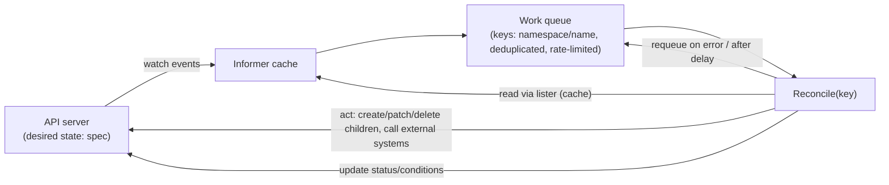

# 5.6 Controllers and the reconcile loop: how Kubernetes thinks

| | |
|---|---|
| Level | Intermediate |
| Priority tier | 0 |
| Lab venue | kind cluster, kubectl; `kubernetes` Python client or client-go for a toy controller; optional kube-controller-manager logs |
| Part | Part 5: Kubernetes |
| Status | Drafted, labs **untested** |

## Why this matters for AI infrastructure

Almost everything that makes Kubernetes useful for AI is a controller: Deployments keep inference servers at the right replica count, Jobs retry failed training pods, StatefulSets give distributed workers stable identities, the node controller evicts pods from dead GPU nodes, the Endpoints controller keeps load balancers pointed at ready replicas, and the GPU Operator, Kueue, KubeRay and the Training Operator are all controllers you will install, debug and sometimes write. If you understand the reconcile loop deeply, you can predict what the system will do after a failure, explain "why did it restart my pod?", read operator logs, and design custom controllers (5.29 to 5.33) that behave well at scale.

## Prerequisites and outcomes

Needs 5.3 and 5.5. After this chapter you can:

- Define a controller precisely: a loop that observes cluster state, compares to desired state, and acts to reduce the difference; contrast with imperative orchestration and event-driven scripts.
- Explain level-triggered vs edge-triggered logic and why idempotent reconciliation matters.
- Describe client-go machinery: reflectors, informers, shared index caches, listers, work queues with rate limiting, workers, resync.
- Trace the built-in controllers end to end: Deployment → ReplicaSet → Pod; StatefulSet; DaemonSet; Job/CronJob; node lifecycle; EndpointSlice; namespace and garbage collection; HPA.
- Use ownerReferences, labels/selectors, finalizers, conditions and `observedGeneration` correctly.
- Explain leader election and HA of controllers; diagnose controller lag, hot loops and conflicts.
- Apply controller-thinking to design safe automation (including GPU health remediation).

## 1. The controller pattern

> A controller watches the state of the cluster and makes or requests changes where needed. Each controller tries to move the current cluster state closer to the desired state.

Think of a thermostat: the desired temperature is the `spec`; the sensor reading is the `status`; the loop turns the heater on or off based on the difference, not on a button press. Properties that make this robust:

- **Declarative input**: users state *what* they want; controllers decide *how* and keep deciding forever.
- **Level-triggered**: the reconcile function takes the *current* world and *desired* spec, computes the diff, and acts. It does not depend on having seen every event. Missed events, restarts and duplicated events are all harmless because the next pass recomputes the same diff. (Edge-triggered systems, which react to "pod died" events, fail if the event is lost.)
- **Idempotent and convergent**: acting twice leaves the same result; repeated reconciliation converges to the desired state or reports why not.
- **Single responsibility and loose coupling**: each controller owns one concern and communicates only through the API (writing child objects, updating status). Chains of simple controllers produce complex behaviour (Deployment creates ReplicaSet creates Pods; the scheduler binds; the kubelet runs).
- **Self-healing and drift correction**: manual changes to controller-owned objects are reverted (if a ReplicaSet's pod is deleted, a new one is created; if you edit a pod template managed by a Deployment, the Deployment overwrites it).



The reconcile function signature is deliberately minimal: given an object key, return nil, an error (retry with backoff), or "requeue after X". It should re-read the object, compute desired children, compare with observed children, and make minimal changes.

## 2. The machinery: informers and work queues

controllers use `client-go` (and `controller-runtime` on top of it, 5.31):

- **Reflector**: performs a LIST of a resource, then a WATCH from the returned resourceVersion, handling reconnects and `410 Gone` by relisting (5.5). It pushes changes into a DeltaFIFO.
- **Informer / SharedInformer**: consumes deltas, updates an in-memory **indexer** (thread-safe store with optional indexes, e.g., pods by node name), and invokes event handlers (`OnAdd`, `OnUpdate`, `OnDelete`). **Shared** informers are created once per resource type per process and shared by many controllers (one watch connection serves all).
- **Lister**: read-only access to the local cache. Reconcile logic reads from listers (cheap, possibly slightly stale) and writes to the API server directly. Stale reads are tolerated because writes are conditional (`resourceVersion`) and reconciliation repeats.
- **Resync period**: periodically re-delivers all cached objects as update events even if unchanged (default 10 hours in kube-controller-manager informers; configurable), as a safety net.
- **Work queue**: event handlers enqueue the *key* (`namespace/name`) of the affected object (or of its owner), not the object. The queue **deduplicates** (many events for one object collapse into one pending key), preserves "one worker at a time per key" semantics, and supports **rate-limited requeues** (exponential backoff on error, bucket limiters) and delayed adds.
- **Workers**: N goroutines pop keys, call `Reconcile`, and `Forget`/`AddRateLimited` depending on the result.
- **Event handlers map secondary resources to owners**: when a Pod changes, enqueue its owning ReplicaSet; when a Node changes, enqueue pods or DaemonSets affected. This "watch children, reconcile parent" pattern is central to every operator.

Why local caches matter: with 5,000 nodes and 150,000 pods, hundreds of controllers cannot each issue LIST calls per decision; the informer pattern means one watch per type per process and O(1) local reads.

## 3. Built-in controllers (a tour)

### Deployment → ReplicaSet → Pod

- The **Deployment controller** owns ReplicaSets; for each unique pod template hash it keeps a ReplicaSet (`<deployment>-<hash>`). On a template change it creates a new ReplicaSet and shifts replicas between old and new according to the **strategy**: `RollingUpdate` with `maxSurge` and `maxUnavailable` (percentages or counts), or `Recreate`. It tracks `progressDeadlineSeconds` and sets conditions (`Progressing`, `Available`, `ReplicaFailure`). `revisionHistoryLimit` keeps old ReplicaSets for rollback (`kubectl rollout undo`). `minReadySeconds` delays counting a pod as available.
- The **ReplicaSet controller** ensures the number of pods matching its selector equals `spec.replicas`, creating pods from its template and deleting extras (preferring unscheduled, not-ready, recently created, or on nodes with more replicas); it uses ownerReferences to adopt/orphan pods.
- **Pod creation** is just writing a Pod object; the scheduler and kubelet take it from there.

```bash
kubectl create deployment web --image=nginx:1.27 --replicas=3
kubectl get deploy,rs,pods -l app=web -o wide
kubectl get rs -l app=web -o jsonpath='{range .items[*]}{.metadata.name}{" owner="}{.metadata.ownerReferences[0].name}{"\n"}{end}'
kubectl set image deploy/web nginx=nginx:1.27.1      # new ReplicaSet, rolling shift
kubectl rollout status deploy/web; kubectl rollout history deploy/web; kubectl rollout undo deploy/web
kubectl delete pod -l app=web --wait=false           # ReplicaSet recreates them
```

### StatefulSet

Ordered, stable identity: pods named `<name>-0..N-1`, stable network IDs via a headless Service, per-pod PVCs from `volumeClaimTemplates` that survive pod deletion. `podManagementPolicy: OrderedReady` (create/scale in order, wait for Ready) vs `Parallel`; update strategies `RollingUpdate` (reverse ordinal, with `partition` for canaries) and `OnDelete`. The controller never runs two pods with the same ordinal and never deletes PVCs automatically unless `persistentVolumeClaimRetentionPolicy` says so. Used for databases, Zookeeper/etcd, and some distributed training coordinators.

### DaemonSet

Ensures one pod per eligible node (selected by `nodeSelector`/affinity, tolerations). Controller creates pods with node affinity for each node (scheduled by the default scheduler since 1.12), handles node add/remove, and does rolling updates (`maxUnavailable`, `maxSurge`). In GPU clusters: NVIDIA device plugin, DCGM exporter, GPU feature discovery, CNI agents, log shippers, node-problem-detector.

### Job and CronJob

The **Job controller** runs pods to completion: `completions`, `parallelism`, `backoffLimit`, `activeDeadlineSeconds`, `ttlSecondsAfterFinished`, `completionMode: Indexed` (each pod gets `JOB_COMPLETION_INDEX`, used for sharded work and for distributed training workers), `podFailurePolicy` (treat specific exit codes/disruptions differently: e.g., don't count node-drain evictions toward backoff), `suspend` (queue managers like Kueue create Jobs suspended and unsuspend on admission), `managedBy` and elastic scaling in newer releases. **CronJob controller** creates Jobs on schedules with `concurrencyPolicy` (`Allow`, `Forbid`, `Replace`), `startingDeadlineSeconds`, history limits and time zones. Training operators (PyTorchJob, MPIJob, RayJob, JobSet) build on the same ideas with gang semantics.

### Node lifecycle and eviction

The **node lifecycle controller** watches Node leases/status; if heartbeats stop for `node-monitor-grace-period` (default 40 s) it sets the Node `Ready` condition to `Unknown` and adds taints `node.kubernetes.io/unreachable:NoExecute` (or `not-ready`). Pods tolerate these taints for `tolerationSeconds` (default 300 s, added automatically by the `DefaultTolerationSeconds` admission plugin), after which the **taint-based eviction** (NoExecute manager) deletes them so controllers can recreate them elsewhere. For GPU training you often change this: shorter tolerations for quick recovery in elastic jobs, longer ones to ride out brief network flaps, and explicit handling for pods with local state. A deleted pod object on an unreachable node is stuck `Terminating` until the kubelet returns or the node object is deleted (or a force delete); StatefulSets do not replace pods stuck terminating, to avoid split-brain, unless the node is confirmed gone (non-graceful shutdown handling in newer releases with the `node.kubernetes.io/out-of-service` taint).

### EndpointSlice and Service controllers

The **EndpointSlice controller** watches Services and Pods; for each Service it maintains EndpointSlices listing ready pod IPs (and `serving`, `terminating` states), updated when pods become Ready/NotReady (readiness probes drive traffic). `kube-proxy` consumes these (5.10). The **Service controller** (cloud-controller-manager) provisions cloud load balancers for `type: LoadBalancer`.

### Namespace, garbage collector, TTL, PV/PVC, HPA and others

- **Namespace controller** deletes all content when a namespace is deleted (hence stuck `Terminating` namespaces when finalizers or unavailable APIs block it).
- **Garbage collector** deletes dependents whose owners are gone, following `ownerReferences` and `blockOwnerDeletion`.
- **TTL-after-finished** removes completed Jobs/Pods.
- **PersistentVolume controller** binds PVCs to PVs, provisions via external provisioners, handles reclaim policies; **attach/detach controller** and **expand controller** coordinate with CSI (5.17).
- **HorizontalPodAutoscaler controller** polls metrics every 15 s (default) and adjusts `scale` subresource of Deployments/StatefulSets/CRDs (5.23).
- **ResourceQuota controller**, **ServiceAccount/token controllers**, **CSR approving/signing**, **ClusterRole aggregation**, **Lease garbage collection** and many more.

List them: `kube-controller-manager --help | grep -A100 controllers` or read its startup log lines "Started ... controller".

## 4. Owners, selectors, finalizers, conditions

### ownerReferences and adoption

Child objects carry `ownerReferences: [{apiVersion, kind, name, uid, controller: true, blockOwnerDeletion: true}]`. Rules: exactly one **controller** owner per object; a controller only manages objects it owns or can adopt by selector (matching labels and no other controller owner). Deleting the owner triggers GC of dependents depending on `propagationPolicy`. If you change a Deployment's selector labels (immutable after creation for `apps/v1`) or relabel pods, you can orphan or fight over pods. `kubectl delete rs web-abc --cascade=orphan` leaves pods running and ownerless (ReplicaSet controllers re-adopt matching pods).

```bash
kubectl get pod web-xxxx -o jsonpath='{.metadata.ownerReferences}' | jq
kubectl label pod web-xxxx app-                # remove the label: ReplicaSet no longer matches it → orphaned and replaced (a debugging trick: isolate a bad pod without deleting it)
```

In *Kubernetes: Up and Running* Chapters 9–12 (*ReplicaSets*, *Deployments*, *DaemonSets*, and *Jobs*) and *Kubernetes Programming with Go* (`KPG` Chapters 3 & 6), the authors highlight four practical mechanics of how built-in controllers use labels and `ownerReferences`:
1. **Quarantining vs. Adopting Pods (`KUR` Chapter 9):** Because a `ReplicaSet` finds its pods strictly by evaluating its `spec.selector` label query against the informer cache, removing the matching label from a misbehaving pod (`kubectl label pod kuard-xxxx app-`) causes the `ReplicaSet` controller to **release (`orphan`)** that pod (leaving it running in isolation so you can `kubectl exec` or capture a core dump/GPU memory dump) while immediately creating a fresh replacement pod to keep `replicas` at target. Conversely, if a bare pod is created with labels matching an active `ReplicaSet` and has no existing controller `ownerReference`, the `ReplicaSet` controller **adopts** it by patching `metadata.ownerReferences` (`Controller: pointer.BoolPtr(true)`, `BlockOwnerDeletion: pointer.BoolPtr(true)` in `k8s.io/apimachinery/pkg/apis/meta/v1`, `KPG` Chapter 3, modeled in `reconcile_replicaset()` in `code/part05/controller_reconcile_simulator.py`).
2. **Client Compatibility During `RollingUpdate` (`KUR` Chapter 10):** During a Deployment `RollingUpdate` (`25% max unavailable, 25% max surge`), both `v1` and `v2` ReplicaSet pods serve traffic simultaneously—and even after `v1` pods terminate, external or mobile/JavaScript clients may still run `v1` client code. Therefore, every service API and database schema must maintain backward compatibility across adjacent versions; and while `kubectl rollout undo` (`kubectl rollout history deployment kuard --revision=2`) works in emergencies, reverting the YAML in Git and running `kubectl apply` keeps declarative source control aligned with the live cluster.
3. **Node-Label Driven `DaemonSet` Reconciliation (`KUR` Chapter 11):** Rather than using pod anti-affinity hacks on a ReplicaSet to place 1 agent per node, a `DaemonSet` (`fluentd`, `nvidia-device-plugin`, `dcgm-exporter`) reconciles node additions and label changes automatically—for example, when a `DaemonSet` specifies `nodeSelector: { ssd: "true" }` (or `nvidia.com/gpu.present: "true"`), labeling a node (`kubectl label nodes node01 ssd=true`) immediately causes the `DaemonSet` controller to schedule the daemon pod onto that node, and removing the label terminates it.
4. **The Three `Job` Patterns and `restartPolicy` (`KUR` Chapter 12 Table 12-1):**
   - *One-shot (`completions: 1, parallelism: 1`):* Database migrations or smoke tests (`--keygen-enable --keygen-exit-on-complete --keygen-num-to-gen=3`).
   - *Parallel fixed completions (`completions: 10, parallelism: 5`):* Processing a fixed batch where 5 pods run concurrently until 10 total completions succeed.
   - *Work queue with parallel consumers (`completions` unset, `parallelism: 5`):* Workers pull items from a queue service (`memq` `/memq/server/queues/keygen` in `KUR` Chapter 12) until the queue is empty and exit `0`.
   - *`restartPolicy: OnFailure` vs. `Never`:* Pods inside a `Job` cannot use `restartPolicy: Always`. With `OnFailure`, a crashing container (`--keygen-exit-code=1`) is restarted *in place* on the same node by the `kubelet` (`RESTARTS` counter increments on the same Pod); with `Never`, the failed Pod is left intact (`Status: Error`) for log inspection while the **Job controller** creates a brand-new replacement Pod (`oneshot-4kfdt`, `oneshot-8x2p1`) until `backoffLimit` is reached.

### Finalizers

Strings in `metadata.finalizers` block deletion: the API server sets `deletionTimestamp` and keeps the object until each finalizer is removed by its owning controller after cleanup (e.g., `kubernetes.io/pv-protection`, `foregroundDeletion`, `batch.kubernetes.io/job-tracking`, your operator's `example.com/cleanup`). Stuck `Terminating` resources are almost always unfulfilled finalizers; fix the controller, not just the finalizer list. Removing a finalizer manually skips cleanup (leaked cloud disks, IPs, load balancers).

### Status and conditions

By convention `status.conditions[]` carry `type`, `status` (`True`/`False`/`Unknown`), `reason` (CamelCase machine-readable), `message`, `lastTransitionTime`, `observedGeneration`. Consumers (`kubectl wait --for=condition=Available`, GitOps health checks, Kueue) rely on them. A good controller sets `Ready`/`Progressing`/`Degraded` style conditions with actionable reasons, and writes `status` through the `/status` subresource (so spec edits and status writes don't conflict).

## 5. Leader election and HA

controller-manager, scheduler and most operators run several replicas but only one **active** instance, chosen by leader election on a Lease object (`coordination.k8s.io/v1`): candidates try to acquire/renew the lease by updating `holderIdentity` and `renewTime`; defaults `leaseDuration` 15 s, `renewDeadline` 10 s, `retryPeriod` 2 s (so failover takes roughly 15 to 30 s). If the leader cannot renew (API/etcd slowness, CPU starvation, network), it exits (a deliberate crash) so another can take over; frequent restarts with "leaderelection lost" messages point to API/etcd latency (5.5). Sharding controllers across replicas is possible but must be designed (consistent hashing of keys).

```bash
kubectl get lease -n kube-system
kubectl get lease kube-controller-manager -n kube-system -o jsonpath='{.spec.holderIdentity}{"\n"}'
```

## 6. Failure modes and diagnostics

| Symptom | Likely cause | How to check |
|---|---|---|
| Object stuck, no events | Controller not running (leader missing), RBAC denies it, webhook blocks writes | Controller logs, `kubectl get lease`, API audit, admission webhooks |
| Deployment rollout stuck | New pods Pending/CrashLoop, readiness never passes, `maxUnavailable: 0` with no capacity, quota exceeded | `kubectl rollout status`, `describe rs`, events, `ProgressDeadlineExceeded` condition |
| Pod keeps being recreated | Controller reconciling a crash/eviction; or two controllers fighting over the same object | `ownerReferences`, controller logs, `managedFields` |
| Reconcile hot loop | Controller updates the object every pass (non-idempotent write, status change triggers itself) | Rate of writes in audit, metrics, `resourceVersion` churn; add change detection, ignore status-only updates (predicates) |
| Controller lag | Work queue depth high, workers too few, slow external calls | `workqueue_depth`, `workqueue_queue_duration_seconds`, `workqueue_work_duration_seconds` |
| 409 Conflict errors in logs | Concurrent writers | Expected occasionally; excessive means fighting actors or stale cache; use patch/SSA |
| Namespace stuck Terminating | Finalizers, unavailable aggregated API (metrics.k8s.io), CRD instances blocked | `kubectl get ns x -o json \| jq .status.conditions`, `kubectl api-resources` errors |
| Pods Terminating forever on a dead node | kubelet unreachable | Wait for node deletion, force delete only if sure the node is down; `out-of-service` taint |
| Replicas flap after HPA | HPA and manifest both set replicas (GitOps) | Omit `replicas` in GitOps manifests, or `ignoreDifferences` |
| Orphans after delete | `--cascade=orphan`, missing ownerRefs in custom controllers | GC rules |

Metrics for any controller using controller-runtime: `controller_runtime_reconcile_total{result}`, `controller_runtime_reconcile_time_seconds`, `controller_runtime_active_workers`, `workqueue_*`, `rest_client_requests_total`, leader election gauges.

## 7. Designing safe automation with the controller mindset

Principles to apply when writing controllers or automation scripts (including remediation of GPU faults):

1. **Observe, compare, act minimally**; never assume your last action succeeded; recompute from current state each time.
2. **Idempotent actions**: cordon only if not already cordoned; label with a stable key; create-if-missing.
3. **Rate-limit and back off**: avoid tight loops against the API or external systems; use jitter.
4. **Bound blast radius**: cap how many nodes you will cordon/drain/reboot simultaneously (a controller reacting to a fleet-wide false alarm can take down the cluster). Implement budgets and require health signals from multiple sources.
5. **Record intent in the API** (annotations/conditions) so humans and other controllers can see it; avoid hidden state.
6. **Fail safe**: on uncertainty, do nothing and surface a condition/event rather than making destructive changes.
7. **Respect ownership**: do not modify objects owned by other controllers (modify their inputs instead).
8. **Finalizers for external cleanup**, with timeouts and metrics so they cannot wedge deletion forever.
9. **Leader election and graceful shutdown** for HA.
10. **Test with chaos**: kill the controller mid-action, drop events, delay the API, and confirm convergence.

Example: a GPU node health controller (5.32) watches Node conditions published by node-problem-detector/DCGM, cordons a node after sustained Xid errors, creates a drain request limited by PodDisruptionBudgets and a global concurrency budget, annotates the node with the reason, and uncordons only after a health-check Job passes: every step is an idempotent reconcile based on observed conditions, not a script reacting to an alert once.

## 8. Lab

First, run the self-checking Python lab (`code/part05/controller_reconcile_simulator_lab.py`) locally. It verifies the deduplicating rate-limited `WorkQueue` (`DeduplicatingWorkQueue`, modeling `dirty`/`processing` key collapse and exponential backoff), the level-triggered `ReplicaSet` reconciler (`reconcile_replicaset`, modeling label-removal pod quarantining, ownerless pod adoption, and replica convergence, `KUR` Ch. 9), and the budget-bounded GPU fault remediation controller (`reconcile_gpu_node_remediation`, `Section 7`).

```bash
python3 code/part05/controller_reconcile_simulator_lab.py
```

Next, on a `kind` or `kubeadm` cluster (all interactive shell steps below are `untested here`), work through these exercises:

1. **See controllers work**: create a Deployment; list owned ReplicaSet/Pods with ownerReferences; delete a pod, scale, change image, and watch `kubectl get rs,pods -w`; correlate events (`kubectl describe`) with controller names; read `kube-controller-manager` logs at `-v=4` (kubeadm: edit the static pod flag) for the deployment/replicaset controllers.
2. **Level- vs edge-triggered**: stop the controller-manager (move its static pod manifest away), delete pods and scale the Deployment; restore the controller manager and observe that it converges without having seen the events.
3. **Adoption and orphaning**: remove a pod's label to orphan it; observe replacement; relabel to re-adopt; delete a ReplicaSet with `--cascade=orphan`; examine ownerReferences.
4. **Rollout strategies**: Deployment with `maxSurge: 25%`, `maxUnavailable: 0`, a failing readiness probe image, watch `ProgressDeadlineExceeded`; `kubectl rollout undo`; test `Recreate`.
5. **StatefulSet**: create one with a headless Service and volumeClaimTemplates; delete a pod and see identity/PVC preserved; scale down and up; test `partition` updates; try `Parallel`.
6. **Jobs**: indexed Job with `parallelism: 4`, `completions: 8`, `backoffLimit`; `podFailurePolicy` to ignore disruption failures; `suspend: true` then unsuspend; simulate failure with exit codes.
7. **Node failure**: on a multi-node lab stop kubelet on a worker; watch taints, `tolerationSeconds`, pod eviction and rescheduling; compare Deployment vs StatefulSet vs bare Pod behaviour.
8. **Finalizers**: create a ConfigMap with a custom finalizer, delete it, observe `deletionTimestamp`; remove the finalizer; create a namespace with a CR that has a finalizer and see Terminating; then fix.
9. **Toy controller**: write a ~50-line controller (Python with `kubernetes` informers or Go with client-go) that ensures every namespace labelled `team=*` has a default ResourceQuota ConfigMap; make it level-triggered and idempotent; kill it and restart; add leader election with a Lease.
10. **Observability**: scrape controller-manager metrics (`workqueue_depth`, `workqueue_retries_total`), create load (hundreds of Jobs) and chart queue depth/latency; identify the slowest controller.
11. **Leader election**: find the lease holders; kill the leader pod; measure failover time; induce slow API (CPU-throttle etcd in a lab) and watch "leaderelection lost".
12. **Design exercise**: write the reconcile pseudocode for a "cordon-on-GPU-fault" controller with budgets; list its inputs, outputs, idempotency, failure behaviour, and metrics.
13. **Clean up**.

## 9. Common mistakes

- Writing controllers that react to events (edge-triggered) and keep internal state instead of recomputing from the API.
- Updating status in a way that triggers another reconcile of the same object endlessly (no predicates/change detection).
- Many controllers LIST-ing from the API server instead of using shared informers.
- Not setting ownerReferences on children (orphans, leaks) or setting two controller owners.
- Relying on finalizers without ensuring the controller will run at deletion time (uninstalling the operator before deleting its CRs).
- Ignoring `409 Conflict`s or retrying without backoff.
- Letting remediation controllers act on every alert without budgets.
- Running controllers without leader election, or with long lease durations that slow failover.
- Mixing GitOps-declared replica counts with HPA.
- Treating `kubectl delete pod` as a fix for something a controller will recreate identically.

## 10. Interview angles

- "What is a Kubernetes controller? Explain the reconcile loop and why it's level-triggered."
- "How do informers, caches and work queues reduce load on the API server?"
- "Walk through what happens when you delete a pod owned by a ReplicaSet / a node dies."
- "How does a Deployment roll out a new version? What are `maxSurge` and `maxUnavailable`?"
- "What are ownerReferences and finalizers? Why is my namespace stuck Terminating?"
- "How does leader election work and what happens during failover?"
- "How would you design a controller that cordons unhealthy GPU nodes safely?"
- "Why do we have both Deployment and ReplicaSet?"

## Exercises

1. **Level-Triggered vs. Edge-Triggered Reconciliation and the Thermostat Analogy:** Explain why Kubernetes controllers are designed as level-triggered reconcile loops (`Reconcile(namespace/name)` comparing observed cluster state against `spec`) rather than edge-triggered event handlers, and trace how a controller converges after being stopped while 3 pods were deleted and `replicas` was scaled.
2. **Inside `client-go` Controller Machinery (`Reflector`, `DeltaFIFO`, `SharedInformer`, `Indexer`/`Lister`, and `WorkQueue`, `KPG` Ch. 6):** Using `DeduplicatingWorkQueue` in `code/part05/controller_reconcile_simulator.py`, explain how `SharedInformer`s share a single watch stream across controllers, why `Reconcile` reads from local `Lister` caches (`O(1)`) while writing directly to `kube-apiserver`, and how the `dirty` and `processing` sets inside the work queue guarantee deduplication and prevent two workers from reconciling the same key concurrently.
3. **Built-In Workload Controllers (`Deployment -> ReplicaSet -> Pod`, `StatefulSet`, `DaemonSet`, `Job`/`CronJob`, `KUR` Chapters 9–12):** Compare how `Deployment` (`RollingUpdate` with `maxSurge`/`maxUnavailable` vs `Recreate`), `StatefulSet` (`OrderedReady` vs `Parallel`, `volumeClaimTemplates`, headless Service, `partition` canaries), `DaemonSet` (node-label driven `fluentd`/`dcgm-exporter`), and `Job` (the 3 `KUR` Ch. 12 patterns plus `Indexed` completion mode, `podFailurePolicy`, `suspend`, and `restartPolicy: OnFailure` vs `Never`) reconcile Pods.
4. **`ownerReferences`, Label Quarantining vs. Adoption (`KUR` Ch. 9 & `KPG` Ch. 3), `finalizers`, and `status.conditions`:** Using `reconcile_replicaset()` in `code/part05/controller_reconcile_simulator.py`, trace what happens when an engineer removes `app=web` from a misbehaving Pod (`kubectl label pod web-xxxx app-`) versus creating an ownerless Pod with `app=web`, and explain why `status.conditions` (`observedGeneration`) are written via the `/status` subresource.
5. **Node Lifecycle Taint Eviction, StatefulSet Split-Brain Prevention (`out-of-service` Taint), and Leader Election (`Lease`):** Trace the `node-lifecycle-controller` timeline (`40s` `node-monitor-grace-period` -> `node.kubernetes.io/unreachable:NoExecute` -> `300s` `tolerationSeconds` eviction), explain why Pods on an unreachable node stay stuck in `Terminating` (blocking `StatefulSet` replacement until the node returns or carries `node.kubernetes.io/out-of-service`), and trace `Lease` leader election (`15s` `leaseDuration`, `10s` `renewDeadline`, `2s` `retryPeriod`).
6. **Diagnosing Reconcile Hot Loops, Stuck `Terminating` Namespaces, and Designing a Budget-Bounded GPU Health Controller:** Using `reconcile_gpu_node_remediation()` in `code/part05/controller_reconcile_simulator.py`, explain what causes a reconcile hot loop (and how `GenerationChangedPredicate` / `/status` subresources prevent it), how to unstick a `Terminating` namespace, and how to design a safe GPU fault remediation controller with a global concurrency budget (`max_concurrent_cordons`).

## Checkpoint questions (20)

<details>
<summary>1. Why does `Reconcile(ctx, req)` accept only a `namespace/name` key instead of the event payload (`ADDED` / `MODIFIED` / `DELETED` + old/new object)?</summary>

Passing only the `namespace/name` key enforces **level-triggered reconciliation**:
1. Between the moment an event was enqueued and the moment a worker goroutine pops the key, the object may have changed 5 more times (all collapsed into 1 deduplicated key in the `WorkQueue`).
2. When `Reconcile(key)` runs, it looks up the **latest current snapshot** of the object (and its children) from the local Informer `Lister` cache, compares it to desired state, and acts on the current difference. If the object is no longer found (`apierrors.IsNotFound(err)`), `Reconcile` knows it was deleted and returns `nil`.
</details>

<details>
<summary>2. Trace the path of a watch event through `client-go`: `Reflector` -> `DeltaFIFO` -> `SharedInformer` -> `Indexer` -> `ResourceEventHandler` -> `WorkQueue` -> `Worker` (`KPG` Chapter 6).</summary>

1. **`Reflector`:** Lists the resource from `kube-apiserver` at `resourceVersion` and opens a `WATCH` stream, pushing `(DeltaType, Object)` items into a **`DeltaFIFO`** queue.
2. **`SharedInformer`:** Pops items from `DeltaFIFO`, updates the thread-safe local in-memory **`Indexer` (cache store)**, and fires registered **`ResourceEventHandler` callbacks (`OnAdd`, `OnUpdate`, `OnDelete`)**.
3. **`ResourceEventHandler`:** Extracts the `namespace/name` key of the object (or its parent owner via `ownerReferences`) and calls **`queue.Add(key)`** on the rate-limiting **`WorkQueue`**.
4. **`Worker` goroutines:** Call `queue.Get()`, execute `Reconcile(key)`, call `queue.Done(key)`, and either call `queue.Forget(key)` (on success) or `queue.AddRateLimited(key)` (on error, applying exponential backoff).
</details>

<details>
<summary>3. How does a `client-go` `WorkQueue` prevent two worker goroutines from reconciling the exact same object (`default/web`) at the same time?</summary>

The `WorkQueue` maintains two internal sets alongside its FIFO slice (`queue`): **`dirty`** and **`processing`**:
- When `Add("default/web")` is called, `"default/web"` is added to `dirty` and—if not currently in `processing`—appended to `queue`. Subsequent `Add("default/web")` calls while it is already in `dirty` are no-ops (deduplication).
- When Worker 1 calls `Get()`, `"default/web"` is removed from `dirty` and placed into **`processing`**.
- If another watch event arrives for `"default/web"` *while Worker 1 is still executing `Reconcile`*, `Add("default/web")` adds it back to **`dirty`** **but does NOT append it to `queue`** because it is in `processing`.
- Only when Worker 1 finishes and calls **`Done("default/web")`** does the queue see `"default/web"` in `dirty` and re-append it to `queue` for a subsequent sequential pass.
</details>

<details>
<summary>4. What is the \"Watch Children, Enqueue Parent\" pattern in Kubernetes controllers?</summary>

A `ReplicaSet` controller reconciles `ReplicaSet` objects, yet it must react immediately when a **child `Pod`** crashes or is deleted. Instead of writing a separate reconcile loop for Pods, the `ReplicaSet` controller registers an Informer event handler on `Pod`s that inspects `pod.metadata.ownerReferences` (`controller: true`), finds the owning `ReplicaSet`'s `namespace/name`, and **enqueues the parent `ReplicaSet`'s key into the `ReplicaSet` work queue** (`EnqueueRequestForOwner` in `controller-runtime`).
</details>

<details>
<summary>5. Why does Kubernetes separate `Deployment` and `ReplicaSet` into two distinct controllers instead of having `Deployment` manage Pods directly (`KUR` Chapters 9 & 10)?</summary>

Single-responsibility decoupling:
- A **`ReplicaSet`** does one simple thing: maintain $N$ identical Pods matching a single, immutable pod template hash (`kuard-2738859366`).
- A **`Deployment`** manages **transitions between versions** by orchestrating multiple `ReplicaSet`s (scaling up the new `ReplicaSet` `v2` while scaling down the old `ReplicaSet` `v1` according to `maxSurge` and `maxUnavailable`, tracking `revisionHistoryLimit` for instant rollbacks via `kubectl rollout undo`).
</details>

<details>
<summary>6. In `KUR` Chapter 9, how do you quarantine a misbehaving Pod for live debugging without its `ReplicaSet` terminating it or leaving your service under-replicated?</summary>

Remove (or change) the label that matches the `ReplicaSet`'s selector:
```bash
kubectl label pod web-xxxx app-
```
On its next reconcile pass, the `ReplicaSet` controller sees that `web-xxxx` no longer matches `app=web`, removes its `ownerReference` (**orphaning `web-xxxx` so it keeps running untouched** for `kubectl exec` / `nsenter` / `nvidia-smi` inspection), and immediately creates a new healthy Pod so the service remains at full capacity.
</details>

<details>
<summary>7. When a `ReplicaSet` scales down (e.g., from 5 replicas to 3), how does the `ReplicaSet` controller choose which 2 Pods to delete first?</summary>

Rather than deleting pods at random, the `ReplicaSet` controller sorts candidate pods and deletes the least valuable/most problematic pods first in this order:
1. **Unscheduled (`Pending`) pods** (`spec.nodeName == ""`) before scheduled pods.
2. **Pods marked with annotation `controller.kubernetes.io/pod-deletion-cost`** (lowest integer deletion cost deleted first).
3. **Pods on nodes with more replicas** of this ReplicaSet (to keep surviving replicas spread across nodes).
4. **Not-Ready pods** before Ready pods.
5. **Pods that have been Ready for the shortest time / newest pods** (or higher restart counts).
</details>

<details>
<summary>8. How does a `StatefulSet` differ from a `Deployment` in pod naming, network identity, storage, and scaling order?</summary>

- **Stable ordinal identity (`<name>-0`, `<name>-1`, ..., `<name>-(N-1)`):** Pods get deterministic hostnames rather than random hashes.
- **Stable DNS via Headless Service (`clusterIP: None`):** Each pod is addressable at `<pod-name>.<service-name>.<ns>.svc.cluster.local`.
- **Per-Pod persistent storage (`volumeClaimTemplates`):** Creates a dedicated PVC (`data-<name>-0`) per ordinal that stays bound to `<name>-0` across pod restarts and rescheduling onto different nodes.
- **Ordered lifecycle (`podManagementPolicy: OrderedReady`):** Scales up `0 -> 1 -> 2` (waiting for each to become `Ready`), scales down in reverse `2 -> 1 -> 0`, and rolls updates in reverse `2 -> 1 -> 0` (with optional `partition: K` canary gating so only ordinals $\ge K$ update).
</details>

<details>
<summary>9. Why does a `StatefulSet` refuse to replace a Pod on a dead/unreachable node while the Pod is stuck in `Terminating`, and how does the `node.kubernetes.io/out-of-service` taint solve this?</summary>

Because a `StatefulSet` guarantees **at-most-one Pod per ordinal index (`web-0`)** to prevent two writers from corrupting the same database volume (**split-brain**), the `StatefulSet` controller will **not** create a replacement `web-0` on another node until `kubelet` on the old node confirms the old `web-0` container has stopped. If the old node crashed or lost network, `web-0` stays stuck in `Terminating` indefinitely.
Once an admin or fencing automation confirms the dead host is powered off via IPMI/Redfish or cloud API, applying the taint **`node.kubernetes.io/out-of-service=nodeshutdown:NoExecute`** tells the control plane that the node is fenced—immediately force-completing pod termination and detaching volumes so `StatefulSet` (and multi-node GPU jobs) can reschedule cleanly.
</details>

<details>
<summary>10. In *Kubernetes: Up and Running* Chapter 12, what are the three `Job` concurrency patterns, and how does `completionMode: Indexed` work for distributed training?</summary>

- **Three `KUR` Chapter 12 Job patterns (`Table 12-1`):**
  1. *One-shot (`completions: 1, parallelism: 1`):* Runs a single Pod to exit `0`.
  2. *Parallel fixed completions (`completions: N, parallelism: M`):* Runs up to $M$ Pods concurrently until $N$ total successful completions occur.
  3. *Work queue with parallel consumers (`completions` unset, `parallelism: M`):* $M$ workers pull tasks from an external queue until empty.
- **`completionMode: Indexed` (used for multi-node PyTorch/MPI training):** Assigns each Pod a unique, stable index from **`0` to `completions - 1`** exposed in **`JOB_COMPLETION_INDEX`** (and pod hostname `<job>-<index>`), which maps directly to `RANK` / `NODE_RANK` in distributed training without needing a StatefulSet.
</details>

<details>
<summary>11. In a Kubernetes `Job`, what is the difference between `restartPolicy: OnFailure` and `restartPolicy: Never` (`KUR` Chapter 12), and what does `podFailurePolicy` add?</summary>

- **`restartPolicy: OnFailure`:** If the container exits non-zero, the local **`kubelet` restarts the container in place** on the same node (with exponential crash-loop backoff) until it succeeds or the Job's `backoffLimit` is hit.
- **`restartPolicy: Never`:** If the container exits non-zero, `kubelet` leaves the failed Pod untouched (preserving its logs and node placement for post-mortem debugging) and the **Job controller creates a new replacement Pod** (which `kube-scheduler` can place on a different, healthy GPU node).
- **`podFailurePolicy`:** Lets you specify rules based on **container exit codes** (e.g., exit code `42` = non-retryable config error -> `FailJob` immediately without wasting GPU hours on retries) and **Pod conditions (`DisruptionTarget`)** (e.g., node drain or spot preemption -> `Ignore` so infrastructure evictions don't burn the Job's `backoffLimit`).
</details>

<details>
<summary>12. How does `suspend: true` on a `Job` (or `JobSet` / `PyTorchJob`) enable batch queue managers like `Kueue`?</summary>

When a user submits a `Job` managed by **Kueue**, a mutating admission webhook sets **`spec.suspend: true`** on creation. While `suspend: true` is set, the built-in `Job` controller creates **zero Pods** (so unqueued jobs do not flood `kube-scheduler` or partially claim GPUs and deadlock). Once Kueue verifies that sufficient `ClusterQueue` GPU quota is available for the *entire* job (gang admission), Kueue patches `spec.suspend: false` (and injects nodeSelector/flavor labels), triggering the `Job` controller to create all Pods at once.
</details>

<details>
<summary>13. What fields belong in an `OwnerReference` (`KPG` Chapter 3), and what is the difference between `controller: true` and `blockOwnerDeletion: true`?</summary>

An `OwnerReference` (`metav1.OwnerReference`) contains `apiVersion`, `kind`, `name`, `uid`, `controller` (`*bool`), and `blockOwnerDeletion` (`*bool`):
- **`controller: true`:** Marks this owner as the **managing controller** of the child object. An object can have multiple `ownerReferences` for garbage collection, **but at most ONE entry may have `controller: true`**.
- **`blockOwnerDeletion: true`:** When the owner is deleted with **`Foreground` cascading deletion**, the garbage collector keeps the owner in `Terminating` (`foregroundDeletion` finalizer) until all children with `blockOwnerDeletion: true` have been deleted first.
</details>

<details>
<summary>14. What causes a \"Reconcile Hot Loop\" in a custom controller, and what two practices prevent it?</summary>

A **reconcile hot loop** happens when `Reconcile(key)` writes an update to the object (or its `.status`) on every single pass—even when nothing meaningful changed (for example, writing `status.lastChecked = time.Now()`, or re-applying a child spec with unsorted slice elements)—which increments `metadata.resourceVersion`, fires an `OnUpdate` watch event back into the Informer, and re-enqueues `key` in an infinite tight loop.
**Two fixes:**
1. **Only write when state actually differs** (never put wall-clock timestamps that update on every pass into `status`; only update `lastTransitionTime` when a condition's `status` flips between `True`/`False`/`Unknown`).
2. **Use `GenerationChangedPredicate` (or ignore status-only updates)** on the primary resource watch so updating `/status` (which does not increment `metadata.generation`) does not re-trigger `Reconcile`.
</details>

<details>
<summary>15. Why does a `Namespace` get stuck in `Terminating` state, and how do you diagnose and resolve it safely?</summary>

When you delete a `Namespace`, the `namespace` controller must delete every resource inside it before removing the `kubernetes` finalizer from `namespace.spec.finalizers`. It gets stuck in `Terminating` for two reasons:
1. **A remaining resource inside the namespace has an unfulfilled `finalizer`** (e.g., a CRD instance whose operator was already uninstalled, or a PVC still mounted). Find it with:
   `kubectl api-resources --verbs=list --namespaced -o name | xargs -n 1 kubectl get --show-kind --ignore-not-found -n <ns>`
2. **An unavailable `APIService` (aggregated API server, like a broken `metrics-server` or custom adapter):** If `kubectl get apiservices` shows an `APIService` with `AVAILABLE = False`, the namespace controller cannot list resources in that API group to verify the namespace is empty. Fix or delete the broken `APIService`, and the namespace will finish deleting immediately (`kubectl get ns <ns> -o json | jq .status.conditions` shows the exact blocker).
</details>

<details>
<summary>16. What are the default `Lease` leader-election timings (`leaseDuration`, `renewDeadline`, `retryPeriod`), and why does a leader controller deliberately `os.Exit(1)` if it loses its lease?</summary>

- **Defaults:** `leaseDuration = 15s`, `renewDeadline = 10s`, `retryPeriod = 2s`.
- **Why the old leader exits immediately upon failing to renew within `renewDeadline` (10s):** If the old leader suffered a network partition or GC pause and kept running its worker goroutines after `leaseDuration` (15s) expired and a standby replica acquired the Lease, **two active leaders would reconcile the cluster simultaneously (split-brain)**. Crashing/exiting the process as soon as `renewDeadline` expires stops all worker goroutines before the new leader takes over at 15s.
</details>

<details>
<summary>17. Which Prometheus metrics tell you that a controller inside `kube-controller-manager` or an Operator is falling behind?</summary>

1. **`workqueue_depth{name="<controller>"}`:** Number of keys currently sitting in the queue waiting for a worker (should return to `0` after bursts; a steadily climbing depth means workers cannot keep up).
2. **`workqueue_queue_duration_seconds_bucket`:** How long keys wait in the queue before a worker pops them.
3. **`workqueue_work_duration_seconds_bucket` (`controller_runtime_reconcile_time_seconds`):** How long each `Reconcile` execution takes.
4. **`workqueue_retries_total` (`controller_runtime_reconcile_errors_total`):** Rate of failed reconciles triggering exponential backoff requeues.
</details>

<details>
<summary>18. What is the role of the `Informer` Resync Period (`resyncPeriod`, default 10 hours in `kube-controller-manager`), and why shouldn't you set it to 5 seconds?</summary>

At each `resyncPeriod`, the Informer iterates through every object already in its local cache and fires synthetic `OnUpdate(oldObj, newObj)` events (where `oldObj == newObj`) to re-enqueue every object as a periodic safety net against bugs or missed external state changes. Setting `resyncPeriod` to a tiny interval like 5 seconds in a large cluster forces the controller to re-reconcile **every single object in the cluster every 5 seconds**, burning huge CPU and API server write QPS unnecessarily. Use watches for Kubernetes resources, and use targeted `RequeueAfter` only for specific objects waiting on external non-watchable operations.
</details>

<details>
<summary>19. Why must an automated GPU node health remediation controller enforce a global concurrency budget (`max_concurrent_cordons` / disruption budget)?</summary>

Suppose a bad NCCL environment variable, a faulty DCGM exporter upgrade, or a power/cooling spike causes 80% of the nodes in a 500-node GPU cluster to report a health alert simultaneously. Without a **blast-radius concurrency budget** (for example, never cordoning/draining more than **2 nodes or 5% of the pool** without human approval), a naive remediation controller will cordon and drain all 400 GPU nodes at once—turning a false alarm or minor issue into a total cluster outage.
</details>

<details>
<summary>20. Why does running `kubectl edit pod` or `kubectl delete pod` rarely fix a configuration bug on a workload managed by a `Deployment` or `DaemonSet`?</summary>

Because the Pod is owned by a `ReplicaSet` or `DaemonSet` controller (`ownerReferences`), deleting the Pod simply causes the controller to **create an identical new Pod from its unchanged `spec.template`** within milliseconds. You must always modify the **top-level owning controller's `spec.template`** (in the `Deployment`, `StatefulSet`, `DaemonSet`, or `Job` YAML in Git) so the controller rolls out the fix.
</details>

## Sources and review notes

- **Sources read in full:**
  - `kubernetes-up-and-running-3rd-edition` — Brendan Burns, Joe Beda, Kelsey Hightower & Lachlan Evenson, *Kubernetes: Up and Running*, 3rd ed., **Chapter 9: ReplicaSets** (read in full: reconciliation loops, decoupling Pods and ReplicaSets via label selectors, adopting existing containers, quarantining misbehaving containers via label removal, scaling ReplicaSets), **Chapter 10: Deployments** (read in full: managing ReplicaSets, `RollingUpdate` `maxSurge`/`maxUnavailable` vs `Recreate`, rollout history `--revision` and `rollout undo`, client backward compatibility), **Chapter 11: DaemonSets** (read in full:DaemonSet scheduler, `fluentd` per-node agent, `nodeSelector` `ssd=true` node labeling, rolling updates), **Chapter 12: Jobs** (read in full: `Job` object, One-shot / Parallel fixed completions / Work queue with parallel consumers `memq` `keygen`, `restartPolicy: OnFailure` vs `Never`, and `CronJob`), and **Chapter 17: Extending Kubernetes** (controller pattern).
  - `kubernetes-programming-with-go-programming-kubernetes-clients-and-operators-using-go-and-the-kuberne` — Philippe Martin, *Kubernetes Programming with Go*, **Chapter 3: Working with API Resources in Go** (labels, selectors, `OwnerReference` `Controller` and `BlockOwnerDeletion`, taints/tolerations, `DeploymentSpec`/`DeploymentStatus`) and **Chapter 6: The Client-go Library** (Reflectors, DeltaFIFO, SharedInformers, Indexers/Listers, and WorkQueues).
  - `nvidia-devops` (`volume-03/01-k8s-control-plane-scheduling-masterclass.md`): control plane, reconcile loop, and scheduling internals.
- **Run here:** `python3 code/part05/controller_reconcile_simulator_lab.py` (5 passed, 0 failed).
- **Explicitly labelled inferences:** The `DeduplicatingWorkQueue`, `reconcile_replicaset`, and `reconcile_gpu_node_remediation` models in `code/part05/controller_reconcile_simulator.py` and the GPU health remediation controller design (Section 7) are the author's constructions synthesizing `KUR` Chapters 9–12 & 17 and `KPG` Chapters 3 & 6 (plus original study items 21, 22, 23, 24, 25, 26, 27, 28, 29, 30, 31, 32, 33, 34, and 35).
- **Not verified on live hardware:** Live `kubectl` and `kube-controller-manager` executions (`10 hours` resync, `5,000` nodes / `150,000` pods, `nginx:1.27` / `1.27.1`, `1.12`, `40 s` grace, `300 s` tolerations, `15 s` HPA poll, `15 s` leaseDuration / `10 s` renewDeadline / `2 s` retryPeriod / `15 to 30 s` failover, `409` Conflict, `-v=4`, `maxSurge: 25%`, `parallelism: 4, completions: 8`, `~50`-line toy controller) are marked (`untested here`) where not executed by `controller_reconcile_simulator_lab.py`.
