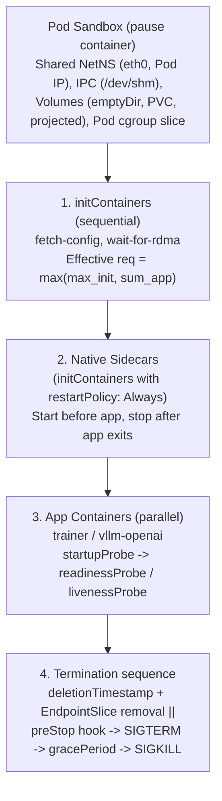

# 5.7 Pods and workloads: Deployments, StatefulSets, DaemonSets and Jobs

| | |
|---|---|
| Level | Intermediate |
| Priority tier | 0 |
| Lab venue | kubectl on any cluster; GPU node with the device plugin for GPU manifests |
| Part | Part 5: Kubernetes |
| Status | Drafted, labs **untested** |

## Why this matters for AI infrastructure

Suppose a training job runs for an hour, and then one worker is evicted for no obvious reason. Or an inference server sits in a restart loop while its model loads. In AI infrastructure, problems like these usually trace back to a pod. Every AI workload ends up as pods. A training worker with eight GPUs needs a large shared-memory volume. An inference server needs probes tuned for slow model loads. A data-preparation Job and a node agent DaemonSet also run as pods.

The pod spec holds the decisions that make a job fast, make it fail mysteriously, get it evicted under memory pressure, or leave GPUs idle. You make those decisions in resource requests and limits, the QoS class, the security context, volumes, lifecycle hooks, termination grace and scheduling constraints. The workload controllers add replica management, identity, per-node placement and run-to-completion behavior: Deployment, StatefulSet, DaemonSet, Job and CronJob. This chapter is the practical reference for writing those objects correctly.

## Prerequisites and outcomes

Before you start, read 5.3 and 5.6. When you finish this chapter, you should be able to do the following.

- Read and write complete pod specs, including init containers, native sidecars, volumes, projected volumes, environment variables and security contexts.
- Set resources correctly. That covers requests, limits, extended resources such as `nvidia.com/gpu`, and hugepages. You should also predict the QoS class and know how limits become cgroups and OOM behavior.
- Use lifecycle hooks, termination grace, signals, `preStop` and restart policies to shut down gracefully and to checkpoint.
- Choose between Deployment, StatefulSet, DaemonSet and Job or CronJob for AI workloads. You should also know when operators, JobSet or Kueue fit better.
- Write production manifests for inference servers, distributed training pods and node agents. Use PodDisruptionBudgets, topology spread and anti-affinity.
- Debug pods with `describe`, events, logs, ephemeral containers and `kubectl debug`.

## 1. The pod

When a node dies, the pods on it do not move to another node by themselves. Controllers create replacements, but the old pod is gone. Keep that in mind as you read the rest of this section.

A pod is the smallest schedulable unit. It holds one or more containers that share a network namespace, so they get one IP address and shared ports. Pods can optionally share IPC and PID namespaces as well. They also hold a set of volumes and a cgroup parent. The containers in a pod are scheduled together on one node, and they talk to each other over `localhost` and shared volumes.

Pods are ephemeral. If a node fails, the pods on it are not rescheduled to another node, and their IPs change. Treat pods as cattle, not pets.

*Kubernetes: Up and Running*, Chapter 5 (*Pods*), by Brendan Burns, Joe Beda, Kelsey Hightower and Lachlan Evenson, asks the design question "What should I put in a Pod?" The test is to ask yourself, "Will these containers work correctly if they land on different machines?" If the answer is no, group the containers in one Pod. A web or inference server paired with a local Git or model-weight synchronizer shares an `emptyDir` volume, so those two belong together. If the answer is yes, put the containers in separate Pods and connect them with a Kubernetes `Service`. A WordPress frontend and a MySQL database are an example of the second case. The same chapter also warns about a common typo in resource units. A lowercase `m` means milli, so `400m` is `0.4` CPU cores. An uppercase `Mi` is a memory unit, so `400Mi` is `400` mebibytes of RAM.



The next manifest shows what a full pod spec looks like. It is a training pod with an init container, several volumes and a `preStop` hook. Read it from the top to see each part of the pod.

```yaml
apiVersion: v1
kind: Pod
metadata:
  name: trainer-0
  namespace: team-a
  labels: { app: llm-train, job: run-142 }
  annotations: { example.com/run-id: "142" }
spec:
  restartPolicy: Never                      # Always | OnFailure | Never
  terminationGracePeriodSeconds: 600        # time for SIGTERM handling (checkpoint) before SIGKILL
  serviceAccountName: trainer
  automountServiceAccountToken: false
  priorityClassName: training-normal
  nodeSelector: { nvidia.com/gpu.product: NVIDIA-H100-80GB-HBM3 }
  tolerations:
    - { key: nvidia.com/gpu, operator: Exists, effect: NoSchedule }
  securityContext:                            # pod-level
    runAsNonRoot: true
    runAsUser: 10001
    runAsGroup: 10001
    fsGroup: 10001
    seccompProfile: { type: RuntimeDefault }
  initContainers:
    - name: fetch-config
      image: registry.example.com/tools/fetch:1.2
      args: ["--out", "/work/config.yaml"]
      volumeMounts: [ { name: work, mountPath: /work } ]
  containers:
    - name: trainer
      image: registry.example.com/ml/trainer@sha256:abc123...
      command: ["torchrun"]
      args: ["--nproc_per_node=8", "train.py", "--config", "/work/config.yaml"]
      env:
        - { name: NCCL_DEBUG, value: WARN }
        - name: RANK_NODE
          valueFrom: { fieldRef: { fieldPath: metadata.annotations['example.com/node-rank'] } }
        - name: HF_TOKEN
          valueFrom: { secretKeyRef: { name: hf, key: token } }
      envFrom:
        - configMapRef: { name: train-env }
      resources:
        requests: { cpu: "64", memory: 800Gi, nvidia.com/gpu: 8, ephemeral-storage: 50Gi }
        limits:   { memory: 800Gi, nvidia.com/gpu: 8, ephemeral-storage: 100Gi }
      securityContext:
        allowPrivilegeEscalation: false
        capabilities: { drop: [ALL] }
        readOnlyRootFilesystem: true
      volumeMounts:
        - { name: work,    mountPath: /work }
        - { name: shm,     mountPath: /dev/shm }
        - { name: data,    mountPath: /data, readOnly: true }
        - { name: ckpt,    mountPath: /ckpt }
        - { name: tmp,     mountPath: /tmp }
      startupProbe:   { exec: { command: ["sh","-c","test -f /tmp/ready"] }, failureThreshold: 120, periodSeconds: 5 }
      lifecycle:
        preStop: { exec: { command: ["sh","-c","kill -USR1 1; sleep 20"] } }    # ask the trainer to checkpoint
  volumes:
    - { name: work, emptyDir: {} }
    - { name: shm,  emptyDir: { medium: Memory, sizeLimit: 64Gi } }
    - { name: tmp,  emptyDir: {} }
    - { name: data, persistentVolumeClaim: { claimName: datasets, readOnly: true } }
    - { name: ckpt, persistentVolumeClaim: { claimName: checkpoints-team-a } }
```

### Labels and annotations: syntax rules and selector queries

Once a cluster runs more than a handful of pods, you need a way to find the ones you care about. Labels and annotations solve that problem. Labels are identifying key/value pairs. ReplicaSets, Services, NetworkPolicies and node selectors use them to group objects and run selector queries. Annotations are non-identifying key/value metadata. Tools and controllers read them, for example `deployment.kubernetes.io/revision`, `kubernetes.io/change-cause` or `kubectl.kubernetes.io/last-applied-configuration`.

As *Kubernetes: Up and Running* (3rd edition, Chapter 6) explains, Kubernetes enforces strict syntax rules on label keys and values. A label key has two parts, separated by a slash, `/`. The prefix is optional. When you use one, it must be a valid DNS subdomain of up to `253` characters, such as `acme.com/app-version` or `kubernetes.io/cluster-service`. The key name is required. It can be up to `63` characters long and may contain alphanumeric characters (`[a-zA-Z0-9]`), dashes (`-`), underscores (`_`) and dots (`.`). It must start and end with an alphanumeric character.

A label value follows the same character rules as a key name. It also has a limit of `63` characters.

Querying and displaying labels with `kubectl` (untested here) works through a few flags. Use `--show-labels` to print every label on each object. Use `-L` with a label key to show that label's value as its own table column. Use `-l` or `--selector` to filter with equality operators (`=`, `!=`) or set-based operators (`in`, `notin`, `key`, `!key`).

```bash
kubectl get pods --show-labels
kubectl get deployments -L canary
kubectl get pods -l 'ver=2,!canary'
kubectl get pods -l 'ver in (1, 2)'
kubectl label deployments alpaca-test "canary=true"    # add or update (--overwrite) a label
kubectl label deployments alpaca-test "canary-"        # remove the 'canary' label with a trailing dash
```

Table 6-1 gives some valid label keys and values that follow these rules.

| Key | Value |
|---|---|
| `acme.com/app-version` | `1.0.0` |
| `appVersion` | `1.0.0` |
| `app.version` | `1.0.0` |
| `kubernetes.io/cluster-service` | `true` |

When a domain name appears in a label or annotation key, it should match the entity it names. A project might define one set of labels for deployment stages, such as staging, canary and production. A cloud provider might define annotations that switch on features for its own service.

In API objects such as `Deployment` and `Job`, you write a selector such as `app=alpaca,ver in (1, 2)` with `matchLabels` and `matchExpressions`. The two fields combine with a logical AND, so an object must match both.

```yaml
selector:
  matchLabels:
    app: alpaca
  matchExpressions:
    - { key: ver, operator: In, values: [1, 2] }
```

### Why labels exist

A team usually starts with one copy of a program. As the app matures, that single copy multiplies into a set of objects. Kubernetes uses labels so you can work with sets of objects, not single ones. The second lesson is that a fixed hierarchy eventually falls short. A team may decide that every app is made of several services. Later, one service may be shared by several apps, and the tidy tree no longer fits. Labels stay flexible enough for this, because you can attach any grouping you need and change it later. For background on how Google approaches production systems, the book points to *Site Reliability Engineering* by Betsy Beyer et al. (O'Reilly).

### Applying and changing labels

Suppose you run two apps, `alpaca` and `bandicoot`. Each app has two environments and two versions. Give every Deployment a `ver`, `app` and `env` label. That way you can slice the set in different ways later. A Deployment is a way to create an array of Pods.

Start with the `alpaca-prod` Deployment. Its labels are set when it is created.

```
$ kubectl run alpaca-prod \
--image=gcr.io/kuar-demo/kuard-amd64:blue \
--replicas=2 \
--labels="ver=1,app=alpaca,env=prod"
```

Next, create the `alpaca-test` Deployment with its own label values.

```
$ kubectl run alpaca-test \
--image=gcr.io/kuar-demo/kuard-amd64:green \
--replicas=1 \
--labels="ver=2,app=alpaca,env=test"
```

Finally, create two Deployments for `bandicoot`. Here the environments are named `prod` and `staging`.

```
$ kubectl run bandicoot-prod \
--image=gcr.io/kuar-demo/kuard-amd64:green \
--replicas=2 \
--labels="ver=2,app=bandicoot,env=prod"
$ kubectl run bandicoot-staging \
--image=gcr.io/kuar-demo/kuard-amd64:green \
--replicas=1 \
--labels="ver=2,app=bandicoot,env=staging"
```

You should now have four Deployments: `alpaca-prod`, `alpaca-test`, `bandicoot-prod` and `bandicoot-staging`. This command shows their labels.

```
$ kubectl get deployments --show-labels
NAME ... LABELS
alpaca-prod ... app=alpaca,env=prod,ver=1
alpaca-test ... app=alpaca,env=test,ver=2
bandicoot-prod ... app=bandicoot,env=prod,ver=2
bandicoot-staging ... app=bandicoot,env=staging,ver=2
```

The book also draws these labels as a Venn diagram (Figure 6-1).

You can add or change labels after an object exists. This command adds a `canary` label to `alpaca-test`.

```
$ kubectl label deployments alpaca-test "canary=true"
```

**Warning.** This command changes only the label on the Deployment itself. It does not change the ReplicaSets or Pods that the Deployment creates. To change those, edit the template embedded in the Deployment, which Chapter 10 of the book covers.

The `-L` option to `kubectl get` shows one label's value as a column.

```
$ kubectl get deployments -L canary
NAME DESIRED CURRENT ... CANARY
alpaca-prod 2 2 ... <none>
alpaca-test 1 1 ... true
bandicoot-prod 2 2 ... <none>
bandicoot-staging 1 1 ... <none>
```

To remove a label, add a dash after its key.

```
$ kubectl label deployments alpaca-test "canary-"
```

### Selecting objects with labels

A selector is a simple Boolean expression. It filters Kubernetes objects by their labels. People use selectors through tools such as `kubectl`, and objects use them too. Each Deployment creates Pods with the labels in the template embedded in the Deployment. The `kubectl run` command configures that template.

Running `kubectl get pods --show-labels` should list every Pod in the cluster. The book expects six `kuard` Pods across its three environments.

```
$ kubectl get pods --show-labels
NAME ... LABELS
alpaca-prod-3408831585-4nzfb ... app=alpaca,env=prod,ver=1,...
alpaca-prod-3408831585-kga0a ... app=alpaca,env=prod,ver=1,...
alpaca-test-1004512375-3r1m5 ... app=alpaca,env=test,ver=2,...
bandicoot-prod-373860099-0t1gp ... app=bandicoot,env=prod,ver=2,...
bandicoot-prod-373860099-k2wcf ... app=bandicoot,env=prod,ver=2,...
bandicoot-staging-1839769971-3ndv ... app=bandicoot,env=staging,ver=2,...
```

You may see a label you have not seen before, `pod-template-hash`. The Deployment applies it to track which Pods came from which template version. That lets the Deployment manage updates cleanly, which Chapter 10 of the book covers.

To list only Pods whose `ver` label is `2`, use the `--selector` flag.

```
$ kubectl get pods --selector="ver=2"
NAME READY STATUS RESTARTS AGE
alpaca-test-1004512375-3r1m5 1/1 Running 0 3m
bandicoot-prod-373860099-0t1gp 1/1 Running 0 3m
bandicoot-prod-373860099-k2wcf 1/1 Running 0 3m
bandicoot-staging-1839769971-3ndv5 1/1 Running 0 3m
```

Separate two selectors with a comma to require both. This is a logical AND.

```
$ kubectl get pods --selector="app=bandicoot,ver=2"
NAME READY STATUS RESTARTS AGE
bandicoot-prod-373860099-0t1gp 1/1 Running 0 4m
bandicoot-prod-373860099-k2wcf 1/1 Running 0 4m
bandicoot-staging-1839769971-3ndv5 1/1 Running 0 4m
```

You can also ask whether a label is one of a set of values. This command asks for every Pod where `app` is `alpaca` or `bandicoot`. It matches all six Pods.

```
$ kubectl get pods --selector="app in (alpaca,bandicoot)"
NAME READY STATUS RESTARTS AGE
alpaca-prod-3408831585-4nzfb 1/1 Running 0 6m
alpaca-prod-3408831585-kga0a 1/1 Running 0 6m
alpaca-test-1004512375-3r1m5 1/1 Running 0 6m
bandicoot-prod-373860099-0t1gp 1/1 Running 0 6m
bandicoot-prod-373860099-k2wcf 1/1 Running 0 6m
bandicoot-staging-1839769971-3ndv5 1/1 Running 0 6m
```

Finally, you can ask whether a label is set at all. This asks for Deployments with a `canary` label, whatever its value.

```
$ kubectl get deployments --selector="canary"
NAME DESIRED CURRENT UP-TO-DATE AVAILABLE AGE
alpaca-test 1 1 1 1 7m
```

Each of these has a negative version. Table 6-2 lists the operators.

| Operator | Description |
|---|---|
| `key=value` | `key` is set to `value` |
| `key!=value` | `key` is not set to `value` |
| `key in (value1, value2)` | `key` is one of `value1` or `value2` |
| `key notin (value1, value2)` | `key` is not one of `value1` or `value2` |
| `key` | `key` is set |
| `!key` | `key` is not set |

For example, this asks for Deployments where `canary` is not set.

```
$ kubectl get deployments --selector='!canary'
```

You can combine positive and negative selectors.

```
$ kubectl get pods -l 'ver=2,!canary'
```

Kubernetes keeps two forms of selectors in API objects, so that it does not break API compatibility. Most objects accept the newer form, which supports the full set of operators. The older form, used by ReplicationControllers and Services, supports only `=`. The selector `app=alpaca,ver=1` looks like this in the older form.

```yaml
selector:
  app: alpaca
  ver: 1
```

In the newer form, a `!=` test is written as a `NotIn` expression with a single value.

### Labels in the Kubernetes architecture

Kubernetes has no fixed hierarchy. Each component works on its own, so objects that need to relate to one another do so through labels and label selectors. A ReplicaSet finds the Pods it manages with a selector. A Service load balancer finds the Pods that should receive traffic with a selector. A Pod can use a node selector to choose the nodes it may run on. To restrict network traffic, you combine Network Policy with specific labels that mark which Pods may talk to each other.

Labels are the glue that holds a Kubernetes application together. Your application will likely start with a few simple labels and queries. Expect the set to grow in size and sophistication over time.

### Annotations

Annotations look like labels, since both are key/value pairs, so people often mix them up. The difference is their purpose. Annotations store metadata for tools and libraries, and you do not use them to query or filter Pods. A program that drives Kubernetes through the API can store opaque data on an object this way. Tools can use that data themselves, or pass configuration between external systems.

Labels identify and group objects. Annotations record where an object came from, how to use it, or what policy applies to it. The line between the two is blurry, so the choice is partly a matter of taste. When in doubt, add the information as an annotation. Promote it to a label if you later want to use it in a selector.

Annotations record the reason for the latest update to an object. They can also pass a specialized scheduling policy to a specialized scheduler. Another use is to record the last tool that updated a resource and how it was updated, so other tools can detect changes and merge smartly. Build, release or image details that do not fit in labels, such as a Git hash, a timestamp or a pull request number, go in annotations too. A Deployment uses annotations to track the ReplicaSets it manages during rollouts. Annotations can also add data that improves a UI, such as a link to an icon. Finally, they let you prototype alpha functionality by encoding its parameters in an annotation instead of a new API field.

Rolling deployments are the main case in Kubernetes. Annotations track the rollout status and keep the information needed to roll back to a previous state.

Annotation keys use the same format as label keys. Because tools use them to talk to each other, the prefix part of the key matters more. Examples include `deployment.kubernetes.io/revision` and `kubernetes.io/change-cause`.

An annotation value is a free-form string. That gives you room to store anything, but the server does not check it. People often store a JSON document as a string in an annotation. The Kubernetes server has no idea what format the value should follow, so the data may not be valid. That makes errors harder to track down.

Every Kubernetes object has a `metadata` section, and annotations sit there.

```yaml
...
metadata:
  annotations:
    example.com/icon-url: "https://example.com/icon.png"
...
```

**Warning.** Annotations make loose coupling easy, which is powerful. Use them with restraint, or your objects fill up with an untyped mess of data.

Avoid using the Kubernetes API server as a general-purpose database. Annotations suit small pieces of data that closely belong to one resource. If data has no obvious object to attach to, store it in a database built for that purpose.

### Cleaning up the label examples

After you finish the label examples, you can remove the Deployments. Delete all the Deployments from this section with `kubectl delete deployments --all`. To be more selective, add the `--selector` flag to choose which Deployments to delete.

### Why containers share a Pod

Picture a web server that serves a folder of files, and a second process that keeps that folder in step with a Git repository. You could pack both programs into one container. The two have different needs, though. The web server answers user requests, so it must stay fast and available. The Git synchronizer works in the background and can wait.

Now suppose the synchronizer has a memory leak. Without isolation, it could take memory the web server needs, which slows the server or crashes it. Two containers, each with its own limits, keep the web server safe. The two still belong together, since a web server on one machine and its Git sync on another would make no sense. Kubernetes therefore groups them into one atomic unit called a Pod. The name fits the whale theme of Docker, since a pod is a group of whales.

Grouping several containers into one Pod looked odd when Kubernetes first added it. Other tools now use the pattern too. Several service mesh implementations, for example, add a second sidecar container to a Pod to inject network management into the application.

A Pod is a collection of application containers and volumes that run in the same execution environment. Pods, not single containers, are the smallest deployable unit in a cluster. All containers in one Pod always land on the same machine. Each container runs in its own cgroup, but they share several Linux namespaces. That is why they share one IP address and port space, and one hostname.

### Thinking with Pods

A common question when teams adopt Kubernetes is "What should I put in a Pod?" It is tempting to put a WordPress container and a MySQL container in one Pod, since together they make a WordPress site. That is an anti-pattern. The two do not have to share a machine, because they talk over a network connection. They also scale differently. WordPress is mostly stateless, so you add WordPress Pods when frontend load grows. A MySQL database is much harder to scale out, so you give one MySQL Pod more resources instead. Putting both in one Pod forces one scaling plan onto both.

The test to use is a single question: "Will these containers work correctly if they land on different machines?" If the answer is no, group them in one Pod. If the answer is yes, use separate Pods. The Git example works only because its two containers share a local filesystem, so they could not run on different machines.

### Declarative configuration and Pod manifests

Suppose a teammate asks what the cluster should look like after a deploy. A Pod manifest answers that question. A Pod manifest is a text file that describes the Kubernetes API object. Kubernetes favors declarative configuration. You write down the desired state of the world, submit the file, and Kubernetes takes the actions needed to make that state real. That is different from imperative configuration, where you run a series of steps, such as `apt-get install foo`, to change a system.

Years of production use have shown that a written record of desired state is easier to manage. You can review it in code, and it documents the system for a distributed team. It is also the base of the self-healing behavior that keeps applications running without anyone acting.

The API server accepts a Pod manifest and stores it in `etcd`. The scheduler looks for Pods that have no node yet, then places each one based on its resource requests and other constraints. It can put several Pods on one machine when resources allow. Copies of the same application on one machine share a single point of failure, though, so the scheduler spreads them across machines when it can. Once a Pod is scheduled, it does not move. It must be deleted and scheduled again.

### Creating a Pod

The quickest way to start a pod is the imperative `kubectl run` command. The book uses it to start the `kuard` demo server.

```
$ kubectl run kuard --image=gcr.io/kuar-demo/kuard-amd64:blue
```

The book's printed command also carries `--generator=run-pod/v1`. Current `kubectl` releases removed that flag, and `kubectl run` now creates a bare Pod by default, so leave it out. If you copy older tutorials and see an error about `--generator`, that is why.

Run `kubectl get pods` to watch its status. The container may show `Pending` at first, then `Running` once the Pod and its containers exist. Remove it with `kubectl delete pods/kuard` when you are done.

For real work, write a manifest. YAML is the usual format because it is easy for people to edit and it supports comments. Treat a manifest like source code, since comments help new team members understand the Pod. A Pod manifest has a `metadata` section for the name and labels, a `spec` section for volumes, and a list of containers. Example 5-1 is a minimal manifest for the same `kuard` server.

```yaml
apiVersion: v1
kind: Pod
metadata:
  name: kuard
spec:
  containers:
    - image: gcr.io/kuar-demo/kuard-amd64:blue
      name: kuard
      ports:
        - containerPort: 8080
          name: http
          protocol: TCP
```

Submit it with `kubectl apply -f kuard-pod.yaml`. The API server receives the manifest, the scheduler picks a healthy node, and the `kubelet` on that node watches over the Pod. Writing it out may feel like more work than a single command. The written record is still the better habit for large teams with many applications.

## 2. Pod spec anatomy

### Containers and init containers

A pod can fail at startup while its events point to an init container that never finished. To read those events, you need to know what each container type does. Every entry in `containers[]` has an image, `command` and `args`, a `workingDir`, environment settings, ports, resources, volume mounts, probes, a lifecycle, a security context and an image pull policy. Pin the image by digest in production. Use exec-form lists for `command` and `args`, because they override the image's ENTRYPOINT and CMD. The `imagePullPolicy` defaults to `IfNotPresent` for tagged images and to `Always` for `:latest`. The `terminationMessagePath/Policy` fields control the failure message, and `stdin/tty` controls interactive input.

Init containers, listed under `initContainers`, run one after another, and each must finish before the app containers start. Use them to wait for dependencies, fetch config or model files, fix permissions and run schema migrations. They share volumes with the pod. For scheduling, their resource requests count as max(init max, sum(app)). A failing init container restarts according to `restartPolicy`. Until it succeeds, it blocks the pod in `Init:Error` or `Init:CrashLoopBackOff`.

Native sidecars are init containers with `restartPolicy: Always`, which are stable in recent releases. They start before the app containers and stay running for as long as those containers run. Their probes are honored, and they terminate after the main containers exit. They suit log shippers, proxies, credential refreshers and metrics exporters. They also avoid an old problem, where a sidecar kept Jobs from completing.

Ephemeral containers are added to a running pod with `kubectl debug`. They help you debug, for example by giving you a shell in a distroless image. They share namespaces with the pod. You cannot remove them, and they cannot have resources.

When you write a new pod spec, decide which of these container types it needs before you fill in the resources.

### Resources and QoS

When a node runs short of memory, Kubernetes has to decide which pod to evict. The resource fields you set decide that order. `requests` drive scheduling, and they set the minimum guaranteed share. `limits` are enforced at run time by cgroups. A CPU limit throttles the container through the CFS quota, `cpu.max`. A memory limit is a hard cap. If the container exceeds it, the container suffers an OOM kill. Requests map to `cpu.weight`, which is the shares value. Memory requests inform eviction and, with MemoryQoS, `memory.min/high`.

Extended resources such as `nvidia.com/gpu`, `rdma/hca_shared_devices_a`, `hugepages-2Mi` and `ephemeral-storage` are integers. For devices, requests must equal limits, so there is no overcommit. GPUs are not shared or fractional unless you use MIG, time-slicing or MPS through the device plugin or operator configuration. Part 11 covers that configuration.

QoS classes are derived, not set. **Guaranteed** means every container has CPU and memory requests equal to its limits. **Burstable** means some requests or limits are set, but the pod does not meet the Guaranteed rules. **BestEffort** means no requests or limits are set at all. QoS decides the cgroup placement under `kubepods.slice/guaranteed`, `burstable` or `besteffort`. It also sets the `oom_score_adj` value, which is -997 for Guaranteed and 1000 for BestEffort, and scaled for Burstable. Finally, QoS sets the eviction order under node pressure, which 5.9 covers. Training and inference pods that must not be evicted should be Guaranteed. Guaranteed is also required for the CPU Manager static policy, which gives exclusive cores for integer CPU requests. It is needed for Topology Manager alignment too, covered in 5.18.

CFS throttling hurts latency-sensitive servers and data loaders that burst. Many teams therefore set CPU requests but no CPU limits on GPU pods. They rely on node dedication to avoid noisy neighbors. Others use the static CPU manager to get exclusive cores. Memory limits equal to requests are recommended, which avoids a surprising node-level OOM.

The container limit covers more than the process. It includes the page cache attributable to the cgroup, pinned memory and shared memory at `/dev/shm`. Shared memory counts because tmpfs pages are charged to the cgroup. A large DataLoader, NCCL buffers and `/dev/shm` together can trigger OOM kills, even when the process itself seems small. Size `emptyDir.medium: Memory` volumes, and include them in the limits.

Ephemeral storage requests and limits cover the container's writable layers, its logs and disk-backed `emptyDir` volumes. Exceeding the limit evicts the pod. A LimitRange sets per-namespace defaults, minimums and maximums. A ResourceQuota caps totals per namespace, including `requests.nvidia.com/gpu`, which 5.22 covers. Pod overhead through RuntimeClass and in-place pod resize are additional features. In-place resize is stable in recent releases for CPU and memory without a restart. Check your version before you rely on either one.

### Resource requests and limits, with a worked example

Most people adopt containers and Kubernetes for better packaging and reliable deploys. Utilization is another gain. Utilization is the amount of a resource actively in use, divided by the amount you bought. A one-core machine running an app that uses a tenth of a core sits at 10%. Kubernetes can push utilization above 50%, but only when you tell it what each app needs.

Kubernetes has two settings for this. A resource request is the minimum an application needs. A resource limit is the most it may use. Kubernetes accepts many notations, from plain numbers such as `12345` to millicores such as `100m`. A lowercase `m` means milli, while an uppercase `M` means mega. So `400m` and `400M` differ by a factor of a thousand. Mixing them up is a common and costly error. The book also explains the binary units, such as `MiB` and `GiB`. Its sentence on this swaps the two families, so check the definitions yourself before you size anything.

A request guarantees that the resource is there for the Pod. CPU and memory are the most common, though GPUs and other types also count. Requests belong to each container, not to the whole Pod. The Pod's total is the sum of all its containers' requests, because a web server and a data synchronizer need very different CPU. Example 5-3 asks for half a CPU and 128 MiB of memory.

```yaml
apiVersion: v1
kind: Pod
metadata:
  name: kuard
spec:
  containers:
    - image: gcr.io/kuar-demo/kuard-amd64:blue
      name: kuard
      resources:
        requests:
          cpu: "500m"
          memory: "128Mi"
      ports:
        - containerPort: 8080
          name: http
          protocol: TCP
```

The scheduler uses requests to place Pods. It makes sure the sum of all requests on a node stays within the node's capacity. A request is a minimum, not a cap, and a worked example shows what that means. Picture a container that tries to use every core, with a request of 0.5 CPU, on a machine with 2 cores. Alone on the machine, it uses all 2.0 cores. A second identical Pod brings each one to 1.0 core, and a third brings each to about 0.66 core. A fourth brings each to the 0.5 it asked for, and the node is full. CPU requests are carried out with the `cpu-shares` feature of the Linux kernel.

Memory works differently. Memory a process already holds cannot be taken back as easily. When a node runs out, the `kubelet` terminates containers that use more memory than they requested. Those containers restart automatically, but the node then has less memory to give them.

A limit is a ceiling. Example 5-4 keeps the same request and adds a limit of 1.0 CPU and 256 MiB of memory.

```yaml
apiVersion: v1
kind: Pod
metadata:
  name: kuard
spec:
  containers:
    - image: gcr.io/kuar-demo/kuard-amd64:blue
      name: kuard
      resources:
        requests:
          cpu: "500m"
          memory: "128Mi"
        limits:
          cpu: "1000m"
          memory: "256Mi"
      ports:
        - containerPort: 8080
          name: http
          protocol: TCP
```

The kernel enforces limits. A container with a CPU limit of 0.5 cores gets only 0.5 cores, even when the CPU is otherwise idle. A container with a 256 MiB memory limit gets no more memory. A `malloc` call fails once its usage passes that limit.

### Volumes

You will meet several volume types. `emptyDir` is per-pod scratch space. Set `medium: Memory` for tmpfs, and set `sizeLimit` to cap it. `configMap`, `secret`, `downwardAPI` and `projected` inject config and identity. Projected ServiceAccount tokens carry an audience and an expiry. `persistentVolumeClaim` gives durable storage, which 5.17 covers. `hostPath` mounts a node path. Avoid it except for system agents, because it carries a large security risk. The list also includes `nfs`, CSI ephemeral volumes, and `image` volumes, which mount OCI artifacts such as model weights in newer releases. The `ephemeral` type creates a generic ephemeral PVC for each pod.

Several mount options matter. `readOnly` makes the mount read-only, and `subPath` mounts one path inside the volume. A `subPath` mount does not receive ConfigMap updates. Other options are `mountPropagation` and `subPathExpr`. `fsGroup` in the security context changes the ownership of volumes. That can be slow on huge volumes, so use `fsGroupChangePolicy: OnRootMismatch` there.

### Persisting data and volume patterns

A container's filesystem disappears when its Pod is deleted or the container restarts. That is often a good thing, because stale files from a stateless web app should not pile up. Some data must survive, though, and Kubernetes models that with volumes. A manifest needs two additions. The `spec.volumes` list defines every volume the Pod may use. Each container's `volumeMounts` list says which volumes it mounts and where. Not every container must mount every volume, and two containers can mount the same volume at different paths.

Example 5-5 defines one volume named `kuard-data` and mounts it at `/data` in the `kuard` container.

```yaml
apiVersion: v1
kind: Pod
metadata:
  name: kuard
spec:
  volumes:
    - name: "kuard-data"
      hostPath:
        path: "/var/lib/kuard"
  containers:
    - image: gcr.io/kuar-demo/kuard-amd64:blue
      name: kuard
      volumeMounts:
        - mountPath: "/data"
          name: "kuard-data"
      ports:
        - containerPort: 8080
          name: http
          protocol: TCP
```

The book lists four common patterns for using volumes in a Pod. The first is communication and synchronization. The Git example uses an `emptyDir` volume. It lasts as long as the Pod, but two containers can share it. That makes it the link between the Git sync container and the web server.

The second pattern is caching. Some apps keep data that speeds things up but that they can rebuild, such as prerendered image thumbnails. Rebuilding is possible, but serving the thumbnails then costs more. You want that cache to survive a restart caused by a failed health check, so `emptyDir` fits here too.

The third pattern is persistent data. Some data must outlive a Pod and move between nodes when a node fails. Kubernetes supports many remote storage types for this. They include NFS and iSCSI, cloud block storage such as Amazon Elastic Block Store, Azure File and Azure Disk, and Google's Persistent Disk. An NFS volume looks like this.

```yaml
...
# Rest of pod definition above here
volumes:
  - name: "kuard-data"
    nfs:
      server: my.nfs.server.local
      path: "/exports"
```

Persistent volumes are a deep topic. The book's Chapter 16 has a longer look at them, and this handbook covers durable storage in 5.17.

The fourth pattern is mounting the host filesystem. Some apps need the node's own files. A tool might need `/dev` to reach a device directly. `hostPath` mounts any location on the worker node into the container. Use it with care, because it gives the container access to the host.

### Environment and configuration

Use `env` for literal values. Use `valueFrom` for field references such as `status.podIP` and `spec.nodeName`, for resource field references, and for ConfigMap or Secret keys. Use `envFrom` to load a whole ConfigMap or Secret. Environment variables are fixed when the container starts. Volume-mounted ConfigMaps and Secrets update eventually, after the kubelet sync of about 1 minute, unless you mount them with `subPath`. Prefer mounted files for secrets. Environment variables leak into `ps`, crash dumps and child processes. Service discovery variables such as `MYSVC_SERVICE_HOST` are legacy. Use DNS instead, which 5.11 covers. In namespaces with many Services, set `enableServiceLinks: false`.

### Security context

The `securityContext` sets rules at the container and pod level. Common fields are `runAsUser/Group` and `runAsNonRoot`, along with `readOnlyRootFilesystem` and `allowPrivilegeEscalation: false`. Drop capabilities with `capabilities.drop: [ALL]`, and add back only what you need. For example, RDMA pinned memory needs `IPC_LOCK`, and a service on a privileged port may need `NET_BIND_SERVICE`. Set `seccompProfile: RuntimeDefault`. Other fields include `seLinuxOptions`, `appArmorProfile`, `procMount`, `supplementalGroups`, `sysctls`, and `hostUsers: false` for user namespaces. Avoid `privileged`. Safe sysctls work by default. Unsafe sysctls require the kubelet flag `--allowed-unsafe-sysctls`.

Enforce these rules with Pod Security Admission, covered in 5.21. It offers the `baseline` and `restricted` profiles. GPU and RDMA workloads often need a few exceptions. Grant those exceptions per namespace, not cluster-wide. Host namespaces, `hostNetwork`, `hostPID` and `hostIPC`, are for system DaemonSets. Some HPC jobs use `hostIPC` or `hostNetwork` for performance, but that weakens isolation.

### Reading a SecurityContext in a running Pod

A manifest shows what you asked for. Checking the running process shows what you actually got. *Kubernetes: Up and Running* (3rd edition, Chapter 19) uses one Pod to show both. The Pod sets a `securityContext` at the Pod level and again at the container level. When the same field appears in both places, the container-level value wins.

```yaml
apiVersion: v1
kind: Pod
metadata:
  name: kuard
spec:
  securityContext:
    runAsNonRoot: true
    runAsUser: 1000
    runAsGroup: 3000
    fsGroup: 2000
  containers:
  - image: gcr.io/kuar-demo/kuard-amd64:blue
    name: kuard
    securityContext:
      allowPrivilegeEscalation: false
      readOnlyRootFilesystem: true
      privileged: false
    ports:
    - containerPort: 8080
      name: http
      protocol: TCP
```

The `runAsNonRoot` field stops a container from starting as the root user. Running as a nonroot user is best practice. Many misconfigurations and exploits depend on the container runtime mixing up the container's root user with the host's root user. The `kuard` image runs as the user `nobody`, set in its Dockerfile. Many images from other sources do not set a user. You may need to extend their Dockerfile, and that does not always work, because the application may need more privileges.

Save the manifest as `kuard-pod-securitycontext.yaml`, create the Pod, and open a shell inside the container:

```bash
$ kubectl create -f kuard-pod-securitycontext.yaml
pod/kuard created
$ kubectl exec -it kuard -- ash
/ $ id
uid=1000 gid=3000 groups=2000
/ $ ps
PID   USER     TIME  COMMAND
    1 1000      0:00 /kuard
   30 1000      0:00 ash
   37 1000      0:00 ps
/ $ touch file
touch: file: Read-only file system
```

The shell runs as user ID `1000` and group ID `3000`, and it belongs to group `2000`. The `kuard` process runs as user `1000`, as the Pod specification asked. Creating a file fails because the container's root filesystem is read-only. If you only add these few fields to your workloads, you have made a good start.

### Lifecycle, termination and restart policy

Pod termination runs as a sequence. The API sets `deletionTimestamp`. The endpoints controller removes the pod from Service endpoints, in parallel with the next step. The kubelet runs `preStop` hooks, sends `SIGTERM` to PID 1 of each container, and waits up to `terminationGracePeriodSeconds`. After that it sends `SIGKILL`.

Endpoint removal and `SIGTERM` race each other. So a server should keep serving for a few seconds while it drains. A `preStop` hook with `sleep 5-10` gives that time. After the drain, the server shuts down gracefully. For training, the process should handle `SIGTERM` by writing a checkpoint and flushing logs. It should then exit with 0 or a distinctive code. Set the grace period to cover the checkpoint time. Pods preempted by higher-priority workloads, or evicted, get the same treatment.

The `restartPolicy` sets restart behavior. Use `Always` for Deployments and similar workloads. Use `OnFailure` or `Never` for Jobs. Container restarts use exponential backoff, from 10 s up to 5 min, and the pod shows `CrashLoopBackOff` while it waits. A container can leave a short failure reason through `terminationMessagePath`, which defaults to `/dev/termination-log`. That reason then appears in `kubectl describe`.

**Probes** are covered in detail in 5.9. The `startupProbe` protects slow starts, such as multi-GB model loads. The `readinessProbe` gates traffic. The `livenessProbe` restarts a container on a deadlock, so use it sparingly and never tie it to dependencies. Each probe can use an `exec`, `httpGet`, `tcpSocket` or `grpc` handler.

### Scheduling-related fields

Several fields control where a pod lands. `nodeName` bypasses the scheduler, so avoid it. `nodeSelector` picks nodes by label. `affinity` covers node, pod and anti-affinity, each either required or preferred, along with topology keys. `tolerations` let a pod run on tainted nodes. `topologySpreadConstraints` spread pods across the topology. `priorityClassName` and `preemptionPolicy` set priority. `schedulerName` selects a scheduler, and `runtimeClassName` selects a runtime. `resourceClaims` covers Dynamic Resource Allocation (DRA). See 5.18 for the details.

### Putting it all together

Many applications are stateful. Their data must survive, and its storage must follow the app to whichever machine it runs on. A persistent volume backed by network storage does that. You also want a healthy instance running at all times, so the container should be ready before clients reach it. Persistent volumes, readiness and liveness probes, and resource limits together let Kubernetes run stateful applications reliably. Example 5-6 combines them in one manifest.

```yaml
apiVersion: v1
kind: Pod
metadata:
  name: kuard
spec:
  volumes:
    - name: "kuard-data"
      nfs:
        server: my.nfs.server.local
        path: "/exports"
  containers:
    - image: gcr.io/kuar-demo/kuard-amd64:blue
      name: kuard
      ports:
        - containerPort: 8080
          name: http
          protocol: TCP
      resources:
        requests:
          cpu: "500m"
          memory: "128Mi"
        limits:
          cpu: "1000m"
          memory: "256Mi"
      volumeMounts:
        - mountPath: "/data"
          name: "kuard-data"
      livenessProbe:
        httpGet:
          path: /healthy
          port: 8080
        initialDelaySeconds: 5
        timeoutSeconds: 1
        periodSeconds: 10
        failureThreshold: 3
      readinessProbe:
        httpGet:
          path: /ready
          port: 8080
        initialDelaySeconds: 30
        timeoutSeconds: 1
        periodSeconds: 10
        failureThreshold: 3
```

The Pod definition grows as the chapter goes on. Each new capability you give the application adds a new section to it.

## 3. Workload controllers: choosing

### Why a bare Pod is not enough

A Pod that is scheduled to a node stays on that node. If the node fails, nothing reschedules the Pod. To run several copies, you would have to create and name each one by hand. Controllers automate that work. The book's Chapter 9 introduces ReplicaSets, which create multiple identical Pods and re-create them after a node failure. The table below compares the controllers this chapter covers.

| Controller | Identity | Storage | Typical use | Notes |
|---|---|---|---|---|
| **Deployment** | Interchangeable replicas | Shared or none | Stateless services, inference servers, gateways, dashboards | Rolling updates, rollbacks, HPA targets |
| **StatefulSet** | Stable names `x-0..n`, stable DNS, ordered | Per-pod PVC via templates | Databases, queues, vector DBs, etcd, some parameter servers, coordination for distributed jobs needing stable hostnames | Careful with update/scale semantics; headless Service |
| **DaemonSet** | One per node | Host paths/CSI | Node agents: device plugin, DCGM, CNI, log shipper, node problem detector, GPU driver containers | Tolerations to reach tainted GPU nodes |
| **Job** | Run to completion, optional indexing | Any | Data prep, evaluations, single-node training, batch inference, benchmarks | `backoffLimit`, `podFailurePolicy`, TTL, `suspend` |
| **CronJob** | Scheduled Jobs | Any | Periodic retraining, backups, report generation, cleanup | `concurrencyPolicy: Forbid` for jobs that must not overlap |
| **JobSet / MPIJob / PyTorchJob / RayJob** (operators) | Gang of heterogeneous pods with startup ordering and failure policies | Any | Multi-node training/inference | Prefer these (plus Kueue) over hand-rolled Jobs for distributed workloads (Part 14) |
| **Bare Pod** | None | | Debugging only | Not rescheduled if the node dies |

Match each workload to the controller whose identity and storage rules fit it, as the table shows.

### ReplicaSets: one object for a group of identical Pods

Suppose you need three copies of the same web server. You could manually write several Pod manifests that are largely similar, then create each one by hand. That works once, but it is tedious and error-prone. Logically, you want to manage a replicated set of Pods as a single entity. A ReplicaSet does exactly that. It acts as a cluster-wide Pod manager, and its job is to keep the correct kinds and counts of Pods alive at every moment.

Use a ReplicaSet when you want a group of replicas rather than one Pod. Its pods are interchangeable, so you can treat the group as a single service. The rest of this chapter builds on that idea.

### Deployment patterns for inference

Suppose you run an inference server that takes many minutes to load its model. It needs long probe windows and careful rollout settings. The manifest below runs three replicas of such a server and adds a PodDisruptionBudget. Read the comments on the rolling update settings, because GPUs are scarce.

```yaml
apiVersion: apps/v1
kind: Deployment
metadata: { name: vllm-llama, namespace: serving }
spec:
  replicas: 3
  revisionHistoryLimit: 5
  progressDeadlineSeconds: 1800         # model downloads and CUDA graph capture are slow
  strategy:
    type: RollingUpdate
    rollingUpdate: { maxSurge: 1, maxUnavailable: 0 }    # GPUs are scarce: surge needs a spare GPU; use maxUnavailable: 1 / maxSurge: 0 if none
  selector: { matchLabels: { app: vllm-llama } }
  template:
    metadata: { labels: { app: vllm-llama } }
    spec:
      terminationGracePeriodSeconds: 120
      tolerations: [ { key: nvidia.com/gpu, operator: Exists, effect: NoSchedule } ]
      topologySpreadConstraints:
        - { maxSkew: 1, topologyKey: kubernetes.io/hostname, whenUnsatisfiable: ScheduleAnyway, labelSelector: { matchLabels: { app: vllm-llama } } }
      containers:
        - name: vllm
          image: vllm/vllm-openai@sha256:...
          args: ["--model", "/models/llama-70b", "--tensor-parallel-size", "4", "--max-model-len", "8192"]
          ports: [ { containerPort: 8000 } ]
          resources: { requests: { cpu: "16", memory: 200Gi, nvidia.com/gpu: 4 }, limits: { memory: 200Gi, nvidia.com/gpu: 4 } }
          startupProbe:   { httpGet: { path: /health, port: 8000 }, periodSeconds: 10, failureThreshold: 180 }    # up to 30 min
          readinessProbe: { httpGet: { path: /health, port: 8000 }, periodSeconds: 5 }
          livenessProbe:  { httpGet: { path: /health, port: 8000 }, periodSeconds: 20, failureThreshold: 6 }
          lifecycle: { preStop: { exec: { command: ["sleep", "15"] } } }
          volumeMounts: [ { name: models, mountPath: /models, readOnly: true }, { name: shm, mountPath: /dev/shm } ]
      volumes:
        - { name: models, persistentVolumeClaim: { claimName: model-weights-ro } }
        - { name: shm, emptyDir: { medium: Memory, sizeLimit: 16Gi } }
---
apiVersion: policy/v1
kind: PodDisruptionBudget
metadata: { name: vllm-llama, namespace: serving }
spec:
  minAvailable: 2
  selector: { matchLabels: { app: vllm-llama } }
```

PodDisruptionBudgets limit voluntary disruptions, such as drains, upgrades and autoscaler scale-down. They work through the Eviction API. You set either `minAvailable` or `maxUnavailable`. They do not stop involuntary failures. A PDB that allows zero disruptions blocks node drains, which is a common stall during upgrades. Pair such a PDB with enough capacity to place replacements.

### Controlling Deployment rollouts: `change-cause`, `pause`, `resume`, `history`, and `undo --to-revision`

During a `Deployment` rollout, the Deployment controller scales up the new `ReplicaSet` (`NewReplicaSet`) and scales down the old `ReplicaSet`s (`OldReplicaSets`). It keeps up to `spec.revisionHistoryLimit` old ReplicaSets, which default to `10`, scaled to `0` so you can roll back. *Kubernetes: Up and Running* (3rd edition, Chapter 10) shows how to record the reason for an update. Set the `kubernetes.io/change-cause` annotation inside `spec.template.metadata.annotations`. Put it on the Pod template, not on the top-level Deployment metadata. Add it only when you change the template, because any change to `spec.template` triggers a new rollout.

```yaml
spec:
  template:
    metadata:
      annotations:
        kubernetes.io/change-cause: "Update to green kuard"
```

You can then inspect, pause, resume or roll back the rollout with `kubectl rollout`. These commands come from the book's `kuard` example and are untested here.

```bash
kubectl rollout status deployments kuard
kubectl rollout pause deployments kuard                    # halt a rollout mid-flight to investigate anomalies
kubectl rollout resume deployments kuard                   # continue a paused rollout
kubectl rollout history deployment kuard                   # list REVISION and CHANGE-CAUSE columns
kubectl rollout history deployment kuard --revision=2      # inspect the Pod template of revision 2
kubectl rollout undo deployments kuard                     # roll back to the previous revision (same as --to-revision=0)
kubectl rollout undo deployments kuard --to-revision=3     # roll back to a specific revision (renumbered as the newest revision)
```

Remember that `kubectl rollout undo` changes cluster state directly. In a GitOps workflow, revert the manifest in Git and apply it instead, so version control matches what runs in the cluster.

An undo leaves a visible trail in the ReplicaSets. The Deployment does not copy files back. It only changes the desired replica counts of the ReplicaSets it manages. You can see that with `kubectl get replicasets -o wide`:

```bash
$ kubectl get replicasets -o wide
NAME DESIRED CURRENT READY ... IMAGE(S) ...
kuard-1128242161 0 0 0 ... gcr.io/kuar-demo/ ...
kuard-1570155864 0 0 0 ... gcr.io/kuar-demo/ ...
kuard-2738859366 3 3 3 ... gcr.io/kuar-demo/ ...
```

Be careful with undo in a declarative setup. When you manage production from files, the manifests in source control should match what runs in the cluster. A `kubectl rollout undo` changes production in a way your source control does not show. An alternative, and perhaps the better choice, is to revert your YAML file and run `kubectl apply` on the previous version. In this way, your "change tracked configuration" more closely tracks what is really running in your cluster. Let's look at the Deployment history again after you do this, so you can check the result.

### Rolling updates and version compatibility

A rolling update means two versions of your service answer requests at the same time. Imagine a frontend rollout that is halfway done. Half your servers run version 1 and half run version 2. A user's first request reaches a version 1 server and downloads the version 1 client library. That library then calls your API, and the call may reach a version 2 server.

If the two versions do not agree on the API, the application breaks. At first, this might seem like an extra burden. In truth, you always had this problem; you may just not have noticed. A user can make a request at time `t`, just before you start an update. That request is serviced by a version 1 server. At `t_1`, you update the service to version 2. At `t_2`, the version 1 client code in the browser hits an endpoint on a version 2 server. No matter how you update software, you need backward and forward compatibility for reliable updates. `RollingUpdate` only makes that need obvious.

The same rule applies to client libraries compiled into other services. Updating your service does not update their copies. Backward compatibility keeps your service decoupled from the systems that call it. If you do not formalize your APIs, you must coordinate every rollout with every caller, which slows you down. A decoupled design puts an API contract and a load balancer between the frontend and the backend. A coupled design uses a thick client, compiled into the frontend, that talks straight to the backends.

Before you roll out a version, ask whether it can talk to the version before it and the version after it.

### StatefulSet example (vector database)

Suppose a vector database runs three replicas, and each one must keep its own data across restarts. A `StatefulSet` gives each replica a stable name and its own storage. The manifest below sets that up, with a headless Service in front.

```yaml
apiVersion: v1
kind: Service
metadata: { name: qdrant, namespace: data }
spec: { clusterIP: None, selector: { app: qdrant }, ports: [ { port: 6333, name: http } ] }
---
apiVersion: apps/v1
kind: StatefulSet
metadata: { name: qdrant, namespace: data }
spec:
  serviceName: qdrant
  replicas: 3
  podManagementPolicy: Parallel
  persistentVolumeClaimRetentionPolicy: { whenDeleted: Retain, whenScaled: Retain }
  selector: { matchLabels: { app: qdrant } }
  updateStrategy: { type: RollingUpdate, rollingUpdate: { partition: 0 } }
  template:
    metadata: { labels: { app: qdrant } }
    spec:
      containers:
        - name: qdrant
          image: qdrant/qdrant:v1.9.0
          volumeMounts: [ { name: storage, mountPath: /qdrant/storage } ]
  volumeClaimTemplates:
    - metadata: { name: storage }
      spec:
        accessModes: [ReadWriteOnce]
        storageClassName: fast-nvme
        resources: { requests: { storage: 200Gi } }
```

Each pod gets a DNS name such as `qdrant-0.qdrant.data.svc.cluster.local`. The PVCs `storage-qdrant-0..2` persist across pod deletion. Scaling down leaves those PVCs in place, which protects your data. A pod is re-attached to the same PVC. For local volumes, that ties the pod to its zone or node topology.

### DaemonSet example (GPU telemetry agent)

The DaemonSet below runs the DCGM exporter, a GPU telemetry agent, on every GPU node.

```yaml
apiVersion: apps/v1
kind: DaemonSet
metadata: { name: dcgm-exporter, namespace: gpu-monitoring }
spec:
  selector: { matchLabels: { app: dcgm-exporter } }
  updateStrategy: { type: RollingUpdate, rollingUpdate: { maxUnavailable: 10% } }
  template:
    metadata: { labels: { app: dcgm-exporter } }
    spec:
      nodeSelector: { nvidia.com/gpu.present: "true" }
      tolerations: [ { operator: Exists } ]                  # run on every (tainted) GPU node
      priorityClassName: system-node-critical
      containers:
        - name: exporter
          image: nvcr.io/nvidia/k8s/dcgm-exporter:3.3.5-3.4.1-ubuntu22.04
          ports: [ { containerPort: 9400, hostPort: 9400, name: metrics } ]
          securityContext: { capabilities: { add: [SYS_ADMIN] } }
          resources: { requests: { cpu: 100m, memory: 128Mi }, limits: { memory: 512Mi } }
```

### DaemonSets: one Pod on every node

Sometimes you want exactly one Pod on every node in the cluster. Most Deployments and ReplicaSets exist for the opposite reason. They run several replicas so that one failure does not take the service down. Replication has another use, though. That one-Pod-per-node case is the usual one when you need to place an agent or daemon on each machine. The Kubernetes object built for this job is the DaemonSet.

A `DaemonSet` makes sure a copy of a Pod runs across a set of nodes. Teams use DaemonSets to deploy system daemons such as log collectors and monitoring agents. These daemons typically have to run on every node. DaemonSets and ReplicaSets share a lot of behavior. Both create Pods that are expected to run for a long time, and both keep the desired state and the observed state in agreement.

Choosing between the two takes some care, because they look alike. A ReplicaSet fits an application that is fully decoupled from its node. You can run many copies on one node without special handling. A DaemonSet fits when a single copy of the application must run on all nodes, or on a subset of them.

Avoid the habit of using scheduling rules to keep Pods apart. If you find yourself wanting one Pod per node, a DaemonSet is the correct resource. If you find yourself building a uniform service to serve user traffic, a ReplicaSet is probably the right resource.

DaemonSets also help when you install software on nodes in a cloud cluster. Cloud services can delete and re-create virtual machines during an upgrade or a scaling event. That approach can cause trouble when central IT requires specific software on every machine. A `DaemonSet` keeps that software in place through upgrades and scale events. It can even mount the host filesystem and run scripts that install RPM or DEB packages on the host operating system. That lets a cloud native cluster still meet the requirements of an enterprise IT department.

### DaemonSet scheduling and reconciliation

By default, a DaemonSet creates a Pod on every node. A node selector narrows the eligible nodes to those with a matching set of labels. The DaemonSet fixes each Pod's node at creation time, by setting the `nodeName` field in the Pod spec. Because of that, the Kubernetes scheduler ignores the Pods that a DaemonSet creates.

Like ReplicaSets, DaemonSets run under a reconciliation control loop. The loop compares the desired state, a Pod on every node, with the observed state. It asks whether a matching Pod is present on each particular node. For each node that has no such Pod, the DaemonSet controller creates one.

When a new node joins the cluster, the DaemonSet controller notices the missing Pod. It then adds that Pod to the new node. You do not have to do anything for this to happen.

**Note.** DaemonSets and ReplicaSets show the value of a decoupled design. You might expect a ReplicaSet to own its Pods, and a DaemonSet to own its Pods as sub-resources. That design would force every tool for Pods to be written twice. Kubernetes instead keeps Pods as top-level objects. So any tool you learned for inspecting Pods under a ReplicaSet, such as `kubectl logs <pod-name>`, works just as well on a Pod from a DaemonSet.

### Creating a DaemonSet

You create a DaemonSet by submitting its configuration to the Kubernetes API server. Example 11-1 is a DaemonSet that creates a `fluentd` logging agent on every node in the target cluster. Save it as `fluentd.yaml`.

```yaml
apiVersion: apps/v1
kind: DaemonSet
metadata:
  name: fluentd
  labels:
    app: fluentd
spec:
  selector:
    matchLabels:
      app: fluentd
  template:
    metadata:
      labels:
        app: fluentd
    spec:
      containers:
        - name: fluentd
          image: fluent/fluentd:v0.14.10
          resources:
            limits:
              memory: 200Mi
            requests:
              cpu: 100m
              memory: 200Mi
          volumeMounts:
            - name: varlog
              mountPath: /var/log
            - name: varlibdockercontainers
              mountPath: /var/lib/docker/containers
              readOnly: true
      terminationGracePeriodSeconds: 30
      volumes:
        - name: varlog
          hostPath:
            path: /var/log
        - name: varlibdockercontainers
          hostPath:
            path: /var/lib/docker/containers
```

Each DaemonSet needs a name that no other DaemonSet in the same namespace uses. It also needs a Pod template spec, which the controller uses to create Pods when needed. This is where DaemonSets part ways with ReplicaSets. Unlike a ReplicaSet, a DaemonSet creates Pods on every node by default, unless you use a node selector.

Submit the file with `kubectl apply`.

```
$ kubectl apply -f fluentd.yaml
daemonset.apps/fluentd created
```

Once the API server accepts the DaemonSet, query its state with `kubectl describe`.

```
$ kubectl describe daemonset fluentd
Name: fluentd
Selector: app=fluentd
Node-Selector: <none>
Labels: app=fluentd
Annotations: deprecated.daemonset.template.generation: 1
Desired Number of Nodes Scheduled: 3
Current Number of Nodes Scheduled: 3
Number of Nodes Scheduled with Up-to-date Pods: 3
Number of Nodes Scheduled with Available Pods: 3
Number of Nodes Misscheduled: 0
Pods Status: 3 Running / 0 Waiting / 0 Succeeded / 0 Failed
...
```

This output shows that a `fluentd` Pod reached all three nodes in the cluster. To confirm where each Pod landed, run `kubectl get pods` with the `-o wide` flag. The flag prints the node that each Pod was assigned to.

```
$ kubectl get pods -l app=fluentd -o wide
NAME READY STATUS RESTARTS AGE IP NODE
fluentd-1q6c6 1/1 Running 0 13m 10.240.0.101 k0-default...
fluentd-mwi7h 1/1 Running 0 13m 10.240.0.80 k0-default...
fluentd-zr6l7 1/1 Running 0 13m 10.240.0.44 k0-default...
```

With the `fluentd` DaemonSet in place, adding a new node to the cluster deploys a `fluentd` Pod to that node automatically.

```
$ kubectl get pods -l app=fluentd -o wide
NAME READY STATUS RESTARTS AGE IP NODE
fluentd-1q6c6 1/1 Running 0 13m 10.240.0.101 k0-default...
fluentd-mwi7h 1/1 Running 0 13m 10.240.0.80 k0-default...
fluentd-oipmq 1/1 Running 0 43s 10.240.0.96 k0-default...
fluentd-zr6l7 1/1 Running 0 13m 10.240.0.44 k0-default...
```

This is exactly the behavior you want when you manage logging daemons and other cluster-wide services. You take no action for the new node. This is how the DaemonSet controller reconciles the observed state with the desired state.

### Limiting a DaemonSet to specific nodes

Most DaemonSets run a Pod on every node. Sometimes you want a Pod on only a subset of nodes. Suppose a workload needs a GPU, or fast storage that only some nodes have. Node labels can tag the specific nodes that meet those requirements.

The first step is to add the labels you want to a subset of nodes. Use the `kubectl label` command for this. The following command adds the `ssd=true` label to a single node.

```
$ kubectl label nodes k0-default-pool-35609c18-z7tb ssd=true
node/k0-default-pool-35609c18-z7tb labeled
```

Listing nodes without a label selector returns every node in the cluster.

```
$ kubectl get nodes
NAME STATUS ROLES AGE VERSION
k0-default-pool-35609c18-0xnl Ready agent 23m v1.21.1
k0-default-pool-35609c18-pol3 Ready agent 1d v1.21.1
k0-default-pool-35609c18-ydae Ready agent 1d v1.21.1
k0-default-pool-35609c18-z7tb Ready agent 1d v1.21.1
```

A label selector filters that list. To show only the nodes whose `ssd` label is `true`, add the `--selector` flag.

```
$ kubectl get nodes --selector ssd=true
NAME STATUS ROLES AGE VERSION
k0-default-pool-35609c18-z7tb Ready agent 1d v1.21.1
```

Node selectors limit which nodes a Pod can run on. You define them in the Pod spec of a DaemonSet. Example 11-2 limits NGINX to nodes that have the `ssd=true` label.

```yaml
apiVersion: apps/v1
kind: "DaemonSet"
metadata:
  labels:
    app: nginx
    ssd: "true"
  name: nginx-fast-storage
spec:
  selector:
    matchLabels:
      app: nginx
      ssd: "true"
  template:
    metadata:
      labels:
        app: nginx
        ssd: "true"
    spec:
      nodeSelector:
        ssd: "true"
      containers:
        - name: nginx
          image: nginx:1.10.0
```

Submit the `nginx-fast-storage` DaemonSet to the API server.

```
$ kubectl apply -f nginx-fast-storage.yaml
daemonset.apps/nginx-fast-storage created
```

Only one node has the `ssd=true` label, so the `nginx-fast-storage` Pod runs only on that node.

```
$ kubectl get pods -l app=nginx -o wide
NAME READY STATUS RESTARTS AGE IP NODE
nginx-fast-storage-7b90t 1/1 Running 0 44s 10.240.0.48 ...
```

Add the `ssd=true` label to more nodes, and the `nginx-fast-storage` Pod deploys to those nodes too. The reverse also holds. If you remove a required label from a node, the DaemonSet controller removes the Pod from that node.

**Warning.** Removing a label that a DaemonSet's node selector requires removes the Pod that the DaemonSet manages from that node. Check the selector before you relabel a node.

### Updating a DaemonSet

DaemonSets are a good way to deploy services across a whole cluster. Upgrades need more thought. Before Kubernetes 1.6, the only way to update the Pods of a DaemonSet was to change the DaemonSet, then delete each Pod by hand so it came back with the new configuration. Kubernetes 1.6 gave DaemonSets a rollout mechanism, much like the one Deployments use inside the cluster.

A DaemonSet can roll out with the same `RollingUpdate` strategy that Deployments use. Set the strategy in the `spec.updateStrategy.type` field to `RollingUpdate`. After that, any change to `spec.template`, or to one of its subfields, starts a rolling update.

As with Deployments, which Chapter 10 of the book covers, the rolling update moves gradually. It updates members of the DaemonSet until every Pod runs the new configuration. Two parameters control the pace.

- `spec.minReadySeconds`: how long a Pod must be ready before the rollout upgrades the next Pod.
- `spec.updateStrategy.rollingUpdate.maxUnavailable`: how many Pods the rollout may update at the same time.

Set `spec.minReadySeconds` to a reasonably long value, such as 30–60 seconds. That gives you confidence that the Pod is truly healthy before the rollout continues.

The right `maxUnavailable` depends on the application. A value of `1` is a safe, general-purpose choice. It is slow, though, because the rollout takes about the number of nodes multiplied by `spec.minReadySeconds`. A higher value speeds the rollout up, but it widens the blast radius of a failed rollout. Start with `1`, and raise it only if users or administrators complain that the rollout is too slow.

Once a rolling update starts, use the `kubectl rollout` commands to see its status. For example, `kubectl rollout status daemonSets my-daemon-set` shows the current rollout status of a DaemonSet named `my-daemon-set`.

### Deleting a DaemonSet

Deleting a DaemonSet with `kubectl delete` is simple. Supply the correct name, or point the command at the file you applied.

```
$ kubectl delete -f fluentd.yaml
```

**Warning.** Deleting a DaemonSet also deletes all the Pods that it manages. To make sure only the DaemonSet is deleted and not its Pods, set the `--cascade` flag to `false`.

### DaemonSets and autoscaled clusters

DaemonSets give you an easy abstraction for running a set of Pods on every node in a cluster. If the case calls for it, they can run on a subset of nodes chosen by labels. The DaemonSet has its own controller and scheduler, so key services such as monitoring agents stay running on the right nodes.

Some applications only need a number of replicas, and you do not care where they run. Agents and monitoring tools are different. They must be present on every machine to work properly. They add capabilities to the cluster itself rather than serving traffic. A DaemonSet lets you declare that an agent runs on every machine, without placing it on each one by hand.

That matters most in an autoscaled cluster, where nodes come and go without anyone acting. The DaemonSet adds the agents to each node as the autoscaler adds that node. Declare the agent once, and let the controller keep it on every node.

### Job patterns for batch and distributed work

A Job is batch work. It runs to completion, and then it stops. The manifest below defines an indexed Job with 16 completions, a Kueue queue label and a pod failure policy.

```yaml
apiVersion: batch/v1
kind: Job
metadata: { name: embed-corpus-142, namespace: team-a, labels: { kueue.x-k8s.io/queue-name: team-a-gpu } }
spec:
  suspend: true                          # Kueue (or you) unsuspends when quota is available
  completionMode: Indexed
  completions: 16
  parallelism: 16
  backoffLimitPerIndex: 2
  maxFailedIndexes: 1
  ttlSecondsAfterFinished: 86400
  podFailurePolicy:
    rules:
      - action: Ignore
        onPodConditions: [ { type: DisruptionTarget } ]       # node drain/preemption does not consume retries
      - action: FailJob
        onExitCodes: { containerName: worker, operator: In, values: [42] }   # config error: do not retry
  template:
    spec:
      restartPolicy: Never
      containers:
        - name: worker
          image: registry.example.com/ml/embed:1.7
          env: [ { name: SHARD, valueFrom: { fieldRef: { fieldPath: "metadata.annotations['batch.kubernetes.io/job-completion-index']" } } } ]
          resources: { requests: { cpu: "8", memory: 64Gi, nvidia.com/gpu: 1 }, limits: { memory: 64Gi, nvidia.com/gpu: 1 } }
```

For tightly coupled multi-node training, use JobSet, MPIJob or PyTorchJob with gang admission from Kueue or Volcano. A plain Job with `parallelism: N` can start some pods while others wait. That wastes GPUs and can deadlock collective initialisation. Part 14 covers these tools. Choose between a plain Job and gang-scheduled tools before you launch distributed training, because the wrong choice wastes GPUs.

### Job patterns: completions and parallelism

Some work should run once and then stop. Other work comes as many small items that you want processed side by side. A Job covers both cases with two settings. `completions` is how many successful finishes the Job needs. `parallelism` is how many Pods may run at the same time. A Job with neither setting changed runs a single Pod once until it succeeds.

Table 12-1 shows how the two settings combine into three common patterns.

| Pattern | Use case | `completions` | `parallelism` |
|---|---|---|---|
| One shot | Database migrations | `1` | `1` |
| Parallel fixed completions | A set of work items processed side by side | `1` or more | `1` or more |
| Work queue: parallel jobs | Workers pulling items from one shared queue | `1` | `2` or more |

### One-shot jobs

Some tasks must happen exactly once. A database schema migration is the classic example. If you ran that migration as a plain Pod, it would restart after every exit and run again and again. A Job fixes this by creating the Pod, watching it, and creating a new one whenever a run fails, until one run succeeds.

Running a one-shot job takes some work behind the scenes. A Pod must be created from the Job's template and submitted to the API. Something must then watch that Pod until it finishes. A run can fail from an application error, an uncaught exception or a node failure. In every case, the job controller re-creates the Pod until one run ends successfully.

The quickest way to make one is `kubectl run` with `--restart=OnFailure`. That flag tells `kubectl` to create a Job object instead of a bare Pod. The example below asks the `kuard` demo image to generate ten 4,096-bit SSH keys and then exit.

```
$ kubectl run -i oneshot \
--image=gcr.io/kuar-demo/kuard-amd64:blue \
--restart=OnFailure \
--command /kuard \
-- --keygen-enable \
--keygen-exit-on-complete \
--keygen-num-to-gen 10
```

A few details matter here. The `-i` flag makes the command interactive, so `kubectl` waits until the Job runs and then prints the log of its one Pod. Everything after `--` goes to the container as arguments. Your output may start a little late, because `kubectl` often misses the first lines when `-i` is set.

When the run ends, the Job object and its Pod stay on the cluster, so you can read the logs. A completed Job is hidden from `kubectl get jobs` unless you add `-a`. Delete the Pod before you go on.

```
$ kubectl delete pods oneshot
```

You can also describe the same Job in a file, as Example 12-1 shows.

```yaml
apiVersion: batch/v1
kind: Job
metadata:
  name: oneshot
spec:
  template:
    spec:
      containers:
      - name: kuard
        image: gcr.io/kuar-demo/kuard-amd64:blue
        imagePullPolicy: Always
        command:
        - "/kuard"
        args:
        - "--keygen-enable"
        - "--keygen-exit-on-complete"
        - "--keygen-num-to-gen=10"
      restartPolicy: OnFailure
```

Submit it with `kubectl apply`, then inspect it with `kubectl describe`.

```
$ kubectl apply -f job-oneshot.yaml
job.batch/oneshot created
$ kubectl describe jobs oneshot
```

The describe output shows `Parallelism: 1` and `Completions: 1`. It also reports `Pods Statuses: 0 Running / 1 Succeeded / 0 Failed` once the run finishes. Find the Pod that the Job created in the events, then read its logs with `kubectl logs`. A successful run shows all ten keys followed by `Workload exiting`.

The example sets no labels on the Job. That matters, because other controllers, such as DaemonSets, ReplicaSets and Deployments, use labels to find their Pods. Jobs start and end, so people create many of them, and a reused label can cause odd behavior. For that reason, the Job object picks a unique label itself and uses it for its Pods. Only advanced cases, such as swapping out a running Job without killing its Pods, need you to turn that automatic label off and set your own.

### One-shot failures: restart policy and backoff

A Job also has to handle failure. To test that, change the arguments so the program exits with a nonzero code after it generates three keys. The file uses `--keygen-exit-code=1` and `--keygen-num-to-gen=3`.

```yaml
...
spec:
  template:
    spec:
      containers:
        ...
          args:
          - "--keygen-enable"
          - "--keygen-exit-on-complete"
          - "--keygen-exit-code=1"
          - "--keygen-num-to-gen=3"
...
```

Apply the file and let it run for a few minutes. Then check the Pod with `kubectl get pod -l job-name=oneshot`. You should see the same Pod restart again and again. In the book's run, the Pod had four restarts and showed `CrashLoopBackOff`.

Many programs crash as soon as they start, usually because of a bug. Kubernetes then waits longer before each restart, so a crash loop does not eat the node's resources. The `kubelet` handles that wait on the node itself. The Job controller is not involved.

Next, delete the Job and change `restartPolicy` from `OnFailure` to `Never`. Apply the edited file and wait a while. Now list every Pod, including finished ones, with `kubectl get pod -l job-name=oneshot -a`. You should see several Pods in the `Error` state, along with one that is still running.

Setting `restartPolicy: Never` tells the `kubelet` not to restart a failed Pod. The Pod is marked as failed, and the Job creates a replacement. Without care, this fills the cluster with failed Pods. That is why `restartPolicy: OnFailure` is the safer default, because failed Pods rerun in place. Clean up with `kubectl delete jobs oneshot` when you are done.

A worker can also fail without exiting. It may get stuck and stop making progress. A liveness probe on the Job's Pod covers that case. If the probe decides the Pod is dead, the Pod is restarted or replaced.

### Parallel jobs: completions and parallelism together

Generating keys is slow, so you can start several workers at once. The goal here is 100 keys, made by 10 runs of `kuard` with 10 keys in each run. You do not want to swamp the cluster, so you limit the job to five Pods at a time.

That means setting `completions` to `10` and `parallelism` to `5`. Example 12-3 shows the full file.

```yaml
apiVersion: batch/v1
kind: Job
metadata:
  name: parallel
  labels:
    chapter: jobs
spec:
  parallelism: 5
  completions: 10
  template:
    metadata:
      labels:
        chapter: jobs
    spec:
      containers:
      - name: kuard
        image: gcr.io/kuar-demo/kuard-amd64:blue
        imagePullPolicy: Always
        command:
        - "/kuard"
        args:
        - "--keygen-enable"
        - "--keygen-exit-on-complete"
        - "--keygen-num-to-gen=10"
      restartPolicy: OnFailure
```

Start it with `kubectl apply -f job-parallel.yaml`. Then watch the Pods with `kubectl get pods -w`. The `-w` flag keeps `kubectl` running and lists each change as it happens. New Pods appear until 10 have completed altogether, and never more than five run at once.

Study the finished Pods and their logs if you like. Each one prints the fingerprints of the keys it made. When you are done, delete the finished Job with `kubectl delete job parallel`.

### Work queues: parallel jobs that drain a queue

A common use of Jobs is to process work from a queue. A task creates a set of work items and publishes them to a queue. Then a worker Job runs until the queue is empty.

The `kuard` image includes a simple memory-based work queue, so you can use it as the queue server. First, run a single queue daemon with a ReplicaSet. A ReplicaSet creates a new Pod if the machine running the old one fails. Example 12-4 shows the file.

```yaml
apiVersion: apps/v1
kind: ReplicaSet
metadata:
  labels:
    app: work-queue
    component: queue
    chapter: jobs
  name: queue
spec:
  replicas: 1
  selector:
    matchLabels:
      app: work-queue
      component: queue
      chapter: jobs
  template:
    metadata:
      labels:
        app: work-queue
        component: queue
        chapter: jobs
    spec:
      containers:
      - name: queue
        image: "gcr.io/kuar-demo/kuard-amd64:blue"
        imagePullPolicy: Always
```

Apply it with `kubectl apply -f rs-queue.yaml`. To reach the queue from your laptop, forward a local port in a separate terminal and leave that command running.

```
$ kubectl port-forward rs/queue 8080:8080
```

Open http://localhost:8080 in a browser to see the `kuard` interface. The “MemQ Server” tab shows what is happening in the queue. Next, expose the queue with a Service, as Example 12-5 shows. The Service gives producers and consumers a stable DNS name for the queue. Create it with `kubectl apply -f service-queue.yaml`.

Now load the queue. The simplest way is `curl`, which talks to the queue API through the port forward. The script creates a queue named `keygen` and adds 100 work items to it.

```bash
# Create a work queue called 'keygen'
curl -X PUT localhost:8080/memq/server/queues/keygen
# Create 100 work items and load up the queue.
for i in work-item-{0..99}; do
curl -X POST localhost:8080/memq/server/queues/keygen/enqueue \
-d "$i"
done
```

Running the script prints 100 JSON objects, one per work item, each with a unique message identifier. You can check the queue in the “MemQ Server” tab, or ask the API directly.

```
$ curl 127.0.0.1:8080/memq/server/stats
```

The stats show a `depth` of 100 and an `enqueued` count of 100, with nothing dequeued yet.

Consumers are the last piece. The `kuard` image can also act as a consumer. In this mode it takes an item from the queue, makes a key, and exits when the queue is empty. Example 12-7 starts five of these workers in parallel.

```yaml
apiVersion: batch/v1
kind: Job
metadata:
  labels:
    app: message-queue
    component: consumer
    chapter: jobs
  name: consumers
spec:
  parallelism: 5
  template:
    metadata:
      labels:
        app: message-queue
        component: consumer
        chapter: jobs
    spec:
      containers:
      - name: worker
        image: "gcr.io/kuar-demo/kuard-amd64:blue"
        imagePullPolicy: Always
        command:
        - "/kuard"
        args:
        - "--keygen-enable"
        - "--keygen-exit-on-complete"
        - "--keygen-memq-server=http://queue:8080/memq/server"
        - "--keygen-memq-queue=keygen"
      restartPolicy: OnFailure
```

This Job sets no `completions`, so it runs in worker-pool mode. Once the first Pod exits with a zero code, the Job winds down and starts no new Pods. None of the workers exit until the work is done, so all of them finish their last item first.

Create it with `kubectl apply -f job-consumers.yaml`. Then run `kubectl get pods` to see five consumer Pods running next to the queue Pod. As the queue empties, the consumers exit cleanly, and the `consumers` Job is complete. You can watch the same drain in the queue UI.

To clean up everything from this section, use the shared label.

```
$ kubectl delete rs,svc,job -l chapter=jobs
```

### CronJobs: run a Job on a schedule

Some work has to repeat on a timer, such as a periodic batch task. A CronJob handles that. It creates a new Job object at each interval you set. Example 12-8 runs a batch image every fifth hour.

```yaml
apiVersion: batch/v1
kind: CronJob
metadata:
  name: example-cron
spec:
  # Run every fifth hour
  schedule: "0 */5 * * *"
  jobTemplate:
    spec:
      template:
        spec:
          containers:
          - name: batch-job
            image: my-batch-image
          restartPolicy: OnFailure
```

The `spec.schedule` field holds the interval in standard `cron` format. Save the file as `job-cronjob.yaml`, then create the CronJob with `kubectl create -f job-cronjob.yaml`. To see its current state, run `kubectl describe` on the CronJob.

### Packaging and templating manifests

Raw YAML works well at first. It gets hard once the same app runs in several places. Staging may need one set of credentials and production another. A second datacenter may need a different image registry, and development may need one replica where production needs five. Copying a manifest for each case makes the copies drift apart. Templating fixes this by putting placeholders in the manifest and filling them in at deploy time.

A templated Deployment looks almost like a normal one. The replica count becomes a value you inject:

```yaml
apiVersion: apps/v1
kind: Deployment
metadata:
  labels:
    app: nginx
  name: nginx
spec:
  replicas: {{ .Values.replicaCount }}
  selector:
    matchLabels:
      app: nginx
  template:
    metadata:
      labels:
        app: nginx
    spec:
      containers:
      - image: nginx
        name: nginx
```

Packaging goes one step further. A package bundles templates and their defaults into one unit. Most packaging tools build on templating and add more. They can push the package to OCI-compatible registries, and they can run lifecycle hooks at install and upgrade time. Helm is the common example. If you have ever installed Vault from the HashiCorp chart, you have used a package. The two commands look like this:

```
$ helm repo add hashicorp https://helm.releases.hashicorp.com
"hashicorp" has been added to your repositories
$ helm install vault hashicorp/vault
```

Packages are a good way to consume software that a third party maintains, or to ship your own software to others. They can fall short for complex applications that need advanced lifecycle management, such as a database that must upgrade its own schema in a set order. For those, an operator is usually the better fit. Pick a templating or packaging approach that your team can use, and spend your time on the problems that matter more.

### Pre-stop hooks and graceful shutdown

Kubernetes can stop a container at any time. A node drain, an upgrade or a reschedule all end with a stop. A web server that cuts off active requests in the middle creates errors for users. Two features help: the pre-stop hook and graceful shutdown.

A pre-stop hook runs before Kubernetes sends the stop signal. It comes in two forms. The `exec` hook runs a command inside the container. The `HTTP` hook sends an HTTP request to an endpoint, usually on the container itself. The Contour Ingress controller uses a pre-stop hook to avoid dropping in-flight client requests. Its Deployment tells Kubernetes to run `/bin/contour envoy shutdown` before the container stops:

```yaml
lifecycle:
  preStop:
    exec:
      command:
      - /bin/contour
      - envoy
      - shutdown
```

Two limits matter here. Pre-stop hooks run only for planned lifecycle and rescheduling events. They do not run when a node fails. Also, the hook's work counts against the Pod's graceful shutdown period, so it must finish inside that window.

Graceful shutdown is the second part. Kubernetes sends `SIGTERM` to the container first. The default termination period is 30 seconds. You can change it with `terminationGracePeriodSeconds` in the Pod spec. During that time the application can persist data, close connections and flush files. It should then exit with a success code. If the process is still running when the period ends, the kubelet sends `SIGKILL`, and nothing else runs.

Your application has to handle `SIGTERM` itself. Each language has its own way to register a signal handler. The following Go code stops the HTTP server when the signal arrives:

```go
func main() {
    // App initialization code here...
    httpServer := app.NewHTTPServer()

    // Make a channel to listen for an interrupt or terminate signal
    // from the OS.
    // Use a buffered channel because the signal package requires it.
    shutdown := make(chan os.Signal, 1)
    signal.Notify(shutdown, os.Interrupt, syscall.SIGTERM)

    // Start the application and listen for errors
    errors := make(chan error, 1)
    go httpServer.ListenAndServe(errors)

    // Block main and waiting for shutdown.
    select {
    case err := <-errors:
        log.Fatalf("http server error: %v", err)
    case <-shutdown:
        log.Printf("shutting down http server")
        httpServer.Shutdown()
    }
}
```

Handle `SIGTERM` even if your app has nothing to clean up. The handler makes the process stop sooner, and that frees the node's resources for other workloads.

### Resource limits and runtimes such as the JVM

Limits stop one workload from taking everything. Without a limit, a Pod gets extra resources when they are free and loses them when other Pods need them. Performance then varies from run to run. Memory is worse. You cannot take memory back from a process without ending it, so the platform kills Pods that have grown past what they were allowed when it needs the memory back.

Some runtimes do not see the container's limit on their own. Java is the classic case. Older JVMs, JDK 8u131 and earlier, read the host's memory rather than the container limit. They then try to use more memory than the container allows. Pass the limit to the JVM through the `JAVA_OPTIONS` environment variable. Newer JVM versions detect container limits by themselves, so upgrading is the other fix when it is possible.

Limits also matter for benchmarks. If a workload can burst into idle capacity, each test run may land on a different node with different free resources, and the results swing widely. Set limits equal to requests for a steady result. Then the application gets the same resources no matter what runs next to it.

## 4. Operating pods

A pod is in a state you do not understand, and a job is waiting on it. You need to find out why. When a pod misbehaves, these commands show its state, its events and its logs.

### Reading state

```bash
kubectl get pod trainer-0 -o wide
kubectl describe pod trainer-0                    # events: Scheduled, Pulling, Created, Started, FailedScheduling, Unhealthy, OOMKilled
kubectl get pod trainer-0 -o jsonpath='{.status.containerStatuses[0].lastState}' | jq
kubectl get pod trainer-0 -o jsonpath='{.status.qosClass}{"\n"}'
kubectl logs trainer-0 -c trainer --previous --timestamps --tail=200
kubectl logs -f job/embed-corpus-142 --all-containers --max-log-requests=20
kubectl exec -it trainer-0 -c trainer -- bash
kubectl attach -it trainer-0 -c trainer                                       # attach to PID 1 stdin/stdout when no shell exists in the container
kubectl apply -f pod.yaml view-last-applied                                   # inspect (or edit-/set-last-applied) the last-applied-configuration annotation
kubectl config set-context my-context --namespace=team-a && kubectl config use-context my-context
source <(kubectl completion bash)                                             # enable bash tab completion for kubectl
kubectl debug -it trainer-0 --image=nicolaka/netshoot --target=trainer      # ephemeral container sharing the process namespace
kubectl debug node/gpu-node-1 -it --image=ubuntu                              # privileged node debug pod (chroot /host)
kubectl top pod trainer-0 --containers
kubectl get events --field-selector involvedObject.name=trainer-0 --sort-by=.lastTimestamp
```

Read the events and the last container state first, because they usually name the failure.

### Listing and describing Pods

`kubectl get pods` prints the Pod name, the count of ready containers such as `1/1`, the status, the restart count and the age. A Pod that was just submitted may show `Pending`. That means it has been accepted but not scheduled yet. A serious error, such as a container image that does not exist, also appears in the status column. Add `-o wide` for a little more detail. Add `-o json` or `-o yaml` to see the whole object. Add `--v=10` when you need verbose logs of what `kubectl` is doing, though that output is hard to read.

`kubectl describe` gives more than the one-line view. Kubernetes also keeps events about Pods in the event stream, and those events are not attached to the Pod object. The output starts with basic facts, such as the name, namespace, node, start time, status and IP. Next come the containers, with their container ID, image, port, state, restart count and mounts. The last part lists events, such as when the Pod was scheduled, when its image was pulled, and when a container was restarted after failed health checks. An events block looks like this.

```
Events:
Seen From SubObjectPath Type Reason Message
---- ---- ------------- -------- ------ -------
50s default-scheduler Normal Scheduled Success...
49s kubelet, node1 spec.containers{kuard} Normal Pulling pulling...
47s kubelet, node1 spec.containers{kuard} Normal Pulled Success...
47s kubelet, node1 spec.containers{kuard} Normal Created Created...
47s kubelet, node1 spec.containers{kuard} Normal Started Started...
```

Run `kubectl describe pods kuard` to see this for your own Pod.

### Logs, exec and copying files

Sometimes `describe` is not enough, and you need to see what the application is doing. `kubectl logs kuard` downloads the current logs. Add `-f` to stream them. Add `--previous` to read logs from the previous instance of the container. That helps when a container keeps restarting because of a problem at startup.

Logs are fine for occasional debugging. For production, a log aggregation service is the better choice. Fluentd with Elasticsearch is one open source option, and many cloud logging providers offer the same. These services keep logs longer and let you search and filter them. Many can also combine logs from many Pods into one view.

When logs are not enough, run a command inside the container with `kubectl exec kuard -- date`. Add `-it` for an interactive shell, as in `kubectl exec -it kuard -- ash`. Copying files into a container is an anti-pattern, because you should treat a container's contents as immutable. Still, a copy can stop an outage faster than a new image build and rollout. If you do copy a file, build and roll out the image right away. Otherwise the local change is lost at the next scheduled rollout.

### Deleting a Pod

Delete a Pod by name with `kubectl delete pods/kuard`, or with the manifest it came from using `kubectl delete -f kuard-pod.yaml`. Deletion is not instant. The Pod enters `Terminating`, and every Pod has a termination grace period, 30 seconds by default. A Pod in `Terminating` takes no new requests, and the grace period lets it finish the requests it is handling.

**Warning.** Any data stored in the Pod's containers is deleted with it. If data must survive across Pod instances, use a persistent volume, as described earlier in this chapter.

### Phases and states

A pod's `phase` is one of Pending, Running, Succeeded, Failed or Unknown. Pending means the Pod has been accepted, but not all of its containers are running yet. It may still be scheduling, pulling images or running init containers. Each container is in a Waiting, Running or Terminated state. A waiting container gives a reason such as `ContainerCreating`, `ImagePullBackOff`, `CrashLoopBackOff` or `CreateContainerConfigError`. A terminated container gives a reason such as `Completed`, `Error` or `OOMKilled`, along with an exit code. Conditions include `PodScheduled`, `Initialized`, `ContainersReady`, `Ready` and `DisruptionTarget`.

Use the table below to match a symptom to its likely cause and fix.

| Symptom | Likely cause | Fix |
|---|---|---|
| Pending, `0/10 nodes are available: Insufficient nvidia.com/gpu` | No free GPUs / taints / quota | `describe` shows predicate counts; add capacity, tolerations, queue |
| Pending, `node(s) had untolerated taint` | Missing toleration | Add toleration |
| `ImagePullBackOff` | Wrong name/tag, auth, rate limit, registry down | Events, `crictl pull` on node, imagePullSecrets (5.1) |
| `CreateContainerConfigError` | Missing ConfigMap/Secret key | `describe` |
| `CrashLoopBackOff` | App crash, bad args, missing dependency | `logs --previous`, exit code |
| `OOMKilled` (exit 137) | Memory limit hit | Increase memory limit, reduce dataloader workers/shm, find leaks |
| Evicted | Node pressure (memory/disk) or ephemeral storage limit | `describe`, node conditions, QoS |
| Stuck `Terminating` | Finalizers, unresponsive kubelet, process ignoring SIGTERM, volume detach | `describe`, kubelet logs |
| Running but not Ready | Readiness failing | Probe config, app logs |
| `ContainerCannotRun` / `exec format error` | Wrong arch/entrypoint | Image platform (5.1) |

For most of these symptoms, start with `describe`, because its events usually point at the cause.

## 5. Sizing and placement guidelines for GPU workloads

A GPU node has a fixed number of GPUs and CPU cores. A pod that claims the wrong share of them leaves the rest of the node idle or fragmented. The guidelines below cover the sizing choices that matter most.

Request all the GPUs of a node for a multi-GPU training pod, which is 8 on an HGX node. Add CPU and memory in proportion, so the pod is Guaranteed and small CPU-only pods do not fragment the node. Match CPU requests to the data-loading work. Heavy augmentation may need 8 to 16 cores per GPU. Leave headroom for system daemons through kube and system reserved settings.

Memory and storage need the same care. Set `/dev/shm` explicitly with a memory-backed `emptyDir` and a `sizeLimit`, and count it in the memory accounting. Mount datasets read-only from shared storage. Write checkpoints to durable storage with an atomic rename. Use local NVMe `emptyDir` volumes or local PVs for scratch space and caching.

Priority and shutdown need deliberate choices. Set `priorityClassName` and preemption policies on purpose, separating interactive work, training and best-effort jobs. Handle SIGTERM so a training job can write its checkpoint. Set `terminationGracePeriodSeconds` to at least the checkpoint duration plus a margin.

Spread inference replicas with `topologySpreadConstraints` or anti-affinity, across nodes and zones. Training pods that need locality can use pod affinity or rack and rail labels instead, which 5.18 and Part 12 cover.

Pin images by digest. Prefer images built for a matching CUDA and driver version, which 5.1 covers, and pre-pull them on the nodes. Set `automountServiceAccountToken: false` on any pod that does not call the API. Finally, label every pod for cost allocation and ownership, using the team, project and run ID consistently.

Four application-level contracts with Kubernetes come from *Production Kubernetes*, Chapter 14 (*Application Considerations*). Josh Rosso and his co-authors describe them. The first is propagating cgroup limits through the Downward API. Runtimes such as older JVMs, or multi-worker Python and C++ allocators, can read the host `/proc/meminfo` rather than the cgroup limits. They may then allocate beyond the container's limit and get `OOMKilled`. To prevent that, expose `resources.limits.memory` as `MEM_LIMIT` through the Downward API, using `resourceFieldRef: { containerName: my-app, resource: limits.memory }`.

The second contract is coordinating `SIGTERM` with `preStop` hooks. `EndpointSlice` removal and kubelet pod termination run asynchronously, in parallel. A server that closes its listening socket the instant `SIGTERM` arrives drops in-flight requests. Those requests come from nodes whose `kube-proxy` or Envoy rules have not updated yet. Register an OS `SIGTERM` handler, such as `signal.Notify(shutdown, os.Interrupt, syscall.SIGTERM)` that calls `httpServer.Shutdown()` or saves a training checkpoint. Pair it with a `lifecycle.preStop` hook, such as `sleep 10` or `/bin/contour envoy shutdown`, so load balancers drain before the process exits.

The third contract is structured logs, Prometheus `/metrics` and distributed tracing. Write application logs to `stdout` and `stderr`. A DaemonSet agent collects them from `/var/log/pods`. Expose a Prometheus `/metrics` endpoint, or use an out-of-process sidecar exporter such as `dcgm-exporter`. Propagate distributed tracing span context, through `OpenTelemetry` or `Jaeger`, across HTTP and gRPC headers.

The fourth contract covers organizing manifests and rolling out releases in stages, from *Kubernetes: Up and Running*, Chapter 22 (*Organizing Your Application*). Brendan Burns and his co-authors set three production principles. First, treat the filesystem in Git as the source of truth. Never treat live `etcd` state changed by ad-hoc `kubectl edit` as the truth. Second, require pull-request code review on all YAML and Helm changes. Third, promote releases through ordered lifecycle and regional stages: `Development -> Staging -> Canary -> Production (Low-Traffic Region) -> Production (High-Traffic Region)`. Use feature flags inside application images, and use Helm or Kustomize templates with a `values.yaml` for each environment or region. Never skip stages during a quick fix.

Start with the first guideline for any multi-GPU pod: request every GPU on the node, and size CPU and memory to match.

## 6. Lab

Start on your own machine. The self-checking Python lab at `code/part05/pod_qos_workload_validator_lab.py` needs no cluster. It checks the Pod QoS class (`Guaranteed`, `Burstable` or `BestEffort`) and `oom_score_adj`. It also checks the init-container effective scheduling request calculator, `compute_pod_qos_and_effective_requests`, which computes `max(max_init, sum_app)`. Last, it checks the Kubernetes label key and value validator, `validate_k8s_label`, from *Kubernetes: Up and Running*, Chapter 6.

```bash
python3 code/part05/pod_qos_workload_validator_lab.py
```

Next, move to a `kind` or GPU cluster and work through these exercises. All interactive shell steps below are untested here.

1. Start with pod anatomy. Write a pod with an init container, a native sidecar, a shared `emptyDir`, and environment taken from a ConfigMap, a Secret and the Downward API. View it with `kubectl get -o yaml`, then read its `status` fields and conditions.
2. Compare QoS and OOM. Create pods with Guaranteed, Burstable and BestEffort QoS. Inspect `/proc/<pid>/oom_score_adj` through `crictl` or the node. Run a memory hog beyond its limit and observe `OOMKilled`. In a lab only, fill node memory to see the eviction order.
3. Reproduce the `/dev/shm` problem. Trigger a PyTorch DataLoader failure, or a Python `multiprocessing` shared-memory failure, with the default 64 MiB shm. Fix it with a memory-backed `emptyDir` and sized limits. Then observe the memory accounting in the cgroup `memory.current` file.
4. Test termination. Write an app that handles SIGTERM and logs its timing. Test `terminationGracePeriodSeconds` and `preStop`, and the race with endpoint removal behind a Service, using a request loop.
5. Test probes. Configure startup, readiness and liveness probes for a slow-start server. Break each probe in turn, and observe whether the result is a restart or an unready pod.
6. Practice Deployment rollouts. Perform a rolling update with `maxUnavailable: 0` and `maxSurge: 1` on a cluster without spare capacity. Observe the stuck rollout, adjust the settings, add a PDB, and drain a node.
7. Work through the StatefulSet. Create the example, delete a pod, scale down and up, and verify PVC retention. Test `OrderedReady` against `Parallel`, and try a partitioned update.
8. Deploy the DaemonSet exporter pattern. Add a node. Cordon a node, and see whether the DaemonSet pods persist because of their tolerations.
9. Work with Jobs. Run an Indexed Job with `podFailurePolicy` and `backoffLimitPerIndex`. Simulate a disruption, such as a drain, and an application error, and watch which failures count against retries. Add `suspend`, then unsuspend the Job.
10. Test GPU manifests. On a GPU node, run `nvidia-smi` pods with limits of 1, 2 and 8 GPUs. Request more GPUs than are available and read the scheduler message. Add taints and tolerations, and try `NVIDIA_VISIBLE_DEVICES` inside the pod.
11. Practice debugging. Use a `kubectl debug` ephemeral container on a distroless pod. Use a node debug pod to inspect kubelet logs. Reproduce `CrashLoopBackOff`, `ImagePullBackOff` and `CreateContainerConfigError`.
12. Work through a PDB and a drain. Create a PDB with `minAvailable` equal to the replica count, then drain a node. The drain should be blocked. Fix the capacity or the PDB, and then discuss the upgrade implications.
13. Clean up.

## 7. Common mistakes

Some of the most expensive mistakes take only one line to make. The first group is about resources. Important pods with no resource requests end up as BestEffort. Memory limits set far above requests invite trouble. Teams also forget `/dev/shm` when they size memory.

The second group is about probes and images. A liveness probe on a slow-starting model server, with no startup probe, creates a restart loop. Using `latest` tags, `hostPath` for convenience, or `privileged` to "make GPUs work" are all common shortcuts. Each one hides a problem that shows up later.

The third group is about shutdown and workload choice. A shell-form entrypoint can make the container ignore SIGTERM. A grace period that is too short cuts off a checkpoint. Teams also use Deployments for training jobs that should be Jobs or JobSet, and plain Jobs for gang workloads.

Maintenance causes its own trouble. A StatefulSet with a PDB or update strategy can block maintenance, and PVCs get deleted by accident. A PDB that forbids all disruption blocks drains. DaemonSets without tolerations for tainted GPU nodes leave agents missing exactly where they are needed.

Last, watch for secrets and tokens. Secrets in env vars can end up printed in logs. Service account tokens get auto-mounted into pods that do not need them. And assuming CPU limits are harmless is a mistake for latency-sensitive services.

## 8. Interview angles

Interviewers often start with pods, because the answers reveal how much you understand about the runtime. Expect questions like these.

- "What is a pod and why not just containers? What do containers in a pod share?"
- "Explain QoS classes and how they affect eviction and OOM."
- "When do you use a StatefulSet vs Deployment vs Job vs DaemonSet?"
- "What happens when you delete a pod? Walk through termination and the endpoint race."
- "Why does my GPU pod stay Pending? How do you debug?"
- "How do init containers and native sidecars differ? What problems do sidecars cause for Jobs?"
- "How would you configure an inference deployment that loads a 140 GB model?" (startup probe, PVC/image volume, rolling update strategy, PDB, topology spread.)
- "What's special about `/dev/shm` in ML containers on Kubernetes?"

## Exercises

1. Start with pod design. Using `compute_pod_qos_and_effective_requests()` in `code/part05/pod_qos_workload_validator.py`, explain the rule from *Kubernetes: Up and Running*, Chapter 5, for deciding what belongs in a single Pod and what belongs in separate Pods. Then explain how `kube-scheduler` calculates a Pod's effective resource request across `initContainers` and `containers`, as `max(max(init), sum(app))`. Finish by explaining how native sidecars (`initContainers` with `restartPolicy: Always`) solve the Job-completion hang that traditional sidecar containers cause.
2. Work through labels, annotations and selector queries from *Kubernetes: Up and Running*, Chapter 6. Using `validate_k8s_label()` in `code/part05/pod_qos_workload_validator.py`, state the exact character and length rules for label keys and values. A key has an optional prefix of up to `253` characters, a `/`, and a name of up to `63` characters. A value is up to `63` characters. Then contrast labels with annotations, using `deployment.kubernetes.io/revision` and `kubernetes.io/change-cause` as examples. Last, write `kubectl get pods` selector queries that use both equality (`=`, `!=`) and set-based (`in`, `notin`, `!canary`) operators.
3. Explore resource requests, limits, extended resources such as `nvidia.com/gpu`, QoS classes and `/dev/shm` accounting. Using `compute_pod_qos_and_effective_requests()`, compare the `Guaranteed` (`oom_score_adj: -997`), `Burstable` and `BestEffort` (`oom_score_adj: 1000`) classes. Explain why many AI platform teams set `requests.memory == limits.memory` while omitting `limits.cpu`, or use the static CPU Manager with `Guaranteed` QoS. Then explain how `emptyDir: { medium: Memory, sizeLimit: 64Gi }` mounted at `/dev/shm` is charged against the container's memory cgroup limit.
4. Trace the termination sequence and the race between `EndpointSlice` removal and `SIGTERM`, using the probes for slow-starting 140 GB LLM servers from *Production Kubernetes*, Chapter 14. Follow the timeline when `kubectl delete pod` runs: `deletionTimestamp`, then `EndpointSlice` removal racing with `preStop`, then `SIGTERM`, then `terminationGracePeriodSeconds`, then `SIGKILL`. Next, design the `startupProbe`, `readinessProbe`, `livenessProbe` and `preStop` configuration for a `vllm-llama` server that takes 12 minutes to load model weights and capture CUDA graphs.
5. Compare the four production manifests in Section 3: the `vllm-llama` Deployment with its PodDisruptionBudget, the `qdrant` StatefulSet with `volumeClaimTemplates`, the `dcgm-exporter` DaemonSet with its `operator: Exists` toleration, and the `embed-corpus-142` Indexed Job with `podFailurePolicy` and `suspend: true`. Then explain why `maxSurge: 1, maxUnavailable: 0` stalls on a GPU node pool with 0 free GPUs.
6. Work through controlling rollouts from *Kubernetes: Up and Running*, Chapter 10, debugging with ephemeral containers, and organizing multi-region releases from Chapter 22. Write the `kubectl rollout` commands that pause, resume, inspect `history --revision=2` and `undo --to-revision=3`. Show how `kubectl debug` troubleshoots a distroless container or a node. Finally, summarize the three rules from Chapter 22 for organizing application YAML across the `Development -> Staging -> Canary -> Production` regions.

## Checkpoint questions (20)

<details>
<summary>1. In *Kubernetes: Up and Running* Chapter 5, what question decides whether two containers belong in the same Pod or in separate Pods, and what do containers inside a Pod share?</summary>

- **The design question:** Ask whether the containers will work correctly if they land on different machines. If they must share local files or fate on the same host, such as an inference server and a local weight-cache warmer or telemetry sidecar sharing an `emptyDir`, put them in the **same Pod**. If they scale independently or have distinct lifecycles, such as a web frontend and a database, put them in **separate Pods**.
- **What containers in a Pod share:** They share the Pod sandbox's network namespace, which gives them one IP address, one port space and `localhost`. They also share the IPC namespace (`/dev/shm`), the UTS namespace (hostname), the declared volumes and a parent Pod cgroup slice. The PID namespace is shared too, if `shareProcessNamespace: true` is set.
</details>

<details>
<summary>2. In Kubernetes: Up and Running Chapter 5, what is the difference between `400m` and `400Mi` (or `400M`) in a Pod's `resources` block?</summary>

Case matters in Kubernetes resource quantities. A lowercase `m` means milli-units, so `400m` is 0.4. On `cpu: 400m`, that means 0.4 CPU cores. If you write `memory: 400m` by accident, it means 0.4 bytes of RAM. An uppercase `Mi` means mebibytes, so `400Mi` is 400 × 2^20 bytes. An uppercase `M` means megabytes, so `400M` is 400 × 10^6 bytes. Use `m` for fractional CPUs, such as `500m`, and use `Mi` or `Gi` for memory, such as `64Gi` or `800Gi`.
</details>

<details>
<summary>3. In Kubernetes: Up and Running Chapter 6, what are the exact character-length and syntax rules for Kubernetes label keys and values?</summary>

A label key has the form `[prefix/]name`. The optional prefix is a valid DNS subdomain of up to **`253` characters**, using `[a-z0-9-.]`, followed by `/`. The required name is **`1` to `63` characters**. It starts and ends with an alphanumeric character (`[a-zA-Z0-9]`), and dashes, underscores, dots and alphanumerics are allowed in between. A label value is up to **`63` characters**. It is either empty or follows the same character rules as the name.
</details>

<details>
<summary>4. How does `kube-scheduler` calculate a Pod's effective resource request when the Pod has both `initContainers` and regular `containers`?</summary>

Init containers run one at a time, before the regular containers start, unless they are native sidecars. So `kube-scheduler` takes the highest request among all the init containers for each resource type, such as `cpu`, `memory` or `nvidia.com/gpu`. It compares that with the sum of the requests across all regular containers, plus any active native sidecars. The larger of the two is the effective request:
`EffectivePodRequest(R) = max(max_{i in init} req_i(R), sum_{c in app} req_c(R))`
</details>

<details>
<summary>5. What is a Native Sidecar Container (`initContainers` with `restartPolicy: Always`), and what classic `Job` bug does it fix?</summary>

Before native sidecars, a helper container such as an Istio or Envoy proxy, a Cloud SQL proxy or a log shipper ran inside `spec.containers` next to a batch worker. When the worker finished and exited with `0`, the sidecar kept running. The Pod stayed in `Running` with `1/2 Ready`, so the Job never completed. Defining the sidecar inside `initContainers` with `restartPolicy: Always` makes it a native sidecar. The kubelet starts it in order during Pod init, and it waits for the sidecar's `startupProbe` or `readinessProbe` before it starts the next init or app containers. It keeps the sidecar alive for the Pod's run. Once all the regular `spec.containers` in the Job Pod have exited, it terminates the native sidecar automatically.
</details>

<details>
<summary>6. How are the three Pod QoS Classes (`Guaranteed`, `Burstable`, `BestEffort`) derived, and how do they set `/proc/<pid>/oom_score_adj`?</summary>

The kube-apiserver computes the QoS class automatically from each container's `resources`. You never set it with a field.

1. **`Guaranteed` (`oom_score_adj: -997`):** Every container in the Pod sets both CPU and memory requests and limits. The request equals the limit for each. The Pod is protected from eviction, unless system daemons exceed their reserved memory. Guaranteed is also required for exclusive core pinning by the static CPU Manager.
2. **`Burstable` (`oom_score_adj: 2..999`, scaled by the percentage of node RAM requested):** At least one container sets a CPU or memory request or limit, but the Pod does not meet the Guaranteed criteria.
3. **`BestEffort` (`oom_score_adj: 1000`):** No container in the Pod sets any CPU or memory request or limit. These Pods are the first to be killed by the kernel OOM killer or by kubelet eviction under memory pressure.
</details>

<details>
<summary>7. Why does mounting `/dev/shm` via `emptyDir: { medium: Memory, sizeLimit: 64Gi }` affect container `OOMKilled` behavior?</summary>

Files written to a `tmpfs` volume, which is what `emptyDir` with `medium: Memory` creates, live in host RAM. Every page of that `tmpfs` is charged against the writing container's memory cgroup, `memory.current`. Suppose the container has `limits.memory: 80Gi`. The Python training process uses 50 GiB of heap and pinned RAM. PyTorch DataLoader workers and NCCL buffers write 35 GiB into `/dev/shm`. The cgroup total then reaches 85 GiB, which is above the 80 GiB limit, and the kernel issues an immediate `OOMKilled` with exit code 137. So set `limits.memory` to cover the process RSS, pinned host memory, the `/dev/shm` `sizeLimit` and the page cache together.
</details>

<details>
<summary>8. What are the rules for requesting Extended Resources like `nvidia.com/gpu` or `rdma/hca_shared_devices_a` in a Pod spec?</summary>

Extended resource quantities must be whole integers. You cannot request `nvidia.com/gpu: 0.5`. For sub-GPU sharing, use MIG resource names such as `nvidia.com/mig-1g.10gb`, or time-slicing replicas. Extended resources also cannot be overcommitted, so `requests` and `limits` must be equal. If you set `limits: { nvidia.com/gpu: 4 }` and leave out `requests`, Kubernetes defaults `requests` to `4` automatically.
</details>

<details>
<summary>9. Walk through the exact sequence of events when a Pod is deleted (`kubectl delete pod`), and explain why `preStop: { exec: { command: ["sleep", "10"] } }` prevents dropped HTTP/gRPC requests (`PK` Chapter 14).</summary>

When a delete request arrives for a Pod, two paths run at the same time. The first path runs from the control plane to the nodes. The kube-apiserver sets `metadata.deletionTimestamp`, which shows the Pod as `Terminating`. The EndpointSlice controller notices and removes the Pod's IP from the EndpointSlices. kube-proxy and the Ingress or Envoy proxies watch the EndpointSlices and update their local iptables, IPVS or upstream tables. Across a large cluster, that propagation takes 1 to 5 seconds.

The second path runs on the target node. The kubelet sees the `deletionTimestamp` and runs any `lifecycle.preStop` hook right away. When the hook finishes, it sends `SIGTERM` to PID 1 in each container, and it waits up to `terminationGracePeriodSeconds` before sending `SIGKILL`.

If a container has no `preStop` delay and closes its listening socket the moment `SIGTERM` arrives, the second path can finish before the first path has updated kube-proxy or the Ingress. New requests then keep arriving at a closed socket, which produces a `502 Bad Gateway` or a connection reset. A `preStop` `sleep 10` keeps the server accepting connections during those 10 seconds, while the EndpointSlice removal spreads across the cluster. After that, `SIGTERM` triggers a clean drain of the requests already in flight.
</details>

<details>
<summary>10. How do `startupProbe`, `readinessProbe`, and `livenessProbe` work together for an LLM inference server (`vllm-llama`) that takes 15 minutes to load 140 GB of weights?</summary>

1. **`startupProbe` (`periodSeconds: 10, failureThreshold: 180`, which is up to 30 minutes):** It runs first, and it disables both the liveness and readiness probes until it succeeds once. That gives `vllm` up to 30 minutes to download or memory-map the weights and capture CUDA graphs. The liveness probe cannot kill and restart the container in the middle of loading.
2. **`readinessProbe` (`periodSeconds: 5`):** It runs continuously once the startup probe succeeds. If it fails, for example during temporary overload, the Pod's IP leaves the Service EndpointSlices without restarting the container.
3. **`livenessProbe` (`periodSeconds: 20, failureThreshold: 6`):** It restarts the container only if the server process is truly deadlocked or unresponsive for 2 full minutes after startup.
</details>

<details>
<summary>11. Why does a GPU `Deployment` with `rollingUpdate: { maxSurge: 1, maxUnavailable: 0 }` hang indefinitely when all GPUs in the node pool are already in use?</summary>

`maxUnavailable: 0` forbids terminating any existing Pod until a replacement Pod is Ready. `maxSurge: 1` tells the controller to schedule one extra Pod first. Suppose the node pool has 12 GPUs, and 3 replicas at 4 GPUs each already use all 12. The surge Pod needs 4 more GPUs, so it stays `Pending` with `0/N nodes are available: Insufficient nvidia.com/gpu`. On a fixed-capacity GPU pool with no spare GPUs for surge, set `maxSurge: 0, maxUnavailable: 1`. One old replica then terminates first, which frees 4 GPUs for the new replica.
</details>

<details>
<summary>12. In Kubernetes: Up and Running Chapter 10, where must the `kubernetes.io/change-cause` annotation be placed, and what `kubectl rollout` commands inspect, pause, resume or undo a Deployment?</summary>

Record `kubernetes.io/change-cause` in `metadata.annotations`, or in `spec.template.metadata.annotations` when you update the template. Then manage the rollout with these commands.

- `kubectl rollout status deployments kuard` watches the rollout until it completes.
- `kubectl rollout pause deployments kuard` and `kubectl rollout resume deployments kuard` freeze a rollout mid-flight, for example for a canary inspection, and then resume it.
- `kubectl rollout history deployment kuard` and `kubectl rollout history deployment kuard --revision=2` list the revisions and show the Pod template of a specific revision.
- `kubectl rollout undo deployments kuard` and `kubectl rollout undo deployments kuard --to-revision=3` roll back to the previous revision, or to revision 3.
</details>

<details>
<summary>13. How does a `PodDisruptionBudget` (`PDB`) work, and why does setting `minAvailable: 3` on a 3-replica Deployment break cluster maintenance?</summary>

A `PodDisruptionBudget` governs voluntary disruptions that go through the Kubernetes Eviction API. Examples are `kubectl drain`, the cluster autoscaler scaling down, and node upgrades. It does not prevent hardware crashes or OOM kills. If a Deployment has `replicas: 3` and its PDB sets `minAvailable: 3`, or `maxUnavailable: 0`, the disruption budget is `0`, shown as `DisruptionsAllowed: 0`. A `kubectl drain` on any node that hosts one of those Pods is then blocked, with the message `Cannot evict pod as it would violate the pod's disruption budget`. Keep `minAvailable` below `replicas`, or keep `maxUnavailable` at 1 or more.
</details>

<details>
<summary>14. Why does mounting a `ConfigMap` or `Secret` using `subPath` prevent automatic live updates when the `ConfigMap` changes?</summary>

When a ConfigMap or Secret volume is mounted as a directory, such as `mountPath: /etc/config`, the kubelet updates the files inside the container within about 60 seconds of a ConfigMap change. It does this with an atomic symlink swap on `..data`. When you mount a single file with `subPath: config.yaml`, the Linux kernel bind-mounts that file's inode directly. When the kubelet later swaps the symlink on the directory, the bind-mounted inode still points to the old file. It never updates until the Pod restarts.
</details>

<details>
<summary>15. Why does `fsGroup: 10001` in `securityContext` sometimes cause a Pod mounting a 10 TB dataset volume with 5 million files to hang for 20 minutes in `ContainerCreating`, and what fixes it?</summary>

By default, `fsGroupChangePolicy: Always` applies. Before the container starts, the kubelet walks every file and directory in the mounted volume, and it chowns and chmods them so the group ownership matches `fsGroup: 10001`. On a volume with millions of training images or checkpoints, that recursive chown can take 10 to 30 minutes. Setting `fsGroupChangePolicy: OnRootMismatch` in `spec.securityContext` tells the kubelet to check only the volume's top-level root directory. If the root already has the right group ownership, the recursive walk is skipped.
</details>

<details>
<summary>16. Why do RDMA / InfiniBand GPU training Pods often require `capabilities: { add: ["IPC_LOCK"] }` and `ulimit memlock: unlimited`?</summary>

GPUDirect RDMA, through `nvidia-peermem`, and InfiniBand verbs, through `libibverbs` and `mlx5`, register and pin memory pages with `mlock`. The NIC's DMA engine can then read and write GPU and host buffers directly, without the OS paging them out. Without the `IPC_LOCK` Linux capability, and without a sufficient `RLIMIT_MEMLOCK` ulimit set on the container runtime, an unprivileged container is capped at a small default `memlock` limit, such as 64 KiB. NCCL RDMA initialization then fails with `ibv_reg_mr failed: Cannot allocate memory`.
</details>

<details>
<summary>17. Why shouldn't you use a plain `Job` with `parallelism: 16` (without `Kueue` or `JobSet`/`PyTorchJob` gang scheduling) for a 16-node synchronous PyTorch `torchrun` training job?</summary>

In synchronous distributed training, through `torchrun` or MPI, all 16 ranks must start and join the `c10d` or NCCL rendezvous barrier before step 1 can begin. Suppose the cluster has only 12 free GPU nodes. A plain Job with `parallelism: 16` makes the scheduler start 12 Pods right away. Those Pods sit idle at the barrier, burning 96 H100 GPUs, while the other 4 Pods stay `Pending`. If a second 16-node job then claims the remaining 4 nodes, both jobs deadlock forever. Kueue, Volcano or coscheduling, together with JobSet or PyTorchJob, enforces all-or-nothing gang admission. Pods are scheduled only when all 16 nodes are available.
</details>

<details>
<summary>18. How do you debug a running `distroless` or minimal container that does not contain `/bin/sh`, `bash`, `ps`, or `ss`, and how do you debug a node when SSH is disabled?</summary>

To debug a distroless Pod, inject an ephemeral container with `kubectl debug -it trainer-0 --image=nicolaka/netshoot --target=trainer`. The ephemeral container is added to `spec.ephemeralContainers`. It shares the `trainer` container's network, IPC and process (PID) namespaces. So `ps aux`, `ss -tulpn` and `/proc/1/root/...` inside `netshoot` inspect the live `trainer` process.

To debug a node without SSH, run `kubectl debug node/gpu-node-01 -it --image=ubuntu`. This starts a privileged debug Pod on `gpu-node-01`, with the host's root filesystem mounted at `/host`. Then run `chroot /host`.
</details>

<details>
<summary>19. In *Production Kubernetes* Chapter 14, how does a container discover its own cgroup memory limit or Pod IP via the Downward API?</summary>

The Downward API exposes Pod metadata through `fieldRef`. That covers `metadata.name`, `metadata.namespace`, `metadata.labels`, `metadata.annotations`, `status.podIP`, `spec.nodeName` and `spec.serviceAccountName`. It exposes container resource values through `resourceFieldRef`. That covers `requests.cpu`, `limits.cpu`, `requests.memory` and `limits.memory`. You can deliver these values either as environment variables or as files in a `downwardAPI` volume. The environment-variable form looks like this:

```yaml
env:
  - name: MEM_LIMIT
    valueFrom:
      resourceFieldRef:
        containerName: my-app
        resource: limits.memory
```
</details>

<details>
<summary>20. In Kubernetes: Up and Running Chapter 22, what are the three core rules for organizing and rolling out Kubernetes applications in production?</summary>

1. Treat the filesystem in Git as the single source of truth. Never treat `etcd` state changed by manual `kubectl` commands as the truth. Organize manifests cleanly by service and by lifecycle stage or region.
2. Enforce code review on all manifest and parameter changes before they reach any cluster.
3. Follow a strict progression across lifecycle and regional stages, without skipping any: `Development -> Staging -> Canary -> Low-Traffic Production Region -> High-Traffic Production Region`. Decouple code deployment from feature activation with feature flags. Parameterize environment differences with Helm or Kustomize templates.
</details>

## Sources and review notes

- **Sources read in full:**
  - `kubernetes-up-and-running-3rd-edition` — Brendan Burns, Joe Beda, Kelsey Hightower & Lachlan Evenson, *Kubernetes: Up and Running*, 3rd ed., **Chapter 12: Jobs** (one-shot jobs, `completions`/`parallelism` patterns, work queues, CronJobs), **Chapter 4: Common kubectl Commands**, **Chapter 5: Pods** (read in full: thinking with Pods, Pod manifests, `emptyDir`/`nfs` volumes, resource requests vs limits `400m` vs `400Mi`, liveness/readiness probes), **Chapter 6: Labels and Annotations** (read in full: label key/value syntax `253`/`63` chars, selector operators, annotations), **Chapters 9–12** (ReplicaSets, Deployments `change-cause`/`pause`/`resume`/`history`/`undo`, DaemonSets, Jobs), and **Chapter 22: Organizing Your Application** (read in full: filesystems in Git as source of truth, code review, feature flags, `Development -> Staging -> Canary -> Production` & regional rollout progression, and Helm parameterization).
  - `production-kubernetes` — Josh Rosso, Rich Lander, Alexander Brand & John Harris, *Production Kubernetes*, **Chapter 14: Application Considerations** (read in full: ConfigMaps/Secrets vs HashiCorp Vault, Downward API `resourceFieldRef` `MEM_LIMIT`, resource requests/limits and OOM behavior, `SIGTERM` signal handling + `preStop` hooks, liveness/readiness probes, structured logging, Prometheus `/metrics`, and OpenTracing/Jaeger distributed tracing).
- **Run here:** `python3 code/part05/pod_qos_workload_validator_lab.py` (2 passed, 0 failed).
- **Explicitly labelled inferences:** The `compute_pod_qos_and_effective_requests` and `validate_k8s_label` models in `code/part05/pod_qos_workload_validator.py` and the `trainer-0` Pod, `vllm-llama` Deployment + PDB, `qdrant` StatefulSet, `dcgm-exporter` DaemonSet, and `embed-corpus-142` Indexed Job manifests are the author's constructions synthesizing `KUR` Chapters 4–6, 9–12, 22 and `PK` Chapter 14 (plus original study items 21, 22, 23, 24, 25, 26, 27, 28, 29, 30, 31, 32, 33, 34, 35, 36, 37, 38, 39, and 40).
- **Not verified on live hardware:** Live `kubectl` workload deployments and debugging commands (`terminationGracePeriodSeconds: 600` / `120` / `30`, UID `10001`, `cpu: "64", memory: 800Gi, nvidia.com/gpu: 8`, `failureThreshold: 120` / `180`, `sizeLimit: 64Gi` / `16Gi`, `253`/`63` chars, `oom_score_adj` `-997`/`1000`, `progressDeadlineSeconds: 1800`, `--tensor-parallel-size 4`, `--max-model-len 8192`, `minAvailable: 2`, `qdrant:v1.9.0`, `6333`, `200Gi`, `dcgm-exporter:3.3.5-3.4.1`, `9400`, `completions: 16`, `ttlSecondsAfterFinished: 86400`, exit code `42` / `137`, `140 GB` model) are marked (`untested here`) where not executed by `pod_qos_workload_validator_lab.py`.
