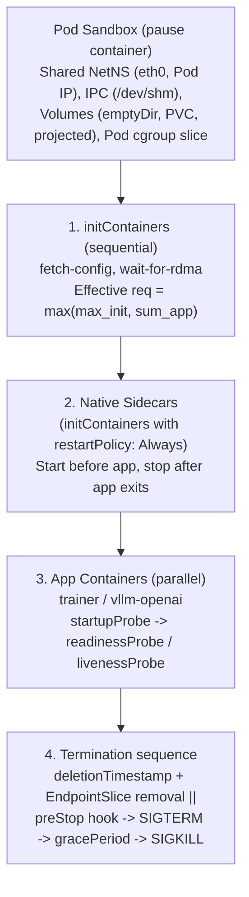

# 5.7 Pods and workloads: Deployments, StatefulSets, DaemonSets and Jobs

| | |
|---|---|
| Level | Intermediate |
| Priority tier | 0 |
| Lab venue | kubectl on any cluster; GPU node with the device plugin for GPU manifests |
| Part | Part 5: Kubernetes |
| Status | Drafted, labs **untested** |

## Why this matters for AI infrastructure

Every AI workload ends up as pods: a training worker with eight GPUs and a large shared-memory volume, an inference server with probes tuned for slow model loads, a data-preparation Job, a node agent DaemonSet. The pod spec contains the decisions that determine whether the job runs fast, fails mysteriously, gets evicted under memory pressure, or leaves GPUs idle: resource requests and limits, QoS class, security context, volumes, lifecycle hooks, termination grace, and scheduling constraints. The workload controllers (Deployment, StatefulSet, DaemonSet, Job, CronJob) add replica management, identity, per-node placement and run-to-completion semantics. This chapter is the practical reference for writing those objects correctly.

## Prerequisites and outcomes

Needs 5.3, 5.6. After this chapter you can:

- Read and write complete pod specs, including init containers, native sidecars, volumes, projected volumes, environment variables, and security contexts.
- Set resources correctly (requests, limits, extended resources like `nvidia.com/gpu`, hugepages), predict QoS class, and know how limits translate to cgroups and OOM behaviour.
- Use lifecycle hooks, termination grace, signals, preStop, and restart policies to achieve graceful shutdown and checkpointing.
- Choose between Deployment, StatefulSet, DaemonSet, Job/CronJob (and know when operators/JobSet/Kueue are better) for AI workloads.
- Write production manifests for inference servers, distributed training pods, and node agents; use PodDisruptionBudgets, topology spread, and anti-affinity.
- Debug pods with `describe`, events, logs, ephemeral containers, and `kubectl debug`.

## 1. The pod

A **pod** is the smallest schedulable unit: one or more containers sharing a network namespace (one IP, shared ports), optionally IPC and PID namespaces, a set of volumes, and a cgroup parent. Containers in a pod are co-scheduled on one node and communicate over `localhost` and shared volumes. Pods are **ephemeral**: they are not rescheduled to other nodes if the node dies (controllers create replacements); their IPs change; they should be treated as cattle.

In *Kubernetes: Up and Running* Chapter 5 (*Pods*), Brendan Burns, Joe Beda, Kelsey Hightower, and Lachlan Evenson answer the fundamental design question **"What should I put in a Pod?"**: ask yourself, *"Will these containers work correctly if they land on different machines?"* If the answer is **no**—for example, a web/inference server paired with a local Git/model-weight synchronizer or telemetry sidecar sharing an `emptyDir` volume—group them into a single Pod; if the answer is **yes**—such as a WordPress web frontend and a MySQL database, which scale independently and have different resource/state lifecycles—put them in **separate Pods** connected by a Kubernetes `Service`. Chapter 5 also warns against a classic resource-unit typo: lowercase **`m` (`400m` = `0.4` CPU cores, milliunits)** versus uppercase **`M` / `Mi` (`400Mi` = `400` mebibytes of RAM)**.



```yaml
apiVersion: v1
kind: Pod
metadata:
  name: trainer-0
  namespace: team-a
  labels: { app: llm-train, job: run-142 }
  annotations: { example.com/run-id: "142" }
spec:
  restartPolicy: Never                      # Always | OnFailure | Never
  terminationGracePeriodSeconds: 600        # time for SIGTERM handling (checkpoint) before SIGKILL
  serviceAccountName: trainer
  automountServiceAccountToken: false
  priorityClassName: training-normal
  nodeSelector: { nvidia.com/gpu.product: NVIDIA-H100-80GB-HBM3 }
  tolerations:
    - { key: nvidia.com/gpu, operator: Exists, effect: NoSchedule }
  securityContext:                            # pod-level
    runAsNonRoot: true
    runAsUser: 10001
    runAsGroup: 10001
    fsGroup: 10001
    seccompProfile: { type: RuntimeDefault }
  initContainers:
    - name: fetch-config
      image: registry.example.com/tools/fetch:1.2
      args: ["--out", "/work/config.yaml"]
      volumeMounts: [ { name: work, mountPath: /work } ]
  containers:
    - name: trainer
      image: registry.example.com/ml/trainer@sha256:abc123...
      command: ["torchrun"]
      args: ["--nproc_per_node=8", "train.py", "--config", "/work/config.yaml"]
      env:
        - { name: NCCL_DEBUG, value: WARN }
        - name: RANK_NODE
          valueFrom: { fieldRef: { fieldPath: metadata.annotations['example.com/node-rank'] } }
        - name: HF_TOKEN
          valueFrom: { secretKeyRef: { name: hf, key: token } }
      envFrom:
        - configMapRef: { name: train-env }
      resources:
        requests: { cpu: "64", memory: 800Gi, nvidia.com/gpu: 8, ephemeral-storage: 50Gi }
        limits:   { memory: 800Gi, nvidia.com/gpu: 8, ephemeral-storage: 100Gi }
      securityContext:
        allowPrivilegeEscalation: false
        capabilities: { drop: [ALL] }
        readOnlyRootFilesystem: true
      volumeMounts:
        - { name: work,    mountPath: /work }
        - { name: shm,     mountPath: /dev/shm }
        - { name: data,    mountPath: /data, readOnly: true }
        - { name: ckpt,    mountPath: /ckpt }
        - { name: tmp,     mountPath: /tmp }
      startupProbe:   { exec: { command: ["sh","-c","test -f /tmp/ready"] }, failureThreshold: 120, periodSeconds: 5 }
      lifecycle:
        preStop: { exec: { command: ["sh","-c","kill -USR1 1; sleep 20"] } }    # ask the trainer to checkpoint
  volumes:
    - { name: work, emptyDir: {} }
    - { name: shm,  emptyDir: { medium: Memory, sizeLimit: 64Gi } }
    - { name: tmp,  emptyDir: {} }
    - { name: data, persistentVolumeClaim: { claimName: datasets, readOnly: true } }
    - { name: ckpt, persistentVolumeClaim: { claimName: checkpoints-team-a } }
```

### Labels and annotations: syntax rules and selector queries

Every Pod and workload controller relies on **labels** (identifying key/value pairs used for grouping and selector queries by ReplicaSets, Services, NetworkPolicies, and node selectors) and **annotations** (non-identifying key/value metadata used by tools and controllers, such as `deployment.kubernetes.io/revision`, `kubernetes.io/change-cause`, or `kubectl.kubernetes.io/last-applied-configuration`). As *Kubernetes: Up and Running* (3rd edition, Chapter 6) specifies, Kubernetes enforces strict syntax rules on label keys and values:

- **Label key syntax**: a key has two parts separated by a slash (`/`): an optional prefix and a required name.
  - **Optional prefix**: must be a valid DNS subdomain up to `253` characters (for example, `acme.com/app-version` or `kubernetes.io/cluster-service`).
  - **Required key name**: up to `63` characters consisting of alphanumeric characters (`[a-zA-Z0-9]`), dashes (`-`), underscores (`_`), and dots (`.`), and must start and end with an alphanumeric character.
- **Label value syntax**: a string up to `63` characters following the same character rules as label key names (starts and ends with `[a-zA-Z0-9]`, with `-`, `_`, and `.` allowed in between).
- **Querying and displaying labels with `kubectl`** (untested here): use `--show-labels` to print all labels on each object, `-L <label_key>` to display a specific label's value as a dedicated table column, and `-l` / `--selector` with equality (`=`, `!=`) or set-based (`in`, `notin`, `key`, `!key`) operators:

```bash
kubectl get pods --show-labels
kubectl get deployments -L canary
kubectl get pods -l 'ver=2,!canary'
kubectl get pods -l 'ver in (1, 2)'
kubectl label deployments alpaca-test "canary=true"    # add or update (--overwrite) a label
kubectl label deployments alpaca-test "canary-"        # remove the 'canary' label with a trailing dash
```

In API objects such as `Deployment` and `Job`, a selector like `app=alpaca,ver in (1, 2)` is written using `matchLabels` and `matchExpressions` (evaluated as a logical AND):

```yaml
selector:
  matchLabels:
    app: alpaca
  matchExpressions:
    - { key: ver, operator: In, values: [1, 2] }
```

## 2. Pod spec anatomy

### Containers and init containers

- `containers[]`: image (pin by digest in production), `command`/`args` (override ENTRYPOINT/CMD; use exec form lists), `workingDir`, `env`/`envFrom`, `ports` (informational), `resources`, `volumeMounts`, probes, `lifecycle`, `securityContext`, `imagePullPolicy` (`IfNotPresent` default for tagged images, `Always` for `:latest`), `terminationMessagePath/Policy`, `stdin/tty`.
- **Init containers** run sequentially to completion before app containers start; use for waiting on dependencies, fetching config or model files, permissions fixes, schema migrations. They share volumes with the pod; their resource requests count as `max(init max, sum(app))` for scheduling. A failing init container restarts per `restartPolicy` and blocks the pod in `Init:Error`/`Init:CrashLoopBackOff`.
- **Sidecar containers** (native sidecars, `initContainers` with `restartPolicy: Always`, stable in recent releases): start before and stay for the lifetime of app containers, are ordered with probes honoured, and terminate after the main containers: ideal for log shippers, proxies, credential refreshers and metrics exporters, avoiding the old problem that a sidecar kept Jobs from completing.
- **Ephemeral containers** (`kubectl debug`) are added to a running pod for debugging (shell in distroless images) and share namespaces; they cannot be removed or have resources.

### Resources and QoS

- `requests` are used for **scheduling** and as the minimum guaranteed share; `limits` are enforced at run time by cgroups: **CPU limit** throttles (CFS quota `cpu.max`), **memory limit** is a hard cap and exceeding it causes an **OOM kill** of the container. Requests map to `cpu.weight` (shares); memory requests inform eviction and (with MemoryQoS) `memory.min/high`.
- **Extended resources** (`nvidia.com/gpu`, `rdma/hca_shared_devices_a`, `hugepages-2Mi`, `ephemeral-storage`) are integers and, for devices, requests must equal limits (no overcommit); GPUs are not shared or fractional unless using MIG, time-slicing or MPS via the device plugin/operator configuration (Part 11).
- **QoS classes** (derived, not set): **Guaranteed** (every container has CPU and memory requests equal to limits), **Burstable** (some requests/limits, not Guaranteed), **BestEffort** (none). QoS determines cgroup placement (`kubepods.slice/guaranteed|burstable|besteffort`), OOM score adjustment (`oom_score_adj`: -997 for Guaranteed, 1000 for BestEffort, scaled for Burstable) and eviction order under node pressure (5.9). Training and inference pods that must not be evicted should be Guaranteed; also required for the **CPU Manager static policy** (exclusive cores for integer CPU requests) and Topology Manager alignment (5.18).
- **CPU limits and ML**: CFS throttling hurts latency-sensitive servers and data loaders with bursts; many teams set CPU requests but no limits for GPU pods (while still avoiding noisy neighbours via node dedication), or use the static CPU manager for exclusive cores. Memory limits equal to requests are recommended to avoid surprising node-level OOM.
- **Memory for ML**: the container limit includes page cache attributable to the cgroup, pinned memory, and shared memory (`/dev/shm`) because tmpfs pages are charged to the cgroup; a large DataLoader or NCCL buffers plus `/dev/shm` can trigger OOM kills even when "the process" seems small. Size `emptyDir.medium: Memory` volumes and include them in limits.
- **Ephemeral storage** requests/limits cover container writable layers, logs and `emptyDir` (disk-backed); exceeding the limit evicts the pod.
- **LimitRange** sets per-namespace defaults/min/max; **ResourceQuota** caps totals per namespace (including `requests.nvidia.com/gpu`) (5.22).
- **Pod overhead** (RuntimeClass) and **in-place pod resize** (stable in recent releases for CPU/memory without restart) are additional features; check your version.

### Volumes

Types you will meet: `emptyDir` (per-pod scratch; `medium: Memory` for tmpfs; `sizeLimit`), `configMap`/`secret`/`downwardAPI`/`projected` (config and identity injection; projected ServiceAccount tokens with audience and expiry), `persistentVolumeClaim` (durable storage, 5.17), `hostPath` (node paths: avoid except for system agents; large security risk), `nfs`, CSI ephemeral volumes, `image` volumes (mount OCI artefacts, e.g., model weights, in newer releases), `ephemeral` (generic ephemeral PVC per pod). Mount options: `readOnly`, `subPath` (note: subPath mounts don't receive ConfigMap updates), `mountPropagation`, `subPathExpr`. `fsGroup` in the security context changes ownership of volumes (can be slow on huge volumes; use `fsGroupChangePolicy: OnRootMismatch`).

### Environment and configuration

`env` with literal values, `valueFrom` (field refs like `status.podIP`, `spec.nodeName`, resource field refs, ConfigMap/Secret keys), `envFrom` (whole ConfigMap/Secret). Env vars are fixed at container start; volume-mounted ConfigMaps/Secrets update eventually (kubelet sync ~1 minute) unless mounted via subPath. Prefer mounted files for secrets over env (env leaks into `ps`, crash dumps and child processes). Service discovery env vars (`MYSVC_SERVICE_HOST`) are legacy; use DNS (5.11); set `enableServiceLinks: false` in namespaces with many Services.

### Security context

Container- and pod-level: `runAsUser/Group`, `runAsNonRoot`, `readOnlyRootFilesystem`, `allowPrivilegeEscalation: false`, `capabilities.drop: [ALL]` (+ minimal adds like `IPC_LOCK` for RDMA pinned memory, `NET_BIND_SERVICE`), `seccompProfile: RuntimeDefault`, `seLinuxOptions`, `appArmorProfile`, `privileged` (avoid), `procMount`, `supplementalGroups`, `sysctls` (safe vs unsafe; unsafe require kubelet `--allowed-unsafe-sysctls`), `hostUsers: false` (user namespaces). Enforce with Pod Security Admission (5.21): `baseline` and `restricted` profiles; GPU/RDMA workloads often need a few exceptions, which should be granted per namespace rather than cluster-wide. Host namespaces (`hostNetwork`, `hostPID`, `hostIPC`) are for system DaemonSets; some HPC jobs use `hostIPC` or `hostNetwork` for performance but weaken isolation.

### Lifecycle, termination and restart policy

Pod termination: API sets `deletionTimestamp`; endpoints controller removes the pod from Service endpoints (in parallel); kubelet runs `preStop` hooks, sends `SIGTERM` to PID 1 of each container, waits up to `terminationGracePeriodSeconds`, then `SIGKILL`. Because endpoint removal and SIGTERM race, servers should keep serving while draining for a few seconds (preStop `sleep 5-10`) and then shut down gracefully. For training: handle SIGTERM by writing a checkpoint, flush logs, and exit 0 or a distinctive code; set the grace period to cover the checkpoint time; pods preempted by higher priority workloads or evicted get the same treatment. `restartPolicy`: `Always` (Deployments etc.), `OnFailure`/`Never` (Jobs). Container restarts use exponential backoff (10 s to 5 min) shown as `CrashLoopBackOff`. `terminationMessagePath` (`/dev/termination-log`) lets a container leave a short failure reason visible in `kubectl describe`.

**Probes** (detailed in 5.9): `startupProbe` (protect slow starts such as multi-GB model loads), `readinessProbe` (traffic gating), `livenessProbe` (restart on deadlock; use sparingly, never tie to dependencies), with `exec`, `httpGet`, `tcpSocket`, `grpc` handlers.

### Scheduling-related fields

`nodeName` (bypass scheduler; avoid), `nodeSelector`, `affinity` (node, pod, anti-affinity: required vs preferred, topology keys), `tolerations`, `topologySpreadConstraints`, `priorityClassName`/`preemptionPolicy`, `schedulerName`, `runtimeClassName`, `resourceClaims` (DRA). See 5.18.

## 3. Workload controllers: choosing

| Controller | Identity | Storage | Typical use | Notes |
|---|---|---|---|---|
| **Deployment** | Interchangeable replicas | Shared or none | Stateless services, inference servers, gateways, dashboards | Rolling updates, rollbacks, HPA targets |
| **StatefulSet** | Stable names `x-0..n`, stable DNS, ordered | Per-pod PVC via templates | Databases, queues, vector DBs, etcd, some parameter servers, coordination for distributed jobs needing stable hostnames | Careful with update/scale semantics; headless Service |
| **DaemonSet** | One per node | Host paths/CSI | Node agents: device plugin, DCGM, CNI, log shipper, node problem detector, GPU driver containers | Tolerations to reach tainted GPU nodes |
| **Job** | Run to completion, optional indexing | Any | Data prep, evaluations, single-node training, batch inference, benchmarks | `backoffLimit`, `podFailurePolicy`, TTL, `suspend` |
| **CronJob** | Scheduled Jobs | Any | Periodic retraining, backups, report generation, cleanup | `concurrencyPolicy: Forbid` for jobs that must not overlap |
| **JobSet / MPIJob / PyTorchJob / RayJob** (operators) | Gang of heterogeneous pods with startup ordering and failure policies | Any | Multi-node training/inference | Prefer these (plus Kueue) over hand-rolled Jobs for distributed workloads (Part 14) |
| **Bare Pod** | None | | Debugging only | Not rescheduled if the node dies |

### Deployment patterns for inference

```yaml
apiVersion: apps/v1
kind: Deployment
metadata: { name: vllm-llama, namespace: serving }
spec:
  replicas: 3
  revisionHistoryLimit: 5
  progressDeadlineSeconds: 1800         # model downloads and CUDA graph capture are slow
  strategy:
    type: RollingUpdate
    rollingUpdate: { maxSurge: 1, maxUnavailable: 0 }    # GPUs are scarce: surge needs a spare GPU; use maxUnavailable: 1 / maxSurge: 0 if none
  selector: { matchLabels: { app: vllm-llama } }
  template:
    metadata: { labels: { app: vllm-llama } }
    spec:
      terminationGracePeriodSeconds: 120
      tolerations: [ { key: nvidia.com/gpu, operator: Exists, effect: NoSchedule } ]
      topologySpreadConstraints:
        - { maxSkew: 1, topologyKey: kubernetes.io/hostname, whenUnsatisfiable: ScheduleAnyway, labelSelector: { matchLabels: { app: vllm-llama } } }
      containers:
        - name: vllm
          image: vllm/vllm-openai@sha256:...
          args: ["--model", "/models/llama-70b", "--tensor-parallel-size", "4", "--max-model-len", "8192"]
          ports: [ { containerPort: 8000 } ]
          resources: { requests: { cpu: "16", memory: 200Gi, nvidia.com/gpu: 4 }, limits: { memory: 200Gi, nvidia.com/gpu: 4 } }
          startupProbe:   { httpGet: { path: /health, port: 8000 }, periodSeconds: 10, failureThreshold: 180 }    # up to 30 min
          readinessProbe: { httpGet: { path: /health, port: 8000 }, periodSeconds: 5 }
          livenessProbe:  { httpGet: { path: /health, port: 8000 }, periodSeconds: 20, failureThreshold: 6 }
          lifecycle: { preStop: { exec: { command: ["sleep", "15"] } } }
          volumeMounts: [ { name: models, mountPath: /models, readOnly: true }, { name: shm, mountPath: /dev/shm } ]
      volumes:
        - { name: models, persistentVolumeClaim: { claimName: model-weights-ro } }
        - { name: shm, emptyDir: { medium: Memory, sizeLimit: 16Gi } }
---
apiVersion: policy/v1
kind: PodDisruptionBudget
metadata: { name: vllm-llama, namespace: serving }
spec:
  minAvailable: 2
  selector: { matchLabels: { app: vllm-llama } }
```

**PodDisruptionBudgets** limit *voluntary* disruptions (drains, upgrades, autoscaler scale-down) via the Eviction API: set `minAvailable` or `maxUnavailable`; they do not stop involuntary failures. A PDB that allows zero disruptions blocks node drains (a common upgrade-time stall), so pair with capacity to place replacements.

### Controlling Deployment rollouts: `change-cause`, `pause`, `resume`, `history`, and `undo --to-revision`

During a `Deployment` rollout, the Deployment controller scales up the new `ReplicaSet` (`NewReplicaSet`) and scales down the old `ReplicaSet`s (`OldReplicaSets`) while keeping up to `spec.revisionHistoryLimit` (default `10`) old `ReplicaSet`s scaled to `0` for rollback. As *Kubernetes: Up and Running* (3rd edition, Chapter 10) shows, you can record the reason for an update by setting the `kubernetes.io/change-cause` annotation inside `spec.template.metadata.annotations` (on the Pod template, not on the top-level Deployment metadata, and only when changing the template since modifying `spec.template` triggers a new rollout):

```yaml
spec:
  template:
    metadata:
      annotations:
        kubernetes.io/change-cause: "Update to green kuard"
```

You can then inspect, pause, resume, or roll back the rollout using `kubectl rollout` (in the book's `kuard` example, untested here):

```bash
kubectl rollout status deployments kuard
kubectl rollout pause deployments kuard                    # halt a rollout mid-flight to investigate anomalies
kubectl rollout resume deployments kuard                   # continue a paused rollout
kubectl rollout history deployment kuard                   # list REVISION and CHANGE-CAUSE columns
kubectl rollout history deployment kuard --revision=2      # inspect the Pod template of revision 2
kubectl rollout undo deployments kuard                     # roll back to the previous revision (same as --to-revision=0)
kubectl rollout undo deployments kuard --to-revision=3     # roll back to a specific revision (renumbered as the newest revision)
```

Remember that `kubectl rollout undo` mutates cluster state directly; in a GitOps workflow, prefer reverting the manifest in Git and applying it so version control matches what runs in the cluster.

### StatefulSet example (vector database)

```yaml
apiVersion: v1
kind: Service
metadata: { name: qdrant, namespace: data }
spec: { clusterIP: None, selector: { app: qdrant }, ports: [ { port: 6333, name: http } ] }
---
apiVersion: apps/v1
kind: StatefulSet
metadata: { name: qdrant, namespace: data }
spec:
  serviceName: qdrant
  replicas: 3
  podManagementPolicy: Parallel
  persistentVolumeClaimRetentionPolicy: { whenDeleted: Retain, whenScaled: Retain }
  selector: { matchLabels: { app: qdrant } }
  updateStrategy: { type: RollingUpdate, rollingUpdate: { partition: 0 } }
  template:
    metadata: { labels: { app: qdrant } }
    spec:
      containers:
        - name: qdrant
          image: qdrant/qdrant:v1.9.0
          volumeMounts: [ { name: storage, mountPath: /qdrant/storage } ]
  volumeClaimTemplates:
    - metadata: { name: storage }
      spec:
        accessModes: [ReadWriteOnce]
        storageClassName: fast-nvme
        resources: { requests: { storage: 200Gi } }
```

Pods get DNS `qdrant-0.qdrant.data.svc.cluster.local`; PVCs `storage-qdrant-0..2` persist across pod deletion; scaling down leaves PVCs (data safety); pods are re-attached to the same PVC (and thus tied to zone/node topology for local volumes).

### DaemonSet example (GPU telemetry agent)

```yaml
apiVersion: apps/v1
kind: DaemonSet
metadata: { name: dcgm-exporter, namespace: gpu-monitoring }
spec:
  selector: { matchLabels: { app: dcgm-exporter } }
  updateStrategy: { type: RollingUpdate, rollingUpdate: { maxUnavailable: 10% } }
  template:
    metadata: { labels: { app: dcgm-exporter } }
    spec:
      nodeSelector: { nvidia.com/gpu.present: "true" }
      tolerations: [ { operator: Exists } ]                  # run on every (tainted) GPU node
      priorityClassName: system-node-critical
      containers:
        - name: exporter
          image: nvcr.io/nvidia/k8s/dcgm-exporter:3.3.5-3.4.1-ubuntu22.04
          ports: [ { containerPort: 9400, hostPort: 9400, name: metrics } ]
          securityContext: { capabilities: { add: [SYS_ADMIN] } }
          resources: { requests: { cpu: 100m, memory: 128Mi }, limits: { memory: 512Mi } }
```

### Job patterns for batch and distributed work

```yaml
apiVersion: batch/v1
kind: Job
metadata: { name: embed-corpus-142, namespace: team-a, labels: { kueue.x-k8s.io/queue-name: team-a-gpu } }
spec:
  suspend: true                          # Kueue (or you) unsuspends when quota is available
  completionMode: Indexed
  completions: 16
  parallelism: 16
  backoffLimitPerIndex: 2
  maxFailedIndexes: 1
  ttlSecondsAfterFinished: 86400
  podFailurePolicy:
    rules:
      - action: Ignore
        onPodConditions: [ { type: DisruptionTarget } ]       # node drain/preemption does not consume retries
      - action: FailJob
        onExitCodes: { containerName: worker, operator: In, values: [42] }   # config error: do not retry
  template:
    spec:
      restartPolicy: Never
      containers:
        - name: worker
          image: registry.example.com/ml/embed:1.7
          env: [ { name: SHARD, valueFrom: { fieldRef: { fieldPath: "metadata.annotations['batch.kubernetes.io/job-completion-index']" } } } ]
          resources: { requests: { cpu: "8", memory: 64Gi, nvidia.com/gpu: 1 }, limits: { memory: 64Gi, nvidia.com/gpu: 1 } }
```

For tightly coupled multi-node training use JobSet/MPIJob/PyTorchJob with gang admission by Kueue/Volcano (a plain Job with `parallelism: N` can start some pods while others wait, wasting GPUs and deadlocking collective initialisation) (Part 14).

## 4. Operating pods

### Reading state

```bash
kubectl get pod trainer-0 -o wide
kubectl describe pod trainer-0                    # events: Scheduled, Pulling, Created, Started, FailedScheduling, Unhealthy, OOMKilled
kubectl get pod trainer-0 -o jsonpath='{.status.containerStatuses[0].lastState}' | jq
kubectl get pod trainer-0 -o jsonpath='{.status.qosClass}{"\n"}'
kubectl logs trainer-0 -c trainer --previous --timestamps --tail=200
kubectl logs -f job/embed-corpus-142 --all-containers --max-log-requests=20
kubectl exec -it trainer-0 -c trainer -- bash
kubectl attach -it trainer-0 -c trainer                                       # attach to PID 1 stdin/stdout when no shell exists in the container
kubectl apply -f pod.yaml view-last-applied                                   # inspect (or edit-/set-last-applied) the last-applied-configuration annotation
kubectl config set-context my-context --namespace=team-a && kubectl config use-context my-context
source <(kubectl completion bash)                                             # enable bash tab completion for kubectl
kubectl debug -it trainer-0 --image=nicolaka/netshoot --target=trainer      # ephemeral container sharing the process namespace
kubectl debug node/gpu-node-1 -it --image=ubuntu                              # privileged node debug pod (chroot /host)
kubectl top pod trainer-0 --containers
kubectl get events --field-selector involvedObject.name=trainer-0 --sort-by=.lastTimestamp
```

### Phases and states

Pod `phase`: Pending (accepted, not all containers running: scheduling, image pulls, init), Running, Succeeded, Failed, Unknown. Container states: Waiting (reason: `ContainerCreating`, `ImagePullBackOff`, `CrashLoopBackOff`, `CreateContainerConfigError`), Running, Terminated (reason `Completed`, `Error`, `OOMKilled`, exit code). Conditions: `PodScheduled`, `Initialized`, `ContainersReady`, `Ready`, `DisruptionTarget`.

| Symptom | Likely cause | Fix |
|---|---|---|
| Pending, `0/10 nodes are available: Insufficient nvidia.com/gpu` | No free GPUs / taints / quota | `describe` shows predicate counts; add capacity, tolerations, queue |
| Pending, `node(s) had untolerated taint` | Missing toleration | Add toleration |
| `ImagePullBackOff` | Wrong name/tag, auth, rate limit, registry down | Events, `crictl pull` on node, imagePullSecrets (5.1) |
| `CreateContainerConfigError` | Missing ConfigMap/Secret key | `describe` |
| `CrashLoopBackOff` | App crash, bad args, missing dependency | `logs --previous`, exit code |
| `OOMKilled` (exit 137) | Memory limit hit | Increase memory limit, reduce dataloader workers/shm, find leaks |
| Evicted | Node pressure (memory/disk) or ephemeral storage limit | `describe`, node conditions, QoS |
| Stuck `Terminating` | Finalizers, unresponsive kubelet, process ignoring SIGTERM, volume detach | `describe`, kubelet logs |
| Running but not Ready | Readiness failing | Probe config, app logs |
| `ContainerCannotRun` / `exec format error` | Wrong arch/entrypoint | Image platform (5.1) |

## 5. Sizing and placement guidelines for GPU workloads

1. Request **all** GPUs of a node for multi-GPU training pods (8 on HGX), plus proportional CPU and memory so the pod is Guaranteed and the node isn't fragmented by small CPU pods.
2. Match CPU requests to data-loading needs (e.g., 8 to 16 cores per GPU for heavy augmentation), and leave headroom for system daemons (kube/system reserved).
3. Set `/dev/shm` explicitly (memory-backed emptyDir with sizeLimit); include it in memory accounting.
4. Mount datasets read-only from shared storage; write checkpoints to durable storage with atomic rename; use local NVMe `emptyDir` or local PVs for scratch/caching.
5. Use `priorityClassName` and preemption policies deliberately (interactive vs training vs best-effort), and handle SIGTERM for checkpointing.
6. Add `topologySpreadConstraints`/anti-affinity for inference replicas across nodes/zones; use pod affinity or rack/rail labels for training pods that need locality (5.18, Part 12).
7. Use `terminationGracePeriodSeconds` ≥ checkpoint duration + margin.
8. Pin images by digest; prefer images prepared with matching CUDA/driver (5.1) and pre-pulled on nodes.
9. Set `automountServiceAccountToken: false` where the pod doesn't call the API.
10. Label for cost allocation and ownership (team, project, run id) consistently.
11. **Application Instrumentation, Downward API Resource Propagation, and Graceful Shutdown (`PK` Chapter 14):** In *Production Kubernetes* Chapter 14 (*Application Considerations*), Josh Rosso et al. emphasize four application-level contracts with Kubernetes:
    - *Propagating cgroup limits via the Downward API:* Runtime environments (such as older JVMs or multi-worker Python/C++ allocators) that inspect host `/proc/meminfo` instead of cgroup limits can allocate beyond the container's limit and get `OOMKilled`; expose `resources.limits.memory` (`resourceFieldRef: { containerName: my-app, resource: limits.memory }`) as `MEM_LIMIT` via the **Downward API**.
    - *Coordinating `SIGTERM` and `preStop` hooks:* Because `EndpointSlice` removal and `kubelet` pod termination run asynchronously in parallel, a server that closes its listening socket the instant `SIGTERM` arrives will drop in-flight requests from nodes whose `kube-proxy` / Envoy rules haven't updated yet. Register an OS `SIGTERM` handler (`signal.Notify(shutdown, os.Interrupt, syscall.SIGTERM)` calling `httpServer.Shutdown()` or saving a training checkpoint) paired with a `lifecycle.preStop` hook (`sleep 10` or `/bin/contour envoy shutdown`) so load balancers drain before the process exits.
    - *Structured Logs, Prometheus `/metrics`, and Distributed Tracing:* Write application logs to `stdout`/`stderr` (collected from `/var/log/pods` by a DaemonSet agent), expose a Prometheus `/metrics` endpoint (or an out-of-process sidecar exporter like `dcgm-exporter`), and propagate distributed tracing span context (`OpenTelemetry` / `Jaeger`) across HTTP/gRPC headers.
12. **Organizing Application Manifests in Git and Staged Regional Rollouts (`KUR` Chapter 22):** In *Kubernetes: Up and Running* Chapter 22 (*Organizing Your Application*), Burns et al. codify three production principles: (a) **Treat filesystems in Git as the source of truth** (never treat live `etcd` state modified by ad-hoc `kubectl edit` as truth), (b) **Require pull-request code review** on all YAML/Helm changes, and (c) **Promote releases through ordered lifecycle and regional stages** (`Development -> Staging -> Canary -> Production (Low-Traffic Region) -> Production (High-Traffic Region)`), using **feature flags** inside application images and **Helm/Kustomize templates** (`values.yaml` per environment/region) without ever skipping stages during "quick fixes".

## 6. Lab

First, run the self-checking Python lab (`code/part05/pod_qos_workload_validator_lab.py`) locally. It verifies the Pod QoS class (`Guaranteed` / `Burstable` / `BestEffort`), `oom_score_adj`, and init-container effective scheduling request calculator (`compute_pod_qos_and_effective_requests`: computing `max(max_init, sum_app)`) and the Kubernetes label key/value syntax validator (`validate_k8s_label`, `KUR` Ch. 6).

```bash
python3 code/part05/pod_qos_workload_validator_lab.py
```

Next, on a `kind` or GPU cluster (all interactive shell steps below are `untested here`), work through these exercises:

1. **Pod anatomy**: write a pod with init container, sidecar (native), shared `emptyDir`, env from ConfigMap/Secret/Downward API; view with `kubectl get -o yaml`; read `status` fields and conditions.
2. **QoS and OOM**: create pods with Guaranteed, Burstable and BestEffort QoS; inspect `/proc/<pid>/oom_score_adj` via `crictl`/node; run a memory hog beyond limits and observe `OOMKilled`; fill node memory to see eviction ordering (lab only).
3. **/dev/shm**: reproduce a PyTorch DataLoader failure (or a Python `multiprocessing` shared-memory failure) with default 64 MiB shm; fix with memory-backed emptyDir and sized limits; observe the memory accounting in cgroup `memory.current`.
4. **Termination**: write an app that handles SIGTERM and logs timing; test `terminationGracePeriodSeconds`, `preStop`, and the race with endpoint removal behind a Service (use a request loop).
5. **Probes**: configure startup/readiness/liveness for a slow-start server; break each and observe behaviour (restart vs unready).
6. **Deployment rollouts**: perform rolling update with `maxUnavailable: 0`, `maxSurge: 1` on a cluster without spare capacity; observe stuck rollout; adjust; add a PDB and drain a node.
7. **StatefulSet**: create the example; delete a pod; scale down/up; verify PVC retention; test `OrderedReady` vs `Parallel`; partitioned update.
8. **DaemonSet**: deploy the exporter pattern; add a node; cordon a node and see DaemonSet pods persist (tolerations).
9. **Jobs**: Indexed Job with `podFailurePolicy` and `backoffLimitPerIndex`; simulate a disruption (drain) and an application error; watch which count against retries; add `suspend` and unsuspend.
10. **GPU manifests**: on a GPU node run `nvidia-smi` pods (limits 1, 2, 8 GPUs); request more than available and read the scheduler message; add taints/tolerations; try `NVIDIA_VISIBLE_DEVICES` in-pod behaviours.
11. **Debugging**: use `kubectl debug` ephemeral container on a distroless pod; node debug pod to inspect kubelet logs; reproduce `CrashLoopBackOff`, `ImagePullBackOff`, `CreateContainerConfigError`.
12. **PDB and drain**: create a PDB with `minAvailable` equal to replicas and drain a node (blocked); fix capacity or PDB; discuss upgrade implications.
13. **Clean up**.

## 7. Common mistakes

- No resource requests (BestEffort) for important pods; limits far above requests for memory; forgetting `/dev/shm` in memory sizing.
- Putting liveness probes on slow-starting model servers without a startup probe (restart loops).
- Using `latest` tags, `hostPath` for convenience, or `privileged` to "make GPUs work".
- SIGTERM ignored (shell-form entrypoint), grace period too short for checkpoints.
- Using Deployments for training jobs that should be Jobs/JobSet; using plain Jobs for gang workloads.
- StatefulSet with a PDB or update strategy that blocks maintenance; deleting PVCs accidentally.
- PDBs that forbid all disruption.
- DaemonSets without tolerations for tainted GPU nodes (agents missing exactly where needed).
- Secrets in env vars printed in logs; service account tokens auto-mounted into pods that don't need them.
- Assuming CPU limits are harmless for latency-sensitive services.

## 8. Interview angles

- "What is a pod and why not just containers? What do containers in a pod share?"
- "Explain QoS classes and how they affect eviction and OOM."
- "When do you use a StatefulSet vs Deployment vs Job vs DaemonSet?"
- "What happens when you delete a pod? Walk through termination and the endpoint race."
- "Why does my GPU pod stay Pending? How do you debug?"
- "How do init containers and native sidecars differ? What problems do sidecars cause for Jobs?"
- "How would you configure an inference deployment that loads a 140 GB model?" (startup probe, PVC/image volume, rolling update strategy, PDB, topology spread.)
- "What's special about `/dev/shm` in ML containers on Kubernetes?"

## Exercises

1. **Pod Design (`KUR` Ch. 5), Init Containers vs. Native Sidecars, and Effective Scheduling Requests:** Using `compute_pod_qos_and_effective_requests()` in `code/part05/pod_qos_workload_validator.py`, explain `KUR` Chapter 5's rule for deciding what belongs in a single Pod vs separate Pods, how `kube-scheduler` calculates a Pod's effective resource request across `initContainers` and `containers` (`max(max(init), sum(app))`), and how native sidecars (`initContainers` with `restartPolicy: Always`) solve the Job-completion hang caused by traditional sidecar containers.
2. **Labels, Annotations, and Selector Queries (`KUR` Chapter 6):** Using `validate_k8s_label()` in `code/part05/pod_qos_workload_validator.py`, state the exact character and length rules for Kubernetes label keys (optional `253`-char DNS subdomain prefix + `/` + `63`-char name) and values (`63` chars), contrast labels with annotations (`deployment.kubernetes.io/revision`, `kubernetes.io/change-cause`), and write `kubectl get pods` selector queries using both equality (`=`, `!=`) and set-based (`in`, `notin`, `!canary`) operators.
3. **Resource Requests, Limits, Extended Resources (`nvidia.com/gpu`), QoS Classes, and `/dev/shm` Accounting:** Using `compute_pod_qos_and_effective_requests()`, compare `Guaranteed` (`oom_score_adj: -997`), `Burstable`, and `BestEffort` (`oom_score_adj: 1000`) QoS classes, explain why many AI platform teams set `requests.memory == limits.memory` while omitting `limits.cpu` (or using static CPU Manager with `Guaranteed` QoS), and explain how `emptyDir: { medium: Memory, sizeLimit: 64Gi }` at `/dev/shm` is charged against the container's memory cgroup limit.
4. **Pod Termination Sequence, the `EndpointSlice` vs. `SIGTERM` Race, and Probes for Slow-Starting 140 GB LLM Servers (`PK` Chapter 14):** Trace the parallel timeline when `kubectl delete pod` is called (`deletionTimestamp` -> `EndpointSlice` removal racing with `preStop` -> `SIGTERM` -> `terminationGracePeriodSeconds` -> `SIGKILL`), and design the `startupProbe`, `readinessProbe`, `livenessProbe`, and `preStop` configuration for a `vllm-llama` server that takes 12 minutes to load model weights and capture CUDA graphs.
5. **Production Workload Manifests (`Deployment` + `PDB`, `StatefulSet`, `DaemonSet`, and `Indexed` `Job`):** Compare the four production manifests in Section 3 (`vllm-llama` `Deployment` + `PodDisruptionBudget`, `qdrant` `StatefulSet` with `volumeClaimTemplates`, `dcgm-exporter` `DaemonSet` with `operator: Exists` toleration, and `embed-corpus-142` `Indexed` `Job` with `podFailurePolicy` and `suspend: true`), and explain why `maxSurge: 1, maxUnavailable: 0` stalls on a GPU node pool with 0 free GPUs.
6. **Controlling Rollouts (`KUR` Chapter 10), Ephemeral Debug Containers (`kubectl debug`), and Organizing Multi-Region Releases (`KUR` Chapter 22):** Write the `kubectl rollout` commands to `pause`, `resume`, inspect `history --revision=2`, and `undo --to-revision=3`, show how `kubectl debug` troubleshoots a distroless container or node, and summarize `KUR` Chapter 22's three rules for organizing application YAML across `Development -> Staging -> Canary -> Production` regions.

## Checkpoint questions (20)

<details>
<summary>1. In *Kubernetes: Up and Running* Chapter 5, what question decides whether two containers belong in the same Pod or in separate Pods, and what do containers inside a Pod share?</summary>

- **The design question:** *"Will these containers work correctly if they land on different machines?"* If they must share local files or fate on the same host (e.g., an inference server and a local weight-cache warmer/telemetry sidecar sharing an `emptyDir`), put them in the **same Pod**. If they scale independently or have distinct lifecycles (e.g., a web frontend and a database), put them in **separate Pods**.
- **What containers in a Pod share:** The Pod Sandbox's **Network namespace** (same IP address, port space, and `localhost` loopback), **IPC namespace** (`/dev/shm`), **UTS namespace** (hostname), declared **Volumes**, and a parent **Pod cgroup slice** (optionally the PID namespace if `shareProcessNamespace: true` is set).
</details>

<details>
<summary>2. In `KUR` Chapter 5, what is the difference between `400m` and `400Mi` (or `400M`) in a Pod's `resources` block?</summary>

Case matters in Kubernetes resource quantities:
- **Lowercase `m` (`400m`)** stands for **milli-units** ($400 \times 10^{-3} = 0.4$). On `cpu: 400m`, it means **0.4 CPU cores**; if accidentally written on `memory: 400m`, it means **0.4 bytes** of RAM.
- **Uppercase `Mi` (`400Mi`) / `M` (`400M`)** stands for **mebibytes** ($400 \times 2^{20}$ bytes) / **megabytes** ($400 \times 10^6$ bytes). Always use `m` for fractional CPUs (`500m`) and `Mi`/`Gi` for memory (`64Gi`, `800Gi`).
</details>

<details>
<summary>3. In `KUR` Chapter 6, what are the exact character-length and syntax rules for Kubernetes Label keys and values?</summary>

- **Label key (`[prefix/]name`):**
  1. **Optional prefix:** Valid DNS subdomain up to **`253` characters** (`[a-z0-9-.]`), followed by `/`.
  2. **Required name:** **`1` to `63` characters**, starting and ending with an alphanumeric character (`[a-zA-Z0-9]`), with dashes (`-`), underscores (`_`), dots (`.`), and alphanumerics allowed in between.
- **Label value:** Up to **`63` characters**, either empty or following the exact same character rules as the label key name.
</details>

<details>
<summary>4. How does `kube-scheduler` calculate a Pod's effective resource request when the Pod has both `initContainers` and regular `containers`?</summary>

Because `initContainers` run **sequentially one at a time** before `containers` start (unless they are native sidecars), `kube-scheduler` takes the **highest request among all `initContainers`** for each resource type (`cpu`, `memory`, `nvidia.com/gpu`) and compares it against the **sum of requests across all regular `containers`** (plus any active native sidecars):
`EffectivePodRequest(R) = max(max_{i in init} req_i(R), sum_{c in app} req_c(R))`
</details>

<details>
<summary>5. What is a Native Sidecar Container (`initContainers` with `restartPolicy: Always`), and what classic `Job` bug does it fix?</summary>

Previously, if you put a helper container (such as an Istio/Envoy proxy, Cloud SQL proxy, or log shipper) alongside a batch worker inside `spec.containers` of a `Job`, the main worker container would finish and exit `0`, **but the sidecar container kept running forever—leaving the Pod stuck in `Running` (`1/2 Ready`) so the `Job` never completed**.
Defining the sidecar inside **`initContainers` with `restartPolicy: Always`** makes it a **native sidecar**: `kubelet` starts it in order during Pod init (waiting for its `startupProbe`/`readinessProbe` before starting subsequent init/app containers), keeps it alive throughout the Pod's run, and **automatically terminates the native sidecar once all regular `spec.containers` in the `Job` Pod have exited**.
</details>

<details>
<summary>6. How are the three Pod QoS Classes (`Guaranteed`, `Burstable`, `BestEffort`) derived, and how do they set `/proc/<pid>/oom_score_adj`?</summary>

QoS class is computed automatically by `kube-apiserver` from container `resources` (never set via a field):
1. **`Guaranteed` (`oom_score_adj: -997`):** **Every** container in the Pod sets both `memory` and `cpu` `requests` and `limits`, and `requests.cpu == limits.cpu` and `requests.memory == limits.memory`. Protected from eviction unless system daemons exceed reserved memory; required for static CPU Manager exclusive core pinning.
2. **`Burstable` (`oom_score_adj: 2..999`, scaled by % of node RAM requested):** At least one container sets a CPU or memory request or limit, but the Pod does not meet the `Guaranteed` criteria.
3. **`BestEffort` (`oom_score_adj: 1000`):** **Zero** containers in the Pod set any CPU or memory requests or limits. First to be killed by the kernel OOM killer or kubelet eviction under memory pressure.
</details>

<details>
<summary>7. Why does mounting `/dev/shm` via `emptyDir: { medium: Memory, sizeLimit: 64Gi }` affect container `OOMKilled` behavior?</summary>

In Kubernetes, files written to a `tmpfs` volume (`emptyDir` with `medium: Memory`) reside in host RAM and **every page in that `tmpfs` is charged directly against the writing container's memory cgroup (`memory.current`)**. If your container has `limits.memory: 80Gi`, your Python training process uses 50 GiB of heap/pinned RAM, and PyTorch DataLoader workers + NCCL buffers write 35 GiB into `/dev/shm`, total cgroup memory hits `50 + 35 = 85 GiB > 80 GiB`—triggering an immediate kernel **`OOMKilled` (exit code 137)**. Always set `limits.memory` to cover **process RSS + pinned host memory + `/dev/shm` `sizeLimit` + page cache**.
</details>

<details>
<summary>8. What are the rules for requesting Extended Resources like `nvidia.com/gpu` or `rdma/hca_shared_devices_a` in a Pod spec?</summary>

1. Extended resource quantities must be **whole integers** (you cannot request `nvidia.com/gpu: 0.5`; for sub-GPU sharing, use MIG resource names like `nvidia.com/mig-1g.10gb` or time-slicing replicas).
2. Extended resources **cannot be overcommitted**, so `requests` and `limits` must be equal (if you specify `limits: { nvidia.com/gpu: 4 }` and omit `requests`, Kubernetes automatically defaults `requests` to `4`).
</details>

<details>
<summary>9. Walk through the exact sequence of events when a Pod is deleted (`kubectl delete pod`), and explain why `preStop: { exec: { command: ["sleep", "10"] } }` prevents dropped HTTP/gRPC requests (`PK` Chapter 14).</summary>

When `DELETE` is called on a Pod, **two paths run concurrently in parallel**:
- **Path A (Control Plane -> Nodes):** `kube-apiserver` sets `metadata.deletionTimestamp` (`Terminating`). The `EndpointSlice` controller notices the Pod is terminating and removes its IP from `EndpointSlice`s; `kube-proxy` and Ingress/Envoy proxies watch `EndpointSlice`s and update their local iptables/IPVS/upstream tables. **This propagation takes 1–5 seconds across a large cluster.**
- **Path B (Target Node `kubelet`):** `kubelet` sees `deletionTimestamp`, immediately executes any **`lifecycle.preStop` hook**, and once `preStop` finishes, sends **`SIGTERM` to PID 1** in each container (waiting up to `terminationGracePeriodSeconds` before sending `SIGKILL`).
If the container has no `preStop` delay and closes its listening socket the millisecond `SIGTERM` arrives, Path B finishes **before** Path A finishes updating `kube-proxy`/Ingress—so new requests continue arriving at a closed socket (`502 Bad Gateway` / `Connection reset`). A `preStop` `sleep 10` keeps the server accepting connections during those 10 seconds while `EndpointSlice` removal propagates cluster-wide, after which `SIGTERM` triggers a clean drain of in-flight requests.
</details>

<details>
<summary>10. How do `startupProbe`, `readinessProbe`, and `livenessProbe` work together for an LLM inference server (`vllm-llama`) that takes 15 minutes to load 140 GB of weights?</summary>

1. **`startupProbe` (`periodSeconds: 10, failureThreshold: 180` = up to 30 minutes):** Runs first and **disables both `livenessProbe` and `readinessProbe` until it succeeds once**. This gives `vllm` up to 30 minutes to download/mmap weights and capture CUDA graphs without `livenessProbe` killing and restarting the container mid-load.
2. **`readinessProbe` (`periodSeconds: 5`):** Runs continuously after `startupProbe` succeeds; if it fails (e.g., temporary overload), the Pod's IP is removed from Service `EndpointSlice`s **without restarting the container**.
3. **`livenessProbe` (`periodSeconds: 20, failureThreshold: 6`):** Restarts the container **only** if the server process is genuinely deadlocked/unresponsive for 2 full minutes after startup.
</details>

<details>
<summary>11. Why does a GPU `Deployment` with `rollingUpdate: { maxSurge: 1, maxUnavailable: 0 }` hang indefinitely when all GPUs in the node pool are already in use?</summary>

`maxUnavailable: 0` forbids terminating any existing Pod until a new replacement Pod is `Ready`, while `maxSurge: 1` tries to schedule 1 extra Pod first. If your node pool has 12 GPUs and `3 replicas * 4 GPUs = 12 GPUs` are already allocated, the 4th surge Pod stays permanently **`Pending` (`0/N nodes are available: Insufficient nvidia.com/gpu`)**. On fixed-capacity GPU pools without spare surge GPUs, set **`maxSurge: 0, maxUnavailable: 1`** (so 1 old replica terminates first to free 4 GPUs for the new replica).
</details>

<details>
<summary>12. In `KUR` Chapter 10, where must the `kubernetes.io/change-cause` annotation be placed, and what `kubectl rollout` commands inspect, pause, resume, or undo a Deployment?</summary>

Record `kubernetes.io/change-cause` in `metadata.annotations` (or `spec.template.metadata.annotations` when updating the template), and manage the rollout with:
- **`kubectl rollout status deployments kuard`**: watch rollout completion.
- **`kubectl rollout pause deployments kuard`** & **`kubectl rollout resume deployments kuard`**: freeze a rollout mid-flight (e.g., for canary inspection) and resume it.
- **`kubectl rollout history deployment kuard`** & **`kubectl rollout history deployment kuard --revision=2`**: list revisions and inspect a specific revision's Pod template.
- **`kubectl rollout undo deployments kuard`** & **`kubectl rollout undo deployments kuard --to-revision=3`**: roll back to the previous revision or revision `3`.
</details>

<details>
<summary>13. How does a `PodDisruptionBudget` (`PDB`) work, and why does setting `minAvailable: 3` on a 3-replica Deployment break cluster maintenance?</summary>

A `PodDisruptionBudget` governs **voluntary disruptions** initiated through the Kubernetes **Eviction API** (`kubectl drain`, cluster autoscaler scale-down, node upgrades; it does *not* prevent hardware crashes or OOM kills). If a Deployment has `replicas: 3` and its PDB specifies `minAvailable: 3` (or `maxUnavailable: 0`), the disruption budget is **`0` (`DisruptionsAllowed: 0`)**—so `kubectl drain` on any node hosting one of those Pods will be **blocked forever** (`Cannot evict pod as it would violate the pod's disruption budget`). Always ensure `minAvailable < replicas` (or `maxUnavailable >= 1`).
</details>

<details>
<summary>14. Why does mounting a `ConfigMap` or `Secret` using `subPath` prevent automatic live updates when the `ConfigMap` changes?</summary>

Normally, when a `ConfigMap` or `Secret` volume is mounted as a directory (`mountPath: /etc/config`), `kubelet` uses an atomic symlink swap (`..data`) to update the files inside the container within ~60 seconds of a `ConfigMap` update. However, when you mount a single file using **`subPath: config.yaml`**, the Linux kernel bind-mounts that specific inode directly; when `kubelet` later swaps the symlink on the directory, **the container's bind-mounted `subPath` inode still points to the old file and NEVER updates** until the Pod is restarted.
</details>

<details>
<summary>15. Why does `fsGroup: 10001` in `securityContext` sometimes cause a Pod mounting a 10 TB dataset volume with 5 million files to hang for 20 minutes in `ContainerCreating`, and what fixes it?</summary>

By default (`fsGroupChangePolicy: Always`), before starting the container, `kubelet` recursively walks **every file and directory** in the mounted volume (`chown`/`chmod`) to ensure group ownership matches `fsGroup: 10001`. On a volume with millions of training images or checkpoints, recursive `chown` takes 10–30 minutes. Setting **`fsGroupChangePolicy: OnRootMismatch`** in `spec.securityContext` tells `kubelet` to check only the volume's top-level root directory—and skip the recursive walk if the root directory already has the right group ownership.
</details>

<details>
<summary>16. Why do RDMA / InfiniBand GPU training Pods often require `capabilities: { add: ["IPC_LOCK"] }` and `ulimit memlock: unlimited`?</summary>

GPUDirect RDMA (`nvidia-peermem`) and InfiniBand verbs (`libibverbs` / `mlx5`) register and **pin memory pages (`mlock`)** in physical RAM so the NIC DMA engine can read/write GPU and host buffers directly without the OS paging them out. Without the **`IPC_LOCK`** Linux capability (and a sufficient `RLIMIT_MEMLOCK` ulimit, configured on the container runtime), unprivileged containers are capped at a small default `memlock` limit (e.g., 64 KiB) and NCCL RDMA initialization fails with `ibv_reg_mr failed: Cannot allocate memory`.
</details>

<details>
<summary>17. Why shouldn't you use a plain `Job` with `parallelism: 16` (without `Kueue` or `JobSet`/`PyTorchJob` gang scheduling) for a 16-node synchronous PyTorch `torchrun` training job?</summary>

In synchronous distributed training (`torchrun` / MPI), **all 16 ranks must start and join the `c10d`/NCCL rendezvous barrier before step 1 can begin**. If the cluster currently has only 12 free GPU nodes and you submit a plain `Job` with `parallelism: 16`, `kube-scheduler` immediately starts 12 Pods (which sit idle burning 96 H100 GPUs waiting at the barrier) while the remaining 4 Pods sit `Pending`. Worse, if a second 16-node job claims the remaining 4 nodes, **both jobs deadlock forever**. Using **Kueue** (or Volcano / coscheduling) with **JobSet / PyTorchJob** enforces **all-or-nothing gang admission** so pods are scheduled only when all 16 nodes are available.
</details>

<details>
<summary>18. How do you debug a running `distroless` or minimal container that does not contain `/bin/sh`, `bash`, `ps`, or `ss`, and how do you debug a node when SSH is disabled?</summary>

- **Debug a distroless Pod with an Ephemeral Container (`kubectl debug`):**
  `kubectl debug -it trainer-0 --image=nicolaka/netshoot --target=trainer`
  This injects an ephemeral debugging container (`spec.ephemeralContainers`) into the running Pod that shares the `trainer` container's network, IPC, and **process (`PID`) namespace** (so `ps aux`, `ss -tulpn`, and `/proc/1/root/...` inside `netshoot` inspect the live `trainer` process).
- **Debug a node without SSH:**
  `kubectl debug node/gpu-node-01 -it --image=ubuntu`
  This launches a privileged debug Pod on `gpu-node-01` with the host's root filesystem mounted at **`/host`** (`chroot /host`).
</details>

<details>
<summary>19. In *Production Kubernetes* Chapter 14, how does a container discover its own cgroup memory limit or Pod IP via the Downward API?</summary>

The **Downward API** exposes Pod metadata (`metadata.name`, `metadata.namespace`, `metadata.labels`, `metadata.annotations`, `status.podIP`, `spec.nodeName`, `spec.serviceAccountName`) via `fieldRef` and container resource requests/limits (`requests.cpu`, `limits.cpu`, `requests.memory`, `limits.memory`) via **`resourceFieldRef`** as either environment variables or files in a `downwardAPI` volume:
```yaml
env:
  - name: MEM_LIMIT
    valueFrom:
      resourceFieldRef:
        containerName: my-app
        resource: limits.memory
```
</details>

<details>
<summary>20. In *Kubernetes: Up and Running* Chapter 22, what are the three core rules for organizing and rolling out Kubernetes applications in production?</summary>

1. **Treat the filesystem in Git as the single source of truth** (never treat `etcd` mutated by manual `kubectl` commands as truth; organize manifests cleanly by service and lifecycle stage/region).
2. **Enforce code review on all manifest and parameter changes** before they reach any cluster.
3. **Follow a strict, unskipped progression across lifecycle and regional stages** (`Development -> Staging -> Canary -> Low-Traffic Production Region -> High-Traffic Production Region`), decoupling code deployment from feature activation via **feature flags** and parameterizing environment differences via **Helm / Kustomize templates**.
</details>

## Sources and review notes

- **Sources read in full:**
  - `kubernetes-up-and-running-3rd-edition` — Brendan Burns, Joe Beda, Kelsey Hightower & Lachlan Evenson, *Kubernetes: Up and Running*, 3rd ed., **Chapter 4: Common kubectl Commands**, **Chapter 5: Pods** (read in full: thinking with Pods, Pod manifests, `emptyDir`/`nfs` volumes, resource requests vs limits `400m` vs `400Mi`, liveness/readiness probes), **Chapter 6: Labels and Annotations** (read in full: label key/value syntax `253`/`63` chars, selector operators, annotations), **Chapters 9–12** (ReplicaSets, Deployments `change-cause`/`pause`/`resume`/`history`/`undo`, DaemonSets, Jobs), and **Chapter 22: Organizing Your Application** (read in full: filesystems in Git as source of truth, code review, feature flags, `Development -> Staging -> Canary -> Production` & regional rollout progression, and Helm parameterization).
  - `production-kubernetes` — Josh Rosso, Rich Lander, Alexander Brand & John Harris, *Production Kubernetes*, **Chapter 14: Application Considerations** (read in full: ConfigMaps/Secrets vs HashiCorp Vault, Downward API `resourceFieldRef` `MEM_LIMIT`, resource requests/limits and OOM behavior, `SIGTERM` signal handling + `preStop` hooks, liveness/readiness probes, structured logging, Prometheus `/metrics`, and OpenTracing/Jaeger distributed tracing).
- **Run here:** `python3 code/part05/pod_qos_workload_validator_lab.py` (2 passed, 0 failed).
- **Explicitly labelled inferences:** The `compute_pod_qos_and_effective_requests` and `validate_k8s_label` models in `code/part05/pod_qos_workload_validator.py` and the `trainer-0` Pod, `vllm-llama` Deployment + PDB, `qdrant` StatefulSet, `dcgm-exporter` DaemonSet, and `embed-corpus-142` Indexed Job manifests are the author's constructions synthesizing `KUR` Chapters 4–6, 9–12, 22 and `PK` Chapter 14 (plus original study items 21, 22, 23, 24, 25, 26, 27, 28, 29, 30, 31, 32, 33, 34, 35, 36, 37, 38, 39, and 40).
- **Not verified on live hardware:** Live `kubectl` workload deployments and debugging commands (`terminationGracePeriodSeconds: 600` / `120` / `30`, UID `10001`, `cpu: "64", memory: 800Gi, nvidia.com/gpu: 8`, `failureThreshold: 120` / `180`, `sizeLimit: 64Gi` / `16Gi`, `253`/`63` chars, `oom_score_adj` `-997`/`1000`, `progressDeadlineSeconds: 1800`, `--tensor-parallel-size 4`, `--max-model-len 8192`, `minAvailable: 2`, `qdrant:v1.9.0`, `6333`, `200Gi`, `dcgm-exporter:3.3.5-3.4.1`, `9400`, `completions: 16`, `ttlSecondsAfterFinished: 86400`, exit code `42` / `137`, `140 GB` model) are marked (`untested here`) where not executed by `pod_qos_workload_validator_lab.py`.
