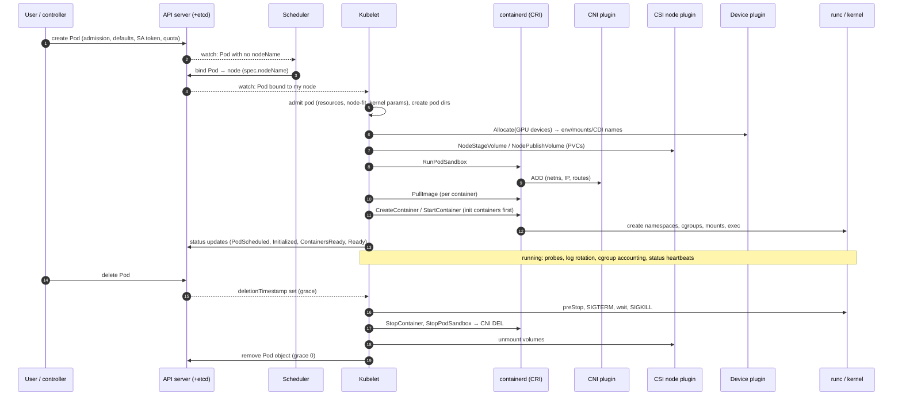

# 5.8 The life of a pod end to end, including what the kernel does

| | |
|---|---|
| Level | Advanced |
| Priority tier | 0 |
| Lab venue | Root access on a Linux node (VM) with Kubernetes; `crictl`, `nsenter`, `ip`, `bpftrace`/`strace` optional |
| Part | Part 5: Kubernetes |
| Status | Drafted, labs **untested** |

## Why this matters for AI infrastructure

When a 64-node training job takes 12 minutes to start instead of 90 seconds, or one pod sits in `ContainerCreating`, you need to know exactly what happens between the YAML and the first line of your training script, and where time can go: scheduling, image pull and unpack, CNI attachment, CSI mounts, device plugin allocation, the RDMA/IB plumbing, cgroup creation, and the probes that gate readiness. Knowing the kernel objects at each stage (namespaces, veth pairs, mounts, cgroups, device nodes) also lets you debug from the node when Kubernetes' own abstractions are not enough. This chapter is the end-to-end trace; it ties together Parts 1 and 2 (Linux, networking) with 5.1 to 5.7.

## Prerequisites and outcomes

Needs 5.1 to 5.7 and Linux chapters on namespaces, cgroups, mounts, networking (1.19, 1.20, 2.25). After this chapter you can:

- Narrate the full lifecycle of a pod in order with the responsible component and the observable artefact at each step.
- Identify which delays belong to which phase and measure them (events, kubelet logs, metrics, timestamps in `status`).
- Locate the pod's kernel objects on the node: namespaces, cgroup directory, mounts, veth, routes, iptables/nft rules, device nodes.
- Explain how GPUs and RDMA devices are attached (device plugin allocation, CDI/runtime injection, cgroup device rules).
- Describe termination end to end (endpoint removal, preStop, SIGTERM, grace, SIGKILL, cleanup of mounts, network and cgroups) and why pods get stuck.
- Use this map to debug `Pending`, `ContainerCreating`, `Init`, `CrashLoopBackOff`, `Terminating` problems.

## 1. Timeline overview



Typical timing for a warm node with cached image: API+scheduling tens of ms; sandbox + CNI 100 to 500 ms; container start under 1 s; for a cold node with a 20 GB image: pull + unpack minutes; PVC attach from cloud 5 to 60 s; model load into GPU minutes.

## 2. Admission and scheduling (control plane)

1. `kubectl apply` or a controller POSTs the Pod. The API server authenticates, authorises, runs mutating admission (injects ServiceAccount token volume, default tolerations `DefaultTolerationSeconds`, defaults from `LimitRange`, sidecars), validates, runs `ResourceQuota` and `PodSecurity` checks, persists to etcd (5.5). The Pod now exists with `status.phase: Pending` and `spec.nodeName` empty.
2. The **scheduler** has the pod in its queue (activeQ; unschedulable pods wait in a backoff or unschedulable queue until a relevant cluster event): it snapshots node state, runs **filters** (resources fit including `nvidia.com/gpu`, node selectors/affinity, taints/tolerations, volume topology/zones, ports, pod topology spread), then **scores** feasible nodes (spreading, image locality, resource balance, affinity weights), picks one, reserves it, may run **Permit** (gang plugins wait here), then **binds** by POSTing a `Binding`. Event: `Scheduled: Successfully assigned ns/pod to node`. If no node fits, `PodScheduled=False` with `Unschedulable` and an event listing reasons ("0/50 nodes available: 20 Insufficient nvidia.com/gpu, 30 node(s) had untolerated taint ..."). Details: 5.18.

Observe: `kubectl get pod -o jsonpath='{.status.conditions}'` (`PodScheduled` timestamp), scheduler logs at `-v=4`, `scheduler_scheduling_attempt_duration_seconds`.

## 3. The kubelet takes over

### The sync loop

The kubelet is event-driven plus periodic: its config sources (API server watch filtered by `spec.nodeName`, static pod files, optionally HTTP) feed the **pod manager**; each pod has a **pod worker** goroutine that runs `syncPod` whenever the pod changes or on periodic resync (~1 minute) or when the **PLEG** (Pod Lifecycle Event Generator) notices container state changes (it relists containers from the runtime every second; "PLEG is not healthy" means the relist took too long, usually runtime or node overload).

`syncPod` for a new pod roughly does:

1. **Admission on the node**: re-check that the pod fits (allocatable resources, node selectors, host ports, tolerations, pod security sysctls, topology manager alignment, device availability). Failure sets the pod `Failed` with reasons like `OutOfcpu`, `OutOfnvidia.com/gpu`, `NodeAffinity`, `TopologyAffinityError` (a classic cause of GPU pods failing after scheduling when the Topology Manager `restricted/single-numa-node` policy cannot align devices).
2. Compute **QoS class** and **cgroup hierarchy**: create the pod-level cgroup under the QoS parent (`kubepods.slice/kubepods-<qos>.slice/kubepods-<qos>-pod<uid>.slice`), set pod-level limits when enabled.
3. Create pod data directories under `/var/lib/kubelet/pods/<uid>/` (`volumes/`, `plugins/`, `etc-hosts`, container dirs).
4. **Mount/attach volumes** via the **volume manager**: for each volume in the spec it waits until the desired volume is mounted: `emptyDir` (create dir or tmpfs mount), `configMap`/`secret`/`projected`/`downwardAPI` (tmpfs, populated from API data), PVCs (attach/detach controller attaches the block device to the node (cloud), kubelet calls CSI **NodeStageVolume** to format/mount to a global staging path, then **NodePublishVolume** bind-mounts into the pod directory); `hostPath` just validates the path. The pod stays in `ContainerCreating` (events `FailedMount`/`FailedAttachVolume`) until all mounts succeed. Details: 5.17.
5. **Pull secrets** resolved (`imagePullSecrets`, ServiceAccount's secrets, kubelet credential providers).
6. **Device plugin allocation**: for container resource requests of extended resources, the kubelet's **device manager** calls the plugin's `Allocate` RPC over its gRPC socket in `/var/lib/kubelet/device-plugins/`; the response lists environment variables (`NVIDIA_VISIBLE_DEVICES=GPU-uuid...`), device nodes, mounts, annotations, and/or CDI device names. These get merged into the CRI container config. The CPU manager (static policy) assigns exclusive CPUs and the memory/topology managers choose NUMA nodes.
7. Call CRI: `RunPodSandbox` then containers.

## 4. Sandbox creation and networking

`RunPodSandbox` (containerd CRI plugin):

1. Pull the **pause** image if absent; create sandbox metadata; **create the network namespace** (`/var/run/netns/cni-<uuid>`), create the pod cgroup scope, start the pause container with new network/IPC/UTS (and optionally PID) namespaces.
2. Invoke **CNI** `ADD` with the sandbox's netns path and pod metadata (K8S_POD_NAME etc.). A typical bridge/veth CNI: create a veth pair, move one end into the pod netns as `eth0`, attach the other to a host bridge or leave it routed, allocate an IP (IPAM: host-local ranges, Calico block affinity, Cilium CRDs), add routes and neighbour entries, program iptables/eBPF for policy. Overlay CNIs configure VXLAN/Geneve/IP-in-IP tunnels per node; routed CNIs (Calico BGP, Cilium native routing) advertise pod CIDRs. Details: 5.13, 5.14.
3. Return the IP(s); the sandbox is ready; the kubelet reports `podIP` in status and creates `/etc/hosts`, `/etc/resolv.conf` for the pod (nameserver = cluster DNS IP, search domains `ns.svc.cluster.local svc.cluster.local cluster.local`, `ndots:5`).

If CNI fails: events show `FailedCreatePodSandBox ... failed to set up sandbox container network`; common reasons: CNI binary/config missing, IP pool exhausted, IPAM state corruption, MTU/route conflicts, CNI agent not running yet (nodes start `NotReady` until it is).

### How CNI `ADD`, IPAM, `readinessGates`, and `podCIDRs` Work (`NK` Chapters 3–4 & `PK` Chapter 5)

In *Networking and Kubernetes* (`NK` Chapters 3 & 4) and *Production Kubernetes* (`PK` Chapter 5), James Strong, Vallery Lancey, and Josh Rosso et al. trace the exact kernel and control-plane plumbing during `RunPodSandbox`:
1. **Per-node Pod CIDR allocation (`--allocate-node-cidrs` and `spec.podCIDRs`):** When `kubeadm init --pod-network-cidr 10.244.0.0/16` (or `10.30.0.0/16`) sets `--cluster-cidr` on `kube-controller-manager` (`--allocate-node-cidrs=true`, `--cidr-allocator-type=RangeAllocator`, `--node-cidr-mask-size-ipv4=24`, `--node-cidr-mask-size-ipv6=64`), the node IPAM controller assigns each `Node` object a `/24` slice (`spec.podCIDR` and the dual-stack array `spec.podCIDRs`), or CNI operators like Cilium (`CiliumNode` `spec.ipam.podCIDRs`) and Calico (`ipPools` with `blockSize: 26`) manage block allocation via CRDs.
2. **Kernel network namespace & `veth` creation (`NK` Chapter 3):** Creating a Pod sandbox mirrors the Linux `ip netns` sequence: `ip netns add <netns>`, `ip link add veth0 type veth peer name eth0`, `ip link set eth0 netns <netns>`, `ip netns exec <netns> ip addr add <pod_ip>/24 dev eth0`, `ip netns exec <netns> ip link set dev eth0 up`, and `ip netns exec <netns> ip route add default via <gw_ip>` (with `net.ipv4.ip_forward = 1` on the host). Because container runtimes create namespaces at `/proc/$PID/ns/net` without always creating a symlink in `/var/run/netns/`, `nsenter --net=/proc/$PID/ns/net` (or `ln -sf /proc/$PID/ns/net /var/run/netns/<id>`) lets you inspect the sandbox with `ip netns exec`.
3. **CNI plugin execution & JSON IPAM result (`NK` Chapter 4 & `PK` Chapter 5):** The CNI DaemonSet (`cilium` / `calico-node`) installs CNI binaries into **`/opt/cni/bin/`** (`cilium-cni`, `calico`, `loopback`, `host-local`, `portmap`, `bandwidth`) and writes its JSON configuration into **`/etc/cni/net.d/`** (e.g., `/etc/cni/net.d/05-cilium.conf`). On `RunPodSandbox`, `containerd` executes the CNI binary with `CNI_COMMAND=ADD`, `CNI_CONTAINERID`, `CNI_NETNS=/var/run/netns/cni-...`, and `CNI_IFNAME=eth0`, and the IPAM plugin returns a JSON payload (`{"cniVersion": "0.4.0", "ips": [{"version": "4", "address": "10.244.1.188/24", "gateway": "10.244.1.1"}], "routes": [...], "dns": {...}}`). Crucially, **the CNI must always allow traffic from the local node IP into every Pod on that node** so `kubelet` can execute `httpGet`, `tcpSocket`, and `grpc` liveness/readiness probes.
4. **Custom `readinessGates` (`NK` Chapter 4):** A Pod is only marked `Ready=True` (and added to `EndpointSlice`s) when **all** containers in the Pod are `Ready` **AND** every custom condition listed in `spec.readinessGates` (`conditionType: www.example.com/feature-X`, or cloud load-balancer target health gates like AWS ALB `target-health.alb.ingress.k8s.aws`) is `True` in `status.conditions`.

Inspect on the node:

```bash
SB=$(crictl pods --name trainer-0 -q)
crictl inspectp $SB | jq '.status.network, .info.runtimeSpec.linux.namespaces'
NETNS=$(crictl inspectp $SB | jq -r '.info.runtimeSpec.linux.namespaces[] | select(.type=="network").path')
nsenter --net=$NETNS ip -br addr; nsenter --net=$NETNS ip route
ip -br link | grep -E 'veth|cali|lxc'            # host end of the veth pair
ip -d link show <veth>                            # peer netnsid; `ip netns list` shows named namespaces
bridge fdb show | head                            # for bridge CNIs
```

## 5. Images and containers

For each container (init containers sequentially, then app containers concurrently):

1. **Pull**: kubelet decides by `imagePullPolicy` (`IfNotPresent`, `Always`, `Never`) and calls `PullImage` with credentials; progress/events: `Pulling`, `Pulled` (with duration). containerd resolves tag → manifest/index → config → layers (parallel downloads, resumable), verifies digests, decompresses and **unpacks layers into the snapshotter** (overlayfs). Large images dominate start time; kubelet limits parallel pulls (`serializeImagePulls: true` by default per node; `maxParallelImagePulls` when false), and enforces `registryPullQPS/Burst`. Cold start of 100 GPU nodes pulling 20 GB each is a registry/bandwidth problem (5.1).
2. **Create**: the CRI plugin builds the OCI runtime spec (`config.json`): process args/env/cwd/user, mounts (rootfs overlay; `/proc`, `/sys`, `/dev`, `/dev/shm`; volume bind mounts from `/var/lib/kubelet/pods/...`; `/etc/hosts`, `/etc/resolv.conf`, termination-log), namespaces (join the sandbox's network/IPC/UTS; own mount and PID unless shared), cgroup path under the pod's cgroup, resource limits translated to cgroup v2 files, capabilities, seccomp/AppArmor/SELinux, devices (`linux.devices` and the cgroup device allow rules), annotations, and CDI/NVIDIA edits.
3. **Start**: containerd launches the shim, which calls `runc create` (sets up namespaces, mounts rootfs with `pivot_root`, applies cgroups, drops capabilities, installs seccomp) then `runc start` (exec of the entrypoint). The process becomes a child of the shim in the container's PID namespace as PID 1.
4. **Post-start hook** (if defined) runs; **startup/readiness/liveness probes** begin per their configuration: probes are executed by the kubelet (exec probes via CRI `ExecSync` inside the container; HTTP/TCP/gRPC probes initiated from the node network into the pod IP). Readiness changes set the `Ready` condition; the EndpointSlice controller adds/removes the pod IP in Service endpoints (5.10).

Observable artefacts:

```bash
CTR=$(crictl ps --name trainer -q | head -1)
PID=$(crictl inspect $CTR | jq -r '.info.pid')
ls -l /proc/$PID/ns                                 # compare inode numbers with the pause container's PID: net/ipc/uts shared, pid/mnt separate
cat /proc/$PID/cgroup                               # 0::/kubepods.slice/kubepods-burstable.slice/kubepods-burstable-pod<uid>.slice/cri-containerd-<id>.scope
CG=/sys/fs/cgroup$(cut -d: -f3 /proc/$PID/cgroup)
cat $CG/memory.max $CG/cpu.max $CG/cpu.weight $CG/pids.max $CG/memory.current
cat $CG/cgroup.controllers; cat $CG/io.max 2>/dev/null
grep -E 'Cap(Inh|Prm|Eff|Bnd)|NoNewPrivs|Seccomp' /proc/$PID/status
cat /proc/$PID/mountinfo | head -30                 # overlay root, volume bind mounts, /dev/shm tmpfs
crictl inspect $CTR | jq '.info.runtimeSpec.linux.devices, .info.runtimeSpec.linux.resources.devices'
ls -l /proc/$PID/root/dev/nvidia*                   # GPU device nodes injected
```

### GPU specifics

Allocation: the NVIDIA device plugin advertises `nvidia.com/gpu: N` per node; the scheduler counts them; the kubelet's `Allocate` returns the chosen GPU UUIDs (as `NVIDIA_VISIBLE_DEVICES`, or CDI names `nvidia.com/gpu=0`). The runtime (NVIDIA container runtime hook or CDI) then adds `/dev/nvidia0..N`, `/dev/nvidiactl`, `/dev/nvidia-uvm`, `/dev/nvidia-modeset`, `/dev/nvidia-caps/*` (MIG), mounts driver userspace libraries (`libcuda.so.*`, `libnvidia-ml.so`, `nvidia-smi`) and sets the cgroup device allow-list entries (cgroup v2 uses an eBPF device filter attached to the cgroup) so the process may open exactly those character devices. Other pods on the node do not get the device nodes: that, plus the cgroup device filter, is the isolation (not a hardware partition unless MIG). RDMA: an SR-IOV/RDMA device plugin allocates VFs or `/dev/infiniband/uverbs*`; Multus attaches a secondary network interface (macvlan/SR-IOV) in the pod netns; the container needs `IPC_LOCK` and `memlock` unlimited for registered memory (Part 12). Verify allocation: `kubectl describe node | grep -A8 Allocated`, `kubectl get pod -o json | jq .spec.containers[].resources`, the kubelet's pod resources API (`/var/lib/kubelet/pod-resources/kubelet.sock`, used by DCGM exporter to map GPUs to pods).

## 6. Running state

- **Heartbeats**: node Lease renewed every 10 s; node status every 5 minutes or on change; pod status updated on changes (batched).
- **cAdvisor** (inside the kubelet) scrapes cgroup stats for `kubectl top` and metrics-server; **summary API** `/stats/summary`.
- **Log handling**: the runtime pipes container stdout/stderr to files under `/var/log/pods/<ns>_<name>_<uid>/<container>/<restart>.log` (`/var/log/pods/...`, CRI format `timestamp stream tag message`), rotated by kubelet (`containerLogMaxSize`, `containerLogMaxFiles`); `kubectl logs` streams via the API server → kubelet (`serverTLSBootstrap`) → file.
- **OOM handling**: memory cgroup limit breach triggers the kernel OOM killer for processes in that cgroup (`memory.oom.group` can make it kill the whole group); kubelet observes container exit with `OOMKilled`; node-level memory pressure triggers kubelet **eviction** based on thresholds (`memory.available<100Mi` hard, soft thresholds with grace) choosing pods by QoS and usage over requests; kernel OOM score adjustments make BestEffort and over-request Burstable processes preferred victims.
- **Kernel interactions to remember**: CPU throttling (`cpu.stat` `nr_throttled`), memory cgroup charging of page cache and tmpfs, `pids.max` limiting fork bombs (kubelet `podPidsLimit`), `fs.inotify` and file descriptor limits on nodes, `conntrack` table size for Services, NUMA locality and hugepages, IRQ and CPU isolation for latency-critical pods.
- **Restart behaviour**: if a container exits and `restartPolicy` allows, the kubelet restarts it in the same sandbox (same network namespace and IP) with backoff; if the sandbox dies (pause container killed, runtime restart quirks), the kubelet recreates the sandbox and containers (new IP possible).

## 7. Termination

1. Deletion request sets `metadata.deletionTimestamp` and `deletionGracePeriodSeconds` (default 30 s, or `terminationGracePeriodSeconds`). The pod moves to `Terminating` (visible as status, not a phase).
2. In parallel: the EndpointSlice controller removes the pod from Service endpoints; kube-proxy/CNI on every node eventually drops the rules (hence the race: connections can still arrive for a few seconds); the kubelet starts killing.
3. Kubelet runs `preStop` hooks (counting against the grace period), sends `SIGTERM` to each container's PID 1, waits, and after the grace period sends `SIGKILL` (init processes in PID namespaces ignore signals without handlers, so apps that don't handle SIGTERM wait for SIGKILL: the "pod takes 30 s to die" symptom).
4. Runtime stops containers, tears down sandbox: **CNI DEL** (release IP, delete veth/routes, remove policy), unmount volumes (CSI **NodeUnpublishVolume**, then **NodeUnstage**/detach once unused), delete the pod cgroup, remove pod directories, release device-plugin allocations and CPU-manager reservations.
5. Kubelet reports the final status and issues a DELETE with grace period 0, removing the Pod object from etcd; owners/controllers observe it and create replacements if needed.

Stuck termination causes: unresponsive/partitioned kubelet (pod stays until node returns or is deleted), finalizers on the pod (rare), processes in `D` state on hung NFS/CSI mounts (cannot be killed), volumes failing to unmount (`Device or resource busy`, open files), runtime shim hung, CNI DEL failures, `preStop` hooks that hang past the grace period. Do not `--force --grace-period=0` StatefulSet pods or pods with RWO volumes unless you are certain the node cannot still be running them (split brain, data corruption).

Eviction vs preemption vs deletion: **eviction** (API-initiated via the Eviction subresource, respecting PDBs: used by drain and autoscaler) and **node-pressure eviction** (kubelet, ignores PDBs) both result in graceful termination; **preemption** (scheduler deletes lower-priority pods to place a higher one) also uses graceful termination. Training jobs should treat SIGTERM as "checkpoint now".

## 8. Measuring pod startup latency

Where the time went, from objects you already have:

| Interval | Source |
|---|---|
| Created → Scheduled | `creationTimestamp` vs `PodScheduled` condition `lastTransitionTime`; scheduler metrics |
| Scheduled → Initialized | Init containers, volume mounts, sandbox; `Initialized` condition |
| Pull duration | Event `Pulled ... in X` ; kubelet metric `kubelet_image_pull_duration_seconds` (newer), containerd logs |
| Sandbox | `kubelet_run_podsandbox_duration_seconds` |
| Container start | `kubelet_start_container_duration_seconds`? (varies); `ContainersReady` time |
| Pod startup SLO | `kubelet_pod_start_duration_seconds` and `kubelet_pod_start_sli_duration_seconds` (excludes image pull) |
| Ready | Readiness probe success time; `Ready` condition |

```bash
kubectl get pod trainer-0 -o json | jq -r '.metadata.creationTimestamp, (.status.conditions[] | "\(.type) \(.lastTransitionTime)"), (.status.containerStatuses[] | "\(.name) started=\(.state.running.startedAt)")'
kubectl get events --field-selector involvedObject.name=trainer-0 --sort-by=.lastTimestamp -o custom-columns=T:.lastTimestamp,R:.reason,M:.message
journalctl -u kubelet --since "-10min" | grep -E 'trainer-0|SyncPod|FailedMount|sandbox'
```

Speed-ups for AI clusters: pre-pull images (DaemonSet), lazy-pulling snapshotters, registry mirrors/P2P (5.1); keep CNI IPAM fast (preallocated IP blocks); avoid slow CSI attach for scratch (use local NVMe/emptyDir); avoid init containers that download large data on every start (use shared caches or pre-staged volumes); minimise admission webhook latency; set `serializeImagePulls: false` carefully; keep node's disk fast; use `imagePullPolicy: IfNotPresent` with digests.

## 9. Debugging by lifecycle stage

| Stage | Symptom | First commands |
|---|---|---|
| Admission | `forbidden`, `exceeded quota`, webhook denied | API error text, `kubectl describe resourcequota`, webhook logs |
| Scheduling | Pending, no node | `kubectl describe pod` events, `kubectl get nodes -o wide`, taints, quota/queue (Kueue Workload) |
| Kubelet admit | `OutOf*`, `NodeAffinity`, `TopologyAffinityError`, `UnexpectedAdmissionError` | `describe pod`, kubelet logs; device plugin health |
| Volumes | `ContainerCreating`, `FailedMount`, `FailedAttachVolume`, `Multi-Attach error` | events, `kubectl get volumeattachment`, CSI logs, cloud console (5.17) |
| Sandbox/CNI | `FailedCreatePodSandBox` | CNI logs, `/etc/cni/net.d`, IPAM exhaustion, `crictl pods` |
| Image | `ErrImagePull`, `ImagePullBackOff` | events, `crictl pull`, credentials, rate limits, DNS |
| Create/start | `CreateContainerError`, `RunContainerError`, `StartError`, OCI runtime errors | `describe`, `journalctl -u containerd`, runc error text (bad mounts, cgroups, seccomp) |
| Run | `CrashLoopBackOff`, `OOMKilled`, `Error` | `logs --previous`, exit codes, node `dmesg` |
| Readiness | Running but `0/1` | probe events, app logs, port/path |
| Termination | `Terminating` forever | kubelet logs, `lsof`/`fuser` on mounts, process state, `crictl ps -a`, node health |

## 10. Lab

First, run the self-checking Python lab (`code/part05/pod_lifecycle_kernel_trace_lab.py`) locally. It verifies the Pod startup latency interval and `kubelet_pod_start_sli_duration_seconds` analyzer (`compute_pod_startup_intervals`), the `/proc/<pid>/ns` inode sharing vs isolation verifier between the `pause` sandbox container and application containers (`verify_pod_namespace_inodes`), and the GPU device plugin + cgroup v2 eBPF device allow-list verifier (`verify_gpu_cgroup_device_isolation`).

```bash
python3 code/part05/pod_lifecycle_kernel_trace_lab.py
```

Next, on a Linux Kubernetes node with `crictl`, `nsenter`, and `ip` (all interactive shell steps below are `untested here`), work through these exercises:

1. **Trace a pod**: tail `kubectl get events -w`, the scheduler log, kubelet journal and containerd journal while applying a pod; build a timeline with timestamps per component.
2. **Kernel artefacts**: for a running pod, list its namespaces, compare inodes with the pause container, read its cgroup files, mount info, capability masks, seccomp status; use `nsenter` to run `ip addr`, `ss -ltn`, `mount` inside; find the host-side veth and its peer index; list iptables/nft rules referencing the pod IP.
3. **cgroup behaviour**: set CPU and memory limits; run a spinner and a memory hog; observe `cpu.stat` throttling and `memory.events` (`oom`, `oom_kill`); compare with and without `cpu` limits using a latency test.
4. **Volumes**: create a pod with `emptyDir`, `emptyDir{medium: Memory}`, ConfigMap, Secret, projected token; examine mount types (`findmnt -T`), file ownership with `fsGroup`, how ConfigMap updates propagate (symlink swap in `..data`), and `subPath` limitations.
5. **CNI**: break the CNI config (rename a file) and create a pod; read the error; restore; check IPAM state; observe IP reuse after delete; capture a pod's first packets (ARP, DHCP-less) with `tcpdump -i <veth>`.
6. **Image pull timing**: pull a multi-GB image to a cold node and measure pull vs unpack; repeat with a pull-through cache; compare with lazy pulling if available.
7. **Device plugin**: on a GPU node, watch the plugin's allocation (plugin logs), inspect the container's devices and cgroup device rules; start two pods requesting one GPU each and prove they see different UUIDs; request more than available and read scheduler message.
8. **Termination race**: serve traffic via a Service from a client loop; delete a pod; capture connection errors with and without `preStop: sleep` and SIGTERM handling; quantify.
9. **Stuck pod**: create a pod mounting an NFS export; block the server; delete the pod and observe `D`-state processes and Terminating; unblock; document the cleanup.
10. **Startup latency report**: script that computes created→scheduled→initialized→ready intervals for pods in a namespace and prints percentiles; run for 100 pods and identify the slowest phase.
11. **PLEG and runtime overload**: create hundreds of short-lived pods and watch kubelet PLEG metrics and node conditions; tune `maxPods`, CPU reservations; see behaviour when containerd is slow.
12. **Clean up**.

## 11. Common mistakes

- Assuming "Pending" always means scheduling; it also covers image pulls, volume mounts and init containers.
- Debugging only with `kubectl logs` when the container never started (check events, kubelet and runtime logs).
- Ignoring readiness vs liveness semantics; killing slow-starting pods.
- Forgetting the endpoint-removal race on termination; ignoring SIGTERM; too-short grace periods for checkpoints.
- Force-deleting pods with attached RWO volumes or in StatefulSets.
- Not accounting for tmpfs/`/dev/shm` and page cache in memory limits.
- Overlooking CNI IPAM exhaustion and conntrack limits at scale.
- Treating GPU allocation as "magic": not checking device plugin health, runtime configuration, and cgroup device filters when a container can't see its GPU.
- Running image pulls and CSI attaches serially at scale without pre-staging.

## 12. Interview angles

- "Describe everything that happens from `kubectl apply -f pod.yaml` until the process runs."
- "What does the kubelet do in its sync loop? What is PLEG?"
- "How is the pod network namespace created and wired? When is CNI called?"
- "How does the NVIDIA device plugin give a pod a GPU? What stops another pod from using it?"
- "How is a memory limit enforced? What happens at OOM? What is evicted vs OOM-killed?"
- "Walk through pod termination. Why do pods drop traffic during rolling updates, and how do you fix it?"
- "A pod is stuck in ContainerCreating. How do you find out why?"
- "How do you measure and reduce pod startup time for large images?"

## Exercises

1. **The End-to-End 20-Step Pod Lifecycle (`kubectl apply` -> Running Process -> `DELETE`):** Trace the Section 1 sequence diagram across `kube-apiserver`, `kube-scheduler`, `kubelet` (`syncPod`), `DevicePlugin` (`Allocate`), `CSI` (`NodeStageVolume` / `NodePublishVolume`), `containerd` (`RunPodSandbox` -> `PullImage` -> `CreateContainer` -> `StartContainer`), `CNI` (`ADD`), and `runc`/Kernel, naming the observable status condition or event at each boundary.
2. **Inside `kubelet`'s `syncPod` Loop, Node-Level Admission (`TopologyAffinityError`), and CSI Volume Staging/Publishing:** Explain how `kubelet`'s pod worker goroutines and PLEG drive `syncPod`, why a Pod that already passed `kube-scheduler` can still be rejected by `kubelet` node admission with `TopologyAffinityError` or `OutOfnvidia.com/gpu`, and how `/var/lib/kubelet/pods/<uid>/` and CSI `NodeStageVolume` -> `NodePublishVolume` work.
3. **Sandbox Creation (`RunPodSandbox`), CNI `ADD` / IPAM JSON, and `/proc/<pid>/ns` Namespace Inodes (`NK` Ch. 3–4 & `PK` Ch. 5):** Using `verify_pod_namespace_inodes()` in `code/part05/pod_lifecycle_kernel_trace.py`, explain which namespaces an application container shares with the `pause` container (`net`, `ipc`, `uts`, `cgroup`) vs keeps isolated (`mnt`, `pid`), and trace how `CNI_COMMAND=ADD` wires the `veth` pair, IPAM JSON response, `/etc/resolv.conf`, and `readinessGates`.
4. **GPU and RDMA Attachment Under the Hood (`Allocate` RPC, CDI / NVIDIA Runtime Hook, and Cgroup v2 eBPF Device Filters):** Using `verify_gpu_cgroup_device_isolation()` in `code/part05/pod_lifecycle_kernel_trace.py`, trace how `kubelet`'s device manager calls `Allocate` on `/var/lib/kubelet/device-plugins/`, how the runtime injects `/dev/nvidia*` and `libcuda.so.*`, and how the cgroup v2 eBPF device allow-list prevents a container from accessing unallocated GPUs on the same host.
5. **Measuring and Accelerating Pod Startup Latency on 64-Node GPU Jobs:** Using `compute_pod_startup_intervals()` in `code/part05/pod_lifecycle_kernel_trace.py`, explain how to compute `scheduling`, `initialization`, `container_start`, `readiness_probe`, and `kubelet_pod_start_sli_duration_seconds` (which excludes image pull time), and list 6 concrete optimizations to cut a 12-minute cold-start down to under 90 seconds.
6. **Pod Termination, `D`-State Uninterruptible Sleep on Hung Mounts, and Debugging by Lifecycle Stage:** Trace the 5 steps of Pod termination (`deletionTimestamp` -> parallel `EndpointSlice` removal & `preStop` -> `SIGTERM` -> `SIGKILL` -> `CNI DEL` + CSI `NodeUnpublishVolume` + `gracePeriod 0` delete), and explain why a process stuck in kernel `D` state on a dead NFS/Lustre mount ignores `SIGKILL` and keeps the Pod in `Terminating`.

## Checkpoint questions (20)

<details>
<summary>1. Why can a Pod stay in `status.phase: Pending` even after `kube-scheduler` has already bound it to a node (`PodScheduled=True`)?</summary>

A Pod remains in `phase: Pending` from creation until **all init containers have completed and all regular application containers have been created and at least one has started running**. Therefore, a scheduled Pod waiting on **CSI volume attachment/mounts**, **CNI sandbox creation**, **25 GB container image pulls (`Pulling`)**, or **long-running `initContainers`** still shows `phase: Pending` (with container state `Waiting: ContainerCreating` or `Init:0/1`).
</details>

<details>
<summary>2. What causes a Pod that already passed `kube-scheduler` to fail immediately on the node with `TopologyAffinityError`?</summary>

`kube-scheduler` evaluates node-level resource sums (`allocatable` CPUs, memory, and total `nvidia.com/gpu` count), **but does not know the exact per-NUMA-node allocation state inside the node**. When the node's `kubelet` runs **Topology Manager** with the `restricted` or `single-numa-node` policy, `kubelet`'s local node admission checks whether the requested GPUs, RDMA NICs, and exclusive CPUs can be allocated from the **same NUMA node**. If fragmentation across existing pods prevents single-NUMA alignment, `kubelet` rejects the Pod at node admission with **`TopologyAffinityError`**.
</details>

<details>
<summary>3. If you run `ls -l /proc/$PID/ns` on the `pause` container and on your `trainer` container in the same Pod, which namespace inode numbers are identical and which are different?</summary>

- **Identical inode numbers (shared across the Pod):** **`net`** (network stack, IP, ports, routing table), **`ipc`** (System V IPC and POSIX message queues), **`uts`** (hostname), and **`cgroup`** (or user namespace if enabled).
- **Different inode numbers (isolated per container):** **`mnt`** (each container has its own `overlayfs` root filesystem and volume bind-mounts) and **`pid`** (isolated per container by default, unless `shareProcessNamespace: true` is set on the Pod spec, in which case `pid` is also shared with `pause`).
</details>

<details>
<summary>4. Walk through the exact two-step CSI volume mount sequence (`NodeStageVolume` -> `NodePublishVolume`) inside `/var/lib/kubelet/pods/<uid>/`.</summary>

After the control-plane `attachdetach` controller attaches the cloud disk / block device to the node (`VolumeAttachment`):
1. **`NodeStageVolume` (once per volume per node):** The CSI node plugin formats (if first use) and mounts the block device or shared filesystem to a **node-global staging directory** (`/var/lib/kubelet/plugins/kubernetes.io/csi/.../globalmount`). This allows multiple pods on the same node to share one underlying device mount.
2. **`NodePublishVolume` (once per Pod mounting the volume):** The CSI node plugin **bind-mounts** from the global staging path into the specific Pod's directory at **`/var/lib/kubelet/pods/<pod-uid>/volumes/kubernetes.io~csi/<pvc-name>/mount`**, which `runc` then bind-mounts into the container's mount namespace.
</details>

<details>
<summary>5. In *Networking and Kubernetes* Chapters 3 and 4, what environment variables and stdin data does `containerd` pass to the CNI plugin binary during `RunPodSandbox`, and what does the CNI return?</summary>

During `RunPodSandbox`, `containerd` invokes the CNI binary (`/opt/cni/bin/<plugin>`) passing:
- **`stdin`:** The JSON CNI network configuration file from **`/etc/cni/net.d/`** (e.g., `05-cilium.conf` or `10-calico.conflist`).
- **Environment variables:** `CNI_COMMAND=ADD` (or `DEL` on teardown), `CNI_CONTAINERID=<sandbox-id>`, `CNI_NETNS=/var/run/netns/cni-<uuid>`, `CNI_IFNAME=eth0`, `CNI_PATH=/opt/cni/bin`, and `CNI_ARGS="K8S_POD_NAMESPACE=...;K8S_POD_NAME=...;K8S_POD_INFRA_CONTAINER_ID=..."`.
The CNI wires the `veth` pair / eBPF programs, calls its IPAM plugin, and prints a **JSON result to `stdout`** containing `cniVersion`, `interfaces`, `ips` (Pod IPv4/IPv6 CIDR and gateway), `routes`, and `dns`.
</details>

<details>
<summary>6. Why does `kubelet` generate `/etc/hosts` and `/etc/resolv.conf` at the Pod level, and what does `ndots:5` in `/etc/resolv.conf` mean?</summary>

All containers in a Pod share one network namespace and hostname, so `kubelet` writes `/var/lib/kubelet/pods/<uid>/etc-hosts` and a shared `resolv.conf` bind-mounted into every container:
```text
nameserver 10.96.0.10
search team-a.svc.cluster.local svc.cluster.local cluster.local
options ndots:5
```
`options ndots:5` tells the C library resolver that any hostname containing **fewer than 5 dots** (such as `redis` or `qdrant.data`) must be tried against the `search` domains **first** (`qdrant.data.team-a.svc.cluster.local`, `qdrant.data.svc.cluster.local`) before querying it as an absolute external FQDN.
</details>

<details>
<summary>7. How does `kubelet` allocate specific GPUs to a Pod, and what two kernel mechanisms stop a container allocated 2 GPUs from accessing the other 6 GPUs on an 8-GPU node?</summary>

1. During `syncPod`, `kubelet`'s Device Manager calls the **`Allocate` gRPC method** on the NVIDIA device plugin's Unix socket (`/var/lib/kubelet/device-plugins/nvidia-gpu.sock`), which returns the UUIDs/CDI IDs of 2 free GPUs (e.g., `GPU-0`, `GPU-1`).
2. When `containerd` and the NVIDIA Container Runtime / CDI create the container, two kernel mechanisms enforce isolation:
   - **Mount namespace (`mnt`):** Only `/dev/nvidia0` and `/dev/nvidia1` (plus `/dev/nvidiactl` and `/dev/nvidia-uvm`) are created/bind-mounted inside `/proc/$PID/root/dev/`; `/dev/nvidia2..7` do not exist in the container's `/dev`.
   - **Cgroup v2 eBPF device controller (`DEVCG_ACC_MKNOD`/`OPEN`):** An eBPF program attached to the container's cgroup rejects `open()` on major/minor device numbers for GPUs `2..7` even if a process inside the container somehow called `mknod`.
</details>

<details>
<summary>8. What is the Kubelet `PodResourcesLister` gRPC socket (`/var/lib/kubelet/pod-resources/kubelet.sock`), and why does `dcgm-exporter` need it?</summary>

Inside the NVIDIA driver and DCGM on the host, hardware metrics (`DCGM_FI_DEV_GPU_UTIL`, temperature, XID errors, NVLink bandwidth) are indexed by physical **GPU UUID / minor number (`gpu=0..7`)**—the NVIDIA driver has no built-in knowledge of Kubernetes Pod names or namespaces. **`dcgm-exporter`** connects to `kubelet`'s local read-only gRPC socket **`/var/lib/kubelet/pod-resources/kubelet.sock`** (`List` RPC) to query which `(namespace, pod_name, container_name)` currently owns each GPU device ID, and enriches every Prometheus metric series with `pod="..."`, `namespace="..."`, and `container="..."` labels.
</details>

<details>
<summary>9. By default in `kubelet`, why does pulling one 25 GB training image block all other image pulls on the same node, and what setting controls this?</summary>

By default, `KubeletConfiguration.serializeImagePulls` is set to **`true`**—meaning `kubelet` issues only **1 `PullImage` CRI call at a time** on the node. While a single pod is pulling and unpacking a 25 GB PyTorch image over 3 minutes, even a tiny 5 MB `busybox` or monitoring pod scheduled onto that node sits stuck in `Waiting: PodInitializing`/`ContainerCreating` waiting for the pull lock. On nodes with fast NVMe disks and high-bandwidth networks, you can set **`serializeImagePulls: false`** and **`maxParallelImagePulls: 4`** (e.g., 3–5 concurrent pulls) so one large pull never head-of-line blocks the node.
</details>

<details>
<summary>10. How does `kubelet` execute `exec` probes versus `httpGet`/`tcpSocket`/`grpc` probes, and what CNI firewall rule does this require (`NK` Chapter 4)?</summary>

- **`exec` probe:** `kubelet` calls CRI **`ExecSync`** via `containerd`, which tells the shim/`runc` to spawn the probe command **inside the container's own namespaces and cgroups** (note: frequent heavy `exec` probes consume container CPU/memory and PIDs).
- **`httpGet`, `tcpSocket`, and `grpc` probes:** `kubelet` (running in the **host network namespace**) opens a network connection from the node's local IP to **`<podIP>:<port>`**. Therefore, as `NK` Chapter 4 warns, **every CNI plugin and `NetworkPolicy` implementation must unconditionally allow traffic from the local host node into all Pods on that node**, or else applying a `default-deny-ingress` `NetworkPolicy` would block `kubelet`'s own health probes and cause healthy Pods to fail liveness/readiness checks.
</details>

<details>
<summary>11. On a Linux node with `cgroupDriver: systemd` and cgroup v2, what is the exact `/sys/fs/cgroup` path for a `Burstable` container, and which files record CPU throttling and OOM kills?</summary>

- **Cgroup path:**
  `/sys/fs/cgroup/kubepods.slice/kubepods-burstable.slice/kubepods-burstable-pod<pod_uid_with_underscores>.slice/cri-containerd-<container_id>.scope/`
- **Key cgroup v2 files in that directory:**
  - `cpu.max` (CFS quota and period, e.g., `400000 100000` for 4 CPUs) and `cpu.weight` (shares).
  - **`cpu.stat`**: check `nr_periods`, **`nr_throttled`**, and **`throttled_usec`** for CFS CPU throttling.
  - `memory.max` (hard RAM limit) and `memory.current` (current RAM + tmpfs + page cache usage).
  - **`memory.events`**: check **`oom`** and **`oom_kill`** counters.
</details>

<details>
<summary>12. What is the difference between a Kernel Cgroup OOM Kill (`OOMKilled`, exit code 137) and a Kubelet Node-Pressure Eviction (`Phase: Failed, Reason: Evicted`)?</summary>

- **Kernel Cgroup OOM Kill (`OOMKilled`):** Triggered synchronously in the Linux kernel (`mm/oom_kill.c`) when a container's memory usage (`memory.current`) hits its own cgroup limit (`memory.max` = `resources.limits.memory`) or when the host kernel runs completely out of physical memory. The kernel sends `SIGKILL` (`137`) to the process; `kubelet` sees the container exit and **restarts the container in place** if `restartPolicy` allows.
- **Kubelet Node-Pressure Eviction (`Reason: Evicted`):** Triggered proactively in user space by `kubelet`'s eviction manager when **node-wide** available memory or disk drops below `evictionHard` (e.g., `memory.available < 100Mi` or `nodefs.available < 10%`). `kubelet` ranks Pods (`BestEffort` -> `Burstable` exceeding requests -> `Guaranteed`), fails the entire Pod (`Phase: Failed, Reason: Evicted`), and lets the owning controller reschedule a replacement Pod onto a healthier node.
</details>

<details>
<summary>13. What is the difference between `kubelet_pod_start_duration_seconds` and `kubelet_pod_start_sli_duration_seconds`?</summary>

- **`kubelet_pod_start_duration_seconds`:** Measures the total wall-clock time on the node from when `kubelet` first sees the Pod bound to the node until all its regular containers are running—**including image pull time**.
- **`kubelet_pod_start_sli_duration_seconds` (Kubernetes SIG-Scalability Pod Startup SLI):** Subtracts image pull duration (and init container runtime) so platform teams can measure **pure kubelet + CRI + CNI + volume mount overhead** independent of whether a user specified a 20 MB or 25 GB container image.
</details>

<details>
<summary>14. When a container inside a Pod crashes and is restarted by `kubelet`, does the Pod get a new IP address?</summary>

**No.** Because the Pod's network namespace (`netns`), `eth0` interface, and IP address belong to the **`pause` sandbox container**, restarting an application container (`RESTARTS` incrementing from `0` to `1`) simply calls `CreateContainer` and `StartContainer` inside the **existing** `pause` sandbox—preserving the exact same Pod IP and mounted volumes. A Pod only gets a new IP on the same node if the `pause` sandbox container itself is killed or recreated.
</details>

<details>
<summary>15. Why does a container whose entrypoint is a shell script (`#!/bin/sh`) or a bare C/Python process that doesn't register a `SIGTERM` handler always take exactly 30 seconds to terminate?</summary>

In Linux, **PID 1 inside a PID namespace has special kernel signal semantics**: the kernel ignores any signal (`SIGTERM`, `SIGINT`) sent to PID 1 **unless PID 1 has explicitly registered a signal handler** for that signal. If PID 1 is `/bin/sh` or a process without a `SIGTERM` handler, `kubelet` sends `SIGTERM`, the kernel drops it, nothing happens for the entire **`terminationGracePeriodSeconds` (default 30s)**, and at `T+30s` `kubelet` sends **`SIGKILL`** (which the kernel never ignores).
</details>

<details>
<summary>16. Why can a Pod stay stuck in `Terminating` even AFTER `kubelet` has sent `SIGKILL` (`kill -9`) to its container processes?</summary>

In the Linux kernel, a process waiting inside an **uninterruptible kernel I/O sleep (`TASK_UNINTERRUPTIBLE`, shown as `D` state in `ps aux`)**—most commonly caused by a hung NFS, Lustre, or Ceph mount whose storage server became unreachable—**cannot process any signal, including `SIGKILL`, until the kernel I/O call returns or times out**. Because the `D`-state process cannot exit, `runc` cannot destroy the container cgroup, CSI cannot unmount the busy volume (`EBUSY`), and `kubelet` cannot complete Pod deletion until the storage mount recovers or the node is rebooted.
</details>

<details>
<summary>17. Compare API-Initiated Eviction (`kubectl drain`), Kubelet Node-Pressure Eviction, and Scheduler Preemption: which ones respect `PodDisruptionBudget` (`PDB`)?</summary>

- **API-Initiated Eviction (`POST /api/v1/namespaces/.../pods/<name>/eviction`, used by `kubectl drain`, Cluster Autoscaler, Karpenter):** **Strictly enforces `PodDisruptionBudget`**—if evicting the Pod would violate `minAvailable` / `maxUnavailable`, `kube-apiserver` rejects the eviction with `429 Too Many Requests`.
- **Kubelet Node-Pressure Eviction (`memory.available < 100Mi`, `nodefs.available < 10%`):** **Does NOT respect `PodDisruptionBudget`**—the node is in immediate danger of kernel OOM or disk exhaustion and must shed load immediately.
- **Scheduler Preemption (evicting lower-priority Pods to make room for a high-priority Pod):** Attempts to respect `PodDisruptionBudget` on a **best-effort** basis (prefers victims that do not violate a PDB, **but will still preempt a PDB-protected Pod** if no other feasible node exists for the high-priority workload).
</details>

<details>
<summary>18. What is `spec.readinessGates` on a Pod (`NK` Chapter 4), and when is it used?</summary>

Even after all containers in a Pod pass their `readinessProbe` (`ContainersReady=True`), an external load balancer (such as an AWS ALB / GCP NEG controller configuring cloud target groups directly to Pod IPs) may still need 10–20 seconds to register the new Pod IP and pass health checks before shifting external traffic. Adding an entry to **`spec.readinessGates`** (`conditionType: target-health.alb.ingress.k8s.aws/...`) prevents `Ready` from becoming `True` (and stops a rolling update from terminating old Pods) until the external controller patches that custom condition to `True` in `pod.status.conditions`.
</details>

<details>
<summary>19. How do you find the host-side `veth` interface corresponding to a specific Pod's `eth0` interface?</summary>

1. Find the Pod's network namespace path or container PID: `PID=$(crictl inspect $CTR | jq -r '.info.pid')`.
2. Inside the Pod's network namespace, check the peer interface index (`@if<N>`) of `eth0`:
   `nsenter -t $PID -n ip link show eth0` -> e.g., `2: eth0@if47: <BROADCAST,MULTICAST,UP,LOWER_UP> ...`
3. On the **host** network namespace, look up interface index **`47`**:
   `ip link | grep '^47:'` -> `47: cali8a9b1c2d@if2` (or `veth...` / `lxc...`). You can now run `tcpdump -i cali8a9b1c2d -nn` on the host to capture only that Pod's traffic.
</details>

<details>
<summary>20. Summarize the six highest-impact optimizations to reduce 64-node GPU Pod startup time from 12 minutes to under 90 seconds.</summary>

1. **Eliminate cold registry pull storms:** Use a local pull-through cache + **P2P distribution (`Spegel` / `Dragonfly`)** or a **lazy-pulling snapshotter (`SOCI` / `eStargz`)** + pre-pulled base images via a DaemonSet.
2. **Enable parallel image pulls on NVMe nodes:** Set `serializeImagePulls: false` and `maxParallelImagePulls: 4` in `KubeletConfiguration` with `/var/lib/containerd` on dedicated PCIe Gen4/Gen5 NVMe.
3. **Avoid slow cloud block-volume attaches (`FailedAttachVolume`) for scratch/weights:** Read model weights from a pre-mounted shared parallel filesystem (Lustre/WEKA/VAST) or local NVMe cache (`emptyDir`) instead of attaching 64 cloud EBS/PD volumes at job start.
4. **Set `fsGroupChangePolicy: OnRootMismatch`** so `kubelet` does not `chown -R` millions of dataset files before starting the container.
5. **Keep `initContainers` lightweight:** Never download 100 GB datasets inside an `initContainer` on every Pod boot.
6. **Tune `startupProbe` `periodSeconds` (e.g., `2`–`5s`)** so readiness transitions immediately once the server initializes.
</details>

## Sources and review notes

- **Sources read in full:**
  - `kubernetes-up-and-running-3rd-edition` — Brendan Burns, Joe Beda, Kelsey Hightower & Lachlan Evenson, *Kubernetes: Up and Running*, 3rd ed., **Chapter 5: Pods** (Pod lifecycle, volumes, probes, resource management).
  - `production-kubernetes` — Josh Rosso, Rich Lander, Alexander Brand & John Harris, *Production Kubernetes*, **Chapter 3: Container Runtime** (`kubelet` CRI calls, `RunPodSandbox`, `runc`) and **Chapter 5: Pod Networking** (`--pod-network-cidr`, `spec.podCIDRs`, `/opt/cni/bin`, `/etc/cni/net.d`, Cilium/Calico IPAM and overlay vs native routing).
  - `networking-and-kubernetes` — James Strong & Vallery Lancey, *Networking and Kubernetes*, **Chapter 3: Container Networking Basics** (read in full: hypervisors vs containers, OCI/CRI, `ip netns` & `veth` pair walkthrough, `/proc/$PID/ns/net` inspection, Docker bridge/host modes) and **Chapter 4: Kubernetes Networking Introduction** (read in full: Pod network model, `livenessProbe`/`readinessProbe` host-to-pod CNI requirement, `spec.readinessGates`, `--allocate-node-cidrs` & `RangeAllocator`, CNI 0.4 IPAM JSON output, CoreDNS, and `NetworkPolicy`).
  - `how-linux-works-3rd-edition` — Brian Ward, *How Linux Works*, 3rd ed., **Chapter 17: Virtualization** (read in full: VMs vs containers, overlay filesystems, namespaces, cgroups).
- **Run here:** `python3 code/part05/pod_lifecycle_kernel_trace_lab.py` (3 passed, 0 failed).
- **Explicitly labelled inferences:** The `compute_pod_startup_intervals`, `verify_pod_namespace_inodes`, and `verify_gpu_cgroup_device_isolation` models in `code/part05/pod_lifecycle_kernel_trace.py` and the 20-step end-to-end sequence diagram (Section 1) are the author's constructions synthesizing `KUR` Chapter 5, `PK` Chapters 3 & 5, `NK` Chapters 3 & 4, and `HLW` Chapter 17 (plus original study items 21, 22, 23, 24, 25, 26, 27, 28, 29, 30, 31, 32, 33, 34, 35, 36, 37, 38, 39, and 40).
- **Not verified on live hardware:** Live `crictl`, `nsenter`, `ip`, and `journalctl -u kubelet` commands (`64`-node job, `12 minutes` vs `90 seconds`, `100 to 500 ms` sandbox, `20 GB` image, `5 to 60 s` PVC attach, `ndots:5`, `100` GPU nodes, `10 s` Lease, `5 minutes` node status, `memory.available<100Mi`, `30 s` grace, exit code `137`) are marked (`untested here`) where not executed by `pod_lifecycle_kernel_trace_lab.py`.
