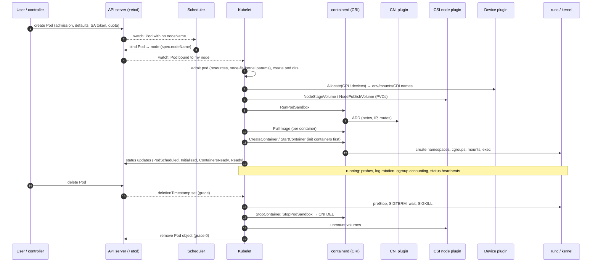

# 5.8 The life of a pod end to end, including what the kernel does

| | |
|---|---|
| Level | Advanced |
| Priority tier | 0 |
| Lab venue | Root access on a Linux node (VM) with Kubernetes; `crictl`, `nsenter`, `ip`, `bpftrace`/`strace` optional |
| Part | Part 5: Kubernetes |
| Status | Drafted, labs **untested** |

## Why this matters for AI infrastructure

When a 64-node training job takes 12 minutes to start instead of 90 seconds, or one pod sits in `ContainerCreating`, you need to know exactly what happens between the YAML and the first line of your training script, and where time can go: scheduling, image pull and unpack, CNI attachment, CSI mounts, device plugin allocation, the RDMA/IB plumbing, cgroup creation, and the probes that gate readiness. Knowing the kernel objects at each stage (namespaces, veth pairs, mounts, cgroups, device nodes) also lets you debug from the node when Kubernetes' own abstractions are not enough. This chapter is the end-to-end trace; it ties together Parts 1 and 2 (Linux, networking) with 5.1 to 5.7.

## Prerequisites and outcomes

Needs 5.1 to 5.7 and Linux chapters on namespaces, cgroups, mounts, networking (1.19, 1.20, 2.25). After this chapter you can:

- Narrate the full lifecycle of a pod in order with the responsible component and the observable artefact at each step.
- Identify which delays belong to which phase and measure them (events, kubelet logs, metrics, timestamps in `status`).
- Locate the pod's kernel objects on the node: namespaces, cgroup directory, mounts, veth, routes, iptables/nft rules, device nodes.
- Explain how GPUs and RDMA devices are attached (device plugin allocation, CDI/runtime injection, cgroup device rules).
- Describe termination end to end (endpoint removal, preStop, SIGTERM, grace, SIGKILL, cleanup of mounts, network and cgroups) and why pods get stuck.
- Use this map to debug `Pending`, `ContainerCreating`, `Init`, `CrashLoopBackOff`, `Terminating` problems.

## 1. Timeline overview



Typical timing for a warm node with cached image: API+scheduling tens of ms; sandbox + CNI 100 to 500 ms; container start under 1 s; for a cold node with a 20 GB image: pull + unpack minutes; PVC attach from cloud 5 to 60 s; model load into GPU minutes.

## 2. Admission and scheduling (control plane)

1. `kubectl apply` or a controller POSTs the Pod. The API server authenticates, authorises, runs mutating admission (injects ServiceAccount token volume, default tolerations `DefaultTolerationSeconds`, defaults from `LimitRange`, sidecars), validates, runs `ResourceQuota` and `PodSecurity` checks, persists to etcd (5.5). The Pod now exists with `status.phase: Pending` and `spec.nodeName` empty.
2. The **scheduler** has the pod in its queue (activeQ; unschedulable pods wait in a backoff or unschedulable queue until a relevant cluster event): it snapshots node state, runs **filters** (resources fit including `nvidia.com/gpu`, node selectors/affinity, taints/tolerations, volume topology/zones, ports, pod topology spread), then **scores** feasible nodes (spreading, image locality, resource balance, affinity weights), picks one, reserves it, may run **Permit** (gang plugins wait here), then **binds** by POSTing a `Binding`. Event: `Scheduled: Successfully assigned ns/pod to node`. If no node fits, `PodScheduled=False` with `Unschedulable` and an event listing reasons ("0/50 nodes available: 20 Insufficient nvidia.com/gpu, 30 node(s) had untolerated taint ..."). Details: 5.18.

Observe: `kubectl get pod -o jsonpath='{.status.conditions}'` (`PodScheduled` timestamp), scheduler logs at `-v=4`, `scheduler_scheduling_attempt_duration_seconds`.

## 3. The kubelet takes over

### The sync loop

The kubelet is event-driven plus periodic: its config sources (API server watch filtered by `spec.nodeName`, static pod files, optionally HTTP) feed the **pod manager**; each pod has a **pod worker** goroutine that runs `syncPod` whenever the pod changes or on periodic resync (~1 minute) or when the **PLEG** (Pod Lifecycle Event Generator) notices container state changes (it relists containers from the runtime every second; "PLEG is not healthy" means the relist took too long, usually runtime or node overload).

`syncPod` for a new pod roughly does:

1. **Admission on the node**: re-check that the pod fits (allocatable resources, node selectors, host ports, tolerations, pod security sysctls, topology manager alignment, device availability). Failure sets the pod `Failed` with reasons like `OutOfcpu`, `OutOfnvidia.com/gpu`, `NodeAffinity`, `TopologyAffinityError` (a classic cause of GPU pods failing after scheduling when the Topology Manager `restricted/single-numa-node` policy cannot align devices).
2. Compute **QoS class** and **cgroup hierarchy**: create the pod-level cgroup under the QoS parent (`kubepods.slice/kubepods-<qos>.slice/kubepods-<qos>-pod<uid>.slice`), set pod-level limits when enabled.
3. Create pod data directories under `/var/lib/kubelet/pods/<uid>/` (`volumes/`, `plugins/`, `etc-hosts`, container dirs).
4. **Mount/attach volumes** via the **volume manager**: for each volume in the spec it waits until the desired volume is mounted: `emptyDir` (create dir or tmpfs mount), `configMap`/`secret`/`projected`/`downwardAPI` (tmpfs, populated from API data), PVCs (attach/detach controller attaches the block device to the node (cloud), kubelet calls CSI **NodeStageVolume** to format/mount to a global staging path, then **NodePublishVolume** bind-mounts into the pod directory); `hostPath` just validates the path. The pod stays in `ContainerCreating` (events `FailedMount`/`FailedAttachVolume`) until all mounts succeed. Details: 5.17.
5. **Pull secrets** resolved (`imagePullSecrets`, ServiceAccount's secrets, kubelet credential providers).
6. **Device plugin allocation**: for container resource requests of extended resources, the kubelet's **device manager** calls the plugin's `Allocate` RPC over its gRPC socket in `/var/lib/kubelet/device-plugins/`; the response lists environment variables (`NVIDIA_VISIBLE_DEVICES=GPU-uuid...`), device nodes, mounts, annotations, and/or CDI device names. These get merged into the CRI container config. The CPU manager (static policy) assigns exclusive CPUs and the memory/topology managers choose NUMA nodes.
7. Call CRI: `RunPodSandbox` then containers.

## 4. Sandbox creation and networking

`RunPodSandbox` (containerd CRI plugin):

1. Pull the **pause** image if absent; create sandbox metadata; **create the network namespace** (`/var/run/netns/cni-<uuid>`), create the pod cgroup scope, start the pause container with new network/IPC/UTS (and optionally PID) namespaces.
2. Invoke **CNI** `ADD` with the sandbox's netns path and pod metadata (K8S_POD_NAME etc.). A typical bridge/veth CNI: create a veth pair, move one end into the pod netns as `eth0`, attach the other to a host bridge or leave it routed, allocate an IP (IPAM: host-local ranges, Calico block affinity, Cilium CRDs), add routes and neighbour entries, program iptables/eBPF for policy. Overlay CNIs configure VXLAN/Geneve/IP-in-IP tunnels per node; routed CNIs (Calico BGP, Cilium native routing) advertise pod CIDRs. Details: 5.13, 5.14.
3. Return the IP(s); the sandbox is ready; the kubelet reports `podIP` in status and creates `/etc/hosts`, `/etc/resolv.conf` for the pod (nameserver = cluster DNS IP, search domains `ns.svc.cluster.local svc.cluster.local cluster.local`, `ndots:5`).

If CNI fails: events show `FailedCreatePodSandBox ... failed to set up sandbox container network`; common reasons: CNI binary/config missing, IP pool exhausted, IPAM state corruption, MTU/route conflicts, CNI agent not running yet (nodes start `NotReady` until it is).

Inspect on the node:

```bash
SB=$(crictl pods --name trainer-0 -q)
crictl inspectp $SB | jq '.status.network, .info.runtimeSpec.linux.namespaces'
NETNS=$(crictl inspectp $SB | jq -r '.info.runtimeSpec.linux.namespaces[] | select(.type=="network").path')
nsenter --net=$NETNS ip -br addr; nsenter --net=$NETNS ip route
ip -br link | grep -E 'veth|cali|lxc'            # host end of the veth pair
ip -d link show <veth>                            # peer netnsid; `ip netns list` shows named namespaces
bridge fdb show | head                            # for bridge CNIs
```

## 5. Images and containers

For each container (init containers sequentially, then app containers concurrently):

1. **Pull**: kubelet decides by `imagePullPolicy` (`IfNotPresent`, `Always`, `Never`) and calls `PullImage` with credentials; progress/events: `Pulling`, `Pulled` (with duration). containerd resolves tag → manifest/index → config → layers (parallel downloads, resumable), verifies digests, decompresses and **unpacks layers into the snapshotter** (overlayfs). Large images dominate start time; kubelet limits parallel pulls (`serializeImagePulls: true` by default per node; `maxParallelImagePulls` when false), and enforces `registryPullQPS/Burst`. Cold start of 100 GPU nodes pulling 20 GB each is a registry/bandwidth problem (5.1).
2. **Create**: the CRI plugin builds the OCI runtime spec (`config.json`): process args/env/cwd/user, mounts (rootfs overlay; `/proc`, `/sys`, `/dev`, `/dev/shm`; volume bind mounts from `/var/lib/kubelet/pods/...`; `/etc/hosts`, `/etc/resolv.conf`, termination-log), namespaces (join the sandbox's network/IPC/UTS; own mount and PID unless shared), cgroup path under the pod's cgroup, resource limits translated to cgroup v2 files, capabilities, seccomp/AppArmor/SELinux, devices (`linux.devices` and the cgroup device allow rules), annotations, and CDI/NVIDIA edits.
3. **Start**: containerd launches the shim, which calls `runc create` (sets up namespaces, mounts rootfs with `pivot_root`, applies cgroups, drops capabilities, installs seccomp) then `runc start` (exec of the entrypoint). The process becomes a child of the shim in the container's PID namespace as PID 1.
4. **Post-start hook** (if defined) runs; **startup/readiness/liveness probes** begin per their configuration: probes are executed by the kubelet (exec probes via CRI `ExecSync` inside the container; HTTP/TCP/gRPC probes initiated from the node network into the pod IP). Readiness changes set the `Ready` condition; the EndpointSlice controller adds/removes the pod IP in Service endpoints (5.10).

Observable artefacts:

```bash
CTR=$(crictl ps --name trainer -q | head -1)
PID=$(crictl inspect $CTR | jq -r '.info.pid')
ls -l /proc/$PID/ns                                 # compare inode numbers with the pause container's PID: net/ipc/uts shared, pid/mnt separate
cat /proc/$PID/cgroup                               # 0::/kubepods.slice/kubepods-burstable.slice/kubepods-burstable-pod<uid>.slice/cri-containerd-<id>.scope
CG=/sys/fs/cgroup$(cut -d: -f3 /proc/$PID/cgroup)
cat $CG/memory.max $CG/cpu.max $CG/cpu.weight $CG/pids.max $CG/memory.current
cat $CG/cgroup.controllers; cat $CG/io.max 2>/dev/null
grep -E 'Cap(Inh|Prm|Eff|Bnd)|NoNewPrivs|Seccomp' /proc/$PID/status
cat /proc/$PID/mountinfo | head -30                 # overlay root, volume bind mounts, /dev/shm tmpfs
crictl inspect $CTR | jq '.info.runtimeSpec.linux.devices, .info.runtimeSpec.linux.resources.devices'
ls -l /proc/$PID/root/dev/nvidia*                   # GPU device nodes injected
```

### GPU specifics

Allocation: the NVIDIA device plugin advertises `nvidia.com/gpu: N` per node; the scheduler counts them; the kubelet's `Allocate` returns the chosen GPU UUIDs (as `NVIDIA_VISIBLE_DEVICES`, or CDI names `nvidia.com/gpu=0`). The runtime (NVIDIA container runtime hook or CDI) then adds `/dev/nvidia0..N`, `/dev/nvidiactl`, `/dev/nvidia-uvm`, `/dev/nvidia-modeset`, `/dev/nvidia-caps/*` (MIG), mounts driver userspace libraries (`libcuda.so.*`, `libnvidia-ml.so`, `nvidia-smi`) and sets the cgroup device allow-list entries (cgroup v2 uses an eBPF device filter attached to the cgroup) so the process may open exactly those character devices. Other pods on the node do not get the device nodes: that, plus the cgroup device filter, is the isolation (not a hardware partition unless MIG). RDMA: an SR-IOV/RDMA device plugin allocates VFs or `/dev/infiniband/uverbs*`; Multus attaches a secondary network interface (macvlan/SR-IOV) in the pod netns; the container needs `IPC_LOCK` and `memlock` unlimited for registered memory (Part 12). Verify allocation: `kubectl describe node | grep -A8 Allocated`, `kubectl get pod -o json | jq .spec.containers[].resources`, the kubelet's pod resources API (`/var/lib/kubelet/pod-resources/kubelet.sock`, used by DCGM exporter to map GPUs to pods).

## 6. Running state

- **Heartbeats**: node Lease renewed every 10 s; node status every 5 minutes or on change; pod status updated on changes (batched).
- **cAdvisor** (inside the kubelet) scrapes cgroup stats for `kubectl top` and metrics-server; **summary API** `/stats/summary`.
- **Log handling**: the runtime pipes container stdout/stderr to files under `/var/log/pods/<ns>_<name>_<uid>/<container>/<restart>.log` (CRI format `timestamp stream tag message`), rotated by kubelet (`containerLogMaxSize`, `containerLogMaxFiles`); `kubectl logs` streams via the API server → kubelet → file.
- **OOM handling**: memory cgroup limit breach triggers the kernel OOM killer for processes in that cgroup (`memory.oom.group` can make it kill the whole group); kubelet observes container exit with `OOMKilled`; node-level memory pressure triggers kubelet **eviction** based on thresholds (`memory.available<100Mi` hard, soft thresholds with grace) choosing pods by QoS and usage over requests; kernel OOM score adjustments make BestEffort and over-request Burstable processes preferred victims.
- **Kernel interactions to remember**: CPU throttling (`cpu.stat` `nr_throttled`), memory cgroup charging of page cache and tmpfs, `pids.max` limiting fork bombs (kubelet `podPidsLimit`), `fs.inotify` and file descriptor limits on nodes, `conntrack` table size for Services, NUMA locality and hugepages, IRQ and CPU isolation for latency-critical pods.
- **Restart behaviour**: if a container exits and `restartPolicy` allows, the kubelet restarts it in the same sandbox (same network namespace and IP) with backoff; if the sandbox dies (pause container killed, runtime restart quirks), the kubelet recreates the sandbox and containers (new IP possible).

## 7. Termination

1. Deletion request sets `metadata.deletionTimestamp` and `deletionGracePeriodSeconds` (default 30 s, or `terminationGracePeriodSeconds`). The pod moves to `Terminating` (visible as status, not a phase).
2. In parallel: the EndpointSlice controller removes the pod from Service endpoints; kube-proxy/CNI on every node eventually drops the rules (hence the race: connections can still arrive for a few seconds); the kubelet starts killing.
3. Kubelet runs `preStop` hooks (counting against the grace period), sends `SIGTERM` to each container's PID 1, waits, and after the grace period sends `SIGKILL` (init processes in PID namespaces ignore signals without handlers, so apps that don't handle SIGTERM wait for SIGKILL: the "pod takes 30 s to die" symptom).
4. Runtime stops containers, tears down sandbox: **CNI DEL** (release IP, delete veth/routes, remove policy), unmount volumes (CSI **NodeUnpublishVolume**, then **NodeUnstage**/detach once unused), delete the pod cgroup, remove pod directories, release device-plugin allocations and CPU-manager reservations.
5. Kubelet reports the final status and issues a DELETE with grace period 0, removing the Pod object from etcd; owners/controllers observe it and create replacements if needed.

Stuck termination causes: unresponsive/partitioned kubelet (pod stays until node returns or is deleted), finalizers on the pod (rare), processes in `D` state on hung NFS/CSI mounts (cannot be killed), volumes failing to unmount (`Device or resource busy`, open files), runtime shim hung, CNI DEL failures, `preStop` hooks that hang past the grace period. Do not `--force --grace-period=0` StatefulSet pods or pods with RWO volumes unless you are certain the node cannot still be running them (split brain, data corruption).

Eviction vs preemption vs deletion: **eviction** (API-initiated via the Eviction subresource, respecting PDBs: used by drain and autoscaler) and **node-pressure eviction** (kubelet, ignores PDBs) both result in graceful termination; **preemption** (scheduler deletes lower-priority pods to place a higher one) also uses graceful termination. Training jobs should treat SIGTERM as "checkpoint now".

## 8. Measuring pod startup latency

Where the time went, from objects you already have:

| Interval | Source |
|---|---|
| Created → Scheduled | `creationTimestamp` vs `PodScheduled` condition `lastTransitionTime`; scheduler metrics |
| Scheduled → Initialized | Init containers, volume mounts, sandbox; `Initialized` condition |
| Pull duration | Event `Pulled ... in X` ; kubelet metric `kubelet_image_pull_duration_seconds` (newer), containerd logs |
| Sandbox | `kubelet_run_podsandbox_duration_seconds` |
| Container start | `kubelet_start_container_duration_seconds`? (varies); `ContainersReady` time |
| Pod startup SLO | `kubelet_pod_start_duration_seconds` and `kubelet_pod_start_sli_duration_seconds` (excludes image pull) |
| Ready | Readiness probe success time; `Ready` condition |

```bash
kubectl get pod trainer-0 -o json | jq -r '.metadata.creationTimestamp, (.status.conditions[] | "\(.type) \(.lastTransitionTime)"), (.status.containerStatuses[] | "\(.name) started=\(.state.running.startedAt)")'
kubectl get events --field-selector involvedObject.name=trainer-0 --sort-by=.lastTimestamp -o custom-columns=T:.lastTimestamp,R:.reason,M:.message
journalctl -u kubelet --since "-10min" | grep -E 'trainer-0|SyncPod|FailedMount|sandbox'
```

Speed-ups for AI clusters: pre-pull images (DaemonSet), lazy-pulling snapshotters, registry mirrors/P2P (5.1); keep CNI IPAM fast (preallocated IP blocks); avoid slow CSI attach for scratch (use local NVMe/emptyDir); avoid init containers that download large data on every start (use shared caches or pre-staged volumes); minimise admission webhook latency; set `serializeImagePulls: false` carefully; keep node's disk fast; use `imagePullPolicy: IfNotPresent` with digests.

## 9. Debugging by lifecycle stage

| Stage | Symptom | First commands |
|---|---|---|
| Admission | `forbidden`, `exceeded quota`, webhook denied | API error text, `kubectl describe resourcequota`, webhook logs |
| Scheduling | Pending, no node | `kubectl describe pod` events, `kubectl get nodes -o wide`, taints, quota/queue (Kueue Workload) |
| Kubelet admit | `OutOf*`, `NodeAffinity`, `TopologyAffinityError`, `UnexpectedAdmissionError` | `describe pod`, kubelet logs; device plugin health |
| Volumes | `ContainerCreating`, `FailedMount`, `FailedAttachVolume`, `Multi-Attach error` | events, `kubectl get volumeattachment`, CSI logs, cloud console (5.17) |
| Sandbox/CNI | `FailedCreatePodSandBox` | CNI logs, `/etc/cni/net.d`, IPAM exhaustion, `crictl pods` |
| Image | `ErrImagePull`, `ImagePullBackOff` | events, `crictl pull`, credentials, rate limits, DNS |
| Create/start | `CreateContainerError`, `RunContainerError`, `StartError`, OCI runtime errors | `describe`, `journalctl -u containerd`, runc error text (bad mounts, cgroups, seccomp) |
| Run | `CrashLoopBackOff`, `OOMKilled`, `Error` | `logs --previous`, exit codes, node `dmesg` |
| Readiness | Running but `0/1` | probe events, app logs, port/path |
| Termination | `Terminating` forever | kubelet logs, `lsof`/`fuser` on mounts, process state, `crictl ps -a`, node health |

## 10. Lab (untested)

1. **Trace a pod**: tail `kubectl get events -w`, the scheduler log, kubelet journal and containerd journal while applying a pod; build a timeline with timestamps per component.
2. **Kernel artefacts**: for a running pod, list its namespaces, compare inodes with the pause container, read its cgroup files, mount info, capability masks, seccomp status; use `nsenter` to run `ip addr`, `ss -ltn`, `mount` inside; find the host-side veth and its peer index; list iptables/nft rules referencing the pod IP.
3. **cgroup behaviour**: set CPU and memory limits; run a spinner and a memory hog; observe `cpu.stat` throttling and `memory.events` (`oom`, `oom_kill`); compare with and without `cpu` limits using a latency test.
4. **Volumes**: create a pod with `emptyDir`, `emptyDir{medium: Memory}`, ConfigMap, Secret, projected token; examine mount types (`findmnt -T`), file ownership with `fsGroup`, how ConfigMap updates propagate (symlink swap in `..data`), and `subPath` limitations.
5. **CNI**: break the CNI config (rename a file) and create a pod; read the error; restore; check IPAM state; observe IP reuse after delete; capture a pod's first packets (ARP, DHCP-less) with `tcpdump -i <veth>`.
6. **Image pull timing**: pull a multi-GB image to a cold node and measure pull vs unpack; repeat with a pull-through cache; compare with lazy pulling if available.
7. **Device plugin**: on a GPU node, watch the plugin's allocation (plugin logs), inspect the container's devices and cgroup device rules; start two pods requesting one GPU each and prove they see different UUIDs; request more than available and read scheduler message.
8. **Termination race**: serve traffic via a Service from a client loop; delete a pod; capture connection errors with and without `preStop: sleep` and SIGTERM handling; quantify.
9. **Stuck pod**: create a pod mounting an NFS export; block the server; delete the pod and observe `D`-state processes and Terminating; unblock; document the cleanup.
10. **Startup latency report**: script that computes created→scheduled→initialized→ready intervals for pods in a namespace and prints percentiles; run for 100 pods and identify the slowest phase.
11. **PLEG and runtime overload**: create hundreds of short-lived pods and watch kubelet PLEG metrics and node conditions; tune `maxPods`, CPU reservations; see behaviour when containerd is slow.
12. **Clean up**.

Mark tested only after execution.

## 11. Common mistakes

- Assuming "Pending" always means scheduling; it also covers image pulls, volume mounts and init containers.
- Debugging only with `kubectl logs` when the container never started (check events, kubelet and runtime logs).
- Ignoring readiness vs liveness semantics; killing slow-starting pods.
- Forgetting the endpoint-removal race on termination; ignoring SIGTERM; too-short grace periods for checkpoints.
- Force-deleting pods with attached RWO volumes or in StatefulSets.
- Not accounting for tmpfs/`/dev/shm` and page cache in memory limits.
- Overlooking CNI IPAM exhaustion and conntrack limits at scale.
- Treating GPU allocation as "magic": not checking device plugin health, runtime configuration, and cgroup device filters when a container can't see its GPU.
- Running image pulls and CSI attaches serially at scale without pre-staging.

## 12. Interview angles

- "Describe everything that happens from `kubectl apply -f pod.yaml` until the process runs." 
- "What does the kubelet do in its sync loop? What is PLEG?" 
- "How is the pod network namespace created and wired? When is CNI called?" 
- "How does the NVIDIA device plugin give a pod a GPU? What stops another pod from using it?" 
- "How is a memory limit enforced? What happens at OOM? What is evicted vs OOM-killed?" 
- "Walk through pod termination. Why do pods drop traffic during rolling updates, and how do you fix it?" 
- "A pod is stuck in ContainerCreating. How do you find out why?" 
- "How do you measure and reduce pod startup time for large images?" 

## 13. Checkpoint questions (40)

1. Who writes `spec.nodeName`? **A:** The scheduler via Binding.
2. Who creates pods for a Deployment? **A:** ReplicaSet controller.
3. What is PLEG? **A:** Pod lifecycle event generator relisting container state.
4. What runs first in the sandbox? **A:** Pause container.
5. When is CNI ADD called? **A:** During RunPodSandbox.
6. What is created for pod networking? **A:** Network namespace + veth + IP/routes.
7. Where is the pod cgroup path? **A:** Under `kubepods.slice/...-pod<uid>.slice`.
8. Who allocates GPUs? **A:** Device plugin via kubelet device manager.
9. What injects `/dev/nvidia*`? **A:** NVIDIA runtime/CDI.
10. How is device access restricted? **A:** Only allocated device nodes exist + cgroup device filter.
11. What does NodeStageVolume do? **A:** Prepare/mount volume to a node-global staging path.
12. NodePublishVolume? **A:** Bind mount into the pod.
13. Why ContainerCreating for long? **A:** Volumes, sandbox/CNI, image pull.
14. How are image pulls serialised? **A:** `serializeImagePulls` default true per node.
15. Who executes probes? **A:** Kubelet.
16. What gates traffic? **A:** Readiness → EndpointSlice membership.
17. Where are container logs on node? **A:** `/var/log/pods/...`.
18. Memory limit enforcement? **A:** cgroup `memory.max` + OOM killer.
19. OOMKilled exit code? **A:** 137.
20. Eviction ordering? **A:** BestEffort, Burstable over request, then Guaranteed.
21. Does node-pressure eviction respect PDBs? **A:** No.
22. Does API-initiated eviction respect PDBs? **A:** Yes.
23. Default grace period? **A:** 30 s.
24. Signal sequence on termination? **A:** preStop → SIGTERM → SIGKILL.
25. Why 30 s deaths? **A:** App ignores SIGTERM (PID 1).
26. What reverses CNI ADD? **A:** CNI DEL.
27. Why force delete is dangerous for RWO? **A:** Node might still write; split brain.
28. What causes `D`-state processes? **A:** Hung I/O on storage mounts.
29. Static pod location? **A:** Kubelet manifest directory.
30. What is `TopologyAffinityError`? **A:** Topology manager couldn't align resources.
31. What does `serverTLSBootstrap` affect? **A:** Kubelet serving certs.
32. What do restarts reuse? **A:** Same sandbox/IP (container restart).
33. What triggers sandbox recreation? **A:** Sandbox failure/changes.
34. Startup SLI excludes? **A:** Image pull time.
35. Pod resources API for? **A:** Mapping devices to pods (DCGM exporter).
36. What mount type is `/dev/shm`? **A:** tmpfs.
37. Where ConfigMap volume updates land? **A:** Symlink swap (`..data`) except subPath.
38. What increases pull throughput? **A:** Mirrors/P2P/pre-pull/lazy-pull.
39. What does CPU throttling look like? **A:** `nr_throttled` in `cpu.stat`.
40. What marks pod Ready? **A:** All containers ready + readiness gates.

## 14. Sources and review notes

**Written in original words.** Principal sources:

- Brendan Burns et al., *Kubernetes: Up and Running* (3rd edition; chapter 5 pods and the node-level material).
- Josh Rosso et al., *Production Kubernetes* (chapters 3 and 5 on container runtime and pod networking).
- Linux kernel and systems chapters of this handbook (namespaces, cgroups, networking) and *How Linux Works* (3rd edition) for kernel concepts.
- James Strong and Vallery Lancey, *Networking and Kubernetes*, for the CNI and network namespace walkthroughs (chapters 3 and 4).
- Kubernetes documentation (pod lifecycle, kubelet, device plugins) and NVIDIA device plugin/Container Toolkit documentation.
- Examples are the author's constructions.

**Flagged for verification before publishing:** metric names for kubelet startup durations, `serializeImagePulls` defaults, cgroup path naming under your cgroup driver, OOM group-kill behaviour, CRI log format details, and every command listing; all labs are **untested**.
