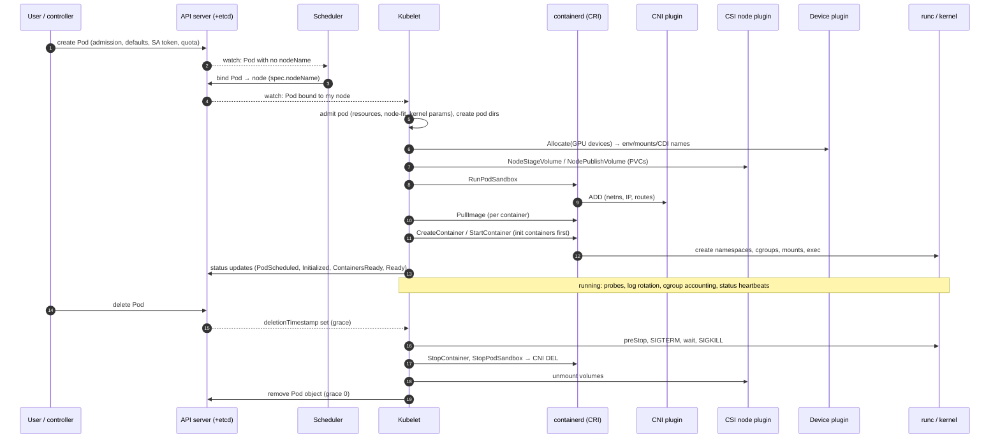

# 5.8 The life of a pod end to end, including what the kernel does

| | |
|---|---|
| Level | Advanced |
| Priority tier | 0 |
| Lab venue | Root access on a Linux node (VM) with Kubernetes; `crictl`, `nsenter`, `ip`, `bpftrace`/`strace` optional |
| Part | Part 5: Kubernetes |
| Status | Drafted, labs **untested** |

## Why this matters for AI infrastructure

Picture a 64-node training job that takes 12 minutes to start, instead of 90 seconds. Or picture one pod that sits in `ContainerCreating` and never moves on. In both cases you need to know what happens between the YAML and the first line of your training script, and where the time goes. The stages include scheduling, image pull and unpack, CNI attachment, CSI mounts, device plugin allocation, the RDMA and InfiniBand plumbing, cgroup creation, and the probes that gate readiness.

Knowing the kernel objects at each stage also lets you debug from the node. Those objects are namespaces, veth pairs, mounts, cgroups and device nodes. They matter most when Kubernetes' own abstractions are not enough. This chapter is the end-to-end trace. It ties together Part 1 on Linux and Part 2 on networking with 5.1 to 5.7.

Read the rest of this chapter as one trace, and use each stage as a place to look when a pod stalls.

## Prerequisites and outcomes

This chapter needs 5.1 to 5.7, plus the Linux chapters on namespaces, cgroups, mounts and networking (1.19, 1.20 and 2.25). After it, you can do the following.

- Narrate the full lifecycle of a pod in order, naming the responsible component and the observable artefact at each step.
- Identify which delays belong to which phase, and measure them with events, kubelet logs, metrics and timestamps in `status`.
- Locate the pod's kernel objects on the node: namespaces, the cgroup directory, mounts, the veth, routes, iptables or nft rules, and device nodes.
- Explain how GPUs and RDMA devices are attached, through device plugin allocation, CDI or runtime injection, and cgroup device rules.
- Describe termination end to end, from endpoint removal, preStop, SIGTERM, grace and SIGKILL to the cleanup of mounts, network and cgroups, and explain why pods get stuck.
- Use this map to debug `Pending`, `ContainerCreating`, `Init`, `CrashLoopBackOff` and `Terminating` problems.

Use the list as a checklist when you finish the chapter.

## 1. Timeline overview

When a pod stalls, the first question is which hand-off failed. The diagram below shows each hand-off in order, from the moment the Pod is created to the moment it is removed.



Read the arrows from top to bottom. Each arrow is one hand-off, so a stalled pod is stuck at one of them.

Timing differs a lot between a warm node and a cold one. On a warm node with a cached image, API and scheduling take tens of milliseconds, the sandbox and CNI step takes 100 to 500 ms, and a container starts in under 1 s. On a cold node with a 20 GB image, the pull and unpack take minutes. A PVC attach from the cloud takes 5 to 60 s, and loading the model into GPU memory takes minutes.

Find the step where your pod's time goes before you tune anything.

## 2. Admission and scheduling (control plane)

A pod that stays `Pending` with no node has not reached a kubelet yet. If you see that, start with the control plane.

1. You run `kubectl apply`, or a controller sends the Pod to the API server. The API server authenticates and authorises the request, then runs mutating admission. That step injects the ServiceAccount token volume, adds the default tolerations set by `DefaultTolerationSeconds`, applies `LimitRange` defaults, and adds sidecars. Next it validates the Pod, runs `ResourceQuota` and `PodSecurity` checks, and persists the Pod to etcd, as covered in 5.5. The Pod now has `status.phase: Pending` and an empty `spec.nodeName`.

2. The **scheduler** takes the pod from its queue. The scheduler runs filters first. These check resource fit, including `nvidia.com/gpu`, node selectors and affinity, taints and tolerations, volume topology and zones, ports, and pod topology spread. Passing nodes are scored on spreading, image locality, resource balance and affinity weights. The scheduler then reserves one node, may run Permit, where gang plugins wait, and binds the pod by posting a `Binding`.

When binding works, you see the event `Scheduled: Successfully assigned ns/pod to node`. If no node fits, `PodScheduled=False` appears with `Unschedulable`, and an event lists the reasons, such as "0/50 nodes available: 20 Insufficient nvidia.com/gpu, 30 node(s) had untolerated taint ...". The details are in 5.18.

To watch this stage, run `kubectl get pod -o jsonpath='{.status.conditions}'` and check the `PodScheduled` timestamp. Scheduler logs at `-v=4` and `scheduler_scheduling_attempt_duration_seconds` show how long each attempt takes.

When your pod stays `Pending`, read the reasons in its event before you change anything, because they say which nodes did not fit.

## 3. The kubelet takes over

### The sync loop

Once the scheduler binds a pod, the kubelet on that node takes over. The kubelet reacts to events and also runs on a timer. Its config sources, which are the API server watch filtered by `spec.nodeName`, static pod files and optionally HTTP, feed the **pod manager**. Each pod gets a **pod worker** goroutine that runs `syncPod` whenever the pod changes. It also runs on a periodic resync of about one minute, and whenever the **PLEG** (Pod Lifecycle Event Generator) notices a container state change.

PLEG relists the containers from the runtime every second. If you see "PLEG is not healthy", the relist took too long. That usually points to overload in the runtime or on the node.

For a new pod, `syncPod` roughly does the following.

1. **Admission on the node.** The kubelet checks again that the pod fits. It looks at allocatable resources, node selectors, host ports, tolerations, pod security sysctls, topology manager alignment and device availability. If the check fails, the pod is set to `Failed` with reasons such as `OutOfcpu`, `OutOfnvidia.com/gpu`, `NodeAffinity` or `TopologyAffinityError`. The last one is a classic cause of GPU pods that fail after scheduling, when the Topology Manager `restricted/single-numa-node` policy cannot align the devices.
2. **Cgroup hierarchy.** The kubelet computes the QoS class and creates the pod-level cgroup under the QoS parent, at `kubepods.slice/kubepods-<qos>.slice/kubepods-<qos>-pod<uid>.slice`. It sets pod-level limits when that is enabled.
3. **Pod directories.** The kubelet creates the pod's data directories under `/var/lib/kubelet/pods/<uid>/`, including `volumes/`, `plugins/`, `etc-hosts` and the container directories.
4. **Volumes.** The volume manager waits until every volume in the spec is mounted. An `emptyDir` becomes a directory or a tmpfs mount. A `configMap`, `secret`, `projected` or `downwardAPI` volume is a tmpfs filled with data from the API. A PVC takes three steps. The cloud attach/detach controller attaches the block device to the node. The kubelet then calls the CSI `NodeStageVolume` to format and mount the device at a global staging path. Finally it calls `NodePublishVolume` to bind-mount that path into the pod directory. A `hostPath` volume only has its path checked. Until every mount succeeds, you see the pod stay in `ContainerCreating`, with events such as `FailedMount` or `FailedAttachVolume`. Details are in 5.17.
5. **Pull secrets.** The kubelet resolves `imagePullSecrets`, the ServiceAccount's secrets and kubelet credential providers.
6. **Device plugin allocation.** For extended resource requests, the kubelet's device manager calls the plugin's `Allocate` RPC over its gRPC socket in `/var/lib/kubelet/device-plugins/`. The response lists environment variables such as `NVIDIA_VISIBLE_DEVICES=GPU-uuid...`, device nodes, mounts, annotations and CDI device names. Those values are merged into the CRI container config. The CPU manager's static policy assigns exclusive CPUs, and the memory and topology managers choose NUMA nodes.
7. **Sandbox and containers.** Last, the kubelet calls `RunPodSandbox` over CRI, then creates the containers.

If your GPU pod fails right after it was scheduled, look at the node admission step first.

## 4. Sandbox creation and networking

The sandbox gives the pod its network, so `RunPodSandbox` builds it before any app container starts. The containerd CRI plugin does this in three steps.

1. The plugin pulls the **pause** image if it is missing, and creates the sandbox metadata. It creates the network namespace at `/var/run/netns/cni-<uuid>` and the pod cgroup scope. Then it starts the pause container with new network, IPC and UTS namespaces. A PID namespace is optional.
2. The plugin calls CNI `ADD` with the sandbox's netns path and pod metadata such as `K8S_POD_NAME`. A typical bridge or veth CNI creates a veth pair and moves one end into the pod netns as `eth0`. It attaches the other end to a host bridge, or leaves it routed. IPAM allocates an IP from host-local ranges, Calico block affinity or Cilium CRDs. The CNI then adds routes and neighbour entries, and programs iptables or eBPF for policy. Overlay CNIs set up VXLAN, Geneve or IP-in-IP tunnels per node. Routed CNIs, such as Calico BGP or Cilium native routing, advertise pod CIDRs instead. Details are in 5.13 and 5.14.
3. The CNI returns the IPs, and the sandbox is ready. You then see `podIP` in status, which the kubelet reports, and the kubelet creates `/etc/hosts` and `/etc/resolv.conf` for the pod. The nameserver is the cluster DNS IP. The search domains are `ns.svc.cluster.local svc.cluster.local cluster.local`, and `ndots:5` is set.

When CNI fails, the events show `FailedCreatePodSandBox ... failed to set up sandbox container network`. The common causes are a missing CNI binary or config, an exhausted IP pool, corrupted IPAM state, MTU or route conflicts, and a CNI agent that has not started yet. Nodes stay `NotReady` until that agent runs.

### How CNI `ADD`, IPAM, `readinessGates`, and `podCIDRs` Work (*Networking and Kubernetes* Chapters 3–4 and *Production Kubernetes* Chapter 5)

In *Networking and Kubernetes* (Chapters 3 and 4) and *Production Kubernetes* (Chapter 5), James Strong, Vallery Lancey, and Josh Rosso et al. trace the exact kernel and control-plane plumbing during `RunPodSandbox`. The first piece is the per-node Pod CIDR. When `kubeadm init --pod-network-cidr 10.244.0.0/16` sets `--cluster-cidr` on `kube-controller-manager`, and the controller runs with `--allocate-node-cidrs=true`, `--cidr-allocator-type=RangeAllocator`, `--node-cidr-mask-size-ipv4=24` and `--node-cidr-mask-size-ipv6=64`, the node IPAM controller gives each `Node` a `/24` slice. That slice appears in `spec.podCIDR` and in the dual-stack array `spec.podCIDRs`. The same flag can take `10.30.0.0/16` instead. CNI operators can also manage block allocation through CRDs. Cilium uses `CiliumNode` `spec.ipam.podCIDRs`, and Calico uses `ipPools` with `blockSize: 26`.

Next, the sandbox's network namespace follows the same steps as the Linux `ip netns` commands, as *Networking and Kubernetes* Chapter 3 shows. The sequence is `ip netns add <netns>`, `ip link add veth0 type veth peer name eth0`, `ip link set eth0 netns <netns>`, `ip netns exec <netns> ip addr add <pod_ip>/24 dev eth0`, `ip netns exec <netns> ip link set dev eth0 up`, and `ip netns exec <netns> ip route add default via <gw_ip>`. This also relies on `net.ipv4.ip_forward = 1` on the host. Container runtimes create namespaces at `/proc/$PID/ns/net` and do not always add a symlink in `/var/run/netns/`. You can still inspect the sandbox with `nsenter --net=/proc/$PID/ns/net`, or create the symlink with `ln -sf /proc/$PID/ns/net /var/run/netns/<id>` and then use `ip netns exec`.

The CNI DaemonSet, such as `cilium` or `calico-node`, installs the CNI binaries into `/opt/cni/bin/`. Those binaries include `cilium-cni`, `calico`, `loopback`, `host-local`, `portmap` and `bandwidth`. The same DaemonSet writes its JSON configuration into `/etc/cni/net.d/`, for example `/etc/cni/net.d/05-cilium.conf`. When `RunPodSandbox` runs, `containerd` executes the CNI binary with `CNI_COMMAND=ADD`, `CNI_CONTAINERID`, `CNI_NETNS=/var/run/netns/cni-...` and `CNI_IFNAME=eth0`. The IPAM plugin then returns a JSON payload such as `{"cniVersion": "0.4.0", "ips": [{"version": "4", "address": "10.244.1.188/24", "gateway": "10.244.1.1"}], "routes": [...], "dns": {...}}`. The most important rule is this. The CNI must always allow traffic from the local node IP into every Pod on that node, so the kubelet can run `httpGet`, `tcpSocket` and `grpc` liveness and readiness probes.

Custom readiness gates come last. A pod gets `Ready=True`, and joins its `EndpointSlice`s, only when every container is `Ready` and every custom condition in `spec.readinessGates` is `True` in `status.conditions`. Examples are `conditionType: www.example.com/feature-X`, and cloud load balancer target health gates such as `target-health.alb.ingress.k8s.aws`.

The next commands let you inspect this on the node. They show the sandbox's network state and the host side of its veth pair.

```bash
SB=$(crictl pods --name trainer-0 -q)
crictl inspectp $SB | jq '.status.network, .info.runtimeSpec.linux.namespaces'
NETNS=$(crictl inspectp $SB | jq -r '.info.runtimeSpec.linux.namespaces[] | select(.type=="network").path')
nsenter --net=$NETNS ip -br addr; nsenter --net=$NETNS ip route
ip -br link | grep -E 'veth|cali|lxc'            # host end of the veth pair
ip -d link show <veth>                            # peer netnsid; `ip netns list` shows named namespaces
bridge fdb show | head                            # for bridge CNIs
```

Compare the address and route output inside the namespace with the host-side veth you find in the link list.

When a sandbox has no network, start with the netns path that `crictl` reports, before you edit the CNI config.

## 5. Images and containers

Each container starts in a fixed order. Init containers run one after another, and then the app containers start together.

1. **Pull.** The kubelet decides based on `imagePullPolicy` (`IfNotPresent`, `Always` or `Never`). It calls `PullImage` with credentials, and reports `Pulling` and `Pulled` events. `Pulled` includes the duration. containerd turns the tag into a manifest or index, then a config, then layers. It downloads layers in parallel, resumes them when needed, verifies digests, and unpacks the layers into the snapshotter, which uses overlayfs. Large images dominate start time. By default, `serializeImagePulls` is `true`, so the kubelet pulls one image at a time on each node. When you set it to `false`, `maxParallelImagePulls` controls how many pulls run at once. The kubelet also enforces `registryPullQPS/Burst`. A cold start of 100 GPU nodes pulling 20 GB each is a registry and bandwidth problem (5.1).
2. **Create.** The CRI plugin builds the OCI runtime spec, `config.json`. It sets the process args, env, cwd and user. It defines the mounts: the rootfs overlay, `/proc`, `/sys`, `/dev`, `/dev/shm`, volume bind mounts from `/var/lib/kubelet/pods/...`, `/etc/hosts`, `/etc/resolv.conf` and the termination log. The container joins the sandbox's network, IPC and UTS namespaces, and gets its own mount and PID namespaces unless they are shared. Its cgroup path sits under the pod's cgroup, and resource limits become cgroup v2 files. The spec also covers capabilities, seccomp, AppArmor and SELinux, devices (`linux.devices` and the cgroup device allow rules), annotations, and CDI or NVIDIA edits.
3. **Start.** containerd launches the shim, which calls `runc create`. That sets up namespaces, mounts the rootfs with `pivot_root`, applies cgroups, drops capabilities and installs seccomp. Then `runc start` execs the entrypoint. The process runs as a child of the shim, inside the container's PID namespace, as PID 1.
4. **Probes.** If a post-start hook is defined, it runs. Startup, readiness and liveness probes begin as configured. The kubelet runs exec probes through CRI `ExecSync`, inside the container. It starts HTTP, TCP and gRPC probes from the node network to the pod IP. A readiness change updates the `Ready` condition. The EndpointSlice controller then adds or removes the pod IP in Service endpoints (5.10).

Each of these steps leaves artefacts you can inspect on the node. Run the block below against a running container. It reads the namespaces, cgroup files, capabilities, mounts and devices.

```bash
CTR=$(crictl ps --name trainer -q | head -1)
PID=$(crictl inspect $CTR | jq -r '.info.pid')
ls -l /proc/$PID/ns                                 # compare inode numbers with the pause container's PID: net/ipc/uts shared, pid/mnt separate
cat /proc/$PID/cgroup                               # 0::/kubepods.slice/kubepods-burstable.slice/kubepods-burstable-pod<uid>.slice/cri-containerd-<id>.scope
CG=/sys/fs/cgroup$(cut -d: -f3 /proc/$PID/cgroup)
cat $CG/memory.max $CG/cpu.max $CG/cpu.weight $CG/pids.max $CG/memory.current
cat $CG/cgroup.controllers; cat $CG/io.max 2>/dev/null
grep -E 'Cap(Inh|Prm|Eff|Bnd)|NoNewPrivs|Seccomp' /proc/$PID/status
cat /proc/$PID/mountinfo | head -30                 # overlay root, volume bind mounts, /dev/shm tmpfs
crictl inspect $CTR | jq '.info.runtimeSpec.linux.devices, .info.runtimeSpec.linux.resources.devices'
ls -l /proc/$PID/root/dev/nvidia*                   # GPU device nodes injected
```

Compare the inode numbers with those of the pause container. The `net`, `ipc` and `uts` namespaces should match, while `pid` and `mnt` should differ.

### GPU specifics

GPU allocation starts with the NVIDIA device plugin, which advertises `nvidia.com/gpu: N` per node. The scheduler counts those GPUs. The kubelet's `Allocate` call then returns the chosen GPU UUIDs, either as `NVIDIA_VISIBLE_DEVICES` or as CDI names such as `nvidia.com/gpu=0`.

The runtime does the injection next. The NVIDIA container runtime hook or CDI adds `/dev/nvidia0..N`, `/dev/nvidiactl`, `/dev/nvidia-uvm`, `/dev/nvidia-modeset` and `/dev/nvidia-caps/*` for MIG. It mounts the driver's userspace libraries, `libcuda.so.*`, `libnvidia-ml.so` and `nvidia-smi`. It also sets the cgroup device allow-list entries. In cgroup v2 that means an eBPF device filter attached to the cgroup, so the process can open exactly those character devices.

Other pods on the node never receive those device nodes. That, together with the cgroup device filter, is the isolation. It is not a hardware partition, unless you use MIG.

RDMA follows a similar path. An SR-IOV or RDMA device plugin allocates VFs or `/dev/infiniband/uverbs*`. Multus attaches a secondary interface, such as macvlan or SR-IOV, in the pod netns. The container needs `IPC_LOCK` and `memlock` unlimited for registered memory. Part 12 covers the details.

To verify the allocation, run `kubectl describe node | grep -A8 Allocated` and `kubectl get pod -o json | jq .spec.containers[].resources`. You can also query the kubelet's pod resources API at `/var/lib/kubelet/pod-resources/kubelet.sock`, which DCGM exporter uses to map GPUs to pods.

When your container cannot see its GPU, check the allocation and the device nodes before you look at the application.

## 6. Running state

Once a pod runs, the node keeps reporting on it, and the kernel keeps enforcing its limits. Several background loops handle this work.

The node Lease is renewed every 10 s. Node status is posted every 5 minutes, or sooner when it changes. Pod status is updated when something changes, in batches.

cAdvisor, which runs inside the kubelet, scrapes cgroup stats for `kubectl top` and metrics-server. The same numbers are served by the summary API at `/stats/summary`.

The runtime pipes container stdout and stderr into files under `/var/log/pods/...`, which you can find as `/var/log/pods/<ns>_<name>_<uid>/<container>/<restart>.log`, in the CRI format `timestamp stream tag message`. The kubelet rotates those files using `containerLogMaxSize` and `containerLogMaxFiles`. When you run `kubectl logs`, the request goes from the API server to the kubelet, which uses `serverTLSBootstrap`, and then reads the file.

Memory limits are the first kernel rule to check. When a container breaks its memory cgroup limit, the kernel OOM killer kills processes in that cgroup. With `memory.oom.group`, it can kill the whole group. The kubelet then sees the container exit with `OOMKilled`. Node-wide memory pressure works differently. It triggers kubelet eviction when a threshold is crossed, such as `memory.available<100Mi` for the hard threshold, and soft thresholds have a grace period. The kubelet ranks pods by QoS class and by usage over requests. Kernel OOM score adjustments make BestEffort processes, and Burstable processes over their requests, the preferred victims.

Several other kernel effects matter here. CPU throttling shows up in `cpu.stat` as `nr_throttled`. The memory cgroup charges page cache and tmpfs too. `pids.max` limits fork bombs, and the kubelet sets it through `podPidsLimit`. Node-level `fs.inotify` and file descriptor limits matter, along with the `conntrack` table size for Services, NUMA locality, hugepages, and IRQ and CPU isolation for latency-critical pods.

When a container exits and `restartPolicy` allows a restart, the kubelet restarts it in the same sandbox, with the same network namespace and IP, using backoff. If the sandbox itself dies, for example because the pause container was killed or the runtime restarted, the kubelet recreates the sandbox and the containers. The pod may then get a new IP.

Before you tune a node for latency, check which of these kernel effects your pods actually hit.

## 7. Termination

Termination starts with a deletion request, and several things happen at once. Knowing the order helps you see where a pod is waiting.

1. The deletion request sets `metadata.deletionTimestamp` and `deletionGracePeriodSeconds`, which defaults to 30 s, or to `terminationGracePeriodSeconds` if that is set. The pod moves to `Terminating`. That shows up as status, not as a phase.
2. Two things happen in parallel. The EndpointSlice controller removes the pod from Service endpoints. kube-proxy or the CNI on every node drops the rules eventually. This is the race: connections can still arrive for a few seconds. Meanwhile, the kubelet starts killing containers.
3. The kubelet runs `preStop` hooks, which count against the grace period. Then it sends `SIGTERM` to each container's PID 1, waits, and sends `SIGKILL` after the grace period. Init processes in PID namespaces ignore signals that have no handler. So an app that does not handle SIGTERM waits for SIGKILL. That is the "pod takes 30 s to die" symptom.
4. The runtime stops the containers and tears down the sandbox. CNI DEL releases the IP, deletes the veth and routes, and removes policy. The kubelet unmounts volumes with CSI `NodeUnpublishVolume`. It runs `NodeUnstage` and detach once the volume is unused. It deletes the pod cgroup and the pod directories, and releases device-plugin allocations and CPU-manager reservations.
5. Last, the kubelet reports the final status and sends a DELETE with grace period 0. That removes the Pod object from etcd. Owners and controllers see the removal, and they create replacements if needed.

A pod can stay in `Terminating` for several reasons. The kubelet may be unresponsive or partitioned, so the pod stays until the node returns or is deleted. A finalizer on the pod, which is rare, can also hold it. Processes in `D` state on a hung NFS or CSI mount cannot be killed. A volume can fail to unmount with `Device or resource busy` while files are still open. A runtime shim can hang, CNI DEL can fail, or a `preStop` hook can run past the grace period. Do not use `--force --grace-period=0` on StatefulSet pods or on pods with RWO volumes unless you are certain the node cannot still be running them. Otherwise you risk split brain and data corruption.

Eviction, preemption and deletion differ in who starts them. API-initiated eviction goes through the Eviction subresource and respects PodDisruptionBudgets. Drain and the autoscaler use it. Node-pressure eviction is started by the kubelet and ignores PodDisruptionBudgets. Both end in graceful termination. Preemption is when the scheduler deletes lower-priority pods to place a higher-priority one, and it also terminates gracefully. Training jobs should treat SIGTERM as "checkpoint now".

Give training jobs a grace period long enough to write a checkpoint, and treat SIGTERM as the signal to start one.

## 8. Measuring pod startup latency

Start by measuring where the time went. The table uses objects you already have, so you can build the timeline from them.

| Interval | Source |
|---|---|
| Created → Scheduled | `creationTimestamp` vs `PodScheduled` condition `lastTransitionTime`; scheduler metrics |
| Scheduled → Initialized | Init containers, volume mounts, sandbox; `Initialized` condition |
| Pull duration | Event `Pulled ... in X` ; kubelet metric `kubelet_image_pull_duration_seconds` (newer), containerd logs |
| Sandbox | `kubelet_run_podsandbox_duration_seconds` |
| Container start | `kubelet_start_container_duration_seconds`? (varies); `ContainersReady` time |
| Pod startup SLO | `kubelet_pod_start_duration_seconds` and `kubelet_pod_start_sli_duration_seconds` (excludes image pull) |
| Ready | Readiness probe success time; `Ready` condition |

Run these three commands on a pod to pull its timestamps, its events and the matching kubelet log lines.

```bash
kubectl get pod trainer-0 -o json | jq -r '.metadata.creationTimestamp, (.status.conditions[] | "\(.type) \(.lastTransitionTime)"), (.status.containerStatuses[] | "\(.name) started=\(.state.running.startedAt)")'
kubectl get events --field-selector involvedObject.name=trainer-0 --sort-by=.lastTimestamp -o custom-columns=T:.lastTimestamp,R:.reason,M:.message
journalctl -u kubelet --since "-10min" | grep -E 'trainer-0|SyncPod|FailedMount|sandbox'
```

Several changes speed up AI clusters. Pre-pull images with a DaemonSet, and consider lazy-pulling snapshotters, registry mirrors or P2P distribution (5.1). Keep CNI IPAM fast with preallocated IP blocks. Avoid slow CSI attaches for scratch space by using local NVMe or `emptyDir`. Avoid init containers that download large data on every start, and use shared caches or pre-staged volumes instead. Minimise admission webhook latency, and keep the node's disk fast. Use `imagePullPolicy: IfNotPresent` with digests, and set `serializeImagePulls: false` carefully.

Measure these intervals before you optimise, so you know which phase to attack first.

## 9. Debugging by lifecycle stage

When you see a symptom, use this table to match it to the stage that produces it. Then run the first commands in that row.

| Stage | Symptom | First commands |
|---|---|---|
| Admission | `forbidden`, `exceeded quota`, webhook denied | API error text, `kubectl describe resourcequota`, webhook logs |
| Scheduling | Pending, no node | `kubectl describe pod` events, `kubectl get nodes -o wide`, taints, quota/queue (Kueue Workload) |
| Kubelet admit | `OutOf*`, `NodeAffinity`, `TopologyAffinityError`, `UnexpectedAdmissionError` | `describe pod`, kubelet logs; device plugin health |
| Volumes | `ContainerCreating`, `FailedMount`, `FailedAttachVolume`, `Multi-Attach error` | events, `kubectl get volumeattachment`, CSI logs, cloud console (5.17) |
| Sandbox/CNI | `FailedCreatePodSandBox` | CNI logs, `/etc/cni/net.d`, IPAM exhaustion, `crictl pods` |
| Image | `ErrImagePull`, `ImagePullBackOff` | events, `crictl pull`, credentials, rate limits, DNS |
| Create/start | `CreateContainerError`, `RunContainerError`, `StartError`, OCI runtime errors | `describe`, `journalctl -u containerd`, runc error text (bad mounts, cgroups, seccomp) |
| Run | `CrashLoopBackOff`, `OOMKilled`, `Error` | `logs --previous`, exit codes, node `dmesg` |
| Readiness | Running but `0/1` | probe events, app logs, port/path |
| Termination | `Terminating` forever | kubelet logs, `lsof`/`fuser` on mounts, process state, `crictl ps -a`, node health |

When your container never started, go to the stage named in its events before you read application logs.

## 10. Lab

Begin with the self-checking Python lab, and run it locally. It checks the analyzer for Pod startup intervals, `compute_pod_startup_intervals`, which covers `kubelet_pod_start_sli_duration_seconds`. It checks `verify_pod_namespace_inodes`, which compares the namespace inodes of the `pause` sandbox container with those of the application containers. It also checks `verify_gpu_cgroup_device_isolation`, which covers the GPU device plugin and the cgroup v2 eBPF device allow-list.

```bash
python3 code/part05/pod_lifecycle_kernel_trace_lab.py
```

Next, move to a Linux Kubernetes node that has `crictl`, `nsenter` and `ip`. The shell steps below have not been run against live hardware. Work through these exercises in order.

1. Trace a pod. While you apply a pod, tail `kubectl get events -w`, the scheduler log, the kubelet journal and the containerd journal. Then build a timeline with timestamps for each component.
2. Inspect the kernel artefacts. For a running pod, list its namespaces and compare their inodes with the pause container. Read its cgroup files, mount info, capability masks and seccomp status. Use `nsenter` to run `ip addr`, `ss -ltn` and `mount` inside the pod. Find the host-side veth and its peer index, and list the iptables or nft rules that reference the pod IP.
3. Test cgroup behaviour. Set CPU and memory limits, then run a spinner and a memory hog. Watch `cpu.stat` throttling and `memory.events` for `oom` and `oom_kill`. Compare runs with and without `cpu` limits, using a latency test.
4. Test volumes. Create a pod with `emptyDir`, `emptyDir{medium: Memory}`, a ConfigMap, a Secret and a projected token. Examine the mount types with `findmnt -T`, and file ownership with `fsGroup`. See how ConfigMap updates propagate through the symlink swap in `..data`, and test the `subPath` limitations.
5. Break the CNI. Rename a file in the CNI config, create a pod and read the error. Restore the file, check the IPAM state, and observe IP reuse after delete. Capture a pod's first packets, such as ARP and DHCP-less traffic, with `tcpdump -i <veth>`.
6. Time an image pull. Pull a multi-GB image to a cold node, and measure pull and unpack separately. Repeat with a pull-through cache, then compare with lazy pulling if your setup has it.
7. Test the device plugin. On a GPU node, watch the plugin's allocation in its logs, and inspect the container's devices and cgroup device rules. Start two pods that each request one GPU, and prove they see different UUIDs. Request more GPUs than are available, and read the scheduler message.
8. Measure the termination race. Serve traffic through a Service from a client loop, and delete a pod. Capture the connection errors with and without `preStop: sleep` and with SIGTERM handling. Then quantify the difference.
9. Reproduce a stuck pod. Create a pod that mounts an NFS export, then block the server. Delete the pod, and observe the `D`-state processes and the Terminating status. Unblock the server, and document the cleanup.
10. Write a startup latency report. Script the created, scheduled, initialized and ready intervals for pods in a namespace, and print percentiles. Run it for 100 pods, and identify the slowest phase.
11. Overload the runtime. Create hundreds of short-lived pods, and watch the kubelet PLEG metrics and node conditions. Tune `maxPods` and CPU reservations, and see how the node behaves when containerd is slow.
12. Clean up when you finish.

Keep the timeline from exercise 1 open while you work through the rest.

## 11. Common mistakes

Watch for these mistakes. Each one maps to a stage covered earlier in the chapter.

Do not assume `Pending` always means scheduling. It also covers image pulls, volume mounts and init containers. When the container never started, check the events and the kubelet and runtime logs, not only `kubectl logs`.

Confusing readiness with liveness leads you to kill slow-starting pods. The endpoint-removal race on termination is easy to forget. Ignoring SIGTERM, or setting grace periods too short for checkpoints, causes the same kind of trouble.

Force-deleting pods with attached RWO volumes, or pods in StatefulSets, is risky. Remember tmpfs, `/dev/shm` and page cache when you set memory limits. Overlooking CNI IPAM exhaustion and conntrack limits shows up at scale.

Treating GPU allocation as "magic" leaves you stuck when a container cannot see its GPU. Check the device plugin health, the runtime configuration and the cgroup device filters. Finally, running image pulls and CSI attaches serially at scale, without pre-staging, is a mistake to avoid.

Before you scale a rollout, confirm that image pulls and volume attaches are pre-staged.

## 12. Interview angles

Each question below maps to a stage in this chapter.

- "Describe everything that happens from `kubectl apply -f pod.yaml` until the process runs."
- "What does the kubelet do in its sync loop? What is PLEG?"
- "How is the pod network namespace created and wired? When is CNI called?"
- "How does the NVIDIA device plugin give a pod a GPU? What stops another pod from using it?"
- "How is a memory limit enforced? What happens at OOM? What is evicted vs OOM-killed?"
- "Walk through pod termination. Why do pods drop traffic during rolling updates, and how do you fix it?"
- "A pod is stuck in ContainerCreating. How do you find out why?"
- "How do you measure and reduce pod startup time for large images?"

## Exercises

Each exercise follows one stage of a pod's life. The helper functions live in `code/part05/pod_lifecycle_kernel_trace.py`.

1. Trace a pod from `kubectl apply` to a running process, using the sequence diagram in Section 1. At each hand-off between components, name the status condition or event you would see if it stalled.
2. Explain how the kubelet's per-pod worker drives `syncPod`. The pod lifecycle event generator (PLEG) is the part that notices container state changes on the node. Then explain how a pod that passed the scheduler can still be rejected on the node with `TopologyAffinityError` or `OutOfnvidia.com/gpu`.
3. Run `verify_pod_namespace_inodes()`. Say which namespaces an application container shares with the `pause` container and which it keeps to itself. Networking and Kubernetes, Chapters 3 and 4, and Production Kubernetes, Chapter 5, give the background.
4. Trace what `CNI_COMMAND=ADD` does. Cover the `veth` pair, the address the IPAM plugin returns, and the `/etc/resolv.conf` the pod receives. Then say what `readinessGates` add.
5. Run `verify_gpu_cgroup_device_isolation()`. Say how the device manager's `Allocate` call ends with `/dev/nvidia*` inside one container, and how the cgroup v2 device filter keeps other GPUs out.
6. Run `compute_pod_startup_intervals()` for a 64-node GPU job. Explain why `kubelet_pod_start_sli_duration_seconds` leaves out image pull time. Then list six changes that could take a 12-minute cold start to under 90 seconds.
7. Trace the five steps of pod termination, starting at `deletionTimestamp`. Then explain why a process stuck in kernel `D` state on a dead NFS or Lustre mount ignores `SIGKILL` and leaves the pod in `Terminating`.

If you are unsure where to begin, start with the exercise for the stage where your own pods stall most often.

## Checkpoint questions (20)

<details>
<summary>1. Why can a Pod stay in `status.phase: Pending` even after `kube-scheduler` has already bound it to a node (`PodScheduled=True`)?</summary>

If you look at a Pod, you see that it stays in `phase: Pending` until every init container has finished and every regular application container has been created, with at least one of them running. So a Pod that is already scheduled still shows `phase: Pending` while it waits for CSI volume attachment or mounts, CNI sandbox creation, a 25 GB image pull (`Pulling`), or a long-running `initContainers` step. In those cases the container state reads `Waiting: ContainerCreating` or `Init:0/1`.
</details>

<details>
<summary>2. What causes a Pod that already passed `kube-scheduler` to fail immediately on the node with `TopologyAffinityError`?</summary>

`kube-scheduler` checks node-level sums: allocatable CPUs, memory, and the total `nvidia.com/gpu` count. It does not know the exact allocation state of each NUMA node inside the node. If the kubelet runs the Topology Manager with the `restricted` or `single-numa-node` policy, the kubelet checks at node admission whether the requested GPUs, RDMA NICs and exclusive CPUs can all come from the same NUMA node. If fragmentation from existing pods makes that impossible, the kubelet rejects the Pod with `TopologyAffinityError`.
</details>

<details>
<summary>3. If you run `ls -l /proc/$PID/ns` on the `pause` container and on your `trainer` container in the same Pod, which namespace inode numbers are identical and which are different?</summary>

In the `net` namespace you see one shared network stack, so both containers have the same IP, ports and routing table. The `ipc` namespace (System V IPC and POSIX message queues) and the `uts` namespace (hostname) are shared too. So is `cgroup`, or the user namespace if one is enabled. The `mnt` namespace differs, because each container has its own overlayfs root and volume bind mounts. The `pid` namespace also differs by default. It is shared only when `shareProcessNamespace: true` is set on the Pod spec, and then it is shared with `pause` as well.
</details>

<details>
<summary>4. Walk through the exact two-step CSI volume mount sequence (`NodeStageVolume` -> `NodePublishVolume`) inside `/var/lib/kubelet/pods/<uid>/`.</summary>

After the control-plane `attachdetach` controller attaches the cloud disk or block device to the node, through a `VolumeAttachment`, two steps mount it. First, `NodeStageVolume` runs once per volume per node. The CSI node plugin formats the device if this is its first use, and mounts it at a node-global staging directory, `/var/lib/kubelet/plugins/kubernetes.io/csi/.../globalmount`. That lets you run several pods on the same node against one device mount. Second, `NodePublishVolume` runs once per pod that mounts the volume. The plugin bind-mounts from the global staging path into the pod's directory, `/var/lib/kubelet/pods/<pod-uid>/volumes/kubernetes.io~csi/<pvc-name>/mount`. `runc` then bind-mounts that path into the container's mount namespace.
</details>

<details>
<summary>5. In *Networking and Kubernetes* Chapters 3 and 4, what environment variables and stdin data does `containerd` pass to the CNI plugin binary during `RunPodSandbox`, and what does the CNI return?</summary>

During `RunPodSandbox`, `containerd` runs the CNI binary at `/opt/cni/bin/<plugin>`. It passes the JSON network configuration from `/etc/cni/net.d/` on stdin, such as `05-cilium.conf` or `10-calico.conflist`. It also sets `CNI_COMMAND=ADD`, or `DEL` on teardown, `CNI_CONTAINERID=<sandbox-id>`, `CNI_NETNS=/var/run/netns/cni-<uuid>`, `CNI_IFNAME=eth0`, `CNI_PATH=/opt/cni/bin`, and `CNI_ARGS="K8S_POD_NAMESPACE=...;K8S_POD_NAME=...;K8S_POD_INFRA_CONTAINER_ID=..."`. The CNI wires the veth pair or eBPF programs, and calls its IPAM plugin. It then prints a JSON result to stdout. That result holds `cniVersion`, `interfaces`, `ips` (the Pod IPv4 or IPv6 CIDR and gateway), `routes` and `dns`.
</details>

<details>
<summary>6. Why does `kubelet` generate `/etc/hosts` and `/etc/resolv.conf` at the Pod level, and what does `ndots:5` in `/etc/resolv.conf` mean?</summary>

All containers in a Pod share one network namespace and one hostname. So `kubelet` writes `/var/lib/kubelet/pods/<uid>/etc-hosts` and a shared `resolv.conf`, which is bind-mounted into every container:
```text
nameserver 10.96.0.10
search team-a.svc.cluster.local svc.cluster.local cluster.local
options ndots:5
```
`options ndots:5` tells the C library resolver that any hostname with fewer than 5 dots, such as `redis` or `qdrant.data`, must be tried against the `search` domains first. Those are `qdrant.data.team-a.svc.cluster.local` and `qdrant.data.svc.cluster.local`. Only after that does the resolver query the name as an absolute external FQDN.
</details>

<details>
<summary>7. How does `kubelet` allocate specific GPUs to a Pod, and what two kernel mechanisms stop a container allocated 2 GPUs from accessing the other 6 GPUs on an 8-GPU node?</summary>

1. During `syncPod`, the kubelet's Device Manager calls the `Allocate` gRPC method on the NVIDIA device plugin's Unix socket, `/var/lib/kubelet/device-plugins/nvidia-gpu.sock`. The call returns the UUIDs or CDI IDs of 2 free GPUs, such as `GPU-0` and `GPU-1`.
2. When `containerd` and the NVIDIA Container Runtime or CDI create the container, two kernel mechanisms enforce isolation. The first is the mount namespace (`mnt`). Only `/dev/nvidia0` and `/dev/nvidia1`, plus `/dev/nvidiactl` and `/dev/nvidia-uvm`, are created or bind-mounted under `/proc/$PID/root/dev/`. So `/dev/nvidia2..7` do not exist in the container's `/dev`. The second is the cgroup v2 eBPF device controller (`DEVCG_ACC_MKNOD`/`OPEN`). An eBPF program attached to the container's cgroup rejects `open()` on the device numbers for GPUs `2..7`, even if a process calls `mknod` on them.
</details>

<details>
<summary>8. What is the Kubelet `PodResourcesLister` gRPC socket (`/var/lib/kubelet/pod-resources/kubelet.sock`), and why does `dcgm-exporter` need it?</summary>

The socket at `/var/lib/kubelet/pod-resources/kubelet.sock` is the kubelet's local, read-only gRPC interface, the PodResourcesLister. Hardware metrics on the host, such as `DCGM_FI_DEV_GPU_UTIL`, temperature, XID errors and NVLink bandwidth, are indexed by physical GPU UUID or minor number, such as `gpu=0..7`. The NVIDIA driver knows nothing about Kubernetes Pod names or namespaces. So `dcgm-exporter` calls the `List` RPC on that socket. It learns which `(namespace, pod_name, container_name)` owns each GPU device ID. It then adds `pod="..."`, `namespace="..."` and `container="..."` labels to every Prometheus metric series.
</details>

> **dcgm-exporter 4.9.0 version note.** dcgm-exporter 4.9.0 (2026-11-06) renamed many default metrics and changed some units. For example `DCGM_FI_DEV_GPU_UTIL` (percent) became `DCGM_FI_DEV_GPU_UTIL_RATIO` (0 to 1), and `DCGM_FI_DEV_FB_USED` (MiB) became `DCGM_FI_DEV_FB_USED_BYTES`. The metric names in this chapter are the 4.8.x names. On a 4.9.0 exporter use the [full mapping in 17.4](../part-17-operations/04-dcgm-exporter-and-interpreting-gpu-metrics.md#14-what-dcgm-exporter-490-renamed), and change thresholds together with the unit.

<details>
<summary>9. By default in `kubelet`, why does pulling one 25 GB training image block all other image pulls on the same node, and what setting controls this?</summary>

By default, `KubeletConfiguration.serializeImagePulls` is `true`. So the kubelet sends only one `PullImage` CRI call at a time on the node. While one pod pulls and unpacks a 25 GB PyTorch image over 3 minutes, even a tiny 5 MB `busybox` or monitoring pod scheduled to that node waits in `Waiting: PodInitializing` or `ContainerCreating` for the pull lock. On nodes with fast NVMe disks and high-bandwidth networks, you can set `serializeImagePulls: false` and `maxParallelImagePulls: 4`, or a value of 3 to 5 concurrent pulls. That way one large pull cannot block the whole node.
</details>

<details>
<summary>10. How does `kubelet` execute `exec` probes versus `httpGet`/`tcpSocket`/`grpc` probes, and what CNI firewall rule does this require (*Networking and Kubernetes*, Chapter 4)?</summary>

- **`exec` probe:** The kubelet calls CRI `ExecSync` through `containerd`. The shim and `runc` then run the probe command inside the container's own namespaces and cgroups. Frequent, heavy `exec` probes use the container's CPU, memory and PIDs.
- **`httpGet`, `tcpSocket`, and `grpc` probes:** The kubelet runs in the host network namespace. It opens a connection from the node's local IP to `<podIP>:<port>`. As *Networking and Kubernetes* Chapter 4 warns, every CNI plugin and `NetworkPolicy` implementation must allow traffic from the local host node into all Pods on that node. Otherwise a `default-deny-ingress` `NetworkPolicy` blocks the kubelet's own health probes, and healthy Pods fail their liveness and readiness checks.
</details>

<details>
<summary>11. On a Linux node with `cgroupDriver: systemd` and cgroup v2, what is the exact `/sys/fs/cgroup` path for a `Burstable` container, and which files record CPU throttling and OOM kills?</summary>

The path is `/sys/fs/cgroup/kubepods.slice/kubepods-burstable.slice/kubepods-burstable-pod<pod_uid_with_underscores>.slice/cri-containerd-<container_id>.scope/`. Inside it, you find `cpu.max`, which holds the CFS quota and period, for example `400000 100000` for 4 CPUs. `cpu.weight` holds the shares. CPU throttling shows in `cpu.stat`, so check `nr_periods`, `nr_throttled` and `throttled_usec`. `memory.max` is the hard RAM limit, and `memory.current` covers RAM, tmpfs and page cache. OOM kills show in `memory.events`, in the `oom` and `oom_kill` counters.
</details>

<details>
<summary>12. What is the difference between a Kernel Cgroup OOM Kill (`OOMKilled`, exit code 137) and a Kubelet Node-Pressure Eviction (`Phase: Failed, Reason: Evicted`)?</summary>

- **Kernel cgroup OOM kill:** This happens synchronously in the Linux kernel (`mm/oom_kill.c`). It fires when a container's memory usage (`memory.current`) reaches its own cgroup limit (`memory.max`, which is set from `resources.limits.memory`). It also fires when the host kernel runs completely out of physical memory. The kernel sends `SIGKILL` (137) to the process. The kubelet sees the container exit, and restarts it in place if `restartPolicy` allows.
- **Kubelet node-pressure eviction:** The kubelet's eviction manager starts this in user space, when node-wide available memory or disk drops below `evictionHard`, for example `memory.available < 100Mi` or `nodefs.available < 10%`. The kubelet ranks pods in the order `BestEffort`, then `Burstable` pods that exceed their requests, then `Guaranteed`. It fails the whole Pod with `Phase: Failed, Reason: Evicted`. The owning controller then reschedules a replacement on a healthier node.
</details>

<details>
<summary>13. What is the difference between `kubelet_pod_start_duration_seconds` and `kubelet_pod_start_sli_duration_seconds`?</summary>

- **`kubelet_pod_start_duration_seconds`:** This is the total wall-clock time on the node. It runs from when the kubelet first sees the Pod bound to the node, until all its regular containers are running. It includes image pull time.
- **`kubelet_pod_start_sli_duration_seconds`:** This is the Kubernetes SIG-Scalability Pod Startup SLI. It subtracts image pull time and init container runtime. So platform teams can measure pure kubelet, CRI, CNI and volume mount overhead, whether the image is 20 MB or 25 GB.
</details>

<details>
<summary>14. When a container inside a Pod crashes and is restarted by `kubelet`, does the Pod get a new IP address?</summary>

**No.** The Pod's network namespace, its `eth0` interface and its IP address belong to the `pause` sandbox container. When an application container restarts, you see its RESTARTS count go from `0` to `1`. The kubelet calls `CreateContainer` and `StartContainer` inside the existing `pause` sandbox, so the Pod IP and mounted volumes stay the same. A Pod gets a new IP on the same node only if the `pause` sandbox container itself is killed or recreated.
</details>

<details>
<summary>15. Why does a container whose entrypoint is a shell script (`#!/bin/sh`) or a bare C/Python process that doesn't register a `SIGTERM` handler always take exactly 30 seconds to terminate?</summary>

In Linux, PID 1 inside a PID namespace has special signal behavior. The kernel ignores any signal sent to PID 1, such as `SIGTERM` or `SIGINT`, unless PID 1 has registered a handler for it. If PID 1 is `/bin/sh`, or a process with no `SIGTERM` handler, the kubelet sends `SIGTERM`, and the kernel drops it. You see nothing happen for the whole `terminationGracePeriodSeconds`, which defaults to 30s. At `T+30s` the kubelet sends `SIGKILL`, which the kernel never ignores.
</details>

<details>
<summary>16. Why can a Pod stay stuck in `Terminating` even AFTER `kubelet` has sent `SIGKILL` (`kill -9`) to its container processes?</summary>

A process in uninterruptible kernel I/O sleep (`TASK_UNINTERRUPTIBLE`, which `ps aux` shows as `D` state) cannot handle any signal, including `SIGKILL`. This usually happens with a hung NFS, Lustre or Ceph mount whose storage server has become unreachable. The process cannot exit until the kernel I/O call returns or times out. Because of that, `runc` cannot destroy the container cgroup. CSI cannot unmount the busy volume, which returns `EBUSY`. So you see the Pod stay in `Terminating` until the storage mount recovers or the node is rebooted.
</details>

<details>
<summary>17. Compare API-Initiated Eviction (`kubectl drain`), Kubelet Node-Pressure Eviction, and Scheduler Preemption: which ones respect `PodDisruptionBudget` (`PDB`)?</summary>

- **API-initiated eviction** (`POST /api/v1/namespaces/.../pods/<name>/eviction`, used by `kubectl drain`, Cluster Autoscaler and Karpenter) strictly enforces PodDisruptionBudgets. If your eviction would break `minAvailable` or `maxUnavailable`, `kube-apiserver` rejects it with `429 Too Many Requests`.
- **Kubelet node-pressure eviction**, triggered by `memory.available < 100Mi` or `nodefs.available < 10%`, does not respect PodDisruptionBudgets. The node is in immediate danger of kernel OOM or disk exhaustion, so it must shed load at once.
- **Scheduler preemption**, which evicts lower-priority Pods to make room for a high-priority Pod, tries to respect PodDisruptionBudgets on a best-effort basis. It prefers victims that do not break a budget. It will still preempt a protected Pod if no other feasible node exists.
</details>

<details>
<summary>18. What is `spec.readinessGates` on a Pod (*Networking and Kubernetes*, Chapter 4), and when is it used?</summary>

Even after every container passes its `readinessProbe` (`ContainersReady=True`), an external load balancer may still need 10 to 20 seconds to register the new Pod IP and pass its health checks. An example is an AWS ALB or GCP NEG controller, which configures cloud target groups directly to Pod IPs. If you add an entry to `spec.readinessGates`, such as `conditionType: target-health.alb.ingress.k8s.aws/...`, keeps `Ready` from becoming `True`. That also stops a rolling update from terminating old Pods. `Ready` stays false until the external controller patches that custom condition to `True` in `pod.status.conditions`.
</details>

<details>
<summary>19. How do you find the host-side `veth` interface corresponding to a specific Pod's `eth0` interface?</summary>

1. Find the container's PID, which gives you the Pod's network namespace: `PID=$(crictl inspect $CTR | jq -r '.info.pid')`.
2. Inside that network namespace, check the peer interface index (`@if<N>`) of `eth0`: `nsenter -t $PID -n ip link show eth0`. The output looks like `2: eth0@if47: <BROADCAST,MULTICAST,UP,LOWER_UP> ...`.
3. On the **host** network namespace, look up interface index `47`: `ip link | grep '^47:'`. The result looks like `47: cali8a9b1c2d@if2`, or a `veth...` or `lxc...` name. You can then run `tcpdump -i cali8a9b1c2d -nn` on the host to capture only that Pod's traffic.
</details>

<details>
<summary>20. Summarize the six highest-impact optimizations to reduce 64-node GPU Pod startup time from 12 minutes to under 90 seconds.</summary>

1. **Eliminate cold registry pull storms.** Use a local pull-through cache with P2P distribution (`Spegel` or `Dragonfly`), or a lazy-pulling snapshotter (`SOCI` or `eStargz`), and pre-pull base images with a DaemonSet.
2. **Enable parallel image pulls on NVMe nodes.** Set `serializeImagePulls: false` and `maxParallelImagePulls: 4` in `KubeletConfiguration`, and keep `/var/lib/containerd` on dedicated PCIe Gen4/Gen5 NVMe.
3. **Avoid slow cloud block-volume attaches (`FailedAttachVolume`) for scratch and weights.** Read model weights from a pre-mounted shared parallel filesystem, such as Lustre, WEKA or VAST, or from a local NVMe cache using `emptyDir`. Do not attach 64 cloud EBS or PD volumes at job start.
4. **Set `fsGroupChangePolicy: OnRootMismatch`,** so the kubelet does not run `chown -R` over millions of dataset files before the container starts.
5. **Keep `initContainers` lightweight.** Never download 100 GB datasets inside an `initContainer` on every Pod boot.
6. **Tune `startupProbe` `periodSeconds`,** for example `2`–`5s`, so readiness changes as soon as the server initializes.
</details>

## Sources and review notes

- **Sources read in full:**
  - `kubernetes-up-and-running-3rd-edition` — Brendan Burns, Joe Beda, Kelsey Hightower & Lachlan Evenson, *Kubernetes: Up and Running*, 3rd ed., **Chapter 5: Pods** (Pod lifecycle, volumes, probes, resource management).
  - `production-kubernetes` — Josh Rosso, Rich Lander, Alexander Brand & John Harris, *Production Kubernetes*, **Chapter 3: Container Runtime** (`kubelet` CRI calls, `RunPodSandbox`, `runc`) and **Chapter 5: Pod Networking** (`--pod-network-cidr`, `spec.podCIDRs`, `/opt/cni/bin`, `/etc/cni/net.d`, Cilium/Calico IPAM and overlay vs native routing).
  - `networking-and-kubernetes` — James Strong & Vallery Lancey, *Networking and Kubernetes*, **Chapter 3: Container Networking Basics** (read in full: hypervisors vs containers, OCI/CRI, `ip netns` & `veth` pair walkthrough, `/proc/$PID/ns/net` inspection, Docker bridge/host modes) and **Chapter 4: Kubernetes Networking Introduction** (read in full: Pod network model, `livenessProbe`/`readinessProbe` host-to-pod CNI requirement, `spec.readinessGates`, `--allocate-node-cidrs` & `RangeAllocator`, CNI 0.4 IPAM JSON output, CoreDNS, and `NetworkPolicy`).
  - `how-linux-works-3rd-edition` — Brian Ward, *How Linux Works*, 3rd ed., **Chapter 17: Virtualization** (read in full: VMs vs containers, overlay filesystems, namespaces, cgroups).
- **Run here:** `python3 code/part05/pod_lifecycle_kernel_trace_lab.py` (3 passed, 0 failed).
- **Explicitly labelled inferences:** The `compute_pod_startup_intervals`, `verify_pod_namespace_inodes`, and `verify_gpu_cgroup_device_isolation` models in `code/part05/pod_lifecycle_kernel_trace.py` and the 20-step end-to-end sequence diagram (Section 1) are the author's constructions. They synthesize *Kubernetes: Up and Running* Chapter 5, *Production Kubernetes* Chapters 3 and 5, *Networking and Kubernetes* Chapters 3 and 4, and *How Linux Works* Chapter 17. They also draw on the original study items 21, 22, 23, 24, 25, 26, 27, 28, 29, 30, 31, 32, 33, 34, 35, 36, 37, 38, 39, and 40.
- **Check before you rely on it:** Use the sources above to check any claim in this chapter. You can run the lab yourself to confirm the parts it covers, and you should check the rest against the sources.
- **Not verified on live hardware:** Live `crictl`, `nsenter`, `ip`, and `journalctl -u kubelet` commands (`64`-node job, `12 minutes` vs `90 seconds`, `100 to 500 ms` sandbox, `20 GB` image, `5 to 60 s` PVC attach, `ndots:5`, `100` GPU nodes, `10 s` Lease, `5 minutes` node status, `memory.available<100Mi`, `30 s` grace, exit code `137`) are marked (not run against live hardware here) where not executed by `pod_lifecycle_kernel_trace_lab.py`.
