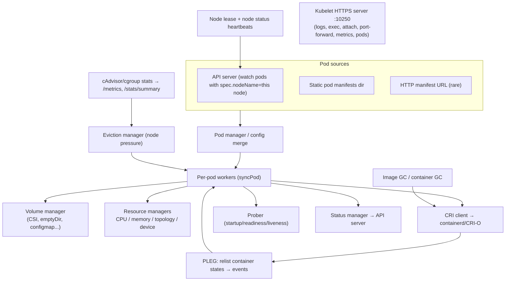

# 5.9 The kubelet and the node: CRI, cgroups, QoS classes, probes and eviction

| | |
|---|---|
| Level | Advanced |
| Priority tier | 0 |
| Lab venue | Root on a Kubernetes worker (VM or bare metal); `kubectl`, `crictl`, `systemd-cgls`, `lscpu`, `numactl`; GPU server with multiple NUMA nodes for topology exercises |
| Part | Part 5: Kubernetes |
| Status | Drafted, labs **untested** |

## Why this matters for AI infrastructure

The kubelet is where cluster policy meets hardware. It decides how many pods a node accepts, whether a training pod gets exclusive CPU cores aligned with its GPUs' NUMA node, how much memory the system and Kubernetes daemons keep for themselves, what gets evicted when memory or disk runs low, how long a node can lose connectivity before its pods are rescheduled, and how containers are killed on shutdown. On a GPU server with 8 GPUs, dual-socket CPUs, multiple NICs and NVMe, default kubelet settings leave a lot of performance and reliability on the table: cross-NUMA traffic, CPU throttling, noisy neighbours, nodes that die from OOM because nothing was reserved for the OS, long recovery times after failures. This chapter explains the kubelet's responsibilities and tuning for AI nodes.

## Prerequisites and outcomes

Needs 5.2, 5.7, 5.8. After this chapter you can:

- Describe the kubelet's responsibilities, configuration sources and APIs; write a production `KubeletConfiguration`.
- Explain the cgroup hierarchy the kubelet builds, QoS classes, reservations (`kubeReserved`, `systemReserved`, eviction thresholds) and compute **node allocatable**.
- Configure and reason about the CPU Manager, Memory Manager, Topology Manager, Device Manager and Pod Resources API for GPU/NUMA alignment.
- Configure probes correctly and understand how the kubelet runs them.
- Explain node-pressure eviction (signals, soft/hard thresholds, ordering), PID and disk limits, image GC and log rotation, and how they differ from API-initiated eviction and OOM kills.
- Understand node status/lease heartbeats, NotReady behaviour, graceful node shutdown, static pods, kubelet certificates and security hardening.
- Diagnose node-level problems with kubelet logs, metrics and cgroup data.

## 1. What the kubelet does



Responsibilities: register the Node (labels, capacity, allocatable, conditions, addresses, daemon endpoints); run assigned pods via CRI; manage pod/container cgroups and QoS; mount volumes; run probes; report status; garbage-collect containers, images and logs; enforce eviction under pressure; expose metrics and APIs; gracefully handle node shutdown; rotate its client/serving certificates.

Configuration: prefer the `KubeletConfiguration` file (`--config`, typically `/var/lib/kubelet/config.yaml` written by kubeadm) over flags; kubeadm stores a cluster-wide copy in ConfigMap `kube-system/kubelet-config` and per-node overrides via `--config`/drop-ins (`/etc/kubernetes/kubelet.conf.d/*.conf` in newer releases) and `KUBELET_EXTRA_ARGS`. Dynamic kubelet config was removed; roll changes with restarts (drain first for disruptive ones). Inspect live config: `kubectl get --raw "/api/v1/nodes/<node>/proxy/configz" | jq .kubeletconfig`.

## 2. A production KubeletConfiguration for GPU nodes

```yaml
apiVersion: kubelet.config.k8s.io/v1beta1
kind: KubeletConfiguration
authentication:
  anonymous: { enabled: false }
  webhook: { enabled: true, cacheTTL: 2m }
  x509: { clientCAFile: /etc/kubernetes/pki/ca.crt }
authorization:
  mode: Webhook
cgroupDriver: systemd
cgroupsPerQOS: true
clusterDNS: ["169.254.20.10"]            # NodeLocal DNSCache (5.11) or the CoreDNS service IP
clusterDomain: cluster.local
containerLogMaxSize: 50Mi
containerLogMaxFiles: 5
serverTLSBootstrap: true
rotateCertificates: true
protectKernelDefaults: true              # fail if kernel sysctls differ from kubelet expectations (hardening)
seccompDefault: true                     # RuntimeDefault seccomp for all pods
maxPods: 110                             # lower (e.g., 30-60) on GPU nodes if you want to reserve headroom
podPidsLimit: 8192
serializeImagePulls: false
maxParallelImagePulls: 3
registryPullQPS: 20
registryBurst: 40
imageGCHighThresholdPercent: 85
imageGCLowThresholdPercent: 70
imageMinimumGCAge: 30m
nodeStatusUpdateFrequency: 10s
nodeStatusReportFrequency: 5m
shutdownGracePeriod: 120s                # graceful node shutdown (systemd inhibitor)
shutdownGracePeriodCriticalPods: 30s
# --- Resource management for GPU/AI nodes ---
cpuManagerPolicy: static
cpuManagerPolicyOptions: { full-pcpus-only: "true" }
cpuManagerReconcilePeriod: 10s
memoryManagerPolicy: Static              # requires reservedMemory to match the reserved totals
topologyManagerPolicy: single-numa-node  # best-effort | restricted | single-numa-node | none
topologyManagerScope: pod                # container | pod
reservedSystemCPUs: "0-3"                # dedicate cores to OS/kubelet/runtime (instead of per-resource reserved)
kubeReserved: { memory: 4Gi, ephemeral-storage: 5Gi }
systemReserved: { memory: 8Gi, ephemeral-storage: 5Gi }
enforceNodeAllocatable: ["pods"]          # add "system-reserved","kube-reserved" only with dedicated cgroups
evictionHard:
  memory.available: "2Gi"
  nodefs.available: "10%"
  nodefs.inodesFree: "5%"
  imagefs.available: "15%"
  pid.available: "10%"
evictionSoft:
  memory.available: "4Gi"
  nodefs.available: "15%"
evictionSoftGracePeriod:
  memory.available: "2m"
  nodefs.available: "2m"
evictionMinimumReclaim:
  memory.available: "1Gi"
  imagefs.available: "5Gi"
featureGates: {}                          # avoid alpha gates in production
```

Notes on key items:

- **`cgroupDriver: systemd`** must match the runtime (5.2); mismatch destabilises nodes.
- **`protectKernelDefaults`** makes the kubelet error on start if required sysctls (`vm.overcommit_memory=1`, `kernel.panic=10`, `kernel.panic_on_oops=1`) are not set; set them in node bootstrap (4.17) to guarantee consistent behaviour.
- **`seccompDefault`** applies the runtime's default seccomp profile (needs workloads compatible; some GPU/RDMA tools need exceptions).
- **`serverTLSBootstrap`** and **`rotateCertificates`**: kubelet gets/rotates its certificates via CSRs (5.21); approve serving CSRs with an approver.
- **`maxPods`** (default 110) is limited also by pod CIDR size per node (a `/24` gives ~254 IPs) and CNI. GPU nodes rarely need 110.
- **Image pulls**: `serializeImagePulls: false` + `maxParallelImagePulls` speeds starts for multiple large images on one node; registry QPS prevents hammering a registry.

## 3. cgroups, QoS and node allocatable

### The hierarchy (cgroup v2, systemd driver)

```text
/sys/fs/cgroup/
├── system.slice/                        # OS services incl. kubelet.service, containerd.service
├── kubepods.slice/                      # all pods; memory.max = node allocatable for pods
│   ├── kubepods-pod<uid>.slice/         # Guaranteed pods (directly under kubepods)
│   │   └── cri-containerd-<id>.scope    # container
│   ├── kubepods-burstable.slice/
│   │   └── kubepods-burstable-pod<uid>.slice/...
│   └── kubepods-besteffort.slice/
│       └── kubepods-besteffort-pod<uid>.slice/...
└── user.slice/
```

The kubelet creates `kubepods` and the QoS sub-slices (`cgroupsPerQOS`), sets CPU weights proportional to requests (`cpu.weight`), and enforces the **node allocatable** limit on the `kubepods` cgroup. Pod-level cgroup limits (sum of container limits) exist for non-Guaranteed pods; with cgroup v2 and the MemoryQoS feature `memory.min/memory.high` provide soft protection and throttling before hitting hard limits (check your release's status).

### Node capacity and allocatable

```text
Capacity (reported by kubelet: cpu, memory, ephemeral-storage, pods, hugepages-*, extended resources)
  − kube-reserved (kubelet, container runtime, node problem detector)
  − system-reserved (sshd, udev, systemd, other OS daemons)
  − eviction-threshold (hard)
  = Allocatable   ← what the scheduler uses for pod requests
```

`kubectl describe node` shows Capacity, Allocatable and Allocated resources (sum of requests/limits). Reserve generously on GPU nodes: DCGM, the device plugin, CNI agents, log shippers, storage clients and the GPU driver stack all need CPU and memory, and unreserved nodes die in surprising ways (kernel OOM killing kubelet/containerd, SSH unresponsive). `enforceNodeAllocatable: ["pods"]` (default) enforces only the pods limit; enforcing `system-reserved`/`kube-reserved` requires dedicated cgroups and carefully sized values (misconfigured enforcement kills system daemons).

### QoS recap (details in 5.7)

Guaranteed/Burstable/BestEffort determine cgroup placement, OOM score and eviction order. The kernel OOM killer picks victims by `oom_score` (which includes `oom_score_adj`: kubelet sets -997 for Guaranteed, 1000 for BestEffort, between for Burstable proportional to request/capacity; critical kubelet and runtime processes have -999). System daemons without protection can be killed if the node runs out of memory outside the pods cgroup.

## 4. Resource managers: CPU, memory, topology, devices

### CPU Manager

- **`none`** (default): pods share all CPUs via CFS; limits cause throttling.
- **`static`**: Guaranteed pods requesting **integer** CPUs get **exclusive** cores (removed from the shared pool and pinned via `cpuset`). Benefits for AI: no CFS throttling, no cache/scheduler noise for data-loading threads, NUMA-local placement, deterministic latency for inference. Requires: Guaranteed QoS, integer CPU requests, reserved CPUs configured (`reservedSystemCPUs` or `kubeReserved/systemReserved` CPU); policy options (`full-pcpus-only` avoids sharing hyperthread siblings; `distribute-cpus-across-numa`, `align-by-socket`). Changing the policy requires draining the node and deleting `/var/lib/kubelet/cpu_manager_state`.
- Containers in Burstable/BestEffort pods and non-integer requests use the shared pool.

### Memory Manager

`Static` policy with `reservedMemory` lets Guaranteed pods get NUMA-pinned memory (and hugepages) allocations coordinated with the Topology Manager; the sum of `reservedMemory` across NUMA nodes must equal `kubeReserved + systemReserved + hard eviction threshold` for memory. Useful for latency-critical or hugepage-based workloads (DPDK, some HPC); complex to operate, so enable only when needed.

### Topology Manager

A broker that collects NUMA **hints** from the CPU Manager, Memory Manager and Device Manager (device plugins report topology: GPU NUMA node, NIC NUMA node) and enforces a policy:

| Policy | Behaviour |
|---|---|
| `none` | No alignment (default) |
| `best-effort` | Prefer aligned allocations; admit even if not aligned |
| `restricted` | Admit only if the preferred (minimal number of NUMA nodes) alignment is achieved; else reject with `TopologyAffinityError` |
| `single-numa-node` | Admit only if all resources fit on a single NUMA node |

Scope `container` aligns per container; `pod` aligns all containers of a pod together. For AI nodes the question is how many GPUs a pod needs: 8-GPU training pods span both sockets by design (hints would be non-preferred; use `best-effort`/`none` or per-pod relaxations), while 1 to 4 GPU inference pods benefit from `single-numa-node`/`restricted` so the pod's CPUs, memory, GPU and NIC share a NUMA node and PCIe root. Misalignment shows up as lower DataLoader throughput or GPUDirect RDMA falling back through the CPU interconnect. When alignment cannot be satisfied the pod fails at admission after scheduling (the scheduler is not topology-aware by default; use NFD/topology-aware scheduling (NodeResourceTopology plugin) or DRA to avoid it; 5.18).

### Device Manager and Pod Resources API

Device plugins register with the kubelet over gRPC at `/var/lib/kubelet/device-plugins/kubelet.sock` and expose a socket; `ListAndWatch` streams devices and health; `Allocate` returns injection details (5.8); `GetPreferredAllocation` lets plugins hint better device sets (e.g., NVLink-connected GPUs). The kubelet checkpoints allocations (`/var/lib/kubelet/device-plugins/kubelet_internal_checkpoint`), so restarts keep allocations. The **Pod Resources API** (`/var/lib/kubelet/pod-resources/kubelet.sock`: `List`, `GetAllocatableResources`, `Get`) exposes which pods use which devices/CPUs/memory: used by DCGM exporter and monitoring. **Dynamic Resource Allocation (DRA)** (stable in recent releases) replaces the counting-based device plugin model with `ResourceClaim`s and driver-published `ResourceSlice`s, enabling structured device selection (GPU model, MIG profile, shared claims) and scheduler awareness (Part 11).

## 5. Probes

The kubelet runs probes on a timer per container:

| Probe | Question | On failure |
|---|---|---|
| **startupProbe** | Has the app finished starting? (disables the others until it succeeds) | Container killed and restarted per restartPolicy after `failureThreshold` |
| **readinessProbe** | Can it serve traffic now? | Pod marked NotReady; removed from Service endpoints; not restarted |
| **livenessProbe** | Is it stuck? | Container killed and restarted |

Handlers: `exec` (command inside the container, exit 0 = success), `httpGet` (2xx/3xx), `tcpSocket`, `grpc` (gRPC health protocol). Parameters: `initialDelaySeconds`, `periodSeconds` (10), `timeoutSeconds` (1), `successThreshold`, `failureThreshold` (3), `terminationGracePeriodSeconds` (probe-level override for liveness kills).

Operational rules:

- HTTP/TCP/gRPC probes originate from the **kubelet on the node** to the pod IP (so NetworkPolicy and host firewalls must allow node → pod traffic); `exec` probes run via CRI inside the container (fork cost: expensive at high frequency and in minimal images; avoid shell-heavy probes).
- **Startup probe for slow starts** (LLM weights load, CUDA graph capture, large dataset indexing): `failureThreshold × periodSeconds` is the allowed startup time; this avoids liveness kill loops.
- **Liveness probes must be local and cheap**: check the process is not deadlocked, not external dependencies (a database outage must not restart every app pod); consider omitting liveness for stateful or long-running training workers where restarts are destructive.
- **Readiness for serving**: only ready when the model is loaded and a tiny inference works; flip not-ready during graceful shutdown/drain; make endpoints cheap.
- **Timeouts**: default 1 s often too short on busy nodes; CFS throttling can fail probes of otherwise healthy pods (CPU-limited containers); set realistic `timeoutSeconds`.
- Probe results appear in events (`Unhealthy: Readiness probe failed: ...`) and metrics (`prober_probe_total`).
- **Readiness gates** (`readinessGates`) let external controllers add conditions that must be true (e.g., load balancer registration for cloud LBs).

## 6. Node-pressure eviction

The eviction manager monitors node signals from cAdvisor/cgroup stats at `evictionPressureTransitionPeriod` intervals and compares them with thresholds:

| Signal | Meaning |
|---|---|
| `memory.available` | `capacity − working set` on the node (excluding reclaimable page cache accounted into inactive file) |
| `nodefs.available`, `nodefs.inodesFree` | Root filesystem (kubelet dir, logs, emptyDir) free space/inodes |
| `imagefs.available`, `imagefs.inodesFree` | Container image/writable layer filesystem (if separate) |
| `containerfs.*` | Newer split for container writable layers |
| `pid.available` | PIDs left |

**Hard** thresholds evict immediately (grace 0, `SIGKILL`-like short grace); **soft** thresholds require the condition to persist for `evictionSoftGracePeriod` and use the pod's grace period up to `evictionMaxPodGracePeriod`. Reclaim attempts happen first (garbage collect dead containers and unused images when disk is low). Node conditions `MemoryPressure`, `DiskPressure`, `PIDPressure` are set (and taints `node.kubernetes.io/memory-pressure:NoSchedule` etc. prevent new BestEffort/otherwise pods from scheduling).

**Selection order** when evicting for memory: pods whose usage exceeds requests first (BestEffort counts as request 0), ordered by priority (lower first), then by how far over request they are; for disk pressure, by ephemeral storage usage over request and priority. Guaranteed pods are evicted last (only if system daemons are the problem and nothing else is left). Evicted pods end `Failed` with reason `Evicted`; controllers recreate them elsewhere. Critical pods (priority `system-node-critical`/`system-cluster-critical`, static pods) are protected.

Distinguish **three kill mechanisms**: (1) *kernel OOM killer* in a cgroup (container exceeded its memory limit, or node ran out of memory faster than kubelet could react): process killed, container restarted per policy, `OOMKilled`; (2) *kubelet eviction* (graceful, pod-level, node pressure; ignores PDBs); (3) *API-initiated eviction/preemption/drain* (respects PDBs and priority). For AI nodes: set `evictionHard memory.available` large enough (several GiB) to act before the kernel OOM kills random processes, because workloads with huge page cache and pinned memory can consume memory faster than kubelet's housekeeping (10 s) sampling; prefer Guaranteed pods for important jobs; keep `ephemeral-storage` requests for pods that write scratch to avoid disk-pressure surprises.

## 7. Garbage collection and logs

- **Container GC** removes exited containers beyond `maxPerPodContainer`/`maxContainers` and older than `minimumContainerTTL`-like behaviour (flags `--maximum-dead-containers*` were deprecated in favour of eviction-based cleaning); dead containers consume writable layer space.
- **Image GC**: when image filesystem usage exceeds `imageGCHighThresholdPercent`, remove least-recently-used unused images until `imageGCLowThresholdPercent`; skip images younger than `imageMinimumGCAge`. With 20 to 50 GB ML images, 85% thresholds on a 1 TB disk mean hundreds of GB of headroom is consumed before GC; but then GC may delete the image you need next and trigger a long re-pull; use bigger disks, `imageMaximumGCAge` (newer), and pre-pull policies.
- **Log rotation**: the kubelet rotates CRI logs at `containerLogMaxSize` keeping `containerLogMaxFiles`; training jobs printing per-step logs at high rate can fill disks and add CPU overhead; log to stdout moderately, ship metrics separately, or write detailed logs to a PVC/object storage.
- **Ephemeral storage accounting**: container logs, writable layer and `emptyDir` count toward the pod's ephemeral-storage usage; exceeding `limits.ephemeral-storage` evicts the pod.

## 8. Node status, leases and failure behaviour

- **Heartbeats**: the kubelet renews a **Lease** (`kube-node-lease/<node>`) every `nodeLeaseDurationSeconds/4` (10 s) – cheap; and updates `Node.status` when something changes or every `nodeStatusReportFrequency` (5 min). Node controller's `--node-monitor-grace-period` (40 s) after the last lease/status marks `Ready=Unknown`.
- **Conditions**: `Ready`, `MemoryPressure`, `DiskPressure`, `PIDPressure`, `NetworkUnavailable`; extra conditions from node-problem-detector (e.g., `KernelDeadlock`, `GPUXidError`) used by remediation controllers (5.32, Part 17).
- **Taints**: automatically added by the node lifecycle controller: `node.kubernetes.io/not-ready`, `unreachable` (NoExecute with default 300 s toleration), plus `memory-pressure`, `disk-pressure`, `pid-pressure`, `network-unavailable`, `unschedulable` (cordon). For GPU jobs requiring fast recovery, shorten `tolerationSeconds` for those taints in pod specs; for stateful workloads consider longer values or manual fencing.
- **Graceful node shutdown** (`shutdownGracePeriod`): on systemd hosts the kubelet takes a shutdown inhibitor lock; when the node shuts down, it terminates pods in priority order (regular first, critical last) within the budget, updates node status, then allows poweroff. Combined with draining before maintenance (5.19), this prevents abrupt SIGKILLs of training pods during reboots. **Non-graceful node shutdown** handling lets you apply `node.kubernetes.io/out-of-service` taint after confirming a node is down so StatefulSet pods and their volumes move.
- **Kubelet restart** does not restart containers: it reconciles from the runtime state; checkpointed manager states (`cpu_manager_state`, device checkpoint, memory manager state) persist. Kubelet down ≠ pods down; but NotReady node triggers evictions after the toleration period, and no probes/log rotation/volume operations happen while it's down.

## 9. Static pods, kubelet API and security

- **Static pods**: manifests in `staticPodPath` (`/etc/kubernetes/manifests`) are run directly by the kubelet and mirrored into the API as read-only "mirror pods" (suffix `-<nodename>`). Used for control-plane components in kubeadm, node-critical agents. Editing a file reconfigures immediately; deleting it removes the pod. They cannot use ConfigMaps/Secrets from the API (file-based only) and are not controlled by controllers.
- **Kubelet API (10250)**: authenticated by x509 or bearer tokens (webhook), authorised by webhook (`nodes/proxy`, `nodes/stats`, `nodes/log`, `nodes/metrics` subresources): granting `nodes/proxy` is effectively `exec` rights on every pod on the node, so audit RBAC that includes it (many monitoring roles do). Endpoints: `/pods`, `/runningpods`, `/stats/summary`, `/metrics`, `/metrics/cadvisor`, `/metrics/resource`, `/metrics/probes`, `/logs/`, `/exec`, `/attach`, `/portForward`, `/configz`, `/healthz`. Disable the read-only port 10255 and anonymous auth; keep `authorization.mode: Webhook`.
- **Node authorizer + NodeRestriction admission** limit what a kubelet can read/modify (only its node and pods bound to it; cannot set certain labels like `node-role.*` or `node-restriction.kubernetes.io/*`).
- **Certificates**: kubelet client cert (CN `system:node:<name>`, group `system:nodes`) via TLS bootstrapping, auto-rotation (`rotateCertificates`); serving cert via CSR (`serverTLSBootstrap`) needs approval; expiry causes NotReady nodes (5.21).
- **Hardening checklist**: `protectKernelDefaults`, `seccompDefault`, read-only port off, `--anonymous-auth=false`, `readOnlyPort: 0`, TLS minimum version and cipher suites, `eventRecordQPS`, restrict `hostPath`/privileged via Pod Security, user namespaces for pods (`hostUsers: false`), AppArmor/SELinux, node OS hardening (Part 18).

## 10. Observability

Kubelet metrics (scrape `:10250/metrics`, `/metrics/cadvisor`, `/metrics/probes`): `kubelet_running_pods`, `kubelet_running_containers`, `kubelet_pod_start_duration_seconds`, `kubelet_runtime_operations_duration_seconds`, `kubelet_pleg_relist_duration_seconds`, `kubelet_pleg_relist_interval_seconds`, `kubelet_evictions`, `kubelet_node_name`, `kubelet_certificate_manager_client_ttl_seconds`, `kubelet_volume_stats_*` (PVC usage), `container_cpu_cfs_throttled_periods_total`, `container_memory_working_set_bytes`, `container_oom_events_total`, `prober_probe_total`, `rest_client_requests_total`. Alerts worth having: node NotReady, PLEG relist slow, kubelet certificate expiring, container CPU throttling ratio high on latency-critical pods, disk/inode/PID pressure approaching thresholds, image pull errors, kubelet restarts, runtime operation latency.

Logs: `journalctl -u kubelet -f` (verbosity `--v=2` default; `4` for sync details), runtime logs `journalctl -u containerd`, kernel `dmesg -T` (OOM kills: "Killed process", "oom-kill:constraint=CONSTRAINT_MEMCG"), `/var/log/pods`.

## 11. Troubleshooting guide

| Symptom | Likely cause | Where to look |
|---|---|---|
| Node `NotReady` | Kubelet down/cert expired/runtime down/network | `systemctl status kubelet`, `journalctl -u kubelet`, `kubectl describe node` conditions, `crictl info` |
| `PLEG is not healthy` | Runtime slow/overloaded (many containers, disk IO) or kernel issue | PLEG metrics, containerd CPU/IO, `crictl ps` latency |
| Kubelet crash loop on start | Swap on, cgroup driver mismatch, invalid config, `protectKernelDefaults` sysctl mismatch, cpu manager state mismatch | kubelet journal first lines |
| `TopologyAffinityError` | Topology manager policy cannot align | pod events, policy and device NUMA info, `numactl -H`, `nvidia-smi topo -m` |
| CPU manager state error after changing policy | Stale state file | drain node, remove `cpu_manager_state`, restart |
| Pods evicted with `The node was low on resource: memory` | Memory pressure beyond thresholds, over-request pods | `kubectl describe pod`, node events, kubelet eviction logs, node `memory.available` |
| Pods OOMKilled while node has free memory | Container limit reached (cgroup) | `kubectl describe`, `memory.events`, shm/page cache |
| Node unresponsive/SSH hangs under load | No system reserved, kernel OOM, CPU starvation | reservations, `dmesg`, `systemd-cgtop` |
| Disk pressure, image GC thrash | Small image disk, large images, logs | `df -h`, `crictl imagefsinfo`, log sizes, thresholds |
| Probes failing intermittently | CPU throttling, short timeouts, NetworkPolicy blocking node→pod | `cpu.stat`, probe events, policy |
| `kubectl logs/exec` fails TLS | Serving CSR unapproved | `kubectl get csr`, approve |
| Pods Pending on node with free GPUs | Device plugin not registered/unhealthy, allocatable 0 | `kubectl describe node`, plugin logs, kubelet device-plugin dir |
| Containers can't see GPUs after kubelet/plugin restart | Plugin restart without kubelet resync; runtime hook mis-config | restart order, `ListAndWatch` logs, checkpoint file |
| Time to start high | Serial image pulls, slow CSI, CNI | see 5.8 |

## 12. Tuning checklist for GPU nodes

1. systemd cgroup driver, cgroup v2, kernel and runtime up to date and consistent across nodes (4.17).
2. Reserve CPU (dedicated cores via `reservedSystemCPUs`) and memory/ephemeral-storage for kube/system daemons; set meaningful hard eviction thresholds.
3. CPU Manager `static` with `full-pcpus-only`; Topology Manager policy chosen per node pool (relaxed for 8-GPU training pools, strict for small-GPU inference pools); Memory Manager only if hugepage/NUMA pinning is required.
4. Guaranteed QoS for GPU pods; explicit shm and ephemeral storage; PID limit adequate for multi-process training (`podPidsLimit` ≥ thousands).
5. Image management: large dedicated NVMe image filesystem, parallel pulls, careful GC thresholds, pre-pull DaemonSet.
6. Fast failure handling: node problem detector + remediation, shorter taint tolerations for elastic jobs, `shutdownGracePeriod` for planned reboots.
7. Security: webhook authn/z, rotate certs, approve serving CSRs, seccomp default, no read-only port.
8. Observability: scrape kubelet/cAdvisor, DCGM, NPD; alert on pressure and throttling.
9. Roll changes through drains and canary nodes; keep config in Git (4.26) and verify with `configz`.

## 13. Lab (untested)

1. **Config and allocatable**: print live kubelet config via `configz`; compute allocatable from capacity and reservations by hand; change `kubeReserved`/`systemReserved` and observe `kubectl describe node` changes after restart.
2. **cgroup tree**: with `systemd-cgls`/`systemd-cgtop`, find `kubepods.slice`, QoS slices, pod and container scopes; read `memory.max`/`cpu.weight` for Guaranteed, Burstable, BestEffort pods; match to requests/limits.
3. **QoS and OOM**: create the three QoS pods; read each container's `oom_score_adj`; use a stress image to trigger a container OOM, then node-level memory pressure (lab VM) and observe eviction order and events.
4. **Eviction tuning**: set `evictionHard memory.available` low and high on two nodes; run a memory consumer; compare kubelet-managed eviction vs kernel OOM kills; set soft thresholds and grace.
5. **CPU Manager**: enable `static` on a node (drain, delete state file), run a Guaranteed pod with 4 CPUs, inspect `cpuset.cpus` (`cat /sys/fs/cgroup/.../cpuset.cpus.effective`), `taskset -pc`, and a shared-pool pod's cpuset; compare latency/throttling with and without exclusivity; try `full-pcpus-only` with odd CPU counts.
6. **Topology Manager**: on a multi-NUMA GPU node set `single-numa-node`; request 1 GPU + CPUs and observe aligned allocation (`nvidia-smi topo -m`, `numactl`); request 8 GPUs and observe `TopologyAffinityError`; adjust to `best-effort` for that pool.
7. **Pod Resources API**: query the socket with `grpcurl` or a small client to list devices per pod; compare with DCGM exporter labels.
8. **Probes**: build a server with controllable startup time and failure toggles; test startup/readiness/liveness interplay; demonstrate CPU-throttle-induced probe failures by limiting CPU hard.
9. **Image and log GC**: fill the image filesystem with test images and observe GC; set low `containerLogMaxSize` and a chatty pod; watch rotation and disk usage; compute log retention per pod.
10. **Node failure timeline**: block kubelet → API connectivity with iptables on a worker; record timestamps for lease expiry, `Unknown` condition, taint, pod eviction; repeat with shorter tolerations; then with graceful shutdown (`systemctl reboot`) and `shutdownGracePeriod`.
11. **Static pod**: add a static pod manifest; see the mirror pod; modify and delete; compare with a DaemonSet.
12. **Kubelet API security**: query `:10250` with and without credentials; check `nodes/proxy` RBAC in existing ClusterRoles; verify read-only port closed.
13. **Dashboards/alerts**: build panels for pressure signals, throttling, PLEG latency, eviction counts; write alerts.
14. **Clean up**.

Mark tested only after execution.

## 14. Common mistakes

- Running GPU nodes with no reserved resources and tiny eviction thresholds; surprise kernel OOM on the node.
- Enabling `static` CPU manager without Guaranteed integer-CPU pods (no effect) or without draining/removing state when switching.
- Using `single-numa-node` for pods that need all 8 GPUs (guaranteed admission failures).
- Liveness probes that call external dependencies; no startup probe for slow model loads; 1 s timeouts on throttled pods.
- Assuming evictions respect PDBs; treating node-pressure eviction as an API eviction.
- Letting image GC delete large ML images repeatedly; tiny image disks.
- Chatty training logs filling disks; no log rotation tuning.
- Granting `nodes/proxy` RBAC broadly; leaving anonymous/read-only kubelet ports on.
- Forgetting to approve kubelet serving CSRs; expired kubelet certificates.
- Changing kubelet config on all nodes at once without canaries.

## 15. Interview angles

- "What does the kubelet do? Walk through its main loops and managers." 
- "How is node allocatable computed? Why reserve resources?" 
- "Explain QoS classes, OOM scores and eviction." 
- "What is the difference between kernel OOM kill, node-pressure eviction and API eviction?" 
- "What do the CPU, Memory and Topology Managers do? When would you use `static` and `single-numa-node` for AI?" 
- "How do probes work and what are common mistakes?" 
- "What happens when a node loses network connectivity to the control plane?" 
- "How would you tune kubelet for an 8-GPU training node versus a 1-GPU inference node?" 

## 16. Checkpoint questions (40)

1. Preferred kubelet config method? **A:** `KubeletConfiguration` file.
2. What is node allocatable? **A:** Capacity minus reservations and hard eviction threshold.
3. What enforces allocatable? **A:** Cgroup limit on `kubepods`.
4. QoS cgroup parents? **A:** guaranteed (directly), burstable, besteffort slices.
5. Guaranteed `oom_score_adj`? **A:** -997.
6. BestEffort `oom_score_adj`? **A:** 1000.
7. What does CPU Manager `static` give? **A:** Exclusive CPUs for Guaranteed integer-CPU pods.
8. Requirement for exclusive CPUs? **A:** Guaranteed QoS and integer CPU requests.
9. What does `full-pcpus-only` do? **A:** Allocates whole physical cores.
10. Memory Manager `Static` needs? **A:** `reservedMemory` matching reservations.
11. Topology Manager policies? **A:** none, best-effort, restricted, single-numa-node.
12. What are topology hints? **A:** NUMA affinity masks from resource managers.
13. When `TopologyAffinityError`? **A:** Policy can't be satisfied at admission.
14. What registers GPUs with kubelet? **A:** Device plugin.
15. Device plugin RPCs? **A:** ListAndWatch, Allocate, GetPreferredAllocation.
16. What is Pod Resources API? **A:** Reports devices/CPUs allocated per pod.
17. DRA advantage? **A:** Structured, flexible device claims.
18. Probe types? **A:** startup, readiness, liveness.
19. Who runs HTTP probes? **A:** Kubelet from the node network.
20. What does failing readiness do? **A:** Removes from endpoints, no restart.
21. What does failing liveness do? **A:** Restarts container.
22. Startup time budget formula? **A:** `failureThreshold × periodSeconds`.
23. Hard vs soft eviction? **A:** Immediate vs after grace period.
24. Signals for eviction? **A:** memory.available, nodefs/imagefs, inodes, pid.available.
25. Eviction ignores PDBs? **A:** Yes (node-pressure).
26. Who gets evicted first? **A:** Pods over requests, lowest priority.
27. Image GC thresholds? **A:** High 85%, low 80% default.
28. Log rotation settings? **A:** `containerLogMaxSize`, `containerLogMaxFiles`.
29. Node lease namespace? **A:** `kube-node-lease`.
30. Node grace period default? **A:** 40 s.
31. Default NoExecute toleration for not-ready? **A:** 300 s.
32. What is graceful node shutdown? **A:** Terminates pods in order during OS shutdown via inhibitor.
33. `out-of-service` taint use? **A:** Non-graceful shutdown recovery.
34. What are static pods? **A:** Kubelet-run from manifest files; mirrored to API.
35. Kubelet API port? **A:** 10250.
36. RBAC to avoid? **A:** Broad `nodes/proxy`.
37. NodeRestriction does what? **A:** Limits kubelet's API writes.
38. Why `protectKernelDefaults`? **A:** Enforce required sysctls.
39. What causes PLEG unhealthy? **A:** Slow relist from runtime/node overload.
40. Why reserve system CPUs? **A:** Protect OS/kubelet/runtime from workload contention.

## 17. Sources and review notes

**Written in original words.** Principal sources:

- Josh Rosso, Rich Lander, Alex Brand and John Harris, *Production Kubernetes* (chapter 3 on container runtime and node considerations).
- Brendan Burns et al., *Kubernetes: Up and Running* (3rd edition; chapter 5 and node-level material).
- The author's `nvidia-devops` repository, volume 03 (node operations masterclass: KubeletConfiguration for AI nodes, eviction and QoS, CRI and sandbox, `crictl` debugging).
- Kubernetes documentation on kubelet, resource managers, node-pressure eviction, probes, graceful node shutdown and the device plugin framework.
- Examples are the author's constructions.

**Flagged for verification before publishing:** all KubeletConfiguration field names and defaults for your release (memory manager, topology manager scope, shutdown settings, image GC options), DRA and MemoryQoS status, metric names, and every command listing; all labs are **untested**.
