# 5.9 The kubelet and the node: CRI, cgroups, QoS classes, probes and eviction

| | |
|---|---|
| Level | Advanced |
| Priority tier | 0 |
| Lab venue | Root on a Kubernetes worker (VM or bare metal); `kubectl`, `crictl`, `systemd-cgls`, `lscpu`, `numactl`; GPU server with multiple NUMA nodes for topology exercises |
| Part | Part 5: Kubernetes |
| Status | Drafted, labs **untested** |

## Why this matters for AI infrastructure

Picture a GPU server with 8 GPUs, dual-socket CPUs, multiple NICs and NVMe drives. The kubelet is the node agent on that machine, and its settings decide how the hardware behaves. Cluster policy reaches the hardware through the kubelet. It decides how many pods a node accepts, and whether a training pod gets exclusive CPU cores aligned with its GPUs' NUMA node. It also decides how much memory the system and Kubernetes daemons keep for themselves, and what gets evicted when memory or disk runs low.

Two more decisions sit with the kubelet: how long a node can lose connectivity before its pods are rescheduled, and how containers are killed on shutdown. Left at defaults, these settings leave a lot of performance and reliability on the table. You will see the symptoms as cross-NUMA traffic, CPU throttling, noisy neighbours, nodes that die from OOM because nothing was reserved for the OS, and long recovery times after failures. This chapter explains the kubelet's responsibilities and how to tune them for AI nodes.

Put simply, these are the settings that decide how the node behaves when the world goes wrong. A node that loses its network, or that runs out of memory, is not the exception on a large GPU fleet. It is a regular event, and the settings in this chapter decide whether the event is a short inconvenience or a long outage. Reading the settings with that in mind makes each one easier to justify.

## Prerequisites and outcomes

This chapter builds on 5.2, 5.7 and 5.8. When you finish it, you should be able to explain why a node behaves the way it does, and tune it on purpose. You will describe the kubelet's responsibilities, its configuration sources and its APIs. You will also write a production `KubeletConfiguration`.

Next, you will explain the cgroup hierarchy the kubelet builds and the QoS classes. You will see how reservations (`kubeReserved`, `systemReserved` and eviction thresholds) give you **node allocatable**. The CPU Manager, Memory Manager, Topology Manager, Device Manager and Pod Resources API come next, and they align GPUs with NUMA nodes. You will configure probes, and you will explain node-pressure eviction, with its signals, soft/hard thresholds and ordering. You will also tell PID and disk limits, image GC and log rotation apart from API-initiated eviction and OOM kills.

The last part covers node status/lease heartbeats, NotReady behaviour, graceful node shutdown, static pods, kubelet certificates and security hardening. By the end you will diagnose node-level problems with kubelet logs, metrics and cgroup data.

## 1. What the kubelet does

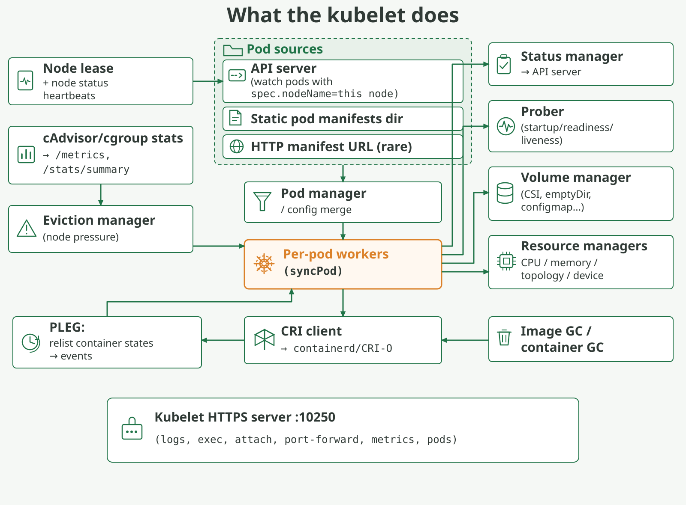

*Figure 5.9.1. What the kubelet does, as a diagram.*

The diagram shows the kubelet as a hub. Pods reach the node from three sources, shown at the top. Most come from the API server, which the kubelet watches for pods whose `spec.nodeName` is this node. The pod manager merges the sources and hands each pod to a worker. That worker drives everything else on the node: volumes, resource managers, the container runtime through CRI, and probes.

A useful way to hold the diagram in mind is a hotel front desk. Guests arrive from several entrances, which are the three pod sources. The desk checks each arrival, assigns a room and passes the job to a housekeeper for that room. Each housekeeper then calls on the laundry, the maintenance team and the phone system as needed. Every box in the diagram is a specialist that the pod workers call on. Nothing on the node reaches a pod except through this hub, which is why the kubelet is the first place to look when a pod on the node behaves strangely.

The kubelet has a long list of jobs. It registers the Node with its labels, capacity, allocatable, conditions, addresses and daemon endpoints. It runs the pods assigned to it through CRI, and it manages their cgroups and QoS. It mounts volumes, runs probes and reports status. It garbage-collects containers, images and logs, and it enforces eviction under pressure. It also exposes metrics and APIs, handles graceful node shutdown, and rotates its client and serving certificates.

Think of the kubelet as the building superintendent for one floor of a large office block. The superintendent does not own the tenants, and the head office sets the rules. The superintendent makes sure each tenant has power, water and a working lock, reports problems upward, and clears out old boxes from the hallways when space runs low. The job description is long because a node has many small duties that all have to be done on time.

Set the kubelet's behaviour in a `KubeletConfiguration` file rather than in flags. The kubelet reads that file through `--config`, and kubeadm typically writes it to `/var/lib/kubelet/config.yaml`. kubeadm also keeps a cluster-wide copy in the ConfigMap `kube-system/kubelet-config`. Per-node overrides arrive through `--config` or the drop-ins in `/etc/kubernetes/kubelet.conf.d/*.conf` in newer releases, and through `KUBELET_EXTRA_ARGS`. Dynamic kubelet config was removed, so you roll changes out with restarts. Inspect the live config with `kubectl get --raw "/api/v1/nodes/<node>/proxy/configz" | jq .kubeletconfig`.

A file is easier to review than a list of flags. You can read it in a pull request, compare two nodes with a diff, and keep it in version control next to the rest of the cluster's settings. Flags tend to scatter across unit files and scripts, and a setting that lives in three places is a setting that drifts. Using one file gives each node a single answer to the question of how it is configured.

For any change that disrupts running pods, drain the node before you restart the kubelet.

Draining first is the same courtesy you would extend to a colleague before you switch off the power in their office. The pods are moved to other nodes in an orderly way, and the restart then affects nothing that is still running. Skipping the drain turns a routine configuration change into an unplanned interruption for the workloads that happen to be on the node.

## 2. A production KubeletConfiguration for GPU nodes

The file below is the kind of configuration a GPU node needs. Several of its settings depend on other parts of the cluster, and the comments mark those spots. Read it as a starting point for your own nodes.

Read the file in groups rather than line by line. The top block covers who may talk to the kubelet and how. The cgroup and kernel block covers how the kubelet and the kernel are expected to cooperate. The next block covers how many pods and images the node handles at once. Then comes the block for GPU and NUMA placement, followed by reservations and eviction. Grouping the file this way makes it much easier to see which change affects which behavior.

```yaml
apiVersion: kubelet.config.k8s.io/v1beta1
kind: KubeletConfiguration
authentication:
  anonymous: { enabled: false }
  webhook: { enabled: true, cacheTTL: 2m }
  x509: { clientCAFile: /etc/kubernetes/pki/ca.crt }
authorization:
  mode: Webhook
cgroupDriver: systemd
cgroupsPerQOS: true
clusterDNS: ["169.254.20.10"]            # NodeLocal DNSCache (5.11) or the CoreDNS service IP
clusterDomain: cluster.local
containerLogMaxSize: 50Mi
containerLogMaxFiles: 5
serverTLSBootstrap: true
rotateCertificates: true
protectKernelDefaults: true              # fail if kernel sysctls differ from kubelet expectations (hardening)
seccompDefault: true                     # RuntimeDefault seccomp for all pods
maxPods: 110                             # lower (e.g., 30-60) on GPU nodes if you want to reserve headroom
podPidsLimit: 8192
serializeImagePulls: false
maxParallelImagePulls: 3
registryPullQPS: 20
registryBurst: 40
imageGCHighThresholdPercent: 85
imageGCLowThresholdPercent: 70
imageMinimumGCAge: 30m
nodeStatusUpdateFrequency: 10s
nodeStatusReportFrequency: 5m
shutdownGracePeriod: 120s                # graceful node shutdown (systemd inhibitor)
shutdownGracePeriodCriticalPods: 30s
# --- Resource management for GPU/AI nodes ---
cpuManagerPolicy: static
cpuManagerPolicyOptions: { full-pcpus-only: "true" }
cpuManagerReconcilePeriod: 10s
memoryManagerPolicy: Static              # requires reservedMemory to match the reserved totals
topologyManagerPolicy: single-numa-node  # best-effort | restricted | single-numa-node | none
topologyManagerScope: pod                # container | pod
reservedSystemCPUs: "0-3"                # dedicate cores to OS/kubelet/runtime (instead of per-resource reserved)
kubeReserved: { memory: 4Gi, ephemeral-storage: 5Gi }
systemReserved: { memory: 8Gi, ephemeral-storage: 5Gi }
enforceNodeAllocatable: ["pods"]          # add "system-reserved","kube-reserved" only with dedicated cgroups
evictionHard:
  memory.available: "2Gi"
  nodefs.available: "10%"
  nodefs.inodesFree: "5%"
  imagefs.available: "15%"
  pid.available: "10%"
evictionSoft:
  memory.available: "4Gi"
  nodefs.available: "15%"
evictionSoftGracePeriod:
  memory.available: "2m"
  nodefs.available: "2m"
evictionMinimumReclaim:
  memory.available: "1Gi"
  imagefs.available: "5Gi"
featureGates: {}                          # avoid alpha gates in production
```

A few settings need a closer look. `cgroupDriver: systemd` must match the runtime described in 5.2, because a mismatch destabilises the node. `protectKernelDefaults` makes the kubelet fail on start if the required sysctls are missing. Those are `vm.overcommit_memory=1`, `kernel.panic=10` and `kernel.panic_on_oops=1`. Set them during node bootstrap, as covered in 4.17, so behaviour stays consistent.

The reason the driver matters is that the kubelet and the container runtime each manage cgroups, and they must agree about who is in charge. If they disagree, the node can end up with two sets of limits pulling in different directions. The symptom is usually a node that starts and then becomes unstable, which is harder to diagnose than a node that refuses to start. Checking the driver first saves a long investigation later.

`seccompDefault` applies the runtime's default seccomp profile to every pod. Some GPU and RDMA tools need exceptions, so check that your workloads work with it. `serverTLSBootstrap` and `rotateCertificates` let the kubelet get and rotate its certificates through CSRs, which 5.21 describes. You approve the serving CSRs with an approver. The default `maxPods` is 110, but the pod CIDR size on each node and the CNI also limit it. A `/24` pod CIDR gives about 254 IPs. GPU nodes rarely need 110 pods, so lowering the value can leave headroom.

For image pulls, `serializeImagePulls: false` with `maxParallelImagePulls` speeds up starts when one node pulls several large images. `registryPullQPS` keeps the kubelet from hammering a registry.

Serial pulls work like a single checkout lane at a store. Everyone waits for the person in front to finish, even if the person in front has a single small item. Parallel pulls open more lanes, so a small image is not stuck behind a large one. The cap on parallel pulls matters because too many lanes can saturate the disk and the network, and then every lane slows down.

Get the cgroup driver and the kernel defaults right first, because those mismatches are the ones that destabilise a node or stop it from starting.

## 3. cgroups, QoS and node allocatable

### The hierarchy (cgroup v2, systemd driver)

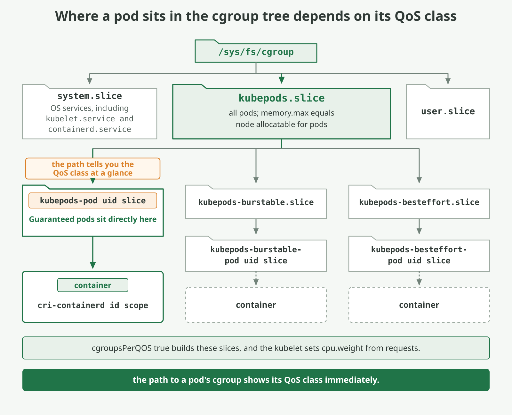

*Figure 5.9.2. The kubelet places each pod under kubepods.slice in a slice that matches its QoS class, so the path shows the class.*

```text
/sys/fs/cgroup/
├── system.slice/                        # OS services incl. kubelet.service, containerd.service
├── kubepods.slice/                      # all pods; memory.max = node allocatable for pods
│   ├── kubepods-pod<uid>.slice/         # Guaranteed pods (directly under kubepods)
│   │   └── cri-containerd-<id>.scope    # container
│   ├── kubepods-burstable.slice/
│   │   └── kubepods-burstable-pod<uid>.slice/...
│   └── kubepods-besteffort.slice/
│       └── kubepods-besteffort-pod<uid>.slice/...
└── user.slice/
```

Every pod on the node sits somewhere in this tree. The kubelet builds the `kubepods` cgroup and the QoS sub-slices when `cgroupsPerQOS` is on. It gives each pod a CPU weight in proportion to its requests (`cpu.weight`). It also enforces the **node allocatable** limit on the `kubepods` cgroup. Non-Guaranteed pods get pod-level cgroup limits, which are the sum of their container limits. With cgroup v2 and the MemoryQoS feature, `memory.min/memory.high` give soft protection and throttling before a pod reaches its hard limits. Check your release's status for that feature.

Read the tree as the floor plan of a building. The top level holds the rooms for the operating system and for all the pods. Under the pod room are separate wings for each quality class, and each pod gets its own small room inside its wing. The kubelet decides which wing a pod goes in, based on its QoS class, and the kernel then applies the limits for that room. That layout is why the tree matters when you debug: the path to a pod's cgroup tells you its class immediately.

### Node capacity and allocatable

The scheduler places pods against allocatable, not raw capacity. The kubelet gets allocatable by subtracting the reservations and the hard eviction threshold from capacity.

Think of capacity as the total size of a fridge and allocatable as the space left after you reserve shelves for the milk, the eggs and the cleaning supplies that must always be there. The scheduler only fills the space that is left. If the reservations are too big, the node looks full while it is actually half empty for pods. If they are too small, the node accepts more pods than the system daemons can tolerate, and the daemons are the first things to suffer.

```text
Capacity (reported by kubelet: cpu, memory, ephemeral-storage, pods, hugepages-*, extended resources)
  − kube-reserved (kubelet, container runtime, node problem detector)
  − system-reserved (sshd, udev, systemd, other OS daemons)
  − eviction-threshold (hard)
  = Allocatable   ← what the scheduler uses for pod requests
```

`kubectl describe node` shows Capacity, Allocatable and Allocated resources, where Allocated is the sum of requests and limits. Reserve generously on GPU nodes. DCGM, the device plugin, CNI agents, log shippers, storage clients and the GPU driver stack all need CPU and memory. An unreserved node can die in surprising ways. The kernel OOM killer may take out kubelet or containerd, or SSH stops responding.

`enforceNodeAllocatable: ["pods"]` is the default, and it enforces only the pods limit. Enforcing `system-reserved` or `kube-reserved` requires dedicated cgroups and carefully sized values. Misconfigured enforcement kills system daemons.

The distinction matters because enforcement is a hard wall. Reserved memory is normally a promise the scheduler keeps, not a limit the kernel enforces on the system services. Turning on enforcement for the system services turns that promise into a wall around them. A wall set too low will kill a daemon that needed more room, so enforce only after you have measured what the daemons really use.

### QoS recap (details in 5.7)

Guaranteed, Burstable and BestEffort decide three things: cgroup placement, OOM score and eviction order. The kernel OOM killer picks its victims by `oom_score`, which includes `oom_score_adj`. The kubelet sets -997 for Guaranteed pods and 1000 for BestEffort pods. Burstable pods land between those two values, in proportion to request and capacity. Critical kubelet and runtime processes have -999. System daemons without protection can still be killed if the node runs out of memory outside the pods cgroup.

A helpful picture is a set of lifeboats on a ship. The Guaranteed pods have the best seats and are the last to be asked to leave. Burstable pods have seats with conditions, and they leave before the Guaranteed ones when the boats are full. BestEffort pods have no reserved seat at all, so they are first in line when space is needed. The three classes are the same idea repeated across cgroups, OOM scores and eviction, which is why they are worth learning as one concept.

Size your reservations before you turn on enforcement, because a bad value kills system daemons.

A practical way to size reservations is to measure before you enforce. Run the node with enforcement off for a while, watch what the system daemons actually use under load, and set the reservation a comfortable margin above that peak. Only then turn enforcement on, and watch the daemons again. Measuring first turns a guess into a number you can defend in a review.

### CPU limits and throttling in multithreaded code

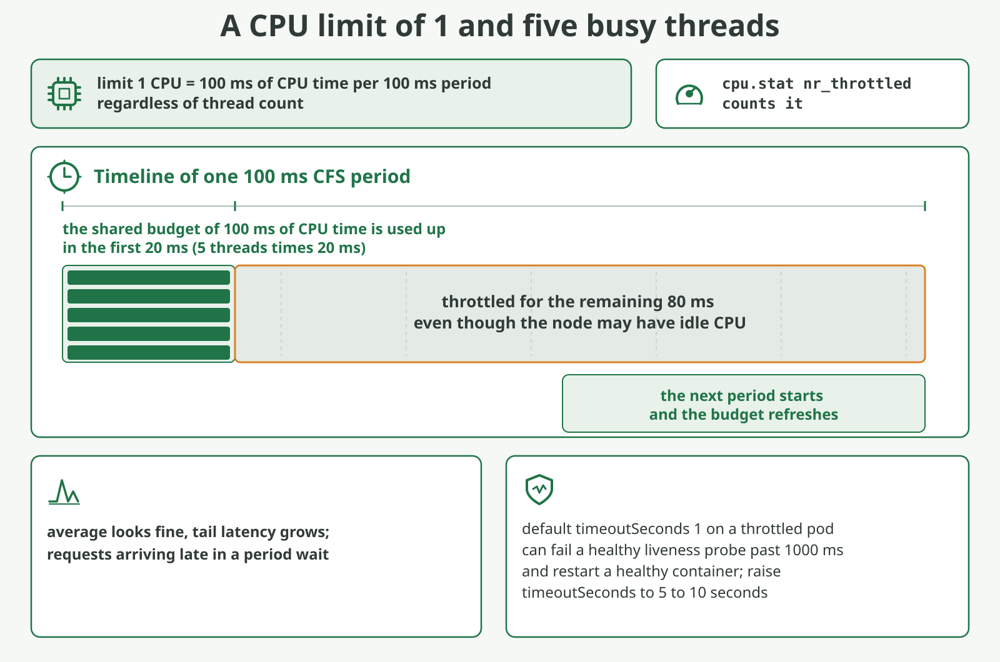

*Figure 5.9.3. A CPU limit is a per-period budget, so many busy threads can exhaust it early and stall for the rest of the period.*

CPU limits can behave in ways that surprise you. Take a container with a limit of 1 CPU. It gets 100 ms of CPU time in every 100 ms period, no matter how many threads it runs. A program with 5 busy threads can spend that whole 100 ms budget in its first 20 ms. The container is then throttled for the remaining 80 ms, even though the node may have idle CPU.

The way to picture a CPU limit is as a budget that refreshes every period. Each period the container gets a fixed amount of CPU time, and when the budget runs out, the container waits until the next period starts. With one thread, the budget lasts a long time. With several busy threads, the budget can run out early in the period, and every thread then waits in silence. The average looks fine, but the tail of the latency distribution grows, and those tail requests are often what users notice.

The effect shows up as latency that comes and goes. The application looks fine on average, but requests that arrive late in a period wait longer. Keep this in mind when you set a low CPU limit on a multithreaded service, and test its latency under load before you ship it.

## 4. Resource managers: CPU, memory, topology, devices

### CPU Manager

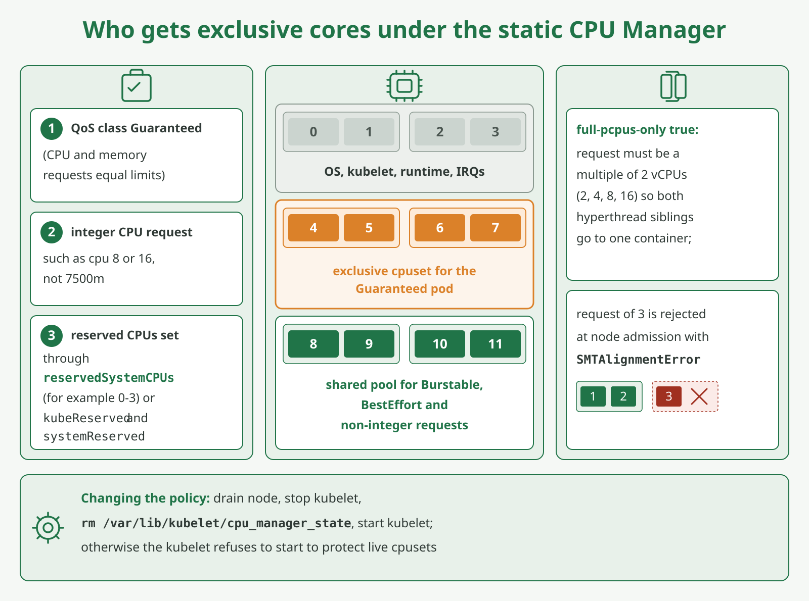

*Figure 5.9.4. The static policy pins whole physical cores to Guaranteed pods and leaves everyone else on a shared pool.*

The CPU Manager has two policies that matter for AI nodes. With `none`, the default, pods share all CPUs through CFS, and limits cause throttling.

The difference between the two policies is the difference between a shared kitchen and a private one. With the shared policy, every pod cooks in the same kitchen and waits its turn for the stove. With the static policy, a Guaranteed pod that asks for whole cores gets its own stove that nobody else uses. For a latency-sensitive inference server, the private stove removes most of the waiting. For a batch job that does not mind waiting, the shared kitchen is usually fine.

With `static`, a Guaranteed pod that requests integer CPUs gets exclusive cores. The kubelet removes those cores from the shared pool and pins the pod to them with `cpuset`. For AI work that means no CFS throttling, no cache or scheduler noise for data-loading threads, NUMA-local placement and deterministic latency for inference. The static policy needs Guaranteed QoS, integer CPU requests and reserved CPUs, set through `reservedSystemCPUs` or the CPU in `kubeReserved/systemReserved`. Its policy options include `full-pcpus-only`, which avoids sharing hyperthread siblings, plus `distribute-cpus-across-numa` and `align-by-socket`. Changing the policy means draining the node and deleting `/var/lib/kubelet/cpu_manager_state`.

Containers in Burstable or BestEffort pods, and containers with non-integer requests, use the shared pool. Use `static` on nodes where the workloads are Guaranteed pods with whole-core requests.

### Memory Manager

The `Static` policy with `reservedMemory` lets Guaranteed pods get NUMA-pinned memory and hugepages. The Topology Manager coordinates those allocations. The sum of `reservedMemory` across NUMA nodes must equal `kubeReserved + systemReserved + hard eviction threshold` for memory. Latency-critical or hugepage-based workloads, such as DPDK or some HPC jobs, can use it. It is complex to operate, so turn it on only when you need it.

### Topology Manager

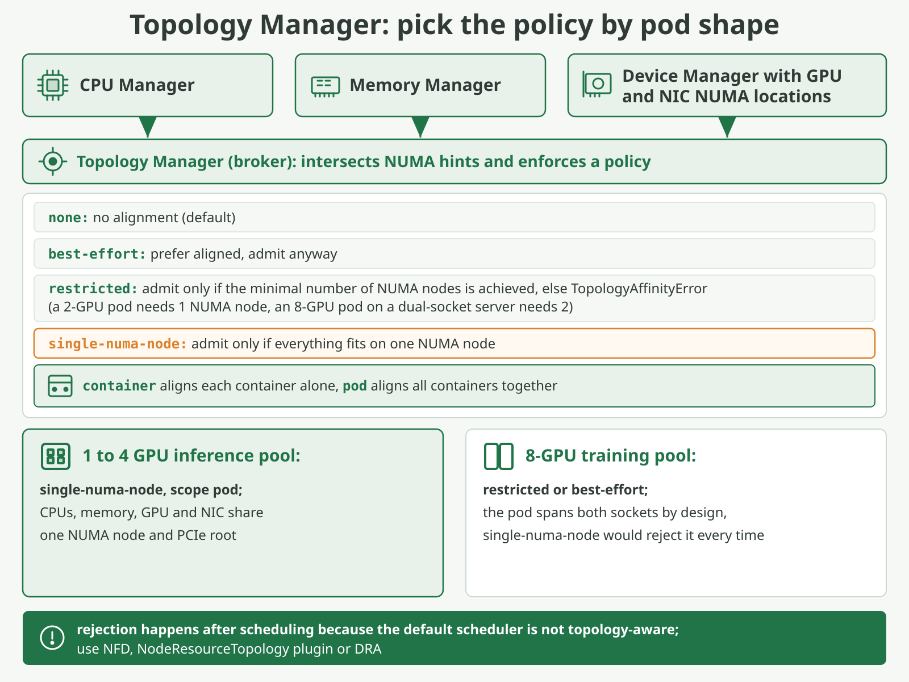

*Figure 5.9.5. Match the Topology Manager policy to the pod shape because a pod that spans sockets cannot meet single-numa-node.*

The Topology Manager acts as a broker. It collects NUMA hints from the CPU Manager, the Memory Manager and the Device Manager, then enforces a policy. Device plugins report topology, such as the NUMA node of a GPU or a NIC.

A broker is useful because each device and resource speaks only for itself. The GPU knows which NUMA node it sits on, the NIC knows its own node, and the CPU manager knows which cores are free. None of them knows the full picture. The Topology Manager gathers their preferences and decides whether a single placement can satisfy all of them. If it cannot, the policy decides whether to reject the pod or admit it with the misalignment.

| Policy | Behaviour |
|---|---|
| `none` | No alignment (default) |
| `best-effort` | Prefer aligned allocations; admit even if not aligned |
| `restricted` | Admit only if the preferred (minimal number of NUMA nodes) alignment is achieved; else reject with `TopologyAffinityError` |
| `single-numa-node` | Admit only if all resources fit on a single NUMA node |

The policies differ in how strictly they treat misalignment, as the table shows. Scope `container` aligns each container alone, while scope `pod` aligns all containers of a pod together.

For AI nodes, the question is how many GPUs a pod needs. An 8-GPU training pod spans both sockets by design, so its hints would not be preferred. Use `best-effort` or `none` for it, or per-pod relaxations. A 1 to 4 GPU inference pod benefits from `single-numa-node` or `restricted`. Its CPUs, memory, GPU and NIC then share one NUMA node and PCIe root. Misalignment shows up as lower DataLoader throughput, or as GPUDirect RDMA falling back through the CPU interconnect. If alignment cannot be satisfied, the pod fails at admission after it has been scheduled. The scheduler is not topology-aware by default. To avoid that, use NFD or topology-aware scheduling (the NodeResourceTopology plugin), or DRA (5.18).

Here is the reasoning in plain terms. A pod that uses all the GPUs on a dual-socket server must touch both sockets anyway, so insisting on one NUMA node would reject it every time. A small inference pod that uses one or two GPUs can comfortably sit on one socket, and keeping it there keeps the memory traffic local. The policy should match the shape of the pod, not a single rule applied to every pool.

### Device Manager and Pod Resources API

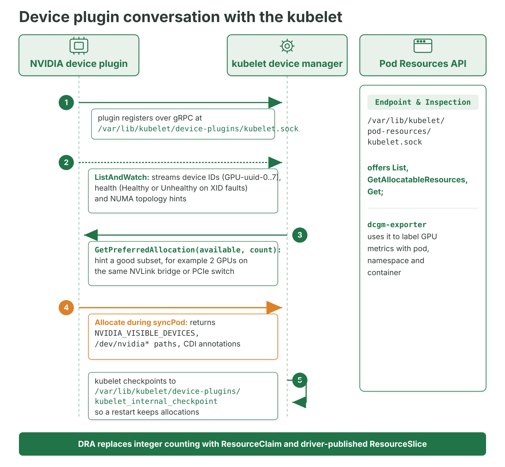

*Figure 5.9.6. The device plugin registers, reports devices and health, hints at good subsets and hands back the allocation details.*

A device plugin registers with the kubelet over gRPC at `/var/lib/kubelet/device-plugins/kubelet.sock`, and it exposes a socket. `ListAndWatch` streams devices and their health. `Allocate` returns the injection details covered in 5.8. `GetPreferredAllocation` lets plugins hint at better device sets, such as NVLink-connected GPUs. The kubelet checkpoints allocations to `/var/lib/kubelet/device-plugins/kubelet_internal_checkpoint`, so a restart keeps them.

The **Pod Resources API** runs on `/var/lib/kubelet/pod-resources/kubelet.sock`. It offers `List`, `GetAllocatableResources` and `Get`, and it shows which pods use which devices, CPUs and memory. The DCGM exporter and monitoring tools use it. **Dynamic Resource Allocation (DRA)** is stable in recent releases. It replaces the counting-based device plugin model with `ResourceClaim`s and driver-published `ResourceSlice`s. That enables structured device selection, such as GPU model, MIG profile or shared claims, and gives the scheduler awareness of devices (Part 11).

For multi-GPU AI nodes, decide which pods need NUMA alignment before you pick a Topology Manager policy.

## 5. Probes

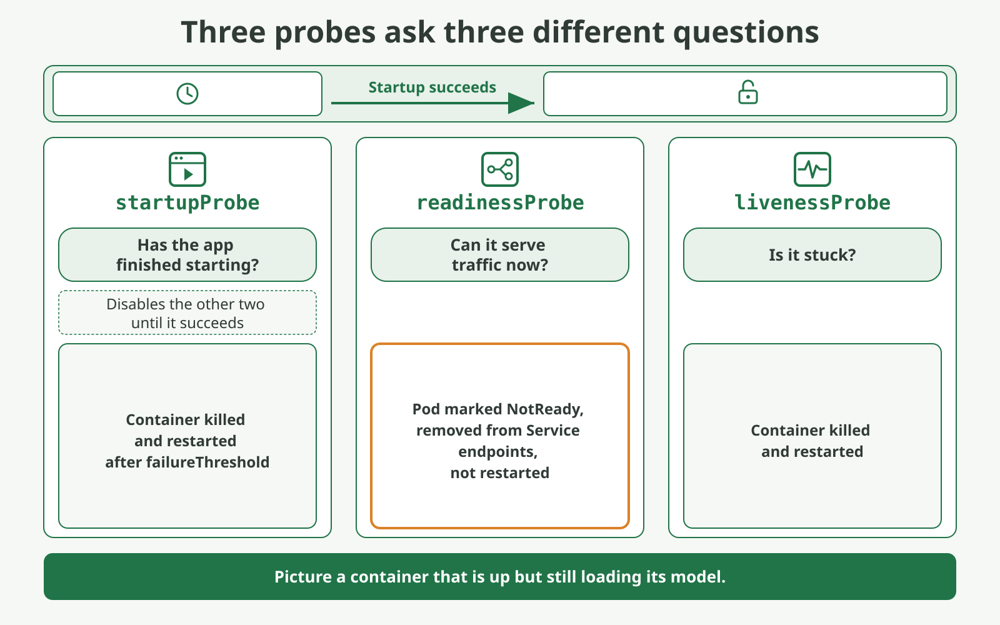

*Figure 5.9.7. The three probes ask whether the app has started, whether it can serve traffic, and whether it is stuck, with a different action for each.*

Picture a container that is up but still loading its model. Until it finishes, a check against its port tells you nothing useful. The kubelet runs three kinds of probe for each container, on a timer. Each one asks a different question, and each failure leads to a different action. The table shows what each probe asks and what happens when it fails.

Think of the three probes as three different questions a receptionist might ask a visitor. The startup probe asks whether the visitor has finished arriving, and nobody else is asked anything until the answer is yes. The readiness probe asks whether the visitor is ready to take a call right now, and a no means the call is sent elsewhere for the moment. The liveness probe asks whether the visitor has fainted, and a no means someone must help them up. Each question has a different consequence, so each probe needs its own design.

| Probe | Question | On failure |
|---|---|---|
| **startupProbe** | Has the app finished starting? (disables the others until it succeeds) | Container killed and restarted per restartPolicy after `failureThreshold` |
| **readinessProbe** | Can it serve traffic now? | Pod marked NotReady; removed from Service endpoints; not restarted |
| **livenessProbe** | Is it stuck? | Container killed and restarted |

The handlers are the checks themselves. `exec` runs a command inside the container, and exit code 0 counts as success. `httpGet` succeeds on 2xx or 3xx responses. `tcpSocket` checks the connection, and `grpc` uses the gRPC health protocol. Timing comes from a few parameters. `initialDelaySeconds` sets the wait before the first run. The defaults are 10 for `periodSeconds`, 1 for `timeoutSeconds` and 3 for `failureThreshold`. You also set `successThreshold`. `terminationGracePeriodSeconds` sets a probe-level override for liveness kills.

HTTP, TCP and gRPC probes come from the kubelet on the node, and they reach the pod IP. That means NetworkPolicy and host firewalls must allow node-to-pod traffic. An `exec` probe runs through CRI inside the container. Each one forks a process, which is expensive at high frequency and in minimal images, so avoid shell-heavy probes.

A startup probe handles slow starts, such as LLM weights loading, CUDA graph capture or large dataset indexing. The allowed startup time is `failureThreshold × periodSeconds`. With the default `failureThreshold` of 3 and a `periodSeconds` of 10, the container gets 30 seconds to come up. A startup probe with a longer window keeps a slow start from turning into a liveness kill loop.

Liveness probes must be local and cheap. Check that the process is not deadlocked, and do not check external dependencies. A database outage must not restart every app pod. For stateful or long-running training workers, consider omitting the liveness probe, because a restart is destructive for them.

A liveness probe that checks a database is like a receptionist who calls the bank whenever a visitor asks a question. If the bank is slow, every visitor gets flagged as broken at once, and they are all sent home together. The safer design checks only what the process itself controls, so a failure means the process really is stuck and a restart will help.

Readiness probes should pass only when the model is loaded and a tiny inference works. Flip the probe to not-ready during graceful shutdown or drain, and keep the endpoint cheap. Timeouts deserve attention too. The default 1 s is often too short on busy nodes. CFS throttling can fail the probes of otherwise healthy pods that have CPU limits, so set a realistic `timeoutSeconds`.

A readiness probe that passes too early sends traffic to a server that cannot answer. A readiness probe that fails too often takes a working server out of rotation for no good reason. The balance is to make the probe reflect the work the server must do, and to keep it cheap enough to run often without adding load.

Probe results appear in events, such as `Unhealthy: Readiness probe failed: ...`, and in the `prober_probe_total` metric. **Readiness gates** (`readinessGates`) let external controllers add conditions that must be true, such as load balancer registration for cloud LBs.

### A startup probe sized for a model load

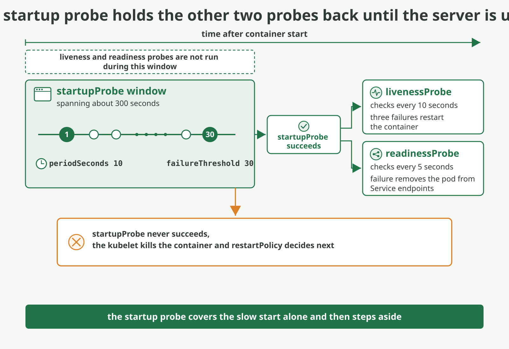

*Figure 5.9.8. The startup probe gives a slow server a long window to start, and the liveness and readiness probes wait until it succeeds.*

Picture an inference server that needs about 300 seconds to load its weights. A liveness probe that waits 300 seconds before its first check would cover the load. It would also wait 300 seconds to notice a hang later in the container's life. A startup probe avoids that trade. It guards the start-up period alone, then steps aside.

```yaml
apiVersion: v1
kind: Pod
metadata:
  name: llm-server
spec:
  containers:
    - name: server
      image: registry.example.com/llm-server:1.0
      ports:
        - containerPort: 8080
          name: http
      startupProbe:
        httpGet:
          path: /healthz
          port: http
        periodSeconds: 10
        failureThreshold: 30
      livenessProbe:
        httpGet:
          path: /healthz
          port: http
        periodSeconds: 10
        timeoutSeconds: 3
        failureThreshold: 3
      readinessProbe:
        httpGet:
          path: /ready
          port: http
        periodSeconds: 5
        timeoutSeconds: 3
        failureThreshold: 2
```

The startup probe may fail 30 times, 10 seconds apart, so the server has up to 300 seconds to come up. Until it succeeds, the kubelet runs neither of the other two probes. If it never succeeds, the kubelet kills the container and the restart policy decides what happens next. Once it succeeds, the liveness probe checks every 10 seconds, and three consecutive failures restart the container.

The restart policy matters here. A failed liveness probe kills the container, and the pod's `restartPolicy` decides what follows. The default `Always` restarts it. `OnFailure` restarts it only after a nonzero exit, and `Never` leaves it dead.

### Designing liveness and readiness endpoints

Liveness and readiness have different consequences, so give them different endpoints. A failed liveness probe restarts the container. A failed readiness probe only removes the pod from Service endpoints until it passes again.

A liveness probe should fail only when a restart would fix the problem, such as a deadlock. Often the endpoint simply returns 200, because a server that can answer at all does not need a restart. Keep it local to the process. A database outage is not repaired by restarting the app, so a database check inside liveness can restart every replica at once. Let the app fail readiness or switch off the feature instead.

A readiness probe may check conditions that come and go. A server can report not ready until its model is loaded and a tiny test request succeeds. An overloaded server can fail readiness to shed load. Readiness matters for anything that receives requests through a Service, and means little for Jobs.

Use a startup probe when the container needs a long time to start, a readiness probe on every serving workload, and a liveness probe only where a restart would help.

## 6. Node-pressure eviction

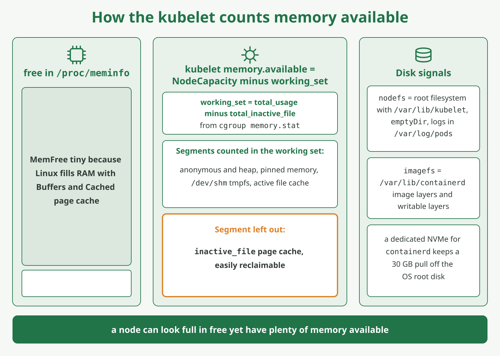

*Figure 5.9.9. The kubelet subtracts only the working set, so reclaimable page cache does not count as pressure.*

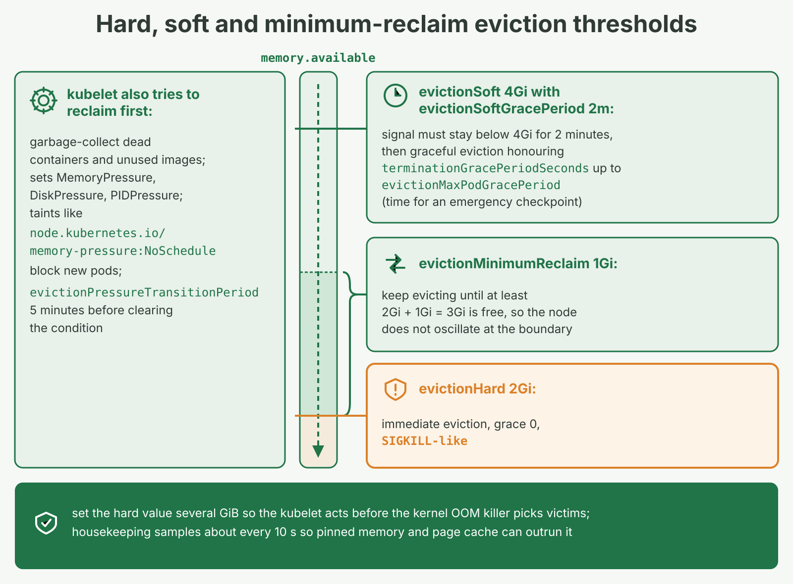

*Figure 5.9.10. Soft thresholds give time to checkpoint, hard thresholds act at once, and minimum reclaim stops oscillation.*

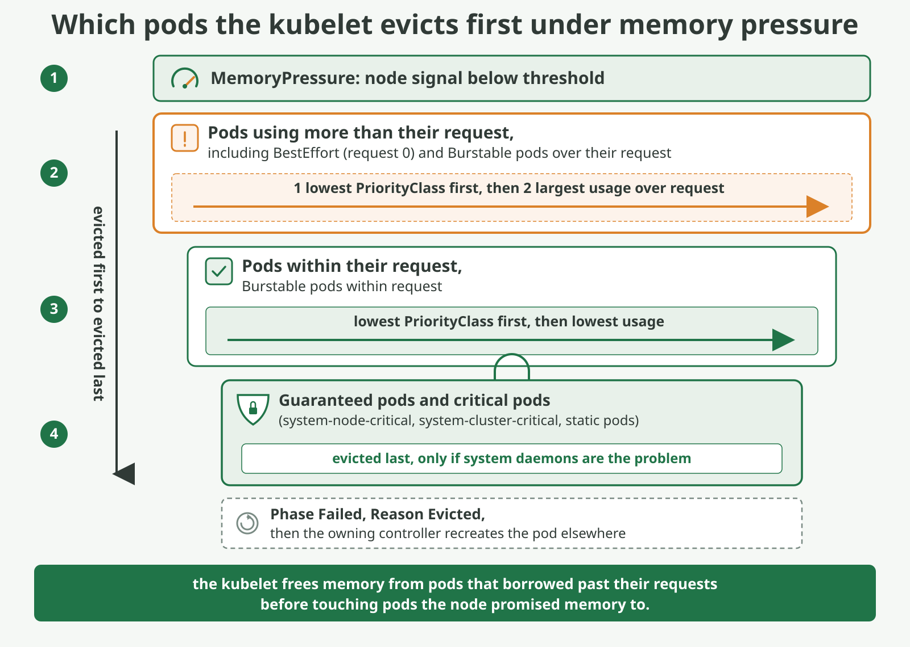

*Figure 5.9.11. Under memory pressure the kubelet evicts pods that exceed their requests first, and Guaranteed and critical pods last.*

Picture a node whose memory use creeps upward. Nothing has crashed yet, but the eviction manager is already watching. It reads node signals from cAdvisor and cgroup stats on the kubelet's housekeeping cycle, about every 10 seconds, and compares them with thresholds. The setting `evictionPressureTransitionPeriod`, 5 minutes by default, does not control sampling. It is how long the node waits after a signal recovers before it clears the pressure condition. The table lists those signals and what each one measures.

The creeping case is the most dangerous because nothing looks wrong until it is too late. A node that jumps from calm to full in one step gives the kubelet no time to act. A node that climbs slowly gives the eviction manager many samples to notice the trend, and soft thresholds let it act before the situation becomes urgent. That is why the soft and hard thresholds exist as two separate lines.

| Signal | Meaning |
|---|---|
| `memory.available` | `capacity − working set` on the node (excluding reclaimable page cache accounted into inactive file) |
| `nodefs.available`, `nodefs.inodesFree` | Root filesystem (kubelet dir, logs, emptyDir) free space/inodes |
| `imagefs.available`, `imagefs.inodesFree` | Container image/writable layer filesystem (if separate) |
| `containerfs.*` | Newer split for container writable layers |
| `pid.available` | PIDs left |

Hard thresholds evict immediately, with grace 0 and a `SIGKILL`-like short grace. Soft thresholds are more patient. The condition must persist for `evictionSoftGracePeriod`, and the pod uses its grace period, up to `evictionMaxPodGracePeriod`. The kubelet tries to reclaim resources first. When disk is low, it garbage-collects dead containers and unused images. It also sets the node conditions `MemoryPressure`, `DiskPressure` and `PIDPressure`. Taints such as `node.kubernetes.io/memory-pressure:NoSchedule` keep new pods from scheduling onto the node.

When memory runs short, the kubelet picks victims in a fixed order. It starts with pods whose usage exceeds their requests, and BestEffort counts as request 0. Among those, lower priority goes first, then the pods furthest over their requests. For disk pressure, the order uses ephemeral storage usage over request, and then priority. Guaranteed pods are evicted last, and only if system daemons are the problem and nothing else is left. Evicted pods end `Failed` with the reason `Evicted`, and controllers recreate them elsewhere. Critical pods, meaning pods with priority `system-node-critical`/`system-cluster-critical` and static pods, are protected.

The order makes sense once you see the goal. The kubelet wants to free memory with the least harm to the work that matters most. Pods that are already over their request have, in a sense, borrowed memory they never reserved, so they are the first to return it. Within that group, lower priority goes first. Pods within their requests and Guaranteed pods are protected because the node promised them that memory.

Keep three kill mechanisms apart. The first is the **kernel OOM killer**, which acts inside a cgroup. It fires when a container exceeds its memory limit, or when the node runs out of memory faster than the kubelet can react. The process is killed, the container restarts according to policy, and the reason shows as `OOMKilled`. The second is *kubelet eviction*. It is graceful, works at pod level under node pressure, and ignores PDBs. The third is *API-initiated eviction/preemption/drain*, which respects PDBs and priority.

For AI nodes, set `evictionHard memory.available` large enough, several GiB, so the kubelet acts before the kernel OOM killer picks processes at random. Workloads with huge page cache and pinned memory can consume memory faster than the kubelet's housekeeping sample, which runs every 10 s. Prefer Guaranteed pods for important jobs. Keep `ephemeral-storage` requests on pods that write scratch data, so disk pressure does not arrive as a surprise.

Pick the `evictionHard` memory value before a training job fills the node, not after the first OOM.

The reason to choose the value early is that the first OOM is the most expensive teacher. By then the job has lost its progress and the node has already made a choice on your behalf. Picking the threshold while the node is calm lets you reason about it with a clear head, and it gives the kubelet room to act while there is still time for an orderly eviction.

### Reading an OOMKilled container

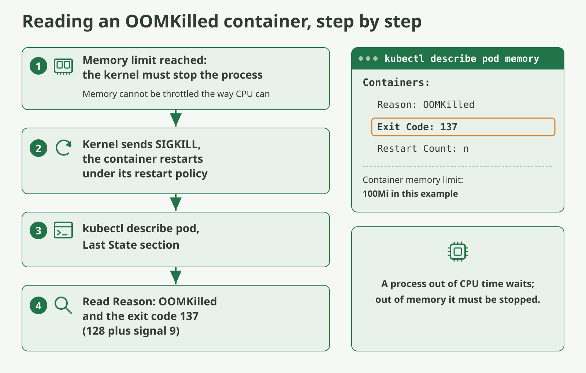

*Figure 5.9.12. An OOMKilled container shows Reason OOMKilled and exit code 137 in the Last State section of kubectl describe pod.*

Memory cannot be throttled the way CPU can. When a container uses more memory than its limit, the kernel has to stop the process. The container then restarts under its restart policy, and the pod records why. You can see that record with `kubectl describe pod`, in the `Last State` section.

The contrast with CPU is the key idea. A process that runs out of CPU time simply waits, and it can wait for a while without harm. A process that runs out of memory has no such option, because the memory it asked for is already in use. The kernel must therefore stop something, and the container restart is the quickest way to recover the memory. Setting the limit well above the real peak is the only way to avoid that stop.

The output below comes from a container with a memory limit of 100Mi. Look at `Reason: OOMKilled` and the exit code. The kernel kills the process with SIGKILL, so containers killed this way normally report exit code 137, which is 128 plus signal 9. The `Restart Count` shows how many times the container has restarted.

```
$ kubectl describe pod memory
Name:         memory
Namespace:    default
Priority:     0
... <snip> ...
Containers:
  stress:
... <snip> ...
    Last State:     Terminated
      Reason:       OOMKilled
      Exit Code:    137
      Started:      Fri, 23 Oct 2020 10:11:51 -0400
      Finished:     Fri, 23 Oct 2020 10:11:56 -0400
    Ready:          True
    Restart Count:  1
    Limits:
      memory:     100Mi
    Requests:
      memory:     100Mi
```

When you see this reason, compare the memory limit with what the workload really uses at its peak. Change the limit, or the workload, before you assume the node is at fault.

## 7. Garbage collection and logs

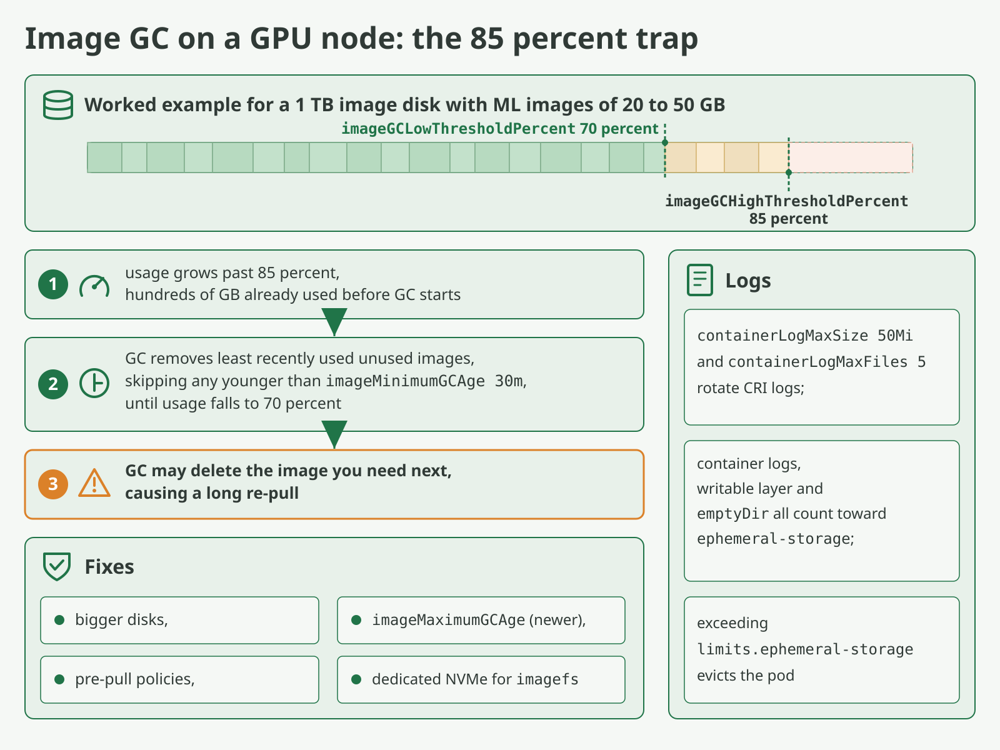

*Figure 5.9.13. High GC thresholds on a big disk let large ML images pile up and then evict the one you need next.*

Disks on a GPU node fill up quietly. Old containers, unused images and chatty logs all take space, and the kubelet has to clean them up. Container GC removes exited containers beyond `maxPerPodContainer` or `maxContainers`, and older than `minimumContainerTTL`-like behaviour. The flags `--maximum-dead-containers*` were deprecated in favour of eviction-based cleaning. Dead containers keep consuming writable layer space until something removes them.

Disk pressure is harder to notice than memory pressure, because nothing crashes at first. Logs grow a few megabytes at a time, old images stay on disk until someone asks for space, and dead containers hold on to their writable layers. One day a pull fails because the disk is full, and the cause turns out to be weeks of quiet growth. Watching the disk trend, and setting the thresholds early, prevents that kind of surprise.

Image GC starts when image filesystem usage exceeds `imageGCHighThresholdPercent`. It then removes the least recently used unused images until usage falls to `imageGCLowThresholdPercent`. It skips any image younger than `imageMinimumGCAge`. Take an ML image of 20 to 50 GB on a 1 TB disk. An 85% high threshold lets hundreds of GB fill before GC starts. GC may then delete the image you need next, which triggers a long re-pull. Use bigger disks, `imageMaximumGCAge` (newer), and pre-pull policies to avoid that cycle.

Log rotation works on a different axis. The kubelet rotates CRI logs at `containerLogMaxSize`, and it keeps `containerLogMaxFiles` of them. Training jobs that print per-step logs at a high rate can fill disks and add CPU overhead. Log to stdout moderately, ship metrics separately, or write detailed logs to a PVC or object storage.

Container logs, the writable layer and `emptyDir` all count toward the pod's ephemeral-storage usage. A pod that exceeds `limits.ephemeral-storage` gets evicted.

Size the disks and set the GC thresholds before you start pulling large ML images.

## 8. Node status, leases and failure behaviour

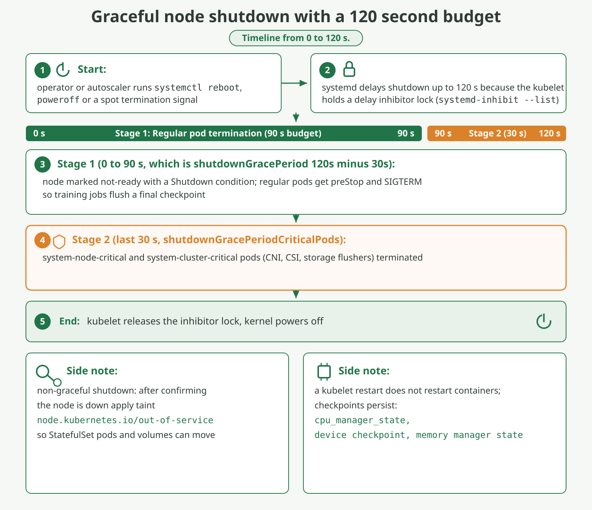

*Figure 5.9.14. The kubelet stops regular pods first and critical pods last inside the shutdown grace period.*

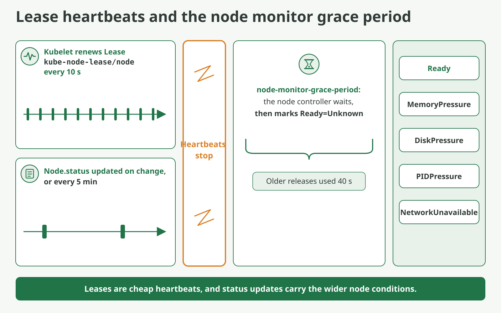

*Figure 5.9.15. The kubelet renews its node lease every 10 seconds and reports status every 5 minutes, and the node is marked Unknown after the grace period.*

Picture a node that stops answering. The control plane has to decide whether the node is gone, and how long to wait before it moves the node's pods. Leases and status updates answer that question.

A useful analogy is a receptionist who stops calling in. The office keeps running for a while, because the staff know their jobs. But the manager eventually notices the silence and reassigns the visitors. The grace periods in this section are the time the manager waits before reassigning, and choosing them is a trade between patience and speed of recovery.

The kubelet renews a Lease named `kube-node-lease/<node>` every `nodeLeaseDurationSeconds/4`, which is 10 s. That is cheap. The kubelet also updates `Node.status` when something changes, or every `nodeStatusReportFrequency`, which is 5 min. The node controller waits for `--node-monitor-grace-period` after the last lease or status update, and then marks the node `Ready=Unknown`. That grace period was 40 s in older releases, and recent kube-controller-manager references list 50 s, so check the default for your Kubernetes version.

Nodes report the conditions `Ready`, `MemoryPressure`, `DiskPressure`, `PIDPressure` and `NetworkUnavailable`. Node-problem-detector adds extra conditions, such as `KernelDeadlock` or `GPUXidError`. Remediation controllers act on those extra conditions, as 5.32 and Part 17 cover.

The node lifecycle controller adds taints on its own. These include `node.kubernetes.io/not-ready` and `unreachable`, which use NoExecute with a default 300 s toleration. It also adds `memory-pressure`, `disk-pressure`, `pid-pressure`, `network-unavailable` and `unschedulable`, which is the taint a cordon applies. For GPU jobs that need fast recovery, shorten `tolerationSeconds` for those taints in the pod specs. For stateful workloads, consider longer values or manual fencing.

On systemd hosts, the kubelet takes a shutdown inhibitor lock, and `shutdownGracePeriod` controls how long that takes. When the node shuts down, the kubelet terminates pods in priority order, with regular pods first and critical pods last, within that budget. It then updates node status and lets the poweroff proceed. Combined with draining before maintenance (5.19), this prevents abrupt SIGKILLs of training pods during reboots. For a non-graceful node shutdown, apply the `node.kubernetes.io/out-of-service` taint after you confirm the node is down. StatefulSet pods and their volumes can then move.

A kubelet restart does not restart containers. The kubelet reconciles from the runtime state, and its checkpointed manager states persist. Those include `cpu_manager_state`, the device checkpoint and the memory manager state. A kubelet being down does not mean its pods are down. A NotReady node does trigger evictions, but only after the toleration period. While the kubelet is down, no probes, log rotation or volume operations happen.

Decide how long each workload should tolerate a NotReady node before its pods move.

## 9. Static pods, kubelet API and security

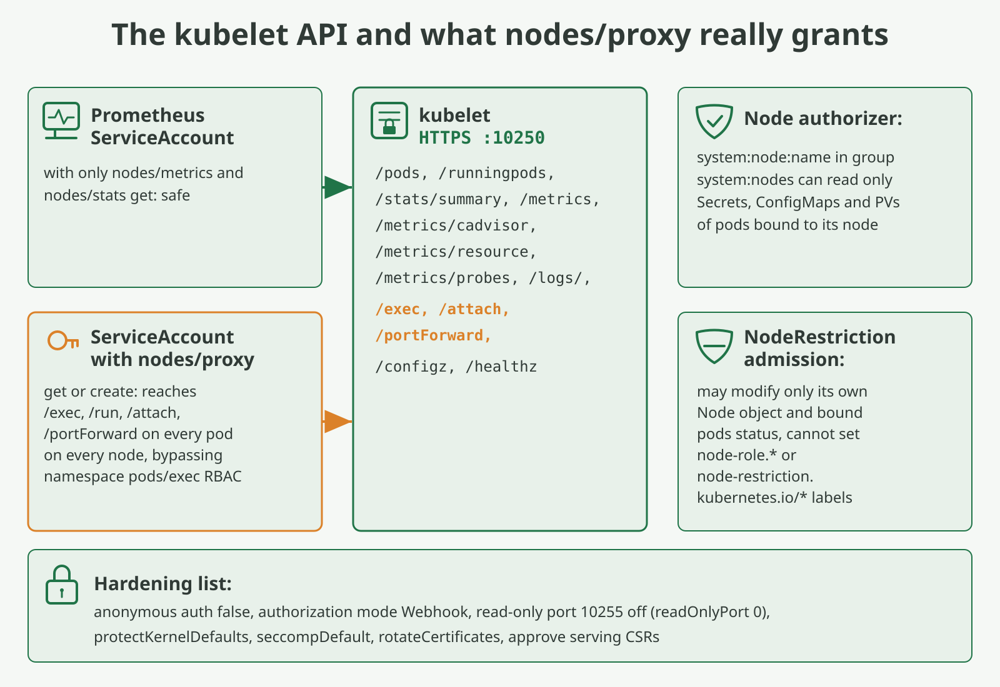

*Figure 5.9.16. Grant monitoring tools only nodes metrics and stats, because nodes proxy is effectively exec on every pod.*

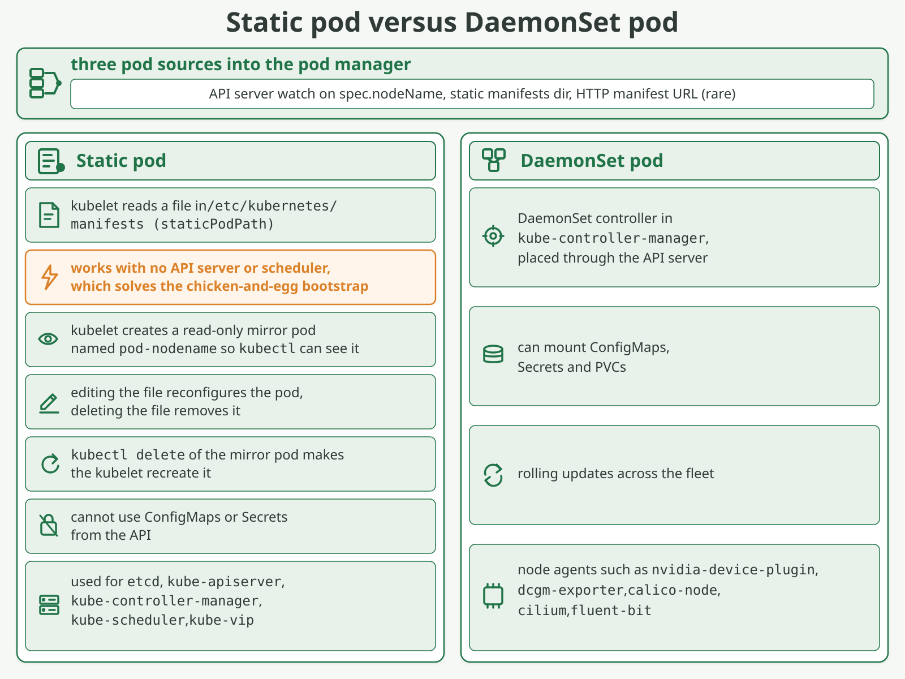

*Figure 5.9.17. Static pods let the kubelet start the control plane from files, and DaemonSets manage node agents through the API.*

Static pods are the pods the kubelet runs without the API server asking for them. Manifests in `staticPodPath` (`/etc/kubernetes/manifests`) are run directly by the kubelet. The kubelet also mirrors each one into the API as a read-only mirror pod, with the suffix `-<nodename>`. kubeadm uses static pods for the control-plane components, and node-critical agents use them too. Editing a file reconfigures the pod immediately, and deleting the file removes the pod. Static pods cannot use ConfigMaps or Secrets from the API, because they are file-based only. Controllers do not control them.

Static pods solve a chicken-and-egg problem. The control plane runs as pods, but the scheduler and the API server need some pods to exist before they can schedule anything. The kubelet reads those pods from files on disk, so it can start them without any API at all. The mirror pod is just a read-only view that lets you see the static pod with ordinary tools.

The kubelet API on port 10250 authenticates with x509 certificates or bearer tokens through a webhook. Authorisation also goes through a webhook, using the `nodes/proxy`, `nodes/stats`, `nodes/log` and `nodes/metrics` subresources. Granting `nodes/proxy` is effectively `exec` rights on every pod on the node. Audit any RBAC that includes it, because many monitoring roles do. The endpoints are `/pods`, `/runningpods`, `/stats/summary`, `/metrics`, `/metrics/cadvisor`, `/metrics/resource`, `/metrics/probes`, `/logs/`, `/exec`, `/attach`, `/portForward`, `/configz` and `/healthz`. Disable the read-only port 10255 and anonymous auth, and keep `authorization.mode: Webhook`.

Think of the kubelet API as a service entrance that opens onto every room in the building. Each door has its own lock, but the entrance itself must be guarded. Authentication checks who is at the door, and authorization checks which rooms that person may enter. The subresources listed in the next sentences are the rooms, and some of them, like the proxy, open onto everything at once.

The Node authorizer and NodeRestriction admission limit what a kubelet can read and modify. A kubelet can touch only its own node and the pods bound to it. It also cannot set certain labels, such as `node-role.*` or `node-restriction.kubernetes.io/*`.

The kubelet client certificate uses the CN `system:node:<name>` and the group `system:nodes`. It comes from TLS bootstrapping and rotates automatically through `rotateCertificates`. The serving certificate comes from a CSR when `serverTLSBootstrap` is on, and that CSR needs approval. An expired certificate causes NotReady nodes, as 5.21 explains.

The hardening checklist covers `protectKernelDefaults`, `seccompDefault`, the read-only port off, `--anonymous-auth=false`, `readOnlyPort: 0`, the TLS minimum version and cipher suites, and `eventRecordQPS`. It also covers restricting `hostPath` and privileged pods through Pod Security, user namespaces for pods (`hostUsers: false`), AppArmor or SELinux, and node OS hardening (Part 18).

Review every role that holds `nodes/proxy`, and then work through the checklist above.

## 10. Observability

The kubelet exposes metrics you can scrape at `:10250/metrics`, `/metrics/cadvisor` and `/metrics/probes`. The ones that tell you the most about a node are `kubelet_running_pods`, `kubelet_running_containers`, `kubelet_pod_start_duration_seconds`, `kubelet_runtime_operations_duration_seconds`, `kubelet_pleg_relist_duration_seconds`, `kubelet_pleg_relist_interval_seconds`, `kubelet_evictions`, `kubelet_node_name` and `kubelet_certificate_manager_client_ttl_seconds`. Volume usage shows up in `kubelet_volume_stats_*` for PVCs. Container-level signals include `container_cpu_cfs_throttled_periods_total`, `container_memory_working_set_bytes`, `container_oom_events_total`, `prober_probe_total` and `rest_client_requests_total`.

Alerts worth having cover node NotReady, slow PLEG relist, an expiring kubelet certificate, and a high container CPU throttling ratio on latency-critical pods. They should also catch disk/inode/PID pressure approaching thresholds, image pull errors, kubelet restarts and runtime operation latency.

Use `journalctl -u kubelet -f` to follow kubelet logs. The default verbosity is `--v=2`, and `4` adds sync details. Runtime logs come from `journalctl -u containerd`. Kernel messages come from `dmesg -T`, and OOM kills appear there as lines such as "Killed process" or "oom-kill:constraint=CONSTRAINT_MEMCG". Pod logs live in `/var/log/pods`.

## 11. Troubleshooting guide

Read the table from left to right. The first column is the symptom you see. The second is the most likely cause, and the third is the command or log that confirms it.

The table works best as a conversation. Start with the symptom you see on the node, find the cause in the middle column that fits it, and then run the check on the right to confirm. Several rows share a root cause, such as the probes row and the throttling row, so once you have confirmed one, the others are often explained too.

| Symptom | Likely cause | Where to look |
|---|---|---|
| Node `NotReady` | Kubelet down/cert expired/runtime down/network | `systemctl status kubelet`, `journalctl -u kubelet`, `kubectl describe node` conditions, `crictl info` |
| `PLEG is not healthy` | Runtime slow/overloaded (many containers, disk IO) or kernel issue | PLEG metrics, containerd CPU/IO, `crictl ps` latency |
| Kubelet crash loop on start | Swap on, cgroup driver mismatch, invalid config, `protectKernelDefaults` sysctl mismatch, cpu manager state mismatch | kubelet journal first lines |
| `TopologyAffinityError` | Topology manager policy cannot align | pod events, policy and device NUMA info, `numactl -H`, `nvidia-smi topo -m` |
| CPU manager state error after changing policy | Stale state file | drain node, remove `cpu_manager_state`, restart |
| Pods evicted with `The node was low on resource: memory` | Memory pressure beyond thresholds, over-request pods | `kubectl describe pod`, node events, kubelet eviction logs, node `memory.available` |
| Pods OOMKilled while node has free memory | Container limit reached (cgroup) | `kubectl describe`, `memory.events`, shm/page cache |
| Node unresponsive/SSH hangs under load | No system reserved, kernel OOM, CPU starvation | reservations, `dmesg`, `systemd-cgtop` |
| Disk pressure, image GC thrash | Small image disk, large images, logs | `df -h`, `crictl imagefsinfo`, log sizes, thresholds |
| Probes failing intermittently | CPU throttling, short timeouts, NetworkPolicy blocking node→pod | `cpu.stat`, probe events, policy |
| `kubectl logs/exec` fails TLS | Serving CSR unapproved | `kubectl get csr`, approve |
| Pods Pending on node with free GPUs | Device plugin not registered/unhealthy, allocatable 0 | `kubectl describe node`, plugin logs, kubelet device-plugin dir |
| Containers can't see GPUs after kubelet/plugin restart | Plugin restart without kubelet resync; runtime hook mis-config | restart order, `ListAndWatch` logs, checkpoint file |
| Time to start high | Serial image pulls, slow CSI, CNI | see 5.8 |

When a node turns NotReady, start with the kubelet journal. The probe and eviction rows follow the same pattern: check the cause in the middle column, then confirm it with the command on the right.

## 12. Tuning checklist for GPU nodes

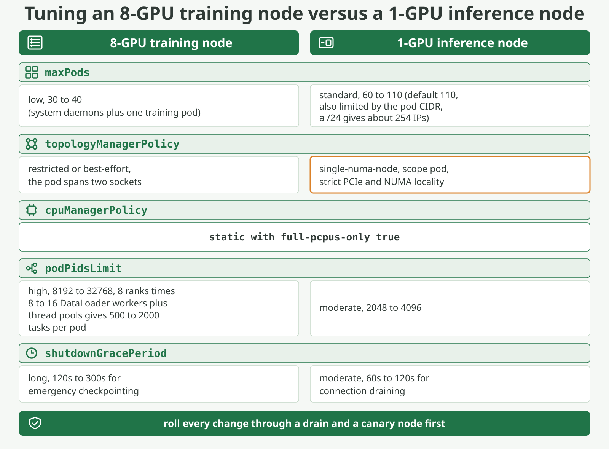

*Figure 5.9.18. Both node types use static CPU pinning, and the topology policy, PID limit and shutdown grace differ.*

Start with the foundation. Use the systemd cgroup driver, cgroup v2, and a kernel and runtime that are up to date and consistent across nodes (4.17). Reserve CPU for kube and system daemons with dedicated cores through `reservedSystemCPUs`, and reserve memory and ephemeral-storage the same way. Set meaningful hard eviction thresholds.

A good order for a new GPU node is foundation first, then placement, then images, then failures, then security, then observability. Each layer depends on the one before it. A carefully tuned scheduler cannot help a node whose cgroup driver disagrees with its runtime, and a fine eviction policy cannot protect a node that was never reserved. Tuning in this order means each change rests on something solid.

Next, place the workloads. Use the CPU Manager `static` policy with `full-pcpus-only`. Choose the Topology Manager policy per node pool: relaxed for 8-GPU training pools, and strict for small-GPU inference pools. Use the Memory Manager only if hugepage or NUMA pinning is required. Use Guaranteed QoS for GPU pods, and set explicit shm and ephemeral storage. Keep the PID limit adequate for multi-process training, with `podPidsLimit` at thousands or more.

For images, use a large dedicated NVMe image filesystem, parallel pulls, careful GC thresholds and a pre-pull DaemonSet. For failures, run node problem detector with remediation, shorten taint tolerations for elastic jobs, and set `shutdownGracePeriod` for planned reboots.

For security, use webhook authn and authz, rotate certificates, approve serving CSRs, enable the seccomp default, and leave the read-only port off. For observability, scrape the kubelet and cAdvisor, DCGM and NPD, and alert on pressure and throttling. Keep config in Git (4.26) and verify it with `configz`. Roll each change out through a drain and a canary node before you apply it to the whole pool.

## 13. Lab

Start with the self-checking Python lab, which runs on your own machine. The script at `code/part05/kubelet_node_managers_lab.py` checks three things. It verifies the CPU Manager through `evaluate_cpu_manager_static`, with `full-pcpus-only: "true"`. It tests the Topology Manager NUMA hint intersection evaluator, `evaluate_topology_manager`, which compares the `single-numa-node`, `restricted` and `best-effort` policies. It also checks the node-pressure memory eviction victim selector, `rank_memory_eviction_victims`.

The lab lets you test your understanding before the node is involved. If you can predict the CPU Manager's answer and the Topology Manager's answer on paper, you know the rules well enough to move on. If the lab disagrees with your prediction, the disagreement is the lesson. Work out which rule you misread, then try the next exercise.

```bash
python3 code/part05/kubelet_node_managers_lab.py
```

The steps after that need a Linux Kubernetes worker node. The interactive shell steps below were not run on a live worker, so treat each one as a first attempt. Work through the exercises in order.

1. Print the live kubelet config through `configz`, then compute allocatable from capacity and reservations by hand. Change `kubeReserved` and `systemReserved`, restart the kubelet, and watch what `kubectl describe node` shows.
2. Use `systemd-cgls` and `systemd-cgtop` to find `kubepods.slice`, the QoS slices, and the pod and container scopes. Read `memory.max` and `cpu.weight` for Guaranteed, Burstable and BestEffort pods, and match those values to the requests and limits.
3. Create one pod for each QoS class and read each container's `oom_score_adj`. Use a stress image to trigger a container OOM. Then push the lab VM into node-level memory pressure, and observe the eviction order and the events.
4. Set `evictionHard memory.available` low on one node and high on another. Run a memory consumer on both, then compare kubelet-managed eviction with kernel OOM kills. Finally, set soft thresholds and grace periods.
5. Enable `static` on a node: drain it and delete the state file. Run a Guaranteed pod with 4 CPUs, then inspect `cpuset.cpus` with `cat /sys/fs/cgroup/.../cpuset.cpus.effective`, `taskset -pc`, and the cpuset of a shared-pool pod. Compare latency and throttling with and without exclusivity, and try `full-pcpus-only` with odd CPU counts.
6. On a multi-NUMA GPU node, set `single-numa-node`. Request 1 GPU and some CPUs, and observe the aligned allocation with `nvidia-smi topo -m` and `numactl`. Then request 8 GPUs and watch for `TopologyAffinityError`. Finally, adjust the pool to `best-effort`.
7. Query the Pod Resources API socket with `grpcurl` or a small client to list devices per pod. Compare the output with the DCGM exporter labels.
8. Build a server with a controllable startup time and failure toggles. Test how the startup, readiness and liveness probes interact. Then show CPU-throttle-induced probe failures by limiting CPU hard.
9. Fill the image filesystem with test images and observe GC. Set a low `containerLogMaxSize`, run a chatty pod, and watch rotation and disk usage. Then compute the log retention per pod.
10. Block connectivity between the kubelet and the API on a worker with iptables. Record timestamps for lease expiry, the `Unknown` condition, the taint and the pod eviction. Repeat with shorter tolerations. Then test graceful shutdown with `systemctl reboot` and `shutdownGracePeriod`.
11. Add a static pod manifest and see its mirror pod. Modify and delete the manifest, then compare the behaviour with a DaemonSet.
12. Query `:10250` with and without credentials. Check the `nodes/proxy` RBAC in the existing ClusterRoles, and verify that the read-only port is closed.
13. Build dashboard panels for pressure signals, throttling, PLEG latency and eviction counts, then write alerts for them.
14. Clean up.

## 14. Common mistakes

The first mistake is running GPU nodes with no reserved resources and tiny eviction thresholds. The result is a surprise kernel OOM on the node. Enabling the `static` CPU manager without Guaranteed integer-CPU pods has no effect at all. Switching policies without draining the node and removing the state file causes trouble too.

Using `single-numa-node` for pods that need all 8 GPUs leads to guaranteed admission failures. Liveness probes that call external dependencies are another trap. So are a missing startup probe for slow model loads, and 1 s timeouts on throttled pods.

Assuming evictions respect PDBs is a mistake. Node-pressure eviction is not an API eviction, and it ignores PDBs. Letting image GC delete large ML images repeatedly is a mistake as well, and so is running tiny image disks. Chatty training logs can fill disks, which is why log rotation needs tuning.

Granting `nodes/proxy` RBAC broadly, and leaving anonymous or read-only kubelet ports on, are security mistakes. Forgetting to approve kubelet serving CSRs lets kubelet certificates expire. Changing the kubelet config on all nodes at once, without canaries, is the last mistake on this list.

Each of these is cheaper to catch on one canary node than across a full GPU pool.

## 15. Interview angles

These are the questions an interviewer tends to ask about the kubelet. Be ready to answer each one in your own words.

- "What does the kubelet do? Walk through its main loops and managers."
- "How is node allocatable computed? Why reserve resources?"
- "Explain QoS classes, OOM scores and eviction."
- "What is the difference between kernel OOM kill, node-pressure eviction and API eviction?"
- "What do the CPU, Memory and Topology Managers do? When would you use `static` and `single-numa-node` for AI?"
- "How do probes work and what are common mistakes?"
- "What happens when a node loses network connectivity to the control plane?"
- "How would you tune kubelet for an 8-GPU training node versus a 1-GPU inference node?"

## Exercises

1. Take the production `KubeletConfiguration` for dual-socket 8-GPU nodes from Section 2 and walk through it. Explain why `cgroupDriver: systemd`, `protectKernelDefaults: true`, `seccompDefault: true`, `serializeImagePulls: false` with `maxParallelImagePulls: 3`, `reservedSystemCPUs: "0-3"`, `kubeReserved` and `systemReserved`, and `evictionHard` and `evictionSoft` are set as shown.
2. Trace the `/sys/fs/cgroup` tree under `systemd`. It contains `system.slice`, `kubepods.slice`, `kubepods-burstable.slice` and `kubepods-besteffort.slice`. Explain why `Guaranteed` pods sit directly under `kubepods.slice`. Then calculate `Allocatable` from `Capacity`, `kubeReserved`, `systemReserved` and `evictionHard`.
3. Use `evaluate_cpu_manager_static()` and `evaluate_topology_manager()` in `code/part05/kubelet_node_managers.py` to answer three questions. First, what happens when a `Guaranteed` Pod requests 3 CPUs on an SMT-enabled host with `full-pcpus-only: "true"`? Second, why must `/var/lib/kubelet/cpu_manager_state` be removed when you change the CPU Manager policy? Third, why do 1 to 4 GPU inference pools use `topologyManagerPolicy: single-numa-node`, while 8-GPU training pools use `best-effort`, or `restricted` with `pod` scope?
4. Explain how the NVIDIA device plugin registers at `/var/lib/kubelet/device-plugins/kubelet.sock`. Explain how `kubelet_internal_checkpoint` preserves GPU assignments across `kubelet` restarts, and how `dcgm-exporter` uses `/var/lib/kubelet/pod-resources/kubelet.sock`. Finally, explain what `DRA` (`ResourceClaim`, `ResourceSlice`) improves over integer device counting.
5. Using `rank_memory_eviction_victims()` in `code/part05/kubelet_node_managers.py`, trace the exact order in which the kubelet selects Pods for eviction under `MemoryPressure`. Then contrast the three kill mechanisms: the kernel cgroup OOM kill (`OOMKilled`), kubelet node-pressure eviction (`Reason: Evicted`), and API-initiated eviction (`kubectl drain`).
6. Explain how `shutdownGracePeriod`, set to `120s`, and `shutdownGracePeriodCriticalPods`, set to `30s`, use systemd inhibitor locks to drain Pods cleanly during OS reboots. Explain how Static Pods and mirror Pods work. Then explain why granting `nodes/proxy` RBAC permissions is a major security risk.

## Checkpoint questions (20)

<details>
<summary>1. How do you inspect the live `KubeletConfiguration` running on a specific worker node from `kubectl`?</summary>

Ask the node's `/configz` endpoint through the API server proxy:
```bash
kubectl get --raw "/api/v1/nodes/<node-name>/proxy/configz" | jq .kubeletconfig
```
The output is the merged `KubeletConfiguration` that is active in memory on that kubelet right now.
</details>

<details>
<summary>2. What does `protectKernelDefaults: true` in `KubeletConfiguration` do?</summary>

With `protectKernelDefaults: true`, the kubelet refuses to start if any kernel sysctl differs from the values it expects. The checked parameters are `vm.overcommit_memory = 1`, `vm.panic_on_oom = 0`, `kernel.panic = 10`, `kernel.panic_on_oops = 1`, `kernel.keys.root_maxkeys = 1000000` and `kernel.keys.root_maxbytes = 25000000`. The kubelet does not change those host kernel tunables at runtime. You manage them declaratively during node bootstrap, with Ansible or Packer. This is how the setting supports CIS Kubernetes Benchmark compliance.
</details>

<details>
<summary>3. Where are `Guaranteed`, `Burstable`, and `BestEffort` Pods placed inside `/sys/fs/cgroup/kubepods.slice` when `cgroupsPerQOS: true` and `cgroupDriver: systemd` are used?</summary>

- **`Guaranteed` Pods:** They sit directly under `kubepods.slice/`, as `/sys/fs/cgroup/kubepods.slice/kubepods-pod<uid>.slice/cri-containerd-<id>.scope`.
- **`Burstable` Pods:** They sit under `kubepods.slice/kubepods-burstable.slice/kubepods-burstable-pod<uid>.slice/...`.
- **`BestEffort` Pods:** They sit under `kubepods.slice/kubepods-besteffort.slice/kubepods-besteffort-pod<uid>.slice/...`.

The `kubepods.slice` cgroup has its `memory.max` set to the node's **Allocatable** memory. With `enforceNodeAllocatable: ["pods"]`, user Pods combined can never encroach on `kubeReserved`, `systemReserved` and `evictionHard`.
</details>

<details>
<summary>4. Why is `reservedSystemCPUs: "0-3"` preferred over `kubeReserved.cpu` + `systemReserved.cpu` when using `cpuManagerPolicy: static` on a GPU node?</summary>

With `cpuManagerPolicy: static`, the kubelet has to know which physical CPU cores to keep in the shared pool. That keeps a user `Guaranteed` Pod off the cores that run the kubelet, containerd, sshd, kernel softirqs, and NVMe or NIC interrupts. `reservedSystemCPUs: "0-3"` names those cores explicitly. It reserves hardware threads `0..3`, which sit on NUMA node 0, for the OS and Kubernetes daemons. Every remaining core stays free for exclusive `cpuset` assignment.
</details>

<details>
<summary>5. What three requirements must a Pod meet to receive exclusive pinned CPU cores from `cpuManagerPolicy: static`, and what does `full-pcpus-only: "true"` add?</summary>

1. The Pod's QoS class must be **`Guaranteed`**, which means every container sets CPU and memory `requests == limits`.
2. The container must request a **whole integer number of CPUs**, such as `cpu: "8"` or `cpu: "16"`, not `cpu: "7500m"`.
3. With `cpuManagerPolicyOptions: { full-pcpus-only: "true" }` on an SMT (Hyper-Threading) server with 2 threads per physical core, the request must be a multiple of 2 vCPUs, such as 2, 4, 8 or 16. The kubelet then allocates complete physical cores, with both hyperthread siblings. Two different containers cannot share the L1 and L2 cache and execution units of one physical core. An odd request, such as `3`, is rejected at node admission with `SMTAlignmentError`.
</details>

<details>
<summary>6. Why does `kubelet` fail to start with `policy ... is not allowed to be changed` after you edit `cpuManagerPolicy` or `reservedSystemCPUs` in `/var/lib/kubelet/config.yaml`, and how do you fix it?</summary>

The kubelet saves its current CPU assignments and policy name in `/var/lib/kubelet/cpu_manager_state`. The memory manager keeps `/var/lib/kubelet/memory_manager_state`. If you change `cpuManagerPolicy`, from `none` to `static` for example, or change `reservedSystemCPUs`, without clearing that checkpoint file, the kubelet refuses to start. That protects live container `cpuset`s from corruption. Drain the node first, stop the kubelet, run `sudo rm -f /var/lib/kubelet/cpu_manager_state`, and then start the kubelet again.
</details>

<details>
<summary>7. Compare the four `topologyManagerPolicy` modes (`none`, `best-effort`, `restricted`, `single-numa-node`) and explain which to use for 1–4 GPU inference nodes vs. 8-GPU HGX training nodes.</summary>

- **`none`** is the default. It does no NUMA alignment between CPUs, memory, GPUs and NICs.
- **`best-effort`** stores the preferred NUMA affinity hint and tries to align resources on the fewest NUMA nodes. It still admits the Pod if alignment is impossible.
- **`restricted`** admits the Pod only if every requested resource fits on the minimum theoretical number of NUMA nodes for that request size. A 2-GPU pod needs 1 NUMA node, and an 8-GPU pod on a dual-socket server needs 2. Otherwise it rejects the Pod with `TopologyAffinityError`.
- **`single-numa-node`** admits the Pod only if all requested CPUs, memory, GPUs and NICs fit on one NUMA node. That covers 1 to 4 GPUs on one socket.

**Rule of thumb:** use `single-numa-node`, with `topologyManagerScope: pod`, on 1 to 4 GPU inference pools. That keeps CPUs, RAM, the GPU and the NIC from crossing the inter-socket UPI or Infinity Fabric link. Use `restricted` or `best-effort` on 8-GPU training pools, where one Pod intentionally spans both CPU sockets with all 8 GPUs.
</details>

<details>
<summary>8. What are the three gRPC methods of the Kubernetes Device Plugin API, and what does `GetPreferredAllocation` do on an 8-GPU NVLink/PCIe node?</summary>

Every device plugin, such as nvidia-device-plugin or an SR-IOV/RDMA plugin, registers with `/var/lib/kubelet/device-plugins/kubelet.sock`. It implements three methods.

1. **`ListAndWatch`** streams the device IDs, such as `GPU-uuid-0..7`, their health status (`Healthy` or `Unhealthy` on XID faults) and their NUMA topology hints to the kubelet.
2. **`GetPreferredAllocation`** runs when a Pod requests a subset of GPUs, such as 2 or 4 out of 8. The kubelet calls `GetPreferredAllocation(available_gpus, required_count)`, so the NVIDIA plugin can pick a topologically good subset. For example, it can pick 2 GPUs on the same NVLink bridge or PCIe switch, not 2 GPUs on opposite sockets.
3. **`Allocate`** runs during `syncPod`. It returns the exact `NVIDIA_VISIBLE_DEVICES` environment variables, the `/dev/nvidia*` device paths and the CDI annotations for the chosen GPUs.
</details>

<details>
<summary>9. How does `kubelet` compute `memory.available` for Node-Pressure Eviction, and why is it different from `free` in `/proc/meminfo`?</summary>

Linux uses free RAM for filesystem page cache, which appears as `Buffers` and `Cached` in `/proc/meminfo`. So raw `MemFree` is almost always near zero on a busy node, even when plenty of memory can be reclaimed. The kubelet reads cgroup memory stats from `memory.stat` instead, and it computes this value:

`memory.available = NodeCapacity - working_set`

Here `working_set` equals `total_usage - total_inactive_file`. In other words, it counts anonymous and heap memory, pinned memory, `/dev/shm` tmpfs and active file cache. It leaves out the easily reclaimable `inactive_file` page cache.
</details>

<details>
<summary>10. What is the difference between `evictionHard`, `evictionSoft`, and `evictionMinimumReclaim` in `KubeletConfiguration`?</summary>

- **`evictionHard`**, for example `memory.available: "2Gi"` or `nodefs.available: "10%"`: as soon as the signal drops below the hard threshold, the kubelet evicts Pods immediately, with a grace period of 0 seconds (`SIGKILL`).
- **`evictionSoft`** with **`evictionSoftGracePeriod`**, for example `memory.available: "4Gi"` with `"2m"`: if `memory.available` stays below 4Gi continuously for 2 minutes, the kubelet starts a graceful eviction. It honors the Pod's `terminationGracePeriodSeconds`, up to `evictionMaxPodGracePeriod`. That gives training jobs time to write an emergency checkpoint before they hit `evictionHard`.
- **`evictionMinimumReclaim`**, for example `memory.available: "1Gi"` and `imagefs.available: "5Gi"`: once an eviction is triggered, the kubelet keeps evicting and reclaiming until at least the threshold plus the minimum reclaim is free. For memory, that is `2Gi + 1Gi = 3Gi`. This stops the node from oscillating right at the threshold boundary.
</details>

<details>
<summary>11. In what exact order does `kubelet` choose which Pod to evict first during `MemoryPressure`?</summary>

The kubelet ranks all active Pods on the node into two tiers, and it evicts from the top of the list.

1. **Tier 1** holds Pods whose memory usage (`working_set`) exceeds their memory request. A BestEffort Pod has a request of 0, so any BestEffort Pod using more than 0 bytes lands in Tier 1, alongside Burstable Pods that exceed their request. Within the tier, the lowest `PriorityClass` goes first, and then the largest `(usage - request)` excess in bytes.
2. **Tier 2** holds Pods whose usage is at or below their memory request. That means Burstable Pods within their request, and Guaranteed Pods. The lowest `PriorityClass` goes first, and then the lowest usage. Guaranteed Pods and `system-node-critical` Pods are never evicted, unless system daemons themselves exceed reserved memory.
</details>

<details>
<summary>12. What is the difference between `nodefs` and `imagefs` in `kubelet` disk-pressure eviction?</summary>

- **`nodefs`** is the node's root filesystem, where `/var/lib/kubelet` lives. It holds Pod `emptyDir` volumes, which are backed by disk, the container logs in `/var/log/pods`, and kubelet state. When `nodefs.available` drops below 10%, the kubelet deletes dead Pods and containers. It then evicts the Pods that use the most ephemeral storage, meaning logs plus `emptyDir`.
- **`imagefs`** is the filesystem where `/var/lib/containerd` keeps pulled image layers and container writable layers. A dedicated NVMe partition for `/var/lib/containerd` separates `imagefs` from `nodefs`. Then pulling 30 GB of container images never fills the OS root disk, which is `nodefs`.
</details>

<details>
<summary>13. Why can a CPU-limited container (`limits.cpu: "2"`) fail its `httpGet` or `exec` `livenessProbe` even when the application has zero bugs, and how do you fix it?</summary>

A container with a strict CFS CPU quota, set by `limits.cpu`, can be throttled during a burst of request or garbage-collection activity. The Linux kernel then throttles every thread in the container for the rest of the 100ms CFS period. The count shows up as `nr_throttled` in `cpu.stat`. If you leave `livenessProbe.timeoutSeconds` at its default of `1` second, a few consecutive throttled periods can delay the HTTP `/healthz` handler past 1,000 ms. The kubelet then kills and restarts a healthy container. To fix it, raise `timeoutSeconds` on the probes to `5` to `10` seconds. You can also remove `limits.cpu` and keep `requests.cpu`, or use `cpuManagerPolicy: static`, so latency-sensitive servers are never CFS-throttled.
</details>

<details>
<summary>14. How do `nodeStatusUpdateFrequency` (`10s`) and `nodeStatusReportFrequency` (`5m`) work together with `kube-node-lease` to reduce API server load on a 5,000-node cluster?</summary>

In early Kubernetes, every kubelet PATCHed its entire heavy `Node.status` object every 10 seconds. That object held dozens of conditions, addresses, capacity and a list of the 50 largest container images on the node. At 5,000 nodes, that overwhelmed etcd.

Today the pattern is different.

- Every `10s`, which is `nodeStatusUpdateFrequency` or `nodeLeaseDurationSeconds/4`, the kubelet updates only its tiny Lease object in `kube-node-lease`. That object is about 200 bytes.
- The kubelet sends a full `Node.status` update only when a condition or capacity actually changes, or once every `5 minutes` (`nodeStatusReportFrequency`). That cuts etcd heartbeat write load by more than 95%.
</details>

<details>
<summary>15. How does Graceful Node Shutdown (`shutdownGracePeriod: 120s`, `shutdownGracePeriodCriticalPods: 30s`) work on a `systemd` Linux host?</summary>

When `shutdownGracePeriod` is configured, the kubelet takes a systemd delay inhibitor lock over D-Bus. You can list it with `systemd-inhibit --list`. When an operator or a cloud autoscaler starts an OS shutdown, through `systemctl reboot`, `poweroff`, or a spot termination ACPI signal, systemd delays the shutdown for up to `120s`. It also notifies the kubelet. The work then happens in two stages.

1. In the first `90s`, which is `120s` minus `30s`, the kubelet marks the node not-ready with a `Shutdown` condition. It terminates all regular user Pods, running their `preStop` hooks and sending `SIGTERM`, so training jobs can flush a final checkpoint.
2. In the final `30s`, set by `shutdownGracePeriodCriticalPods`, the kubelet terminates `system-node-critical` and `system-cluster-critical` Pods, such as the CNI, CSI and storage flushers. It then releases the systemd inhibitor lock, so the kernel powers off cleanly.
</details>

<details>
<summary>16. What are the differences between a Static Pod (`/etc/kubernetes/manifests`) and a `DaemonSet` Pod?</summary>

- **Static Pod:** The local kubelet manages it by reading a file on disk, `/etc/kubernetes/manifests/*.yaml`, with no dependency on kube-apiserver or kube-scheduler. It cannot reference `ConfigMap`s or `Secret`s. You cannot delete it with `kubectl delete pod`, because deleting the mirror Pod in kube-apiserver makes the kubelet recreate it immediately. Static Pods bootstrap etcd, kube-apiserver, kube-controller-manager, kube-scheduler and kube-vip.
- **`DaemonSet` Pod:** The `DaemonSet` controller in kube-controller-manager manages it, and kube-scheduler places it through kube-apiserver. It can mount `ConfigMap`s, `Secret`s and PVCs. It supports rolling updates across the fleet, and it runs node agents such as nvidia-device-plugin, dcgm-exporter, calico-node, cilium and fluent-bit.
</details>

<details>
<summary>17. Why is granting RBAC permission on `nodes/proxy` (`verbs: ["*"]` or `["get", "create"]`) equivalent to granting root/exec access to every Pod on every node?</summary>

The `nodes/proxy` subresource authorizes direct proxying to the Kubelet HTTPS API on port `:10250`. That API includes the `/exec`, `/run`, `/attach` and `/portForward` endpoints for every container on the node. An attacker, or a compromised monitoring ServiceAccount with `nodes/proxy` `create` or `get` permission, can run arbitrary commands inside any `kube-system` or tenant Pod on any node. That bypasses namespace-level `pods/exec` RBAC rules completely. Monitoring scrapers such as Prometheus should get only `nodes/metrics` and `nodes/stats` with `get`, and never `nodes/proxy`.
</details>

<details>
<summary>18. What do the `Node` Authorizer and `NodeRestriction` Admission Plugin prevent a compromised worker node's `kubelet` from doing?</summary>

Every kubelet authenticates to kube-apiserver as `system:node:<nodename>`, in the group `system:nodes`. If one worker node is compromised, two controls limit the damage. The Node Authorizer restricts `system:node:<nodename>` so it can read only the Secrets, ConfigMaps and PVs mounted by Pods scheduled onto that node. It cannot read Secrets belonging to Pods on other nodes. The NodeRestriction Admission Plugin limits the node to modifying its own Node object and the status of its bound Pods. It also forbids the kubelet from adding or modifying `node-role.kubernetes.io/*` or `node-restriction.kubernetes.io/*` labels on itself. A compromised worker therefore cannot relabel itself as a control-plane or trusted security node.
</details>

<details>
<summary>19. Why should `podPidsLimit` (and `evictionHard["pid.available"]`) be configured explicitly on multi-GPU training nodes?</summary>

A single 8-GPU PyTorch `torchrun` job starts 8 rank processes. Each of those starts 8 to 16 `DataLoader` worker processes, plus OpenMP or MKL thread pools and NCCL proxy threads. That easily creates 500 to 2,000 Linux tasks, or PIDs, per Pod. In Linux, every thread is a task that consumes a PID from `/proc/sys/kernel/pid_max`. Setting `podPidsLimit: 8192` (or `16384`) in `KubeletConfiguration` writes `pids.max` into each Pod's cgroup. That gives legitimate multi-GPU training jobs enough headroom. It also stops a runaway fork bomb in one container from exhausting the host's global `kernel.pid_max` and crashing sshd or the kubelet.
</details>

<details>
<summary>20. Contrast the `KubeletConfiguration` tuning for an 8-GPU HGX Training Node vs. a 1-GPU / MIG Multi-Tenant Inference Node.</summary>

The table sets the two node types side by side.

| Setting | 8-GPU HGX Training Node (1 Pod = Whole Node) | 1-GPU / MIG Multi-Tenant Inference Node (Many Pods) |
|---|---|---|
| `maxPods` | Low (`30`–`40`: system daemons + 1 training pod) | Standard (`60`–`110`) |
| `topologyManagerPolicy` | `restricted` or `best-effort` (pod spans 2 sockets) | `single-numa-node` (`scope: pod`) for strict PCIe/NUMA locality |
| `cpuManagerPolicy` | `static` (`full-pcpus-only: "true"`) | `static` (`full-pcpus-only: "true"`) |
| `podPidsLimit` | High (`8192`–`32768`) for multi-process DataLoaders | Moderate (`2048`–`4096`) |
| `shutdownGracePeriod` | Long (`120s`–`300s`) to allow emergency checkpointing | Moderate (`60s`–`120s`) for connection draining |

Both node types use `static` with `full-pcpus-only`. The settings that differ most are the topology policy, the PID limit and the shutdown grace period.
</details>

## Sources and review notes

- **Sources read in full:**
  - `production-kubernetes` — Josh Rosso, Rich Lander, Alexander Brand & John Harris, *Production Kubernetes*, **Chapter 3: Container Runtime** (node runtime, CRI, and cgroup considerations).
  - `production-kubernetes` — Josh Rosso, Rich Lander, Alexander Brand & John Harris, *Production Kubernetes*, **Chapter 14: Application Considerations** (read in full: liveness, readiness and startup probe design, the probe mechanisms and thresholds, and the Probe guidance summary).
  - `kubernetes-up-and-running-3rd-edition` — Brendan Burns, Joe Beda, Kelsey Hightower & Lachlan Evenson, *Kubernetes: Up and Running*, 3rd ed., **Chapter 5: Pods** (probes, resource requests/limits, volumes, and node behavior).
  - `nvidia-devops` (`volume-03/02-k8s-node-storage-masterclass.md`): node operations masterclass (`KubeletConfiguration` for AI nodes, CPU/Memory/Topology/Device managers, eviction and QoS, CRI and sandbox, and `crictl` debugging).
- **Corrections in the rework:** Eviction sampling follows the kubelet housekeeping cycle, and `evictionPressureTransitionPeriod` is the wait before clearing a pressure condition (Kubernetes node-pressure eviction documentation). The OOMKilled example now shows exit code 137 for SIGKILL. The node monitor grace period default is stated as version-dependent, 40 s in older releases and 50 s in recent ones, and was not re-checked against a specific release. DRA driver behaviour and MemoryQoS status were not added because they were not sourced.
- **Run here:** `python3 code/part05/kubelet_node_managers_lab.py` (3 passed, 0 failed).
- **Explicitly labelled inferences:** The `evaluate_cpu_manager_static`, `evaluate_topology_manager`, and `rank_memory_eviction_victims` models in `code/part05/kubelet_node_managers.py` and the production GPU `KubeletConfiguration` (Section 2) are the author's constructions synthesizing Production Kubernetes Chapter 3, Kubernetes: Up and Running Chapter 5, and `volume-03/02` (plus original study items 21, 22, 23, 24, 25, 26, 27, 28, 29, 30, 31, 32, 33, 34, 35, 36, 37, 38, 39, and 40).
- **Not verified on live hardware:** Live `kubelet`, `systemd-cgls`, `numactl`, and `grpcurl` executions (`169.254.20.10`, `50Mi`, `110` maxPods, `8192` podPidsLimit, `85%`/`70%`/`80%` image GC, `120s`/`30s` shutdownGracePeriod, `reservedSystemCPUs: "0-3"`, `4Gi`/`8Gi` reserved, `2Gi`/`4Gi` eviction, `-997`/`-999`/`1000` oom_score_adj, `:10250`, `10255`) were not run on a live node. Only the models in `kubelet_node_managers_lab.py` were executed.
