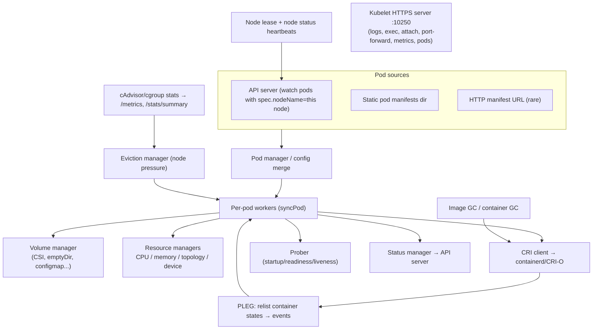

# 5.9 The kubelet and the node: CRI, cgroups, QoS classes, probes and eviction

| | |
|---|---|
| Level | Advanced |
| Priority tier | 0 |
| Lab venue | Root on a Kubernetes worker (VM or bare metal); `kubectl`, `crictl`, `systemd-cgls`, `lscpu`, `numactl`; GPU server with multiple NUMA nodes for topology exercises |
| Part | Part 5: Kubernetes |
| Status | Drafted, labs **untested** |

## Why this matters for AI infrastructure

Picture a GPU server with 8 GPUs, dual-socket CPUs, multiple NICs and NVMe drives. The kubelet is the node agent on that machine, and its settings decide how the hardware behaves. Cluster policy reaches the hardware through the kubelet. It decides how many pods a node accepts, and whether a training pod gets exclusive CPU cores aligned with its GPUs' NUMA node. It also decides how much memory the system and Kubernetes daemons keep for themselves, and what gets evicted when memory or disk runs low.

Two more decisions sit with the kubelet: how long a node can lose connectivity before its pods are rescheduled, and how containers are killed on shutdown. Left at defaults, these settings leave a lot of performance and reliability on the table. You will see the symptoms as cross-NUMA traffic, CPU throttling, noisy neighbours, nodes that die from OOM because nothing was reserved for the OS, and long recovery times after failures. This chapter explains the kubelet's responsibilities and how to tune them for AI nodes.

## Prerequisites and outcomes

This chapter builds on 5.2, 5.7 and 5.8. When you finish it, you should be able to explain why a node behaves the way it does, and tune it on purpose. You will describe the kubelet's responsibilities, its configuration sources and its APIs. You will also write a production `KubeletConfiguration`.

Next, you will explain the cgroup hierarchy the kubelet builds and the QoS classes. You will see how reservations (`kubeReserved`, `systemReserved` and eviction thresholds) give you **node allocatable**. The CPU Manager, Memory Manager, Topology Manager, Device Manager and Pod Resources API come next, and they align GPUs with NUMA nodes. You will configure probes, and you will explain node-pressure eviction, with its signals, soft/hard thresholds and ordering. You will also tell PID and disk limits, image GC and log rotation apart from API-initiated eviction and OOM kills.

The last part covers node status/lease heartbeats, NotReady behaviour, graceful node shutdown, static pods, kubelet certificates and security hardening. By the end you will diagnose node-level problems with kubelet logs, metrics and cgroup data.

## 1. What the kubelet does



The diagram shows the kubelet as a hub. Pods reach the node from three sources, shown at the top. Most come from the API server, which the kubelet watches for pods whose `spec.nodeName` is this node. The pod manager merges the sources and hands each pod to a worker. That worker drives everything else on the node: volumes, resource managers, the container runtime through CRI, and probes.

The kubelet has a long list of jobs. It registers the Node with its labels, capacity, allocatable, conditions, addresses and daemon endpoints. It runs the pods assigned to it through CRI, and it manages their cgroups and QoS. It mounts volumes, runs probes and reports status. It garbage-collects containers, images and logs, and it enforces eviction under pressure. It also exposes metrics and APIs, handles graceful node shutdown, and rotates its client and serving certificates.

Set the kubelet's behaviour in a `KubeletConfiguration` file rather than in flags. The kubelet reads that file through `--config`, and kubeadm typically writes it to `/var/lib/kubelet/config.yaml`. kubeadm also keeps a cluster-wide copy in the ConfigMap `kube-system/kubelet-config`. Per-node overrides arrive through `--config` or the drop-ins in `/etc/kubernetes/kubelet.conf.d/*.conf` in newer releases, and through `KUBELET_EXTRA_ARGS`. Dynamic kubelet config was removed, so you roll changes out with restarts. Inspect the live config with `kubectl get --raw "/api/v1/nodes/<node>/proxy/configz" | jq .kubeletconfig`.

For any change that disrupts running pods, drain the node before you restart the kubelet.

## 2. A production KubeletConfiguration for GPU nodes

The file below is the kind of configuration a GPU node needs. Several of its settings depend on other parts of the cluster, and the comments mark those spots. Read it as a starting point for your own nodes.

```yaml
apiVersion: kubelet.config.k8s.io/v1beta1
kind: KubeletConfiguration
authentication:
  anonymous: { enabled: false }
  webhook: { enabled: true, cacheTTL: 2m }
  x509: { clientCAFile: /etc/kubernetes/pki/ca.crt }
authorization:
  mode: Webhook
cgroupDriver: systemd
cgroupsPerQOS: true
clusterDNS: ["169.254.20.10"]            # NodeLocal DNSCache (5.11) or the CoreDNS service IP
clusterDomain: cluster.local
containerLogMaxSize: 50Mi
containerLogMaxFiles: 5
serverTLSBootstrap: true
rotateCertificates: true
protectKernelDefaults: true              # fail if kernel sysctls differ from kubelet expectations (hardening)
seccompDefault: true                     # RuntimeDefault seccomp for all pods
maxPods: 110                             # lower (e.g., 30-60) on GPU nodes if you want to reserve headroom
podPidsLimit: 8192
serializeImagePulls: false
maxParallelImagePulls: 3
registryPullQPS: 20
registryBurst: 40
imageGCHighThresholdPercent: 85
imageGCLowThresholdPercent: 70
imageMinimumGCAge: 30m
nodeStatusUpdateFrequency: 10s
nodeStatusReportFrequency: 5m
shutdownGracePeriod: 120s                # graceful node shutdown (systemd inhibitor)
shutdownGracePeriodCriticalPods: 30s
# --- Resource management for GPU/AI nodes ---
cpuManagerPolicy: static
cpuManagerPolicyOptions: { full-pcpus-only: "true" }
cpuManagerReconcilePeriod: 10s
memoryManagerPolicy: Static              # requires reservedMemory to match the reserved totals
topologyManagerPolicy: single-numa-node  # best-effort | restricted | single-numa-node | none
topologyManagerScope: pod                # container | pod
reservedSystemCPUs: "0-3"                # dedicate cores to OS/kubelet/runtime (instead of per-resource reserved)
kubeReserved: { memory: 4Gi, ephemeral-storage: 5Gi }
systemReserved: { memory: 8Gi, ephemeral-storage: 5Gi }
enforceNodeAllocatable: ["pods"]          # add "system-reserved","kube-reserved" only with dedicated cgroups
evictionHard:
  memory.available: "2Gi"
  nodefs.available: "10%"
  nodefs.inodesFree: "5%"
  imagefs.available: "15%"
  pid.available: "10%"
evictionSoft:
  memory.available: "4Gi"
  nodefs.available: "15%"
evictionSoftGracePeriod:
  memory.available: "2m"
  nodefs.available: "2m"
evictionMinimumReclaim:
  memory.available: "1Gi"
  imagefs.available: "5Gi"
featureGates: {}                          # avoid alpha gates in production
```

A few settings need a closer look. `cgroupDriver: systemd` must match the runtime described in 5.2, because a mismatch destabilises the node. `protectKernelDefaults` makes the kubelet fail on start if the required sysctls are missing. Those are `vm.overcommit_memory=1`, `kernel.panic=10` and `kernel.panic_on_oops=1`. Set them during node bootstrap, as covered in 4.17, so behaviour stays consistent.

`seccompDefault` applies the runtime's default seccomp profile to every pod. Some GPU and RDMA tools need exceptions, so check that your workloads work with it. `serverTLSBootstrap` and `rotateCertificates` let the kubelet get and rotate its certificates through CSRs, which 5.21 describes. You approve the serving CSRs with an approver. The default `maxPods` is 110, but the pod CIDR size on each node and the CNI also limit it. A `/24` pod CIDR gives about 254 IPs. GPU nodes rarely need 110 pods, so lowering the value can leave headroom.

For image pulls, `serializeImagePulls: false` with `maxParallelImagePulls` speeds up starts when one node pulls several large images. `registryPullQPS` keeps the kubelet from hammering a registry.

Get the cgroup driver and the kernel defaults right first, because those mismatches are the ones that destabilise a node or stop it from starting.

## 3. cgroups, QoS and node allocatable

### The hierarchy (cgroup v2, systemd driver)

```text
/sys/fs/cgroup/
├── system.slice/                        # OS services incl. kubelet.service, containerd.service
├── kubepods.slice/                      # all pods; memory.max = node allocatable for pods
│   ├── kubepods-pod<uid>.slice/         # Guaranteed pods (directly under kubepods)
│   │   └── cri-containerd-<id>.scope    # container
│   ├── kubepods-burstable.slice/
│   │   └── kubepods-burstable-pod<uid>.slice/...
│   └── kubepods-besteffort.slice/
│       └── kubepods-besteffort-pod<uid>.slice/...
└── user.slice/
```

Every pod on the node sits somewhere in this tree. The kubelet builds the `kubepods` cgroup and the QoS sub-slices when `cgroupsPerQOS` is on. It gives each pod a CPU weight in proportion to its requests (`cpu.weight`). It also enforces the **node allocatable** limit on the `kubepods` cgroup. Non-Guaranteed pods get pod-level cgroup limits, which are the sum of their container limits. With cgroup v2 and the MemoryQoS feature, `memory.min/memory.high` give soft protection and throttling before a pod reaches its hard limits. Check your release's status for that feature.

### Node capacity and allocatable

The scheduler places pods against allocatable, not raw capacity. The kubelet gets allocatable by subtracting the reservations and the hard eviction threshold from capacity.

```text
Capacity (reported by kubelet: cpu, memory, ephemeral-storage, pods, hugepages-*, extended resources)
  − kube-reserved (kubelet, container runtime, node problem detector)
  − system-reserved (sshd, udev, systemd, other OS daemons)
  − eviction-threshold (hard)
  = Allocatable   ← what the scheduler uses for pod requests
```

`kubectl describe node` shows Capacity, Allocatable and Allocated resources, where Allocated is the sum of requests and limits. Reserve generously on GPU nodes. DCGM, the device plugin, CNI agents, log shippers, storage clients and the GPU driver stack all need CPU and memory. An unreserved node can die in surprising ways. The kernel OOM killer may take out kubelet or containerd, or SSH stops responding.

`enforceNodeAllocatable: ["pods"]` is the default, and it enforces only the pods limit. Enforcing `system-reserved` or `kube-reserved` requires dedicated cgroups and carefully sized values. Misconfigured enforcement kills system daemons.

### QoS recap (details in 5.7)

Guaranteed, Burstable and BestEffort decide three things: cgroup placement, OOM score and eviction order. The kernel OOM killer picks its victims by `oom_score`, which includes `oom_score_adj`. The kubelet sets -997 for Guaranteed pods and 1000 for BestEffort pods. Burstable pods land between those two values, in proportion to request and capacity. Critical kubelet and runtime processes have -999. System daemons without protection can still be killed if the node runs out of memory outside the pods cgroup.

Size your reservations before you turn on enforcement, because a bad value kills system daemons.

## 4. Resource managers: CPU, memory, topology, devices

### CPU Manager

The CPU Manager has two policies that matter for AI nodes. With `none`, the default, pods share all CPUs through CFS, and limits cause throttling.

With `static`, a Guaranteed pod that requests integer CPUs gets exclusive cores. The kubelet removes those cores from the shared pool and pins the pod to them with `cpuset`. For AI work that means no CFS throttling, no cache or scheduler noise for data-loading threads, NUMA-local placement and deterministic latency for inference. The static policy needs Guaranteed QoS, integer CPU requests and reserved CPUs, set through `reservedSystemCPUs` or the CPU in `kubeReserved/systemReserved`. Its policy options include `full-pcpus-only`, which avoids sharing hyperthread siblings, plus `distribute-cpus-across-numa` and `align-by-socket`. Changing the policy means draining the node and deleting `/var/lib/kubelet/cpu_manager_state`.

Containers in Burstable or BestEffort pods, and containers with non-integer requests, use the shared pool. Use `static` on nodes where the workloads are Guaranteed pods with whole-core requests.

### Memory Manager

The `Static` policy with `reservedMemory` lets Guaranteed pods get NUMA-pinned memory and hugepages. The Topology Manager coordinates those allocations. The sum of `reservedMemory` across NUMA nodes must equal `kubeReserved + systemReserved + hard eviction threshold` for memory. Latency-critical or hugepage-based workloads, such as DPDK or some HPC jobs, can use it. It is complex to operate, so turn it on only when you need it.

### Topology Manager

The Topology Manager acts as a broker. It collects NUMA hints from the CPU Manager, the Memory Manager and the Device Manager, then enforces a policy. Device plugins report topology, such as the NUMA node of a GPU or a NIC.

| Policy | Behaviour |
|---|---|
| `none` | No alignment (default) |
| `best-effort` | Prefer aligned allocations; admit even if not aligned |
| `restricted` | Admit only if the preferred (minimal number of NUMA nodes) alignment is achieved; else reject with `TopologyAffinityError` |
| `single-numa-node` | Admit only if all resources fit on a single NUMA node |

The policies differ in how strictly they treat misalignment, as the table shows. Scope `container` aligns each container alone, while scope `pod` aligns all containers of a pod together.

For AI nodes, the question is how many GPUs a pod needs. An 8-GPU training pod spans both sockets by design, so its hints would not be preferred. Use `best-effort` or `none` for it, or per-pod relaxations. A 1 to 4 GPU inference pod benefits from `single-numa-node` or `restricted`. Its CPUs, memory, GPU and NIC then share one NUMA node and PCIe root. Misalignment shows up as lower DataLoader throughput, or as GPUDirect RDMA falling back through the CPU interconnect. If alignment cannot be satisfied, the pod fails at admission after it has been scheduled. The scheduler is not topology-aware by default. To avoid that, use NFD or topology-aware scheduling (the NodeResourceTopology plugin), or DRA (5.18).

### Device Manager and Pod Resources API

A device plugin registers with the kubelet over gRPC at `/var/lib/kubelet/device-plugins/kubelet.sock`, and it exposes a socket. `ListAndWatch` streams devices and their health. `Allocate` returns the injection details covered in 5.8. `GetPreferredAllocation` lets plugins hint at better device sets, such as NVLink-connected GPUs. The kubelet checkpoints allocations to `/var/lib/kubelet/device-plugins/kubelet_internal_checkpoint`, so a restart keeps them.

The **Pod Resources API** runs on `/var/lib/kubelet/pod-resources/kubelet.sock`. It offers `List`, `GetAllocatableResources` and `Get`, and it shows which pods use which devices, CPUs and memory. The DCGM exporter and monitoring tools use it. **Dynamic Resource Allocation (DRA)** is stable in recent releases. It replaces the counting-based device plugin model with `ResourceClaim`s and driver-published `ResourceSlice`s. That enables structured device selection, such as GPU model, MIG profile or shared claims, and gives the scheduler awareness of devices (Part 11).

For multi-GPU AI nodes, decide which pods need NUMA alignment before you pick a Topology Manager policy.

## 5. Probes

Picture a container that is up but still loading its model. Until it finishes, a check against its port tells you nothing useful. The kubelet runs three kinds of probe for each container, on a timer. Each one asks a different question, and each failure leads to a different action. The table shows what each probe asks and what happens when it fails.

| Probe | Question | On failure |
|---|---|---|
| **startupProbe** | Has the app finished starting? (disables the others until it succeeds) | Container killed and restarted per restartPolicy after `failureThreshold` |
| **readinessProbe** | Can it serve traffic now? | Pod marked NotReady; removed from Service endpoints; not restarted |
| **livenessProbe** | Is it stuck? | Container killed and restarted |

The handlers are the checks themselves. `exec` runs a command inside the container, and exit code 0 counts as success. `httpGet` succeeds on 2xx or 3xx responses. `tcpSocket` checks the connection, and `grpc` uses the gRPC health protocol. Timing comes from a few parameters. `initialDelaySeconds` sets the wait before the first run. The defaults are 10 for `periodSeconds`, 1 for `timeoutSeconds` and 3 for `failureThreshold`. You also set `successThreshold`. `terminationGracePeriodSeconds` sets a probe-level override for liveness kills.

HTTP, TCP and gRPC probes come from the kubelet on the node, and they reach the pod IP. That means NetworkPolicy and host firewalls must allow node-to-pod traffic. An `exec` probe runs through CRI inside the container. Each one forks a process, which is expensive at high frequency and in minimal images, so avoid shell-heavy probes.

A startup probe handles slow starts, such as LLM weights loading, CUDA graph capture or large dataset indexing. The allowed startup time is `failureThreshold × periodSeconds`. With the default `failureThreshold` of 3 and a `periodSeconds` of 10, the container gets 30 seconds to come up. A startup probe with a longer window keeps a slow start from turning into a liveness kill loop.

Liveness probes must be local and cheap. Check that the process is not deadlocked, and do not check external dependencies. A database outage must not restart every app pod. For stateful or long-running training workers, consider omitting the liveness probe, because a restart is destructive for them.

Readiness probes should pass only when the model is loaded and a tiny inference works. Flip the probe to not-ready during graceful shutdown or drain, and keep the endpoint cheap. Timeouts deserve attention too. The default 1 s is often too short on busy nodes. CFS throttling can fail the probes of otherwise healthy pods that have CPU limits, so set a realistic `timeoutSeconds`.

Probe results appear in events, such as `Unhealthy: Readiness probe failed: ...`, and in the `prober_probe_total` metric. **Readiness gates** (`readinessGates`) let external controllers add conditions that must be true, such as load balancer registration for cloud LBs.

### Liveness probes, step by step

A process check has a gap. Picture an application that is deadlocked. Its process is still running, so a process check reports it healthy. A liveness probe closes that gap by running application logic, such as loading a web page, to confirm the app works. You define liveness probes per container, so each container in a Pod is checked separately. Example 5-2 adds a liveness probe to the `kuard` container. It sends an HTTP request to `/healthy` on port 8080:

```yaml
apiVersion: v1
kind: Pod
metadata:
  name: kuard
spec:
  containers:
    - image: gcr.io/kuar-demo/kuard-amd64:blue
      name: kuard
      livenessProbe:
        httpGet:
          path: /healthy
          port: 8080
        initialDelaySeconds: 5
        timeoutSeconds: 1
        periodSeconds: 10
        failureThreshold: 3
      ports:
        - containerPort: 8080
          name: http
          protocol: TCP
```

After all containers in the Pod are created, the probe waits `initialDelaySeconds`, which is 5 seconds, before its first run. The probe must answer within `timeoutSeconds`, which is 1 second. Any status code from 200 up to, but not including, 400 counts as success. Kubernetes calls the probe every 10 seconds. When more than three consecutive probes fail, the container fails and restarts.

To see this in action, apply the manifest and port-forward to the Pod:

```
$ kubectl apply -f kuard-pod-health.yaml
$ kubectl port-forward kuard 8080:8080
```

Open http://localhost:8080 in a browser and click the "Liveness Probe" tab. The tab lists every probe this `kuard` instance has received. Click the "Fail" link, and `kuard` starts failing its health checks. Wait long enough and Kubernetes restarts the container, and the display starts over. To see the restart, run `kubectl describe pods kuard`. The "Events" section reads like this:

```
Killing container with id docker://2ac946...:pod "kuard_default(9ee84...)"
container "kuard" is unhealthy, it will be killed and re-created.
```

A failed liveness check restarts the Pod by default, but the real behavior depends on the Pod's `restartPolicy`. `Always` is the default. `OnFailure` restarts only on a liveness failure or a nonzero exit code, and `Never` does not restart.

### Readiness and startup probes

Liveness asks whether an application is running properly. Readiness asks whether a container can serve user requests right now. A container that fails liveness gets restarted. A container that fails readiness is removed from service load balancers instead. You set up readiness probes much like liveness probes, and using both keeps only healthy containers in service. The book covers Kubernetes Services in its Chapter 7.

A startup probe handles slow-starting containers, and the book calls it a recent addition. It runs before any other probe on the Pod. It keeps trying until it either times out, which restarts the Pod, or succeeds. Once it succeeds, the liveness probe takes over. You can poll slowly while the container starts, then respond quickly once it is up.

### Advanced probe settings and other handlers

Probes have more options than the ones above. You can set how long to wait after startup before probing, how many failures count as a real failure, and how many successes reset the failure count. Each option has a default if you leave it out. Set them yourself for applications that are flaky or take a long time to start.

Besides HTTP checks, Kubernetes supports `tcpSocket` probes. A `tcpSocket` probe opens a TCP socket and succeeds if the connection works, which suits databases and other non-HTTP APIs. An `exec` probe runs a script or program inside the container. Exit code zero means success, and any other code means failure. Use `exec` for custom checks that do not fit neatly into an HTTP call.

Set a startup probe for any container that loads a large model, and keep liveness checks local.

### Probe mechanisms and what each one tells Kubernetes

Probes give the platform a view of the app's health. Without them, Kubernetes only knows whether the process is running. A process can be running and still stuck, so that view is not enough.

Every probe type uses one of three mechanisms. The `exec` probe runs a command inside the container. It succeeds when the command returns exit code zero. Any other code marks the container unhealthy. The HTTP probe sends a request to an endpoint in the Pod. Any response code from 200 up to, but not including, 400 counts as success. The `tcpSocket` probe opens a TCP connection to a port you choose. The container counts as healthy if the connection succeeds.

All probes also share tuning settings, such as success and failure thresholds and timeouts. The Kubernetes documentation describes each one, so set them from there when your workload needs it.

### Designing liveness and readiness endpoints

Liveness and readiness serve different purposes, so they should check different things. A failed liveness probe makes the kubelet restart the Pod. A failed readiness probe only stops traffic from reaching the Pod. Because the two outcomes differ, most apps should use separate endpoints or commands for each.

A liveness probe should fail only when a restart would fix the problem. A deadlock is the typical case. An HTTP server often implements a liveness endpoint that always returns 200, since a server that answers at all does not need a restart. Here is the timing from the book's example. The kubelet probes every 10 seconds. When the last 10 probes have failed, it restarts the container.

The liveness probe should stay local to the workload. Restarting a Pod does not repair a database outage, so a database check inside liveness can cause cascading restarts. A better design is for the app to switch to read-only mode, or to turn off the feature that needs the database. Failing readiness is another option.

A readiness probe can check conditions that come and go. An app that warms its caches on startup can report not ready until they are warm. An overloaded app can fail readiness to shed load. In the book's example, the probe has a 5-second initial delay and a 10-second period. The Pod stops receiving traffic after two consecutive failures.

### Startup probes for slow-starting applications

Why not just use a long liveness delay? Imagine an app that takes about 300 seconds to start. A liveness probe could wait 300 seconds before it begins. That works during startup. But if the app later hangs, the platform would still wait 300 seconds before it restarts the container. A startup probe fixes this. It guards the start-up period and then steps aside.

The book's example uses a startup probe with a failure threshold of 30 and a period of 10 seconds. That gives the app up to 300 seconds to come up. Once the startup probe succeeds, the liveness and readiness probes take over. If it fails 30 times in a row, the kubelet restarts the Pod.

The book suggests avoiding startup probes unless you need them. Liveness and readiness probes cover most cases. For a large model load, though, a startup probe is the right tool.

Next, the book's guidance on which probes to use:

- Use readiness probes for any workload that handles requests. Readiness means nothing for controllers or Jobs.
- Use liveness probes only when a restart would fix the problem.
- Use startup probes only when you really need them.

## 6. Node-pressure eviction

Picture a node whose memory use creeps upward. Nothing has crashed yet, but the eviction manager is already watching. It samples node signals from cAdvisor and cgroup stats at `evictionPressureTransitionPeriod` intervals, and it compares them with thresholds. The table lists those signals and what each one measures.

| Signal | Meaning |
|---|---|
| `memory.available` | `capacity − working set` on the node (excluding reclaimable page cache accounted into inactive file) |
| `nodefs.available`, `nodefs.inodesFree` | Root filesystem (kubelet dir, logs, emptyDir) free space/inodes |
| `imagefs.available`, `imagefs.inodesFree` | Container image/writable layer filesystem (if separate) |
| `containerfs.*` | Newer split for container writable layers |
| `pid.available` | PIDs left |

Hard thresholds evict immediately, with grace 0 and a `SIGKILL`-like short grace. Soft thresholds are more patient. The condition must persist for `evictionSoftGracePeriod`, and the pod uses its grace period, up to `evictionMaxPodGracePeriod`. The kubelet tries to reclaim resources first. When disk is low, it garbage-collects dead containers and unused images. It also sets the node conditions `MemoryPressure`, `DiskPressure` and `PIDPressure`. Taints such as `node.kubernetes.io/memory-pressure:NoSchedule` keep new pods from scheduling onto the node.

When memory runs short, the kubelet picks victims in a fixed order. It starts with pods whose usage exceeds their requests, and BestEffort counts as request 0. Among those, lower priority goes first, then the pods furthest over their requests. For disk pressure, the order uses ephemeral storage usage over request, and then priority. Guaranteed pods are evicted last, and only if system daemons are the problem and nothing else is left. Evicted pods end `Failed` with the reason `Evicted`, and controllers recreate them elsewhere. Critical pods, meaning pods with priority `system-node-critical`/`system-cluster-critical` and static pods, are protected.

Keep three kill mechanisms apart. The first is the **kernel OOM killer**, which acts inside a cgroup. It fires when a container exceeds its memory limit, or when the node runs out of memory faster than the kubelet can react. The process is killed, the container restarts according to policy, and the reason shows as `OOMKilled`. The second is *kubelet eviction*. It is graceful, works at pod level under node pressure, and ignores PDBs. The third is *API-initiated eviction/preemption/drain*, which respects PDBs and priority.

For AI nodes, set `evictionHard memory.available` large enough, several GiB, so the kubelet acts before the kernel OOM killer picks processes at random. Workloads with huge page cache and pinned memory can consume memory faster than the kubelet's housekeeping sample, which runs every 10 s. Prefer Guaranteed pods for important jobs. Keep `ephemeral-storage` requests on pods that write scratch data, so disk pressure does not arrive as a surprise.

Pick the `evictionHard` memory value before a training job fills the node, not after the first OOM.

## 7. Garbage collection and logs

Disks on a GPU node fill up quietly. Old containers, unused images and chatty logs all take space, and the kubelet has to clean them up. Container GC removes exited containers beyond `maxPerPodContainer` or `maxContainers`, and older than `minimumContainerTTL`-like behaviour. The flags `--maximum-dead-containers*` were deprecated in favour of eviction-based cleaning. Dead containers keep consuming writable layer space until something removes them.

Image GC starts when image filesystem usage exceeds `imageGCHighThresholdPercent`. It then removes the least recently used unused images until usage falls to `imageGCLowThresholdPercent`. It skips any image younger than `imageMinimumGCAge`. Take an ML image of 20 to 50 GB on a 1 TB disk. An 85% high threshold lets hundreds of GB fill before GC starts. GC may then delete the image you need next, which triggers a long re-pull. Use bigger disks, `imageMaximumGCAge` (newer), and pre-pull policies to avoid that cycle.

Log rotation works on a different axis. The kubelet rotates CRI logs at `containerLogMaxSize`, and it keeps `containerLogMaxFiles` of them. Training jobs that print per-step logs at a high rate can fill disks and add CPU overhead. Log to stdout moderately, ship metrics separately, or write detailed logs to a PVC or object storage.

Container logs, the writable layer and `emptyDir` all count toward the pod's ephemeral-storage usage. A pod that exceeds `limits.ephemeral-storage` gets evicted.

Size the disks and set the GC thresholds before you start pulling large ML images.

## 8. Node status, leases and failure behaviour

Picture a node that stops answering. The control plane has to decide whether the node is gone, and how long to wait before it moves the node's pods. Leases and status updates answer that question.

The kubelet renews a Lease named `kube-node-lease/<node>` every `nodeLeaseDurationSeconds/4`, which is 10 s. That is cheap. The kubelet also updates `Node.status` when something changes, or every `nodeStatusReportFrequency`, which is 5 min. The node controller waits `--node-monitor-grace-period`, which is 40 s, after the last lease or status update. Then it marks the node `Ready=Unknown`.

Nodes report the conditions `Ready`, `MemoryPressure`, `DiskPressure`, `PIDPressure` and `NetworkUnavailable`. Node-problem-detector adds extra conditions, such as `KernelDeadlock` or `GPUXidError`. Remediation controllers act on those extra conditions, as 5.32 and Part 17 cover.

The node lifecycle controller adds taints on its own. These include `node.kubernetes.io/not-ready` and `unreachable`, which use NoExecute with a default 300 s toleration. It also adds `memory-pressure`, `disk-pressure`, `pid-pressure`, `network-unavailable` and `unschedulable`, which is the taint a cordon applies. For GPU jobs that need fast recovery, shorten `tolerationSeconds` for those taints in the pod specs. For stateful workloads, consider longer values or manual fencing.

On systemd hosts, the kubelet takes a shutdown inhibitor lock, and `shutdownGracePeriod` controls how long that takes. When the node shuts down, the kubelet terminates pods in priority order, with regular pods first and critical pods last, within that budget. It then updates node status and lets the poweroff proceed. Combined with draining before maintenance (5.19), this prevents abrupt SIGKILLs of training pods during reboots. For a non-graceful node shutdown, apply the `node.kubernetes.io/out-of-service` taint after you confirm the node is down. StatefulSet pods and their volumes can then move.

A kubelet restart does not restart containers. The kubelet reconciles from the runtime state, and its checkpointed manager states persist. Those include `cpu_manager_state`, the device checkpoint and the memory manager state. A kubelet being down does not mean its pods are down. A NotReady node does trigger evictions, but only after the toleration period. While the kubelet is down, no probes, log rotation or volume operations happen.

Decide how long each workload should tolerate a NotReady node before its pods move.

## 9. Static pods, kubelet API and security

Static pods are the pods the kubelet runs without the API server asking for them. Manifests in `staticPodPath` (`/etc/kubernetes/manifests`) are run directly by the kubelet. The kubelet also mirrors each one into the API as a read-only mirror pod, with the suffix `-<nodename>`. kubeadm uses static pods for the control-plane components, and node-critical agents use them too. Editing a file reconfigures the pod immediately, and deleting the file removes the pod. Static pods cannot use ConfigMaps or Secrets from the API, because they are file-based only. Controllers do not control them.

The kubelet API on port 10250 authenticates with x509 certificates or bearer tokens through a webhook. Authorisation also goes through a webhook, using the `nodes/proxy`, `nodes/stats`, `nodes/log` and `nodes/metrics` subresources. Granting `nodes/proxy` is effectively `exec` rights on every pod on the node. Audit any RBAC that includes it, because many monitoring roles do. The endpoints are `/pods`, `/runningpods`, `/stats/summary`, `/metrics`, `/metrics/cadvisor`, `/metrics/resource`, `/metrics/probes`, `/logs/`, `/exec`, `/attach`, `/portForward`, `/configz` and `/healthz`. Disable the read-only port 10255 and anonymous auth, and keep `authorization.mode: Webhook`.

The Node authorizer and NodeRestriction admission limit what a kubelet can read and modify. A kubelet can touch only its own node and the pods bound to it. It also cannot set certain labels, such as `node-role.*` or `node-restriction.kubernetes.io/*`.

The kubelet client certificate uses the CN `system:node:<name>` and the group `system:nodes`. It comes from TLS bootstrapping and rotates automatically through `rotateCertificates`. The serving certificate comes from a CSR when `serverTLSBootstrap` is on, and that CSR needs approval. An expired certificate causes NotReady nodes, as 5.21 explains.

The hardening checklist covers `protectKernelDefaults`, `seccompDefault`, the read-only port off, `--anonymous-auth=false`, `readOnlyPort: 0`, the TLS minimum version and cipher suites, and `eventRecordQPS`. It also covers restricting `hostPath` and privileged pods through Pod Security, user namespaces for pods (`hostUsers: false`), AppArmor or SELinux, and node OS hardening (Part 18).

Review every role that holds `nodes/proxy`, and then work through the checklist above.

## 10. Observability

The kubelet exposes metrics you can scrape at `:10250/metrics`, `/metrics/cadvisor` and `/metrics/probes`. The ones that tell you the most about a node are `kubelet_running_pods`, `kubelet_running_containers`, `kubelet_pod_start_duration_seconds`, `kubelet_runtime_operations_duration_seconds`, `kubelet_pleg_relist_duration_seconds`, `kubelet_pleg_relist_interval_seconds`, `kubelet_evictions`, `kubelet_node_name` and `kubelet_certificate_manager_client_ttl_seconds`. Volume usage shows up in `kubelet_volume_stats_*` for PVCs. Container-level signals include `container_cpu_cfs_throttled_periods_total`, `container_memory_working_set_bytes`, `container_oom_events_total`, `prober_probe_total` and `rest_client_requests_total`.

Alerts worth having cover node NotReady, slow PLEG relist, an expiring kubelet certificate, and a high container CPU throttling ratio on latency-critical pods. They should also catch disk/inode/PID pressure approaching thresholds, image pull errors, kubelet restarts and runtime operation latency.

Use `journalctl -u kubelet -f` to follow kubelet logs. The default verbosity is `--v=2`, and `4` adds sync details. Runtime logs come from `journalctl -u containerd`. Kernel messages come from `dmesg -T`, and OOM kills appear there as lines such as "Killed process" or "oom-kill:constraint=CONSTRAINT_MEMCG". Pod logs live in `/var/log/pods`.

## 11. Troubleshooting guide

Read the table from left to right. The first column is the symptom you see. The second is the most likely cause, and the third is the command or log that confirms it.

| Symptom | Likely cause | Where to look |
|---|---|---|
| Node `NotReady` | Kubelet down/cert expired/runtime down/network | `systemctl status kubelet`, `journalctl -u kubelet`, `kubectl describe node` conditions, `crictl info` |
| `PLEG is not healthy` | Runtime slow/overloaded (many containers, disk IO) or kernel issue | PLEG metrics, containerd CPU/IO, `crictl ps` latency |
| Kubelet crash loop on start | Swap on, cgroup driver mismatch, invalid config, `protectKernelDefaults` sysctl mismatch, cpu manager state mismatch | kubelet journal first lines |
| `TopologyAffinityError` | Topology manager policy cannot align | pod events, policy and device NUMA info, `numactl -H`, `nvidia-smi topo -m` |
| CPU manager state error after changing policy | Stale state file | drain node, remove `cpu_manager_state`, restart |
| Pods evicted with `The node was low on resource: memory` | Memory pressure beyond thresholds, over-request pods | `kubectl describe pod`, node events, kubelet eviction logs, node `memory.available` |
| Pods OOMKilled while node has free memory | Container limit reached (cgroup) | `kubectl describe`, `memory.events`, shm/page cache |
| Node unresponsive/SSH hangs under load | No system reserved, kernel OOM, CPU starvation | reservations, `dmesg`, `systemd-cgtop` |
| Disk pressure, image GC thrash | Small image disk, large images, logs | `df -h`, `crictl imagefsinfo`, log sizes, thresholds |
| Probes failing intermittently | CPU throttling, short timeouts, NetworkPolicy blocking node→pod | `cpu.stat`, probe events, policy |
| `kubectl logs/exec` fails TLS | Serving CSR unapproved | `kubectl get csr`, approve |
| Pods Pending on node with free GPUs | Device plugin not registered/unhealthy, allocatable 0 | `kubectl describe node`, plugin logs, kubelet device-plugin dir |
| Containers can't see GPUs after kubelet/plugin restart | Plugin restart without kubelet resync; runtime hook mis-config | restart order, `ListAndWatch` logs, checkpoint file |
| Time to start high | Serial image pulls, slow CSI, CNI | see 5.8 |

When a node turns NotReady, start with the kubelet journal. The probe and eviction rows follow the same pattern: check the cause in the middle column, then confirm it with the command on the right.

## 12. Tuning checklist for GPU nodes

Start with the foundation. Use the systemd cgroup driver, cgroup v2, and a kernel and runtime that are up to date and consistent across nodes (4.17). Reserve CPU for kube and system daemons with dedicated cores through `reservedSystemCPUs`, and reserve memory and ephemeral-storage the same way. Set meaningful hard eviction thresholds.

Next, place the workloads. Use the CPU Manager `static` policy with `full-pcpus-only`. Choose the Topology Manager policy per node pool: relaxed for 8-GPU training pools, and strict for small-GPU inference pools. Use the Memory Manager only if hugepage or NUMA pinning is required. Use Guaranteed QoS for GPU pods, and set explicit shm and ephemeral storage. Keep the PID limit adequate for multi-process training, with `podPidsLimit` at thousands or more.

For images, use a large dedicated NVMe image filesystem, parallel pulls, careful GC thresholds and a pre-pull DaemonSet. For failures, run node problem detector with remediation, shorten taint tolerations for elastic jobs, and set `shutdownGracePeriod` for planned reboots.

For security, use webhook authn and authz, rotate certificates, approve serving CSRs, enable the seccomp default, and leave the read-only port off. For observability, scrape the kubelet and cAdvisor, DCGM and NPD, and alert on pressure and throttling. Keep config in Git (4.26) and verify it with `configz`. Roll each change out through a drain and a canary node before you apply it to the whole pool.

## 13. Lab

Start with the self-checking Python lab, which runs on your own machine. The script at `code/part05/kubelet_node_managers_lab.py` checks three things. It verifies the CPU Manager through `evaluate_cpu_manager_static`, with `full-pcpus-only: "true"`. It tests the Topology Manager NUMA hint intersection evaluator, `evaluate_topology_manager`, which compares the `single-numa-node`, `restricted` and `best-effort` policies. It also checks the node-pressure memory eviction victim selector, `rank_memory_eviction_victims`.

```bash
python3 code/part05/kubelet_node_managers_lab.py
```

The steps after that need a Linux Kubernetes worker node. All interactive shell steps below are `untested here`, so treat each one as a first attempt. Work through the exercises in order.

1. Print the live kubelet config through `configz`, then compute allocatable from capacity and reservations by hand. Change `kubeReserved` and `systemReserved`, restart the kubelet, and watch what `kubectl describe node` shows.
2. Use `systemd-cgls` and `systemd-cgtop` to find `kubepods.slice`, the QoS slices, and the pod and container scopes. Read `memory.max` and `cpu.weight` for Guaranteed, Burstable and BestEffort pods, and match those values to the requests and limits.
3. Create one pod for each QoS class and read each container's `oom_score_adj`. Use a stress image to trigger a container OOM. Then push the lab VM into node-level memory pressure, and observe the eviction order and the events.
4. Set `evictionHard memory.available` low on one node and high on another. Run a memory consumer on both, then compare kubelet-managed eviction with kernel OOM kills. Finally, set soft thresholds and grace periods.
5. Enable `static` on a node: drain it and delete the state file. Run a Guaranteed pod with 4 CPUs, then inspect `cpuset.cpus` with `cat /sys/fs/cgroup/.../cpuset.cpus.effective`, `taskset -pc`, and the cpuset of a shared-pool pod. Compare latency and throttling with and without exclusivity, and try `full-pcpus-only` with odd CPU counts.
6. On a multi-NUMA GPU node, set `single-numa-node`. Request 1 GPU and some CPUs, and observe the aligned allocation with `nvidia-smi topo -m` and `numactl`. Then request 8 GPUs and watch for `TopologyAffinityError`. Finally, adjust the pool to `best-effort`.
7. Query the Pod Resources API socket with `grpcurl` or a small client to list devices per pod. Compare the output with the DCGM exporter labels.
8. Build a server with a controllable startup time and failure toggles. Test how the startup, readiness and liveness probes interact. Then show CPU-throttle-induced probe failures by limiting CPU hard.
9. Fill the image filesystem with test images and observe GC. Set a low `containerLogMaxSize`, run a chatty pod, and watch rotation and disk usage. Then compute the log retention per pod.
10. Block connectivity between the kubelet and the API on a worker with iptables. Record timestamps for lease expiry, the `Unknown` condition, the taint and the pod eviction. Repeat with shorter tolerations. Then test graceful shutdown with `systemctl reboot` and `shutdownGracePeriod`.
11. Add a static pod manifest and see its mirror pod. Modify and delete the manifest, then compare the behaviour with a DaemonSet.
12. Query `:10250` with and without credentials. Check the `nodes/proxy` RBAC in the existing ClusterRoles, and verify that the read-only port is closed.
13. Build dashboard panels for pressure signals, throttling, PLEG latency and eviction counts, then write alerts for them.
14. Clean up.

## 14. Common mistakes

The first mistake is running GPU nodes with no reserved resources and tiny eviction thresholds. The result is a surprise kernel OOM on the node. Enabling the `static` CPU manager without Guaranteed integer-CPU pods has no effect at all. Switching policies without draining the node and removing the state file causes trouble too.

Using `single-numa-node` for pods that need all 8 GPUs leads to guaranteed admission failures. Liveness probes that call external dependencies are another trap. So are a missing startup probe for slow model loads, and 1 s timeouts on throttled pods.

Assuming evictions respect PDBs is a mistake. Node-pressure eviction is not an API eviction, and it ignores PDBs. Letting image GC delete large ML images repeatedly is a mistake as well, and so is running tiny image disks. Chatty training logs can fill disks, which is why log rotation needs tuning.

Granting `nodes/proxy` RBAC broadly, and leaving anonymous or read-only kubelet ports on, are security mistakes. Forgetting to approve kubelet serving CSRs lets kubelet certificates expire. Changing the kubelet config on all nodes at once, without canaries, is the last mistake on this list.

Each of these is cheaper to catch on one canary node than across a full GPU pool.

## 15. Interview angles

These are the questions a interviewer tends to ask about the kubelet. Be ready to answer each one in your own words.

- "What does the kubelet do? Walk through its main loops and managers."
- "How is node allocatable computed? Why reserve resources?"
- "Explain QoS classes, OOM scores and eviction."
- "What is the difference between kernel OOM kill, node-pressure eviction and API eviction?"
- "What do the CPU, Memory and Topology Managers do? When would you use `static` and `single-numa-node` for AI?"
- "How do probes work and what are common mistakes?"
- "What happens when a node loses network connectivity to the control plane?"
- "How would you tune kubelet for an 8-GPU training node versus a 1-GPU inference node?"

## Exercises

1. Take the production `KubeletConfiguration` for dual-socket 8-GPU nodes from Section 2 and walk through it. Explain why `cgroupDriver: systemd`, `protectKernelDefaults: true`, `seccompDefault: true`, `serializeImagePulls: false` with `maxParallelImagePulls: 3`, `reservedSystemCPUs: "0-3"`, `kubeReserved` and `systemReserved`, and `evictionHard` and `evictionSoft` are set as shown.
2. Trace the `/sys/fs/cgroup` tree under `systemd`. It contains `system.slice`, `kubepods.slice`, `kubepods-burstable.slice` and `kubepods-besteffort.slice`. Explain why `Guaranteed` pods sit directly under `kubepods.slice`. Then calculate `Allocatable` from `Capacity`, `kubeReserved`, `systemReserved` and `evictionHard`.
3. Use `evaluate_cpu_manager_static()` and `evaluate_topology_manager()` in `code/part05/kubelet_node_managers.py` to answer three questions. First, what happens when a `Guaranteed` Pod requests 3 CPUs on an SMT-enabled host with `full-pcpus-only: "true"`? Second, why must `/var/lib/kubelet/cpu_manager_state` be removed when you change the CPU Manager policy? Third, why do 1 to 4 GPU inference pools use `topologyManagerPolicy: single-numa-node`, while 8-GPU training pools use `best-effort`, or `restricted` with `pod` scope?
4. Explain how the NVIDIA device plugin registers at `/var/lib/kubelet/device-plugins/kubelet.sock`. Explain how `kubelet_internal_checkpoint` preserves GPU assignments across `kubelet` restarts, and how `dcgm-exporter` uses `/var/lib/kubelet/pod-resources/kubelet.sock`. Finally, explain what `DRA` (`ResourceClaim`, `ResourceSlice`) improves over integer device counting.
5. Using `rank_memory_eviction_victims()` in `code/part05/kubelet_node_managers.py`, trace the exact order in which the kubelet selects Pods for eviction under `MemoryPressure`. Then contrast the three kill mechanisms: the kernel cgroup OOM kill (`OOMKilled`), kubelet node-pressure eviction (`Reason: Evicted`), and API-initiated eviction (`kubectl drain`).
6. Explain how `shutdownGracePeriod`, set to `120s`, and `shutdownGracePeriodCriticalPods`, set to `30s`, use systemd inhibitor locks to drain Pods cleanly during OS reboots. Explain how Static Pods and mirror Pods work. Then explain why granting `nodes/proxy` RBAC permissions is a major security risk.

## Checkpoint questions (20)

<details>
<summary>1. How do you inspect the live `KubeletConfiguration` running on a specific worker node from `kubectl`?</summary>

Ask the node's `/configz` endpoint through the API server proxy:
```bash
kubectl get --raw "/api/v1/nodes/<node-name>/proxy/configz" | jq .kubeletconfig
```
The output is the merged `KubeletConfiguration` that is active in memory on that kubelet right now.
</details>

<details>
<summary>2. What does `protectKernelDefaults: true` in `KubeletConfiguration` do?</summary>

With `protectKernelDefaults: true`, the kubelet refuses to start if any kernel sysctl differs from the values it expects. The checked parameters are `vm.overcommit_memory = 1`, `vm.panic_on_oom = 0`, `kernel.panic = 10`, `kernel.panic_on_oops = 1`, `kernel.keys.root_maxkeys = 1000000` and `kernel.keys.root_maxbytes = 25000000`. The kubelet does not change those host kernel tunables at runtime. You manage them declaratively during node bootstrap, with Ansible or Packer. This is how the setting supports CIS Kubernetes Benchmark compliance.
</details>

<details>
<summary>3. Where are `Guaranteed`, `Burstable`, and `BestEffort` Pods placed inside `/sys/fs/cgroup/kubepods.slice` when `cgroupsPerQOS: true` and `cgroupDriver: systemd` are used?</summary>

- **`Guaranteed` Pods:** They sit directly under `kubepods.slice/`, as `/sys/fs/cgroup/kubepods.slice/kubepods-pod<uid>.slice/cri-containerd-<id>.scope`.
- **`Burstable` Pods:** They sit under `kubepods.slice/kubepods-burstable.slice/kubepods-burstable-pod<uid>.slice/...`.
- **`BestEffort` Pods:** They sit under `kubepods.slice/kubepods-besteffort.slice/kubepods-besteffort-pod<uid>.slice/...`.

The `kubepods.slice` cgroup has its `memory.max` set to the node's **Allocatable** memory. With `enforceNodeAllocatable: ["pods"]`, user Pods combined can never encroach on `kubeReserved`, `systemReserved` and `evictionHard`.
</details>

<details>
<summary>4. Why is `reservedSystemCPUs: "0-3"` preferred over `kubeReserved.cpu` + `systemReserved.cpu` when using `cpuManagerPolicy: static` on a GPU node?</summary>

With `cpuManagerPolicy: static`, the kubelet has to know which physical CPU cores to keep in the shared pool. That keeps a user `Guaranteed` Pod off the cores that run the kubelet, containerd, sshd, kernel softirqs, and NVMe or NIC interrupts. `reservedSystemCPUs: "0-3"` names those cores explicitly. It reserves hardware threads `0..3`, which sit on NUMA node 0, for the OS and Kubernetes daemons. Every remaining core stays free for exclusive `cpuset` assignment.
</details>

<details>
<summary>5. What three requirements must a Pod meet to receive exclusive pinned CPU cores from `cpuManagerPolicy: static`, and what does `full-pcpus-only: "true"` add?</summary>

1. The Pod's QoS class must be **`Guaranteed`**, which means every container sets CPU and memory `requests == limits`.
2. The container must request a **whole integer number of CPUs**, such as `cpu: "8"` or `cpu: "16"`, not `cpu: "7500m"`.
3. With `cpuManagerPolicyOptions: { full-pcpus-only: "true" }` on an SMT (Hyper-Threading) server with 2 threads per physical core, the request must be a multiple of 2 vCPUs, such as 2, 4, 8 or 16. The kubelet then allocates complete physical cores, with both hyperthread siblings. Two different containers cannot share the L1 and L2 cache and execution units of one physical core. An odd request, such as `3`, is rejected at node admission with `SMTAlignmentError`.
</details>

<details>
<summary>6. Why does `kubelet` fail to start with `policy ... is not allowed to be changed` after you edit `cpuManagerPolicy` or `reservedSystemCPUs` in `/var/lib/kubelet/config.yaml`, and how do you fix it?</summary>

The kubelet saves its current CPU assignments and policy name in `/var/lib/kubelet/cpu_manager_state`. The memory manager keeps `/var/lib/kubelet/memory_manager_state`. If you change `cpuManagerPolicy`, from `none` to `static` for example, or change `reservedSystemCPUs`, without clearing that checkpoint file, the kubelet refuses to start. That protects live container `cpuset`s from corruption. Drain the node first, stop the kubelet, run `sudo rm -f /var/lib/kubelet/cpu_manager_state`, and then start the kubelet again.
</details>

<details>
<summary>7. Compare the four `topologyManagerPolicy` modes (`none`, `best-effort`, `restricted`, `single-numa-node`) and explain which to use for 1–4 GPU inference nodes vs. 8-GPU HGX training nodes.</summary>

- **`none`** is the default. It does no NUMA alignment between CPUs, memory, GPUs and NICs.
- **`best-effort`** stores the preferred NUMA affinity hint and tries to align resources on the fewest NUMA nodes. It still admits the Pod if alignment is impossible.
- **`restricted`** admits the Pod only if every requested resource fits on the minimum theoretical number of NUMA nodes for that request size. A 2-GPU pod needs 1 NUMA node, and an 8-GPU pod on a dual-socket server needs 2. Otherwise it rejects the Pod with `TopologyAffinityError`.
- **`single-numa-node`** admits the Pod only if all requested CPUs, memory, GPUs and NICs fit on one NUMA node. That covers 1 to 4 GPUs on one socket.

**Rule of thumb:** use `single-numa-node`, with `topologyManagerScope: pod`, on 1 to 4 GPU inference pools. That keeps CPUs, RAM, the GPU and the NIC from crossing the inter-socket UPI or Infinity Fabric link. Use `restricted` or `best-effort` on 8-GPU training pools, where one Pod intentionally spans both CPU sockets with all 8 GPUs.
</details>

<details>
<summary>8. What are the three gRPC methods of the Kubernetes Device Plugin API, and what does `GetPreferredAllocation` do on an 8-GPU NVLink/PCIe node?</summary>

Every device plugin, such as nvidia-device-plugin or an SR-IOV/RDMA plugin, registers with `/var/lib/kubelet/device-plugins/kubelet.sock`. It implements three methods.

1. **`ListAndWatch`** streams the device IDs, such as `GPU-uuid-0..7`, their health status (`Healthy` or `Unhealthy` on XID faults) and their NUMA topology hints to the kubelet.
2. **`GetPreferredAllocation`** runs when a Pod requests a subset of GPUs, such as 2 or 4 out of 8. The kubelet calls `GetPreferredAllocation(available_gpus, required_count)`, so the NVIDIA plugin can pick a topologically good subset. For example, it can pick 2 GPUs on the same NVLink bridge or PCIe switch, not 2 GPUs on opposite sockets.
3. **`Allocate`** runs during `syncPod`. It returns the exact `NVIDIA_VISIBLE_DEVICES` environment variables, the `/dev/nvidia*` device paths and the CDI annotations for the chosen GPUs.
</details>

<details>
<summary>9. How does `kubelet` compute `memory.available` for Node-Pressure Eviction, and why is it different from `free` in `/proc/meminfo`?</summary>

Linux uses free RAM for filesystem page cache, which appears as `Buffers` and `Cached` in `/proc/meminfo`. So raw `MemFree` is almost always near zero on a busy node, even when plenty of memory can be reclaimed. The kubelet reads cgroup memory stats from `memory.stat` instead, and it computes this value:

`memory.available = NodeCapacity - working_set`

Here `working_set` equals `total_usage - total_inactive_file`. In other words, it counts anonymous and heap memory, pinned memory, `/dev/shm` tmpfs and active file cache. It leaves out the easily reclaimable `inactive_file` page cache.
</details>

<details>
<summary>10. What is the difference between `evictionHard`, `evictionSoft`, and `evictionMinimumReclaim` in `KubeletConfiguration`?</summary>

- **`evictionHard`**, for example `memory.available: "2Gi"` or `nodefs.available: "10%"`: as soon as the signal drops below the hard threshold, the kubelet evicts Pods immediately, with a grace period of 0 seconds (`SIGKILL`).
- **`evictionSoft`** with **`evictionSoftGracePeriod`**, for example `memory.available: "4Gi"` with `"2m"`: if `memory.available` stays below 4Gi continuously for 2 minutes, the kubelet starts a graceful eviction. It honors the Pod's `terminationGracePeriodSeconds`, up to `evictionMaxPodGracePeriod`. That gives training jobs time to write an emergency checkpoint before they hit `evictionHard`.
- **`evictionMinimumReclaim`**, for example `memory.available: "1Gi"` and `imagefs.available: "5Gi"`: once an eviction is triggered, the kubelet keeps evicting and reclaiming until at least the threshold plus the minimum reclaim is free. For memory, that is `2Gi + 1Gi = 3Gi`. This stops the node from oscillating right at the threshold boundary.
</details>

<details>
<summary>11. In what exact order does `kubelet` choose which Pod to evict first during `MemoryPressure`?</summary>

The kubelet ranks all active Pods on the node into two tiers, and it evicts from the top of the list.

1. **Tier 1** holds Pods whose memory usage (`working_set`) exceeds their memory request. A BestEffort Pod has a request of 0, so any BestEffort Pod using more than 0 bytes lands in Tier 1, alongside Burstable Pods that exceed their request. Within the tier, the lowest `PriorityClass` goes first, and then the largest `(usage - request)` excess in bytes.
2. **Tier 2** holds Pods whose usage is at or below their memory request. That means Burstable Pods within their request, and Guaranteed Pods. The lowest `PriorityClass` goes first, and then the lowest usage. Guaranteed Pods and `system-node-critical` Pods are never evicted, unless system daemons themselves exceed reserved memory.
</details>

<details>
<summary>12. What is the difference between `nodefs` and `imagefs` in `kubelet` disk-pressure eviction?</summary>

- **`nodefs`** is the node's root filesystem, where `/var/lib/kubelet` lives. It holds Pod `emptyDir` volumes, which are backed by disk, the container logs in `/var/log/pods`, and kubelet state. When `nodefs.available` drops below 10%, the kubelet deletes dead Pods and containers. It then evicts the Pods that use the most ephemeral storage, meaning logs plus `emptyDir`.
- **`imagefs`** is the filesystem where `/var/lib/containerd` keeps pulled image layers and container writable layers. A dedicated NVMe partition for `/var/lib/containerd` separates `imagefs` from `nodefs`. Then pulling 30 GB of container images never fills the OS root disk, which is `nodefs`.
</details>

<details>
<summary>13. Why can a CPU-limited container (`limits.cpu: "2"`) fail its `httpGet` or `exec` `livenessProbe` even when the application has zero bugs, and how do you fix it?</summary>

A container with a strict CFS CPU quota, set by `limits.cpu`, can be throttled during a burst of request or garbage-collection activity. The Linux kernel then throttles every thread in the container for the rest of the 100ms CFS period. The count shows up as `nr_throttled` in `cpu.stat`. If you leave `livenessProbe.timeoutSeconds` at its default of `1` second, a few consecutive throttled periods can delay the HTTP `/healthz` handler past 1,000 ms. The kubelet then kills and restarts a healthy container. To fix it, raise `timeoutSeconds` on the probes to `5` to `10` seconds. You can also remove `limits.cpu` and keep `requests.cpu`, or use `cpuManagerPolicy: static`, so latency-sensitive servers are never CFS-throttled.
</details>

<details>
<summary>14. How do `nodeStatusUpdateFrequency` (`10s`) and `nodeStatusReportFrequency` (`5m`) work together with `kube-node-lease` to reduce API server load on a 5,000-node cluster?</summary>

In early Kubernetes, every kubelet PATCHed its entire heavy `Node.status` object every 10 seconds. That object held dozens of conditions, addresses, capacity and a list of the 50 largest container images on the node. At 5,000 nodes, that overwhelmed etcd.

Today the pattern is different.

- Every `10s`, which is `nodeStatusUpdateFrequency` or `nodeLeaseDurationSeconds/4`, the kubelet updates only its tiny Lease object in `kube-node-lease`. That object is about 200 bytes.
- The kubelet sends a full `Node.status` update only when a condition or capacity actually changes, or once every `5 minutes` (`nodeStatusReportFrequency`). That cuts etcd heartbeat write load by more than 95%.
</details>

<details>
<summary>15. How does Graceful Node Shutdown (`shutdownGracePeriod: 120s`, `shutdownGracePeriodCriticalPods: 30s`) work on a `systemd` Linux host?</summary>

When `shutdownGracePeriod` is configured, the kubelet takes a systemd delay inhibitor lock over D-Bus. You can list it with `systemd-inhibit --list`. When an operator or a cloud autoscaler starts an OS shutdown, through `systemctl reboot`, `poweroff`, or a spot termination ACPI signal, systemd delays the shutdown for up to `120s`. It also notifies the kubelet. The work then happens in two stages.

1. In the first `90s`, which is `120s` minus `30s`, the kubelet marks the node not-ready with a `Shutdown` condition. It terminates all regular user Pods, running their `preStop` hooks and sending `SIGTERM`, so training jobs can flush a final checkpoint.
2. In the final `30s`, set by `shutdownGracePeriodCriticalPods`, the kubelet terminates `system-node-critical` and `system-cluster-critical` Pods, such as the CNI, CSI and storage flushers. It then releases the systemd inhibitor lock, so the kernel powers off cleanly.
</details>

<details>
<summary>16. What are the differences between a Static Pod (`/etc/kubernetes/manifests`) and a `DaemonSet` Pod?</summary>

- **Static Pod:** The local kubelet manages it by reading a file on disk, `/etc/kubernetes/manifests/*.yaml`, with no dependency on kube-apiserver or kube-scheduler. It cannot reference `ConfigMap`s or `Secret`s. You cannot delete it with `kubectl delete pod`, because deleting the mirror Pod in kube-apiserver makes the kubelet recreate it immediately. Static Pods bootstrap etcd, kube-apiserver, kube-controller-manager, kube-scheduler and kube-vip.
- **`DaemonSet` Pod:** The `DaemonSet` controller in kube-controller-manager manages it, and kube-scheduler places it through kube-apiserver. It can mount `ConfigMap`s, `Secret`s and PVCs. It supports rolling updates across the fleet, and it runs node agents such as nvidia-device-plugin, dcgm-exporter, calico-node, cilium and fluent-bit.
</details>

<details>
<summary>17. Why is granting RBAC permission on `nodes/proxy` (`verbs: ["*"]` or `["get", "create"]`) equivalent to granting root/exec access to every Pod on every node?</summary>

The `nodes/proxy` subresource authorizes direct proxying to the Kubelet HTTPS API on port `:10250`. That API includes the `/exec`, `/run`, `/attach` and `/portForward` endpoints for every container on the node. An attacker, or a compromised monitoring ServiceAccount with `nodes/proxy` `create` or `get` permission, can run arbitrary commands inside any `kube-system` or tenant Pod on any node. That bypasses namespace-level `pods/exec` RBAC rules completely. Monitoring scrapers such as Prometheus should get only `nodes/metrics` and `nodes/stats` with `get`, and never `nodes/proxy`.
</details>

<details>
<summary>18. What do the `Node` Authorizer and `NodeRestriction` Admission Plugin prevent a compromised worker node's `kubelet` from doing?</summary>

Every kubelet authenticates to kube-apiserver as `system:node:<nodename>`, in the group `system:nodes`. If one worker node is compromised, two controls limit the damage. The Node Authorizer restricts `system:node:<nodename>` so it can read only the Secrets, ConfigMaps and PVs mounted by Pods scheduled onto that node. It cannot read Secrets belonging to Pods on other nodes. The NodeRestriction Admission Plugin limits the node to modifying its own Node object and the status of its bound Pods. It also forbids the kubelet from adding or modifying `node-role.kubernetes.io/*` or `node-restriction.kubernetes.io/*` labels on itself. A compromised worker therefore cannot relabel itself as a control-plane or trusted security node.
</details>

<details>
<summary>19. Why should `podPidsLimit` (and `evictionHard["pid.available"]`) be configured explicitly on multi-GPU training nodes?</summary>

A single 8-GPU PyTorch `torchrun` job starts 8 rank processes. Each of those starts 8 to 16 `DataLoader` worker processes, plus OpenMP or MKL thread pools and NCCL proxy threads. That easily creates 500 to 2,000 Linux tasks, or PIDs, per Pod. In Linux, every thread is a task that consumes a PID from `/proc/sys/kernel/pid_max`. Setting `podPidsLimit: 8192` (or `16384`) in `KubeletConfiguration` writes `pids.max` into each Pod's cgroup. That gives legitimate multi-GPU training jobs enough headroom. It also stops a runaway fork bomb in one container from exhausting the host's global `kernel.pid_max` and crashing sshd or the kubelet.
</details>

<details>
<summary>20. Contrast the `KubeletConfiguration` tuning for an 8-GPU HGX Training Node vs. a 1-GPU / MIG Multi-Tenant Inference Node.</summary>

The table sets the two node types side by side.

| Setting | 8-GPU HGX Training Node (1 Pod = Whole Node) | 1-GPU / MIG Multi-Tenant Inference Node (Many Pods) |
|---|---|---|
| `maxPods` | Low (`30`–`40`: system daemons + 1 training pod) | Standard (`60`–`110`) |
| `topologyManagerPolicy` | `restricted` or `best-effort` (pod spans 2 sockets) | `single-numa-node` (`scope: pod`) for strict PCIe/NUMA locality |
| `cpuManagerPolicy` | `static` (`full-pcpus-only: "true"`) | `static` (`full-pcpus-only: "true"`) |
| `podPidsLimit` | High (`8192`–`32768`) for multi-process DataLoaders | Moderate (`2048`–`4096`) |
| `shutdownGracePeriod` | Long (`120s`–`300s`) to allow emergency checkpointing | Moderate (`60s`–`120s`) for connection draining |

Both node types use `static` with `full-pcpus-only`. The settings that differ most are the topology policy, the PID limit and the shutdown grace period.
</details>

## Sources and review notes

- **Sources read in full:**
  - `production-kubernetes` — Josh Rosso, Rich Lander, Alexander Brand & John Harris, *Production Kubernetes*, **Chapter 3: Container Runtime** (node runtime, CRI, and cgroup considerations).
  - `production-kubernetes` — Josh Rosso, Rich Lander, Alexander Brand & John Harris, *Production Kubernetes*, **Chapter 14: Application Considerations** (read in full: liveness, readiness and startup probe design, the probe mechanisms and thresholds, and the Probe guidance summary).
  - `kubernetes-up-and-running-3rd-edition` — Brendan Burns, Joe Beda, Kelsey Hightower & Lachlan Evenson, *Kubernetes: Up and Running*, 3rd ed., **Chapter 5: Pods** (probes, resource requests/limits, volumes, and node behavior).
  - `nvidia-devops` (`volume-03/02-k8s-node-storage-masterclass.md`): node operations masterclass (`KubeletConfiguration` for AI nodes, CPU/Memory/Topology/Device managers, eviction and QoS, CRI and sandbox, and `crictl` debugging).
- **Run here:** `python3 code/part05/kubelet_node_managers_lab.py` (3 passed, 0 failed).
- **Explicitly labelled inferences:** The `evaluate_cpu_manager_static`, `evaluate_topology_manager`, and `rank_memory_eviction_victims` models in `code/part05/kubelet_node_managers.py` and the production GPU `KubeletConfiguration` (Section 2) are the author's constructions synthesizing Production Kubernetes Chapter 3, Kubernetes: Up and Running Chapter 5, and `volume-03/02` (plus original study items 21, 22, 23, 24, 25, 26, 27, 28, 29, 30, 31, 32, 33, 34, 35, 36, 37, 38, 39, and 40).
- **Not verified on live hardware:** Live `kubelet`, `systemd-cgls`, `numactl`, and `grpcurl` executions (`169.254.20.10`, `50Mi`, `110` maxPods, `8192` podPidsLimit, `85%`/`70%`/`80%` image GC, `120s`/`30s` shutdownGracePeriod, `reservedSystemCPUs: "0-3"`, `4Gi`/`8Gi` reserved, `2Gi`/`4Gi` eviction, `-997`/`-999`/`1000` oom_score_adj, `:10250`, `10255`) are marked (`untested here`) where not executed by `kubelet_node_managers_lab.py`.
