# 5.10 Services, endpoints and kube-proxy: the life of a Service

| | |
|---|---|
| Level | Advanced |
| Priority tier | 0 |
| Lab venue | Multi-node cluster; root on a node; `iptables-save`, `nft`, `ipvsadm`, `conntrack`, `tcpdump`, `curl`, `kubectl` |
| Part | Part 5: Kubernetes |
| Status | Drafted, labs **untested** |

## Why this matters for AI infrastructure

A user reports that the inference API works from one node and times out from another. The pod behind it is healthy. Pods come and go all day and their IP addresses change with every replacement, yet inference servers, vector databases, feature stores and metrics endpoints all need an address that stays put. A Service provides that address.

At small scale a Service looks like plain load balancing. At large scale it gets harder. With thousands of Services and tens of thousands of endpoints, iptables rule updates take seconds and burn CPU. Conntrack tables fill during bursts from training clients or inference gateways. Long-lived gRPC streams pin to a single backend, and `externalTrafficPolicy` decides whether your LLM gateway sees client IPs and balances evenly.

To debug latency spikes, connection resets and uneven load, you need to know how a ClusterIP becomes a pod IP inside the kernel. This chapter follows that translation step by step.

Think of a Service as the phone number of a busy restaurant. The number stays on the sign for years, while the cooks, the tables and the shift schedule change every day. A call to that number goes to whichever cook is free. The caller never needs to know which cook answered, and nobody has to tell callers when the staff changes. A ClusterIP plays the same role for pods. The rest of this chapter follows one call from the moment it leaves a client to the moment a pod picks it up.

## Prerequisites and outcomes

Before you start, you need 5.3 and 5.8, plus the networking material in Part 2 on NAT, conntrack and iptables/nftables (2.23). Use the list below as a self-check once you have read the chapter. Each line names one skill you use when a Service misbehaves, and a line that feels unfamiliar points you back to the section that covers it:

- Define Service types and fields (selectors, ports, targetPort, sessionAffinity, externalTrafficPolicy, internalTrafficPolicy, loadBalancerClass, IP families) and EndpointSlices, and explain readiness gating and terminating endpoints.
- Trace a packet from a pod to a ClusterIP and on to a backend pod (DNAT, conntrack, reverse NAT) in iptables, IPVS and nftables modes, and in eBPF replacements such as Cilium.
- Explain NodePort and LoadBalancer paths, source IP preservation, health checks, hairpin traffic, and Services without selectors.
- Diagnose Service failures with `kubectl`, `iptables-save`, `ipvsadm`, `conntrack`, `tcpdump`, and kube-proxy logs and metrics.
- Choose a kube-proxy mode, tune conntrack, handle scale (large Service counts), and use topology-aware routing.

## 1. Service objects

Suppose a vLLM deployment serves requests from several pods, and those pods come and go all day. Clients cannot keep track of which pod IP is alive at any moment. A client that hard-codes one pod IP fails the first time that pod is replaced. A Service solves this. It is a stable virtual IP (ClusterIP) and DNS name that load-balances to a set of pods selected by labels. A Service is purely a *control-plane and kernel* construct. No process listens on the ClusterIP. The packet rewrite happens in each node's kernel, or in the CNI datapath.

That last point is the part people find hardest to believe, so it is worth a closer look. If you run `ss -tulpn` on a node, you will find no line for the ClusterIP, because no socket is bound to it. The address exists only as a set of rules that the kernel applies to packets. Think of a mail sorting office that changes the address on every letter before it leaves. The carrier never needs to know that the recipient moved. The office does the work, and the address on the envelope is only a label that the office recognizes.

```yaml
apiVersion: v1
kind: Service
metadata:
  name: vllm
  namespace: serving
spec:
  type: ClusterIP                  # ClusterIP | NodePort | LoadBalancer | ExternalName | (headless: clusterIP: None)
  selector: { app: vllm }
  ports:
    - name: http
      port: 80                     # service port (what clients use)
      targetPort: http             # container port number or named port
      protocol: TCP
      appProtocol: http            # hints for L7 proxies/meshes
  sessionAffinity: None            # or ClientIP (+ sessionAffinityConfig.clientIP.timeoutSeconds)
  internalTrafficPolicy: Cluster   # or Local (only node-local endpoints)
  ipFamilyPolicy: SingleStack      # SingleStack | PreferDualStack | RequireDualStack
  trafficDistribution: PreferClose # topology-aware preference (newer releases)
```

### Why a Service is needed

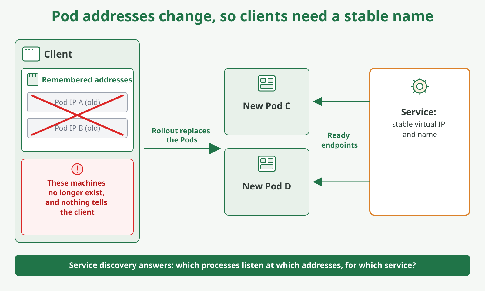

*Figure 5.10.1. After a rollout replaces the Pods, a client holding old Pod addresses fails, while a Service keeps one stable address that routes to the new Pods.*

Kubernetes moves things around constantly. It places pods on nodes, keeps them running and moves them when needed. It also changes the number of pods with load, through Horizontal Pod Autoscaling. That makes it easy to run many things and hard to find them. Most traditional network infrastructure was never built for this much change.

Consider what that means for a client. Yesterday the pods had two addresses. Today a rollout has replaced them with two others. A client that remembered the old addresses now sends its requests to machines that no longer exist, and nothing in the client tells it so.

The general name for this problem is service discovery. A service discovery tool answers one question: which processes listen at which addresses, for which service? A good one answers quickly and reliably. It also updates clients soon after a change, and it can hold a richer description of a service, such as several ports.

The Domain Name System (DNS) is the traditional service discovery system on the internet. It is built for names that stay put, so its answers are cached widely. That suits the internet well. A Kubernetes cluster, however, changes too fast for it.

Old DNS habits cause real trouble here. Many systems, Java by default, resolve a name once and then keep the answer. A client holding a stale answer keeps calling an IP that no longer serves the app. A short TTL (time-to-live) and a careful client help. A lag before the client sees a change still remains.

Picture a driver who writes down a route once and never checks a map again. The road may close tomorrow, and the driver keeps turning at the same corner. A cached DNS answer behaves like that written route. It is correct until the day it is not, and the client has no way to know the difference.

DNS also limits how much one answer can hold. Trouble begins once a single name carries more than 20 to 30 address (A) records. Service (SRV) records fix some of that, but they are hard to use. Clients usually take the first IP and count on the server to shuffle the list. That is no replacement for real load balancing.

An A record is the simplest DNS answer. It maps one name to one IPv4 address. A name with many pods behind it carries many A records in one answer, so a long list makes every answer bigger.

That is why Kubernetes starts with a Service object. A Service is a named label selector, and it does more than that, as the next sections show.

### Creating two services

Let's build two small apps, `alpaca-prod` and `bandicoot-prod`, and put a Service in front of each. The `kubectl expose` command creates a Service from an existing deployment, so you start with the deployments. Each deployment creates pods that carry a label, such as `app=alpaca`. The Service uses that label to find its pods, which makes the label matter more than the name:

```
$ kubectl create deployment alpaca-prod \
--image=gcr.io/kuar-demo/kuard-amd64:blue \
--port=8080
$ kubectl scale deployment alpaca-prod --replicas 3
$ kubectl expose deployment alpaca-prod
$ kubectl create deployment bandicoot-prod \
--image=gcr.io/kuar-demo/kuard-amd64:green \
--port=8080
$ kubectl scale deployment bandicoot-prod --replicas 2
kubectl expose deployment bandicoot-prod
$ kubectl get services -o wide
NAME CLUSTER-IP ... PORT(S) ... SELECTOR
alpaca-prod 10.115.245.13 ... 8080/TCP ... app=alpaca
bandicoot-prod 10.115.242.3 ... 8080/TCP ... app=bandicoot
kubernetes 10.115.240.1 ... 443/TCP ... <none>
```

After these commands, you have three Services. Two are yours: `alpaca-prod` and `bandicoot-prod`. The third, `kubernetes`, is created for you, so that apps inside the cluster can find and talk to the Kubernetes API by name, without knowing its address.

Look at the `SELECTOR` column. The `alpaca-prod` Service only gives a name to a selector, and it says which ports to use. The `kubectl expose` command copies both the label selector and the port (8080 here) from the deployment.

The Service also gets a new kind of address, a cluster IP. This virtual IP is load balanced across every pod that the selector matches.

To try it, open a port-forward to one of the `alpaca` pods. A port-forward is a tunnel from your laptop into one specific pod. It skips the Service, so you are testing that pod alone. Keep it running in its own terminal window:

```
$ ALPACA_POD=$(kubectl get pods -l app=alpaca \
-o jsonpath='{.items[0].metadata.name}')
$ kubectl port-forward $ALPACA_POD 48858:8080
```

Then open http://localhost:48858 in your browser. You should see the `alpaca` pod answering through the forwarded port.

### Types

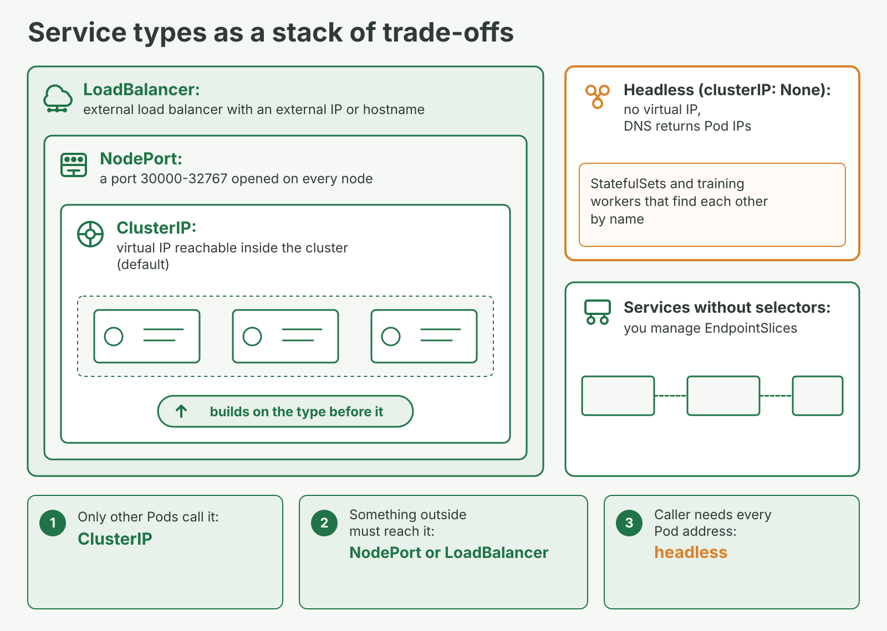

*Figure 5.10.2. Service types build on each other from ClusterIP to NodePort to LoadBalancer, while a headless Service skips the virtual IP entirely.*

Services come in several types, and the type decides what gets created. Pick the one that matches where the traffic comes from. The default is ClusterIP, and NodePort and LoadBalancer each build on the type before them.

| Type | What it creates | Notes |
|---|---|---|
| **ClusterIP** | Virtual IP from the service CIDR (configured on `kube-apiserver` via `--service-cluster-ip-range`, e.g., `10.96.0.0/12`, which must not overlap with Pod or node subnets), reachable inside the cluster | Default |
| **NodePort** | ClusterIP + a port (30000-32767) opened on every node forwarding to the Service | Basis for external LBs; `externalTrafficPolicy` matters |
| **LoadBalancer** | NodePort + external load balancer (cloud controller or MetalLB/kube-vip) with an external IP/hostname | `loadBalancerClass` selects implementation; `allocateLoadBalancerNodePorts: false` for LBs that route directly to pods |
| **ExternalName** | DNS CNAME to an external name; no proxying | No ports/selectors; avoid for TLS/host-header surprises |
| **Headless** (`clusterIP: None`) | No VIP; DNS returns pod IPs (A/AAAA per ready endpoint) | StatefulSets, client-side balancing, direct pod addressing, gRPC clients |
| **Services without selectors** | You manage EndpointSlices manually | Map to external databases/IPs or other-cluster pods |

Read the table as a list of trade-offs. The NodePort row shows what a LoadBalancer builds on, and the headless row shows how a Service can skip the virtual IP altogether.

A simple way to choose: start with ClusterIP for anything that only other pods call. Move to NodePort or LoadBalancer only when something outside the cluster has to reach the Service. Use headless when the caller needs every pod address, such as a clustered database or a group of training workers that must find each other by name.

### Ports

Each port entry has a few fields to keep straight. The `port` is the Service's port, the one clients use. The `targetPort` is the pod port. It can be a number or the container's named port, which lets you change port numbers without touching the Services. When a Service has multiple ports, each one needs a name. `nodePort` can be fixed if you need a specific value, and `protocol` is TCP, UDP or SCTP. Named `appProtocol` values, such as `http`, `h2c` and `grpc`, help gateways and meshes.

Think of a Service as the front desk of a large office, and the pod ports as the rooms behind it. Visitors ask the desk for a name, and the desk sends them to the right room. The desk's number stays the same even when the rooms are renumbered. Naming a port and pointing `targetPort` at that name is what lets the desk keep up with the renumbering.

### DNS

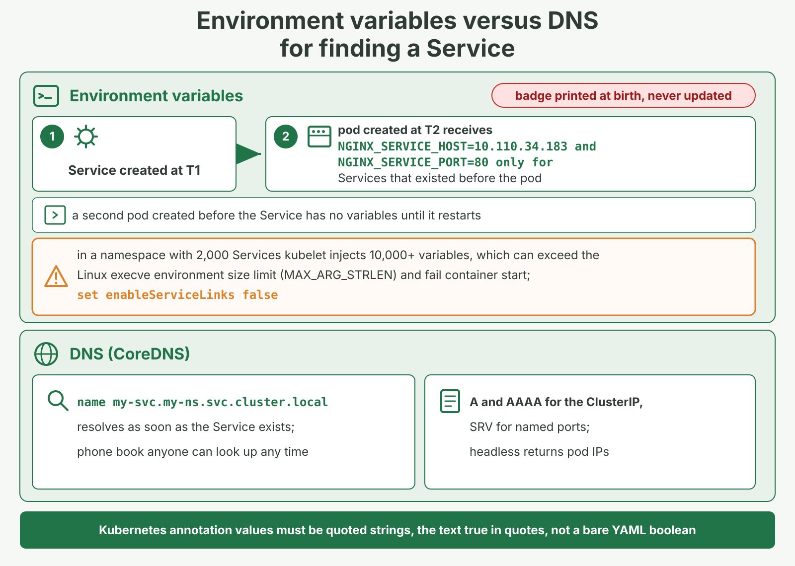

*Figure 5.10.3. Prefer DNS because pod environment variables are fixed at start and can grow too large.*

Each Service gets a name in the form `my-svc.my-ns.svc.cluster.local`. That name resolves to A and AAAA records for the ClusterIP, and named ports also get SRV records. Pods can resolve short names through search domains, which section 5.11 explains. A headless Service resolves to endpoint IPs instead. This is why `curl http://vllm` works from inside the same namespace without any IP address on hand. The name lookup returns the ClusterIP, and the rules described in section 3 take it from there.

Josh Rosso et al. explain this in *Production Kubernetes*, Chapter 6 (*Service Routing*), and Brendan Burns et al. show it in *Kubernetes: Up and Running*, Chapter 7 (*Service Discovery*). Kubernetes also injects **Docker-Links-style environment variables** into every pod when its container starts. Examples are `NGINX_SERVICE_HOST=10.110.34.183` and `NGINX_SERVICE_PORT=80`. They cover the Services that already exist in the same namespace. Relying on these variables brings two operational pitfalls.

The first pitfall is creation order (Production Kubernetes, Chapter 6). A pod only receives `<SVC>_SERVICE_HOST` environment variables for Services that existed before the pod was created. If the pod starts before its `Service` exists, those variables are missing until the pod restarts. CoreDNS, by contrast, resolves the Service as soon as it is created.

Think of the environment variables as a printed mailing list that was made when the pod was born. A Service created later never reaches that list. DNS works more like a phone book that anyone can look up at any time, so the Service is findable the moment it exists.

The second pitfall appears in large namespaces. In a namespace with 2,000 Services, `kubelet` injects 10,000+ environment variables into every container. That can exceed the Linux kernel `execve` `MAX_ARG_STRLEN` environment size limit and cause containers to fail at startup. Set `enableServiceLinks: false` in Pod specs, and always use CoreDNS for service discovery. Also remember the YAML pitfall from Networking and Kubernetes, Chapter 5, when you set Service annotations such as internal load-balancer annotations. **Kubernetes annotation values must always be quoted strings (`"true"`, not bare YAML boolean `true`).**

### Readiness checks

An app is often not ready to take requests the moment it starts. Initialization can take under a second or several minutes. A readiness check lets the Service track which pods are ready. Let's add one to the `alpaca-prod` deployment.

A readiness check works like a cashier who opens a till only once the register is working. Until the answer is yes, the cluster keeps customers away from that till. The probe asks the question, and the Service sends traffic only to pods that answer yes.

The `kubectl edit` command fetches the current deployment and opens it in an editor. When you save and quit, it writes the object back to Kubernetes. It is a quick way to edit an object without saving a YAML file first.

```
$ kubectl edit deployment/alpaca-prod
```

Add the following section:

```
spec:
...
template:
...
spec:
containers:
...
name: alpaca-prod
readinessProbe:
httpGet:
path: /ready
port: 8080
periodSeconds: 2
initialDelaySeconds: 0
failureThreshold: 3
successThreshold: 1
```

This check sends an HTTP `GET` to `/ready` on port 8080. It starts as soon as the pod comes up and runs every two seconds. Three failed checks in a row mark the pod as not ready. A single successful check brings it back to ready. Only ready pods are sent traffic. The numbers in that block set the probe's timing, and you can tune them. A slow app needs a longer `initialDelaySeconds`. A flaky app may need a higher `failureThreshold`, so that a single bad check does not pull it out of service.

Updating the deployment deletes and re-creates the `alpaca` pods, so you need to restart the port-forward:

```
$ ALPACA_POD=$(kubectl get pods -l app=alpaca-prod \
-o jsonpath='{.items[0].metadata.name}')
$ kubectl port-forward $ALPACA_POD 48858:8080
```

Point your browser to http://localhost:48858 and expand the Readiness Probe section. The page updates each time the system runs a readiness check.

In another terminal, watch the endpoints for `alpaca-prod`. Endpoints are a lower-level view of where a Service sends traffic, and section 2 covers them. The `--watch` option keeps `kubectl` running and prints each change, which makes it an easy way to see how an object changes over time:

```
$ kubectl get endpoints alpaca-prod --watch
```

Now return to your browser and click `Fail` on the readiness check. The server starts returning errors in the 500 range. After three of these, the server is removed from the endpoints for the Service. Click `Succeed`, and after a single good check, the endpoint is added back.

This is a useful signal. An overloaded or sick server can tell the system that it no longer wants traffic. It also gives you graceful shutdown. The server stops asking for traffic, waits until open connections close, and then exits cleanly.

Press `Ctrl-C` to stop both the `port-forward` and the `watch` commands. Before you rely on a readiness check, make sure the path it calls reports whether the server can take traffic.

## 2. EndpointSlices

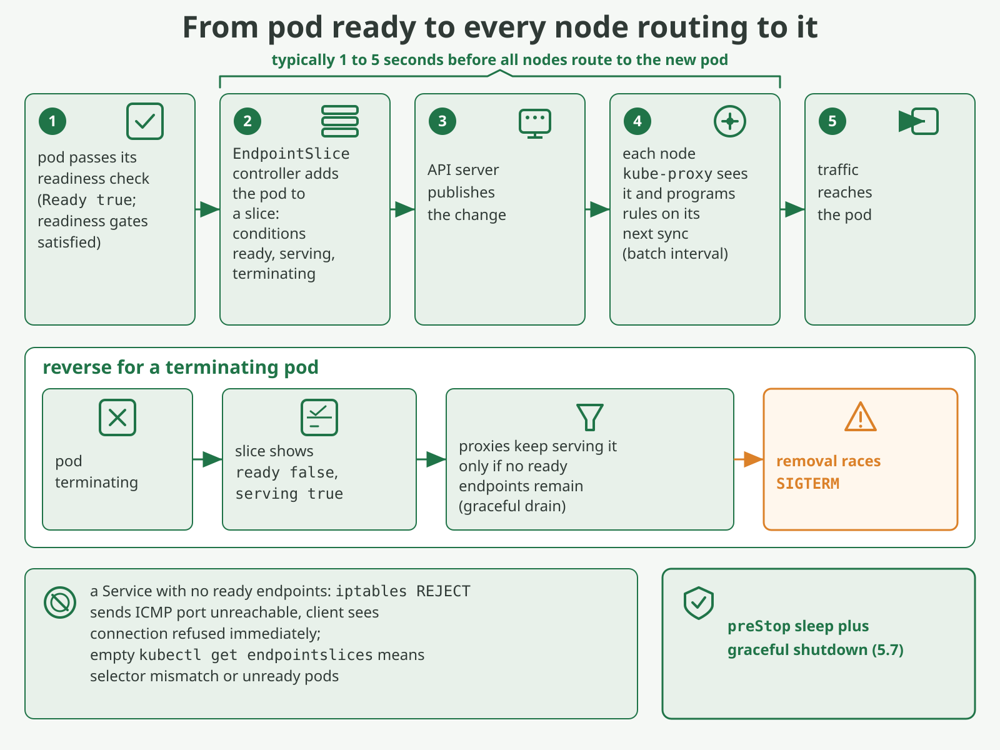

*Figure 5.10.4. New and terminating pods take a few seconds to appear or disappear on every node.*

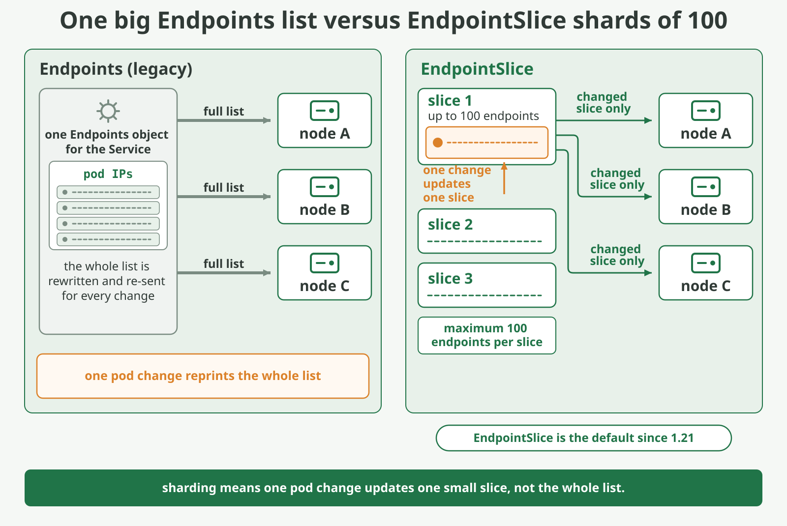

*Figure 5.10.5. A legacy Endpoints object resends the whole pod list on every change, whereas an EndpointSlice shard updates only the slice that changed.*

Picture a Service with a few thousand pods behind it and a rolling update that replaces pods one at a time. Every replacement changes the list of addresses, and every node needs the new list before it can route traffic correctly. How the cluster stores that list decides how much work each change causes.

Every Service has endpoints, which track the pods behind it. The legacy Endpoints object holds one big list per Service, and that list does not scale. Each change rewrites and re-sends the whole list to every node. Think of it as a printed phone directory that has to be reprinted and mailed to every office whenever one person changes desks. The EndpointSlice object, the default since 1.21, shards endpoints into slices of up to 100 (configurable). Shards work like separate volumes of that directory, so one change reprints only one volume. Each endpoint in a slice carries its own fields:

```yaml
apiVersion: discovery.k8s.io/v1
kind: EndpointSlice
metadata:
  name: vllm-abcde
  labels: { kubernetes.io/service-name: vllm }
addressType: IPv4
ports: [ { name: http, port: 8000, protocol: TCP } ]
endpoints:
  - addresses: ["10.244.3.17"]
    conditions: { ready: true, serving: true, terminating: false }
    nodeName: gpu-node-3
    zone: us-central1-a
    targetRef: { kind: Pod, name: vllm-6d9f-xk2lm, namespace: serving }
    hints: { forZones: [ { name: us-central1-a } ] }
```

The EndpointSlice controller, which runs in kube-controller-manager, creates and updates slices from Services and pods. A pod counts as `ready` only when its Ready condition is true. That means its readiness probe passes and any readiness gates are satisfied. The `serving` and `terminating` fields let proxies keep sending traffic to pods that are terminating but still serving, once no ready endpoints remain. That is a graceful drain. The EndpointSliceMirroring controller mirrors manually created Endpoints into slices.

Large Services, with 5,000+ pods, produce many slices. Each pod change updates only one of them, which is a small update. Legacy Endpoints does not work that way. To see the slices for the `vllm` Service, run `kubectl get endpointslices -l kubernetes.io/service-name=vllm -o wide`.

Those fields have consequences. Readiness controls traffic. Unready pods are removed from endpoints, so a pod stuck NotReady gets no traffic. Slow readiness at scale, with thousands of pods starting, causes endpoint churn.

In practice, a readiness probe is more than a health check. It is also a switch that decides whether traffic flows at all. A probe that is too strict can pull every pod out of a Service during a busy minute. A probe that is too eager sends requests to pods that are still loading model weights.

Propagation takes time too. The gap between "pod ready" and "all nodes route to it" is typically 1 to 5 seconds. That covers the controller, the API, the kube-proxy sync and its batch interval. The reverse, removing a terminating pod, is a source of errors during rollouts. The fix is a preStop sleep and graceful shutdown, covered in 5.7.

Here is the order of events when a pod becomes ready. The pod passes its readiness check. The EndpointSlice controller adds it to a slice, and the API server publishes the change. Each node's kube-proxy then programs its rules on the next sync. Until the last of those steps finishes, some nodes still send no traffic to the new pod. The one to five second window above is that delay. A terminating pod goes through the same steps in reverse, which is why a short preStop sleep covers the gap.

A Service with no ready endpoints fails its connections. In iptables mode, the `REJECT` rule answers with ICMP port unreachable, which the client sees as connection refused. In IPVS mode, there is no real server to pick. If `kubectl get endpointslices` comes back empty, look for a selector mismatch or pods that are not ready.

Think of an empty Service as a shop with its shutters down. A client that walks up gets a clear answer straight away, which is far better than a request that hangs until it times out. That is why the failure appears as a refused connection instead of a silent wait.

### Watching endpoints

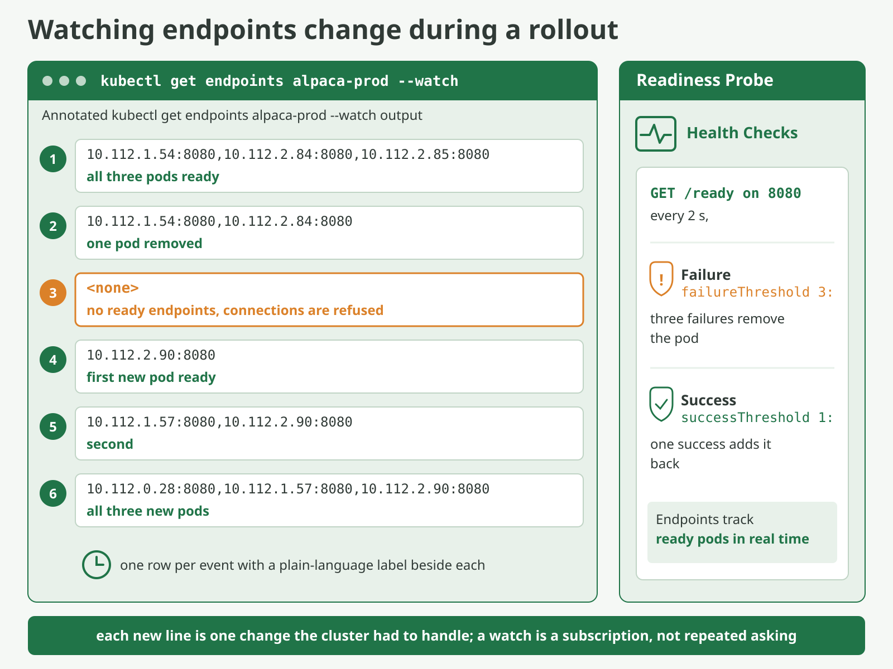

*Figure 5.10.6. Each line of the watch is one endpoint change, and the empty line shows the moment of no backends.*

Some apps, and the system itself, want the list of pod IPs behind a Service rather than its cluster IP. For that reason, Kubernetes creates a buddy Endpoints object for every Service, holding the IP addresses behind it. Think of it as the older, plainer view of the same data. It has the same name as its Service, so one command finds it:

```
$ kubectl describe endpoints alpaca-prod
Name: alpaca-prod
Namespace: default
Labels: app=alpaca
Subsets:
Addresses: 10.112.1.54,10.112.2.84,10.112.2.85
NotReadyAddresses: <none>
Ports:
Name Port Protocol
---- ---- --------
<unset> 8080 TCP
No events.
```

The output lists the ready addresses under `Addresses`. Any unready addresses appear under `NotReadyAddresses`. An advanced app can ask the Kubernetes API for these endpoints and call them directly. The API can also watch an object and notify the client as soon as it changes, so a client can react right away when the IPs behind a Service change. In plain words, a watch is a subscription. The client asks once, then hears about each change as it happens, instead of asking again and again.

Try it yourself. Start this command in one terminal and leave it running. It prints the current state, then waits for changes:

```
$ kubectl get endpoints alpaca-prod --watch
NAME ENDPOINTS AGE
alpaca-prod 10.112.1.54:8080,10.112.2.84:8080,10.112.2.85:8080 1m
```

In a second terminal, delete and re-create the deployment behind `alpaca-prod`:

```
$ kubectl delete deployment alpaca-prod
$ kubectl create deployment alpaca-prod \
--image=gcr.io/kuar-demo/kuard-amd64:blue \
--port=8080
$ kubectl scale deployment alpaca-prod --replicas=3
```

Each new line in the watched output is one change, and each change is one event the cluster had to handle. Count the lines and you see how busy the Service was during the rollout.

Look back at the watched output. As the pods are deleted and re-created, each line shows the newest set of IP addresses for the Service. Your output looks something like this:

```
NAME ENDPOINTS AGE
alpaca-prod 10.112.1.54:8080,10.112.2.84:8080,10.112.2.85:8080 1m
alpaca-prod 10.112.1.54:8080,10.112.2.84:8080 1m
alpaca-prod <none> 1m
alpaca-prod 10.112.2.90:8080 1m
alpaca-prod 10.112.1.57:8080,10.112.2.90:8080 1m
alpaca-prod 10.112.0.28:8080,10.112.1.57:8080,10.112.2.90:8080 1m
```

The Endpoints object suits new code built to run on Kubernetes from the start. Most projects are not in that position. Most existing systems expect plain IP addresses that do not change very often. A system that reads its address once at startup is one of those, which is why the Service name is the safer choice for most apps.

### Manual service discovery

A Service is built on label selectors over pods. That means you can do rough service discovery with the Kubernetes API without creating a Service object at all.

With `kubectl`, you can see the IP that is assigned to each pod in the example deployments:

```
$ kubectl get pods -o wide --show-labels
NAME ... IP ... LABELS
alpaca-prod-12334-87f8h ... 10.112.1.54 ... app=alpaca
alpaca-prod-12334-jssmh ... 10.112.2.84 ... app=alpaca
alpaca-prod-12334-tjp56 ... 10.112.2.85 ... app=alpaca
bandicoot-prod-5678-sbxzl ... 10.112.1.55 ... app=bandicoot
bandicoot-prod-5678-x0dh8 ... 10.112.2.86 ... app=bandicoot
```

That works, but a cluster can hold a great many pods. You will want to filter by the labels the deployment applied. Here is the `alpaca` app only:

```
$ kubectl get pods -o wide --selector=app=alpaca
NAME ... IP ...
alpaca-prod-3408831585-bpzdz ... 10.112.1.54 ...
alpaca-prod-3408831585-kncwt ... 10.112.2.84 ...
alpaca-prod-3408831585-l9fsq ... 10.112.2.85 ...
```

You now have the basics. Labels pick out the pods you care about, and the API gives you their IP addresses. Keeping the right labels in sync is tricky, though. That is why the Service object was created, so you do not have to keep label queries up to date by hand.

## 3. kube-proxy

A pod calls a ClusterIP and waits, and the connection times out even though the Service looks correct on paper. Nothing listens on that address, so the answer has to come from the node itself. A ClusterIP has no process behind it, so the real work happens in the rules on each node. `kube-proxy` is the component that writes those rules. It runs on every node, as a DaemonSet or as a static pod. It watches Services, EndpointSlices and Node topology labels, and it programs the node's datapath so that ClusterIP:port traffic reaches a backend. In modern modes, it does not carry the traffic itself. The older userspace mode did, but modern modes only program rules. Think of `kube-proxy` as a clerk who keeps the routing table current, while the kernel is the one that moves each packet.

Its configuration lives in `KubeProxyConfiguration`, which is stored in the ConfigMap `kube-system/kube-proxy`. The top-level keys are `mode`, `clusterCIDR`, and the `iptables`, `ipvs` and `nftables` sections. Those sections hold `syncPeriod`, `minSyncPeriod`, `masqueradeAll`, `scheduler` and `strictARP`. Conntrack settings sit under `conntrack` (`maxPerCore`, `min`, `tcpEstablishedTimeout`, `tcpCloseWaitTimeout`). `nodePortAddresses` and `metricsBindAddress` complete the list. You do not need to memorize every key. When a setting seems to change behavior, this ConfigMap is the first place to look.

### iptables mode (default for many years)

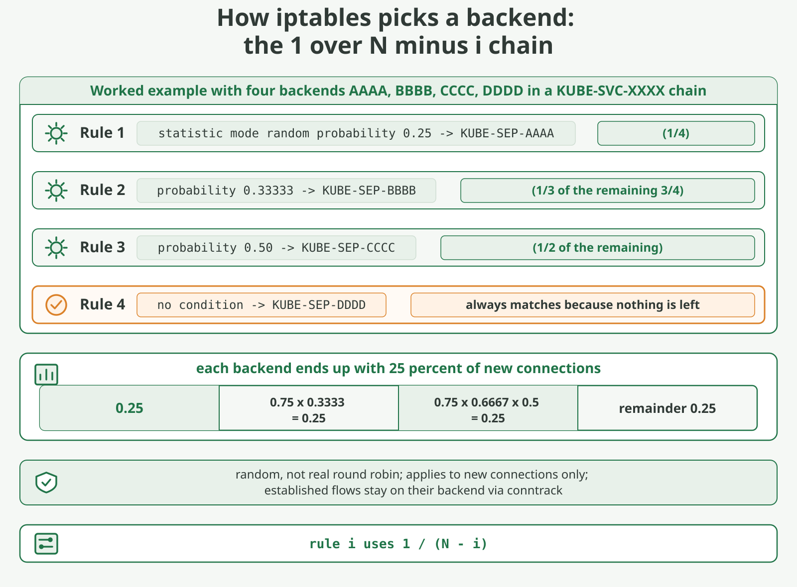

*Figure 5.10.7. Each later rule's probability is larger so every backend ends up with an equal chance.*

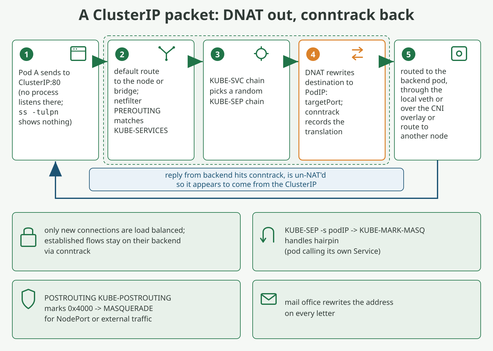

*Figure 5.10.8. The kernel rewrites the destination on the way out and conntrack reverses it on the way back.*

For each Service and endpoint, `kube-proxy` writes chains in the `nat` table, and in the `filter` table for rejects:

```text
PREROUTING / OUTPUT  → KUBE-SERVICES
KUBE-SERVICES:   -d <ClusterIP> -p tcp --dport 80 → KUBE-SVC-XXXX     (one jump per Service port)
                 (also -m addrtype --dst-type LOCAL → KUBE-NODEPORTS for NodePorts)
KUBE-SVC-XXXX:   -m statistic --mode random --probability 0.33333 → KUBE-SEP-AAAA
                 -m statistic --mode random --probability 0.50000 → KUBE-SEP-BBBB
                 → KUBE-SEP-CCCC                                        (random load balancing, no real round robin)
KUBE-SEP-AAAA:   -s <podIP> → KUBE-MARK-MASQ  (hairpin: pod talking to its own Service)
                 -p tcp → DNAT --to-destination <podIP>:<targetPort>
POSTROUTING:     KUBE-POSTROUTING: -m mark --mark 0x4000 → MASQUERADE   (for NodePort/external traffic needing SNAT)
```

Follow a packet from pod A to a ClusterIP. The pod's network namespace sends the packet toward the ClusterIP, through the default route to the node or bridge. The node's netfilter `PREROUTING` hook handles traffic from pods and matches `KUBE-SERVICES`. A random `KUBE-SEP` chain is then chosen, and `DNAT` rewrites the destination to the pod IP. **conntrack** records that translation. Return packets from the backend are un-NAT'd, so they look as if they came from the ClusterIP. Finally, the packet is routed to the destination pod, either through the local veth or over the CNI overlay or route to another node. Return traffic hits conntrack and is reverse-translated.

Think of the `KUBE-SERVICES` chain as a receptionist with a long list of names. Each packet is checked against the list until one entry matches. The random pick of a backend works like drawing a slip from a hat, where the odds change a little at each step. The lab in section 9 checks that sequence of odds.

This mode has costs that grow with the cluster. The rule count grows with Services multiplied by endpoints, so matching `KUBE-SERVICES` is a linear, O(n) chain traversal. Since 1.2x, hash-based jumps mitigate this for some cases. Every sync rewrites the whole ruleset with `iptables-restore`. That call takes the xtables lock and can take seconds, and significant CPU, for tens of thousands of rules. Load balancing is random, and it applies to new connections only. Established flows stay on their backend through conntrack. Endpoints get no health checking beyond readiness. The per-packet cost stays small, but the rule update latency becomes large at scale.

The practical effect is that the cost is paid in two places. Each new connection pays a small price to walk the list, and each change pays a larger price to rewrite the whole rule set. The second cost is the one operators notice first, in slow syncs and CPU spikes.

### Why iptables struggles at scale

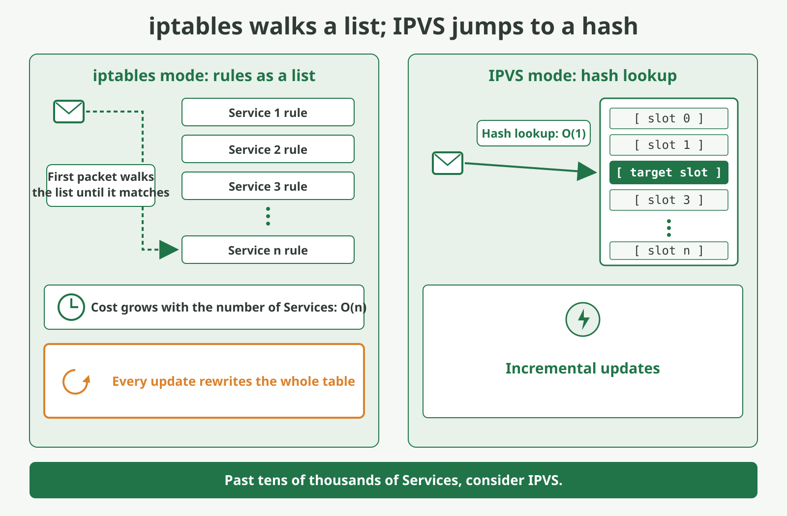

*Figure 5.10.9. iptables mode walks a list of rules whose cost grows with the number of Services, while IPVS looks up the Service in a hash table.*

The iptables rules are stored as a list. When a pod opens a new connection to a Service, the first packet walks through that list until it finds a match. In the worst case, the packet must walk the entire list. The cost therefore grows linearly with the number of Services. `O(n)` is shorthand for work that grows in step with n, the number of items being checked. Put simply, a long guest list takes longer to check than a short one, and every new connection has to check it. In complexity terms, the iptables mode is O(n) when it processes packets. Connections to Services get slower as the cluster grows.

Updates are the bigger problem. iptables rules are not incremental, so kube-proxy must write out the entire table for every update. On a large cluster, that write can take minutes, which risks sending traffic to stale endpoints. kube-proxy also holds the iptables lock (`/run/xtables.lock`) during the update. Other processes that change iptables rules, such as CNI plug-ins, can then contend with it.

Community tests suggest you should not notice a slowdown unless the cluster runs tens of thousands of Services. Past that point, the IPVS mode is worth considering. The next subsection shows how it handles the same Services.

### IPVS mode

IPVS mode uses the kernel's IP Virtual Server, an L4 load balancer inside netfilter, with hash tables. `kube-proxy` creates a virtual server for each ClusterIP:port on a dummy interface named `kube-ipvs0`. Each endpoint becomes a real server. A scheduler picks among the real servers. The schedulers are `rr`, `lc`, `sh`, `dh`, `sed` and `nq`, and you set one with `ipvs.scheduler`. Matching uses `ipset` sets such as `KUBE-CLUSTER-IP` and `KUBE-NODE-PORT-TCP`, plus a few iptables rules for masquerade. A quick way to picture IPVS is a phone book with an index. iptables reads the rules one line at a time, while IPVS jumps straight to the entry for an address. The real servers sit under that entry, and the scheduler picks which one answers.

Lookups are O(1). Updates are incremental: a real server is added or removed, rather than the whole ruleset being rewritten. IPVS offers more schedulers, and it supports connection tracking and graceful termination (weight 0). It needs the `ip_vs*` modules and `ipset`, and you use `ipvsadm` to inspect it. With MetalLB in L2 mode, `strictARP: true` is required.

IPVS has caveats. It still uses conntrack and iptables for SNAT and policy. It has had historical bugs. Upstream is deprioritising IPVS in favour of nftables, and some CNIs and NetworkPolicy implementations assume iptables.

```bash
ipvsadm -Ln | head -30                  # virtual servers and real servers
ipvsadm -Lnc | head                     # IPVS connection table
ipset list KUBE-CLUSTER-IP | head
ip addr show kube-ipvs0 | head
```

### Reading IPVS listings

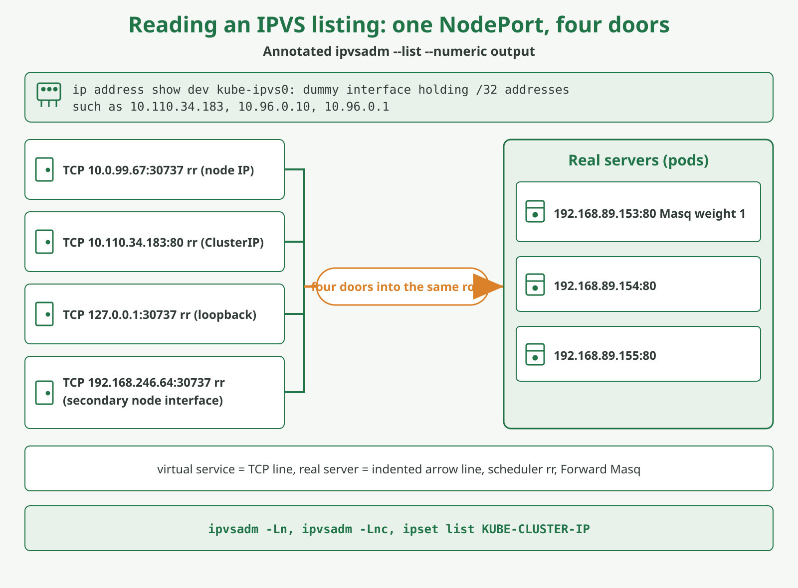

*Figure 5.10.10. A NodePort Service in IPVS mode appears as four virtual services that share the same real servers.*

IPVS does not walk a list when a new connection arrives. It finds the destination right away, based on the Service IP address. kube-proxy in `ipvs` mode first adds the ClusterIP to a dummy interface named `kube-ipvs0`:

```
$ ip address show dev kube-ipvs0
28: kube-ipvs0: <BROADCAST,NOARP> mtu 1500 qdisc noop state DOWN group default
link/ether 96:96:1b:36:32:de brd ff:ff:ff:ff:ff:ff
inet 10.110.34.183/32 brd 10.110.34.183 scope global kube-ipvs0
valid_lft forever preferred_lft forever
inet 10.96.0.10/32 brd 10.96.0.10 scope global kube-ipvs0
valid_lft forever preferred_lft forever
inet 10.96.0.1/32 brd 10.96.0.1 scope global kube-ipvs0
valid_lft forever preferred_lft forever
```

Next, kube-proxy creates an IPVS virtual service for the ClusterIP. Then it adds one IPVS real server for each Service endpoint. For a ClusterIP Service with three endpoints, the listing looks like this:

```
$ ipvsadm --list --numeric --tcp-service 10.110.34.183:80
Prot LocalAddress:Port Scheduler Flags
  -> RemoteAddress:Port Forward Weight ActiveConn InActConn
TCP 10.110.34.183:80 rr
  -> 192.168.89.153:80 Masq 1 0 0
  -> 192.168.89.154:80 Masq 1 0 0
  -> 192.168.89.155:80 Masq 1 0 0
```

The line starting with `TCP` is the virtual service. Its address is the ClusterIP. The indented `->` lines are real servers, and each one is a Service endpoint (a pod).

NodePort and LoadBalancer Services need more virtual services. kube-proxy creates one for the Service's ClusterIP. It also creates one for each node IP address and one for the loopback address. The next listing shows a NodePort Service on TCP port 30737:

```
ipvsadm --list --numeric
IP Virtual Server version 1.2.1 (size=4096)
Prot LocalAddress:Port Scheduler Flags
  -> RemoteAddress:Port Forward Weight ActiveConn InActConn
TCP 10.0.99.67:30737 rr
  -> 192.168.89.153:80 Masq 1 0 0
  -> 192.168.89.154:80 Masq 1 0 0
  -> 192.168.89.155:80 Masq 1 0 0
TCP 10.110.34.183:80 rr
  -> 192.168.89.153:80 Masq 1 0 0
  -> 192.168.89.154:80 Masq 1 0 0
  -> 192.168.89.155:80 Masq 1 0 0
TCP 127.0.0.1:30737 rr
  -> 192.168.89.153:80 Masq 1 0 0
  -> 192.168.89.154:80 Masq 1 0 0
  -> 192.168.89.155:80 Masq 1 0 0
TCP 192.168.246.64:30737 rr
  -> 192.168.89.153:80 Masq 1 0 0
  -> 192.168.89.154:80 Masq 1 0 0
  -> 192.168.89.155:80 Masq 1 0 0
```

There are four virtual services in that output. The first listens on the node's IP address. The second listens on the Service's cluster IP. The third listens on `localhost`. The fourth listens on a secondary network interface on the node. Each one forwards to the same three pods, so a client can reach the NodePort through any of those addresses. Read the four blocks as four doors into the same room, each one leading to the same three pods.

### nftables mode

nftables is the modern kernel packet filter, and `kube-proxy` supports it as a mode that is stable in recent releases. If you have only used iptables, picture nftables as the same kind of filter written with lookup tables built in, so a rule does not have to be found by reading down a list. It programs a single `kube-proxy` table with maps and verdict maps. That gives O(1) Service lookup and incremental updates, because each `nft -f` transaction changes only the deltas. It scales and updates better than iptables, and it avoids IPVS's extra dependencies. Check availability in your Kubernetes and kernel version. Coexistence with other iptables-based tooling needs care, since legacy `iptables` front-ends that sit over the nft backend can conflict. Inspect it with `nft list table ip kube-proxy` and `nft list chain ip kube-proxy services`.

### eBPF replacements (Cilium kube-proxy replacement, Calico eBPF dataplane)

An eBPF datapath replaces kube-proxy entirely. Service resolution happens at socket-connect time. `cgroup/connect4` hooks translate the ClusterIP to a backend before the packet exists, which is called socket LB. For NodePort and external traffic, resolution happens at tc or XDP ingress instead. The load-balancing state lives in BPF maps. The datapath offers Maglev consistent hashing, and DSR (direct server return) avoids SNAT hops. It also brings health checking. Socket-level translations need no conntrack, and CPU use at scale is much lower, with faster updates.

The key word is socket. A normal packet is rewritten after it is built. With socket-level load balancing, the rewrite happens when the application asks the kernel to connect, so the first packet already carries the real pod address. That is why this approach needs no conntrack entry for in-cluster Service traffic.

To run it, set `kubeProxyReplacement=true` for Cilium, and disable kube-proxy with `kubeadm init --skip-phases=addon/kube-proxy`. It needs modern kernels, 5.10+ recommended, and careful MTU and encap settings. Inspect it with `cilium service list`, `cilium bpf lb list` and `hubble observe`. The trade-offs are real. You debug with different tools, because there are no iptables rules to read. The datapath depends on the kernel version, and it ties you to the CNI. See 5.14.

### Mode comparison

The diagram shows how a packet reaches a backend in each mode. Read the iptables and nftables path first, then compare the IPVS and eBPF paths against it.

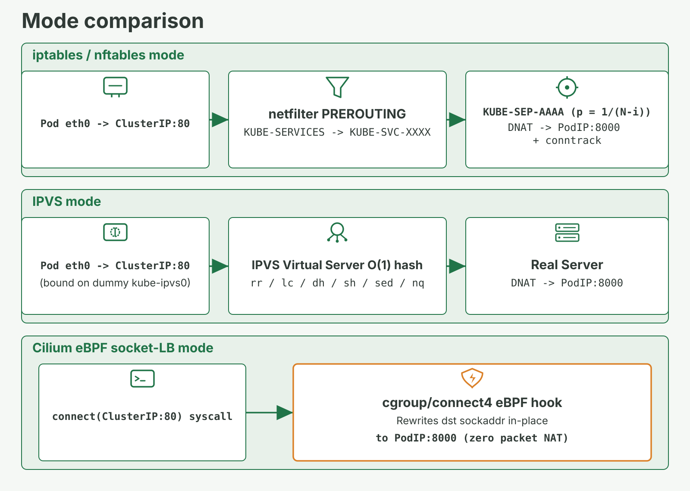

*Figure 5.10.11. Mode comparison, as a diagram.*

The table puts the same comparison into rows. The Scale row shows why iptables is the first mode to strain as Services grow.

| | iptables | IPVS | nftables | eBPF (Cilium) |
|---|---|---|---|---|
| Lookup | Linear rule traversal | Hash O(1) | Map O(1) | Map O(1), socket-level |
| Update | Full `iptables-restore` | Incremental | Incremental | Incremental |
| LB algorithms | Random | rr, lc, sh, ... | Random (map-based) | Random, Maglev, DSR |
| Scale (10k+ Services) | Poor (seconds-long syncs) | Good | Good | Very good |
| Debuggability | Familiar (iptables-save) | ipvsadm, ipset | nft | Hubble, cilium CLI |
| Dependencies | iptables | ip_vs, ipset | nft kernel support | Kernel BPF features |

### Cluster IP environment variables

Most users should find cluster IPs through DNS. An older mechanism still appears in some setups, though. Kubernetes injects a set of environment variables into pods as they start.

To see it, port-forward to the `bandicoot` app:

```
$ BANDICOOT_POD=$(kubectl get pods -l app=bandicoot \
-o jsonpath='{.items[0].metadata.name}')
$ kubectl port-forward $BANDICOOT_POD 48858:8080
```

Browse to http://localhost:48858 and expand the Server Env section. It lists the variables for the `alpaca` Service in a table like this:

| Key | Value |
|---|---|
| `ALPACA_PROD_PORT` | `tcp://10.115.245.13:8080` |
| `ALPACA_PROD_PORT_8080_TCP` | `tcp://10.115.245.13:8080` |
| `ALPACA_PROD_PORT_8080_TCP_ADDR` | `10.115.245.13` |
| `ALPACA_PROD_PORT_8080_TCP_PORT` | `8080` |
| `ALPACA_PROD_PORT_8080_TCP_PROTO` | `tcp` |
| `ALPACA_PROD_SERVICE_HOST` | `10.115.245.13` |
| `ALPACA_PROD_SERVICE_PORT` | `8080` |

Two of these matter most: `ALPACA_PROD_SERVICE_HOST` and `ALPACA_PROD_SERVICE_PORT`. The rest exist only for the older Docker link variables, which are now deprecated. Think of these variables as a badge printed when the pod was created. If the Service changes later, the badge does not change.

This approach has a catch. Resources must be created in a set order, because the Service has to exist before the pods that read its variables. That gets complicated when several Services make up one application. Many users also find environment variables awkward to work with. For these reasons, DNS is probably the better option. Prefer DNS for new work, and treat these variables as a legacy path you may still meet.

## 4. NodePort, LoadBalancer and traffic policies

A team has a Service that works inside the cluster, but a laptop on the office network cannot reach it. Something has to accept traffic at the edge of the cluster and hand it to the Service. NodePort and LoadBalancer are the two common answers, and they differ mainly in who opens the door.

### NodePort path

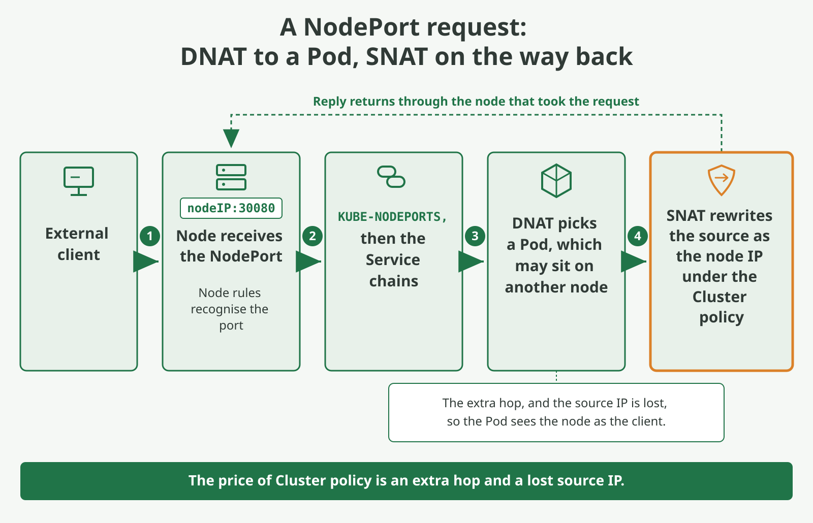

*Figure 5.10.12. A NodePort request is DNATed to a Pod, possibly on another node, and SNATed under the Cluster policy so the reply returns through the receiving node.*

An external client connects to `<nodeIP>:30080` on any node. The traffic then passes `KUBE-NODEPORTS` and the Service chains, and DNAT sends it to a pod, which may sit on another node. Under the `Cluster` policy, **SNAT** then masquerades the source as the node's IP, so replies return through the node that received the connection. That path has costs. It adds an extra hop, the source IP is lost so pods see the node IP, and the load can become uneven.

Here is that path in order. The packet arrives at a node on the NodePort. The node's rules recognize the port and jump into the Service's chains. DNAT picks a pod, and that pod may sit on another node. SNAT then rewrites the source so that the reply returns through the node that took the request. The pod sees the node as the client, which is the price of the extra hop.

### Trying a NodePort

Pod IPs are often reachable only from inside the cluster, so at some point you have to let new traffic in. Let's try a NodePort on `alpaca-prod`.

Change `spec.type` to `NodePort` with `kubectl edit service alpaca-prod`. You can also do this when you create the Service, by adding `--type=NodePort` to `kubectl expose`. The system assigns a new port:

```
$ kubectl describe service alpaca-prod
Name: alpaca-prod
Namespace: default
Labels: app=alpaca
Annotations: <none>
Selector: app=alpaca
Type: NodePort
IP: 10.115.245.13
Port: <unset> 8080/TCP
NodePort: <unset> 32711/TCP
Endpoints: 10.112.1.66:8080,10.112.2.104:8080,10.112.2.105:8080
Session Affinity: None
No events.
```

Here the system assigned port 32711. Now you can hit any cluster node on that port to reach the Service. If you are on the same network, connect directly. If the cluster runs in the cloud, tunnel over SSH:

```
$ ssh <node> -L 8080:localhost:32711
```

Point your browser to http://localhost:8080, and you are connected to the Service. Each request goes to one of the pods at random. Reload the page a few times, and you land on different pods. When you are done, exit the SSH session. The random choice is why the same page can come from a different pod on each reload. Nothing is wrong with the Service when that happens.

### `externalTrafficPolicy`

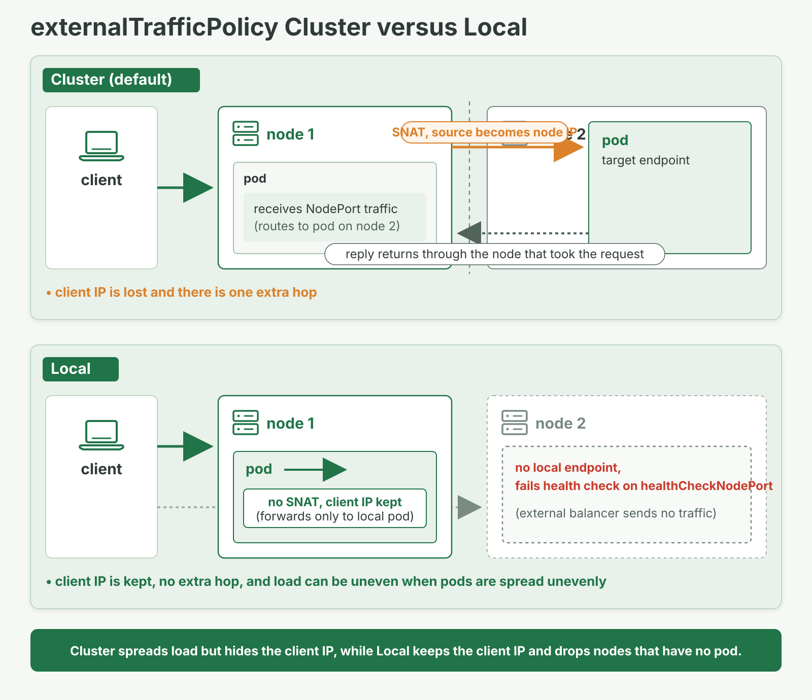

*Figure 5.10.13. With Cluster traffic may reach a pod on another node and the client IP is lost, while with Local only local pods answer and the client IP is kept.*

The `externalTrafficPolicy` setting decides which pods can answer external traffic. It has two values. Think of it as the rule at a taxi stand. With `Cluster`, any taxi in the city may pick up the fare. With `Local`, only the taxis parked at that stand may pick it up.

With `Cluster`, which is the default, any node may forward to any pod. Load spreads across all the pods, but the client source IP is lost and an extra hop is added.

With `Local`, only endpoints on the receiving node are used. There is no SNAT, so the client IP is preserved, and there is no extra hop. A node with no local endpoint fails the load balancer's health checks, because a `healthCheckNodePort` is allocated and the load balancer must use it. That node then drops out. The risk is uneven load when endpoints are unevenly distributed, for example 3 pods across 10 nodes. Connections may also drop during rolling updates if the load balancer's health check lags. Use `Local` with topology spread and `maxSurge`, or with cloud load balancers that route directly to pods, in NEG/IP target mode.

Here is a worked case. Suppose three pods run on ten nodes. Every node without a pod fails the health check and takes no traffic. The few nodes that do hold a pod carry the load for their share, and that is why spreading the pods first matters more than the policy itself.

**`internalTrafficPolicy: Local`** does the same for in-cluster clients, such as node-local DNS caches and per-node daemon Services.

### LoadBalancer implementations

In the cloud (AWS NLB or ALB, GCP LB, Azure LB), cloud-controller-manager creates the load balancer, along with node ports or direct pod targets. By default, a cloud `LoadBalancer` Service provisions a public, internet-facing load balancer. To expose a Service only inside your private VPC or VNet, add the cloud provider's internal load-balancer annotation to `metadata.annotations`. *Kubernetes: Up and Running*, third edition, Chapter 7, lists them:

- **Google Cloud Platform (GKE)**: `cloud.google.com/load-balancer-type: "Internal"`
- **Amazon Web Services (EKS)**: `service.beta.kubernetes.io/aws-load-balancer-internal: "true"`
- **Microsoft Azure (AKS)**: `service.beta.kubernetes.io/azure-load-balancer-internal: "true"`
- **Alibaba Cloud**: `service.beta.kubernetes.io/alibaba-cloud-loadbalancer-address-type: "intranet"`

Bare metal and GPU clouds use **MetalLB** (L2 ARP/NDP announcements or BGP), **kube-vip**, **Cilium LB IPAM + BGP control plane**, **Calico BGP**, or hardware load balancers. For inference gateways, prefer L7 ingress or Gateway API (5.12) in front of Services. Keep L4 load balancers for raw TCP, such as SSH bastions, databases, or gRPC with specific needs. The choice between an L4 and an L7 front door comes down to what the load balancer needs to read. An L4 balancer sees only connections, while an L7 gateway can read each request.

### Trying a LoadBalancer

Change `spec.type` to `LoadBalancer` with `kubectl edit service alpaca-prod`. This builds on NodePort. It also asks the cloud to create a load balancer that points at your nodes. Think of this step as ordering a front door for the Service. You ask the cloud to build the door, and the Service stays the room behind it.

**Warning:** a `LoadBalancer` Service is exposed to the public internet. Before you create one, make sure it is safe for everyone in the world to reach. *Kubernetes: Up and Running*, Chapters 9 and 20, give guidance on securing an application.

Run `kubectl get services` right away, and the `EXTERNAL-IP` column for `alpaca-prod` shows `<pending>`. Wait a bit, and the cloud assigns a public address. You can see the work Kubernetes asked for in the console of your cloud account. Seeing `<pending>` is normal at first. The cloud needs a short time to provide an address, so check again in a minute instead of changing the Service.

```
$ kubectl describe service alpaca-prod
Name: alpaca-prod
Namespace: default
Labels: app=alpaca
Selector: app=alpaca
Type: LoadBalancer
IP: 10.115.245.13
LoadBalancer Ingress: 104.196.248.204
Port: <unset> 8080/TCP
NodePort: <unset> 32711/TCP
Endpoints: 10.112.1.66:8080,10.112.2.104:8080,10.112.2.105:8080
Session Affinity: None
Events:
FirstSeen ... Reason Message
--------- ... ------ -------
3m ... Type NodePort -> LoadBalancer
3m ... CreatingLoadBalancer Creating load balancer
2m ... CreatedLoadBalancer Created load balancer
```

Here the Service has the address 104.196.248.204. Open a browser and try it. The events show the change from NodePort to LoadBalancer, then the load balancer being created.

This example comes from a cluster on Google Cloud, run through GKE. How a load balancer is set up depends on the cloud. Some clouds, such as AWS with Elastic Load Balancing (ELB), give a hostname instead of an IP address. Creating a cloud load balancer can take a few minutes on most providers.

### Session affinity and long-lived connections

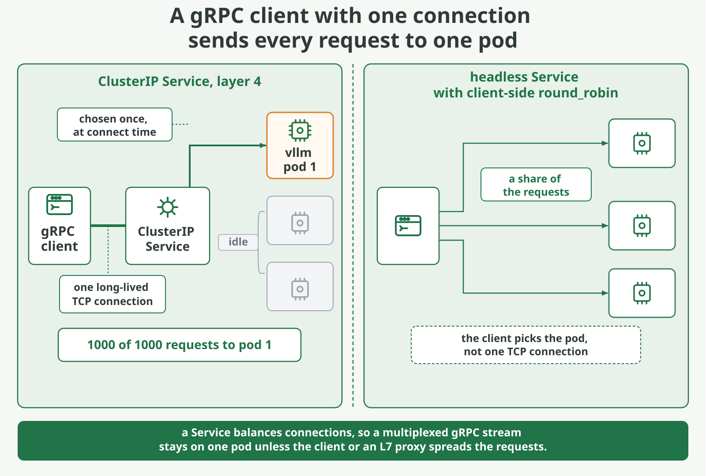

*Figure 5.10.14. A ClusterIP Service pins one long-lived gRPC connection to a single pod, so spreading requests needs a headless Service or an L7 proxy.*

`sessionAffinity: ClientIP` pins a client IP to one backend for `timeoutSeconds`, which defaults to 10800. It works through the `recent` module in iptables, or through IPVS persistence. It breaks behind NAT, where many clients share one IP.

Layer 4 balancing works per connection. HTTP/2 and gRPC multiplex many requests over one connection, so a client opens one connection and all its requests hit one pod. This is the well-known uneven gRPC load problem, and it is severe for inference gateways. Put simply, a client that opens one connection is like a shopper who sends every order through one cashier, no matter how many cashiers are open. You have several fixes. You can use a headless Service with client-side load balancing (gRPC `round_robin`, or xDS). You can use L7 proxies such as Envoy, Istio, Linkerd or an ingress. You can set connection age limits with `MAX_CONNECTION_AGE` on servers, or use a service mesh (5.28).

### Source IP and hairpin

Pod-to-own-Service traffic, called hairpin, requires `KUBE-MARK-MASQ` for same-endpoint selection. Bridge CNIs also need bridge `hairpin_mode` or promiscuous setups. Pod-to-Service traffic normally keeps the client pod IP as its source, with no SNAT, inside the cluster for iptables and IPVS modes. Traffic that leaves the cluster is SNAT'd by the CNI or the NAT gateway. Hairpin traffic is rare, but when it happens the reply needs special handling. Checkpoint 10 explains the rule that handles it.

### Connecting with other environments

Real applications often span environments. A cloud cluster may need to reach systems that run on-premise, and newer cloud native apps may need to talk to legacy ones. This part of Kubernetes is still being explored and developed.

### Connecting to resources outside of a cluster

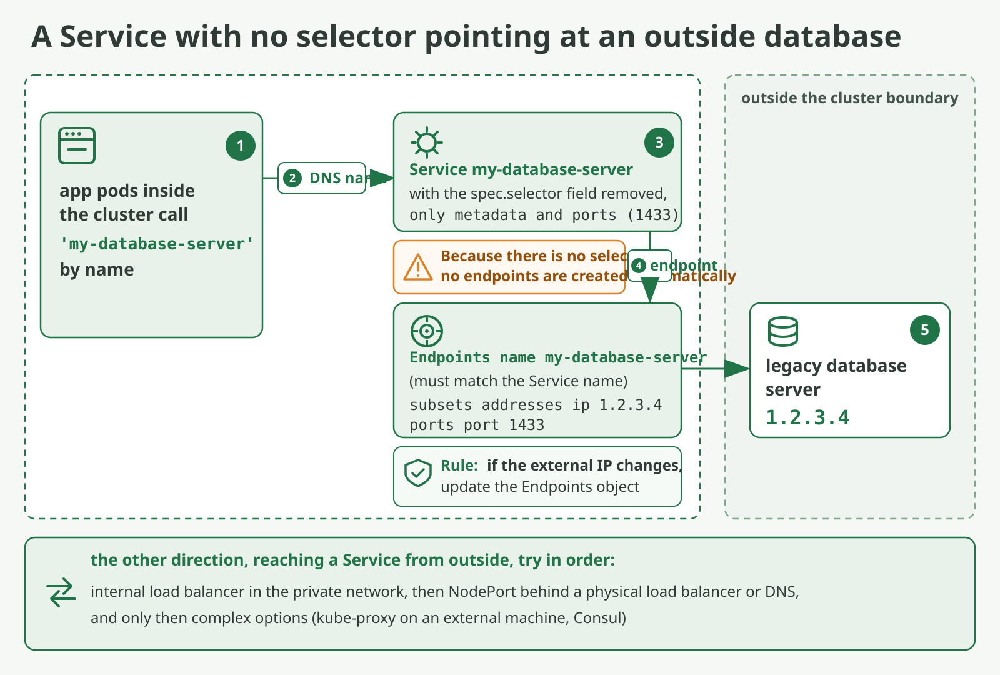

*Figure 5.10.15. Without a selector you supply the endpoint yourself, which lets cluster DNS name an external IP.*

To connect Kubernetes to a legacy resource outside the cluster, use a selector-less Service. You give it a manually assigned IP address outside the cluster. Kubernetes DNS then works as expected, and traffic flows to the external resource. To make one, remove the `spec.selector` field and leave `metadata` and `ports` unchanged.

Because the Service has no selector, no endpoints are added for it. You add them yourself. Think of a selector-less Service as a named sign that points to a door outside the building. Applications use the sign's name, and you decide where the door leads. The endpoint is usually a fixed IP address, such as your database server's, so you add it once. If that IP address ever changes, update the endpoint resource to match:

```
apiVersion: v1
kind: Endpoints
metadata:
# This name must match the name of your service
name: my-database-server
subsets:
- addresses:
# Replace this IP with the real IP of your server
- ip: 1.2.3.4
ports:
# Replace this port with the port(s) you want to expose
- port: 1433
```

### Connecting external resources to services inside a cluster

Connecting an external resource to a Kubernetes Service is trickier. If your cloud supports it, an internal load balancer is the simplest choice, as described above. It sits in your private network and passes traffic from a fixed IP address into the cluster. Traditional DNS can then publish that address to the external resource.

If an internal load balancer is not available, use a NodePort Service. It exposes the Service on the IP addresses of the cluster nodes. You can then program a physical load balancer to send traffic to those nodes, or use DNS-based load balancing to spread traffic across them.

If neither option works, more complex choices remain. You can run the full `kube-proxy` on an external machine and point it at the DNS server inside the cluster. That setup is much harder to get right, and it should really be used only in on-premise environments. Open source projects such as HashiCorp's Consul can also manage connectivity between resources inside and outside the cluster. Try the options in that order: internal load balancer, then NodePort, and only then the rest.

**Warning:** these options need deep knowledge of both networking and Kubernetes. Treat them as a last resort.

## 5. conntrack: the hidden state

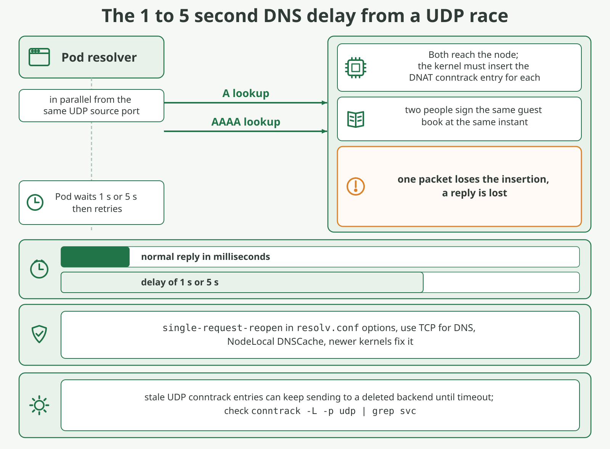

*Figure 5.10.16. Parallel DNS queries from one UDP source port can lose a race and add seconds of delay.*

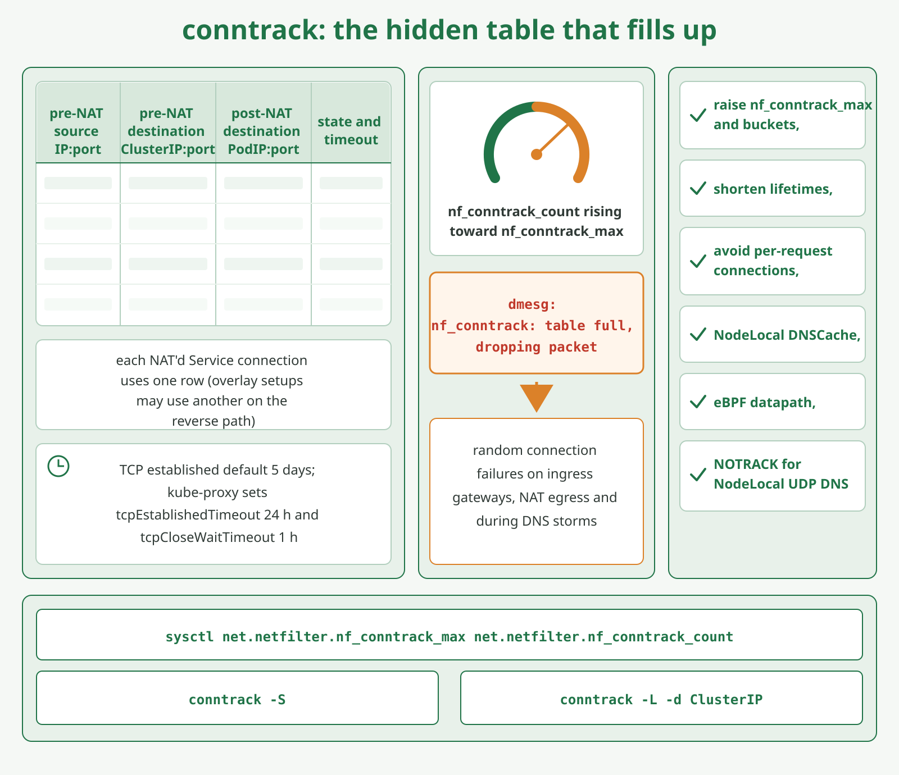

*Figure 5.10.17. Every NAT'd Service connection needs a conntrack row, and a full table drops new connections.*

Picture a busy ingress node on a Friday afternoon. Some connections fail at random, and the Service, the pods and the logs all look normal. Nothing about the Service has changed. The cause is a table on the node itself that has filled up, and that table is conntrack.

Every NAT'd Service connection uses a `conntrack` entry on the node. Often it also uses one on the destination node's reverse path in overlay setups. Those entries are limited. `net.netfilter.nf_conntrack_max` sets the maximum number of entries, and its default scales with memory. Hash buckets and per-state timeouts also apply. Think of conntrack as the guest list at a hotel front desk. Each active connection gets a line, and the desk checks that list to know which guest a reply belongs to. A full list turns new guests away, even when the rooms are empty. TCP established connections default to 5 days. kube-proxy sets `tcpEstablishedTimeout` to 24 h and `tcpCloseWaitTimeout` to 1 h.

When the table fills, `dmesg` shows `nf_conntrack: table full, dropping packet`. Busy nodes then see random connection failures, for example on ingress gateways, on NAT'd egress, or during DNS storms. The fixes are to raise `nf_conntrack_max` and the buckets, reduce lifetimes, and avoid per-request connections. You can also use NodeLocal DNSCache, use an eBPF datapath, or avoid conntrack for UDP DNS with `NOTRACK` for NodeLocal.

UDP entries can go stale. When a UDP backend pod is deleted, such as one serving DNS or syslog, conntrack may keep sending to the old IP until the timeout. kube-proxy deletes stale UDP conntrack entries when endpoints change, but bugs and races have occurred. Check for them with `conntrack -L -p udp | grep <svc>`. Think of a stale UDP entry as a note left on the front desk for a guest who has already checked out. Until the note expires, the desk keeps forwarding mail to the old room.

Races can also add delays of 1 s or 5 s to DNS. Parallel A and AAAA lookups that share a UDP source port race the DNAT insertion. This is a kernel conntrack race. Picture two people signing the same guest book at the same instant, with the second signature landing before the first one is written down. The DNS client sends a lookup, and the reply it needs is lost in that gap. The client then waits, and the wait is measured in seconds. It is mitigated with `single-request-reopen`, with TCP, or with NodeLocal DNS, and newer kernels fix it (see 5.11). Asymmetric routing and unexpected SNAT can also break stateful firewalls.

```bash
sysctl net.netfilter.nf_conntrack_max net.netfilter.nf_conntrack_count
conntrack -S | head                       # per-CPU stats: drops, insert_failed, search_restart
conntrack -L | wc -l
conntrack -L -d 10.96.12.34 | head        # entries for a ClusterIP
cat /proc/net/stat/nf_conntrack | head -3
dmesg -T | grep -i conntrack
```

On busy nodes, check the conntrack limits early. A full table fails connections that look unrelated to the Service itself.

### How a table fills up, and what to watch

When the kernel performs DNAT on a Service packet, it adds a conntrack entry. Each entry maps the pre-NAT protocol, source IP, source port, destination IP and destination port onto the post-NAT values. Later packets to the same Service then get the same translation. The same table removes the NAT from response packets before they go back to the source pod. Entries hold more fields than this, but these are the ones that matter for Services.

When the table is full, the kernel starts dropping or rejecting connections. Some applications handle that badly. If your workloads open many connections and you see connection failures, you may need to raise the maximum size of the table on your nodes. Monitor conntrack utilization as well. Set an alert for when the table gets close to full, so you can act before connections fail.

## 6. Topology-aware routing and other features

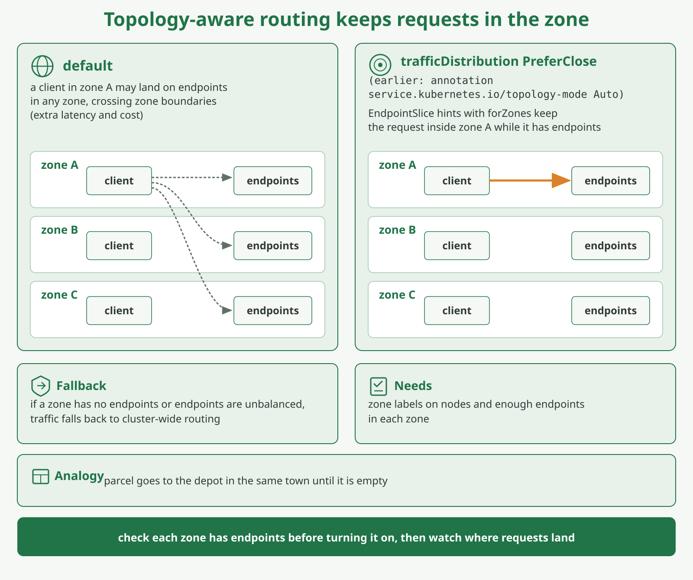

*Figure 5.10.18. PreferClose keeps traffic in-zone when each zone has enough endpoints.*

A team runs inference pods in several zones. Each request that crosses a zone boundary adds time and cost, and the bill grows with traffic. Topology-aware routing tries to keep each request in the zone where it started.

**Topology Aware Routing** is set with `trafficDistribution: PreferClose`. In earlier releases, the annotation `service.kubernetes.io/topology-mode: Auto` did the same job. EndpointSlice **hints** keep traffic inside the same zone when endpoints are balanced, which reduces cross-zone latency and cost. It needs zone labels on nodes and enough endpoints in each zone. Otherwise it falls back to cluster-wide routing. Think of it as a delivery company that sends each parcel to the depot in the same town while that depot has capacity. Only when the local depot is empty does a parcel travel farther.

When all ready endpoints are gone, proxies use `serving && terminating` endpoints. That keeps connections from dropping during rolling updates. In recent versions, this depends on the `externalTrafficPolicy: Local` fallback semantic.

Dual-stack gives a Service IPv4 and IPv6 ClusterIPs, configured with `ipFamilies` and `ipFamilyPolicy`. EndpointSlices exist per address family, and the CNI and kube-proxy must support it.

Service CIDR changes are hard, so allocate a large service range at the start. Newer releases support multiple ServiceCIDRs, through `ServiceCIDR` and `IPAddress` objects. `loadBalancerSourceRanges` limits which sources can reach a load balancer. Avoid `externalIPs`, which is a security risk in the CVE class. `publishNotReadyAddresses` publishes headless discovery before readiness, which StatefulSet peers need. `allocateLoadBalancerNodePorts` controls whether a load balancer gets node ports.

ServiceInternalTrafficPolicy covers node-local Services. Per-node daemons, such as log agents, DNS caches and GPU metrics scrapers, can be reached node-locally.

Turn on topology-aware routing only after you confirm that each zone has enough endpoints, or the traffic falls back to cluster-wide routing. Put simply, the feature is only as good as the zone balance behind it. Check that each zone has endpoints before you turn it on, and watch where requests land after the change.

## 7. Debugging Services

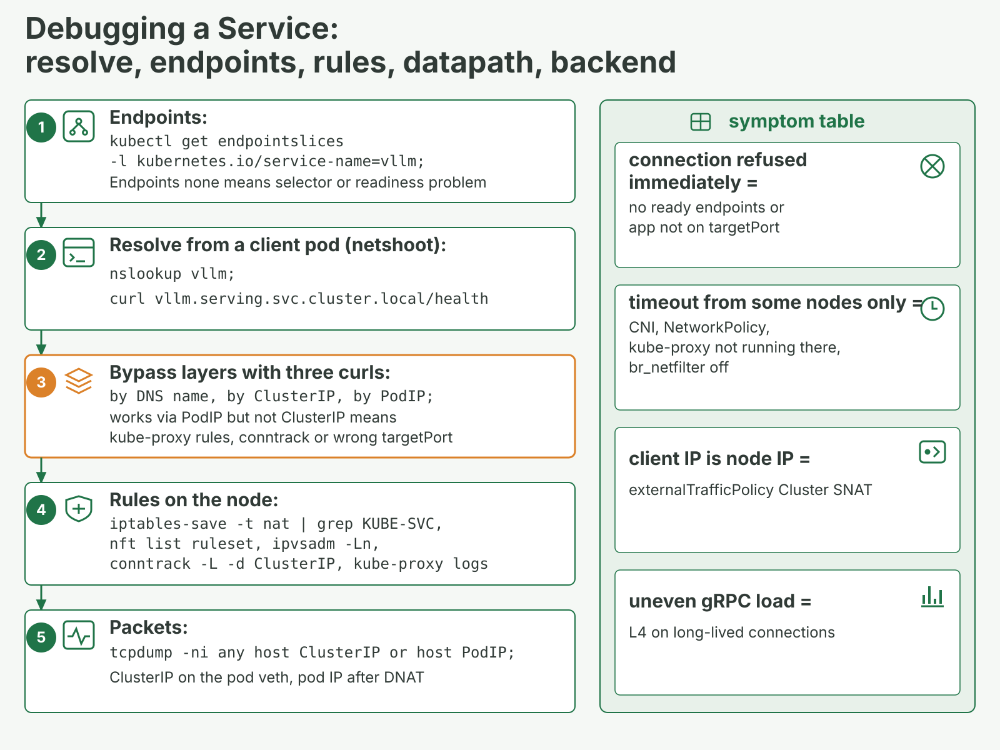

*Figure 5.10.19. Work top-down because each layer depends on the one before it.*

A user reports that the vLLM Service is slow, and nobody can say whether the fault is in DNS, the Service, kube-proxy or the pod. Guessing wastes time. Working from the top down narrows the fault quickly.

Work through the layers in order: **resolve → endpoints → rules → datapath → backend**. Each step narrows where the fault can be. Start with the Service and its endpoints, then check the client's DNS, then the node's rules, and only then the packets. The order matters because each layer depends on the one before it. If the Service has no ready endpoints, checking the packets first only shows you a dead end.

```bash
# 1. Does the Service select pods and do they have ready endpoints?
kubectl get svc vllm -n serving -o wide
kubectl get endpointslices -n serving -l kubernetes.io/service-name=vllm -o yaml | yq '.items[].endpoints'
kubectl get pods -n serving -l app=vllm -o wide           # labels match? Ready?
kubectl describe svc vllm -n serving                      # Endpoints: <none> means selector or readiness problem

# 2. From a client pod: DNS and connectivity
kubectl run -it --rm dbg --image=nicolaka/netshoot --restart=Never -n serving -- bash
  nslookup vllm; dig +short vllm.serving.svc.cluster.local
  curl -v http://vllm.serving.svc.cluster.local/health
  curl -v http://<clusterIP>:80/                           # bypass DNS
  curl -v http://<podIP>:8000/health                       # bypass Service (tests pod/CNI)

# 3. On the node: kube-proxy rules
kubectl -n kube-system logs ds/kube-proxy | tail            # mode, sync errors
iptables-save -t nat | grep -E "vllm|KUBE-SVC" | head -20   # service chain for the ClusterIP
iptables -t nat -L KUBE-SERVICES -n | grep <clusterIP>
nft list ruleset | grep -A3 <clusterIP>                     # nftables mode
ipvsadm -Ln | grep -A4 <clusterIP>                          # ipvs mode
conntrack -L -d <clusterIP>                                  # live translations

# 4. Packets
tcpdump -ni any host <clusterIP> or host <podIP> -c 50       # before/after DNAT: ClusterIP on the pod veth, pod IP after the node
tcpdump -ni <veth> port 8000
```

The table maps common symptoms to their likely causes and the check that confirms each one. Find the row that matches what you see, then run its check.

A quick way to use the table is to start from the symptom, not the component. A client that gets connection refused points you at endpoints. A client that times out from only some nodes points you at those nodes or the network between them. Reading the symptom first keeps you from opening every log in the cluster.

| Symptom | Likely cause | Check |
|---|---|---|
| `connection refused` immediately | No ready endpoints (iptables REJECT) or app not listening on targetPort | EndpointSlices, `ss -ltn` in pod |
| Timeout from some nodes only | CNI/overlay issue, NetworkPolicy, kube-proxy not running there, `br_netfilter` off | kube-proxy pod on that node, `sysctl net.bridge.bridge-nf-call-iptables`, route tables |
| Works via PodIP, not ClusterIP | kube-proxy rules missing/stale, conntrack, wrong targetPort | `iptables-save \| grep`, kube-proxy logs, `kubectl get endpointslices` |
| Works inside cluster, not via NodePort/LB | Firewall/security group, `externalTrafficPolicy: Local` with no local pod, LB health check | `healthCheckNodePort`, cloud LB status |
| Client IP is node IP | `externalTrafficPolicy: Cluster` SNAT | Use `Local` or LB with proxy protocol/XFF |
| Sporadic 1-5 s delays on DNS | conntrack UDP race | NodeLocal DNS, single-request-reopen, kernel update |
| Resets during rollouts | Endpoint removal race, no preStop, readiness too eager | 5.7 termination practices |
| Uneven load on gRPC | L4 balancing of long-lived connections | headless + client LB, L7 proxy |
| kube-proxy high CPU / slow updates | iptables mode with huge rule count | IPVS/nftables/eBPF, reduce Services, tune `minSyncPeriod` |
| `Service has no endpoints` for a StatefulSet headless | pods not ready, `publishNotReadyAddresses` needed | Readiness |
| NodePort unreachable on some interfaces | `nodePortAddresses` restrictions | kube-proxy config |

Watch the kube-proxy metrics as well. `kubeproxy_sync_proxy_rules_duration_seconds` and `kubeproxy_sync_proxy_rules_last_timestamp_seconds` show how long syncs take and when they last ran. `kubeproxy_network_programming_duration_seconds` measures the time from an endpoint change to its programming, and `kubeproxy_sync_proxy_rules_iptables_total` counts the iptables rules. Alert if programming latency exceeds a few seconds or syncs stall.

## 8. Scaling guidance

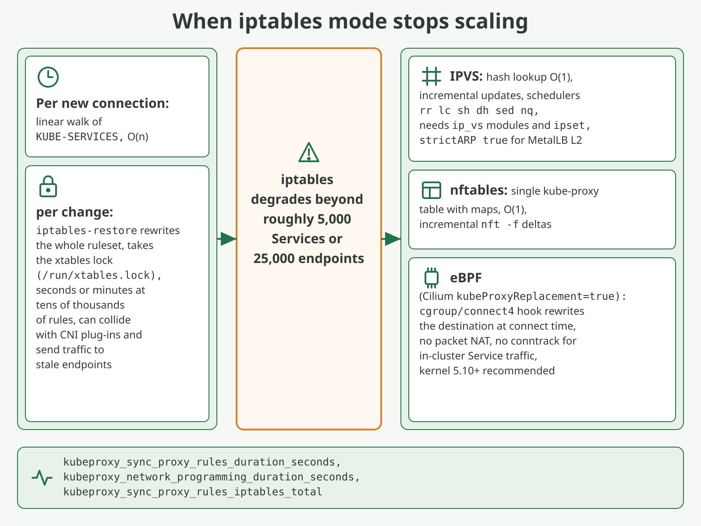

*Figure 5.10.20. iptables pays a linear lookup per connection and a full rewrite per change, so large clusters move to IPVS, nftables or eBPF.*

A platform team has grown from a handful of Services to several thousand. kube-proxy on each node now uses noticeable CPU every time something changes, and deploys feel slow. The first question is how many objects the cluster holds, and the second is how often they change.

The first step is to count. A cluster can hold thousands of Services, tens of thousands of EndpointSlices, and many rules or entries on each node. iptables mode degrades beyond roughly 5,000 Services or 25,000 endpoints. Sync times grow to many seconds, and CPU spikes on every change. Beyond that point, use IPVS, nftables or eBPF.

Churn is the next thing to reduce. Avoid flapping readiness, batch your rollouts, and set `kube-proxy --iptables-min-sync-period`. Consolidate redundant Services. Avoid a Service per job for thousands of short jobs, unless headless DNS is required. JobSet and MPI operators create a headless Service for each job, so keep an eye on the total count. Think of churn as a crowd that keeps moving through the same doors. Each move costs a little, and a crowd that never stops moving keeps every door busy.

Conntrack sizing matters on gateway and ingress nodes, and dedicated nodes can take the heavy NAT. Put simply, the nodes that handle the most connections deserve the most conntrack room, and you should not size every node the same way. NodeLocal DNSCache removes DNS from the conntrack path (see 5.11).

AI inference at high request rates needs its own path. Avoid sending bulk token streams through multiple NAT layers. Prefer direct pod IP routing, such as a load balancer with pod targets or DSR, and tune keep-alive and HTTP/2 connection reuse. For request-aware balancing, use L7 gateways with policies such as least-outstanding-requests or cache-aware routing (see 5.12 and Part 15).

For RDMA and NCCL traffic, Services are irrelevant. Those workloads use pod IPs on secondary networks (Part 12), and they rendezvous through headless Services or the launcher's hostfile. Decide early which layer balances each traffic type, because inference, RDMA and NCCL traffic each need a different path.

## 9. Lab

Start with the self-checking Python lab, and run it locally. Run `code/part05/kube_proxy_service_sim_lab.py` to check three things. It verifies the `iptables` `KUBE-SVC-*` sequential `--probability` calculator (`compute_iptables_sep_probabilities`, from Networking and Kubernetes, Chapter 4), which uses `1 / (N - i)`. It checks the EndpointSlice sharding into 100-endpoint slices, along with the terminating-endpoint fallback builder (`build_endpointslices`). It also checks the `externalTrafficPolicy: Cluster` versus `Local` packet path and source-IP simulator (`simulate_external_traffic_policy`). The script runs on a laptop and needs no cluster. It checks the logic, not the real kernel, so the lab steps below are still needed.

```bash
python3 code/part05/kube_proxy_service_sim_lab.py
```

Next, work through these exercises on a multi-node Kubernetes cluster. The shell steps below have not been run against live hardware. Start with step 1 and move down the list. Each step builds on the one before, so skipping ahead makes the later failures hard to read.

1. Start with the anatomy of a Service. Create a Deployment and a ClusterIP Service, then list the EndpointSlice. Compare ready and unready endpoints by failing the readiness probe on one pod, and watch the slice change. Finally, delete the selectors' labels and see `Endpoints: <none>`.
2. Walk the iptables rules on one node. Find the `KUBE-SVC-*` and `KUBE-SEP-*` chains for the Service, and compute the probabilities. While you curl the Service, run `conntrack -E` to watch the `NEW` and `DESTROY` events and the DNAT mapping. Use `tcpdump` on the pod veth and on the node interface to see the difference between ClusterIP and pod IP.
3. Switch the kube-proxy mode. Change kube-proxy to `ipvs`, with the modules loaded, and compare `ipvsadm -Ln`, the connection tables and update latency with 2,000 Services. Create those Services with a loop or with `kube-burner`. Then try `nftables` mode if it is available, and measure `kubeproxy_sync_proxy_rules_duration_seconds` in each mode.
4. Test NodePort and the traffic policies. Expose the Service through a NodePort, then curl it from outside with `externalTrafficPolicy: Cluster` and again with `Local`. Print `X-Forwarded-For`, or the source IP, in the server. Deploy fewer pods than nodes, and watch `Local` fail on the nodes that have no endpoints. Check `healthCheckNodePort` as well.
5. Install MetalLB in L2 mode on the lab network. Create a `LoadBalancer` Service, and observe the ARP announcements with `arping` and `ip neigh`. Switch to BGP with FRR (2.15, 2.27) to see the routes, then test failover by cordoning the speaker node.
6. Build a headless Service with a StatefulSet. Resolve the A records for each pod, use `dig SRV`, and compare the results with ClusterIP resolution. Finish by showing gRPC client-side round-robin.
7. Show gRPC imbalance. Deploy a gRPC echo service, then run a client with one connection and 1,000 requests. All of them land on one pod, which is the problem to see. Fix it with a headless Service and `round_robin`, or with an Envoy gateway, and graph the per-pod request counts.
8. Trigger conntrack exhaustion. Set a tiny `nf_conntrack_max` on a lab node, and generate many connections with hping, ab or fortio. Observe the drops and `dmesg`. Then raise the limits, compare the results, and measure the impact of NodeLocal DNSCache.
9. Test a rollout race. Serve traffic through a Service while you roll a Deployment, once with a `preStop` sleep and readiness delay, and once without. Count the errors, then tune.
10. Test topology routing. Label the nodes with zones, enable `trafficDistribution: PreferClose`, and show that requests stay in-zone using the per-pod logs. Then observe the fallback when a zone has no endpoints.
11. Replace kube-proxy with Cilium. In a lab cluster, install Cilium with `kubeProxyReplacement=true`, and verify that no `KUBE-SVC` rules remain. Use `cilium service list` and `hubble observe`, then compare latency and CPU in a load test.
12. Break a Service in five ways: a wrong selector, a wrong targetPort, readiness failing, a NetworkPolicy deny, and kube-proxy stopped on one node. Diagnose each one with the method above.
13. Clean up.

## 10. Common mistakes

Most Service outages come from a small set of mistakes, and many of them show up right after a change. A rollout finishes, the new pods look healthy, and the Service still returns nothing.

Selectors cause the first group of mistakes. A selector that does not match the pod labels breaks the Service, and so does one that matches pods from another Deployment. A wrong `targetPort` causes trouble too, and so does forgetting that named ports must match.

Round-robin is a common expectation, and it is wrong for iptables mode. There, the choice is random for each new connection, and long-lived connections stay where they are. Expecting a Service IP to answer a ping is another mistake, because ICMP to a ClusterIP usually isn't handled.

Using `externalTrafficPolicy: Local` without topology spread or load balancer health checks causes trouble as well. Running iptables-mode kube-proxy with tens of thousands of Services, while ignoring sync latency, is a mistake too. So is ignoring conntrack limits on ingress or gateway nodes, or letting DNS over UDP storm without NodeLocal DNS.

Treating `ExternalName` as a proxy is a mistake. Using `externalIPs`, or exposing NodePort ranges publicly, is one too. Running L4 balancing for HTTP/2 or gRPC inference traffic, and then expecting even load, is a mistake. Forgetting that NetworkPolicy and host firewalls affect node-to-pod probes and Service traffic causes surprises as well.

Check the selector and `targetPort` first, because they are the first items on this list.

Each mistake above leaves a clue. A selector mistake shows `Endpoints: <none>`. A `targetPort` mistake shows refused connections even when the endpoints look fine. A traffic policy mistake shows a client IP you did not expect. Matching the clue to the mistake is usually faster than re-reading the manifest.

## 11. Interview angles

In an interview, the panel usually starts with a single packet, not a diagram. They want to hear you follow that packet through the Service path, not only name the components.

Interviewers use these questions to see whether you can follow a packet through the Service path, not just name the components. Answer each one by tracing what happens in the kernel.

- "How does a ClusterIP work? There's no process; explain what happens to a packet."
- "iptables vs IPVS vs nftables vs eBPF kube-proxy: trade-offs and scale limits."
- "What is an EndpointSlice and why did it replace Endpoints?"
- "Explain `externalTrafficPolicy: Local` vs `Cluster`."
- "A Service works from some pods but not others. How do you debug?"
- "Why does gRPC load balance badly through a Service? Fixes?"
- "What breaks when conntrack fills up? How do you size/monitor it?"
- "How would you expose an inference gateway on bare metal?" (MetalLB/BGP, ingress/Gateway, traffic policy.)

## Exercises

Each exercise uses the simulator in `code/part05/kube_proxy_service_sim.py` or the commands from Section 7.

1. Take the six Service patterns from section 1: ClusterIP, NodePort, LoadBalancer, ExternalName, headless and selector-less. For each pattern, what problem does it solve?
2. Why is `enableServiceLinks: false` together with CoreDNS preferred over `<SVC>_SERVICE_HOST` environment variables? Production Kubernetes, Chapter 6, gives the reasons. Answer in your own words.
3. Run `build_endpointslices()`. Why does one `Endpoints` object become a bottleneck at 5,000 pods? How does EndpointSlice reduce that work? Why does the `serving && terminating` fallback keep connections alive when every pod is terminating?
4. Run `compute_iptables_sep_probabilities()`. Why does rule i in a `KUBE-SVC-*` chain use the probability `1 / (N - i)`? Work through a chain with four backends. The first rule uses 0.25. The second uses 0.33333, and the third uses 0.50. Why does the last rule always match?
5. Compare iptables, IPVS, nftables and Cilium eBPF as kube-proxy modes. How does each one find a backend? Which one would you pick for a cluster with thousands of Services, and why?
6. Run `simulate_external_traffic_policy()` once with `Cluster` and once with `Local`. What happens to the packet path? What happens to the source IP and the health check port? Why does ClusterIP balancing pin a multiplexed gRPC connection to one vLLM replica?
7. What does conntrack store for every Service flow? What happens when `nf_conntrack_count` reaches `nf_conntrack_max`? Why did parallel UDP `A` and `AAAA` queries once cause 5-second DNS timeouts? How does NodeLocal DNSCache remove that problem?
8. A `vllm` Service is unreachable. Use the four steps from section 7 in order: resolve, endpoints, rules and datapath. Which command would you run at each step?

## Checkpoint questions (20)

<details>
<summary>1. If you run `ss -tulpn` or `netstat` on a Kubernetes node, why is there NO process listening on a Service's `ClusterIP`?</summary>

A `ClusterIP` is a **purely virtual IP (`VIP`)** taken from `--service-cluster-ip-range` (`10.96.0.0/12`). No socket or daemon binds to it. The exception is IPVS mode, where the VIP is bound to the dummy `kube-ipvs0` interface, so the kernel treats it as local. Instead, when a pod sends a packet to `<ClusterIP>:<port>`, the node's kernel datapath handles it. That datapath is `netfilter` (`iptables` or `nftables`) or IPVS rules programmed by `kube-proxy`, or an `eBPF` `cgroup/connect4` program in Cilium. It rewrites the destination (`DNAT`) to a healthy backend, `<PodIP>:<targetPort>`.
</details>

<details>
<summary>2. Why can't you `ping <ClusterIP>` by default, even when `curl http://<ClusterIP>:<port>` works perfectly?</summary>

In `iptables` and `nftables` modes, `kube-proxy` writes `DNAT` rules that match only the layer-4 `protocol` (`TCP`, `UDP` or `SCTP`) and the `--dport <port>` declared in `Service.spec.ports`. A `ping` sends ICMP Echo Request packets, which have no TCP or UDP port. Those packets match no `KUBE-SVC-*` rule, so they are dropped or sent into a black hole. Test a Service with `curl`, `nc -zv` or `grpcurl` on its declared port, never with `ping`.
</details>

<details>
<summary>3. Why did Kubernetes introduce `EndpointSlice`s (`discovery.k8s.io/v1`) to replace the original `Endpoints` (`v1`) resource?</summary>

The legacy `Endpoints` object stored **all** backend pod IPs for a Service in one monolithic API object. Take a Service with 5,000 pods on a 1,000-node cluster:
1. The single `Endpoints` object exceeded `etcd`'s 1.5 MiB object size limit.
2. Each time **one** pod started, died or flipped readiness, `kube-apiserver` had to serialize the whole 5,000-endpoint object and broadcast it to all 1,000 `kube-proxy` watchers. That is $5,000 \times 1,000 = O(N^2)$ network traffic.

`EndpointSlice` splits endpoints into shards of at most **100 endpoints per slice** (`maxEndpointsPerSlice`). A single pod readiness change then updates only one small slice of 100 endpoints.
</details>

<details>
<summary>4. In `iptables` mode, why do the 4 rules inside `KUBE-SVC-XXXX` have probabilities `0.25`, `0.33333`, `0.50`, and `1.0` instead of `0.25` on every rule (Networking and Kubernetes, Chapter 4)?</summary>

`iptables` evaluates rules from top to bottom, so rule $i$ is reached only if rules $0 \dots i-1$ did **not** match. Each of the $N = 4$ backends (`KUBE-SEP-*`) should get an equal, unconditional share of $1/4 = 25\%$:
- **Rule 1 (`i=0`):** Matches with probability $1/4 = \mathbf{0.25}$, which is 25% of total traffic. The other 75% continues.
- **Rule 2 (`i=1`):** Matches $1/3 = \mathbf{0.33333}$ of the remaining 75%. That is $0.33333 \times 0.75 = 25\%$ of total traffic, and 50% continues.
- **Rule 3 (`i=2`):** Matches $1/2 = \mathbf{0.50}$ of the remaining 50%. That is $0.50 \times 0.50 = 25\%$ of total traffic, and 25% continues.
- **Rule 4 (`i=3`):** An unconditional jump ($\mathbf{1.0}$) that takes the remaining 25%.

In general, rule $i$ (counting from 0) uses **`--probability 1 / (N - i)`**.
</details>

<details>
<summary>5. Why does `kube-proxy` in `iptables` mode degrade severely beyond ~5,000 Services or ~25,000 endpoints?</summary>

There are two kernel bottlenecks. First, every new connection's packet walks the `KUBE-SERVICES` chain, which means linear $O(S)$ rule evaluation that compares the destination IP and port against thousands of rules. Second, whenever an endpoint changes, `kube-proxy` must serialize the **entire** NAT table, tens of thousands of lines, and run `iptables-restore`. That call takes the global kernel `xtables` lock and can take several seconds and 100% of a CPU core for each sync.
</details>

<details>
<summary>6. How does `kube-proxy` in `IPVS` mode work (Production Kubernetes, Chapter 6, and Networking and Kubernetes, Chapter 4), and what are its six load-balancing schedulers?</summary>

In `IPVS` mode, `kube-proxy` creates a dummy network interface named **`kube-ipvs0`** and binds every `ClusterIP` to it. It stores ClusterIP and NodePort sets in kernel **`ipset` hash tables**, which give $O(1)$ lookup. It creates one IPVS **Virtual Server** per Service port, with one **Real Server** per healthy pod IP. Pods can then be added or removed quickly, without rewriting the whole ruleset.

The six `--ipvs-scheduler` modes, from Networking and Kubernetes, Chapter 4, are:
1. **`rr` (Round-Robin, default)**
2. **`lc` (Least Connection):** Sends to the backend with the fewest active connections.
3. **`dh` (Destination Hashing)**
4. **`sh` (Source Hashing)**
5. **`sed` (Shortest Expected Delay)**
6. **`nq` (Never Queue)**
</details>

<details>
<summary>7. How does `kube-proxy` in `nftables` mode improve on both `iptables` and `IPVS`?</summary>

`nftables` mode creates one dedicated kernel table, `table ip kube-proxy`. It uses native `nftables` verdict maps (`vmap`) keyed by `(protocol . daddr . dport)`. Three things follow. A packet lookup is an $O(1)$ hash or map lookup, not a linear scan of chains. Updates are incremental transactions that change only the changed Service's map entries, not a full `iptables-restore` dump. And it needs no `ip_vs` kernel modules or dummy `kube-ipvs0` interface, and it never contends for the legacy `xtables` lock with CNI or firewall tools.
</details>

<details>
<summary>8. How does Cilium's `eBPF` `kube-proxy` replacement (`Socket-LB`) eliminate packet-level `DNAT` and `conntrack` for in-cluster traffic?</summary>

Cilium does not let a pod build a TCP packet addressed to `ClusterIP:80` and then rewrite its headers in `netfilter` on the `veth` interface. Instead, it attaches an eBPF program to the **`cgroup/connect4`** socket hook, and `sendmsg4` as well. When an application in the pod calls `connect(fd, ClusterIP:80)`, the eBPF hook rewrites the destination `sockaddr_in` in memory to `<PodIP>:8000`. That happens before the first TCP SYN is created. So every packet on the wire already carries the real `<PodIP>:8000` address. No packet DNAT is needed, no reverse NAT is needed on return packets, and there is no Service `conntrack` overhead.
</details>

<details>
<summary>9. What is the role of `conntrack` during a standard `iptables` Service connection (Production Kubernetes, Chapter 6), and what breaks without it?</summary>

Take pod A at `10.244.1.5:54321` connecting to a ClusterIP at `10.96.0.100:80`. `iptables` `PREROUTING` rewrites (`DNAT`s) the destination to pod B at `10.244.2.9:8000`, so pod B sees a packet from `10.244.1.5:54321`. Pod B then sends its `SYN-ACK` reply with source `10.244.2.9:8000`. If that reply reached pod A with that source, pod A's TCP stack would send a `RST` and drop it. Pod A opened a socket to `10.96.0.100:80`, not to `10.244.2.9:8000`.

The kernel's **`nf_conntrack`** table prevents this. It records the 5-tuple mapping: pre-NAT `10.244.1.5:54321 -> 10.96.0.100:80` matches post-NAT `10.244.1.5:54321 -> 10.244.2.9:8000`. The return packet is un-NAT'd back to source `10.96.0.100:80` before it reaches pod A. Later packets in the same TCP flow skip the `KUBE-SERVICES` rules and follow the cached conntrack entry.
</details>

<details>
<summary>10. What is \"Hairpin Traffic\" (`KUBE-MARK-MASQ`), and why does a Pod talking to its own Service deadlock without it?</summary>

Suppose pod A (`10.244.1.5`) connects to its own Service (`10.96.0.100:80`), and `kube-proxy` randomly picks pod A itself, `10.244.1.5:8000`, as the backend. This is hairpin traffic. After `DNAT`, the packet has source IP `10.244.1.5` and destination IP `10.244.1.5`. Pod A's kernel sees that the source is local to pod A. It therefore delivers the `SYN-ACK` reply internally over `lo`, without sending it out `eth0` to the host kernel. The host's `conntrack` never un-NATs the reply back to `10.96.0.100`, so the connection hangs.

The fix is the `KUBE-SEP-*` rule `-s 10.244.1.5 -j KUBE-MARK-MASQ`. It marks hairpin packets (`0x4000`) for `MASQUERADE`, which is SNAT to the node or bridge IP, in `POSTROUTING`. Paired with bridge `hairpin_mode = 1`, the reply then goes back out `eth0` through host `conntrack`.
</details>

<details>
<summary>11. Compare `externalTrafficPolicy: Cluster` vs. `externalTrafficPolicy: Local` on a `NodePort` or `LoadBalancer` Service.</summary>

- **`externalTrafficPolicy: Cluster` (default):** A node that receives external traffic on the `NodePort` balances across **all Ready endpoints in the cluster**, including those on other nodes. The ingress node then performs **SNAT (`MASQUERADE`)** so the return packet comes back through the node that holds the conntrack entry. SNAT overwrites the client's real source IP with the node's IP, and it adds an extra cross-node hop.
- **`externalTrafficPolicy: Local`:** The receiving node forwards only to endpoints running on that same node. There is no SNAT, so the client's true source IP is preserved, and there is no extra hop. A node with no local endpoints returns HTTP `503` on the Service's auto-allocated **`healthCheckNodePort`**, so the external cloud load balancer stops sending traffic to that node.
</details>

<details>
<summary>12. Why does a gRPC or HTTP/2 client sending 10,000 inference requests through a standard Kubernetes `ClusterIP` Service send 100% of its traffic to a single `vllm` Pod?</summary>

Standard `ClusterIP` balancing (`iptables`, `IPVS`, `nftables`, and the `cgroup/connect4` eBPF path) works at **Layer 4, per TCP connection**. The backend is chosen once, when the TCP `SYN` or `connect()` happens. Every later packet on that connection follows the established socket or conntrack mapping to the same pod. gRPC and HTTP/2 multiplex thousands of RPCs or streams over one long-lived TCP connection, so all 10,000 requests land on one pod. The other $N-1$ GPU pods sit idle.

There are three fixes:
1. Use a **Headless Service (`clusterIP: None`)** with gRPC client-side load balancing, for example `dns:///vllm.serving.svc.cluster.local` with `{"loadBalancingConfig": [{"round_robin": {}}]}`.
2. Route through an **L7 HTTP/2-aware proxy, Gateway API or service mesh** such as Envoy, Istio, Linkerd or NGINX.
3. Configure `MAX_CONNECTION_AGE` on the gRPC server, so it forces periodic reconnects.
</details>

<details>
<summary>13. What annotations request an internal (VPC-private) `LoadBalancer` Service on GCP, AWS, Azure, and Alibaba Cloud (Kubernetes: Up and Running, Chapter 7), and what YAML quoting rule applies (Networking and Kubernetes, Chapter 5)?</summary>

- **GCP (GKE):** `cloud.google.com/load-balancer-type: "Internal"`, or `networking.gke.io/load-balancer-type: "Internal"`
- **AWS (EKS):** `service.beta.kubernetes.io/aws-load-balancer-internal: "true"`, or with the AWS Load Balancer Controller, `aws-load-balancer-scheme: "internal"`
- **Azure (AKS):** `service.beta.kubernetes.io/azure-load-balancer-internal: "true"`
- **Alibaba Cloud:** `service.beta.kubernetes.io/alibaba-cloud-loadbalancer-address-type: "intranet"`

In `metadata.annotations`, every value is typed as a string map, `map[string]string`. So a boolean-looking value such as `"true"` must always be enclosed in quotes (Networking and Kubernetes, Chapter 5).
</details>

<details>
<summary>14. How do you use a Kubernetes `Service` to route to an external database or GPU cluster outside Kubernetes (a Service without a `selector`, Kubernetes: Up and Running, Chapter 7)?</summary>

Create a `Service` and leave out `spec.selector`. Because there is no selector, the `EndpointSlice` controller does not fill in endpoints on its own. You create a matching **`EndpointSlice`**, or an `Endpoints` object with exactly the same `metadata.name` as the `Service`, that lists the external IP addresses and ports. In-cluster pods can then connect to `external-db.default.svc.cluster.local` through the usual `ClusterIP` DNAT. Later, you can move the backend between external IPs and in-cluster pods without changing application configs.
</details>

<details>
<summary>15. How does MetalLB provide `Service type: LoadBalancer` on bare-metal GPU clusters in Layer 2 mode vs. BGP mode (Networking and Kubernetes, Chapter 5)?</summary>

MetalLB runs a cluster-wide `controller` Deployment, which assigns external VIPs from an `IPAddressPool`. It also runs a per-node `speaker` DaemonSet.
- **Layer 2 (`L2Advertisement`) mode:** One elected `speaker` node claims the Service's external IP and answers **ARP (IPv4) or NDP (IPv6)** requests on the local LAN subnet. It is simple, because no router configuration is needed. But all ingress traffic for that VIP enters through a single node, which is a `single-node bandwidth bottleneck`. Failover takes a few seconds of gratuitous ARP.
- **BGP (`BGPAdvertisement`) mode:** Each `speaker` node, or each node with local endpoints under `externalTrafficPolicy: Local`, peers over **BGP (TCP port 179)** with the top-of-rack (`ToR`) switches. It advertises a `/32` host route for the VIP, which enables true **ECMP multi-node load balancing** at line rate across the rack switches.
</details>

<details>
<summary>16. Why must `ipvs.strictARP: true` be enabled in `KubeProxyConfiguration` when using `kube-proxy` in IPVS mode with MetalLB Layer 2 mode?</summary>

In IPVS mode, `kube-proxy` binds every Service IP, including `LoadBalancer` external VIPs, to the dummy **`kube-ipvs0`** interface on every node. By default on Linux (`arp_ignore = 0`), the kernel answers an ARP request for any IP address on any interface of the host, and that includes `kube-ipvs0`. So every node in the cluster replies to ARP requests for the MetalLB VIP, which pulls traffic away from the elected MetalLB L2 speaker. Setting **`strictARP: true`** makes `kube-proxy` set `net.ipv4.conf.all.arp_ignore = 1` and `arp_announce = 2`. Nodes then answer ARP only for IPs configured on the actual physical ingress interface.
</details>

<details>
<summary>17. What are the two drawbacks of relying on Kubernetes-injected `<SVC>_SERVICE_HOST` environment variables instead of CoreDNS (Production Kubernetes, Chapter 6)?</summary>

1. **Creation-order bug:** `kubelet` injects environment variables only for Services that exist when the pod starts. A Service created after the pod starts does not appear in its `env`.
2. **Environment variable explosion:** In clusters with thousands of Services, injecting several variables per Service into every pod slows container startup. It can also exceed the Linux kernel `execve` argument and environment buffer limit (`Argument list too long`), which crashes pod startup. Set **`enableServiceLinks: false`** in Pod specs.
</details>

<details>
<summary>18. What is `publishNotReadyAddresses: true` on a Headless Service, and why do `StatefulSet`s and distributed training jobs need it?</summary>

Normally, the `EndpointSlice` controller includes a pod's IP in an `EndpointSlice` only after the pod passes its `readinessProbe`. CoreDNS returns A and AAAA records for `pod-0.svc.ns.svc.cluster.local` only after that point too. Clustered databases, such as `etcd`, Raft and ZooKeeper, and multi-node PyTorch or MPI jobs launched through a Headless Service, face a problem here. Their peers must find each other by DNS hostname while they initialize, before any pod can become Ready. Setting **`publishNotReadyAddresses: true`** on the Service tells the `EndpointSlice` controller and CoreDNS to publish DNS records for the pods immediately, even while `ready: false`.
</details>

<details>
<summary>19. How does Topology-Aware Routing (`trafficDistribution: PreferClose`) reduce cross-zone latency and cloud egress costs?</summary>

When `trafficDistribution: PreferClose` is enabled on a Service, or `service.kubernetes.io/topology-mode: Auto` is set, the `EndpointSlice` controller fills in **`hints.forZones`** on each endpoint. The hint is based on the zone of the endpoint's node, from `topology.kubernetes.io/zone`. `kube-proxy`, or Cilium, on a node in `us-central1-a` then filters the `EndpointSlice` to prefer endpoints whose `forZones` hint matches `us-central1-a`. That keeps inference and storage traffic inside the local availability zone. If a zone has no healthy endpoints, routing falls back automatically to the whole cluster.
</details>

<details>
<summary>20. What Prometheus metric measures the end-to-end latency between an endpoint becoming Ready and `kube-proxy` finishing programming the kernel datapath?</summary>

**`kubeproxy_network_programming_duration_seconds`** is a histogram. It measures the time from when the Pod or EndpointSlice change timestamp was recorded in the API to when `kube-proxy` finished its `iptables-restore`, `ipvs` or `nft` sync on the node. It is paired with **`kubeproxy_sync_proxy_rules_duration_seconds`**, which measures the duration of the local kernel rule sync itself.
</details>

## Sources and review notes

- **Sources read in full:**
  - `kubernetes-up-and-running-3rd-edition` — Brendan Burns, Joe Beda, Kelsey Hightower & Lachlan Evenson, *Kubernetes: Up and Running*, 3rd ed., **Chapter 7: Service Discovery** (read in full: the `Service` object, `kubectl expose`, `readinessProbe` gating endpoints, `--service-cluster-ip-range`, `NodePort` and `LoadBalancer` types, internal LoadBalancer annotations across GCP/AWS/Azure/Alibaba, `Endpoints` watch mechanics, manual service discovery via label selectors, and selector-less Services for external integration).
  - `networking-and-kubernetes` — James Strong & Vallery Lancey, *Networking and Kubernetes*, **Chapter 4: Kubernetes Networking Introduction** (sequential `iptables` `--probability` rules and IPVS 6 schedulers `rr`, `lc`, `dh`, `sh`, `sed`, `nq`) and **Chapter 5: Kubernetes Networking Abstractions** (read in full: `Pod`, `Deployment`, `ReplicaSet`, `Endpoints` `.addresses` vs `.notReadyAddresses`, `ClusterIP`, `NodePort`, `LoadBalancer` with MetalLB `controller` + `speaker`, string quoting on annotations `"true"`, Ingress, and Service Mesh).
  - `production-kubernetes` — Josh Rosso, Rich Lander, Alexander Brand & John Harris, *Production Kubernetes*, **Chapter 6: Service Routing** (read in full: Service discovery via environment variables vs CoreDNS and `ndots`, `Services` and `Endpoints`, `kube-proxy` in `iptables` and `IPVS` modes with `kube-ipvs0` and `conntrack` pre-NAT/post-NAT 5-tuples, Ingress controllers, and Service Mesh).
- **Run here:** `python3 code/part05/kube_proxy_service_sim_lab.py` (3 passed, 0 failed).
- **Explicitly labelled inferences:** The `compute_iptables_sep_probabilities`, `build_endpointslices`, and `simulate_external_traffic_policy` models in `code/part05/kube_proxy_service_sim.py` and the `vllm` Service and `EndpointSlice` manifests are the author's constructions synthesizing *Kubernetes: Up and Running* Chapter 7, *Networking and Kubernetes* Chapters 4 & 5, and *Production Kubernetes* Chapter 6 (plus original study items 21, 22, 23, 24, 25, 26, 27, 28, 29, 30, 31, 32, 33, 34, 35, 36, 37, 38, 39, and 40).
- **Not verified on live hardware:** Live `iptables-save`, `ipvsadm`, `nft`, `conntrack`, `cilium`, and `metallb` executions (`10.96.0.0/12`, `30000-32767`, `100` endpoints/slice, `80` -> `8000`, `10.244.3.17`, `0.33333` / `0.50000`, `0x4000`, `5.10+` kernel, `30080`, `timeoutSeconds: 10800`, `5 days` / `24 h` / `1 h` conntrack timeouts, `10.96.12.34`, `~5,000` Services / `~25,000` endpoints) are marked (not run against live hardware here) where not executed by `kube_proxy_service_sim_lab.py`.
