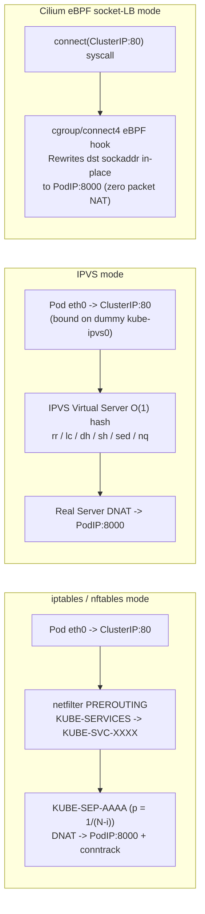

# 5.10 Services, endpoints and kube-proxy: the life of a Service

| | |
|---|---|
| Level | Advanced |
| Priority tier | 0 |
| Lab venue | Multi-node cluster; root on a node; `iptables-save`, `nft`, `ipvsadm`, `conntrack`, `tcpdump`, `curl`, `kubectl` |
| Part | Part 5: Kubernetes |
| Status | Drafted, labs **untested** |

## Why this matters for AI infrastructure

Pods are ephemeral and their IPs change, so everything that talks to inference servers, vector databases, parameter servers, feature stores, metrics endpoints or the control plane does so through Services. At scale Services stop being "just load balancing": with thousands of Services and tens of thousands of endpoints, iptables rule updates take seconds and CPU, conntrack tables fill during burst traffic from training clients or inference gateways, long-lived gRPC/HTTP2 streams pin to a single backend, and `externalTrafficPolicy` decides whether your LLM gateway sees client IPs and balances evenly. Understanding exactly how a ClusterIP becomes a pod IP in the kernel is essential for debugging latency spikes, connection resets, uneven load and "Service works from some nodes but not others".

## Prerequisites and outcomes

Needs 5.3, 5.8; networking (Part 2: NAT, conntrack, iptables/nftables 2.23). After this chapter you can:

- Define Service types and fields (selectors, ports, targetPort, sessionAffinity, externalTrafficPolicy, internalTrafficPolicy, loadBalancerClass, IP families) and EndpointSlices; explain readiness gating and terminating endpoints.
- Trace a packet from a pod to a ClusterIP to a backend pod (DNAT, conntrack, reverse NAT) in iptables, IPVS and nftables modes, and in eBPF replacements (Cilium).
- Explain NodePort and LoadBalancer paths, source IP preservation, health checks, hairpin traffic, and Services without selectors.
- Diagnose Service failures with `kubectl`, `iptables-save`, `ipvsadm`, `conntrack`, `tcpdump`, and kube-proxy logs/metrics.
- Choose kube-proxy mode, tune conntrack, handle scale (large Service counts), and use topology-aware routing.

## 1. Service objects

A **Service** is a stable virtual IP (ClusterIP) and DNS name that load-balances to a set of pods selected by labels. It is purely a *control-plane and kernel* construct: there is no process listening on the ClusterIP; the packet rewrite happens in each node's kernel (or in the CNI datapath).

```yaml
apiVersion: v1
kind: Service
metadata:
  name: vllm
  namespace: serving
spec:
  type: ClusterIP                  # ClusterIP | NodePort | LoadBalancer | ExternalName | (headless: clusterIP: None)
  selector: { app: vllm }
  ports:
    - name: http
      port: 80                     # service port (what clients use)
      targetPort: http             # container port number or named port
      protocol: TCP
      appProtocol: http            # hints for L7 proxies/meshes
  sessionAffinity: None            # or ClientIP (+ sessionAffinityConfig.clientIP.timeoutSeconds)
  internalTrafficPolicy: Cluster   # or Local (only node-local endpoints)
  ipFamilyPolicy: SingleStack      # SingleStack | PreferDualStack | RequireDualStack
  trafficDistribution: PreferClose # topology-aware preference (newer releases)
```

### Why a Service is needed

Kubernetes is a very dynamic system. It places Pods on nodes, keeps them running, and moves them when needed. It can also change the number of Pods based on load, through Horizontal Pod Autoscaling. That makes it easy to run a lot of things, but it makes those things hard to find. Most traditional network infrastructure was never built for this much change.

The general name for this class of problem is service discovery. A service discovery tool answers one question: which processes listen at which addresses, for which service? A good system answers quickly and reliably. It also updates clients soon after a change, and it can hold a richer description of a service, such as several ports.

The Domain Name System (DNS) is the traditional service discovery system on the internet. It is built for names that stay put, with wide caching. That suits the internet well, but a Kubernetes cluster changes too fast for it.

Old DNS habits cause real trouble here. Many systems, Java by default, resolve a name one time and then keep the answer. A client holding a stale answer keeps calling an IP that no longer serves the app. A short TTL (time-to-live) and a careful client help, but a lag before the client sees a change remains.

DNS also has limits on how much one answer can hold. Trouble begins once a single name carries more than 20 to 30 address (A) records. Service (SRV) records fix some of that, but they are hard to use. Clients usually take the first IP and count on the server to shuffle the list. That is no replacement for real load balancing.

That is why Kubernetes starts with a Service object. A Service is a named label selector, and it does more than that, as the next sections show.

### Creating two services

Let's make two small apps, `alpaca-prod` and `bandicoot-prod`, and put a Service in front of each. The `kubectl expose` command creates a Service from an existing deployment. Start with the commands:

```
$ kubectl create deployment alpaca-prod \
--image=gcr.io/kuar-demo/kuard-amd64:blue \
--port=8080
$ kubectl scale deployment alpaca-prod --replicas 3
$ kubectl expose deployment alpaca-prod
$ kubectl create deployment bandicoot-prod \
--image=gcr.io/kuar-demo/kuard-amd64:green \
--port=8080
$ kubectl scale deployment bandicoot-prod --replicas 2
kubectl expose deployment bandicoot-prod
$ kubectl get services -o wide
NAME CLUSTER-IP ... PORT(S) ... SELECTOR
alpaca-prod 10.115.245.13 ... 8080/TCP ... app=alpaca
bandicoot-prod 10.115.242.3 ... 8080/TCP ... app=bandicoot
kubernetes 10.115.240.1 ... 443/TCP ... <none>
```

After running these commands, there are three Services. Two are new: `alpaca-prod` and `bandicoot-prod`. The third, `kubernetes`, is created for you so that apps inside the cluster can find and talk to the Kubernetes API.

Look at the `SELECTOR` column. The `alpaca-prod` Service only gives a name to a selector, and it says which ports to use. The `kubectl expose` command copies both the label selector and the port (8080 here) from the deployment.

The Service also gets a new kind of address, a cluster IP. It is a virtual IP that the system load balances across every Pod the selector matches.

To try it, open a port-forward to one of the `alpaca` Pods. Keep it running in its own terminal window:

```
$ ALPACA_POD=$(kubectl get pods -l app=alpaca \
-o jsonpath='{.items[0].metadata.name}')
$ kubectl port-forward $ALPACA_POD 48858:8080
```

Then open http://localhost:48858 in your browser. You should see the `alpaca` Pod answering through the forwarded port.

### Types

| Type | What it creates | Notes |
|---|---|---|
| **ClusterIP** | Virtual IP from the service CIDR (configured on `kube-apiserver` via `--service-cluster-ip-range`, e.g., `10.96.0.0/12`, which must not overlap with Pod or node subnets), reachable inside the cluster | Default |
| **NodePort** | ClusterIP + a port (30000-32767) opened on every node forwarding to the Service | Basis for external LBs; `externalTrafficPolicy` matters |
| **LoadBalancer** | NodePort + external load balancer (cloud controller or MetalLB/kube-vip) with an external IP/hostname | `loadBalancerClass` selects implementation; `allocateLoadBalancerNodePorts: false` for LBs that route directly to pods |
| **ExternalName** | DNS CNAME to an external name; no proxying | No ports/selectors; avoid for TLS/host-header surprises |
| **Headless** (`clusterIP: None`) | No VIP; DNS returns pod IPs (A/AAAA per ready endpoint) | StatefulSets, client-side balancing, direct pod addressing, gRPC clients |
| **Services without selectors** | You manage EndpointSlices manually | Map to external databases/IPs or other-cluster pods |

### Ports

`port` is the Service's port; `targetPort` is the pod port (number or the container's named port, which allows changing numbers without touching Services); multiple ports require names; `nodePort` fixed if needed; `protocol` TCP/UDP/SCTP. Named `appProtocol` values (`http`, `h2c`, `grpc`) help gateways and meshes.

### DNS

Services get `my-svc.my-ns.svc.cluster.local` A/AAAA records (ClusterIP), SRV records for named ports, and pods can resolve short names via search domains (5.11). Headless services resolve to endpoint IPs.

As Josh Rosso et al. explain in *Production Kubernetes* Chapter 6 (*Service Routing*) and Brendan Burns et al. show in *Kubernetes: Up and Running* Chapter 7 (*Service Discovery*), Kubernetes also injects **Docker-Links-style environment variables** (`NGINX_SERVICE_HOST=10.110.34.183`, `NGINX_SERVICE_PORT=80`) into every Pod at container start time for Services that already exist in the same namespace. However, relying on Service environment variables has two major operational pitfalls:
1. **Strict creation-order dependency (`PK` Chapter 6):** A Pod only receives `<SVC>_SERVICE_HOST` environment variables for Services that **existed BEFORE the Pod was created**—if the Pod starts before its `Service` is created, those environment variables are missing until the Pod is restarted (whereas CoreDNS resolves the Service immediately as soon as it is created).
2. **Startup and memory bloat in large namespaces:** In a namespace with 2,000 Services, `kubelet` injects 10,000+ environment variables into every container, which can exceed the Linux kernel `execve` `MAX_ARG_STRLEN` environment size limit and cause containers to fail startup. Set **`enableServiceLinks: false`** in Pod specs and always use **CoreDNS** for service discovery. Also remember `NK` Chapter 5's YAML pitfall when setting Service annotations (such as internal load-balancer annotations): **Kubernetes annotation values must always be quoted strings (`"true"`, not bare YAML boolean `true`)**.

### Readiness checks

Often an app is not ready to take requests the moment it starts. Initialization can take under a second or several minutes. The Service can track which Pods are ready, using a readiness check. Let's add one to the `alpaca-prod` deployment.

The `kubectl edit` command fetches the current deployment and opens it in an editor. When you save and quit, it writes the object back to Kubernetes. It is a quick way to edit an object without saving a YAML file first.

```
$ kubectl edit deployment/alpaca-prod
```

Add the following section:

```
spec:
...
template:
...
spec:
containers:
...
name: alpaca-prod
readinessProbe:
httpGet:
path: /ready
port: 8080
periodSeconds: 2
initialDelaySeconds: 0
failureThreshold: 3
successThreshold: 1
```

This check sends an HTTP `GET` to `/ready` on port 8080. It starts as soon as the Pod comes up, and it runs every two seconds. If three checks in a row fail, the Pod is not ready. If only one check succeeds, the Pod is ready again.

Only ready Pods are sent traffic.

Updating the deployment deletes and re-creates the `alpaca` Pods, so restart the port-forward:

```
$ ALPACA_POD=$(kubectl get pods -l app=alpaca-prod \
-o jsonpath='{.items[0].metadata.name}')
$ kubectl port-forward $ALPACA_POD 48858:8080
```

Point your browser to http://localhost:48858 and expand the Readiness Probe section. The page updates each time the system runs a readiness check.

In another terminal, watch the endpoints for `alpaca-prod`. Endpoints are a lower-level view of where a Service sends traffic, and section 2 covers them. The `--watch` option keeps `kubectl` running and prints each change. It is an easy way to see how an object changes over time:

```
$ kubectl get endpoints alpaca-prod --watch
```

Now return to your browser and click `Fail` on the readiness check. The server starts returning errors in the 500 range. After three of these, the server is removed from the endpoints for the Service. Click `Succeed`, and after a single good check, the endpoint is added back.

This is a useful signal. An overloaded or sick server can tell the system that it no longer wants traffic. It also gives you graceful shutdown. The server stops asking for traffic, waits until open connections close, and then exits cleanly.

Press `Ctrl-C` to stop both the `port-forward` and the `watch` commands.

## 2. EndpointSlices

Endpoints track the pods behind a Service. The legacy **Endpoints** object (one per Service, a single big list) does not scale (every change rewrites and re-sends the whole list to every node). **EndpointSlice** (default since 1.21) shards endpoints into slices of up to 100 (configurable) with per-endpoint fields:

```yaml
apiVersion: discovery.k8s.io/v1
kind: EndpointSlice
metadata:
  name: vllm-abcde
  labels: { kubernetes.io/service-name: vllm }
addressType: IPv4
ports: [ { name: http, port: 8000, protocol: TCP } ]
endpoints:
  - addresses: ["10.244.3.17"]
    conditions: { ready: true, serving: true, terminating: false }
    nodeName: gpu-node-3
    zone: us-central1-a
    targetRef: { kind: Pod, name: vllm-6d9f-xk2lm, namespace: serving }
    hints: { forZones: [ { name: us-central1-a } ] }
```

The **EndpointSlice controller** (kube-controller-manager) creates/updates slices from Services and Pods: a pod is `ready` only when its Ready condition is true (readiness probe passing, readiness gates satisfied). `serving` and `terminating` fields let proxies keep sending traffic to terminating-but-still-serving pods (graceful drain) when no ready endpoints remain. The **EndpointSliceMirroring controller** mirrors manually created Endpoints to slices. Large Services (5,000+ pods) produce many slices; each pod change updates one slice (small update), unlike legacy Endpoints. Observe: `kubectl get endpointslices -l kubernetes.io/service-name=vllm -o wide`.

Consequences:

- **Readiness controls traffic**: unready pods are removed from endpoints; a pod stuck NotReady gets no traffic. Slow readiness at scale (thousands of pods starting) causes endpoint churn.
- **Propagation delay** between "pod ready" and "all nodes route to it" is typically 1 to 5 seconds (controller → API → kube-proxy sync, plus its batch interval); the reverse (removing a terminating pod) is a source of errors during rollouts (fix: preStop sleep, graceful shutdown, 5.7).
- Services without ready endpoints: connections fail (iptables mode `REJECT` with ICMP port unreachable / connection refused; IPVS: no real server); `kubectl get endpointslices` empty shows selector mismatch or no ready pods.

### Watching endpoints

Some apps, and the system itself, want to use a Service without a cluster IP. For that, Kubernetes creates a buddy Endpoints object for every Service. It holds the IP addresses behind that Service:

```
$ kubectl describe endpoints alpaca-prod
Name: alpaca-prod
Namespace: default
Labels: app=alpaca
Subsets:
Addresses: 10.112.1.54,10.112.2.84,10.112.2.85
NotReadyAddresses: <none>
Ports:
Name Port Protocol
---- ---- --------
<unset> 8080 TCP
No events.
```

The output lists the ready addresses under `Addresses`. Any unready addresses appear under `NotReadyAddresses`. An advanced app can ask the Kubernetes API for these endpoints and call them directly. The API can also watch an object and notify the client as soon as it changes. That lets a client react right away when the IPs behind a Service change.

Try it. Start this command in a terminal and leave it running. It prints the current state, then waits:

```
$ kubectl get endpoints alpaca-prod --watch
NAME ENDPOINTS AGE
alpaca-prod 10.112.1.54:8080,10.112.2.84:8080,10.112.2.85:8080 1m
```

In a second terminal, delete and re-create the deployment behind `alpaca-prod`:

```
$ kubectl delete deployment alpaca-prod
$ kubectl create deployment alpaca-prod \
--image=gcr.io/kuar-demo/kuard-amd64:blue \
--port=8080
$ kubectl scale deployment alpaca-prod --replicas=3
```

Look back at the watched output. As the Pods are deleted and re-created, each line shows the newest set of IP addresses for the Service. Your output looks something like this:

```
NAME ENDPOINTS AGE
alpaca-prod 10.112.1.54:8080,10.112.2.84:8080,10.112.2.85:8080 1m
alpaca-prod 10.112.1.54:8080,10.112.2.84:8080 1m
alpaca-prod <none> 1m
alpaca-prod 10.112.2.90:8080 1m
alpaca-prod 10.112.1.57:8080,10.112.2.90:8080 1m
alpaca-prod 10.112.0.28:8080,10.112.1.57:8080,10.112.2.90:8080 1m
```

The Endpoints object is a good fit for new code built to run on Kubernetes from the start. Most projects are not in that position. Most existing systems expect plain IP addresses that do not change very often.

### Manual service discovery

Kubernetes Services sit on top of label selectors over Pods. That means you can do rough service discovery with the Kubernetes API without a Service object at all.

With `kubectl`, you can see the IP that is assigned to each Pod in the example deployments:

```
$ kubectl get pods -o wide --show-labels
NAME ... IP ... LABELS
alpaca-prod-12334-87f8h ... 10.112.1.54 ... app=alpaca
alpaca-prod-12334-jssmh ... 10.112.2.84 ... app=alpaca
alpaca-prod-12334-tjp56 ... 10.112.2.85 ... app=alpaca
bandicoot-prod-5678-sbxzl ... 10.112.1.55 ... app=bandicoot
bandicoot-prod-5678-x0dh8 ... 10.112.2.86 ... app=bandicoot
```

That works, but a cluster can have a ton of Pods. You will want to filter by the labels the deployment applied. Here is the `alpaca` app only:

```
$ kubectl get pods -o wide --selector=app=alpaca
NAME ... IP ...
alpaca-prod-3408831585-bpzdz ... 10.112.1.54 ...
alpaca-prod-3408831585-kncwt ... 10.112.2.84 ...
alpaca-prod-3408831585-l9fsq ... 10.112.2.85 ...
```

You now have the basics of service discovery. You can use labels to pick the set of Pods you care about, get them, and read their IP addresses. But keeping the right labels in sync is tricky. That is why the Service object was created.

## 3. kube-proxy

`kube-proxy` runs on every node (DaemonSet or static), watches Services and EndpointSlices (and Node topology labels), and programs the node's datapath so ClusterIP:port traffic reaches a backend. It does **not** proxy traffic in the data path in modern modes (the older userspace mode did); it only programs rules. Configuration: `KubeProxyConfiguration` (ConfigMap `kube-system/kube-proxy`): `mode`, `clusterCIDR`, `iptables`/`ipvs`/`nftables` sections (`syncPeriod`, `minSyncPeriod`, `masqueradeAll`, `scheduler`, `strictARP`), `conntrack` (`maxPerCore`, `min`, `tcpEstablishedTimeout`, `tcpCloseWaitTimeout`), `nodePortAddresses`, `metricsBindAddress`.

### iptables mode (default for many years)

For each Service/endpoint kube-proxy writes chains in the `nat` table (and `filter` for rejects):

```text
PREROUTING / OUTPUT  → KUBE-SERVICES
KUBE-SERVICES:   -d <ClusterIP> -p tcp --dport 80 → KUBE-SVC-XXXX     (one jump per Service port)
                 (also -m addrtype --dst-type LOCAL → KUBE-NODEPORTS for NodePorts)
KUBE-SVC-XXXX:   -m statistic --mode random --probability 0.33333 → KUBE-SEP-AAAA
                 -m statistic --mode random --probability 0.50000 → KUBE-SEP-BBBB
                 → KUBE-SEP-CCCC                                        (random load balancing, no real round robin)
KUBE-SEP-AAAA:   -s <podIP> → KUBE-MARK-MASQ  (hairpin: pod talking to its own Service)
                 -p tcp → DNAT --to-destination <podIP>:<targetPort>
POSTROUTING:     KUBE-POSTROUTING: -m mark --mark 0x4000 → MASQUERADE   (for NodePort/external traffic needing SNAT)
```

Packet path for pod A → ClusterIP: pod's netns sends to ClusterIP (default route to the node/bridge) → node's netfilter `PREROUTING` (for traffic from pods) → `KUBE-SERVICES` match → random `KUBE-SEP` → `DNAT` to pod IP; **conntrack** records the translation so return packets from the backend are un-NAT'd to look like they came from the ClusterIP; the packet is then routed to the destination pod (local veth or via CNI overlay/route to another node). Return traffic hits conntrack and is reverse-translated.

Characteristics: rule count grows linearly with Services × endpoints (O(n) chain traversal for `KUBE-SERVICES` matching, mitigated since 1.2x by using hash-based jumps for some cases); every sync rewrites the whole ruleset with `iptables-restore` (takes the xtables lock, can take seconds for tens of thousands of rules and consume significant CPU); connection-based random load balancing (new connections only; established flows stay on their backend via conntrack); no health checking of endpoints beyond readiness; per-packet cost small but rule update latency large at scale.

### IPVS mode

Uses the kernel's IP Virtual Server (L4 load balancer in netfilter) with hash tables: kube-proxy creates a virtual server per ClusterIP:port in a dummy interface `kube-ipvs0` and real servers (endpoints) with schedulers (`rr`, `lc`, `sh`, `dh`, `sed`, `nq`; set `ipvs.scheduler`); uses `ipset` sets for matching (`KUBE-CLUSTER-IP`, `KUBE-NODE-PORT-TCP`, ...) and a few iptables rules for masquerade. Complexity O(1) lookup; incremental updates (add/remove real server) instead of full rewrites; more schedulers; supports connection tracking and graceful termination (weight 0). Requirements: `ip_vs*` modules, `ipset`, `ipvsadm` for inspection; `strictARP: true` needed when using MetalLB L2. Caveats: still uses conntrack/iptables for SNAT/policy; historical bugs; upstream is deprioritising IPVS in favour of nftables; some CNIs/NetworkPolicy implementations assume iptables.

```bash
ipvsadm -Ln | head -30                  # virtual servers and real servers
ipvsadm -Lnc | head                     # IPVS connection table
ipset list KUBE-CLUSTER-IP | head
ip addr show kube-ipvs0 | head
```

### nftables mode

The modern kernel packet filter. kube-proxy (stable in recent releases) programs a single `kube-proxy` table with maps and verdict maps for O(1) Service lookup and incremental updates (`nft -f` transactions only changing deltas). Better scale and update latency than iptables, without IPVS's extra dependencies. Check availability in your Kubernetes and kernel version; coexistence with other iptables-based tooling (legacy `iptables` front-ends over nft backend) needs care. `nft list table ip kube-proxy`, `nft list chain ip kube-proxy services`.

### eBPF replacements (Cilium kube-proxy replacement, Calico eBPF dataplane)

An eBPF datapath replaces kube-proxy entirely: Service resolution happens at socket-connect time (`cgroup/connect4` hooks translate ClusterIP to a backend before the packet exists: "socket LB") or at tc/XDP ingress (for NodePort/external); load-balancing state lives in BPF maps (Maglev consistent hashing available, DSR (direct server return) to avoid SNAT hops), health checking, no conntrack for socket-level translations, much lower CPU at scale and faster updates. Run with `kubeProxyReplacement=true` (Cilium) and disable kube-proxy (`kubeadm init --skip-phases=addon/kube-proxy`). Requirements: modern kernels (5.10+ recommended), careful MTU/encap settings. Inspect with `cilium service list`, `cilium bpf lb list`, `hubble observe`. Trade-offs: different debug tools (no iptables rules to read), kernel-version dependency, CNI lock-in. See 5.14.

### Mode comparison



| | iptables | IPVS | nftables | eBPF (Cilium) |
|---|---|---|---|---|
| Lookup | Linear rule traversal | Hash O(1) | Map O(1) | Map O(1), socket-level |
| Update | Full `iptables-restore` | Incremental | Incremental | Incremental |
| LB algorithms | Random | rr, lc, sh, ... | Random (map-based) | Random, Maglev, DSR |
| Scale (10k+ Services) | Poor (seconds-long syncs) | Good | Good | Very good |
| Debuggability | Familiar (iptables-save) | ipvsadm, ipset | nft | Hubble, cilium CLI |
| Dependencies | iptables | ip_vs, ipset | nft kernel support | Kernel BPF features |

### Cluster IP environment variables

Most users should find cluster IPs through DNS. An older mechanism still shows up in some setups, though. Kubernetes injects a set of environment variables into Pods as they start.

To see it, port-forward to the `bandicoot` app:

```
$ BANDICOOT_POD=$(kubectl get pods -l app=bandicoot \
-o jsonpath='{.items[0].metadata.name}')
$ kubectl port-forward $BANDICOOT_POD 48858:8080
```

Browse to http://localhost:48858 and expand the Server Env section. It lists the variables for the `alpaca` Service in a table like this:

| Key | Value |
|---|---|
| `ALPACA_PROD_PORT` | `tcp://10.115.245.13:8080` |
| `ALPACA_PROD_PORT_8080_TCP` | `tcp://10.115.245.13:8080` |
| `ALPACA_PROD_PORT_8080_TCP_ADDR` | `10.115.245.13` |
| `ALPACA_PROD_PORT_8080_TCP_PORT` | `8080` |
| `ALPACA_PROD_PORT_8080_TCP_PROTO` | `tcp` |
| `ALPACA_PROD_SERVICE_HOST` | `10.115.245.13` |
| `ALPACA_PROD_SERVICE_PORT` | `8080` |

Two of these matter most: `ALPACA_PROD_SERVICE_HOST` and `ALPACA_PROD_SERVICE_PORT`. The rest are there only for the older Docker link variables, which are now deprecated.

This approach has a catch. Resources must be created in a set order: the Service has to exist before the Pods that read its variables. That gets complicated when several Services make up one application. Many users also find environment variables strange to work with. For these reasons, DNS is probably the better option.

## 4. NodePort, LoadBalancer and traffic policies

### NodePort path

External client → `<nodeIP>:30080` on any node → `KUBE-NODEPORTS` → Service chains → DNAT to a pod (possibly on another node) and, in `Cluster` policy, **SNAT** (masquerade to the node's IP) so replies return via the node that received the connection. Costs: extra hop, source IP lost (pods see the node IP), potential imbalance.

### Trying a NodePort

Pod IPs are often reachable only from inside the cluster. At some point, you have to let new traffic in. Let's try a NodePort on `alpaca-prod`.

Change `spec.type` to `NodePort` with `kubectl edit service alpaca-prod`. You can also do this when you create the Service, by adding `--type=NodePort` to `kubectl expose`. The system assigns a new port:

```
$ kubectl describe service alpaca-prod
Name: alpaca-prod
Namespace: default
Labels: app=alpaca
Annotations: <none>
Selector: app=alpaca
Type: NodePort
IP: 10.115.245.13
Port: <unset> 8080/TCP
NodePort: <unset> 32711/TCP
Endpoints: 10.112.1.66:8080,10.112.2.104:8080,10.112.2.105:8080
Session Affinity: None
No events.
```

Here the system assigned port 32711. Now you can hit any cluster node on that port to reach the Service. If you are on the same network, connect directly. If the cluster runs in the cloud, tunnel over SSH:

```
$ ssh <node> -L 8080:localhost:32711
```

Point your browser to http://localhost:8080 and you are connected to the Service. Each request is sent to one of the Pods at random. Reload the page a few times, and you land on different Pods. When you are done, exit the SSH session.

### `externalTrafficPolicy`

- **`Cluster`** (default): any node may forward to any pod; load spreads across all pods but loses client source IP and adds a hop.
- **`Local`**: only endpoints on the receiving node are used; no SNAT, client IP preserved, no extra hop; nodes with no local endpoint fail health checks from the LB (a `healthCheckNodePort` is allocated; the LB must use it) and drop out. Risk: uneven load when endpoints are unevenly distributed (e.g., 3 pods across 10 nodes), and connection drops during rolling updates if the LB's health check lags. Use with topology spread and `maxSurge`, or with cloud LBs that route directly to pods (NEG/IP target mode).
- **`internalTrafficPolicy: Local`** does the same for in-cluster clients (node-local DNS caches, per-node daemon Services).

### LoadBalancer implementations

Cloud (AWS NLB/ALB, GCP LB, Azure LB): cloud-controller-manager creates LBs and node ports or direct pod targets. By default, a cloud `LoadBalancer` Service provisions a public internet-facing load balancer; to expose a Service only inside your private VPC/VNet, add the cloud provider's internal load-balancer annotation to `metadata.annotations`, as listed in *Kubernetes: Up and Running* (3rd edition, Chapter 7; untested here):

- **Google Cloud Platform (GKE)**: `cloud.google.com/load-balancer-type: "Internal"`
- **Amazon Web Services (EKS)**: `service.beta.kubernetes.io/aws-load-balancer-internal: "true"`
- **Microsoft Azure (AKS)**: `service.beta.kubernetes.io/azure-load-balancer-internal: "true"`
- **Alibaba Cloud**: `service.beta.kubernetes.io/alibaba-cloud-loadbalancer-address-type: "intranet"`

Bare metal/GPU clouds: **MetalLB** (L2 ARP/NDP announcements or BGP), **kube-vip**, **Cilium LB IPAM + BGP control plane**, **Calico BGP**, hardware LBs. For inference gateways prefer L7 ingress/Gateway API (5.12) in front of Services; keep L4 LBs for raw TCP (SSH bastions, databases, gRPC with specific needs).

### Trying a LoadBalancer

Change `spec.type` to `LoadBalancer` with `kubectl edit service alpaca-prod`. This builds on NodePort. It also asks the cloud to create a load balancer that points at your nodes.

**Warning:** a `LoadBalancer` Service is exposed to the public internet. Before you create one, make sure it is safe for everyone in the world to reach. Chapters 9 and 20 of the book give guidance on securing an application.

Run `kubectl get services` right away, and the `EXTERNAL-IP` column for `alpaca-prod` shows `<pending>`. Wait a bit, and the cloud assigns a public address. You can see the work Kubernetes asked for in the console of your cloud account.

```
$ kubectl describe service alpaca-prod
Name: alpaca-prod
Namespace: default
Labels: app=alpaca
Selector: app=alpaca
Type: LoadBalancer
IP: 10.115.245.13
LoadBalancer Ingress: 104.196.248.204
Port: <unset> 8080/TCP
NodePort: <unset> 32711/TCP
Endpoints: 10.112.1.66:8080,10.112.2.104:8080,10.112.2.105:8080
Session Affinity: None
Events:
FirstSeen ... Reason Message
--------- ... ------ -------
3m ... Type NodePort -> LoadBalancer
3m ... CreatingLoadBalancer Creating load balancer
2m ... CreatedLoadBalancer Created load balancer
```

Here the Service has the address 104.196.248.204. Open a browser and try it. The events show the change from NodePort to LoadBalancer, then the load balancer being created.

This example comes from a cluster on Google Cloud, run through GKE. How a load balancer is set up depends on the cloud. Some clouds, such as AWS with Elastic Load Balancing (ELB), give a hostname instead of an IP address. Creating a cloud load balancer can take a few minutes on most providers.

### Session affinity and long-lived connections

- `sessionAffinity: ClientIP` pins a client IP to a backend for `timeoutSeconds` (default 10800): uses `recent` module (iptables) or IPVS persistence; breaks behind NAT where many clients share an IP.
- **L4 balancing is per connection**: HTTP/2 and gRPC multiplex many requests over one connection, so a client opens one connection and all requests hit one pod (the classic "uneven gRPC load" problem, severe for inference gateways). Solutions: headless Service + client-side load balancing (gRPC `round_robin`, xDS), L7 proxies (Envoy/Istio/Linkerd/ingress), connection age limits (`MAX_CONNECTION_AGE` on servers), or a service mesh (5.28).

### Source IP and hairpin

Pod-to-own-Service traffic ("hairpin") requires `KUBE-MARK-MASQ` for same-endpoint selection, and bridge `hairpin_mode` or promiscuous setups for bridge CNIs. Pod-to-Service traffic normally keeps the client pod IP as source (no SNAT) inside the cluster for iptables/IPVS modes; traffic leaving the cluster is SNAT'd by the CNI/NAT gateway.

### Connecting with other environments

Real applications often need to work across environments. A cloud cluster may need to reach systems deployed on-premise, and newer cloud native apps may need to talk to legacy ones. This is still an area of Kubernetes that is being explored and developed.

### Connecting to resources outside of a cluster

When you connect Kubernetes to a legacy resource outside the cluster, use a selector-less Service. You give it a manually assigned IP address outside the cluster. Kubernetes DNS then works as expected, and the network traffic flows to the external resource. To make one, remove the `spec.selector` field and leave `metadata` and `ports` unchanged.

Because the Service has no selector, no endpoints are added for it. You add them yourself. The endpoint is usually a fixed IP address, such as your database server's, so you add it once. If that IP address ever changes, update the endpoint resource to match:

```
apiVersion: v1
kind: Endpoints
metadata:
# This name must match the name of your service
name: my-database-server
subsets:
- addresses:
# Replace this IP with the real IP of your server
- ip: 1.2.3.4
ports:
# Replace this port with the port(s) you want to expose
- port: 1433
```

### Connecting external resources to services inside a cluster

Connecting an external resource to a Kubernetes Service is trickier. If your cloud supports it, an internal load balancer is the simplest choice, as described above. It sits in your private network and passes traffic from a fixed IP address into the cluster. Traditional DNS can then publish that address to the external resource.

If an internal load balancer is not available, use a NodePort Service. It exposes the Service on the IP addresses of the cluster nodes. You can then program a physical load balancer to send traffic to those nodes, or use DNS-based load balancing to spread traffic across them.

If neither option works, more complex choices remain. You can run the full `kube-proxy` on an external machine and point it at the DNS server inside the cluster. That setup is much harder to get right, and it should really be used only in on-premise environments. Open source projects such as HashiCorp's Consul can also manage connectivity between resources inside and outside the cluster.

**Warning:** these options need deep knowledge of both networking and Kubernetes. Treat them as a last resort.

## 5. conntrack: the hidden state

Every NAT'd Service connection uses a `conntrack` entry on the node (and often on the destination node's reverse path in overlay setups). Limits: `net.netfilter.nf_conntrack_max` (default scales with memory), hash buckets, per-state timeouts (TCP established 5 days default; kube-proxy sets `tcpEstablishedTimeout` 24 h, `tcpCloseWaitTimeout` 1 h). Failure modes:

- **Table full** (`nf_conntrack: table full, dropping packet` in `dmesg`): random connection failures on busy nodes (ingress gateways, NAT'd egress, DNS storms). Fix: raise `nf_conntrack_max` (and buckets), reduce lifetimes, avoid per-request connections, use NodeLocal DNSCache, eBPF datapath, or avoid conntrack for UDP DNS (`NOTRACK` for NodeLocal).
- **UDP stale entries**: when a UDP backend pod (e.g., DNS, syslog) is deleted, conntrack may keep sending to the old IP until timeout; kube-proxy deletes stale UDP conntrack entries on endpoint changes, but bugs/races occurred; check with `conntrack -L -p udp | grep <svc>`.
- **Races causing 1 s/5 s DNS delays**: parallel A/AAAA lookups sharing a UDP source port racing DNAT insertion (kernel conntrack race, mitigated with `single-request-reopen`/TCP/NodeLocal DNS; fixed in newer kernels) (5.11).
- **Asymmetric routing/unexpected SNAT** breaking stateful firewalls.

```bash
sysctl net.netfilter.nf_conntrack_max net.netfilter.nf_conntrack_count
conntrack -S | head                       # per-CPU stats: drops, insert_failed, search_restart
conntrack -L | wc -l
conntrack -L -d 10.96.12.34 | head        # entries for a ClusterIP
cat /proc/net/stat/nf_conntrack | head -3
dmesg -T | grep -i conntrack
```

## 6. Topology-aware routing and other features

- **Topology Aware Routing / `trafficDistribution: PreferClose`** (and the annotation `service.kubernetes.io/topology-mode: Auto` in earlier releases): EndpointSlice **hints** keep traffic within the same zone when endpoints are balanced, reducing cross-zone latency and cost; requires zone labels on nodes and enough endpoints per zone, else falls back to cluster-wide.
- **Terminating endpoints**: when all ready endpoints are gone, proxies use `serving && terminating` endpoints to avoid dropping connections during rolling updates (needs `externalTrafficPolicy: Local` fallback semantic in recent versions).
- **Dual-stack**: IPv4+IPv6 ClusterIPs, `ipFamilies`, `ipFamilyPolicy`; EndpointSlices per address family; ensure CNI and kube-proxy support it.
- **Service CIDR changes** are hard; allocate a large service range initially; newer releases support multiple ServiceCIDRs (`ServiceCIDR`/`IPAddress` objects).
- **Load balancer source ranges** (`loadBalancerSourceRanges`), `externalIPs` (avoid; security risk CVE class), `publishNotReadyAddresses` for headless discovery before readiness (StatefulSet peers), `allocateLoadBalancerNodePorts`.
- **ServiceInternalTrafficPolicy and node-local services**: per-node daemons (log agents, DNS caches, GPU metrics scrapers) can be reached node-locally.

## 7. Debugging Services

Method: **resolve → endpoints → rules → datapath → backend**.

```bash
# 1. Does the Service select pods and do they have ready endpoints?
kubectl get svc vllm -n serving -o wide
kubectl get endpointslices -n serving -l kubernetes.io/service-name=vllm -o yaml | yq '.items[].endpoints'
kubectl get pods -n serving -l app=vllm -o wide           # labels match? Ready?
kubectl describe svc vllm -n serving                      # Endpoints: <none> means selector or readiness problem

# 2. From a client pod: DNS and connectivity
kubectl run -it --rm dbg --image=nicolaka/netshoot --restart=Never -n serving -- bash
  nslookup vllm; dig +short vllm.serving.svc.cluster.local
  curl -v http://vllm.serving.svc.cluster.local/health
  curl -v http://<clusterIP>:80/                           # bypass DNS
  curl -v http://<podIP>:8000/health                       # bypass Service (tests pod/CNI)

# 3. On the node: kube-proxy rules
kubectl -n kube-system logs ds/kube-proxy | tail            # mode, sync errors
iptables-save -t nat | grep -E "vllm|KUBE-SVC" | head -20   # service chain for the ClusterIP
iptables -t nat -L KUBE-SERVICES -n | grep <clusterIP>
nft list ruleset | grep -A3 <clusterIP>                     # nftables mode
ipvsadm -Ln | grep -A4 <clusterIP>                          # ipvs mode
conntrack -L -d <clusterIP>                                  # live translations

# 4. Packets
tcpdump -ni any host <clusterIP> or host <podIP> -c 50       # before/after DNAT: ClusterIP on the pod veth, pod IP after the node
tcpdump -ni <veth> port 8000
```

| Symptom | Likely cause | Check |
|---|---|---|
| `connection refused` immediately | No ready endpoints (iptables REJECT) or app not listening on targetPort | EndpointSlices, `ss -ltn` in pod |
| Timeout from some nodes only | CNI/overlay issue, NetworkPolicy, kube-proxy not running there, `br_netfilter` off | kube-proxy pod on that node, `sysctl net.bridge.bridge-nf-call-iptables`, route tables |
| Works via PodIP, not ClusterIP | kube-proxy rules missing/stale, conntrack, wrong targetPort | `iptables-save \| grep`, kube-proxy logs, `kubectl get endpointslices` |
| Works inside cluster, not via NodePort/LB | Firewall/security group, `externalTrafficPolicy: Local` with no local pod, LB health check | `healthCheckNodePort`, cloud LB status |
| Client IP is node IP | `externalTrafficPolicy: Cluster` SNAT | Use `Local` or LB with proxy protocol/XFF |
| Sporadic 1-5 s delays on DNS | conntrack UDP race | NodeLocal DNS, single-request-reopen, kernel update |
| Resets during rollouts | Endpoint removal race, no preStop, readiness too eager | 5.7 termination practices |
| Uneven load on gRPC | L4 balancing of long-lived connections | headless + client LB, L7 proxy |
| kube-proxy high CPU / slow updates | iptables mode with huge rule count | IPVS/nftables/eBPF, reduce Services, tune `minSyncPeriod` |
| `Service has no endpoints` for a StatefulSet headless | pods not ready, `publishNotReadyAddresses` needed | Readiness |
| NodePort unreachable on some interfaces | `nodePortAddresses` restrictions | kube-proxy config |

kube-proxy metrics: `kubeproxy_sync_proxy_rules_duration_seconds`, `kubeproxy_sync_proxy_rules_last_timestamp_seconds`, `kubeproxy_network_programming_duration_seconds` (time from endpoint change to programmed), `kubeproxy_sync_proxy_rules_iptables_total`. Alert if programming latency exceeds a few seconds or syncs stall.

## 8. Scaling guidance

- Count: Services (thousands), EndpointSlices (tens of thousands), rules/entries per node. iptables mode degrades beyond ~5,000 Services or ~25,000 endpoints (sync times grow to many seconds; CPU spikes on every change). Use IPVS/nftables/eBPF beyond that.
- Reduce churn: avoid flapping readiness; batch rollouts; set `kube-proxy --iptables-min-sync-period`; consolidate redundant Services; avoid per-job Services for thousands of short jobs unless headless DNS is required (JobSet/MPI operators create headless Services per job: monitor total count).
- Conntrack sizing for gateway/ingress nodes; dedicated nodes for heavy NAT.
- NodeLocal DNSCache to remove DNS from the conntrack path (5.11).
- For AI inference at high QPS: avoid sending bulk token streams through multiple NAT layers; prefer direct pod IP routing (LB with pod targets, DSR), keep-alive and HTTP/2 tuned connection reuse, and L7 gateways with request-aware balancing (least-outstanding-requests, cache-aware routing, 5.12 and Part 15).
- For RDMA/NCCL traffic: Services are irrelevant; use pod IPs on secondary networks (Part 12); rendezvous via headless Services or the launcher's hostfile.

## 9. Lab

First, run the self-checking Python lab (`code/part05/kube_proxy_service_sim_lab.py`) locally. It verifies the `iptables` `KUBE-SVC-*` sequential `--probability` (`1 / (N - i)`) calculator (`compute_iptables_sep_probabilities`, `NK` Ch. 4), the `EndpointSlice` 100-endpoint sharding and terminating-endpoint fallback builder (`build_endpointslices`), and the `externalTrafficPolicy: Cluster` vs `Local` packet path and source-IP simulator (`simulate_external_traffic_policy`).

```bash
python3 code/part05/kube_proxy_service_sim_lab.py
```

Next, on a multi-node Kubernetes cluster (all interactive shell steps below are `untested here`), work through these exercises:

1. **Anatomy**: create a Deployment and ClusterIP Service; list the EndpointSlice; compare ready vs unready (fail the readiness probe on one pod) and watch the slice change; delete selectors' labels and see `Endpoints: <none>`.
2. **iptables mode walk**: on a node, find the `KUBE-SVC-*` and `KUBE-SEP-*` chains for the Service; compute the probabilities; use `conntrack -E` while curling to watch `NEW` and `DESTROY` events and DNAT mapping; use `tcpdump` at the pod veth and the node interface to see ClusterIP vs pod IP.
3. **Mode switch**: change kube-proxy to `ipvs` (modules loaded), compare `ipvsadm -Ln`, connection tables and update latency with 2,000 Services (create with a loop or `kube-burner`); then `nftables` mode if available; measure `kubeproxy_sync_proxy_rules_duration_seconds` in each.
4. **NodePort and policies**: expose via NodePort; curl from outside with `externalTrafficPolicy: Cluster` and `Local`, print `X-Forwarded-For`/source IP in the server; deploy fewer pods than nodes and see Local failing on nodes without endpoints; check `healthCheckNodePort`.
5. **MetalLB**: install MetalLB in L2 mode on the lab network; create a `LoadBalancer` Service; observe ARP announcements (`arping`, `ip neigh`); switch to BGP with FRR (2.15, 2.27) and see routes; test failover by cordoning the speaker node.
6. **Headless and DNS**: create a headless Service and StatefulSet; resolve A records per pod; use `dig SRV`; compare to ClusterIP resolution; show gRPC client-side round-robin.
7. **gRPC imbalance**: deploy a gRPC echo service; run a client with one connection and 1,000 requests; show all land on one pod; fix with headless + `round_robin` or an Envoy gateway; graph per-pod request counts.
8. **conntrack exhaustion**: set a tiny `nf_conntrack_max` on a lab node and generate many connections (hping/ab/fortio); observe drops and `dmesg`; raise limits and compare; measure impact of NodeLocal DNSCache.
9. **Rollout race**: serve traffic through a Service while rolling a Deployment with and without `preStop` sleep and readiness delay; count errors; tune.
10. **Topology routing**: label nodes with zones, enable `trafficDistribution: PreferClose`, and show requests staying in-zone via per-pod logs; observe fallback when a zone has no endpoints.
11. **Cilium kube-proxy replacement**: in a lab cluster install Cilium with `kubeProxyReplacement=true`; verify no `KUBE-SVC` rules; use `cilium service list`, `hubble observe`; compare latency and CPU in a load test.
12. **Debug drill**: break a Service in five ways (wrong selector, wrong targetPort, readiness failing, NetworkPolicy deny, kube-proxy stopped on one node) and diagnose each with the method above.
13. **Clean up**.

## 10. Common mistakes

- Selectors that don't match pod labels (or match pods from another Deployment); wrong `targetPort`; forgetting named-port mismatches.
- Expecting round-robin: iptables mode is random per new connection; long-lived connections stay put.
- Assuming a Service IP is pingable (ICMP to ClusterIP usually isn't handled).
- Using `externalTrafficPolicy: Local` without topology spread or LB health checks.
- Running iptables-mode kube-proxy with tens of thousands of Services; ignoring sync latency.
- Ignoring conntrack limits on ingress/gateway nodes; DNS over UDP storms without NodeLocal DNS.
- Treating `ExternalName` as a proxy; using `externalIPs` or exposing NodePort ranges publicly.
- Running L4 balancing for HTTP/2/gRPC inference traffic and expecting even load.
- Forgetting that NetworkPolicy and host firewalls affect node→pod probes and Service traffic.

## 11. Interview angles

- "How does a ClusterIP work? There's no process; explain what happens to a packet."
- "iptables vs IPVS vs nftables vs eBPF kube-proxy: trade-offs and scale limits."
- "What is an EndpointSlice and why did it replace Endpoints?"
- "Explain `externalTrafficPolicy: Local` vs `Cluster`."
- "A Service works from some pods but not others. How do you debug?"
- "Why does gRPC load balance badly through a Service? Fixes?"
- "What breaks when conntrack fills up? How do you size/monitor it?"
- "How would you expose an inference gateway on bare metal?" (MetalLB/BGP, ingress/Gateway, traffic policy.)

## Exercises

1. **Service Types (`ClusterIP`, `NodePort`, `LoadBalancer`, `ExternalName`, Headless, Selector-Less) and Service Discovery (`KUR` Ch. 7 & `PK` Ch. 6):** Compare all 6 Service patterns in Section 1, list the cloud annotations for internal LoadBalancers across GCP, AWS, Azure, and Alibaba (`KUR` Ch. 7), and explain why `enableServiceLinks: false` + CoreDNS is preferred over `<SVC>_SERVICE_HOST` environment variables (`PK` Ch. 6).
2. **`EndpointSlices` (`ready`, `serving`, `terminating`, Zone `hints`) vs. Legacy `Endpoints`:** Using `build_endpointslices()` in `code/part05/kube_proxy_service_sim.py`, explain why a single `Endpoints` object creates an $O(N^2)$ network/etcd amplification bottleneck at 5,000 Pods, how `EndpointSlice` shards endpoints into 100-endpoint objects, and how the `serving && terminating` fallback prevents connection drops when all pods are terminating.
3. **Comparing `kube-proxy` Modes (`iptables`, `IPVS`, `nftables`) and Cilium eBPF Socket-LB (`NK` Ch. 4 & `PK` Ch. 6):** Using `compute_iptables_sep_probabilities()` in `code/part05/kube_proxy_service_sim.py`, prove why rule $i$ in a `KUBE-SVC-*` chain uses `--probability 1 / (N - i)` (`0.25`, `0.33333`, `0.50` for 4 backends), and compare `iptables` (`iptables-restore`), `IPVS` (`kube-ipvs0` + `ipset` + 6 schedulers `rr`/`lc`/`dh`/`sh`/`sed`/`nq`), `nftables` (verdict maps), and Cilium eBPF (`cgroup/connect4` socket-level translation).
4. **`externalTrafficPolicy` (`Cluster` vs. `Local`), `internalTrafficPolicy`, and HTTP/2 & gRPC Load-Balancing Imbalance:** Using `simulate_external_traffic_policy()` in `code/part05/kube_proxy_service_sim.py`, trace the packet path, SNAT behavior, client source IP visibility, and `healthCheckNodePort` behavior under `Cluster` vs `Local`, and explain why L4 `ClusterIP` balancing pins all requests on a multiplexed gRPC / HTTP/2 connection to a single vLLM replica.
5. **Linux `conntrack` Internals (`nf_conntrack_max`), Table Exhaustion, and the 5-Second UDP DNS Race (`PK` Ch. 6):** Explain what pre-NAT and post-NAT 5-tuple entries `conntrack` stores for every Service flow, what happens when `nf_conntrack_count` reaches `nf_conntrack_max` (`nf_conntrack: table full, dropping packet`), why parallel UDP `A`/`AAAA` DNS queries historically suffered 5-second timeouts, and how `NodeLocal DNSCache` (`NOTRACK`) and eBPF solve it.
6. **Systematic 4-Step Service Debugging (`Resolve -> Endpoints -> Rules -> Datapath/Backend`):** Walk through the exact commands in Section 7 to diagnose a broken `vllm` Service across DNS (`dig`), `EndpointSlice`s (`kubectl get endpointslices`), node rules (`iptables-save` / `ipvsadm` / `nft` / `conntrack -L`), and packet capture (`tcpdump -ni any`).

## Checkpoint questions (20)

<details>
<summary>1. If you run `ss -tulpn` or `netstat` on a Kubernetes node, why is there NO process listening on a Service's `ClusterIP`?</summary>

A Kubernetes `ClusterIP` is a **purely virtual IP (`VIP`)** allocated from `--service-cluster-ip-range` (`10.96.0.0/12`). No socket or daemon ever binds to it (except in `IPVS` mode where the VIP is bound to the dummy `kube-ipvs0` interface so the kernel recognizes it as local). Instead, when a Pod sends a packet to `<ClusterIP>:<port>`, the node's kernel datapath (`netfilter` `iptables`/`nftables`/`IPVS` rules programmed by `kube-proxy`, or an `eBPF` `cgroup/connect4` program in Cilium) intercepts the packet or socket call and **rewrites the destination (`DNAT`) to a healthy backend `<PodIP>:<targetPort>`**.
</details>

<details>
<summary>2. Why can't you `ping <ClusterIP>` by default, even when `curl http://<ClusterIP>:<port>` works perfectly?</summary>

`kube-proxy` in `iptables` and `nftables` modes writes `DNAT` rules matching **only the specific layer-4 `protocol` (`TCP`, `UDP`, or `SCTP`) and `--dport <port>`** declared in `Service.spec.ports`. Because `ping` sends **ICMP Echo Request** packets (which have no TCP/UDP port), the ICMP packets do not match any `KUBE-SVC-*` rule and are dropped or routed into a black hole. Always test a Service with `curl`, `nc -zv`, or `grpcurl` on its declared port, never `ping`.
</details>

<details>
<summary>3. Why did Kubernetes introduce `EndpointSlice`s (`discovery.k8s.io/v1`) to replace the original `Endpoints` (`v1`) resource?</summary>

The legacy `Endpoints` object stored **all** backend Pod IPs for a Service inside a **single monolithic API object**. For a 5,000-Pod Service on a 1,000-node cluster:
1. The single `Endpoints` object exceeded `etcd`'s 1.5 MiB object size limit.
2. Every time **1 single Pod** started, died, or flipped readiness, `kube-apiserver` had to serialize the entire 5,000-endpoint object and broadcast it to all 1,000 `kube-proxy` watchers ($5,000 \times 1,000 = O(N^2)$ network traffic).
**`EndpointSlice`** splits endpoints into shards of at most **100 endpoints per slice** (`maxEndpointsPerSlice`), so a single Pod readiness change updates only 1 small 100-endpoint slice.
</details>

<details>
<summary>4. In `iptables` mode, why do the 4 rules inside `KUBE-SVC-XXXX` have probabilities `0.25`, `0.33333`, `0.50`, and `1.0` instead of `0.25` on every rule (`NK` Chapter 4)?</summary>

`iptables` evaluates rules **sequentially from top to bottom**, so rule $i$ is only reached if rules $0 \dots i-1$ did **not** match. To give each of the $N = 4$ backends (`KUBE-SEP-*`) an equal unconditional $1/4 = 25\%$ share:
- **Rule 1 (`i=0`):** Matches with probability $1/4 = \mathbf{0.25}$ ($25\%$ of total traffic; $75\%$ continues).
- **Rule 2 (`i=1`):** Matches $1/3 = \mathbf{0.33333}$ of the remaining $75\%$ ($0.33333 \times 0.75 = 25\%$ of total traffic; $50\%$ continues).
- **Rule 3 (`i=2`):** Matches $1/2 = \mathbf{0.50}$ of the remaining $50\%$ ($0.50 \times 0.50 = 25\%$ of total traffic; $25\%$ continues).
- **Rule 4 (`i=3`):** Unconditional jump ($\mathbf{1.0}$) taking the remaining $25\%$.
In general, rule $i$ ($0$-indexed) uses **`--probability 1 / (N - i)`**.
</details>

<details>
<summary>5. Why does `kube-proxy` in `iptables` mode degrade severely beyond ~5,000 Services or ~25,000 endpoints?</summary>

Two kernel bottlenecks:
1. **Linear $O(S)$ rule evaluation per new connection:** Every new connection packet traverses the `KUBE-SERVICES` chain comparing destination IP/port against thousands of rules.
2. **Full-table atomic `iptables-restore` rewrites:** Whenever an endpoint changes, `kube-proxy` must serialize the **entire** NAT table (tens of thousands of lines) and invoke `iptables-restore`, which acquires the global kernel `xtables` lock and can take **several seconds and 100% of a CPU core** per sync.
</details>

<details>
<summary>6. How does `kube-proxy` in `IPVS` mode work (`PK` Chapter 6 & `NK` Chapter 4), and what are its six load-balancing schedulers?</summary>

In `IPVS` mode, `kube-proxy` creates a dummy network interface **`kube-ipvs0`**, binds every `ClusterIP` to `kube-ipvs0`, stores ClusterIP/NodePort sets in kernel **`ipset` hash tables** ($O(1)$ lookup), and creates an IPVS **Virtual Server** per Service port with one **Real Server** per healthy Pod IP (allowing fast $O(1)$ incremental additions/removals without rewriting the whole ruleset).
Its six `--ipvs-scheduler` modes (`NK` Chapter 4) are:
1. **`rr` (Round-Robin, default)**
2. **`lc` (Least Connection):** Sends to the backend with the fewest active connections.
3. **`dh` (Destination Hashing)**
4. **`sh` (Source Hashing)**
5. **`sed` (Shortest Expected Delay)**
6. **`nq` (Never Queue)**.
</details>

<details>
<summary>7. How does `kube-proxy` in `nftables` mode improve on both `iptables` and `IPVS`?</summary>

`nftables` mode creates a single dedicated kernel table (`table ip kube-proxy`) and uses **native `nftables` verdict maps (`vmap`)** keyed by `(protocol . daddr . dport)`:
- Packet lookup is **$O(1)$ hash/map lookup** rather than linear chain scanning.
- Updates are **incremental transactions** (`nft -f` modifying only the changed Service's map entries) rather than a full `iptables-restore` dump.
- It requires no `ip_vs` kernel modules or dummy `kube-ipvs0` interface tricks, and never contends on the legacy `xtables` lock with CNI/firewall tools.
</details>

<details>
<summary>8. How does Cilium's `eBPF` `kube-proxy` replacement (`Socket-LB`) eliminate packet-level `DNAT` and `conntrack` for in-cluster traffic?</summary>

Instead of letting a Pod construct a TCP packet addressed to `ClusterIP:80` and rewriting the packet headers inside `netfilter` on the `veth` interface, Cilium attaches an eBPF program to the **`cgroup/connect4` (and `sendmsg4`) socket layer hook**. When an application inside the Pod calls `connect(fd, ClusterIP:80)`, the eBPF hook **rewrites the destination `sockaddr_in` in memory directly to `<PodIP>:8000` before a single TCP SYN packet is ever created**. Consequently, all packets on the wire already carry the real `<PodIP>:8000` address—requiring zero packet DNAT, zero reverse-NAT on return packets, and zero Service `conntrack` overhead.
</details>

<details>
<summary>9. What is the role of `conntrack` during a standard `iptables` Service connection (`PK` Chapter 6), and what breaks without it?</summary>

When Pod A (`10.244.1.5:54321`) connects to `ClusterIP` (`10.96.0.100:80`) and `iptables` `PREROUTING` rewrites (`DNAT`s) the destination to Pod B (`10.244.2.9:8000`), Pod B sees a packet from `10.244.1.5:54321` and sends its `SYN-ACK` reply **with source IP `10.244.2.9:8000`**.
If that reply arrived back at Pod A with source IP `10.244.2.9:8000`, **Pod A's TCP stack would immediately send a `RST` and drop the packet**, because Pod A opened a socket to `10.96.0.100:80`, not `10.244.2.9:8000`.
The kernel's **`nf_conntrack` table** records the 5-tuple mapping (`pre-NAT: 10.244.1.5:54321 -> 10.96.0.100:80` $\leftrightarrow$ `post-NAT: 10.244.1.5:54321 -> 10.244.2.9:8000`) so the return packet is automatically **un-NAT'd** back to source `10.96.0.100:80` before reaching Pod A, and all subsequent packets in that TCP flow skip `KUBE-SERVICES` rules and follow the cached conntrack entry.
</details>

<details>
<summary>10. What is \"Hairpin Traffic\" (`KUBE-MARK-MASQ`), and why does a Pod talking to its own Service deadlock without it?</summary>

Suppose Pod A (`10.244.1.5`) connects to its own Service (`10.96.0.100:80`), and `kube-proxy` randomly selects **Pod A itself (`10.244.1.5:8000`)** as the backend endpoint (**hairpin**). After `DNAT`, the packet has **source IP `10.244.1.5` and destination IP `10.244.1.5`**. When that packet enters Pod A, Pod A's kernel sees that the source IP (`10.244.1.5`) is local to Pod A itself, so it delivers the `SYN-ACK` reply **internally over `lo` inside Pod A without ever sending it back out `eth0` to the host kernel**—so the host's `conntrack` never un-NATs the reply back to `10.96.0.100`, and the connection hangs.
`kube-proxy`'s `KUBE-SEP-*` chain checks `-s 10.244.1.5 -j KUBE-MARK-MASQ`, which marks hairpin packets (`0x4000`) for **`MASQUERADE` (`SNAT` to the node/bridge IP)** in `POSTROUTING` (paired with bridge `hairpin_mode = 1`) so Pod A sends the reply back out `eth0` through host `conntrack`.
</details>

<details>
<summary>11. Compare `externalTrafficPolicy: Cluster` vs. `externalTrafficPolicy: Local` on a `NodePort` or `LoadBalancer` Service.</summary>

- **`externalTrafficPolicy: Cluster` (default):** Any node receiving external traffic on the `NodePort` balances across **all Ready endpoints in the cluster** (even on other nodes). To ensure the return packet comes back through the ingress node that holds the conntrack entry, the ingress node performs **SNAT (`MASQUERADE`)**—which **overwrites the client's real source IP with the node's IP** and adds an extra cross-node network hop.
- **`externalTrafficPolicy: Local`:** The receiving node **only forwards to endpoints running locally on that same node**, with **zero SNAT (preserving the client's true source IP)** and **zero extra network hop**. Nodes that have zero local endpoints return HTTP `503` on the Service's auto-allocated **`healthCheckNodePort`** so external cloud load balancers stop sending traffic to those nodes.
</details>

<details>
<summary>12. Why does a gRPC or HTTP/2 client sending 10,000 inference requests through a standard Kubernetes `ClusterIP` Service send 100% of its traffic to a single `vllm` Pod?</summary>

Standard `ClusterIP` load balancing (`iptables`, `IPVS`, `nftables`, and `cgroup/connect4` eBPF) operates at **Layer 4 (per TCP connection)**: the backend endpoint is chosen **once when the TCP `SYN` / `connect()` occurs**, and every subsequent packet on that TCP connection follows the established socket/conntrack mapping to that exact same Pod. Because **gRPC and HTTP/2 multiplex thousands of RPCs/streams over a single long-lived TCP connection**, all 10,000 requests land on 1 Pod while the other $N-1$ GPU Pods sit idle.
**Fixes:**
1. Use a **Headless Service (`clusterIP: None`)** with gRPC client-side load balancing (`dns:///vllm.serving.svc.cluster.local` + `{"loadBalancingConfig": [{"round_robin": {}}]}`).
2. Route through an **L7 HTTP/2-aware proxy / Gateway API / Service Mesh** (Envoy, Istio, Linkerd, NGINX).
3. Configure `MAX_CONNECTION_AGE` on the gRPC server to force periodic reconnects.
</details>

<details>
<summary>13. What annotations request an internal (VPC-private) `LoadBalancer` Service on GCP, AWS, Azure, and Alibaba Cloud (`KUR` Chapter 7), and what YAML quoting rule applies (`NK` Chapter 5)?</summary>

- **GCP (GKE):** `cloud.google.com/load-balancer-type: "Internal"` (or `networking.gke.io/load-balancer-type: "Internal"`)
- **AWS (EKS):** `service.beta.kubernetes.io/aws-load-balancer-internal: "true"` (or AWS LB Controller `aws-load-balancer-scheme: "internal"`)
- **Azure (AKS):** `service.beta.kubernetes.io/azure-load-balancer-internal: "true"`
- **Alibaba Cloud:** `service.beta.kubernetes.io/alibaba-cloud-loadbalancer-address-type: "intranet"`
In Kubernetes `metadata.annotations`, every value is typed `map[string]string`—so boolean strings like **`"true"` must always be enclosed in quotes** (`NK` Chapter 5).
</details>

<details>
<summary>14. How do you use a Kubernetes `Service` to route to an external database or GPU cluster outside Kubernetes (a Service without a `selector`, `KUR` Chapter 7)?</summary>

Create a `Service` **omitting `spec.selector`**:
1. Because there is no `selector`, the `EndpointSlice` controller does not auto-populate endpoints.
2. You create a matching **`EndpointSlice`** (or `Endpoints` object with the exact same `metadata.name` as the `Service`) listing the external IP addresses and ports.
In-cluster Pods can then connect to `external-db.default.svc.cluster.local` using standard `ClusterIP` DNAT, allowing you to migrate the backend between external IPs and in-cluster Pods later without changing application configs.
</details>

<details>
<summary>15. How does MetalLB provide `Service type: LoadBalancer` on bare-metal GPU clusters in Layer 2 mode vs. BGP mode (`NK` Chapter 5)?</summary>

MetalLB deploys a cluster-wide `controller` Deployment (which assigns external VIPs from an `IPAddressPool`) and a per-node `speaker` DaemonSet:
- **Layer 2 (`L2Advertisement`) mode:** One elected `speaker` node claims the Service's external IP and responds to **ARP (IPv4) / NDP (IPv6)** requests on the local LAN subnet. Simple (no router config needed), but all ingress traffic for that VIP enters through a single node (`single-node bandwidth bottleneck`) and failover takes a few seconds of gratuitous ARP.
- **BGP (`BGPAdvertisement`) mode:** Every `speaker` node (or nodes with local endpoints under `externalTrafficPolicy: Local`) peers over **BGP (TCP port 179)** with the top-of-rack (`ToR`) switches and advertises a `/32` host route for the VIP—enabling true **ECMP multi-node load balancing** at line rate across the rack switches.
</details>

<details>
<summary>16. Why must `ipvs.strictARP: true` be enabled in `KubeProxyConfiguration` when using `kube-proxy` in IPVS mode with MetalLB Layer 2 mode?</summary>

In IPVS mode, `kube-proxy` binds every Service IP (including `LoadBalancer` external VIPs) to the dummy **`kube-ipvs0`** interface on **every node in the cluster**. By default on Linux (`arp_ignore = 0`), the kernel will answer an ARP request for *any* IP address assigned to *any* interface on the host (including `kube-ipvs0`). As a result, **every node in the cluster replies to ARP requests for the MetalLB VIP**, hijacking traffic away from the elected MetalLB L2 speaker. Setting **`strictARP: true`** makes `kube-proxy` set `net.ipv4.conf.all.arp_ignore = 1` and `arp_announce = 2` so nodes only answer ARP for IPs configured on the actual physical ingress interface.
</details>

<details>
<summary>17. What are the two drawbacks of relying on Kubernetes-injected `<SVC>_SERVICE_HOST` environment variables instead of CoreDNS (`PK` Chapter 6)?</summary>

1. **Creation-order bug:** `kubelet` only injects environment variables for Services that exist at the moment the Pod starts; Services created *after* the Pod starts are invisible in `env`.
2. **Environment variable explosion:** In clusters with thousands of Services, injecting several environment variables per Service into every Pod bloats container startup latency and can exceed the Linux kernel `execve` argument/environment buffer limit (`Argument list too long`), crashing Pod startup. Set **`enableServiceLinks: false`** in Pod specs.
</details>

<details>
<summary>18. What is `publishNotReadyAddresses: true` on a Headless Service, and why do `StatefulSet`s and distributed training jobs need it?</summary>

Normally, the `EndpointSlice` controller only includes a Pod's IP in `EndpointSlice`s (and CoreDNS only returns A/AAAA records for `pod-0.svc.ns.svc.cluster.local`) **after** the Pod passes its `readinessProbe`. However, in clustered databases (`etcd`, Raft, ZooKeeper) or multi-node PyTorch/MPI jobs launched via a Headless Service, **peers must discover and connect to each other by DNS hostname during initialization *before* any pod can become Ready**. Setting **`publishNotReadyAddresses: true`** on the Service tells `EndpointSlice` and CoreDNS to publish DNS records for the Pods immediately even while `ready: false`.
</details>

<details>
<summary>19. How does Topology-Aware Routing (`trafficDistribution: PreferClose`) reduce cross-zone latency and cloud egress costs?</summary>

When `trafficDistribution: PreferClose` (or `service.kubernetes.io/topology-mode: Auto`) is enabled on a Service, the `EndpointSlice` controller populates **`hints.forZones`** on each endpoint based on the zone of its node (`topology.kubernetes.io/zone`). `kube-proxy` (or Cilium) on a node in `us-central1-a` filters the `EndpointSlice` to prefer endpoints whose `forZones` hint matches `us-central1-a`—keeping inference/storage traffic inside the local availability zone and automatically falling back to cluster-wide routing if a zone has no healthy endpoints.
</details>

<details>
<summary>20. What Prometheus metric measures the end-to-end latency between an endpoint becoming Ready and `kube-proxy` finishing programming the kernel datapath?</summary>

**`kubeproxy_network_programming_duration_seconds`** (a histogram measuring the elapsed time from when the Pod/EndpointSlice change timestamp was recorded in the API to when `kube-proxy` completed its `iptables-restore` / `ipvs` / `nft` sync on the node), paired with **`kubeproxy_sync_proxy_rules_duration_seconds`** (the duration of the local kernel rule sync itself).
</details>

## Sources and review notes

- **Sources read in full:**
  - `kubernetes-up-and-running-3rd-edition` — Brendan Burns, Joe Beda, Kelsey Hightower & Lachlan Evenson, *Kubernetes: Up and Running*, 3rd ed., **Chapter 7: Service Discovery** (read in full: the `Service` object, `kubectl expose`, `readinessProbe` gating endpoints, `--service-cluster-ip-range`, `NodePort` and `LoadBalancer` types, internal LoadBalancer annotations across GCP/AWS/Azure/Alibaba, `Endpoints` watch mechanics, manual service discovery via label selectors, and selector-less Services for external integration).
  - `networking-and-kubernetes` — James Strong & Vallery Lancey, *Networking and Kubernetes*, **Chapter 4: Kubernetes Networking Introduction** (sequential `iptables` `--probability` rules and IPVS 6 schedulers `rr`, `lc`, `dh`, `sh`, `sed`, `nq`) and **Chapter 5: Kubernetes Networking Abstractions** (read in full: `Pod`, `Deployment`, `ReplicaSet`, `Endpoints` `.addresses` vs `.notReadyAddresses`, `ClusterIP`, `NodePort`, `LoadBalancer` with MetalLB `controller` + `speaker`, string quoting on annotations `"true"`, Ingress, and Service Mesh).
  - `production-kubernetes` — Josh Rosso, Rich Lander, Alexander Brand & John Harris, *Production Kubernetes*, **Chapter 6: Service Routing** (read in full: Service discovery via environment variables vs CoreDNS and `ndots`, `Services` and `Endpoints`, `kube-proxy` in `iptables` and `IPVS` modes with `kube-ipvs0` and `conntrack` pre-NAT/post-NAT 5-tuples, Ingress controllers, and Service Mesh).
- **Run here:** `python3 code/part05/kube_proxy_service_sim_lab.py` (3 passed, 0 failed).
- **Explicitly labelled inferences:** The `compute_iptables_sep_probabilities`, `build_endpointslices`, and `simulate_external_traffic_policy` models in `code/part05/kube_proxy_service_sim.py` and the `vllm` Service and `EndpointSlice` manifests are the author's constructions synthesizing `KUR` Chapter 7, `NK` Chapters 4 & 5, and `PK` Chapter 6 (plus original study items 21, 22, 23, 24, 25, 26, 27, 28, 29, 30, 31, 32, 33, 34, 35, 36, 37, 38, 39, and 40).
- **Not verified on live hardware:** Live `iptables-save`, `ipvsadm`, `nft`, `conntrack`, `cilium`, and `metallb` executions (`10.96.0.0/12`, `30000-32767`, `100` endpoints/slice, `80` -> `8000`, `10.244.3.17`, `0.33333` / `0.50000`, `0x4000`, `5.10+` kernel, `30080`, `timeoutSeconds: 10800`, `5 days` / `24 h` / `1 h` conntrack timeouts, `10.96.12.34`, `~5,000` Services / `~25,000` endpoints) are marked (`untested here`) where not executed by `kube_proxy_service_sim_lab.py`.
