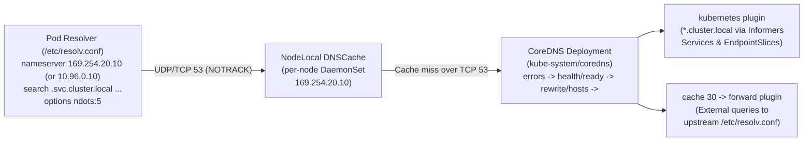

# 5.11 DNS and service discovery with CoreDNS

| | |
|---|---|
| Level | Intermediate |
| Priority tier | 0 |
| Lab venue | Any cluster; `kubectl`, a `netshoot`/`dnsutils` pod, node access for `tcpdump` and `conntrack` |
| Part | Part 5: Kubernetes |
| Status | Drafted, labs **untested** |

## Why this matters for AI infrastructure

DNS is the first dependency of almost every pod: a training worker resolves its rendezvous address, a data loader resolves object-store endpoints, an inference gateway resolves model servers, MPI and PyTorch use headless Services for peer discovery, and every external API call (registries, Hugging Face, telemetry) begins with a lookup. Cluster DNS is also a classic hidden bottleneck: Kubernetes' default `ndots:5` multiplies queries, UDP conntrack races add 5-second stalls, one CoreDNS pod serving a 2,000-pod job start causes timeouts, and a failing DNS looks like "the network is down" across the entire platform. Knowing how records are generated, how resolvers behave inside pods, how CoreDNS is configured, and how to scale and debug it is basic platform hygiene.

## Prerequisites and outcomes

Needs 5.8, 5.10 and DNS fundamentals (2.8). After this chapter you can:

- List the DNS records Kubernetes creates (Services, headless Services, SRV, Pods, ExternalName) and the naming scheme.
- Explain `/etc/resolv.conf` in pods (`nameserver`, `search`, `ndots`, `options`), `dnsPolicy` values and `dnsConfig`, and the query amplification caused by `ndots:5`.
- Read and modify the CoreDNS Corefile (kubernetes, forward, cache, loop, errors, health, ready, prometheus, rewrite, hosts, template, autopath, ...) and configure stub domains and upstream resolvers.
- Scale and harden CoreDNS (replicas, autoscaling, resources, anti-affinity, PDB, NodeLocal DNSCache) and monitor it.
- Use DNS-based discovery for StatefulSets, headless Services and distributed training rendezvous; avoid DNS pitfalls with large jobs.
- Debug resolution failures systematically.

## 1. Records Kubernetes creates

DNS names follow `<name>.<namespace>.svc.<cluster-domain>` (default `cluster.local`). The DNS server is **CoreDNS** (the default since 1.13), deployed as a Deployment `coredns` in `kube-system` behind the Service `kube-dns` (ClusterIP usually `10.96.0.10`; legacy name retained). It watches the Kubernetes API (Services, EndpointSlices, Namespaces, optionally Pods) and answers authoritatively for the cluster domain.

| Object | Record |
|---|---|
| ClusterIP Service `svc` in `ns` | `svc.ns.svc.cluster.local.` A (and AAAA for IPv6) → ClusterIP |
| Headless Service (no ClusterIP) | `svc.ns.svc.cluster.local.` A/AAAA → set of ready pod IPs |
| Named port | SRV `_http._tcp.svc.ns.svc.cluster.local.` → target + port; for headless: one SRV per pod `pod.svc.ns.svc...` |
| StatefulSet pod behind headless Service with `serviceName` | `pod-0.svc.ns.svc.cluster.local.` A → that pod IP (stable per-pod identity) |
| ExternalName Service | CNAME → external name |
| Pod IP (optional `pods insecure`/`verified` mode) | `10-244-3-17.ns.pod.cluster.local.` A → 10.244.3.17 (rarely useful) |
| Pod with `hostname`/`subdomain` set and matching headless Service | `hostname.subdomain.ns.svc.cluster.local.` |
| Reverse lookups | PTR for Service IPs and pod IPs (via `kubernetes` plugin `PTR`) |

Short names work through the pod's search path: from namespace `ns`, `svc` resolves via `svc.ns.svc.cluster.local`; `svc.other-ns` resolves through `svc.cluster.local`. Cross-namespace access should use at least `svc.ns` or the FQDN.

```bash
kubectl run -it --rm dns --image=registry.k8s.io/e2e-test-images/jessie-dnsutils:1.3 --restart=Never -- sh
nslookup kubernetes.default
dig +short kubernetes.default.svc.cluster.local
dig +short SRV _https._tcp.kubernetes.default.svc.cluster.local
dig +short my-headless.ns.svc.cluster.local          # multiple A records
dig +short pod-0.my-headless.ns.svc.cluster.local
cat /etc/resolv.conf
```

### Reading a Service name

A name like `alpaca-prod` looks short, but Kubernetes builds a longer name behind it. The kuard demo app has a DNS Query section on its status page. Query the A record for `alpaca-prod` there. The answer looks something like this:

```
;; opcode: QUERY, status: NOERROR, id: 12071
;; flags: qr aa rd ra; QUERY: 1, ANSWER: 1, AUTHORITY: 0, ADDITIONAL: 0
;; QUESTION SECTION:
;alpaca-prod.default.svc.cluster.local. IN A
;; ANSWER SECTION:
alpaca-prod.default.svc.cluster.local. 30 IN A 10.115.245.13
```

The answer gives the Service's cluster IP, 10.115.245.13. The full DNS name is `alpaca-prod.default.svc.cluster.local.` Each part has a job:

- `alpaca-prod` is the name of the Service.
- `default` is the namespace the Service lives in.
- `svc` says this is a Service. It leaves room for Kubernetes to expose other types of objects as DNS names later.
- `cluster.local.` is the base domain for the cluster. It is the default, and most clusters show it. Administrators can change it so that names stay unique across several clusters.

Inside your own namespace, you can use just the service name, `alpaca-prod`. To reach a Service in another namespace, use `alpaca-prod.default`. You can also use the fully qualified name, `alpaca-prod.default.svc.cluster.local.` Try each of these in the DNS Query section of kuard.

## 2. Resolver behaviour inside pods

The kubelet writes the pod's `/etc/resolv.conf` according to `dnsPolicy`:

| `dnsPolicy` | Result |
|---|---|
| `ClusterFirst` (default) | `nameserver <kube-dns ClusterIP>`; search domains `<ns>.svc.<domain> svc.<domain> <domain>` plus the node's search domains; `options ndots:5`. Names not under the cluster domain are forwarded upstream by CoreDNS |
| `Default` | Inherit the node's resolver config (`/etc/resolv.conf` or the kubelet `resolvConf`) — **not** the default policy despite the name |
| `ClusterFirstWithHostNet` | For `hostNetwork: true` pods that still want cluster DNS |
| `None` | Use only `dnsConfig` (custom nameservers, searches, options) |

```yaml
spec:
  dnsPolicy: ClusterFirst
  dnsConfig:
    options:
      - { name: ndots, value: "2" }
      - { name: single-request-reopen }
      - { name: timeout, value: "2" }
      - { name: attempts, value: "3" }
    searches: ["extra.example.com"]
```

### The ndots:5 problem

`ndots:5` means "if the name has fewer than 5 dots, try the search domains first." A lookup of `api.example.com` (2 dots) from namespace `ml` produces up to **8+ queries** (A and AAAA each for): `api.example.com.ml.svc.cluster.local` → NXDOMAIN, `api.example.com.svc.cluster.local` → NXDOMAIN, `api.example.com.cluster.local` → NXDOMAIN, `api.example.com.<node-search>` ... and finally `api.example.com.` → answer. For external-heavy workloads (downloading datasets, calling APIs), this multiplies CoreDNS load and latency, and failed lookups produce many NXDOMAINs in CoreDNS logs. Mitigations:

- Use **fully qualified names with a trailing dot** in configs (`api.example.com.`) for external endpoints (skips search).
- Lower `ndots` (2 is a common compromise) via `dnsConfig` for pods that mostly call external names. With `ndots:2`, a name such as `api.example.com` (two dots) is tried as an absolute name first, while one-dot in-cluster names like `svc.ns` still go through the search path; names with no dot (`svc`) always use it.
- Use **CoreDNS `autopath`** plugin (requires pod mode verified and adds API load) to short-circuit the search path server-side.
- Enable NodeLocal DNSCache (below) so repeated NXDOMAINs are cached locally.
- Avoid musl-libc DNS quirks: Alpine's resolver (older versions) queries all nameservers in parallel and doesn't support the full search semantics reliably (known issues with `ndots` and TCP fallback); another reason to avoid Alpine in ML containers.

Also note: glibc sends A and AAAA queries in parallel from the same socket (source port), which hit the conntrack race (below); `options single-request` / `single-request-reopen` serialize them (the latter reopens the socket), at some latency cost; `use-vc` forces TCP.

## 3. CoreDNS architecture



CoreDNS is a plugin chain. Each server block in the **Corefile** (ConfigMap `kube-system/coredns`) defines zones and plugins executed in a fixed order defined at compile time (not file order):

```text
.:53 {
    errors
    health { lameduck 5s }
    ready
    kubernetes cluster.local in-addr.arpa ip6.arpa {
        pods insecure
        fallthrough in-addr.arpa ip6.arpa
        ttl 30
    }
    prometheus :9153
    forward . /etc/resolv.conf {
        max_concurrent 1000
        prefer_udp
    }
    cache 30
    loop
    reload
    loadbalance
}
```

| Plugin | Function |
|---|---|
| `errors` | Log errors |
| `health` / `ready` | Liveness (`:8080/health`, `lameduck` drains) and readiness (`:8181/ready`) endpoints |
| `kubernetes` | Answers for the cluster domain from API objects; options `pods disabled\|insecure\|verified`, `ttl`, `endpoint_pod_names`, `fallthrough`, `namespaces`, `labels` |
| `forward` | Send non-cluster queries to upstream resolvers (node's resolv.conf or explicit list); health checks, policy (`random`, `round_robin`, `sequential`), TLS/DoT |
| `cache` | Cache positive and negative responses (`cache 30` seconds; `success`/`denial` capacity and TTL); prefetch |
| `loop` | Detect forwarding loops (CoreDNS crash with "Loop detected" when node resolv.conf points to 127.0.0.53 on systemd-resolved: set kubelet `resolvConf: /run/systemd/resolve/resolv.conf`) |
| `reload` | Auto-reload on Corefile change |
| `loadbalance` | Randomise order of A records |
| `prometheus` | Metrics |
| `rewrite` | Rewrite names/types (migrate domains, alias) |
| `hosts` | Serve entries from a hosts file |
| `template` | Synthesize records by regex |
| `autopath` | Server-side search path completion |
| `log` | Query logging (verbose; use for debugging only) |
| `acl`, `dnssec`, `nsid`, `trace`, `forward` variants | Access control, DNSSEC, tracing |

### Customisation recipes

**Stub domain / split-horizon** (internal corporate zone to an internal resolver):

```text
corp.example.com:53 {
    errors
    cache 30
    forward . 10.1.0.53 10.1.0.54
}
```

**Route object-store or registry names to internal addresses** (`hosts` or `rewrite`):

```text
.:53 {
    ...
    rewrite name huggingface.mirror.local huggingface-proxy.registry.svc.cluster.local
    hosts {
        10.20.0.15 storage.lab.internal
        fallthrough
    }
    ...
}
```

**Upstream with DoT** or a specific resolver: `forward . tls://1.1.1.1 { tls_servername cloudflare-dns.com; health_check 5s }`. **Rate-limit or ACL** abusive clients with `acl` or by NetworkPolicy to DNS.

Edit the Corefile with `kubectl -n kube-system edit cm coredns`; `reload` picks it up within ~30 s (verify with logs); in managed clusters (GKE, EKS) use the provider's `CoreDNS` customisation path (`coredns-custom` ConfigMap `*.override`/`*.server` imports on AKS/EKS add-on; kube-dns on GKE uses `kube-dns` ConfigMap `stubDomains`/`upstreamNameservers`).

## 4. Scaling and hardening

### Capacity

CoreDNS is lightweight but QPS grows with pod count × lookup rate × ndots amplification: a 5,000-pod job starting at once with `getaddrinfo` per connection easily generates 100k+ queries in seconds. Rules of thumb: ~10-20k QPS per CPU-core with caching; CoreDNS pods are stateless, so scale horizontally. Defaults ship with 2 replicas; recommended: replicas ≈ nodes/100 to nodes/20 (min 3 for HA), spread across nodes/zones with anti-affinity and a PDB (`minAvailable: 1` or 50%), requests/limits sized (e.g., 100m CPU / 70 Mi request, memory limit ~170 Mi at modest scale; raise with cache size), `priorityClassName: system-cluster-critical`, `GOMAXPROCS`/cpu limits aligned (avoid CPU throttling which adds latency).

**Autoscaling**: the **cluster-proportional-autoscaler** scales CoreDNS replicas by node/core counts (`linear` or `ladder` params); HPA on CPU can lag for bursts; keep a floor sized for bursts.

### NodeLocal DNSCache

A DaemonSet running a caching CoreDNS (`node-local-dns`) on every node, listening on a link-local address (`169.254.20.10`) and the kube-dns ClusterIP via a dummy interface and NOTRACK iptables rules. Pods query the local cache (no DNAT, no conntrack, no cross-node hop); cache misses are forwarded over **TCP** to the upstream `kube-dns` Service, avoiding the UDP conntrack race and spreading load; negative caching reduces NXDOMAIN storms. Install via the manifest from the Kubernetes repository (set `__PILLAR__LOCAL__DNS__`, `__PILLAR__DNS__SERVER__`, `__PILLAR__DNS__DOMAIN__`), configure the kubelet `clusterDNS` to the link-local IP (or leave and use the dummy-interface binding in iptables mode). Operate it as a critical DaemonSet: per-node failure means that node's pods lose DNS until the cache restarts (it uses `hostNetwork` and a dedicated interface; use proper rollout limits `maxUnavailable: 10%`, readiness, and consider fallback to the cluster DNS Service with search order). For Cilium, local DNS can be handled by its DNS proxy or `localRedirectPolicy`.

### The conntrack/UDP race and 5-second delays

Symptoms: sporadic DNS lookups taking exactly 5 s (default resolver timeout) or intermittent `EAI_AGAIN`. Cause: glibc sends A and AAAA queries from the same UDP socket concurrently; both packets hit netfilter `conntrack` simultaneously, one entry insertion races (DNAT via kube-proxy to the kube-dns ClusterIP creates entries) and the packet is dropped; the resolver times out and retries. Mitigations: NodeLocal DNSCache (no DNAT), `single-request-reopen` option, TCP for DNS, newer kernels (races mostly fixed in 5.0+ with later patches), eBPF kube-proxy replacement (no conntrack for socket LB), reduce simultaneous lookups (connection pooling, caching in apps), and Alpine-specific caveats.

### Other hardening and operations

- Keep CoreDNS and the Corefile in GitOps; test changes in staging; version-skew with Kubernetes releases; watch for the `loop` plugin crash.
- NetworkPolicy allowing DNS egress (UDP/TCP 53 to `kube-dns` and node-local IP) in default-deny namespaces (5.15).
- Limit blast radius from abuse: `ratelimit` via external proxies is limited; use pod quotas and alerts on per-pod QPS (metrics by client IP require query logging).
- Security: DNS exfiltration/tunnelling detection (log anomalies), DNSSEC not typical in-cluster; avoid exposing CoreDNS outside the cluster; restrict zone transfer (not enabled).
- TTLs: `kubernetes ttl 30` for Services (default 5s in some distros) vs. cache; short TTL + cache keeps endpoints fresh; long TTL delays failover for headless discovery.
- IPv6 and dual-stack: AAAA lookups for Services without IPv6 return NODATA but still cost a query; serialise lookups (`single-request`) or set address-family hints in applications where it matters.

## 5. DNS-based discovery for distributed AI workloads

- **StatefulSet + headless Service**: workers address peers as `trainer-0.trainer.ml.svc.cluster.local` (stable even when pods are rescheduled; IP changes, name stays). PyTorch `torchrun --rdzv_backend=c10d --rdzv_endpoint=trainer-0.trainer:29500`, Ray head `ray-head.ray.svc:6379`, MPI hostfiles generated from pod names. Operators (Kubeflow Training Operator, MPI Operator, JobSet, KubeRay) create headless Services and set env vars/hostfiles for you.
- **Readiness and DNS**: headless Services publish only **ready** pods by default; peers needing to discover each other *before* readiness (rendezvous during startup) require `publishNotReadyAddresses: true` on the headless Service (or avoid readiness probes on worker pods). Without it, pods can deadlock waiting for each other's DNS names.
- **Negative caching**: a lookup that returned NXDOMAIN for a peer before its pod existed may be cached for the negative-TTL (default SOA minimum 30 s in CoreDNS `cache denial` settings); workers should retry with backoff and bounded timeouts, and applications should not cache failures (JVM `networkaddress.cache.negative.ttl`, Python `socket.getaddrinfo` doesn't cache but libraries do).
- **Job start storms**: thousands of workers resolving the same few names at once: set generous CoreDNS replicas and NodeLocal caches before launching large jobs; stagger startup; avoid resolving per-iteration.
- **JVM and long-lived clients** cache DNS indefinitely by default with a security manager or for 30 s without; after a service failover, clients keep old IPs; set TTL properties. gRPC resolvers: `dns:///svc.ns:443` re-resolves periodically (30 s minimum with some implementations); for headless service balancing use `round_robin` policy.
- **External dependencies**: object stores, registries, model hubs: use IP-pinned mirrors or internal resolvers for stability; consider local caching proxies; failing external DNS appears as training job hangs at startup; add DNS health to preflight checks (Part 17).
- **Multi-cluster discovery**: Multicluster Services API (`ServiceExport`/`ServiceImport`, `clusterset.local`), Cilium ClusterMesh, Istio multi-cluster DNS proxying, or external DNS (ExternalDNS publishes Service/Ingress records to Route53/CloudDNS/Cloudflare) (5.35).

## 6. Observability

CoreDNS metrics (port 9153): `coredns_dns_requests_total{type,proto,zone}`, `coredns_dns_responses_total{rcode}` (watch NXDOMAIN/SERVFAIL rates), `coredns_dns_request_duration_seconds_bucket`, `coredns_cache_hits_total`/`misses_total`, `coredns_forward_requests_total`, `coredns_forward_healthcheck_failures_total`, `coredns_panics_total`, `coredns_health_request_failures_total`, `coredns_kubernetes_rest_client_requests_total`. Alerts: SERVFAIL ratio > 1%, p99 latency > 100 ms, forward healthcheck failures, CoreDNS restarts, cache hit ratio dropping, CPU throttling. Enable the `log` plugin briefly or `errors`; use `dnstap` or packet capture for forensics. Node-local: `node-local-dns` exposes metrics (port 9253).

```bash
kubectl -n kube-system get deploy,po -l k8s-app=kube-dns -o wide
kubectl -n kube-system logs deploy/coredns --tail=50
kubectl -n kube-system top pod -l k8s-app=kube-dns
kubectl -n kube-system get cm coredns -o yaml
kubectl get svc -n kube-system kube-dns; kubectl get endpointslices -n kube-system -l kubernetes.io/service-name=kube-dns
# test load
kubectl run -it --rm perf --image=registry.k8s.io/perf-tests/dnsperf --restart=Never -- sh   # or dnsperf/queryperf with a query file
```

## 7. Debugging method

1. **Is it DNS?** From a failing pod: `getent hosts svc.ns` and `dig` both; `curl` by IP works while name fails → DNS.
2. **Which resolver?** `cat /etc/resolv.conf` (nameserver IP matches kube-dns or node-local; `ndots`; search list; `dnsPolicy`).
3. **Is CoreDNS healthy?** pods Running/Ready, endpoints present, logs for `loop`, `SERVFAIL`, forward errors; query CoreDNS pod IP directly: `dig @<coredns-pod-ip> kubernetes.default.svc.cluster.local`.
4. **Service vs pod path:** query via the ClusterIP (tests kube-proxy/CNI) vs the pod IP (tests CoreDNS itself) vs node-local cache.
5. **Upstream:** `dig @<upstream> example.com` from the CoreDNS pod/node; check `forward` health, firewall/security group for UDP/TCP 53, node `resolv.conf`.
6. **Records exist?** Service selectors/endpoints (empty headless → no A records), namespace spelling, `fallthrough`, `pods` mode.
7. **Packet capture:** `tcpdump -ni any port 53` on the node or the pod's netns; look for unanswered queries, retransmits at 5 s, truncated UDP (TC bit) falling back to TCP (blocked TCP/53 breaks large responses).
8. **Timing:** `dig +stats`, `time getent hosts`, client-side `strace -T` to see which query is slow; CoreDNS request duration histogram.
9. **Search-path effects:** compare `dig name.` (absolute) vs `dig name` using search; count NXDOMAINs.
10. **Conntrack:** `conntrack -S`, `conntrack -L -p udp --dport 53 | wc -l`, insert_failed counters; kernel version.

| Symptom | Likely cause | Fix |
|---|---|---|
| CoreDNS CrashLoop "Loop detected" | Upstream is itself/127.0.0.53 | Kubelet `resolvConf` to real upstream file; `forward . 10.x.x.x` |
| `SERVFAIL` for external names | Upstream unreachable, firewall, forward misconfigured | Test from CoreDNS pod; fix routes/SG; add secondary upstream |
| `NXDOMAIN` for existing Service | Wrong namespace/search, headless with no ready pods, label mismatch | FQDN, endpoints |
| Random 5 s delays | UDP conntrack race | NodeLocal DNS, `single-request-reopen`, TCP |
| High NXDOMAIN rate and load | ndots:5 + external names | FQDNs with trailing dot, lower ndots, autopath, node-local |
| Names don't resolve for hostNetwork pods | `dnsPolicy: ClusterFirst` ignored for hostNetwork | Use `ClusterFirstWithHostNet` |
| Intermittent failures during CoreDNS rollout | No lameduck/PDB, single replica | `lameduck`, PDB, ≥3 replicas |
| External resolution works, cluster names fail | `kubernetes` plugin API access (RBAC), CoreDNS cache of API, wrong cluster domain | CoreDNS logs, ClusterRole, `clusterDomain` consistency (kubelet vs Corefile) |
| Large responses fail | Blocked TCP/53, EDNS issues | Allow TCP, check MTU |

## 8. Lab

First, run the self-checking Python lab (`code/part05/coredns_ndots_resolver_lab.py`) locally. It verifies the `/etc/resolv.conf` `ndots` search-list query expander (`expand_dns_search_queries`: comparing `ndots:5` vs `ndots:2` vs trailing-dot FQDN on `api.huggingface.co` and in-cluster `vllm.serving`, `NK` Ch. 5 & `PK` Ch. 6), the Headless Service + StatefulSet DNS record generator with `publishNotReadyAddresses` (`resolve_headless_service_records`, `KUR` Ch. 7), and the CoreDNS `loop` plugin detector (`detect_coredns_forwarding_loop` on `127.0.0.53`).

```bash
python3 code/part05/coredns_ndots_resolver_lab.py
```

Next, on a Kubernetes cluster (all interactive shell steps below are `untested here`), work through these exercises:

1. **Record tour**: create Services (ClusterIP, headless, named ports), a StatefulSet with `serviceName`, and an ExternalName; query A/AAAA/SRV/PTR for each; observe how readiness changes headless answers.
2. **resolv.conf and ndots**: inspect `/etc/resolv.conf` under each `dnsPolicy`; with CoreDNS `log` enabled, resolve `api.github.com` and count the queries (ndots 5 vs 2 vs trailing dot); measure latency differences with a loop of 1,000 lookups.
3. **Corefile edits**: add a stub zone to an internal resolver, a `rewrite` and a `hosts` entry; verify with `dig`; break `forward` and observe `SERVFAIL` and metrics; fix.
4. **Loop plugin**: reproduce "Loop detected" by pointing upstream at 127.0.0.53 on a systemd-resolved host; fix via kubelet `resolvConf`.
5. **Scale test**: run `dnsperf`/`k6` DNS load against `kube-dns`; find the QPS at which latency degrades with 2 replicas; add replicas/cluster-proportional-autoscaler and a NodeLocal DNSCache; compare p99 and conntrack counts.
6. **5-second delays**: with glibc client in a loop (parallel A/AAAA) and heavy UDP traffic on a lab node, look for 5 s outliers; apply `single-request-reopen`, then NodeLocal DNSCache; document.
7. **NodeLocal DNSCache**: install, point kubelet `clusterDNS`, verify with `dig @169.254.20.10`, kill the local cache pod and observe client behaviour; check metrics.
8. **Distributed rendezvous**: run a 4-worker PyTorch (or simple TCP) job on a StatefulSet + headless Service; show failure without `publishNotReadyAddresses` when readiness is gated on peers; fix; test pod reschedule (IP changes, name stable).
9. **Negative caching**: query a not-yet-created Service, create it, and measure how long the NXDOMAIN persists; tune CoreDNS `cache` and application retry.
10. **Failure drills**: delete CoreDNS pods during a request loop; scale to 1; add PDB/lameduck; block upstream UDP/53; simulate an expired CoreDNS RBAC; practise the debugging method.
11. **Observability**: scrape CoreDNS and node-local metrics, build a dashboard (QPS, rcode ratios, latency, cache hit), and define alerts.
12. **Clean up**.

## 9. Common mistakes

- Treating `Default` dnsPolicy as the default; forgetting `ClusterFirstWithHostNet` for host-network pods.
- Leaving `ndots:5` on heavy external-call workloads and wondering why CoreDNS is saturated.
- Two CoreDNS replicas for a 2,000-node cluster; no PDB or lameduck; CPU-throttled CoreDNS.
- Pointing CoreDNS upstream at systemd-resolved's stub (loop).
- Blocking TCP/53 or EDNS/large packets at firewalls.
- Using DNS names with low TTL assumptions in JVM/gRPC clients that cache indefinitely.
- Gating worker readiness on peer discovery without `publishNotReadyAddresses`.
- Not allowing DNS egress in default-deny NetworkPolicies.
- Custom Corefile changes made by hand in production and lost on upgrade.
- Using Pod DNS A records (`10-0-0-1.ns.pod...`) as identity.

## 10. Interview angles

- "What happens when a pod resolves `my-service`? Walk through resolv.conf, search domains, CoreDNS."
- "What is `ndots:5`? What problems does it cause and how do you fix them?"
- "How is a headless Service different in DNS? Why do StatefulSets need it?"
- "What causes 5-second DNS delays in Kubernetes? How does NodeLocal DNSCache help?"
- "How would you scale CoreDNS for a 5,000-node cluster?"
- "Explain the Corefile plugins you'd use for a split-horizon setup."
- "A distributed training job hangs at startup resolving peers. Why might that be?"
- "How do you debug a cluster-wide DNS failure?"

## Exercises

1. **Kubernetes DNS Record Types (`A`/`AAAA`, Headless, `SRV`, `CNAME`, `PTR`) and `dnsPolicy` Modes (`KUR` Ch. 7 & `NK` Ch. 4–5):** List the exact DNS record formats generated for a `ClusterIP` Service, a Headless Service (`clusterIP: None`), a `StatefulSet` Pod (`pod-0.svc.ns.svc.cluster.local`), a named port (`_http._tcp.svc.ns.svc.cluster.local`), and an `ExternalName` Service, and compare all four `dnsPolicy` values (`ClusterFirst`, `Default`, `ClusterFirstWithHostNet`, `None`).
2. **The `ndots:5` Query Amplification Problem and Mitigations (`NK` Ch. 5 & `PK` Ch. 6):** Using `expand_dns_search_queries()` in `code/part05/coredns_ndots_resolver.py`, trace every `A` and `AAAA` query sent when a Pod in namespace `ml` resolves `api.huggingface.co` under `ndots: 5` (8 queries: 6 `NXDOMAIN` + 2 answers) versus `ndots: 2` or a trailing dot (`api.huggingface.co.`), and show why `ndots: 2` still resolves 1-dot cross-namespace names (`vllm.serving`) via search domains.
3. **CoreDNS `Corefile` Architecture, Plugin Execution Order, and Split-Horizon / Mirror Rewrites (`NK` Ch. 4 Table 4-5):** Using `detect_coredns_forwarding_loop()` in `code/part05/coredns_ndots_resolver.py`, explain the role of each plugin in the default `Corefile` (`errors`, `health { lameduck 5s }`, `ready`, `kubernetes`, `prometheus :9153`, `forward`, `cache 30`, `loop`, `reload`, `loadbalance`), and write a `Corefile` snippet that routes `corp.example.com` to internal DNS (`10.1.0.53`) and rewrites `huggingface.mirror.local` to `huggingface-proxy.registry.svc.cluster.local`.
4. **Scaling CoreDNS (`Cluster Proportional Autoscaler`), `NodeLocal DNSCache` (`169.254.20.10`), and the 5-Second UDP `conntrack` Race (`PK` Ch. 6):** Explain the root cause of the 5-second DNS timeout (parallel `A`/`AAAA` UDP queries from the same socket racing `conntrack` DNAT insertion), how `NodeLocal DNSCache` (`169.254.20.10` with `NOTRACK` iptables rules and TCP upstream forwarding) eliminates it, and how `cluster-proportional-autoscaler` scales CoreDNS with cluster size.
5. **DNS-Based Rendezvous for Distributed Training (`torchrun`, `MPI`, `Ray`) and Negative Caching Pitfalls:** Using `resolve_headless_service_records()` in `code/part05/coredns_ndots_resolver.py`, explain why a multi-node `StatefulSet` or `Indexed` Job using `torchrun --rdzv_endpoint=trainer-0.trainer:29500` deadlocks if `readinessProbe` depends on peer rendezvous and `publishNotReadyAddresses: true` is omitted, and how CoreDNS negative caching (`cache denial` SOA TTL) affects worker startup retries.
6. **Systematic 10-Step Cluster DNS Debugging:** Walk through the Section 7 diagnostic checklist to distinguish a broken Pod `/etc/resolv.conf`, a `kube-proxy` `10.96.0.10` datapath failure, a CoreDNS pod crash/RBAC error, a blocked TCP port 53 firewall rule (`TC` bit truncation), and an upstream resolver outage.

## Checkpoint questions (20)

<details>
<summary>1. What DNS records does CoreDNS create for a standard `ClusterIP` Service versus a `Headless` Service (`clusterIP: None`)?</summary>

- **Standard `ClusterIP` Service (`vllm` in namespace `serving`):**
  - **`A` / `AAAA` record:** `vllm.serving.svc.cluster.local.` resolves to the **single virtual `ClusterIP`** (e.g., `10.96.45.12`).
  - **`SRV` record (for each named port):** `_http._tcp.vllm.serving.svc.cluster.local.` points to `0 100 80 vllm.serving.svc.cluster.local.`.
- **Headless Service (`clusterIP: None`, e.g., `trainer` in namespace `ml`):**
  - **`A` / `AAAA` record on the Service name (`trainer.ml.svc.cluster.local.`):** Returns the **set of IP addresses of all Ready backing Pods** (or all Pods if `publishNotReadyAddresses: true`).
  - **Per-Pod `A` / `AAAA` record (when Pods belong to a `StatefulSet` with `serviceName: trainer` or set `hostname` + `subdomain: trainer`):** `trainer-0.trainer.ml.svc.cluster.local.` resolves to the **exact Pod IP of `trainer-0`**.
</details>

<details>
<summary>2. Compare the four `dnsPolicy` values on a Pod spec (`ClusterFirst`, `Default`, `ClusterFirstWithHostNet`, `None`).</summary>

1. **`ClusterFirst` (the default when `hostNetwork` is false):** Queries `kube-dns` / `NodeLocal DNSCache` with cluster search domains (`<ns>.svc.cluster.local`, `svc.cluster.local`, `cluster.local`); external queries are forwarded upstream by CoreDNS.
2. **`Default` (NOT the default Kubernetes policy):** The Pod inherits `/etc/resolv.conf` directly from the underlying worker node OS—so it **cannot resolve `.cluster.local` Service names** unless the node itself is configured to use CoreDNS.
3. **`ClusterFirstWithHostNet`:** Mandatory for Pods running with **`hostNetwork: true`** that still need to resolve Kubernetes `.cluster.local` Service names (since setting `hostNetwork: true` otherwise causes `ClusterFirst` to fall back to `Default` node DNS).
4. **`None`:** Ignores pre-generated DNS settings and builds `/etc/resolv.conf` solely from `spec.dnsConfig` (`nameservers`, `searches`, `options`).
</details>

<details>
<summary>3. Why does a single lookup of `api.huggingface.co` inside a Pod in namespace `ml` generate 8 DNS queries by default (`NK` Chapter 5 & `PK` Chapter 6)?</summary>

By default, `/etc/resolv.conf` has **`options ndots:5`** and `search ml.svc.cluster.local svc.cluster.local cluster.local`. Because `api.huggingface.co` contains only **2 dots** ($2 < 5$), the C library resolver does **not** query `api.huggingface.co.` first; instead, it appends every search domain in order, sending both an `A` (IPv4) and `AAAA` (IPv6) query at each step:
1. `A` & `AAAA` `api.huggingface.co.ml.svc.cluster.local.` -> `NXDOMAIN` (2 queries)
2. `A` & `AAAA` `api.huggingface.co.svc.cluster.local.` -> `NXDOMAIN` (2 queries)
3. `A` & `AAAA` `api.huggingface.co.cluster.local.` -> `NXDOMAIN` (2 queries)
4. Finally, `A` & `AAAA` `api.huggingface.co.` -> `NOERROR` (2 queries)
Total: **8 DNS queries** (6 wasted `NXDOMAIN`s) for a single external hostname lookup.
</details>

<details>
<summary>4. What are the four best ways to eliminate `ndots:5` query amplification on GPU workloads that make heavy external S3/GCS/HuggingFace API calls?</summary>

1. **Append a trailing dot to external FQDNs in configuration (`api.huggingface.co.` or `s3.us-east-1.amazonaws.com.`):** A trailing dot marks the name as an absolute root FQDN, completely bypassing the `search` list regardless of `ndots`.
2. **Set `ndots: "2"` in `spec.dnsConfig.options`:** Any name with $\ge 2$ dots (`api.huggingface.co`) is queried as an absolute FQDN first, while 0-dot (`vllm`) and 1-dot (`vllm.serving`) in-cluster Service names still traverse the `search` domains.
3. **Deploy `NodeLocal DNSCache` (`169.254.20.10`):** Caches `NXDOMAIN` responses locally on each node in RAM so repeated search lookups never leave the node.
4. **Always use cross-namespace Service names with at least `.svc.cluster.local.` in hot paths.**
</details>

<details>
<summary>5. In CoreDNS's `Corefile`, does changing the text order of plugins inside a server block change the order in which plugins execute?</summary>

**No.** In CoreDNS, the execution order of plugins within a server block is **compiled statically into the CoreDNS binary** via `plugin.cfg` (for example, `errors`/`log` wrap the chain, `rewrite` runs before `hosts`, `hosts` runs before `kubernetes`, `cache` wraps `kubernetes` and `forward`, and `forward` runs near the end when `kubernetes` does not match or falls through). The order in which you write plugin stanzas inside `.:53 { ... }` in the `Corefile` has no effect on execution order.
</details>

<details>
<summary>6. What do `health { lameduck 5s }` and `ready` do in the CoreDNS `Corefile`?</summary>

- **`ready` (HTTP `:8181/ready`, used by `readinessProbe`):** Returns HTTP `200 OK` only when all plugins (including the `kubernetes` plugin's initial Informer list/watch sync of Services and EndpointSlices) have finished initializing and are ready to serve queries.
- **`health { lameduck 5s }` (HTTP `:8080/health`, used by `livenessProbe` and graceful shutdown):** When CoreDNS receives `SIGTERM` during a Deployment rollout or node drain, **`lameduck 5s`** delays shutting down the DNS listener for 5 seconds while immediately marking readiness unhealthy—allowing `kube-proxy` and `NodeLocal DNSCache` across the cluster to remove the terminating CoreDNS pod's IP from `EndpointSlice`s before it stops answering queries.
</details>

<details>
<summary>7. What causes CoreDNS Pods to crash-loop with `plugin/loop: Loop ... detected for zone "."`, and how do you fix it?</summary>

At startup, the CoreDNS **`loop` plugin** sends a random probe query (`<rand1>.<rand2>.zone`) to itself; if that exact probe query arrives back at the same CoreDNS process via the **`forward . /etc/resolv.conf`** plugin, CoreDNS logs `Loop detected` and exits with a fatal error to prevent an infinite packet storm.
This happens on Linux nodes (such as Ubuntu with `systemd-resolved`) where the host's `/etc/resolv.conf` contains `nameserver 127.0.0.53` (or `127.0.0.1`). When the CoreDNS pod inherits `/etc/resolv.conf` from the node, `127.0.0.53` inside the CoreDNS pod's network namespace points to CoreDNS itself.
**Fix:** Configure `resolvConf: /run/systemd/resolve/resolv.conf` in `KubeletConfiguration` (so Pods inherit the real upstream DNS servers instead of the local `127.0.0.53` stub) or replace `/etc/resolv.conf` in the Corefile `forward` line with explicit upstream DNS IPs (`forward . 10.0.0.2`).
</details>

<details>
<summary>8. Explain the root cause of the classic Kubernetes \"5-Second DNS Timeout\" (`conntrack` UDP race) and why it happens with `glibc`.</summary>

When a Linux container calls `getaddrinfo("api.example.com")`, **`glibc` sends the `A` (IPv4) and `AAAA` (IPv6) UDP DNS queries in parallel over the exact same UDP socket (same source IP and source port)** to `10.96.0.10:53` (`kube-dns` ClusterIP).
In `iptables` mode without `NodeLocal DNSCache`:
1. Both UDP packets enter `netfilter` on the node simultaneously before a `conntrack` entry exists.
2. Both packets independently traverse `KUBE-SVC-*` and may be `DNAT`'d to different CoreDNS Pod IPs (e.g., Packet 1 -> `CoreDNS-A`, Packet 2 -> `CoreDNS-B`).
3. When both packets try to confirm/insert their 5-tuple into the `nf_conntrack` hash table at the end of netfilter processing, **the second packet loses the race (`insert_failed`) and is silently dropped by the kernel**.
4. The client waits the full **5-second default `resolv.conf` timeout** before retrying.
</details>

<details>
<summary>9. How does `NodeLocal DNSCache` (`169.254.20.10`) solve both CoreDNS scale bottlenecks and the 5-second UDP `conntrack` race?</summary>

`NodeLocal DNSCache` runs as a `DaemonSet` on every node, binding a lightweight caching CoreDNS instance to a link-local dummy interface (**`169.254.20.10`**, plus the `kube-dns` ClusterIP `10.96.0.10` locally):
1. **Bypasses `DNAT` and `conntrack` (`NOTRACK`):** It installs `iptables -t raw` **`NOTRACK`** rules for UDP/TCP port 53 traffic to `169.254.20.10` / `10.96.0.10`, so Pod-to-local-cache DNS packets **never enter `conntrack` or undergo `kube-proxy` DNAT**—completely eliminating the UDP `conntrack` race and saving tens of thousands of `conntrack` table entries.
2. **Upgrades cache misses to TCP:** When a query misses the local RAM cache (positive and negative `NXDOMAIN` caching), `NodeLocal DNSCache` forwards the query to the central `kube-dns` Service over **multiplexed TCP (`prefer_tcp`)** instead of lossy UDP.
</details>

<details>
<summary>10. What does `options single-request-reopen` in `dnsConfig` do when `NodeLocal DNSCache` is not installed?</summary>

- **`single-request`:** Tells `glibc` to send the `A` query and wait for its response *before* sending the `AAAA` query (serializing them so they don't race).
- **`single-request-reopen`:** Uses **different sockets (different source ports)** for the `A` and `AAAA` queries and reopens a new socket if a timeout occurs—ensuring the `A` and `AAAA` UDP packets have distinct 5-tuples in `conntrack` so neither packet is dropped.
</details>

<details>
<summary>11. How does the `Cluster Proportional Autoscaler` (`CPA`) scale CoreDNS (`PK` Chapter 6), and why is it paired with HPA or a minimum floor?</summary>

Unlike standard HPA (which reacts *after* CPU spikes), the **`cluster-proportional-autoscaler`** watches the number of schedulable **Nodes** and **CPU cores** in the cluster and proactively adjusts `coredns` `spec.replicas` according to a linear or step-ladder formula (for example, `coresPerReplica: 256`, `nodesPerReplica: 16`, `min: 3`). This guarantees that when a cluster scales up from 50 to 1,000 GPU nodes for a training run, CoreDNS scales up to $\ge 63$ replicas *before* the training pods launch.
</details>

<details>
<summary>12. How do you configure Split-Horizon DNS (a Stub Domain for `corp.internal`) and an in-cluster hostname alias (`rewrite` vs. `hosts`) in CoreDNS?</summary>

- **Stub domain (`corp.internal` forwarded to internal corporate DNS `10.1.0.53`):** Add a separate server block above `.:53`:
  ```text
  corp.internal:53 {
      errors
      cache 30
      forward . 10.1.0.53 10.1.0.54
  }
  ```
- **CNAME-style alias to an in-cluster Service (`rewrite`):**
  `rewrite name exact weights.internal.local minio.storage.svc.cluster.local` (rewrites the query name before the `kubernetes` plugin processes it, returning the target Service's `A` record directly).
- **Static IP mapping (`hosts`):**
  `hosts { 10.20.0.15 nfs-filer.lab.local; fallthrough }` (always include **`fallthrough`** so non-matching queries continue to `kubernetes`/`forward`).
</details>

<details>
<summary>13. Why does a multi-node PyTorch `torchrun` job using a `StatefulSet` + Headless Service deadlock during startup if `readinessProbe` is configured and `publishNotReadyAddresses` is `false`?</summary>

In PyTorch `torchrun` (`--rdzv_backend=c10d --rdzv_endpoint=trainer-0.trainer.ml.svc.cluster.local:29500`), worker ranks resolve `trainer-0.trainer` during initialization, and `trainer-0` does not finish initialization (and thus does not pass its `readinessProbe`) until all worker ranks connect to its rendezvous port.
If `publishNotReadyAddresses` is `false` (the default), CoreDNS **refuses to publish the `A` record for `trainer-0.trainer.ml.svc.cluster.local` until `trainer-0` is `Ready`**—so workers get `NXDOMAIN`, `trainer-0` never gets connections, and the job deadlocks. Setting **`publishNotReadyAddresses: true`** on the Headless Service publishes all Pod DNS records immediately upon Pod IP assignment regardless of readiness.
</details>

<details>
<summary>14. How can CoreDNS Negative Caching (`NXDOMAIN` caching) delay distributed training startup by 30 seconds, and how should worker startup scripts handle it?</summary>

When worker `trainer-7` starts 500 milliseconds before `trainer-0` has received its Pod IP, `trainer-7` queries `trainer-0.trainer.ml.svc.cluster.local.` and receives **`NXDOMAIN`**. The CoreDNS `cache` plugin (and `NodeLocal DNSCache`) caches negative (`NXDOMAIN`) responses for up to the SOA minimum TTL (default **30 seconds**, configurable via `cache { denial <size> <ttl> }`, e.g., `denial 9984 5`). Even if `trainer-0` starts 1 second later, cached resolvers may continue returning `NXDOMAIN` for up to 5–30 seconds. Therefore:
1. Lower negative cache TTL in `NodeLocal DNSCache` / CoreDNS (`denial 9984 5`) for batch clusters.
2. Ensure distributed training rendezvous loops retry DNS resolution with backoff for at least 60–120 seconds (`rdzv_timeout`) rather than crashing on the first `gaierror` (`EAI_NONAME`).
</details>

<details>
<summary>15. Why do Java (JVM) and long-lived Python/gRPC clients sometimes continue sending traffic to dead Pod IPs after a Headless Service endpoint changes?</summary>

DNS has no push mechanism to invalidate a client's in-process memory cache once a hostname is resolved:
- **JVM:** Historically cached successful DNS lookups forever when a SecurityManager was set (or 30s default); always set `networkaddress.cache.ttl=5` and `networkaddress.cache.negative.ttl=0`.
- **Python `urllib3` / `requests` / `aiohttp` / gRPC:** HTTP connection pools keep established TCP sockets open forever (`Keep-Alive`), never re-querying DNS as long as the socket stays open, and gRPC's `dns:///` resolver enforces a minimum 30-second re-resolution interval unless connection failure triggers a reconnect.
</details>

<details>
<summary>16. Why must every namespace with a `default-deny-egress` `NetworkPolicy` include an explicit DNS egress allow rule, and why must it allow BOTH UDP and TCP port 53?</summary>

In Kubernetes, applying any egress `NetworkPolicy` to a Pod blocks **all** outbound traffic not explicitly permitted—including DNS queries to `kube-dns` (`10.96.0.10`) and `NodeLocal DNSCache` (`169.254.20.10`). Every egress policy must allow **both `UDP` port `53` and `TCP` port `53`** to `kube-system` (`k8s-app: kube-dns`) and `169.254.20.10/32`.
If you allow only `UDP/53` and block `TCP/53`, standard small lookups work, **but any large DNS response (such as a Headless Service with 30+ Pod IPs or a large `SRV` response exceeding 512 bytes / EDNS0 MTU) sets the UDP Truncated (`TC`) bit and falls back to TCP/53—which will silently hang and time out**.
</details>

<details>
<summary>17. In the CoreDNS `kubernetes` plugin, what is the difference between `pods disabled`, `pods insecure`, and `pods verified`?</summary>

This controls whether CoreDNS answers Pod-IP-based `A` queries of the form `10-244-3-17.<namespace>.pod.cluster.local.`:
- **`pods disabled`:** CoreDNS does not answer `.pod.cluster.local` queries at all (most common when only Service/Headless discovery is needed).
- **`pods insecure` (kubeadm default):** Synthesizes `10-244-3-17.<ns>.pod.cluster.local. -> 10.244.3.17` purely by parsing the dashed IP string, without checking the API server to see if a Pod with that IP actually exists in `<ns>`.
- **`pods verified`:** Checks the Pod Informer cache to verify a Pod with IP `10.244.3.17` actually exists in `<ns>` before returning `A 10.244.3.17` (requires CoreDNS to watch all `Pod` objects cluster-wide, which significantly increases CoreDNS memory and API watch traffic on 5,000-node clusters).
</details>

<details>
<summary>18. What does the `fallthrough` directive do inside the `kubernetes` or `hosts` plugin in a `Corefile`?</summary>

Normally, a plugin that is authoritative for a zone (`kubernetes cluster.local in-addr.arpa ip6.arpa` or `hosts`) immediately returns **`NXDOMAIN`** if a queried record is not found in its store, stopping the plugin chain. Adding **`fallthrough [zones...]`** (for example, `fallthrough in-addr.arpa ip6.arpa` in `kubernetes`, or `fallthrough` in `hosts`) tells CoreDNS: *"If this plugin does not find a match in the specified zones, pass the query down to the next plugin in the chain (`kubernetes` or `forward`) instead of returning `NXDOMAIN`."*
</details>

<details>
<summary>19. Which Prometheus metrics on `:9153/metrics` indicate CoreDNS trouble, and what should you alert on?</summary>

1. **`coredns_dns_responses_total{rcode="SERVFAIL"}`:** Rate of server failures (upstream unreachable, timeout, or plugin error); alert if `SERVFAIL` ratio exceeds **1%**.
2. **`coredns_dns_responses_total{rcode="NXDOMAIN"}`:** Spikes indicate `ndots:5` amplification or misconfigured clients polling nonexistent names.
3. **`coredns_dns_request_duration_seconds_bucket`:** Alert if p99 latency exceeds **50–100 ms**.
4. **`coredns_forward_healthcheck_failures_total`:** Upstream DNS servers failing health checks.
5. **`coredns_panics_total`** (must be `0`) and **`container_cpu_cfs_throttled_periods_total`** on `coredns` pods (never set a tight `limits.cpu` on CoreDNS).
</details>

<details>
<summary>20. Walk through how to isolate whether a Pod's DNS failure is caused by (a) Pod `/etc/resolv.conf`, (b) `kube-proxy` `ClusterIP` routing, (c) a specific CoreDNS Pod, or (d) the upstream DNS resolver.</summary>

From a `netshoot` / `dnsutils` debug container in the affected namespace:
1. **Inspect `/etc/resolv.conf`:** Check `nameserver`, `search`, and `options` (`cat /etc/resolv.conf`).
2. **Test a specific CoreDNS Pod IP directly (bypassing `kube-proxy` `ClusterIP` `10.96.0.10` and `trafficDistribution`):**
   `dig @<coredns-pod-ip> kubernetes.default.svc.cluster.local`
   - If `@<coredns-pod-ip>` succeeds but `@10.96.0.10` fails/times out, the bug is in **`kube-proxy` / CNI / `NetworkPolicy`**, not CoreDNS.
3. **Test in-cluster name vs. external name against `@<coredns-pod-ip>`:**
   - If `kubernetes.default.svc.cluster.local` succeeds but `example.com` returns `SERVFAIL` or times out, the bug is in **`forward` upstream reachability** (`dig @<upstream-ip> example.com` from the node).
</details>

## Sources and review notes

- **Sources read in full:**
  - `kubernetes-up-and-running-3rd-edition` — Brendan Burns, Joe Beda, Kelsey Hightower & Lachlan Evenson, *Kubernetes: Up and Running*, 3rd ed., **Chapter 7: Service Discovery** (DNS service discovery, `<svc>.<ns>.svc.cluster.local`, readiness and endpoints).
  - `networking-and-kubernetes` — James Strong & Vallery Lancey, *Networking and Kubernetes*, **Chapter 4: Kubernetes Networking Introduction** (CoreDNS history from KubeDNS `kube-dns`/`dnsmasq-nanny`/`sidecar`, CoreDNS plugins `Table 4-5`, `dnsPolicy` values, `dnsConfig`) and **Chapter 5: Kubernetes Networking Abstractions** (`host -v -t a github.com` search path expansion across `default.svc.cluster.local`, `svc.cluster.local`, `cluster.local`).
  - `production-kubernetes` — Josh Rosso, Rich Lander, Alexander Brand & John Harris, *Production Kubernetes*, **Chapter 6: Service Routing** (CoreDNS, `/etc/resolv.conf`, `ndots:5` external lookup impact, and scaling DNS with the `Cluster Proportional Autoscaler`).
- **Run here:** `python3 code/part05/coredns_ndots_resolver_lab.py` (3 passed, 0 failed).
- **Explicitly labelled inferences:** The `expand_dns_search_queries`, `resolve_headless_service_records`, and `detect_coredns_forwarding_loop` models in `code/part05/coredns_ndots_resolver.py` and the stub-domain and `rewrite`/`hosts` Corefile snippets are the author's constructions synthesizing `KUR` Chapter 7, `NK` Chapters 4 & 5, and `PK` Chapter 6 (plus original study items 21, 22, 23, 24, 25, 26, 27, 28, 29, 30, 31, 32, 33, 34, and 35).
- **Not verified on live hardware:** Live `dig`, `nslookup`, `dnsperf`, `coredns`, and `node-local-dns` executions (`1.13`, `10.96.0.10`, `10.244.3.17`, `ndots:5` / `2`, `lameduck 5s`, `ttl 30`, `:9153` / `:9253`, `max_concurrent 1000`, `cache 30`, `10.1.0.53`, `10.20.0.15`, `1.1.1.1`, `100k+` QPS, `10-20k` QPS/core, `100m`/`70 Mi`/`170 Mi`, `169.254.20.10`, `29500`, `6379`) are marked (`untested here`) where not executed by `coredns_ndots_resolver_lab.py`.
