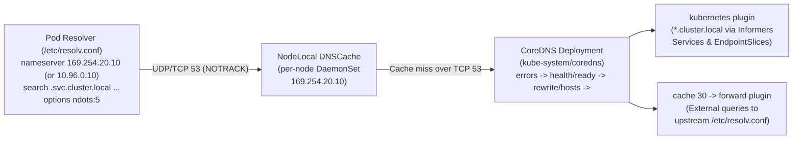

# 5.11 DNS and service discovery with CoreDNS

| | |
|---|---|
| Level | Intermediate |
| Priority tier | 0 |
| Lab venue | Any cluster; `kubectl`, a `netshoot`/`dnsutils` pod, node access for `tcpdump` and `conntrack` |
| Part | Part 5: Kubernetes |
| Status | Drafted, labs **untested** |

## Why this matters for AI infrastructure

DNS is the first dependency of almost every pod. A training worker resolves its rendezvous address, a data loader resolves object-store endpoints, and an inference gateway resolves model servers. MPI and PyTorch use headless Services for peer discovery. Every external API call, to registries, Hugging Face or telemetry, begins with a lookup too. If you run training jobs, you will meet these names every day.

Cluster DNS is also a classic hidden bottleneck. Kubernetes' default `ndots:5` multiplies queries, and UDP conntrack races add 5-second stalls. One CoreDNS pod serving a 2,000-pod job start causes timeouts. When DNS fails, the whole platform can look as if the network is down. Knowing how records are generated, how resolvers behave inside pods, how CoreDNS is configured, and how to scale and debug it is basic platform hygiene.

## Prerequisites and outcomes

This chapter builds on 5.8, 5.10 and the DNS fundamentals in 2.8. Once you finish it, you should be able to list the DNS records Kubernetes creates. Those cover Services, headless Services, SRV records, Pods and ExternalName Services, along with the naming scheme.

You should also be able to read `/etc/resolv.conf` inside a pod, including `nameserver`, `search`, `ndots` and `options`. You should know the `dnsPolicy` values and `dnsConfig`, and you should understand the query amplification that `ndots:5` causes.

Next, you should be able to read and change the CoreDNS Corefile. The plugins to know include kubernetes, forward, cache, loop, errors, health, ready, prometheus, rewrite, hosts, template, autopath and others. You should also be able to configure stub domains and upstream resolvers.

Then you can scale and harden CoreDNS with replicas, autoscaling, resources, anti-affinity, a PDB and NodeLocal DNSCache, and monitor it. Use DNS-based discovery for StatefulSets, headless Services and distributed training rendezvous, and avoid DNS pitfalls with large jobs. Finally, debug resolution failures in a systematic way.

## 1. Records Kubernetes creates

Your application rarely works with raw IP addresses. It asks for a name such as `alpaca-prod`, and something has to turn that name into an address. DNS names follow `<name>.<namespace>.svc.<cluster-domain>`, and the cluster domain defaults to `cluster.local`. The DNS server is **CoreDNS**, the default since 1.13. It runs as a Deployment named `coredns` in `kube-system`, behind a Service named `kube-dns` whose ClusterIP is usually `10.96.0.10`. The name `kube-dns` is a legacy name that was kept on purpose.

CoreDNS watches the Kubernetes API for Services, `EndpointSlices`, Namespaces and, optionally, Pods. It answers authoritatively for the cluster domain, so it is the single source of truth for those names.

The table shows which record each kind of object produces. Read it as a lookup: find the object you have, then check the record you will get back.

| Object | Record |
|---|---|
| ClusterIP Service `svc` in `ns` | `svc.ns.svc.cluster.local.` A (and AAAA for IPv6) → ClusterIP |
| Headless Service (no ClusterIP) | `svc.ns.svc.cluster.local.` A/AAAA → set of ready pod IPs |
| Named port | SRV `_http._tcp.svc.ns.svc.cluster.local.` → target + port; for headless: one SRV per pod `pod.svc.ns.svc...` |
| StatefulSet pod behind headless Service with `serviceName` | `pod-0.svc.ns.svc.cluster.local.` A → that pod IP (stable per-pod identity) |
| ExternalName Service | CNAME → external name |
| Pod IP (optional `pods insecure`/`verified` mode) | `10-244-3-17.ns.pod.cluster.local.` A → 10.244.3.17 (rarely useful) |
| Pod with `hostname`/`subdomain` set and matching headless Service | `hostname.subdomain.ns.svc.cluster.local.` |
| Reverse lookups | PTR for Service IPs and pod IPs (via `kubernetes` plugin `PTR`) |

Short names work through the pod's search path. From namespace `ns`, `svc` resolves through `svc.ns.svc.cluster.local`, while `svc.other-ns` resolves through `svc.cluster.local`. For cross-namespace access, use at least `svc.ns` or the full name.

A temporary pod is the easiest place to check these names. The commands below start one and then query the names from inside it.

```bash
kubectl run -it --rm dns --image=registry.k8s.io/e2e-test-images/jessie-dnsutils:1.3 --restart=Never -- sh
nslookup kubernetes.default
dig +short kubernetes.default.svc.cluster.local
dig +short SRV _https._tcp.kubernetes.default.svc.cluster.local
dig +short my-headless.ns.svc.cluster.local          # multiple A records
dig +short pod-0.my-headless.ns.svc.cluster.local
cat /etc/resolv.conf
```

Compare the single answer for `kubernetes.default` with the several answers for the headless name. The `resolv.conf` file at the end shows the search path that made the short names work.

### Reading a Service name

Say you are looking at the kuard demo app and want to know where `alpaca-prod` really points. A name like that looks short, but Kubernetes builds a longer name behind it. The kuard app has a DNS Query section on its status page. Query the A record for `alpaca-prod` there. The answer looks something like this:

```
;; opcode: QUERY, status: NOERROR, id: 12071
;; flags: qr aa rd ra; QUERY: 1, ANSWER: 1, AUTHORITY: 0, ADDITIONAL: 0
;; QUESTION SECTION:
;alpaca-prod.default.svc.cluster.local. IN A
;; ANSWER SECTION:
alpaca-prod.default.svc.cluster.local. 30 IN A 10.115.245.13
```

The answer gives the Service's cluster IP, 10.115.245.13. The full DNS name is `alpaca-prod.default.svc.cluster.local.`, and each part has a job:

- `alpaca-prod` is the name of the Service.
- `default` is the namespace the Service lives in.
- `svc` says this is a Service. It leaves room for Kubernetes to expose other types of objects as DNS names later.
- `cluster.local.` is the base domain for the cluster. It is the default, and most clusters show it. Administrators can change it so that names stay unique across several clusters.

Inside your own namespace, the service name `alpaca-prod` is enough. To reach a Service in another namespace, add the namespace, as in `alpaca-prod.default`. You can also use the fully qualified name, `alpaca-prod.default.svc.cluster.local.` Try all three in the DNS Query section of kuard. Use the short name inside your own namespace, and the namespace-qualified name when you cross into another one.

## 2. Resolver behaviour inside pods

A pod that looks up `api.example.com` can send 8 or more queries before it gets an answer. The reason sits in the pod's `/etc/resolv.conf`. The kubelet writes that file according to `dnsPolicy`, and the table shows what each value produces.

| `dnsPolicy` | Result |
|---|---|
| `ClusterFirst` (default) | `nameserver <kube-dns ClusterIP>`; search domains `<ns>.svc.<domain> svc.<domain> <domain>` plus the node's search domains; `options ndots:5`. Names not under the cluster domain are forwarded upstream by CoreDNS |
| `Default` | Inherit the node's resolver config (`/etc/resolv.conf` or the kubelet `resolvConf`) — **not** the default policy despite the name |
| `ClusterFirstWithHostNet` | For `hostNetwork: true` pods that still want cluster DNS |
| `None` | Use only `dnsConfig` (custom nameservers, searches, options) |

`Default` is the one that surprises you, because it does not mean the default. It hands the pod the node's own resolver settings.

The snippet below sets the resolver options and an extra search domain in the pod spec.

```yaml
spec:
  dnsPolicy: ClusterFirst
  dnsConfig:
    options:
      - { name: ndots, value: "2" }
      - { name: single-request-reopen }
      - { name: timeout, value: "2" }
      - { name: attempts, value: "3" }
    searches: ["extra.example.com"]
```

Each `options` entry tunes the resolver, and `searches` adds one more domain to the search path. The `ndots` value here is 2, not 5, which changes how many lookups go through the search list.

### The ndots:5 problem

Here is the problem in plain words. `ndots:5` means that if a name has fewer than 5 dots, the resolver tries the search domains first. Take a lookup of `api.example.com` from namespace `ml`. That name has 2 dots, so the resolver tries the search domains before it tries the name as written. Each name below gets an A query and an AAAA query, so you can count them:

1. `api.example.com.ml.svc.cluster.local` returns NXDOMAIN.
2. `api.example.com.svc.cluster.local` returns NXDOMAIN.
3. `api.example.com.cluster.local` returns NXDOMAIN.
4. `api.example.com.<node-search>` returns NXDOMAIN, once for each node search domain.
5. Finally, `api.example.com.` gets an answer.

That is 8 or more queries for one hostname. For workloads that call external services often, such as downloading datasets or calling APIs, this multiplies CoreDNS load and latency. Each failed lookup also shows up as an NXDOMAIN in the CoreDNS logs.

You have several ways to cut this down:

- Use fully qualified names with a trailing dot, such as `api.example.com.`, in configs for external endpoints. The dot tells the resolver to skip the search list.
- Lower `ndots` to 2 with `dnsConfig` for pods that mostly call external names. 2 is a common compromise. With `ndots:2`, a name such as `api.example.com`, which has 2 dots, is tried as an absolute name first. One-dot in-cluster names like `svc.ns` still go through the search path, and names with no dot (`svc`) always use it.
- Use the CoreDNS `autopath` plugin to complete the search path on the server side. It needs pod mode `verified` and adds load on the API server.
- Turn on NodeLocal DNSCache, so that repeated NXDOMAINs are cached on each node.
- Avoid musl-libc quirks. Alpine's resolver, in older versions, queries all nameservers in parallel. It also does not support the full search semantics reliably, with known issues around `ndots` and TCP fallback. That is one more reason to avoid Alpine in ML containers.

glibc also sends A and AAAA queries in parallel from the same socket, which is the source of the conntrack race described below. The options `single-request` and `single-request-reopen` serialize those queries. The second one also reopens the socket, at some latency cost. `use-vc` forces TCP.

For most external calls, the trailing dot is the first change you should make.

## 3. CoreDNS architecture

A single DNS query from a pod passes through several components before it gets an answer. The diagram shows that path, from the pod's resolver through NodeLocal DNSCache to CoreDNS and then to the upstream resolver.



CoreDNS is a chain of plugins. Each server block in the Corefile, which lives in the ConfigMap `kube-system/coredns`, defines zones and plugins. The plugins run in a fixed order that is set when CoreDNS is compiled. The order you write them in the file does not change that order.

```text
.:53 {
    errors
    health { lameduck 5s }
    ready
    kubernetes cluster.local in-addr.arpa ip6.arpa {
        pods insecure
        fallthrough in-addr.arpa ip6.arpa
        ttl 30
    }
    prometheus :9153
    forward . /etc/resolv.conf {
        max_concurrent 1000
        prefer_udp
    }
    cache 30
    loop
    reload
    loadbalance
}
```

Read the block as a list of features rather than a sequence of steps. The table below is a lookup for the plugins you are most likely to meet when you read a Corefile.

| Plugin | Function |
|---|---|
| `errors` | Log errors |
| `health` / `ready` | Liveness (`:8080/health`, `lameduck` drains) and readiness (`:8181/ready`) endpoints |
| `kubernetes` | Answers for the cluster domain from API objects; options `pods disabled\|insecure\|verified`, `ttl`, `endpoint_pod_names`, `fallthrough`, `namespaces`, `labels` |
| `forward` | Send non-cluster queries to upstream resolvers (node's resolv.conf or explicit list); health checks, policy (`random`, `round_robin`, `sequential`), TLS/DoT |
| `cache` | Cache positive and negative responses (`cache 30` seconds; `success`/`denial` capacity and TTL); prefetch |
| `loop` | Detect forwarding loops (CoreDNS crash with "Loop detected" when node resolv.conf points to 127.0.0.53 on systemd-resolved: set kubelet `resolvConf: /run/systemd/resolve/resolv.conf`) |
| `reload` | Auto-reload on Corefile change |
| `loadbalance` | Randomise order of A records |
| `prometheus` | Metrics |
| `rewrite` | Rewrite names/types (migrate domains, alias) |
| `hosts` | Serve entries from a hosts file |
| `template` | Synthesize records by regex |
| `autopath` | Server-side search path completion |
| `log` | Query logging (verbose; use for debugging only) |
| `acl`, `dnssec`, `nsid`, `trace`, `forward` variants | Access control, DNSSEC, tracing |

### Customisation recipes

Most changes come from one of three needs: an internal zone, a renamed or redirected name, or a different upstream. The recipes below cover each of them.

Say your company keeps an internal zone, `corp.example.com`, on its own resolver. A stub domain sends queries for that zone to that resolver and leaves the rest alone.

```text
corp.example.com:53 {
    errors
    cache 30
    forward . 10.1.0.53 10.1.0.54
}
```

Next, suppose a model mirror is reachable under a local name. A `rewrite` changes the query name, and a `hosts` entry answers a name directly.

```text
.:53 {
    ...
    rewrite name huggingface.mirror.local huggingface-proxy.registry.svc.cluster.local
    hosts {
        10.20.0.15 storage.lab.internal
        fallthrough
    }
    ...
}
```

To send external queries to a specific resolver over DNS over TLS (DoT), change the `forward` line, as in `forward . tls://1.1.1.1 { tls_servername cloudflare-dns.com; health_check 5s }`. To rate-limit abusive clients, use the `acl` plugin or a NetworkPolicy that restricts DNS.

Open the Corefile with `kubectl -n kube-system edit cm coredns`. The `reload` plugin picks up the change within about 30 s, so check the logs to confirm it. Managed clusters have their own route. On GKE and EKS, use the provider's CoreDNS customisation path. On AKS and on the EKS add-on, the `coredns-custom` ConfigMap imports `*.override` and `*.server` files. On GKE, kube-dns reads the `stubDomains` and `upstreamNameservers` settings in its `kube-dns` ConfigMap.

Test each Corefile change in staging before it reaches a managed cluster.

## 4. Scaling and hardening

### Capacity

Picture a 5,000-pod job that starts all at once, with every pod calling `getaddrinfo` for each connection. That job can easily generate 100k+ queries in seconds. The query rate grows with pod count × lookup rate × ndots amplification, so each factor multiplies the load.

As a rule of thumb, CoreDNS handles about 10-20k QPS per CPU core when caching is on. Its pods hold no state, so you add capacity by adding replicas. Defaults ship with 2 replicas. The recommendation is replicas ≈ nodes/100 to nodes/20, with a minimum of 3 for high availability. Spread the replicas across nodes and zones with anti-affinity, and protect them with a PDB, such as `minAvailable: 1` or 50%.

Size the requests and limits too. For example, at modest scale you might request 100m CPU and 70 Mi of memory, with a memory limit of about 170 Mi. Raise the memory limit as the cache grows. Set `priorityClassName: system-cluster-critical` on the pods. Align `GOMAXPROCS` with the CPU limit, because CPU throttling adds latency.

**Autoscaling** is the next step. The cluster-proportional-autoscaler scales CoreDNS replicas by node and core counts, using `linear` or `ladder` parameters. A CPU-based HPA can lag behind a sudden burst, so keep a floor sized for that burst.

### NodeLocal DNSCache

NodeLocal DNSCache runs a caching CoreDNS, `node-local-dns`, as a `DaemonSet` on every node. It listens on a link-local address, `169.254.20.10`, and on the `kube-dns` ClusterIP, through a dummy interface and NOTRACK iptables rules. Pods query the local cache with no DNAT, no conntrack and no cross-node hop.

Cache misses go over TCP to the upstream `kube-dns` Service. That avoids the UDP conntrack race and spreads the load. Negative caching also reduces NXDOMAIN storms. To install it, take the manifest from the Kubernetes repository and set `__PILLAR__LOCAL__DNS__`, `__PILLAR__DNS__SERVER__` and `__PILLAR__DNS__DOMAIN__`. Then point the kubelet `clusterDNS` at the link-local IP. You can also leave `clusterDNS` alone and use the dummy-interface binding in iptables mode.

Run it as a critical `DaemonSet`. If one node's cache fails, that node's pods lose DNS until the cache restarts. The cache uses `hostNetwork` and a dedicated interface, so set rollout limits such as `maxUnavailable: 10%`, add readiness checks, and consider a fallback to the cluster DNS Service with the search order. For Cilium, local DNS can be handled by its DNS proxy or by `localRedirectPolicy`.

Decide how each node falls back if its cache is down before you roll NodeLocal DNSCache out.

### The conntrack/UDP race and 5-second delays

The symptom is a lookup that takes exactly 5 s, which is the default resolver timeout, or an intermittent `EAI_AGAIN`. The cause sits in the kernel. glibc sends the A and AAAA queries from the same UDP socket at the same time. Both packets hit netfilter `conntrack` together. The DNAT that kube-proxy applies, to reach the kube-dns ClusterIP, creates entries, and one of those insertions races with the other. The packet loses the race and is dropped. The resolver then waits, times out and retries.

Several fixes address this. NodeLocal DNSCache removes the DNAT. The `single-request-reopen` option separates the two queries. Sending DNS over TCP avoids the race as well. Newer kernels help, because the races are mostly fixed in 5.0+ with later patches. An eBPF kube-proxy replacement avoids conntrack for socket load balancing. Reducing simultaneous lookups helps too, through connection pooling and caching in the application. Keep the Alpine-specific caveats in mind as well.

If you see exact 5-second delays, check the conntrack counters before you change the application.

### Other hardening and operations

A few smaller habits keep DNS healthy over time. Keep CoreDNS and the Corefile in GitOps, and test changes in staging first. Check version skew against Kubernetes releases, and watch for the `loop` plugin crash.

Each default-deny namespace needs a NetworkPolicy that allows DNS egress, UDP and TCP port 53, to `kube-dns` and to the node-local IP, as covered in 5.15.

Limit the damage from abusive clients. `ratelimit` through external proxies is limited, so rely on pod quotas and on alerts for per-pod QPS. Metrics by client IP need query logging.

For security, watch for DNS exfiltration and tunnelling by logging anomalies. DNSSEC is not typical inside a cluster. Avoid exposing CoreDNS outside the cluster, and restrict zone transfer, which is not enabled.

For TTLs, the `kubernetes` plugin uses `ttl 30` for Services, while some distributions use 5s. A short TTL with a cache keeps endpoints fresh. A long TTL delays failover for headless discovery.

For IPv6 and dual-stack, AAAA lookups for Services without IPv6 return NODATA but still cost a query. Serialise them with `single-request`, or set address-family hints in applications where it matters.

Put the Corefile under GitOps and test each change in staging before it reaches production.

## 5. DNS-based discovery for distributed AI workloads

Distributed training depends on DNS more than most workloads do. Every worker needs the addresses of its peers before it can start, so one missing name can stall the whole job.

A StatefulSet behind a headless Service gives each worker a stable name. Workers address their peers as `trainer-0.trainer.ml.svc.cluster.local`. When a pod is rescheduled, its IP changes but the name stays the same. PyTorch uses `torchrun --rdzv_backend=c10d --rdzv_endpoint=trainer-0.trainer:29500`, Ray uses `ray-head.ray.svc:6379` for its head, and MPI hostfiles are generated from pod names. Operators such as the Kubeflow Training Operator, the MPI Operator, JobSet and KubeRay create the headless Services and set the environment variables or hostfiles for you.

Readiness changes what DNS returns. Headless Services publish only ready pods by default. If peers must find each other before they are ready, during rendezvous at startup, set `publishNotReadyAddresses: true` on the headless Service, or avoid readiness probes on worker pods. Without one of these, pods can deadlock while they wait for each other's DNS names.

Negative caching can slow a startup. A lookup that returned NXDOMAIN for a peer, before that peer's pod existed, can stay in the cache for the negative TTL. That TTL defaults to the SOA minimum of 30 s in CoreDNS `cache denial` settings. Workers should therefore retry with backoff and bounded timeouts. Applications should also avoid caching failures. The JVM has the `networkaddress.cache.negative.ttl` setting for this. Python's `socket.getaddrinfo` does not cache, but some libraries do.

Job start storms happen when thousands of workers resolve the same few names at once. Before you launch a large job, give CoreDNS generous replicas and NodeLocal caches. Stagger the startup, and avoid resolving names on every iteration.

JVM and other long-lived clients can hold on to old addresses. By default, the JVM caches successful lookups indefinitely with a security manager, or for 30 s without one. After a failover, clients keep the old IPs, so set the TTL properties. gRPC's `dns:///svc.ns:443` re-resolves periodically, at a 30 s minimum in some implementations. For balancing across a headless Service, use the `round_robin` policy.

External dependencies such as object stores, registries and model hubs are a risk too. Pin them to IP-addressed mirrors or internal resolvers for stability, and consider a local caching proxy. When external DNS fails, the symptom is a training job that hangs at startup. Add DNS health to your preflight checks in Part 17.

For discovery across clusters, you can use the Multicluster Services API, with `ServiceExport` and `ServiceImport` and the `clusterset.local` domain. Cilium ClusterMesh and Istio multi-cluster DNS proxying are other options. ExternalDNS publishes Service and Ingress records to Route53, CloudDNS or Cloudflare, as covered in 5.35.

Choose the discovery method that matches how far your workloads must reach, whether that is inside one cluster or across several.

## 6. Observability

CoreDNS exposes its metrics on port 9153. Watch `coredns_dns_requests_total{type,proto,zone}` for traffic, and `coredns_dns_responses_total{rcode}` for the NXDOMAIN and SERVFAIL rates. Latency shows up in `coredns_dns_request_duration_seconds_bucket`. The cache is visible in `coredns_cache_hits_total` and `coredns_cache_misses_total`, and forwarding in `coredns_forward_requests_total`.

Also watch `coredns_forward_healthcheck_failures_total`, `coredns_panics_total`, `coredns_health_request_failures_total` and `coredns_kubernetes_rest_client_requests_total`.

For alerts, use these thresholds: a SERVFAIL ratio above 1%, p99 latency above 100 ms, forward healthcheck failures, CoreDNS restarts, a falling cache hit ratio, and CPU throttling. For debugging, turn on the `log` plugin briefly, or rely on `errors`. Use `dnstap` or a packet capture for forensics. The `node-local-dns` cache exposes its own metrics on port 9253.

Start with these commands to see the state of CoreDNS.

```bash
kubectl -n kube-system get deploy,po -l k8s-app=kube-dns -o wide
kubectl -n kube-system logs deploy/coredns --tail=50
kubectl -n kube-system top pod -l k8s-app=kube-dns
kubectl -n kube-system get cm coredns -o yaml
kubectl get svc -n kube-system kube-dns; kubectl get endpointslices -n kube-system -l kubernetes.io/service-name=kube-dns
# test load
kubectl run -it --rm perf --image=registry.k8s.io/perf-tests/dnsperf --restart=Never -- sh   # or dnsperf/queryperf with a query file
```

Before you rely on these alerts, run the load test and confirm that the numbers look sane.

## 7. Debugging method

A pod reports that a name will not resolve. Before you change any config, work through the steps below in order, and stop at the first step that shows a fault.

Step 1: begin by asking whether you are looking at a DNS failure at all. From the failing pod, run `getent hosts svc.ns` and `dig`. If `curl` works by IP while the name fails, the problem is DNS.

Step 2: next, find out which resolver the pod uses. Run `cat /etc/resolv.conf`. The nameserver IP should match `kube-dns` or the node-local cache. Note the `ndots` value, the search list and the `dnsPolicy`.

Step 3: then check whether you can see that CoreDNS itself is healthy. Its pods should be Running and Ready, the endpoints should be present, and the logs should show no `loop`, `SERVFAIL` or forward errors. To test the CoreDNS pod directly, query its IP with `dig @<coredns-pod-ip> kubernetes.default.svc.cluster.local`.

Step 4: compare the paths. Querying through the ClusterIP tests kube-proxy and the CNI. Querying the pod IP tests CoreDNS alone. Querying the node-local cache tests that layer.

Step 5: check the upstream. Run `dig @<upstream> example.com` from the CoreDNS pod or the node. Then check `forward` health, the firewall or security group for UDP and TCP 53, and the node's `resolv.conf`.

Step 6: confirm that the records exist. An empty headless Service returns no A records, so check the Service selectors and endpoints first. Also check the namespace spelling, the `fallthrough` setting and the `pods` mode.

Step 7: if the answers are still unclear, capture packets. Run `tcpdump -ni any port 53` on the node or in the pod's network namespace. Look for unanswered queries, retransmits at 5 s, and truncated UDP responses with the TC bit set. Those fall back to TCP, and blocked TCP/53 breaks large responses.

Step 8: measure the timing. Use `dig +stats`, `time getent hosts` and `strace -T` on the client to find the slow query. The CoreDNS request duration histogram shows the same thing from the server side.

Step 9: compare the search path. Run `dig name.`, with the trailing dot, which is absolute. Then run `dig name`, which uses the search list. Count the NXDOMAINs in each case.

Step 10: last, check conntrack. Run `conntrack -S` and `conntrack -L -p udp --dport 53 | wc -l`, and look at the `insert_failed` counters. Also note the kernel version.

The table matches common symptoms to their likely causes and fixes. Match the symptom first, then read the cause column before you change anything.

| Symptom | Likely cause | Fix |
|---|---|---|
| CoreDNS CrashLoop "Loop detected" | Upstream is itself/127.0.0.53 | Kubelet `resolvConf` to real upstream file; `forward . 10.x.x.x` |
| `SERVFAIL` for external names | Upstream unreachable, firewall, forward misconfigured | Test from CoreDNS pod; fix routes/SG; add secondary upstream |
| `NXDOMAIN` for existing Service | Wrong namespace/search, headless with no ready pods, label mismatch | FQDN, endpoints |
| Random 5 s delays | UDP conntrack race | NodeLocal DNS, `single-request-reopen`, TCP |
| High NXDOMAIN rate and load | ndots:5 + external names | FQDNs with trailing dot, lower ndots, autopath, node-local |
| Names don't resolve for hostNetwork pods | `dnsPolicy: ClusterFirst` ignored for hostNetwork | Use `ClusterFirstWithHostNet` |
| Intermittent failures during CoreDNS rollout | No lameduck/PDB, single replica | `lameduck`, PDB, ≥3 replicas |
| External resolution works, cluster names fail | `kubernetes` plugin API access (RBAC), CoreDNS cache of API, wrong cluster domain | CoreDNS logs, ClusterRole, `clusterDomain` consistency (kubelet vs Corefile) |
| Large responses fail | Blocked TCP/53, EDNS issues | Allow TCP, check MTU |

## 8. Lab

Start on your own machine with the self-checking Python lab, which you run locally before you touch a cluster. It checks three things. First, `expand_dns_search_queries` compares `ndots:5`, `ndots:2` and a trailing-dot FQDN on `api.huggingface.co`, and on the in-cluster name `vllm.serving`. That draws on Networking and Kubernetes, chapter 5, and Production Kubernetes, chapter 6. Second, `resolve_headless_service_records` generates the DNS records for a headless Service and a StatefulSet, including the `publishNotReadyAddresses` case. That draws on Kubernetes: Up and Running, chapter 7. Third, `detect_coredns_forwarding_loop` looks for the CoreDNS `loop` plugin's forwarding loop on `127.0.0.53`.

```bash
python3 code/part05/coredns_ndots_resolver_lab.py
```

A passing run means the three checks agree with the behaviour described in this chapter. All interactive shell steps below are `untested here`, so treat them as a plan until you run them yourself. On a Kubernetes cluster, work through these exercises:

1. Take a tour of the records. Create a ClusterIP Service, a headless Service with named ports, a StatefulSet with `serviceName`, and an ExternalName Service. Query A, AAAA, SRV and PTR records for each, and watch how readiness changes the answers for the headless Service.
2. Inspect `/etc/resolv.conf` under each `dnsPolicy`. Then turn on the CoreDNS `log` plugin, resolve `api.github.com`, and count the queries for `ndots:5`, `ndots:2` and a trailing dot. Finally, measure the latency difference across a loop of 1,000 lookups.
3. Edit the Corefile. Add a stub zone for an internal resolver, plus a `rewrite` rule and a `hosts` entry, and verify each with `dig`. Then break `forward` on purpose, observe the SERVFAIL responses and the metrics, and fix it.
4. Reproduce the loop. On a systemd-resolved host, point the upstream at 127.0.0.53 until you see "Loop detected". Then fix it through the kubelet `resolvConf` setting.
5. Run a scale test. Point `dnsperf` or `k6` DNS load at `kube-dns` and find the QPS at which latency starts to degrade with 2 replicas. Then add more replicas or the cluster-proportional-autoscaler, add a NodeLocal DNSCache, and compare the p99 latency and conntrack counts.
6. Chase the 5-second delays. Run a glibc client in a loop with parallel A and AAAA queries, and generate heavy UDP traffic on a lab node. Look for 5 s outliers. Apply `single-request-reopen`, then NodeLocal DNSCache, and write down what changed.
7. Install NodeLocal DNSCache and point the kubelet `clusterDNS` at it. Verify it with `dig @169.254.20.10`. Then kill the local cache pod, watch how the client behaves, and check the metrics.
8. Test distributed rendezvous. Run a 4-worker PyTorch job, or a simple TCP job, on a StatefulSet and a headless Service. Show the failure when readiness is gated on peers and `publishNotReadyAddresses` is missing, then fix it. Finally, reschedule a pod and confirm that its IP changes while its name stays the same.
9. Measure negative caching. Query a Service that does not exist yet, create it, and time how long the NXDOMAIN persists. Then tune the CoreDNS `cache` setting and the application's retry behaviour.
10. Run failure drills. Delete CoreDNS pods while a request loop runs, then scale to 1 replica. Add a PDB and `lameduck`, block upstream UDP/53, and simulate an expired CoreDNS RBAC. Practise the debugging method on each failure.
11. Build observability. Scrape the CoreDNS and node-local metrics, build a dashboard for QPS, rcode ratios, latency and cache hits, and define alerts.
12. Clean up when you are done.

Write down what each drill showed, because the debugging method depends on those measurements.

## 9. Common mistakes

These mistakes come up again and again, so check your own cluster against them.

- Assuming `Default` is the default `dnsPolicy`, which it is not.
- Forgetting `ClusterFirstWithHostNet` for pods that use host networking.
- Leaving `ndots:5` on workloads that make many external calls, then wondering why CoreDNS is saturated.
- Running two CoreDNS replicas for a 2,000-node cluster, with no PDB or lameduck and CPU-throttled pods.
- Pointing the CoreDNS upstream at the systemd-resolved stub, which causes a loop.

The second group is just as easy to fall into.

- Blocking TCP/53, or large EDNS packets, at firewalls.
- Assuming a low TTL will help JVM or gRPC clients that cache indefinitely.
- Gating worker readiness on peer discovery without `publishNotReadyAddresses`.
- Forgetting to allow DNS egress in default-deny NetworkPolicies.
- Making Corefile changes by hand in production, where they are lost on upgrade. Using Pod DNS A records, such as `10-0-0-1.ns.pod...`, as a workload's identity is a mistake too.

Compare your manifests with this list before the next rollout.

## 10. Interview angles

These questions test whether you can explain the mechanism, not just name a setting.

- What happens when a pod resolves `my-service`? Walk through `resolv.conf`, the search domains and CoreDNS.
- What is `ndots:5`? What problems does it cause, and how do you fix them?
- How is a headless Service different in DNS? Why do StatefulSets need it?
- What causes 5-second DNS delays in Kubernetes? How does NodeLocal DNSCache help?
- How would you scale CoreDNS for a 5,000-node cluster?
- Explain the Corefile plugins you would use for a split-horizon setup.
- A distributed training job hangs at startup while resolving peers. Why might that be?
- How do you debug a cluster-wide DNS failure?

## Exercises

Work through these after you have read the chapter. Each one asks you to trace a mechanism, not just repeat a setting.

1. Start with the record types and the `dnsPolicy` modes. List the exact DNS record formats, including the `CNAME`, `PTR` and `SRV` records, for a `ClusterIP` Service, a headless Service (`clusterIP: None`), a `StatefulSet` pod (`pod-0.svc.ns.svc.cluster.local`), a named port (`_http._tcp.svc.ns.svc.cluster.local`) and an `ExternalName` Service. Then compare the four `dnsPolicy` values: `ClusterFirst`, `Default`, `ClusterFirstWithHostNet` and `None`. The background is in Kubernetes: Up and Running, chapter 7, and Networking and Kubernetes, chapters 4 and 5.
2. Trace the `ndots:5` problem in code. Using `expand_dns_search_queries()` in `code/part05/coredns_ndots_resolver.py`, follow every `A` and `AAAA` query sent when a pod in namespace `ml` resolves `api.huggingface.co` under `ndots: 5`. You should count 8 queries, 6 `NXDOMAIN` and 2 answers. Then compare that with `ndots: 2` and with a trailing dot (`api.huggingface.co.`). Finally, show why `ndots: 2` still resolves 1-dot cross-namespace names, such as `vllm.serving`, through the search domains. The background is in Networking and Kubernetes, chapter 5, and Production Kubernetes, chapter 6.
3. Study the Corefile. Using `detect_coredns_forwarding_loop()` in `code/part05/coredns_ndots_resolver.py`, explain what each plugin in the default `Corefile` does. Those plugins are `errors`, `health { lameduck 5s }`, `ready`, `kubernetes`, `prometheus :9153`, `forward`, `cache 30`, `loop`, `reload` and `loadbalance`. Then write a `Corefile` snippet that routes `corp.example.com` to internal DNS at `10.1.0.53`, and rewrites `huggingface.mirror.local` to `huggingface-proxy.registry.svc.cluster.local`. For background, see Networking and Kubernetes, chapter 4, Table 4-5.
4. Work through scaling and the 5-second race. Explain the root cause of the 5-second DNS timeout, which comes from parallel `A` and `AAAA` UDP queries from the same socket racing `conntrack` DNAT insertion. Then explain how `NodeLocal DNSCache` at `169.254.20.10` removes it, using `NOTRACK` iptables rules and TCP upstream forwarding. Finally, explain how the `cluster-proportional-autoscaler` scales CoreDNS with cluster size. Production Kubernetes, chapter 6, covers the background.
5. Look at rendezvous and negative caching, which also appears in `MPI` and `Ray` setups. Using `resolve_headless_service_records()` in `code/part05/coredns_ndots_resolver.py`, explain why a multi-node `StatefulSet` or `Indexed` Job deadlocks. The job uses `torchrun --rdzv_endpoint=trainer-0.trainer:29500`, its `readinessProbe` depends on peer rendezvous, and `publishNotReadyAddresses: true` is omitted. Then explain how CoreDNS negative caching, governed by the `cache denial` SOA TTL, affects worker startup retries.
6. Finish with the full debugging method. Walk through the 10 steps of the checklist in section 7, and use them to tell apart five faults: a broken pod `/etc/resolv.conf`, a `kube-proxy` datapath failure at `10.96.0.10`, a CoreDNS pod crash or RBAC error, a blocked TCP port 53 firewall rule that shows up as `TC` bit truncation, and an upstream resolver outage.

## Checkpoint questions (20)

<details>
<summary>1. What DNS records does CoreDNS create for a standard `ClusterIP` Service versus a `Headless` Service (`clusterIP: None`)?</summary>

- For a standard `ClusterIP` Service, such as `vllm` in namespace `serving`, the A and AAAA record `vllm.serving.svc.cluster.local.` resolves to the single virtual `ClusterIP`, for example `10.96.45.12`. Each named port also gets an SRV record. `_http._tcp.vllm.serving.svc.cluster.local.` points to `0 100 80 vllm.serving.svc.cluster.local.`.
- For a headless Service, with `clusterIP: None`, such as `trainer` in namespace `ml`, the name `trainer.ml.svc.cluster.local.` returns the IP addresses of all ready backing pods. If `publishNotReadyAddresses: true` is set, it returns all pods instead. When pods belong to a StatefulSet with `serviceName: trainer`, or set `hostname` and `subdomain: trainer`, each pod also gets its own record. `trainer-0.trainer.ml.svc.cluster.local.` resolves to the exact IP of `trainer-0`.
</details>

<details>
<summary>2. Compare the four `dnsPolicy` values on a Pod spec (`ClusterFirst`, `Default`, `ClusterFirstWithHostNet`, `None`).</summary>

1. `ClusterFirst` is the default when `hostNetwork` is false. Queries go to `kube-dns` or NodeLocal DNSCache with the cluster search domains, `<ns>.svc.cluster.local`, `svc.cluster.local` and `cluster.local`. External queries are forwarded upstream by CoreDNS.
2. `Default` is not the default Kubernetes policy. The pod inherits `/etc/resolv.conf` straight from the worker node, so it cannot resolve `.cluster.local` Service names unless the node itself uses CoreDNS.
3. `ClusterFirstWithHostNet` is required for pods with `hostNetwork: true` that still need to resolve `.cluster.local` Service names. Without it, `ClusterFirst` falls back to `Default` node DNS when `hostNetwork` is set.
4. `None` ignores the generated DNS settings. It builds `/etc/resolv.conf` only from `spec.dnsConfig`, using `nameservers`, `searches` and `options`.
</details>

<details>
<summary>3. Why does a single lookup of `api.huggingface.co` inside a Pod in namespace `ml` generate 8 DNS queries by default (Networking and Kubernetes, chapter 5, and Production Kubernetes, chapter 6)?</summary>

By default, `/etc/resolv.conf` has `options ndots:5` and `search ml.svc.cluster.local svc.cluster.local cluster.local`. The name `api.huggingface.co` has only 2 dots, which is fewer than 5. So the C library resolver does not try it as an absolute name first. Instead, it appends each search domain in turn, and it sends an `A` query and an `AAAA` query at every step:
1. `A` and `AAAA` for `api.huggingface.co.ml.svc.cluster.local.` return `NXDOMAIN` (2 queries).
2. `A` and `AAAA` for `api.huggingface.co.svc.cluster.local.` return `NXDOMAIN` (2 queries).
3. `A` and `AAAA` for `api.huggingface.co.cluster.local.` return `NXDOMAIN` (2 queries).
4. Finally, `A` and `AAAA` for `api.huggingface.co.` return `NOERROR` (2 queries).

That makes 8 DNS queries in total, 6 of them wasted `NXDOMAIN` responses, for one external hostname lookup.
</details>

<details>
<summary>4. What are the four best ways to eliminate `ndots:5` query amplification on GPU workloads that make heavy external S3/GCS/HuggingFace API calls?</summary>

1. Put a trailing dot on external FQDNs in your configuration, such as `api.huggingface.co.` or `s3.us-east-1.amazonaws.com.`. The trailing dot marks an absolute root name, so the search list is skipped whatever `ndots` says.
2. Set `ndots: "2"` in `spec.dnsConfig.options`. A name with 2 or more dots, such as `api.huggingface.co`, is queried as an absolute name first. Zero-dot and one-dot in-cluster names, such as `vllm` and `vllm.serving`, still go through the search domains.
3. Deploy NodeLocal DNSCache at `169.254.20.10`. It caches NXDOMAIN responses in RAM on each node, so repeated search lookups never leave the node.
4. Use cross-namespace Service names with at least `.svc.cluster.local.` in hot paths.
</details>

<details>
<summary>5. In CoreDNS's `Corefile`, does changing the text order of plugins inside a server block change the order in which plugins execute?</summary>

No. You can rely on this: the execution order of plugins in a server block is compiled into the CoreDNS binary through `plugin.cfg`. For example, `errors` and `log` wrap the chain, `rewrite` runs before `hosts`, `hosts` runs before `kubernetes`, `cache` wraps `kubernetes` and `forward`, and `forward` runs near the end when `kubernetes` does not match or falls through. Writing the stanzas in a different order inside `.:53 { ... }` changes nothing.
</details>

<details>
<summary>6. What do `health { lameduck 5s }` and `ready` do in the CoreDNS `Corefile`?</summary>

- `ready` serves HTTP on `:8181/ready`, and the `readinessProbe` uses it. It returns `200 OK` only after every plugin has finished starting up. That includes the initial list and watch sync of Services and `EndpointSlices` in the `kubernetes` plugin.
- `health { lameduck 5s }` serves HTTP on `:8080/health`, and the `livenessProbe` and graceful shutdown use it. When CoreDNS gets `SIGTERM` during a rollout or a node drain, `lameduck 5s` keeps the DNS listener open for 5 seconds while readiness already reports unhealthy. That gives kube-proxy and NodeLocal DNSCache time to remove the pod's IP from the `EndpointSlices` before it stops answering.
</details>

<details>
<summary>7. What causes CoreDNS Pods to crash-loop with `plugin/loop: Loop ... detected for zone "."`, and how do you fix it?</summary>

The `loop` plugin sends a random probe query, `<rand1>.<rand2>.zone`, to itself at startup. If that probe comes back to the same process through `forward . /etc/resolv.conf`, CoreDNS logs `Loop detected` and exits with a fatal error. That stops an endless packet storm. You see this on Linux nodes such as Ubuntu with systemd-resolved, where the host's `/etc/resolv.conf` lists `nameserver 127.0.0.53` or `127.0.0.1`. The CoreDNS pod inherits that file, so `127.0.0.53` inside its network namespace points back at CoreDNS itself.

The fix is either to set `resolvConf: /run/systemd/resolve/resolv.conf` in `KubeletConfiguration`, so pods inherit the real upstream servers instead of the local stub, or to put explicit upstream IPs on the `forward` line, such as `forward . 10.0.0.2`.
</details>

<details>
<summary>8. Explain the root cause of the classic Kubernetes \"5-Second DNS Timeout\" (`conntrack` UDP race) and why it happens with `glibc`.</summary>

When a Linux container calls `getaddrinfo("api.example.com")`, glibc sends the `A` (IPv4) and `AAAA` (IPv6) UDP queries in parallel, over the same UDP socket with the same source IP and port, to `10.96.0.10:53`, the kube-dns ClusterIP. In iptables mode without NodeLocal DNSCache, the race goes like this:
1. Both packets reach netfilter on the node before any `conntrack` entry exists.
2. Both packets go through the `KUBE-SVC-*` chains. Each may be DNATed to a different CoreDNS pod, so packet 1 might go to `CoreDNS-A` and packet 2 to `CoreDNS-B`.
3. When both try to insert their 5-tuple into the `nf_conntrack` hash table, the second packet loses the race (`insert_failed`), and the kernel silently drops it.
4. The client waits the full 5-second default `resolv.conf` timeout before it retries.
</details>

<details>
<summary>9. How does `NodeLocal DNSCache` (`169.254.20.10`) solve both CoreDNS scale bottlenecks and the 5-second UDP `conntrack` race?</summary>

NodeLocal DNSCache runs as a `DaemonSet` on every node. It binds a small caching CoreDNS instance to a link-local dummy interface at `169.254.20.10`, and to the kube-dns ClusterIP `10.96.0.10` on that node. You can see it solve the race in two ways:
1. It bypasses DNAT and conntrack. `iptables -t raw` NOTRACK rules cover UDP and TCP port 53 traffic to `169.254.20.10` and `10.96.0.10`. Pod-to-cache packets never enter conntrack or go through kube-proxy DNAT. That removes the UDP race and saves tens of thousands of conntrack table entries.
2. It upgrades cache misses to TCP. When a query misses the local RAM cache, which covers both positive and NXDOMAIN answers, the query goes to the central kube-dns Service over multiplexed TCP, `prefer_tcp`, instead of lossy UDP.
</details>

<details>
<summary>10. What does `options single-request-reopen` in `dnsConfig` do when `NodeLocal DNSCache` is not installed?</summary>

`single-request` tells glibc to send the `A` query and wait for its response before it sends the `AAAA` query, so the two queries never race. `single-request-reopen` uses different sockets, with different source ports, for the `A` and `AAAA` queries. It also reopens a new socket when a timeout occurs. Each packet then gets its own 5-tuple in conntrack, so neither one is dropped.
</details>

<details>
<summary>11. How does the `Cluster Proportional Autoscaler` (`CPA`) scale CoreDNS (Production Kubernetes, chapter 6), and why is it paired with HPA or a minimum floor?</summary>

Unlike a standard HPA, which reacts after CPU spikes, the `cluster-proportional-autoscaler` watches the number of schedulable nodes and CPU cores. It adjusts `coredns` `spec.replicas` ahead of time, using a linear or step-ladder formula. For example, `coresPerReplica: 256`, `nodesPerReplica: 16` and `min: 3`. Suppose a cluster grows from 50 to 1,000 GPU nodes for a training run. The autoscaler then brings CoreDNS up to 63 or more replicas before the training pods launch.
</details>

<details>
<summary>12. How do you configure Split-Horizon DNS (a Stub Domain for `corp.internal`) and an in-cluster hostname alias (`rewrite` vs. `hosts`) in CoreDNS?</summary>

- For a stub domain, you add a separate server block above `.:53` that forwards `corp.internal` to the internal corporate DNS at `10.1.0.53`:
  ```text
  corp.internal:53 {
      errors
      cache 30
      forward . 10.1.0.53 10.1.0.54
  }
  ```
- For a CNAME-style alias to an in-cluster Service, use `rewrite`. The line `rewrite name exact weights.internal.local minio.storage.svc.cluster.local` changes the query name before the `kubernetes` plugin sees it, so the target Service's A record is returned directly.
- For a static IP mapping, use `hosts`: `hosts { 10.20.0.15 nfs-filer.lab.local; fallthrough }`. Always include `fallthrough`, so that queries that do not match continue to `kubernetes` or `forward`.
</details>

<details>
<summary>13. Why does a multi-node PyTorch `torchrun` job using a `StatefulSet` + Headless Service deadlock during startup if `readinessProbe` is configured and `publishNotReadyAddresses` is `false`?</summary>

Worker ranks resolve `trainer-0.trainer` while they start. With `torchrun --rdzv_backend=c10d --rdzv_endpoint=trainer-0.trainer.ml.svc.cluster.local:29500`, the rendezvous only finishes when all worker ranks connect to its port. But `trainer-0` does not finish initializing, and so does not pass its `readinessProbe`, until those connections arrive. By default, `publishNotReadyAddresses` is `false`. CoreDNS then does not publish the A record for `trainer-0.trainer.ml.svc.cluster.local` until `trainer-0` is Ready. Workers get NXDOMAIN, `trainer-0` never receives connections, and the job deadlocks. If you set `publishNotReadyAddresses: true` on the Headless Service publishes each pod's DNS record as soon as the pod has an IP, whatever its readiness.
</details>

<details>
<summary>14. How can CoreDNS Negative Caching (`NXDOMAIN` caching) delay distributed training startup by 30 seconds, and how should worker startup scripts handle it?</summary>

When worker `trainer-7` starts 500 milliseconds before `trainer-0` has its Pod IP, `trainer-7` queries `trainer-0.trainer.ml.svc.cluster.local.` and gets `NXDOMAIN`. The CoreDNS `cache` plugin and NodeLocal DNSCache cache negative responses for up to the SOA minimum TTL, which defaults to 30 seconds. You can change that with `cache { denial <size> <ttl> }`, for example `denial 9984 5`. Even if `trainer-0` starts 1 second later, cached resolvers can keep returning `NXDOMAIN` for 5 to 30 seconds. So you should do two things:
1. Lower the negative cache TTL in NodeLocal DNSCache or CoreDNS, for example `denial 9984 5`, for batch clusters.
2. Make the rendezvous loops retry DNS with backoff for at least 60 to 120 seconds, the `rdzv_timeout`, instead of crashing on the first `gaierror` (`EAI_NONAME`).
</details>

<details>
<summary>15. Why do Java (JVM) and long-lived Python/gRPC clients sometimes continue sending traffic to dead Pod IPs after a Headless Service endpoint changes?</summary>

DNS has no push mechanism that tells a client its cached address is stale. The JVM historically caches successful lookups forever when a SecurityManager is set, or for 30 seconds without one. Set `networkaddress.cache.ttl=5` and `networkaddress.cache.negative.ttl=0` to change that. Python clients such as `urllib3`, `requests` and `aiohttp` behave differently. Their HTTP connection pools keep an established TCP socket open through keep-alive, and they never query DNS again while the socket stays open. gRPC's `dns:///` resolver enforces a minimum 30-second re-resolution interval, unless a connection failure triggers a reconnect.
</details>

<details>
<summary>16. Why must every namespace with a `default-deny-egress` `NetworkPolicy` include an explicit DNS egress allow rule, and why must it allow BOTH UDP and TCP port 53?</summary>

Once an egress `NetworkPolicy` selects a pod, all outbound traffic that is not explicitly allowed is blocked. That includes DNS queries to kube-dns at `10.96.0.10` and to NodeLocal DNSCache at `169.254.20.10`. So each egress policy has to allow both UDP port 53 and TCP port 53 to `kube-system` (`k8s-app: kube-dns`) and to `169.254.20.10/32`. If you allow UDP/53 but block TCP/53, small lookups still work. A large response, such as a headless Service with 30 or more pod IPs, or a large `SRV` response over 512 bytes or the EDNS0 MTU, sets the UDP truncated (`TC`) bit and falls back to TCP/53. That lookup then hangs silently and times out.
</details>

<details>
<summary>17. In the CoreDNS `kubernetes` plugin, what is the difference between `pods disabled`, `pods insecure`, and `pods verified`?</summary>

This setting controls whether CoreDNS answers Pod-IP A queries, such as `10-244-3-17.<namespace>.pod.cluster.local.`.
- `pods disabled` means CoreDNS does not answer `.pod.cluster.local` queries at all. It is the most common choice when you only need Service and headless discovery.
- `pods insecure` is the kubeadm default. It builds `10-244-3-17.<ns>.pod.cluster.local.` as `10.244.3.17` by parsing the dashed IP. It never checks the API server to see whether that pod exists in `<ns>`.
- `pods verified` checks the pod informer cache before it returns `A 10.244.3.17`. CoreDNS must then watch every Pod object in the cluster, which significantly raises its memory use and API watch traffic on 5,000-node clusters.
</details>

<details>
<summary>18. What does the `fallthrough` directive do inside the `kubernetes` or `hosts` plugin in a `Corefile`?</summary>

A plugin that is authoritative for a zone, such as `kubernetes cluster.local in-addr.arpa ip6.arpa` or `hosts`, normally returns `NXDOMAIN` right away when it does not find a record. The `fallthrough` directive changes that. With `fallthrough [zones...]`, such as `fallthrough in-addr.arpa ip6.arpa` in `kubernetes`, or a bare `fallthrough` in `hosts`, a miss passes to the next plugin, `kubernetes` or `forward`, instead of returning `NXDOMAIN`. In other words, it tells CoreDNS: if this plugin does not find a match in these zones, let the next plugin try.
</details>

<details>
<summary>19. Which Prometheus metrics on `:9153/metrics` indicate CoreDNS trouble, and what should you alert on?</summary>

1. `coredns_dns_responses_total{rcode="SERVFAIL"}` is the rate of server failures, from an unreachable upstream, a timeout or a plugin error. Alert when the SERVFAIL ratio goes above 1%.
2. `coredns_dns_responses_total{rcode="NXDOMAIN"}` spikes point to `ndots:5` amplification, or to clients that keep polling names that do not exist.
3. `coredns_dns_request_duration_seconds_bucket` shows latency. Alert when p99 latency goes above 50 to 100 ms.
4. `coredns_forward_healthcheck_failures_total` counts upstream DNS servers that fail their health checks.
5. `coredns_panics_total` must stay at 0. Also watch `container_cpu_cfs_throttled_periods_total` on the `coredns` pods, and never set a tight `limits.cpu` on CoreDNS.
</details>

<details>
<summary>20. Walk through how to isolate whether a Pod's DNS failure is caused by (a) Pod `/etc/resolv.conf`, (b) `kube-proxy` `ClusterIP` routing, (c) a specific CoreDNS Pod, or (d) the upstream DNS resolver.</summary>

You start from a `netshoot` or `dnsutils` debug container in the affected namespace.
1. Check `/etc/resolv.conf` for `nameserver`, `search` and `options`, with `cat /etc/resolv.conf`.
2. Query a specific CoreDNS pod IP directly, which skips the kube-proxy ClusterIP `10.96.0.10` and `trafficDistribution`: `dig @<coredns-pod-ip> kubernetes.default.svc.cluster.local`. If the pod IP answers but `@10.96.0.10` fails or times out, the fault is in kube-proxy, the CNI or a NetworkPolicy, not in CoreDNS.
3. Query an in-cluster name and an external name against the same pod IP. If `kubernetes.default.svc.cluster.local` succeeds but `example.com` returns `SERVFAIL` or times out, the fault is in `forward` upstream reachability. Test it with `dig @<upstream-ip> example.com` from the node.
</details>

## Sources and review notes

- **Sources read in full:**
  - `kubernetes-up-and-running-3rd-edition` — Brendan Burns, Joe Beda, Kelsey Hightower & Lachlan Evenson, *Kubernetes: Up and Running*, 3rd ed., **Chapter 7: Service Discovery** (DNS service discovery, `<svc>.<ns>.svc.cluster.local`, readiness and endpoints).
  - `networking-and-kubernetes` — James Strong & Vallery Lancey, *Networking and Kubernetes*, **Chapter 4: Kubernetes Networking Introduction** (CoreDNS history from KubeDNS `kube-dns`/`dnsmasq-nanny`/`sidecar`, CoreDNS plugins `Table 4-5`, `dnsPolicy` values, `dnsConfig`) and **Chapter 5: Kubernetes Networking Abstractions** (`host -v -t a github.com` search path expansion across `default.svc.cluster.local`, `svc.cluster.local`, `cluster.local`).
  - `production-kubernetes` — Josh Rosso, Rich Lander, Alexander Brand & John Harris, *Production Kubernetes*, **Chapter 6: Service Routing** (CoreDNS, `/etc/resolv.conf`, `ndots:5` external lookup impact, and scaling DNS with the `Cluster Proportional Autoscaler`).
- **Run here:** `python3 code/part05/coredns_ndots_resolver_lab.py` (3 passed, 0 failed).
- **Explicitly labelled inferences:** The `expand_dns_search_queries`, `resolve_headless_service_records`, and `detect_coredns_forwarding_loop` models in `code/part05/coredns_ndots_resolver.py` and the stub-domain and `rewrite`/`hosts` Corefile snippets are the author's constructions synthesizing Kubernetes: Up and Running, chapter 7, Networking and Kubernetes, chapters 4 and 5, and Production Kubernetes, chapter 6 (plus original study items 21, 22, 23, 24, 25, 26, 27, 28, 29, 30, 31, 32, 33, 34, and 35).
- **Not verified on live hardware:** Live `dig`, `nslookup`, `dnsperf`, `coredns`, and `node-local-dns` executions (`1.13`, `10.96.0.10`, `10.244.3.17`, `ndots:5` / `2`, `lameduck 5s`, `ttl 30`, `:9153` / `:9253`, `max_concurrent 1000`, `cache 30`, `10.1.0.53`, `10.20.0.15`, `1.1.1.1`, `100k+` QPS, `10-20k` QPS/core, `100m`/`70 Mi`/`170 Mi`, `169.254.20.10`, `29500`, `6379`) are marked (`untested here`) where not executed by `coredns_ndots_resolver_lab.py`.
