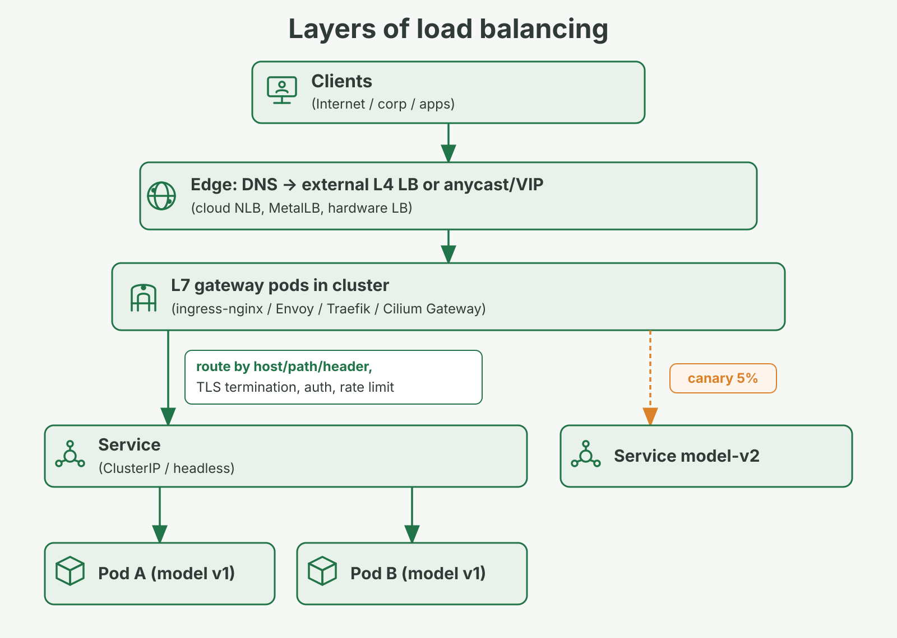
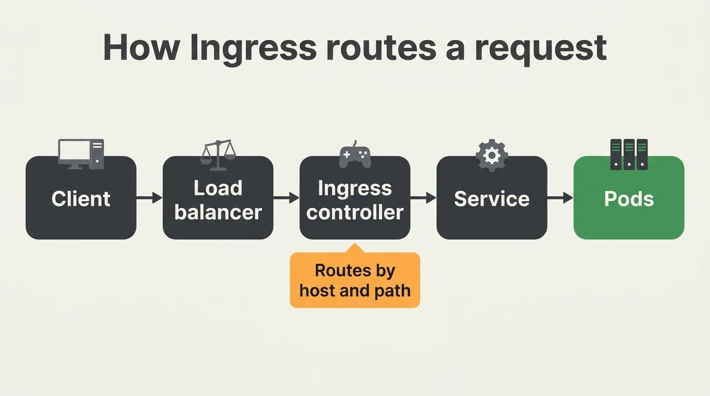

# 5.12 Ingress, load balancers and the Gateway API

| | |
|---|---|
| Level | Intermediate |
| Priority tier | 1 |
| Lab venue | Cluster with a LoadBalancer implementation (cloud or MetalLB); Helm; curl/hey/fortio |
| Part | Part 5: Kubernetes |
| Status | Drafted, labs **untested** |

## Why this matters for AI infrastructure

Suppose your team has just put a model behind an endpoint, and users report that long answers stop halfway through. The cause often sits at the edge, the point where traffic first enters the cluster. Inference endpoints, notebooks, experiment trackers, dashboards, model registries and internal tools all need a controlled entry point. That entry point handles TLS and authentication. It routes requests by hostname, path or header, for example by model name or tenant.

It also splits traffic between model versions for canary and A/B tests. Long-running answers need long timeouts and streaming. Token streaming can use Server-Sent Events, WebSockets or gRPC. The edge also applies rate limiting per API key and exposes metrics.

The edge is also where AI-specific problems appear. A default 60-second proxy timeout can kill a long generation. Request buffering can break token streaming. Body size limits can reject large prompts or image batches. HTTP/2 connection reuse can produce uneven load. Cache-/KV-aware routing needs go beyond what classic L7 balancers can meet. Put simply, a balancer that only counts requests cannot tell that one backend already holds the context for a prompt, and that knowledge can save a lot of recomputation.

This chapter covers the Kubernetes mechanisms, Ingress and the newer Gateway API, along with the controllers behind them. It also covers TLS automation and the operational design of an edge for inference traffic.

Think of the edge as the front door of a building. Every visitor passes it, so a small mistake there affects everyone inside. A slow lock or a wrong sign at the door is far easier to fix than a hundred confused visitors deeper in the building.

## Prerequisites and outcomes

You will need 5.10, 5.11, and the HTTP/TLS fundamentals in 2.10 and 2.20 before you start. Use the list below as a self-check once you have read the chapter. Each line names a skill you use when an endpoint misbehaves:

- Contrast L4 and L7 load balancing, and place Service types, Ingress, the Gateway API and external load balancers in the right layer.
- Write Ingress resources with hosts, paths, TLS, annotations and IngressClass, and operate popular controllers such as ingress-nginx, Traefik, HAProxy, Envoy-based controllers and cloud controllers.
- Use the Gateway API, including its roles, GatewayClass, Gateway, HTTPRoute, GRPCRoute, TLSRoute and ReferenceGrant, along with traffic splitting, header matching and filters. You will also compare it with Ingress.
- Automate TLS with cert-manager, using ACME or an internal CA, and secure the edge with mTLS, OAuth/OIDC auth, a WAF, rate limiting and control over network exposure.
- Provide bare-metal load balancing with MetalLB in L2 or BGP mode, kube-vip or Cilium LB IPAM, and understand how cloud load balancers integrate.
- Tune for LLM and streaming workloads, covering timeouts, buffering, HTTP/2, connection draining, body size and retries. You will also know when to use AI-aware gateways.
- Diagnose edge failures, including 502/503/504 errors, TLS errors and wrong routing.

## 1. Layers of load balancing

A request passes through several layers before it reaches your model. Each layer makes a different kind of decision, so knowing which layer acted tells you where to look. The diagram shows that path.



*Figure 5.12.1. Layers of load balancing, as a diagram.*

Notice that the 5% canary branch leaves the gateway for a separate Service, model-v2. Think of the edge as a building's security desk. The outer door only checks that someone is entering. The reception desk reads the name on the visitor's badge and sends them to the right office.

L4 (TCP/UDP) balancing spreads connections without looking at the protocol. Services covered in 5.10, `type: LoadBalancer`, cloud NLBs, MetalLB and IPVS all work this way. It is fast and protocol-agnostic. However, it cannot route by URL or retry a single request, and long-lived connections stick.

Here is a worked example. A client opens one connection to the stable IP and sends three chat requests over it. An L4 balancer picks a backend once, for the whole connection, so all three requests land on the same pod. An L7 gateway reads each request separately, so it can send each one to whichever backend is best. That difference is why uneven load shows up so often with HTTP/2 and gRPC.

L7 (HTTP and gRPC) balancing terminates the protocol and makes a decision for each request. It can route by host, path or header, retry, set timeouts, apply circuit breaking, rate limit, authenticate and rewrite. It can even balance individual requests over HTTP/2. Put simply, an L7 gateway is the part that reads the request, and most of the useful routing features live there.

A typical stack has three parts. An external L4 load balancer gives you one stable IP. Behind it sits an L7 gateway Deployment or DaemonSet, which forwards to Services and then to pods. Cloud L7 load balancers, such as ALB or the GCP HTTP(S) LB, can skip the node hops by routing straight to pods with NEG/IP targets. Put simply, a request in that layout makes fewer stops, and each stop removed is one less place for delay or failure to hide.

When traffic goes wrong, decide first whether the L4 layer or the L7 layer made the decision. Think of it as checking a building from the lobby upward. If the lobby door is locked, nothing upstairs matters.

## 2. Ingress

Suppose one hostname has to reach a chat model while a second hostname reaches a different service. Something must read each request's host and path, then pick the right backend. In Kubernetes, that job belongs to an Ingress.



*Figure 5.12.2. Ingress sends HTTP traffic by host and path to Services.*

An **Ingress** declares L7 routing rules, and its API group and version is `networking.k8s.io/v1`. An **Ingress controller** does the actual work. It is a separate deployment that you install. The controller watches Ingress objects and configures a proxy from them. Kubernetes ships no controller by default. `IngressClass` selects which controller handles an Ingress, through `spec.ingressClassName`. Think of an Ingress as a list of instructions pinned to a board. The board does nothing by itself. The controller is the staff member who reads the board and acts on it.

Read the example below as a whole. The annotations tune timeouts, body size and rate limits, and the `tls` block points at a Secret that cert-manager creates and renews. The first half of the manifest is routing. The annotations are tuning, and each one is specific to ingress-nginx, so another controller may not understand it.

```yaml
apiVersion: networking.k8s.io/v1
kind: Ingress
metadata:
  name: llm-api
  namespace: serving
  annotations:                                   # controller-specific behaviour (ingress-nginx examples)
    nginx.ingress.kubernetes.io/proxy-read-timeout: "600"
    nginx.ingress.kubernetes.io/proxy-send-timeout: "600"
    nginx.ingress.kubernetes.io/proxy-body-size: "64m"
    nginx.ingress.kubernetes.io/proxy-buffering: "off"          # token streaming (SSE)
    nginx.ingress.kubernetes.io/limit-rps: "20"
    cert-manager.io/cluster-issuer: letsencrypt-prod
spec:
  ingressClassName: nginx
  tls:
    - hosts: [llm.example.com]
      secretName: llm-example-tls                # cert-manager creates and renews this Secret
  rules:
    - host: llm.example.com
      http:
        paths:
          - path: /v1/chat
            pathType: Prefix                      # Exact | Prefix | ImplementationSpecific
            backend:
              service: { name: vllm, port: { number: 80 } }
          - path: /v1/embeddings
            pathType: Prefix
            backend:
              service: { name: embeddings, port: { name: http } }
```

Walk through the two `paths` entries. A request for `llm.example.com/v1/chat/completions` matches the first prefix, so it goes to `vllm`. A request for `llm.example.com/v1/embeddings` matches the second, so it goes to `embeddings`.

Ingress itself covers virtual hosting by `Host`, path routing with `Exact` and `Prefix` matches, and TLS termination through Secrets that hold `tls.crt` and `tls.key`. It also has a default backend. Everything else, such as rewrites, redirects, auth, rate limits, timeouts, canary, CORS and WAF, is a controller-specific annotation. Annotations are not portable and carry no types. Put simply, an annotation is a string that the controller may or may not read. A typo in one fails quietly, and nothing tells you that the timeout you wrote never took effect. That is the main reason the Gateway API exists. The Ingress API is frozen, so it gets no new features.

Four operational details of Ingress routing matter in practice. *Kubernetes: Up and Running*, Chapter 8, and *Networking and Kubernetes*, Chapters 5 & 6, both describe them.

The first detail is that paths reach the backend unmodified by default. Suppose a client requests `bandicoot.example.com/a/` and that matches the Ingress path rule `path: /a`. The proxy forwards the request with the `/a/` path intact, as `GET /a/ HTTP/1.1`. If the backend expects requests at `/` instead of `/a/`, it returns `404 Not Found`. The fix is path rewriting, set with an Ingress controller annotation such as `nginx.ingress.kubernetes.io/rewrite-target` or a Gateway API `URLRewrite` filter. Put simply, the proxy passes the address on as written, so the backend has to recognize that address or the proxy has to change it first.

The second detail is precedence between path rules. Suppose an Ingress or `HTTPRoute` has a `Prefix` rule for `/v1` and an `Exact` rule for `/v1/health`, and both match a request. The `Exact` match always wins. Among `Prefix` rules, the longest matching prefix wins, as the model in `evaluate_httproute_and_reference_grant()` in `code/part05/gateway_llm_router.py` shows. Put simply, the most specific rule wins. An exact path is the most specific match, and the longest prefix comes next.

The third detail concerns defaults. Marking an `IngressClass` with `ingressclass.kubernetes.io/is-default-class: "true"` makes it handle any Ingress that omits `spec.ingressClassName`. Setting `spec.defaultBackend` handles requests that match no `rules` host or path. Put simply, the default class is the fallback when an Ingress does not name its controller, and the default backend is the fallback when no rule matches.

The fourth detail is cloud container-native load balancing. On GKE, Network Endpoint Groups, or NEGs, let the cloud load balancer watch Pod IPs directly. On AWS EKS, the AWS Load Balancer Controller does the same when you set `alb.ingress.kubernetes.io/target-type: ip`. Traffic then runs from the cloud edge straight to Pod IPs, skipping `NodePort` and `kube-proxy` hops. Put simply, the cloud load balancer keeps a list of pod addresses and sends traffic to them directly, with no node in between. The cloud load balancer also integrates with Google Cloud Armor, Cloud CDN and IAP, or with AWS WAF.

### The case for Ingress

Services already route traffic to pods, so why add another mechanism? Services have two important limits. The first is routing. A Service routes by destination IP and port. That is enough for a small application, but it breaks down for a large set of microservices that need smarter rules. The second is cost. In a cloud, each `LoadBalancer` Service creates its own external load balancer, such as an ELB on AWS. Running one per Service gets expensive fast.

Ingress solves both limits. Think of the two limits as two separate complaints. One is that the Service cannot read the request. The other is that every Service costs a new external balancer. It works at layer 7, the application layer, instead of layer 3 and 4. It can read the HTTP `Host` header and route on it. One entry point can then serve many applications, and the Ingress controller sorts the traffic to the right place. That also cuts the cost of bringing traffic into the platform. In a non-cloud setup, you can run one external load balancer in front of the Ingress controllers, instead of managing many NodePort Services. Think of it as one reception desk for a building with many offices, instead of one front door for each office.

Ingress does not replace Services. Put simply, Ingress is the reception desk, and a Service is still the room behind it. The Ingress controller runs inside the cluster, so clients outside it still need a NodePort or LoadBalancer Service to reach it. Ingress controllers are also strongest with HTTP. Other protocols may need a Service alongside Ingress, depending on what your controller supports. Many off-the-shelf applications and cluster add-ons expect an Ingress controller to be running. Your developers will need one as well.

### Host-based routing with Ingress

Host-based routing is the simplest useful Ingress pattern. The next configuration sends requests with the `Host` header set to `bookhotels.com` to one service. Requests for `bookflights.com` go to another. Read the two manifests side by side. Each one names a host, and the proxy checks the Host header to choose between them. Each Ingress is a separate object, so each one can change on its own.

```
---
apiVersion: networking.k8s.io/v1
kind: Ingress
metadata:
  name: hotels-ingress
spec:
  rules:
  - host: bookhotels.com
    http:
      paths:
      - path: /
        backend:
          serviceName: hotels
          servicePort: 80
---
apiVersion: networking.k8s.io/v1
kind: Ingress
metadata:
  name: flights-ingress
spec:
  rules:
  - host: bookflights.com
    http:
      paths:
      - path: /
        backend:
          serviceName: flights
          servicePort: 80
```

This listing keeps the older field names from *Kubernetes: Up and Running*, `serviceName` and `servicePort`. Check the current Ingress reference before you copy it into a cluster.

A common follow-on is subdomain-based routing. You assign one domain name to the platform, and each application gets a subdomain. A travel platform could use `hotels.cluster1.useast.example.com` and `flights.cluster1.useast.example.com`. The same idea supports SaaS tenants, with names such as `tenantA.example.com` and `tenantB.example.com`. Subdomain-based routing is one of the best strategies available here. Think of subdomains as street addresses within one city. The city name stays the same, and each business gets its own street number.

### Why Ingress has no default controller

Ingress works differently from most Kubernetes objects. A useful picture is a restaurant order slip. The slip describes what the customer wants, and the kitchen is the controller that does the cooking. The object is only a specification, and a separate controller implements it. You can create and change Ingress objects like any other object. By default, though, no code acts on them. So you or your distribution must install and manage a controller. That split is what makes the controller pluggable. A useful test is to ask who acts when an object changes. If no controller is listening, the object sits there unchanged.

Kubernetes leaves the choice open because no single HTTP load balancer suits every setup. Teams run open source proxies, cloud load balancers such as ELB on AWS, and hardware appliances. The Ingress object also arrived before Kubernetes had its common extension features, which are covered in Chapter 17. It will likely change to use them over time.

### Installing Contour

The examples in this chapter use Contour. It configures Envoy, an open source CNCF load balancer that you can change on the fly through an API. Contour translates Ingress objects into a form Envoy understands. Contour is a good teaching choice because its pieces are easy to see: a controller that reads the objects, and an Envoy proxy that carries the traffic. The project began at Heptio with real customers and runs in production today. It is now an independent open source project.

You can install Contour with one line:

```
$ kubectl apply -f https://projectcontour.io/quickstart/contour.yaml
```

Run the install as a user with `cluster-admin` permissions. Put simply, that role can change anything in the cluster, so treat the install like any other cluster-wide change. The single line works for most configurations. It creates a namespace called `projectcontour` and a Deployment with two replicas. It also creates an external-facing Service of `type: LoadBalancer`, sets up permissions through a service account, and installs a CustomResourceDefinition for the extra features covered in "Where Ingress is heading" below.

Because the install is global, it needs wide admin rights on the cluster. When it finishes, look up the external address of Contour:

```
$ kubectl get -n projectcontour service envoy -o wide
NAME CLUSTER-IP EXTERNAL-IP PORT(S) ...
contour 10.106.53.14 a477...amazonaws.com 80:30274/TCP ...
```

Look at the `EXTERNAL-IP` column. On GCP and Azure it holds an IP address, and on AWS it holds a hostname. Other clouds may differ. Think of the EXTERNAL-IP as the address printed on the building's front door. Every route you define later starts from that address. If your cluster does not support `type: LoadBalancer`, change the Contour YAML to use `type: NodePort`, and send traffic to the cluster machines another way. Put simply, `NodePort` makes the cluster machines the entry point, so you need another way to reach them, such as a firewall rule or a hardware balancer.

With `minikube`, the `EXTERNAL-IP` column will probably stay empty. Open a second terminal and run `minikube tunnel`. The tunnel sets up network routes, so every Service of `type: LoadBalancer` gets its own unique IP address. Keep the tunnel running while you test, because it stops when its terminal closes.

### Pointing DNS names at the controller

People reach sites by name, not by IP address, and many hostnames can share one external endpoint. Put simply, one IP address can serve many names, and the name in each request decides where that request goes. The Ingress controller then uses the hostname to send each request to the right upstream service.

The examples assume a domain called `example.com`. Why the record type matters: an A record must hold an IP address, while a CNAME points to another name. If the load balancer gives you a hostname, an A record has nothing to hold, so a CNAME is the correct choice. You need two DNS entries, `alpaca.example.com` and `bandicoot.example.com`. If the external load balancer gives you an IP address, create A records. If it gives you a hostname instead, create CNAME records.

Think of DNS as the sign on the street, and the Ingress controller as the doorman who reads the name on each visitor's card. ExternalDNS can manage these records for you. It is a cluster add-on that keeps the IP addresses of Kubernetes Service resources in sync with an external DNS provider. It works with traditional domain registrars as well as public cloud providers.

### Testing with a local hosts file

If you have no domain, or you use a local tool such as `minikube`, you can point the names at the controller in your hosts file. Editing that file needs admin or root rights. Its location differs by platform, and the change may need extra steps to take effect. On Windows the file is usually at `C:\Windows\System32\drivers\etc\hosts`. On recent versions of macOS, run `sudo killall -HUP mDNSResponder` after you change it. Think of the hosts file as a personal address book that your laptop checks before it asks the internet. An entry you add wins over the public DNS answer for that name, which makes it useful for testing and easy to forget.

Add a line like this one, with the external IP address of Contour:

```
<ip-address> alpaca.example.com bandicoot.example.com
```

If all you have is a hostname, as on AWS, run `host -t a <address>` to get an IP address. That address may change later, so remove the line when you are done. Put simply, the IP that `host` returns is a snapshot. If the cloud changes the address, your hosts file goes stale.

### Creating three sample services

Before you route anything, you need upstream services to send traffic to. Think of these three Deployments as three shops in one mall. Each shop has its own sign, and the Ingress is the mall directory that sends visitors to the right shop. These are the backends. The next commands create three Deployments of the same `kuard` app. Each one runs three replicas on port 8080. The images differ only by tag: `blue`, `green` and `purple`. Each Deployment also gets a Service.

```
$ kubectl create deployment be-default \
--image=gcr.io/kuar-demo/kuard-amd64:blue \
--replicas=3 \
--port=8080
$ kubectl expose deployment be-default
$ kubectl create deployment alpaca \
--image=gcr.io/kuar-demo/kuard-amd64:green \
--replicas=3 \
--port=8080
$ kubectl expose deployment alpaca
$ kubectl create deployment bandicoot \
--image=gcr.io/kuar-demo/kuard-amd64:purple \
--replicas=3 \
--port=8080
$ kubectl expose deployment bandicoot
$ kubectl get services -o wide
NAME CLUSTER-IP ... PORT(S) ... SELECTOR
alpaca 10.115.245.13 ... 8080/TCP ... run=alpaca
bandicoot 10.115.242.3 ... 8080/TCP ... run=bandicoot
be-default 10.115.246.6 ... 8080/TCP ... run=be-default
kubernetes 10.115.240.1 ... 443/TCP ... <none>
```

### Simplest Ingress: send everything to one service

The simplest use of Ingress is to pass everything it sees to one upstream service. Put simply, this is the catch-all rule. Every request that reaches the controller gets the same answer, which makes it useful for a quick test. `kubectl` has only limited commands for Ingress, so you start with a YAML file.

The `simple-ingress.yaml` manifest:

```
apiVersion: networking.k8s.io/v1
kind: Ingress
metadata:
name: simple-ingress
spec:
defaultBackend:
service:
name: alpaca
port:
number: 8080
```

Create it with `kubectl apply`:

```
$ kubectl apply -f simple-ingress.yaml
ingress.extensions/simple-ingress created
```

Check the result with `kubectl get` and `kubectl describe`:

```
$ kubectl get ingress
NAME HOSTS ADDRESS PORTS AGE
simple-ingress * 80 13m
$ kubectl describe ingress simple-ingress
Name: simple-ingress
Namespace: default
Address:
Default backend: alpaca:8080
(172.17.0.6:8080,172.17.0.7:8080,172.17.0.8:8080)
Rules:
Host Path Backends
---- ---- --------
* * alpaca:8080 (172.17.0.6:8080,172.17.0.7:8080,172.17.0.8:8080)
Annotations:
...
Events: <none>
```

Read the `describe` output from the top. The `Default backend` line names the service that catches everything. The `Rules` table shows a host of `*`, which means any host.

With this file, every HTTP request that reaches the controller goes to the `alpaca` service. You can reach it through any of the raw IPs or CNAMEs, which here means either `alpaca.example.com` or `bandicoot.example.com`. On its own, this adds little over a plain Service of `type: LoadBalancer`. The next sections try more complex setups.

### Routing by hostname

Ingress gets useful when it routes on something in the request. Think of the Host header as the name written on an envelope. The proxy reads that name, then decides which room gets the letter. The most common case is the HTTP `Host` header, which carries the DNS name from the original URL. The `host-ingress.yaml` manifest adds a second Ingress that sends traffic for `alpaca.example.com` to the `alpaca` service.

The `host-ingress.yaml` manifest:

```
apiVersion: networking.k8s.io/v1
kind: Ingress
metadata:
name: host-ingress
spec:
defaultBackend:
service:
name: be-default
port:
number: 8080
rules:
- host: alpaca.example.com
http:
paths:
- pathType: Prefix
path: /
backend:
service:
name: alpaca
port:
number: 8080
```

Create it with `kubectl apply`:

```
$ kubectl apply -f host-ingress.yaml
ingress.extensions/host-ingress created
```

Check that it is set up correctly:

```
$ kubectl get ingress
NAME HOSTS ADDRESS PORTS AGE
host-ingress alpaca.example.com 80 54s
simple-ingress * 80 13m
$ kubectl describe ingress host-ingress
Name: host-ingress
Namespace: default
Address:
Default backend: be-default:8080 (<none>)
Rules:
Host Path Backends
---- ---- --------
alpaca.example.com
/ alpaca:8080 (<none>)
Annotations:
...
Events: <none>
```

Two things in this output look odd. The first is the reference to `default-http-backend`. Some Ingress controllers send any request they cannot handle elsewhere to a service with that name in the `kube-system` namespace. `kubectl` simply shows you that convention. The second is that no endpoints appear for the `alpaca` backend. That is a `kubectl` bug, fixed in Kubernetes v1.14.

You should now reach the `alpaca` service at `http://alpaca.example.com`. Reach it by any other method, and you get the default service instead. Think of the default backend as the lost-and-found desk. Anything that does not match a named rule lands there.

### Routing by path

Routing on the path as well as the hostname comes next. Think of the host as choosing the building and the path as choosing the floor. You add a `path` to the `paths` entry. The `path-ingress.yaml` manifest sends everything for `bandicoot.example.com` to the `bandicoot` service, and it sends `bandicoot.example.com/a` to the `alpaca` service. You can use this to host several services on different paths of one domain.

The `path-ingress.yaml` manifest:

```
apiVersion: networking.k8s.io/v1
kind: Ingress
metadata:
name: path-ingress
spec:
rules:
- host: bandicoot.example.com
http:
paths:
- pathType: Prefix
path: "/"
backend:
service:
name: bandicoot
port:
number: 8080
- pathType: Prefix
path: "/a/"
backend:
service:
name: alpaca
port:
number: 8080
```

When several paths on the same host match, the longest prefix wins. Put simply, the longer and more specific path wins, so `/a/` beats `/`. Here, traffic that starts with `/a/` goes to the `alpaca` service. All other traffic, which starts with `/`, goes to the `bandicoot` service.

The proxy does not change the path as it forwards the request. A request to `bandicoot.example.com/a/` therefore reaches the upstream server with the same path, so the upstream service must be ready to serve that subpath. The `kuard` app has special test code for this. It answers on the root path, `/`, and on a fixed set of subpaths: `/a/`, `/b/` and `/c/`.

### Cleaning up the sample

Clean up after each lab step. Leftover Ingress objects keep claiming hosts, and a later test can then look as if it has failed.

To remove the sample objects, run:

```
$ kubectl delete ingress host-ingress path-ingress simple-ingress
$ kubectl delete service alpaca bandicoot be-default
$ kubectl delete deployment alpaca bandicoot be-default
```

### Annotations and gotchas

Ingress supports other advanced features too. Think of annotations as sticky notes attached to the Ingress object. Each note is read by one controller, and two controllers may write the same idea in different words. How well each one works depends on the controller, and two controllers may implement the same feature in slightly different ways. Many of these features are set through annotations on the Ingress object. Annotations are easy to get wrong and hard to validate, and they apply to the whole object, so they can reach further than you intended. To narrow their scope, split one Ingress object into several. The controller reads them all and merges them together.

When you create more than one Ingress object, the controllers should read them all and merge them into one config. Duplicate or conflicting settings, however, have undefined behavior. Different controllers may handle the same conflict differently. Even one controller may behave differently depending on factors that are not obvious.

### Ingress and namespaces

Ingress interacts with namespaces in a few non-obvious ways. For security reasons, an Ingress object can point only at an upstream service in its own namespace. So one Ingress object cannot send a subpath to a service in another namespace. Put simply, an Ingress can only name services that live beside it, so cross-namespace routing needs a different mechanism.

Ingress objects in different namespaces can, however, define subpaths for the same host. The controller merges them into one final config. Ingress therefore has to be coordinated across the whole cluster. Think of a shared Ingress as a shared kitchen. One careless cook can spoil the dishes of every other cook, even when each one followed a recipe. If one namespace is careless, its Ingress object can cause problems, or undefined behavior, in the others.

By default, the Ingress controller does not restrict which namespaces may claim which hostnames and paths. Advanced users may try to enforce a policy with a custom admission controller. The evolutions of Ingress covered in "The Future of Ingress" also address this problem.

### Path rewriting

Some Ingress controllers can rewrite the path while they proxy a request. You usually set this with an annotation on the Ingress object, and it applies to every request that object handles. With the NGINX Ingress controller, for example, you set `nginx.ingress.kubernetes.io/rewrite-target: /`. Rewriting lets an upstream service work on a subpath, even when the service was not built for one. Think of the rewrite as changing the address on an envelope before the courier leaves. The receiver sees the new address, and the sender's copy keeps the old one.

Several implementations go further and accept regular expressions in the path. The NGINX controller, for instance, can capture parts of the path and reuse them when it rewrites. How that works, and which regular expression variant it uses, depends on the implementation.

Rewriting is not a silver bullet, though, and it often causes bugs. Many web apps link to themselves with absolute paths. Suppose an app served on `/subpath` receives its requests on `/`, then sends a user to `/app-path`. It is unclear whether that link is internal, and if it is, it should be `/subpath/app-path`. It could also point to a different app. For that reason, avoid subpaths for complicated applications when you can. Put simply, an app that thinks it lives at the root builds every link from the root, and a subpath breaks those links.

### Serving TLS

Secure HTTPS is now the norm for websites. Ingress supports TLS, as do most Ingress controllers. First, you give Ingress a Secret that holds your certificate and private key, and the `tls-secret.yaml` manifest shows its shape. You can also create the Secret from the command line with `kubectl create secret tls <secret-name> --cert <certificate-pem-file> --key <private-key-pem-file>`.

The `tls-secret.yaml` manifest:

```
apiVersion: v1
kind: Secret
metadata:
creationTimestamp: null
name: tls-secret-name
type: kubernetes.io/tls
data:
tls.crt: <base64 encoded certificate>
tls.key: <base64 encoded private key>
```

Once the Secret exists, an Ingress object references it. Put simply, the Ingress points at the Secret by name, and the controller loads the certificate from that Secret. The Ingress lists each certificate together with the hostnames it should serve, as the `tls-ingress.yaml` manifest shows. If several Ingress objects name certificates for the same hostname, the behavior is undefined.

The `tls-ingress.yaml` manifest:

```
apiVersion: networking.k8s.io/v1
kind: Ingress
metadata:
name: tls-ingress
spec:
tls:
- hosts:
- alpaca.example.com
secretName: tls-secret-name
rules:
- host: alpaca.example.com
http:
paths:
- backend:
serviceName: alpaca
servicePort: 8080
```

Uploading and managing TLS secrets by hand is hard, and certificates can cost a lot. Let's Encrypt helps here. It is a nonprofit that runs a free, API-driven Certificate Authority, so a cluster can fetch and install certificates automatically. Setup is tricky, but it is very simple to use once it works. The missing piece is cert-manager, an open source project created by Jetstack, a UK startup, and since onboarded to the CNCF. The cert-manager.io website and GitHub repository explain how to install it. Think of cert-manager as a renewal clerk. It watches the expiry dates, asks the certificate authority for a fresh certificate before the old one runs out, and stores the result in the same Secret.

### Where Ingress is heading

Ingress is a useful abstraction for configuring L7 load balancers, but it has not grown to cover every feature users want. Put simply, the Ingress API works well for the common case, and it stops there. Each controller then stretches it in its own way. Various implementations want to offer more. Many Ingress features are underdefined, so each implementation may expose them differently. That lowers the portability of configurations between implementations.

Ingress is also easy to misconfigure. Multiple objects can combine into conflicts, and implementations resolve those conflicts differently. Merging objects across namespaces also breaks the idea of namespace isolation.

Ingress arrived before the service mesh idea, which projects such as Istio and Linkerd made well known. How Ingress and service meshes should fit together is still being worked out. Chapter 15 covers service meshes in more detail.

The future of HTTP load balancing in Kubernetes looks like the Gateway API. The Kubernetes networking special interest group, or SIG, is developing it to provide a more modern API for routing. It focuses on HTTP, but it also includes resources for Layer 4 TCP balancing. The Gateway APIs are still under development, so for now stick to the Ingress and Service resources that exist in Kubernetes today.

### Controllers

The table lists the common controllers and the proxy each one uses.

| Controller | Proxy | Notes |
|---|---|---|
| **ingress-nginx** (Kubernetes community) | NGINX | Most common; huge annotation set; snippet annotations are risky (disable `allow-snippet-annotations`); retired/limited maintenance should be checked for your timeline |
| NGINX Inc. Ingress Controller / NGINX Gateway Fabric | NGINX / NGINX Plus | Commercial option, Gateway API-based fabric |
| **Traefik** | Traefik | Dynamic config, CRDs (IngressRoute), middlewares |
| **HAProxy Ingress** | HAProxy | High performance, rich TCP features |
| **Envoy-based**: Contour, Emissary, Envoy Gateway, Istio ingress gateway, Cilium Gateway/Ingress | Envoy | xDS dynamic config, gRPC/HTTP2 first-class, good observability; foundation for Gateway API implementations and meshes |
| **Cloud**: AWS Load Balancer Controller (ALB/NLB), GKE Ingress/Gateway, AGIC (Azure) | Cloud LB | Managed, integrates with WAF/IAM; may route to pod IPs |
| **Kong, Apache APISIX, Ambassador** | Envoy/NGINX | API gateway features: plugins, auth, rate limiting, developer portals |

Read the Notes column before you pick one. It flags risky snippet annotations and maintenance status. Think of the table as a menu of kitchens. Several can serve the same dish, but each has its own recipe and its own rules about what it will cook.

You can run the controller as an autoscaled Deployment, or as a DaemonSet that uses `hostNetwork` or a NodePort with an external load balancer. Give it dedicated nodes when traffic is heavy. Put simply, a Deployment scales by adding replicas, while a DaemonSet places one copy on each chosen node. The DaemonSet fits edge nodes, because each node then has its own proxy ready to take traffic. Set resource requests, a PDB, anti-affinity, `terminationGracePeriodSeconds` and a lifecycle so the controller drains gracefully. Finally, expose metrics for Prometheus and write access logs as structured JSON to stdout.

### Multi-team Ingress collisions and Contour's `HTTPProxy` root inclusion

In a multi-tenant cluster, the standard `Ingress` API does not stop two teams in different namespaces from claiming the same `host`. The example in *Production Kubernetes* uses `app.bearcanoe.com`. Depending on the controller, overlapping rules are either merged in surprising ways or rejected, and either can cause production outages. As *Production Kubernetes*, Chapter 6, describes, platform teams solve this in one of two ways.

The first way is validating admission control. An Open Policy Agent or Gatekeeper policy, for example, checks existing `Ingress` objects across the cluster and rejects duplicate hostnames.

The second way is delegated routing with a custom resource such as Contour's `HTTPProxy`. Contour replaces flat `Ingress` objects with a root `HTTPProxy` custom resource that uses inclusion, set with `includes`. A platform administrator creates a root `HTTPProxy` in an administrative namespace. That root owns a domain, such as `app1.bearcanoe.com`, and delegates routing for that domain or path prefix by including `HTTPProxy` resources from the `app1` team's namespace. Only the root namespace can define top-level virtual hosts, so teams cannot collide with another team's hostname. Think of the root HTTPProxy as the owner of a street. The owner decides which neighbors may build on it, and a neighbor cannot paint over the owner's sign.

Contour's `HTTPProxy` also supports layer 3/4 TCP proxying through TLS Server Name Indication (`SNI`). The example below comes from *Production Kubernetes*:

```yaml
apiVersion: projectcontour.io/v1
kind: HTTPProxy
metadata:
  name: tcp-proxy
spec:
  virtualhost:
    fqdn: tcp.bearcanoe.com
    tls:
      secretName: secret
  tcpproxy:
    services:
      - name: tcp-app
        port: 8080
```

### Dedicated Ingress node pool and DaemonSet edge pattern

Kubernetes does not isolate network I/O or file descriptors with cgroups. Put simply, a busy application can slow the proxy on the same node, because Kubernetes does not reserve network capacity for each pod. So a noisy application pod can contend with Ingress proxies when both share general worker nodes. *Production Kubernetes*, Chapter 6, recommends reserving a dedicated set of edge nodes for the Ingress tier. It uses four settings together.

The first setting is node labels, taints and a `DaemonSet`. Label and taint the dedicated ingress nodes, then deploy the Ingress controller as a `DaemonSet` with a matching `nodeSelector` and taint `tolerations`. Think of a taint as a sign on the door that says only authorized guests may enter. The toleration is the ticket that lets the Ingress pods in. A small, fixed set of edge nodes also simplifies firewall exceptions and static backend pools on hardware load balancers.

The second setting is host networking with `hostNetwork: true` and `ClusterFirstWithHostNet`. Binding the Ingress proxy container directly to the node's network namespace lets incoming packets reach the proxy without traversing the Kubernetes Service `iptables`/`IPVS` fabric. Put simply, the proxy listens on the node's own address, so a packet reaches it directly. Two such pods on one node compete for the same ports. When `hostNetwork: true` is enabled, you must set `dnsPolicy: ClusterFirstWithHostNet`. That lets the proxy still resolve in-cluster `*.svc.cluster.local` Service names through CoreDNS, as in this Pod template snippet:

```yaml
spec:
  containers:
    - image: nginx
      name: nginx
  dnsPolicy: ClusterFirstWithHostNet
  hostNetwork: true
```

The third setting is `externalTrafficPolicy: Local` on the Service. Use it when the Ingress controller is exposed through a `NodePort` or `LoadBalancer` Service rather than direct host ports. External load balancers then send traffic only to nodes that run a local Ingress proxy replica. That avoids an extra cross-node hop, and the client's source IP address is preserved with no SNAT. Put simply, `Local` keeps the traffic on the node that received it, so the proxy sees the client's real address.

The fourth setting is spreading the replicas across failure domains. When you run a `Deployment`, or select nodes across zones, use Pod anti-affinity rules to spread Ingress controller replicas across availability zones or racks. Think of anti-affinity as a seating rule that keeps two members of the same team out of the same room.

If heavy traffic shares nodes with application pods, give the Ingress tier its own nodes first.

### Trade-offs of dedicated and host-network Ingress nodes

Dedicating nodes to Ingress can look wasteful at first. Put simply, the question to ask is what the shared edge costs when it fails, not what the spare nodes cost while they sit idle. The reasoning is simple, though. If you can afford dedicated control plane nodes, you can probably afford dedicated nodes for the layer that every workload's traffic passes through. The main gains are resource isolation, compliance and simpler external load balancers.

Resource isolation matters because Kubernetes resource requests and limits are hard to tune well. Platform teams new to Kubernetes often get them wrong. Kubernetes also does not isolate network I/O or file descriptors. Fair sharing of those resources is hard to guarantee on shared nodes. Compliance is the second gain. Many organizations have firewall rules that conflict with Ingress controllers. Exceptions are easier to get for a small subset of nodes than for the whole fleet. On bare metal, the Ingress tier sits behind a hardware load balancer, which often has no API and must be configured statically. A small set of ingress nodes makes that configuration easier to manage.

Host networking adds speed, but it costs isolation. Think of it as opening a side door in the building. Visitors arrive faster, and the side door is also a way in for anyone who should not be there. Binding the controller to the host network lets requests skip the Service fabric. The controller then has full access to the node's interfaces and network services. That lowers the bar for an attacker who exploits a proxy bug and tries to move sideways. Host networking is also a privileged operation, so the controller needs elevated privileges or an exception. Even so, the authors have found the trade-off worth it. Ingress traffic reaches the controller directly.

If you use dedicated ingress nodes, plan for node failures. Ingress controllers only run on the reserved nodes, so a failed node leaves the edge short-handed. Ideally, a replacement node joins and takes over the Ingress traffic.

### DNS for Ingress: a wildcard record or external-dns

Ingress routes by hostname, so DNS is a central part of the design. One common pattern is a wildcard DNS record, such as `*.bearcanoe.com`. Think of a wildcard record as a catch-all mailbox for a whole street. Any name under the street reaches the same building, and the proxy sorts the mail inside. The record resolves to the Ingress tier, which is usually a load balancer in front of the Ingress controllers. Each application then gets its own subdomain.

A wildcard record has three benefits. Applications can use any path under their subdomain, including the root path (`/`). Developers do not need to rework their apps to run on a subpath, and some apps only work at the root. The DNS setup is also simple, because Kubernetes and the DNS provider need no integration. Finally, one wildcard record avoids the propagation delays that come with adding a new record for each application.

The other approach is to integrate the platform with your DNS provider. The Kubernetes community maintains a controller for this, called external-dns. external-dns is a reconciler. It keeps the DNS records in your provider in line with the Ingress resources, creating, updating and deleting records as Ingress objects change. It needs two pieces of information. The hostname comes from the Ingress specification. The target IP address comes from the Ingress `status` field. If your DNS provider is supported, external-dns automates the work.

Integration suits platforms that need many domain names. It has trade-offs, though. You must deploy, operate, monitor, version and upgrade one more component. If external-dns does not support your provider, you would have to build and maintain your own controller. That engineering effort is usually better spent elsewhere. In that case, a single wildcard record is the simpler choice.

## 3. Gateway API

The Gateway API is the successor to Ingress. Think of it as the Ingress idea split into roles, so that each team edits only its own part. It is role-oriented, expressive, portable and extensible. It covers L4 and L7 traffic, and it also covers gateways for service meshes, which the project calls GAMMA. Its HTTP features reached GA in v1. The table lists each resource and the person who usually owns it. Put simply, the GatewayClass is the template, the Gateway is the building, and the routes are the signs that point visitors to rooms inside it.

| Resource | Owner persona | Purpose |
|---|---|---|
| **GatewayClass** | Infrastructure provider | Names a controller implementation (like StorageClass/IngressClass) |
| **Gateway** | Cluster operator | A deployed listener set: addresses, ports, protocols, TLS, allowed routes (namespaces/selectors) |
| **HTTPRoute / GRPCRoute** | App developer | Hostnames, matches (path, headers, query, method), filters (redirect, rewrite, header modification, mirror, CORS/timeouts in newer releases), backendRefs with weights |
| **TLSRoute / TCPRoute / UDPRoute** | App developer | L4 routing (experimental/standard by release) |
| **ReferenceGrant** | Namespace owner | Permit cross-namespace references (route → Service in another namespace; Gateway → Secret) |
| **BackendTLSPolicy, BackendLBPolicy, policy attachment** | Operator/developer | Backend TLS, load balancing policy, timeouts (via policy attachment pattern; evolving) |

Notice that each resource has a different owner. Put simply, the operator decides where traffic enters, and the developer decides where a request goes. Neither has to edit the other's object. The infrastructure provider names the controller, the cluster operator defines the Gateway, and the app developer writes the routes. The example below shows how these pieces fit together in a canary split and a redirect.

```yaml
apiVersion: gateway.networking.k8s.io/v1
kind: GatewayClass
metadata: { name: envoy }
spec: { controllerName: gateway.envoyproxy.io/gatewayclass-controller }
---
apiVersion: gateway.networking.k8s.io/v1
kind: Gateway
metadata: { name: public, namespace: edge }
spec:
  gatewayClassName: envoy
  listeners:
    - name: https
      protocol: HTTPS
      port: 443
      hostname: "*.ai.example.com"
      tls:
        mode: Terminate
        certificateRefs: [ { name: wildcard-ai-example-com } ]
      allowedRoutes:
        namespaces: { from: Selector, selector: { matchLabels: { gateway-access: public } } }
---
apiVersion: gateway.networking.k8s.io/v1
kind: HTTPRoute
metadata: { name: chat, namespace: serving }
spec:
  parentRefs: [ { name: public, namespace: edge, sectionName: https } ]
  hostnames: ["chat.ai.example.com"]
  rules:
    - matches:
        - path: { type: PathPrefix, value: /v1 }
          headers: [ { name: x-model, value: llama-70b } ]
      backendRefs:
        - { name: vllm-llama70b-v1, port: 80, weight: 95 }       # canary: 95/5 split
        - { name: vllm-llama70b-v2, port: 80, weight: 5 }
      timeouts: { request: 600s, backendRequest: 600s }
      filters:
        - type: RequestHeaderModifier
          requestHeaderModifier: { add: [ { name: x-served-by, value: gateway } ] }
    - matches: [ { path: { type: PathPrefix, value: /healthz } } ]
      filters:
        - type: RequestRedirect
          requestRedirect: { scheme: https, statusCode: 301 }
```

Read the HTTPRoute from the top. `parentRefs` attaches the route to the Gateway. `hostnames` limits it to one name. `matches` picks the path and the header. `backendRefs` splits the traffic, and `timeouts` and `filters` apply to the matched requests.

The Gateway sits in the `edge` namespace and accepts HTTPS for `*.ai.example.com`. The `chat` route in the `serving` namespace attaches to it. It sends `/v1` traffic 95/5 between two model versions, and it adds a header to each request. It also redirects `/healthz` to HTTPS with status 301.

Compared with Ingress, the Gateway API replaces annotations with typed fields. Put simply, a reviewer can read a field and know what it does, instead of decoding a string inside an annotation. Header matches, weights, redirects, mirroring and timeouts are all fields you can read and check. Roles are separated as well. Cluster operators own Gateways, and teams own Routes under RBAC. Cross-namespace references need a ReferenceGrant, which keeps them safe. Gateways and Routes also report status conditions, `Accepted`, `ResolvedRefs` and `Programmed`, that tell you why a route is not working. The same API runs on many implementations, including Envoy Gateway, Istio, Cilium, Contour, NGINX Gateway Fabric, Traefik, Kong, and the GKE, AWS and Azure offerings.

Migration can start with a tool such as `ingress2gateway`, which converts Ingresses. Think of migration as running two doors at once. You move traffic to the new door in steps, and you close the old door only after the new one has proven itself. Run both in parallel during migration, using different IPs or hostnames. Map annotations to filters and policies, and note the features that remain implementation-specific.

The Gateway API Inference Extension adds concepts for LLM serving. An InferencePool groups a set of model-server pods, and InferenceModel and Objective objects describe the models. An endpoint picker routes requests by reading model-server metrics, such as queue depth, KV-cache utilisation, active LoRA adapters and prefix cache, instead of round-robin. This is directly relevant to LLM serving, which Part 15 covers. The project is still evolving, so verify its maturity before you rely on it. Put simply, the endpoint picker chooses the pod with the most room for the next request, rather than the next pod in a fixed order.

Before you migrate, list the annotations your Ingresses use and map each one to a filter or policy.

## 4. TLS and cert-manager

Suppose a certificate expires on a Friday night and the site goes down. Think of cert-manager as the reminder system that prevents that night from happening. cert-manager prevents that. It automates certificate issuance and renewal through custom resources. An `Issuer` or `ClusterIssuer` says where certificates come from, such as ACME and Let's Encrypt, Vault PKI, an internal CA, Venafi, or self-signed. A `Certificate` describes the certificate you want, and cert-manager stores the result in a Secret. Think of the Certificate as an order form and the Issuer as the shop. cert-manager fills in the form, collects the goods and puts them in the Secret. An annotation on an Ingress or Gateway, like `cert-manager.io/cluster-issuer`, creates the Certificate for you.

ACME gives you two ways to prove that you control a domain. HTTP-01 needs public reachability on port 80, works per host, and cannot issue wildcards. DNS-01 needs API credentials for your DNS provider. It supports wildcards and private clusters. Put simply, HTTP-01 proves control by serving a file on port 80, while DNS-01 proves control by writing a record in the domain's DNS.

Renewal starts at about 2/3 of the lifetime by default. Think of the renewal window as an early reminder before a passport expires, so you never travel with an expired document. For 90-day certificates, that means renewal 30 days before expiry.

The example uses a DNS-01 solver with `cloudDNS`. Put simply, the solver proves control of the domain through the Google Cloud DNS API.

```yaml
apiVersion: cert-manager.io/v1
kind: ClusterIssuer
metadata: { name: letsencrypt-prod }
spec:
  acme:
    server: https://acme-v02.api.letsencrypt.org/directory
    email: platform@example.com
    privateKeySecretRef: { name: letsencrypt-prod-account }
    solvers:
      - dns01:
          cloudDNS: { project: my-dns-project, serviceAccountSecretRef: { name: clouddns-sa, key: key.json } }   # prefer workload identity
```

The solver reads a service account key from a Secret, and the comment prefers workload identity. Put simply, a key file in a Secret must be rotated and guarded. Workload identity avoids the file altogether, which is why the comment prefers it.

To operate this, monitor `certmanager_certificate_expiration_timestamp_seconds` and alert on issuance failures. Think of the expiry metric as the fuel gauge for each certificate. A gauge that nobody reads is no gauge at all. When something fails, run `kubectl describe certificate/order/challenge` to see why. Watch public CA rate limits, and secure the issuer credentials. For private and internal domains, including mTLS between services, use an internal CA such as Vault, step-ca or the cert-manager CA issuer.

Put simply, these settings protect the connection between a visitor and the edge. The certificate proves who the server is, and the TLS version and cipher choices decide how well the traffic is protected.

At the edge, accept TLS 1.2 or newer, and prefer 1.3. Use modern cipher suites, HSTS, OCSP stapling and an HTTP-to-HTTPS redirect. Keep separate certificates for each environment, rotate secrets on a schedule, and restrict who can read TLS Secrets with RBAC. Put simply, a leaked staging key should never open production, and anyone who can read a TLS Secret can copy its private key.

You can terminate at the L4 load balancer for passthrough, or at the gateway. Put simply, termination means the proxy opens the encrypted connection and reads the request. Passthrough means the proxy forwards encrypted bytes it cannot read, so the backend must hold the certificate. End-to-end encryption to pods with mTLS in a mesh is covered in 5.28. SNI routing with TLS passthrough suits backends that must keep their own certificates.

Choose HTTP-01 or DNS-01 for each domain before creating the issuer.

## 5. Bare-metal and GPU-cloud load balancers

Without a cloud provider, a `type: LoadBalancer` Service stays `<pending>` until you install a controller. Think of a bare-metal cluster as a building with no front desk. A `LoadBalancer` Service asks for a front desk, and nothing answers until you hire one, which is what MetalLB or kube-vip does.

MetalLB assigns IP addresses from pools you configure. In L2 mode, one node answers ARP or NDP for the IP. Failover takes seconds, but that single node is a bandwidth bottleneck, and all nodes must share one L2 domain. Think of it as one doorman who answers the phone for the whole building, so every call passes through that one person. If you run kube-proxy in IPVS mode, set `strictARP`. In BGP mode, the speakers peer with the ToR switches or routers and advertise /32 routes. Put simply, L2 mode is one doorman who answers for the address, while BGP mode is many doormen who each announce it to the router, so the router can share visitors among them. Traffic then spreads across nodes with ECMP, which helps at scale. BGP needs router configuration, and it fits the leaf-spine fabrics covered in 2.15 to 2.16. You configure MetalLB with the `IPAddressPool`, `L2Advertisement`, `BGPPeer` and `BGPAdvertisement` CRDs. Service annotations such as `metallb.universe.tf/address-pool` and `loadBalancerIPs` select the pool and the address.

kube-vip provides a VIP for the control plane and for Services, using ARP or BGP, and it is lightweight. Cilium LB IPAM, with its BGP Control Plane or with L2 announcements, is integrated with the CNI. It can use Maglev hashing and DSR with an eBPF datapath. Calico advertises Service and cluster IPs through BGP.

Hardware and virtual appliances fill the same role. Put simply, anycast means several machines share one address, and the network delivers each visitor to the nearest one. Examples include F5, A10, NetScaler, HAProxy with keepalived pairs, and NVIDIA or Cumulus anycast designs. Anycast also gives you one entry point across multiple sites.

Cloud providers offer a Network LB at L4 and an Application LB at L7. Use annotations to configure internal LBs, health check paths, target types (instance or IP) and idle timeouts. Idle timeouts need attention. Think of an idle timeout as a patience limit. A connection that stays quiet longer than the limit gets closed, even when a token is about to arrive. The AWS NLB default is 350 s, the ALB default is 60 s, and the GCP backend timeout default is 30 s. Raise these for streaming and LLM endpoints. Put simply, a streaming answer sends small pieces over a long time, and a short idle limit reads the pauses between pieces as a dead connection.

Raise the idle timeouts on any load balancer that fronts streaming endpoints before you send it real traffic. Put simply, find the limits in a test, so that a real user does not find them first.

## 6. Designing the edge for AI/LLM traffic

An LLM edge fails in different ways from a web edge. Think of a web request as a letter that arrives in a second. A generation is closer to a phone call that lasts several minutes, and the line stays busy the whole time. Generations run for minutes, prompts can be large, and one slow backend can hold many requests. The table covers each concern, and you can read the guidance on the same row.

| Concern | Guidance |
|---|---|
| **Timeouts** | Generation can take minutes; set gateway read/idle/request timeouts (e.g., 300-900 s) and cloud LB idle timeouts accordingly; use heartbeats/keepalive comments in SSE streams; client libraries must match |
| **Streaming** | Disable response buffering for SSE/chunked token streams (`proxy_buffering off`, Envoy default is streaming); avoid gzip on streams; HTTP/2 end-to-end if possible; watch idle connection reaping in intermediate NAT/LB |
| **Request size** | Raise body size limits for long prompts, multimodal inputs (images/audio), batch inference (`proxy-body-size`); consider presigned object store uploads for large files instead of proxying through the gateway |
| **Connection handling** | HTTP/2 multiplexing and keep-alive pin to backends; L7 per-request balancing (Envoy `least_request`, `ring_hash`/`maglev` for consistent hashing by session/user for prefix-cache locality); limit max connection age to rebalance |
| **Retries and idempotency** | Do not auto-retry non-idempotent POSTs that already started generating; configure retry budgets and timeouts; use idempotency keys |
| **Backpressure and queues** | Gateways need concurrency limits and queueing per model (max pending requests); return 429/503 with `Retry-After` rather than piling latency; surface queue depth; integrate with autoscaling signals (5.23) |
| **Rate limiting** | Per API key/tenant limits in requests and tokens per minute: gateway-level (Envoy global rate limit service, Kong/APISIX plugins, NGINX `limit_req`), or an LLM gateway (LiteLLM, Portkey, Kong AI Gateway, custom) for token accounting |
| **Authentication** | OIDC (oauth2-proxy, Envoy ext_authz), API keys/JWT validation at the gateway, mTLS for service clients; propagate identity headers; never expose model-serving ports directly |
| **Routing by model/version** | Host/path/header matches; weights for canary (5% → 25% → 100%) with metrics gates (Argo Rollouts/Flagger integrate with Gateway API) (4.26) |
| **Cache-/load-aware routing** | Use endpoint-picker approaches (Gateway API Inference Extension, vLLM production-stack router, llm-d) that use KV-cache and queue metrics, prefix-cache hit probability, LoRA locality — beats round-robin for LLMs (Part 15) |
| **Observability** | Access logs with request id, model, tenant, status, latency, upstream time, tokens; RED metrics per route; distributed tracing (W3C `traceparent`); correlate with model-server metrics |
| **Security** | WAF/rate limiting, request validation (schema), max prompt size, prompt-injection filtering is application-level; isolate public and internal gateways; network policies from gateway namespace to backends only; TLS everywhere |
| **Availability** | ≥3 gateway replicas across zones, PDB, anti-affinity, HPA on connections/CPU, graceful shutdown (drain connections, `lameduck`), multiple LB IPs, DNS failover, health checks that reflect model readiness |
| **Cost/egress** | Keep gateways in the same zone/region as model servers; avoid hairpinning through the Internet; compress responses where not streaming |

Start with timeouts and streaming, because the first rows decide whether a long answer reaches your users at all. Put simply, read the table as a checklist. Each row is a question you can answer with a setting or a diagram. The rows after them handle load, security and cost.

### Example: nginx-ingress tuned for streaming inference (annotations)

The first example applies the streaming settings to ingress-nginx.

```yaml
metadata:
  annotations:
    nginx.ingress.kubernetes.io/proxy-connect-timeout: "10"
    nginx.ingress.kubernetes.io/proxy-read-timeout: "900"
    nginx.ingress.kubernetes.io/proxy-send-timeout: "900"
    nginx.ingress.kubernetes.io/proxy-buffering: "off"
    nginx.ingress.kubernetes.io/proxy-request-buffering: "off"
    nginx.ingress.kubernetes.io/proxy-body-size: "100m"
    nginx.ingress.kubernetes.io/backend-protocol: "HTTP"
    nginx.ingress.kubernetes.io/upstream-hash-by: "$http_x_session_id"      # consistent hashing for prefix-cache locality
    nginx.ingress.kubernetes.io/limit-connections: "50"
```

### Example: Envoy Gateway policies (Gateway API attachments)

The second example applies the same ideas as a Gateway API policy in Envoy Gateway. Put simply, the policy attaches to the route by name, and the route carries the rules with it.

```yaml
apiVersion: gateway.envoyproxy.io/v1alpha1
kind: BackendTrafficPolicy
metadata: { name: llm-policy, namespace: serving }
spec:
  targetRefs: [ { group: gateway.networking.k8s.io, kind: HTTPRoute, name: chat } ]
  loadBalancer: { type: LeastRequest }
  timeout: { http: { requestTimeout: 900s } }
  retry: { numRetries: 0 }                      # no blind retries of generation requests
  circuitBreaker: { maxPendingRequests: 200, maxParallelRequests: 400 }
```

Resource kinds and fields vary by implementation and version. This example illustrates the attachment pattern. Put simply, both examples aim at the same goal, a long timeout with no blind retries and a limit on how many requests can queue. Only the syntax differs, so the same review questions apply to either one.

Set the timeouts and body size on the edge before you tune anything else.

## 7. Operating and debugging

When an on-call page says users see errors, start with the status code. Think of a request as a parcel on a route with several stops. The status code tells you which stop reported the problem. Each code points at a different layer of the request path. A request travels from DNS to an LB IP, through a node or load balancer, into a gateway pod, then to a Service and its endpoints, and finally to an app pod.

The table maps each status to its likely meaning and to the first thing you should check. Read the status code as a pointer to a layer, not as a diagnosis. A 502 says the backend answered badly, and it says nothing yet about why.

| Status | Meaning | Check |
|---|---|---|
| **404 from the gateway** | No matching host/path/route; default backend | Ingress/HTTPRoute `Accepted`/`ResolvedRefs`, hostname/Host header, path type, IngressClass, namespace allowed by Gateway |
| **502 Bad Gateway** | Backend reset connection / protocol mismatch / bad upstream TLS | Backend pod logs, `backend-protocol`, port, HTTP/1.1 vs HTTP/2, upstream TLS settings, pod crash during rollout |
| **503 Service Unavailable** | No healthy endpoints / overloaded / circuit breaker | EndpointSlices, readiness, outlier detection, `maxPendingRequests` |
| **504 Gateway Timeout** | Upstream took longer than timeout | Raise timeouts, check model latency/queue, LB idle timeouts, retries |
| **413 Request Entity Too Large** | Body limit | Raise size, use presigned uploads |
| **TLS handshake errors** | SNI mismatch, expired/missing cert, wrong secret namespace | `openssl s_client -connect ip:443 -servername host`, cert-manager status, Secret exists in right namespace (Ingress) / ReferenceGrant (Gateway) |
| **429** | Rate limit | Policy, client behaviour, `Retry-After` |
| **Connection resets mid-stream** | Idle/maximum duration timeouts, buffer limits, pod termination | LB idle timeout, `proxy_read_timeout`, SSE heartbeats, rolling update drain |
| **Wrong client IP** | SNAT / `externalTrafficPolicy: Cluster` / proxy protocol missing | `Local` policy, PROXY protocol, `X-Forwarded-For` handling and trusted proxies |
| **Uneven load** | HTTP/2 connection pinning, L4 balancing, sticky hash | Per-request L7 balancing, max connection age |

The commands below let you check each layer in turn, from the Ingress and Gateway objects down to the logs and the TLS certificate. Run them in the order they appear. The first ones show the objects you declared, and the later ones show what the controller built from them.

```bash
kubectl get ingressclass,ingress -A
kubectl describe ingress llm-api -n serving                     # events, backends, TLS
kubectl get gatewayclass,gateway,httproute -A
kubectl describe gateway public -n edge | sed -n '/Conditions/,$p'
kubectl describe httproute chat -n serving | sed -n '/Status/,$p'
kubectl -n ingress-nginx logs deploy/ingress-nginx-controller --tail=100
kubectl -n ingress-nginx exec deploy/ingress-nginx-controller -- cat /etc/nginx/nginx.conf | grep -A5 "server_name llm.example.com"
curl -vk --resolve llm.example.com:443:<LB-IP> https://llm.example.com/v1/models
curl -N -H 'Accept: text/event-stream' https://llm.example.com/v1/chat   # check streaming with -N (no buffering)
openssl s_client -connect <LB-IP>:443 -servername llm.example.com </dev/null | openssl x509 -noout -dates -subject -issuer
kubectl get certificate,certificaterequest,order,challenge -A
```

Run the commands from the top when you are unsure. Each one narrows the search, and the last ones confirm the certificate.

For a 504, check the timeouts and the model's latency before you change anything else. Put simply, a 504 means the gateway waited and gave up, so the question is how long the slow part takes, not whether the route exists.

## 8. Lab

Start with the self-checking Python lab. You can run it locally before you touch a cluster. Think of the lab script as a dry run of the routing logic. It shows whether the rules agree with each other before any cluster sees them. It checks the Gateway API `HTTPRoute` matcher, `evaluate_httproute_and_reference_grant`, covering `Exact` versus `PathPrefix` precedence, `x-model` header matching and cross-namespace `ReferenceGrant` enforcement. It also checks the LLM streaming gateway validator, `validate_llm_streaming_gateway_config`, and the KV-cache and queue-aware `InferencePool` endpoint picker, `pick_llm_inference_endpoint`.

```bash
python3 code/part05/gateway_llm_router_lab.py
```

Think of these steps as a ladder. Each rung uses the setup from the rung below it, so skipping ahead leaves gaps.

Next, move to a cluster that has a LoadBalancer implementation and Helm. The shell steps below were not run on live hardware. You work through these exercises in order.

1. Install ingress-nginx and MetalLB, or a cloud LB. Deploy two echo services and create an Ingress with host and path rules. Test it with `curl --resolve`, observe the generated nginx config, and add TLS first with a self-signed cert, then with cert-manager and an internal CA.
2. Deploy a mock SSE server that emits a token every 200 ms for 5 minutes. Observe the buffering effects with the defaults, then set timeouts and `proxy-buffering: off`. Verify with `curl -N`, test through a cloud or LB idle timeout, for example 60 s, and add keepalive comments.
3. Install Envoy Gateway, or Cilium or Istio, along with the Gateway API CRDs. Create a GatewayClass, a Gateway and an HTTPRoute. Set a weight-based canary of 90/10 between two Services, and add header-based routing. Then read the status conditions after you introduce mistakes, such as a missing ReferenceGrant or a wrong parentRef.
4. Convert the Ingress from step 1 with `ingress2gateway`, and compare the two. Run both, and document the unsupported annotations and their equivalents.
5. Send gRPC echo traffic over a single client connection through a Service, then through ingress-nginx, then through Envoy with `LeastRequest`. Graph the per-backend counts. Add `maglev` or `ring_hash` keyed by a header, and observe the stickiness and its effect on prefix-cache hit rate. Simulate the cache with an LRU cache in the backend.
6. Add per-key rate limiting with the Envoy rate limit service or NGINX, and add OIDC through oauth2-proxy or JWT validation. Test the 401, 403 and 429 behaviour, and check the logs.
7. Issue a certificate with ACME DNS-01 against the staging CA, or against an internal CA. Force a renewal. Then simulate a failure by revoking the DNS credentials, and use `describe` to read the error. Finally, add expiry alerts.
8. Configure MetalLB in L2 mode, and find the announcing node with `kubectl get events` and `arping`. Kill that node and measure the failover. Switch to BGP with FRR, observe ECMP across nodes, and test `externalTrafficPolicy: Local` health checks.
9. Drain a gateway node, and roll the gateway Deployment both with and without graceful drain. Count the dropped requests. Scale backend pods to 0 to produce 503s, set a tiny body limit to produce 413s, and shorten the timeouts to produce 504s.
10. This step is optional. Deploy two mock or real vLLM replicas, plus a router or endpoint picker, such as the vLLM router or the Gateway API Inference Extension if it is available. Compare tail latency with round-robin under a skewed workload.
11. Turn on JSON access logs and Prometheus metrics, and build a dashboard of request rate, errors and duration by route. Add tracing headers, then view a trace through the gateway and the backend.
12. Clean up.

## 9. Common mistakes

Most edge incidents come back to a few habits, and most of them are cheap to avoid. The first one is a default that was never chosen on purpose.

Default proxy timeouts of 60 s and default buffering kill long generations and token streams. Put simply, a default timeout was set for web pages, and a model's answer can run far longer than a web page ever does. Relying on controller-specific annotations is another trap. An annotation can silently do nothing under another controller or version, and nothing validates it. Enabling snippet annotations for untrusted tenants is a related risk.

Exposing model server ports through a NodePort or an LB, without auth and rate limiting, leaves the model open. Put simply, the model server should sit behind the gateway, and the gateway should be the only way in. Using `externalTrafficPolicy: Cluster` means you may later wonder where client IPs went. Setting `Local` with too few pods creates its own gaps.

Running one gateway replica, or running without a PDB, leaves you no graceful drain. Put simply, a single replica means any restart is a full outage for the edge. DNS TTLs that are too long also slow failover. Not allowing the gateway namespace in NetworkPolicies, or not restricting backends to gateway-only ingress, is another gap.

Ignoring certificate expiry monitoring is risky. Put simply, an expired certificate fails the whole site at once, and the alert is the only early warning you get. So are ACME rate limits, and HTTP-01 challenges behind a firewall. Assuming L7 gateways balance HTTP/2 evenly without configuration is a mistake. Round-robin is also a poor fit for LLM traffic when load- and cache-aware routing matters. Put simply, round-robin sends the next request to the next pod in line, even when that pod is busy with a long prompt. Round-robin is also a poor fit for LLM traffic when load- and cache-aware routing matters.

Retrying non-idempotent generation requests is dangerous. Running Ingress and Gateway controllers that both claim the same class or hosts causes conflicts.

Check your edge against this list before the next rollout.

## 10. Interview angles

Interviewers want the reasoning behind each answer, not a list of names. Answer by following the request through the layers.

- Explain the difference between a Service of type LoadBalancer, an Ingress and the Gateway API.
- Why was the Gateway API created, and what do GatewayClass, Gateway, HTTPRoute and ReferenceGrant each do?
- How would you expose an LLM inference endpoint securely and reliably? Which timeouts and buffering settings matter most?
- How do you run canary releases for a model version at the gateway?
- How does cert-manager work, and when do you pick HTTP-01 over DNS-01?
- How do you provide LoadBalancer Services on bare metal? Mention MetalLB's L2 and BGP modes.
- A client gets a 504 after 60 seconds on a long generation. Where do you look?
- Why might round-robin load balancing be a poor choice for LLM serving?

## Exercises

Each exercise is a question about the edge of the cluster. Answer in the order the question asks, and check your answer against the helper functions where a function is named. The helper functions live in `code/part05/gateway_llm_router.py`.

1. Contrast L4 load balancing through `Service type: LoadBalancer` with L7 load balancing through Ingress and Gateway API. Why does a request for `bandicoot.example.com/a/` reach the backend as `/a/`? What would change that? Kubernetes: Up and Running, Chapter 8, describes the case.
2. Two teams claim the same hostname on one Ingress controller. How does Contour `HTTPProxy` root inclusion stop the collision? Production Kubernetes, Chapter 6, explains the pattern.
3. Isolate an Ingress controller on dedicated edge nodes. What does `hostNetwork: true` contribute? What does `dnsPolicy: ClusterFirstWithHostNet` contribute? What does `externalTrafficPolicy: Local` contribute?
4. Run `evaluate_httproute_and_reference_grant()`. Match each Gateway API role to its owner: the infrastructure provider, the cluster operator or the application developer. Why does a cross-namespace backend reference fail with `RefNotPermitted`? Explain what changes once a `ReferenceGrant` exists.
5. Write an `HTTPRoute` that matches the header `x-model: llama-70b`. Send 95 percent of traffic to one backend. Send the other 5 percent to a canary.
6. Compare ACME HTTP-01 and DNS-01 challenges for a wildcard certificate. Then compare them for a private cluster. When does cert-manager renew? The answer is at two thirds of the certificate lifetime.
7. Compare MetalLB in Layer 2 mode with MetalLB in BGP mode. How does GKE container-native load balancing reach pods directly? How does AWS ALB IP target mode do the same? Networking and Kubernetes, Chapter 6, covers the cloud side.
8. Run `validate_llm_streaming_gateway_config()`. Why does a 60-second idle timeout return a 504? Why does proxy buffering stall streamed tokens? Why does a 1 MB body limit return a 413? Last, why do automatic POST retries multiply GPU load?
9. Run `pick_llm_inference_endpoint()` for an `InferencePool`. Why does round-robin do poorly for long prompts? How do KV-prefix-cache and queue-depth routing do better? Finish by naming the first command you would run for each status code in the section 7 table.

## Checkpoint questions (20)

<details>
<summary>1. Compare `Service type: LoadBalancer`, `Ingress`, and the `Gateway API`: what layer does each operate at, and how many external IP addresses do 20 HTTP microservices need under each?</summary>

- `Service type: LoadBalancer` works at Layer 4, for TCP and UDP. It provisions a dedicated external load balancer for each Service. Exposing 20 microservices that way creates 20 separate cloud load balancers and 20 billable public IPs, and it offers no URL path or header routing.
- `Ingress` works at Layer 7, for HTTP and HTTPS. One shared reverse proxy, such as `ingress-nginx`, Envoy or ALB, sits behind a single external IP. It routes to all 20 internal `ClusterIP` Services by `Host` header and URL path. Advanced features depend on controller annotations, which are not portable.
- The `Gateway API` works at Layer 4 and Layer 7, covering HTTP, gRPC, TLS, TCP and UDP. It is a role-oriented, strongly typed successor to `Ingress`, built from `GatewayClass`, `Gateway`, `HTTPRoute`, `GRPCRoute` and `ReferenceGrant`. It can share one or more managed Gateway listeners across teams without untyped annotations.
</details>

<details>
<summary>2. In *Kubernetes: Up and Running* Chapter 8, what happens if you create an `Ingress` object in a cluster that has no Ingress controller installed?</summary>

Nothing happens. A `Deployment` or `ReplicaSet` has its controller built into `kube-controller-manager`, but Kubernetes does not include a built-in Ingress controller. `kube-apiserver` stores the `Ingress` YAML in `etcd`, and `kubectl get ingress` shows an empty `ADDRESS` column forever. No traffic is routed until you install an Ingress controller that matches `spec.ingressClassName`, such as `ingress-nginx`, Contour, Cilium, Traefik or a cloud controller.
</details>

<details>
<summary>3. In Kubernetes: Up and Running, Chapter 8, if an Ingress rule matches `host: bandicoot.example.com` and `path: /a` (`pathType: Prefix`) and forwards to Service `bandicoot:8080`, what URL path does the `bandicoot` container receive?</summary>

By default, Ingress does not strip or rewrite the matched path prefix. A client request for `http://bandicoot.example.com/a/status` reaches the `bandicoot` container as `GET /a/status HTTP/1.1`. If the application listens at `/status` instead of `/a/status`, it returns `404 Not Found`. Path rewriting fixes that, through an annotation such as `nginx.ingress.kubernetes.io/rewrite-target` or a Gateway API `URLRewrite` `ReplacePrefixMatch` filter.
</details>

<details>
<summary>4. In Networking and Kubernetes, Chapter 5, if an `Ingress` or `HTTPRoute` contains both a `Prefix` rule for `/v1` and an `Exact` rule for `/v1/models`, which rule wins for a request to `/v1/models`?</summary>

The `Exact` rule always takes precedence over `Prefix` rules, whatever order the rules appear in the YAML file. When several `Prefix` rules match, such as `/v1` and `/v1/chat`, the longest matching prefix wins. In that case, `/v1/chat` wins.
</details>

<details>
<summary>5. In *Production Kubernetes* Chapter 6, what is the \"Multi-Team Hostname Collision\" problem with standard `Ingress`, and how do Contour's `HTTPProxy` and the Gateway API solve it?</summary>

With standard `Ingress`, any developer who can create an `Ingress` in their own namespace, such as `team-b`, can declare `host: chat.ai.example.com`. They can do that accidentally or maliciously, and it hijacks or corrupts production routes that `team-a` owns.
- Contour's `HTTPProxy` handles this with root `HTTPProxy` inclusion, set through `includes`. Only a locked-down admin namespace can define top-level virtual hosts, such as `fqdn: chat.ai.example.com`. That namespace delegates path prefixes, such as `/v1/embeddings`, to child `HTTPProxy` objects in `team-b`'s namespace. Production Kubernetes, Chapter 6, describes this pattern.
- The Gateway API separates the `Gateway`, owned by cluster operators in the `edge` namespace, from the `HTTPRoute`s owned by application teams. The `Gateway` defines the allowed `hostname: "*.ai.example.com"` and the `allowedRoutes` namespace selector.
</details>

<details>
<summary>6. Why does Production Kubernetes, Chapter 6, recommend running high-throughput Ingress/Gateway proxies on dedicated edge nodes with `hostNetwork: true` and `dnsPolicy: ClusterFirstWithHostNet`?</summary>

It recommends three settings that you use together.
1. Dedicated edge nodes, labeled and tainted, run the proxy as a `DaemonSet`. This isolates proxy CPU, NIC bandwidth, file descriptors and `conntrack` tables from noisy application and training pods. It also gives external hardware load balancers or BGP routers a small, fixed set of edge node IPs.
2. `hostNetwork: true` binds the proxy directly to host ports `80` and `443` in the root network namespace. That bypasses the `NodePort` `iptables`/`IPVS` DNAT overhead and preserves client source IPs.
3. `dnsPolicy: ClusterFirstWithHostNet` is needed because `hostNetwork: true` otherwise makes Kubernetes default to the host's external `/etc/resolv.conf`. That breaks resolution of in-cluster `*.svc.cluster.local` backend names. This policy restores CoreDNS resolution for the host-networked proxy.
</details>

<details>
<summary>7. What are the four core resource kinds in the Gateway API (`gateway.networking.k8s.io/v1`) and which persona manages each?</summary>

1. `GatewayClass`, owned by the infrastructure provider, defines the controller implementation class. Examples include `gateway.envoyproxy.io/gatewayclass-controller`, `io.cilium/gateway-controller` and `gke-l7-global-external-managed`.
2. `Gateway`, owned by the cluster or platform operator, declares the load-balancing entry point. It holds listeners, ports such as `443`, protocols such as `HTTPS`, TLS certificates, and the namespaces allowed to attach routes through `allowedRoutes`.
3. `HTTPRoute`, `GRPCRoute` and `TLSRoute`, owned by application or ML developers, attach to a parent `Gateway` through `parentRefs`. They define hostnames, path and header matches, filters, timeouts and weighted `backendRefs`.
4. `ReferenceGrant`, owned by the target namespace owner, explicitly authorizes cross-namespace references. For example, it can allow an `HTTPRoute` in `edge` to route to a `Service` in `serving`, or a `Gateway` in `edge` to read a TLS `Secret` in `security`.
</details>

<details>
<summary>8. If an `HTTPRoute` in namespace `serving` tries to attach to a `Gateway` in namespace `edge` (or reference a `Service` in namespace `ops`) and traffic is not flowing, what `status` conditions on the `HTTPRoute` tell you why?</summary>

Run `kubectl describe httproute <name> -n serving` and inspect `status.parents[].conditions`. Two conditions can explain the problem you see.
- `Accepted: False`, with `Reason: NotAllowedByListeners` or `NoMatchingListenerHostname`, means the `Gateway` in `edge` does not allow routes from `serving` through `allowedRoutes.namespaces`. It can also mean the route's `hostnames` do not match the listener's hostname wildcard.
- `ResolvedRefs: False`, with `Reason: RefNotPermitted` or `BackendNotFound`, means the `HTTPRoute` references a `Service` in another namespace, `ops`, and there is no `ReferenceGrant` in `ops` that permits `HTTPRoute`s from `serving` to target it.
</details>

<details>
<summary>9. Why should `allow-snippet-annotations` be disabled on `ingress-nginx` in multi-tenant clusters?</summary>

`nginx.ingress.kubernetes.io/configuration-snippet` and `server-snippet` let any user who can create an `Ingress` inject arbitrary raw `nginx.conf` directives into the shared `ingress-nginx-controller` Pod. Those directives can include Lua code or file reads. That Pod has cluster-wide permission to read every TLS `Secret` and ServiceAccount token. Snippet injection has been the source of critical CVEs, such as `CVE-2021-25742` and `CVE-2023-5044`, which let tenants steal all cluster Secrets. Always set `allow-snippet-annotations: "false"`, or migrate to the typed Gateway API.
</details>

<details>
<summary>10. Compare `cert-manager` ACME `HTTP-01` vs. `DNS-01` challenges: when must you use `DNS-01`?</summary>

- The `HTTP-01` challenge: Let's Encrypt makes an inbound HTTP request from the public internet to `http://<your-domain>/.well-known/acme-challenge/<token>` on port 80. `cert-manager` temporarily spawns a solver Pod and an Ingress rule to answer it. The method is simple and needs no DNS API credentials. However, it fails if port 80 is blocked from the public internet, as with private or VPC-internal endpoints. It also cannot issue wildcard certificates such as `*.ai.example.com`.
- The `DNS-01` challenge: `cert-manager` uses a cloud DNS API, such as Cloud DNS, Route53 or Cloudflare, to create a temporary `_acme-challenge.<domain>` `TXT` record. It works for private or internal clusters without public inbound port 80, and it supports wildcard certificates such as `*.ai.example.com`.
</details>

<details>
<summary>11. What four gateway settings break Server-Sent Events (`SSE`) token streaming on LLM inference endpoints (`/v1/chat/completions` with `"stream": true`) if left at their defaults?</summary>

1. Response buffering, set with `proxy-buffering: "on"` in NGINX, holds generated tokens in proxy memory until the buffer fills or generation completes. The user then sees nothing for 40 seconds and receives the whole answer in one burst, instead of smooth real-time token streaming. Set `nginx.ingress.kubernetes.io/proxy-buffering: "off"`, and disable gzip compression on `text/event-stream`.
2. Short proxy read and send timeouts, with a `60s` default, cause trouble. A reasoning model such as `DeepSeek-R1` or an `o1`-style model, or a long 8,192-token generation, can take 2–10 minutes. A 60s timeout kills the connection mid-stream, which shows up as `504 Gateway Timeout` or a premature EOF. Raise `proxy-read-timeout` or `requestTimeout` to `600s`–`900s`.
3. Cloud load balancer idle timeouts, `60s` on AWS ALB and `30s` on GCP BackendService, can drop the connection even when the L7 Ingress timeout is 900s. A reasoning model that thinks for 65 seconds before its first token triggers that. Raise the outer LB idle timeout, and send periodic SSE comment heartbeats, such as `: ping\n\n`, every 15s during prefill or thinking.
4. Small request body limits, `1m` by default in NGINX, are easily exceeded by multimodal prompts with base64 images or 128k-token context windows. Those prompts can exceed 1 MB and return `413 Request Entity Too Large`. Raise `proxy-body-size` to `64m`–`100m`.
</details>

<details>
<summary>12. Why must automatic HTTP retries on `POST /v1/chat/completions` be disabled (`numRetries: 0`) at the L7 gateway?</summary>

Generating 4,000 tokens for one prompt uses tens of seconds of expensive GPU compute across 4–8 H100 GPUs. Suppose a gateway automatically retries a `POST` on a timeout or transient reset, with `retries: 3`. One slow prompt then triggers 4 concurrent 4,000-token generations. That quadruples GPU queue depth and can cause a cascading latency collapse, or retry storm, across the inference pool. Retry only fast connect failures, before any bytes are sent, using `retryOn: connect-failure`. Never retry full `POST` generation timeouts.
</details>

<details>
<summary>13. Why is naive Round-Robin load balancing suboptimal for LLM inference servers (`vLLM`, `TRT-LLM`, `SGLang`), and what does the Gateway API Inference Extension (`InferencePool`) do instead?</summary>

In LLM serving, requests differ in cost by $1,000\times$, from a 10-token prompt to a 64,000-token prompt. Pods also keep stateful GPU KV-caches, which include prefix caches of shared system prompts or RAG documents, and loaded LoRA adapters. Round-robin sends a 64k-token prompt to a pod whose GPU KV-cache is already 95% full, which triggers KV-cache preemption and recomputation. It can also send a multi-turn chat turn to a pod that does not hold the conversation's prefix in its KV-cache.

The Gateway API Inference Extension, through `InferencePool` and the Endpoint Picker, `EPP`, works differently. It scrapes real-time KV-cache utilization, waiting queue depth, active LoRA adapters and prefix-cache hashes from the `vLLM` pods. It then routes each request to the replica with the highest prefix-cache hit and the lowest queue and KV pressure.
</details>

<details>
<summary>14. Why does rate limiting for LLM APIs require both `Requests Per Minute (RPM)` and `Tokens Per Minute (TPM)` controls?</summary>

A conventional L7 API gateway, such as `limit-rps: 20`, counts every HTTP request as cost `1`. But a tenant that sends 10 requests per second with 100,000 input tokens each consumes 1,000,000 prefill tokens per second. That saturates a whole H100 cluster while staying well under a `20 RPS` request limit. An AI-aware gateway layer, such as Envoy `ext_proc`, LiteLLM, Kong AI Gateway or APISIX, inspects the prompt token count before it forwards the request. It also records completion token usage from the response stream. That enforces per-tenant Tokens Per Minute (`TPM`) and concurrent-request budgets.
</details>

<details>
<summary>15. In *Networking and Kubernetes* Chapter 6, what is GKE \"Container-Native Load Balancing\" (`NEG`s) / AWS ALB `target-type: ip`, and why is it faster than `NodePort`-based load balancing?</summary>

With traditional cloud load balancing, `target-type: instance`, the external cloud LB sends traffic to a node's `NodePort`, in the range `30000-32767`. `kube-proxy` then uses `iptables` or `IPVS` to DNAT the packet and forward it over a second network hop to the node that runs the Pod.

With GKE Network Endpoint Groups, `NEG`s, set through `cloud.google.com/neg: '{"ingress": true}'`, or with the AWS Load Balancer Controller and `alb.ingress.kubernetes.io/target-type: ip`, the cloud controller programs the cloud L7 load balancer with the actual Pod IPs from `EndpointSlice`s. Traffic then flows directly from the cloud load balancer to the target Pod IP in one hop. Client source IPs are preserved, and the `NodePort` SNAT and `kube-proxy` hops disappear.
</details>

<details>
<summary>16. Distinguish the exact meanings of HTTP `502 Bad Gateway`, `503 Service Unavailable`, and `504 Gateway Timeout` when returned by an Ingress or Gateway proxy.</summary>

- `502 Bad Gateway`: The gateway selected a backend Pod IP and connected, but it received an invalid response or a TCP `RST`. Causes include a backend process that crashed mid-request, a backend that speaks plain HTTP where the gateway expects HTTPS or HTTP/2, or a backend that closed the keep-alive socket just as the gateway sent a request.
- `503 Service Unavailable`: The gateway has zero healthy backend endpoints in the `EndpointSlice`, because every Pod failed its `readinessProbe` or the selector labels do not match. It can also mean the gateway's circuit breaker or pending-request queue limit, `maxPendingRequests`, tripped.
- `504 Gateway Timeout`: The gateway connected and sent the request to the backend Pod, but the backend did not respond within `proxy-read-timeout` or `requestTimeout`.
</details>

<details>
<summary>17. How do you perform a zero-downtime canary rollout (`95% -> 5%`) of a new model version (`vllm-llama70b-v2`) using the Gateway API?</summary>

Deploy `vllm-llama70b-v1` and `vllm-llama70b-v2` as separate `Deployment`s and `Service`s. List both in the `HTTPRoute`'s `backendRefs` with explicit `weight` values:

```yaml
backendRefs:
  - { name: vllm-llama70b-v1, port: 80, weight: 95 }
  - { name: vllm-llama70b-v2, port: 80, weight: 5 }
```

An automated progressive delivery controller, Argo Rollouts or Flagger, covered in Chapter 4.26, can adjust these weights automatically, for example `5 -> 25 -> 50 -> 100`. At each step it checks Prometheus TTFT, ITL and HTTP 5xx error rates.
</details>

<details>
<summary>18. Why can rolling updates of the Ingress/Gateway controller Pods themselves drop active streaming connections, and how do you prevent it?</summary>

External load balancers can take 5–15 seconds to notice that a proxy Pod's health check has failed. Existing LLM token streams through that Pod can take 2–5 minutes to finish. A controller upgrade can therefore drop active streams. Prevent that with two settings you place on the controller Pod.
1. A `lifecycle.preStop` hook, such as `sleep 15` or `/wait-shutdown`. The proxy then fails its LB health check and stops receiving new connections from the external LB for 15 seconds, before NGINX or Envoy begins draining.
2. `terminationGracePeriodSeconds: 600`, matching your maximum LLM streaming timeout, so NGINX worker processes or Envoy can drain existing streams cleanly before exit.
</details>

<details>
<summary>19. How do you test an `Ingress` or `Gateway` route for `https://llm.example.com/v1/models` before updating public DNS records (Kubernetes: Up and Running, Chapter 8)?</summary>

Use `curl --resolve <host>:<port>:<LB-IP>`. It overrides DNS resolution for `llm.example.com` inside `curl`, so the TCP connection, the TLS SNI `ClientHello` extension, and the HTTP `Host: llm.example.com` header all use the real hostname.

```bash
curl -vk --resolve llm.example.com:443:203.0.113.50 https://llm.example.com/v1/models
```

Running `curl -k -H "Host: llm.example.com" https://203.0.113.50/...` sets the HTTP `Host` header, but it fails TLS SNI routing. The TLS `ClientHello` lacks `servername=llm.example.com`. `--resolve` sets both SNI and `Host` correctly.
</details>

<details>
<summary>20. How do you debug a `Certificate` stuck in `Ready: False` in `cert-manager`?</summary>

Follow the `cert-manager` resource chain from top to bottom with `kubectl describe`. The chain runs from `Certificate` to `CertificateRequest`, then to `Order` for ACME, and then to `Challenge`. To list all of them, run `kubectl get certificate,certificaterequest,order,challenge -A`. Then run `kubectl describe challenge <name>` to see the exact ACME failure reason. That can be a firewall blocking Let's Encrypt's HTTP-01 probe to port 80, an Ingress class mismatch on the solver Pod, or missing Cloud DNS IAM permissions for creating the DNS-01 TXT record.
</details>

## Sources and review notes

- **Sources read in full:**
  - `kubernetes-up-and-running-3rd-edition` — Brendan Burns, Joe Beda, Kelsey Hightower & Lachlan Evenson, *Kubernetes: Up and Running*, 3rd ed., **Chapter 8: HTTP Load Balancing with Ingress** (read in full: Ingress spec vs Ingress controller, installing Contour, `/etc/hosts` local testing, `defaultBackend`, host and path rules, unmodified upstream path forwarding vs path rewriting, serving TLS with `kubernetes.io/tls` Secrets, `ingressClassName` and `is-default-class`, and multiple-Ingress merge pitfalls).
  - `production-kubernetes` — Josh Rosso, Rich Lander, Alexander Brand & John Harris, *Production Kubernetes*, **Chapter 6: Service Routing** (read in full: Ingress controller deployment considerations, multi-team hostname collisions, Contour `HTTPProxy` root `includes` and TCP SNI proxying, dedicated Ingress node pools with `DaemonSet` + `hostNetwork: true` + `dnsPolicy: ClusterFirstWithHostNet` + `externalTrafficPolicy: Local`).
  - `networking-and-kubernetes` — James Strong & Vallery Lancey, *Networking and Kubernetes*, **Chapter 5: Kubernetes Networking Abstractions** (`Exact` vs `Prefix` path precedence, NGINX Ingress controller, TLS Secrets) and **Chapter 6: Kubernetes and Cloud Networking** (read in full: AWS VPC/EKS with AWS Load Balancer Controller `v2.2.0` & OIDC IAM service account, GCP VPC-native GKE with Container-Native Load Balancing / NEGs / Cloud Armor / IAP, and Azure VNet/AKS).
- **Run here:** `python3 code/part05/gateway_llm_router_lab.py` (3 passed, 0 failed).
- **Explicitly labelled inferences:** The `evaluate_httproute_and_reference_grant`, `validate_llm_streaming_gateway_config`, and `pick_llm_inference_endpoint` models in `code/part05/gateway_llm_router.py` and the `llm-api` `Ingress`, `chat` `HTTPRoute`, `letsencrypt-prod` `ClusterIssuer`, and `llm-policy` `BackendTrafficPolicy` manifests are the author's constructions synthesizing *Kubernetes: Up and Running* Chapter 8, *Production Kubernetes* Chapter 6, and *Networking and Kubernetes* Chapters 5 & 6 (plus original study items 21, 22, 23, 24, 25, 26, 27, 28, 29, 30, 31, 32, 33, 34, and 35).
- **Not verified on live hardware:** Live `ingress-nginx`, `Envoy Gateway`, `Contour`, `cert-manager`, and `MetalLB` executions (`60s` / `600s` / `900s` timeouts, `64m` / `100m` body size, `limit-rps: 20`, `limit-connections: 50`, `8080`, `443`, `95/5` and `90/10` canary weights, `301`, `90`-day certs / `30`-day renewal, `350 s` AWS NLB / `60 s` ALB / `30 s` GCP timeouts, `maxPendingRequests: 200, maxParallelRequests: 400`, `404`/`413`/`429`/`502`/`503`/`504`, `200 ms` token interval) are marked (not run against live hardware here) where not executed by `gateway_llm_router_lab.py`.
