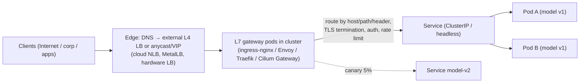

# 5.12 Ingress, load balancers and the Gateway API

| | |
|---|---|
| Level | Intermediate |
| Priority tier | 1 |
| Lab venue | Cluster with a LoadBalancer implementation (cloud or MetalLB); Helm; curl/hey/fortio |
| Part | Part 5: Kubernetes |
| Status | Drafted, labs **untested** |

## Why this matters for AI infrastructure

Inference endpoints, notebooks, experiment trackers, dashboards, model registries and internal tools all need controlled entry points: TLS, authentication, routing by hostname/path/header (model name, tenant), canary and A/B traffic splits between model versions, long timeouts and streaming (Server-Sent Events for token streaming, WebSockets, gRPC), rate limiting per API key, and metrics. The edge is also where AI-specific problems appear: default 60-second proxy timeouts killing long generations, request buffering breaking token streaming, body size limits rejecting large prompts or image batches, uneven load from HTTP/2 connection reuse, and cache-/KV-aware routing needs that classic L7 balancers cannot meet. This chapter covers the Kubernetes mechanisms (Ingress and the newer Gateway API), the controllers behind them, TLS automation, and the operational design of an edge for inference traffic.

## Prerequisites and outcomes

Needs 5.10, 5.11, and HTTP/TLS fundamentals (2.10, 2.20). After this chapter you can:

- Contrast L4 and L7 load balancing and place Service types, Ingress, Gateway API and external LBs correctly.
- Write Ingress resources (hosts, paths, TLS, annotations, IngressClass) and operate popular controllers (ingress-nginx, Traefik, HAProxy, Envoy-based, cloud controllers).
- Use the Gateway API: roles, GatewayClass/Gateway/HTTPRoute/GRPCRoute/TLSRoute/ReferenceGrant, traffic splitting, header matching and filters, and compare with Ingress.
- Automate TLS with cert-manager (ACME, internal CA), and secure the edge (mTLS, OAuth/OIDC auth, WAF, rate limiting, network exposure).
- Provide bare-metal load balancing (MetalLB L2/BGP, kube-vip, Cilium LB IPAM) and understand cloud LB integration.
- Tune for LLM/streaming workloads (timeouts, buffering, HTTP/2, connection draining, body size, retries) and know when to use AI-aware gateways.
- Diagnose edge failures (502/503/504, TLS errors, wrong routing).

## 1. Layers of load balancing



- **L4 (TCP/UDP)** balancing distributes connections without understanding the protocol: Services (5.10), `type: LoadBalancer`, cloud NLBs, MetalLB, IPVS. Fast and protocol-agnostic; cannot route by URL or retry per request; long-lived connections stick.
- **L7 (HTTP/gRPC)** balancing terminates the protocol, makes per-request decisions: host/path/header routing, retries, timeouts, circuit breaking, rate limits, authentication, rewriting, observability per request, traffic splitting, per-request balancing even over HTTP/2.
- A typical stack: **external L4 LB** (single stable IP) → **L7 gateway Deployment/DaemonSet** → **Services** → pods. Alternatively cloud L7 LBs (ALB, GCP HTTP(S) LB) integrate through Ingress/Gateway controllers and route directly to pods (NEG/IP targets), skipping node hops.

## 2. Ingress

An **Ingress** (networking.k8s.io/v1) declares L7 routing rules; an **Ingress controller** (a separate deployment you install) watches Ingress objects and configures a proxy. Kubernetes ships no controller by default. `IngressClass` selects which controller handles an Ingress (`spec.ingressClassName`).

```yaml
apiVersion: networking.k8s.io/v1
kind: Ingress
metadata:
  name: llm-api
  namespace: serving
  annotations:                                   # controller-specific behaviour (ingress-nginx examples)
    nginx.ingress.kubernetes.io/proxy-read-timeout: "600"
    nginx.ingress.kubernetes.io/proxy-send-timeout: "600"
    nginx.ingress.kubernetes.io/proxy-body-size: "64m"
    nginx.ingress.kubernetes.io/proxy-buffering: "off"          # token streaming (SSE)
    nginx.ingress.kubernetes.io/limit-rps: "20"
    cert-manager.io/cluster-issuer: letsencrypt-prod
spec:
  ingressClassName: nginx
  tls:
    - hosts: [llm.example.com]
      secretName: llm-example-tls                # cert-manager creates and renews this Secret
  rules:
    - host: llm.example.com
      http:
        paths:
          - path: /v1/chat
            pathType: Prefix                      # Exact | Prefix | ImplementationSpecific
            backend:
              service: { name: vllm, port: { number: 80 } }
          - path: /v1/embeddings
            pathType: Prefix
            backend:
              service: { name: embeddings, port: { name: http } }
```

Features: virtual hosting by `Host`, path routing (`Exact`, `Prefix`), TLS termination via Secrets (`tls.crt`/`tls.key`), default backend. Everything else (rewrites, redirects, auth, rate limits, timeouts, canary, CORS, WAF) is **controller-specific annotations** — non-portable and untyped, the main motivation for the Gateway API. The Ingress API is frozen (stable, no new features).

### Controllers

| Controller | Proxy | Notes |
|---|---|---|
| **ingress-nginx** (Kubernetes community) | NGINX | Most common; huge annotation set; snippet annotations are risky (disable `allow-snippet-annotations`); retired/limited maintenance should be checked for your timeline |
| NGINX Inc. Ingress Controller / NGINX Gateway Fabric | NGINX / NGINX Plus | Commercial option, Gateway API-based fabric |
| **Traefik** | Traefik | Dynamic config, CRDs (IngressRoute), middlewares |
| **HAProxy Ingress** | HAProxy | High performance, rich TCP features |
| **Envoy-based**: Contour, Emissary, Envoy Gateway, Istio ingress gateway, Cilium Gateway/Ingress | Envoy | xDS dynamic config, gRPC/HTTP2 first-class, good observability; foundation for Gateway API implementations and meshes |
| **Cloud**: AWS Load Balancer Controller (ALB/NLB), GKE Ingress/Gateway, AGIC (Azure) | Cloud LB | Managed, integrates with WAF/IAM; may route to pod IPs |
| **Kong, Apache APISIX, Ambassador** | Envoy/NGINX | API gateway features: plugins, auth, rate limiting, developer portals |

Deploy the controller as a Deployment (autoscaled) or DaemonSet with `hostNetwork`/NodePort + external LB; give it dedicated nodes for heavy traffic; set resource requests, PDB, anti-affinity, `terminationGracePeriodSeconds` and lifecycle for graceful draining; expose metrics (Prometheus) and access logs (structured JSON to stdout).

### Multi-team Ingress collisions and Contour's `HTTPProxy` root inclusion

In a multi-tenant cluster, the standard `Ingress` API does not prevent two teams in different namespaces from claiming the same `host` (such as `app.bearcanoe.com` in the book's example). Depending on the controller, overlapping rules are either merged in surprising ways or rejected, which can cause production outages. As *Production Kubernetes* (Chapter 6) describes, platform teams solve this in one of two ways:

1. **Validating admission control** (such as an Open Policy Agent / Gatekeeper policy) that checks existing `Ingress` objects across the cluster and rejects duplicate hostnames.
2. **Delegated routing CRDs such as Contour's `HTTPProxy`**: Contour replaces flat `Ingress` objects with a root `HTTPProxy` custom resource and **inclusion** (`includes`). A platform administrator creates a root `HTTPProxy` in an administrative namespace that owns the domain (for example, `app1.bearcanoe.com`) and delegates routing for that domain or path prefix by including `HTTPProxy` resources from the `app1` team's namespace. Because only the root namespace can define top-level virtual hosts, teams cannot collide with another team's hostname. Contour's `HTTPProxy` also supports layer 3/4 TCP proxying via TLS Server Name Indication (`SNI`), as in the book's example (untested here):

```yaml
apiVersion: projectcontour.io/v1
kind: HTTPProxy
metadata:
  name: tcp-proxy
spec:
  virtualhost:
    fqdn: tcp.bearcanoe.com
    tls:
      secretName: secret
  tcpproxy:
    services:
      - name: tcp-app
        port: 8080
```

### Dedicated Ingress node pool and DaemonSet edge pattern

Because Kubernetes does not isolate network I/O or file descriptors via cgroups, noisy application pods can contend with Ingress proxies if they share general worker nodes. *Production Kubernetes* (Chapter 6) recommends reserving a dedicated set of edge nodes for the Ingress tier using four combined settings:

1. **Node labels, taints, and a `DaemonSet`**: label and taint the dedicated ingress nodes, then deploy the Ingress controller as a `DaemonSet` with a matching `nodeSelector` and taint `tolerations`. Having a small, fixed set of edge nodes also simplifies firewall exceptions and static backend pools on hardware load balancers.
2. **Host networking (`hostNetwork: true`) with `ClusterFirstWithHostNet`**: binding the Ingress proxy container directly to the node's network namespace lets incoming packets reach the proxy without traversing the Kubernetes Service `iptables`/`IPVS` fabric. When `hostNetwork: true` is enabled, you must set `dnsPolicy: ClusterFirstWithHostNet` so the proxy can still resolve in-cluster `*.svc.cluster.local` Service names via CoreDNS, as in the book's Pod template snippet (untested here):

```yaml
spec:
  containers:
    - image: nginx
      name: nginx
  dnsPolicy: ClusterFirstWithHostNet
  hostNetwork: true
```

3. **Service `externalTrafficPolicy: Local`**: if the Ingress controller is exposed through a `NodePort` or `LoadBalancer` Service rather than direct host ports, set `externalTrafficPolicy: Local` so external load balancers only send traffic to nodes running a local Ingress proxy replica, avoiding an extra cross-node hop and preserving the client's source IP address (no SNAT).
4. **Spreading across failure domains**: when running as a `Deployment` (or selecting nodes across zones), use Pod anti-affinity rules to spread Ingress controller replicas across availability zones or racks.

## 3. Gateway API

The **Gateway API** (`gateway.networking.k8s.io`, GA for HTTP features in v1) is the successor to Ingress: role-oriented, expressive, portable, extensible, and covering L4/L7 and gateways for mesh (GAMMA). Resources:

| Resource | Owner persona | Purpose |
|---|---|---|
| **GatewayClass** | Infrastructure provider | Names a controller implementation (like StorageClass/IngressClass) |
| **Gateway** | Cluster operator | A deployed listener set: addresses, ports, protocols, TLS, allowed routes (namespaces/selectors) |
| **HTTPRoute / GRPCRoute** | App developer | Hostnames, matches (path, headers, query, method), filters (redirect, rewrite, header modification, mirror, CORS/timeouts in newer releases), backendRefs with weights |
| **TLSRoute / TCPRoute / UDPRoute** | App developer | L4 routing (experimental/standard by release) |
| **ReferenceGrant** | Namespace owner | Permit cross-namespace references (route → Service in another namespace; Gateway → Secret) |
| **BackendTLSPolicy, BackendLBPolicy, policy attachment** | Operator/developer | Backend TLS, load balancing policy, timeouts (via policy attachment pattern; evolving) |

```yaml
apiVersion: gateway.networking.k8s.io/v1
kind: GatewayClass
metadata: { name: envoy }
spec: { controllerName: gateway.envoyproxy.io/gatewayclass-controller }
---
apiVersion: gateway.networking.k8s.io/v1
kind: Gateway
metadata: { name: public, namespace: edge }
spec:
  gatewayClassName: envoy
  listeners:
    - name: https
      protocol: HTTPS
      port: 443
      hostname: "*.ai.example.com"
      tls:
        mode: Terminate
        certificateRefs: [ { name: wildcard-ai-example-com } ]
      allowedRoutes:
        namespaces: { from: Selector, selector: { matchLabels: { gateway-access: public } } }
---
apiVersion: gateway.networking.k8s.io/v1
kind: HTTPRoute
metadata: { name: chat, namespace: serving }
spec:
  parentRefs: [ { name: public, namespace: edge, sectionName: https } ]
  hostnames: ["chat.ai.example.com"]
  rules:
    - matches:
        - path: { type: PathPrefix, value: /v1 }
          headers: [ { name: x-model, value: llama-70b } ]
      backendRefs:
        - { name: vllm-llama70b-v1, port: 80, weight: 95 }       # canary: 95/5 split
        - { name: vllm-llama70b-v2, port: 80, weight: 5 }
      timeouts: { request: 600s, backendRequest: 600s }
      filters:
        - type: RequestHeaderModifier
          requestHeaderModifier: { add: [ { name: x-served-by, value: gateway } ] }
    - matches: [ { path: { type: PathPrefix, value: /healthz } } ]
      filters:
        - type: RequestRedirect
          requestRedirect: { scheme: https, statusCode: 301 }
```

Compared with Ingress: typed fields replace annotations (header matches, weights, redirects, mirroring, timeouts); separation of roles (cluster operators own Gateways, teams own Routes with RBAC); multiple protocols; cross-namespace safety (ReferenceGrant); status conditions on Gateways and Routes (`Accepted`, `ResolvedRefs`, `Programmed`) that tell you why a route isn't working; portable across implementations (Envoy Gateway, Istio, Cilium, Contour, NGINX Gateway Fabric, Traefik, Kong, GKE/AWS/Azure). Migration: tools like `ingress2gateway` convert Ingresses; run both in parallel during migration with different IP/hostnames; map annotations to filters/policies, noting features still implementation-specific.

Gateway API Inference Extension: a project extending Gateway API with an **InferencePool** (a set of model-server pods) and **InferenceModel/Objective** concepts plus an *endpoint picker* that routes requests using model-server metrics (queue depth, KV-cache utilisation, active LoRA adapters, prefix cache) instead of round-robin — directly relevant to LLM serving (Part 15). Treat it as evolving; verify maturity.

## 4. TLS and cert-manager

**cert-manager** automates certificate issuance and renewal through CRDs: `Issuer`/`ClusterIssuer` (ACME/Let's Encrypt, Vault PKI, internal CA, Venafi, self-signed), `Certificate` (desired cert → Secret), and annotations on Ingress/Gateway (`cert-manager.io/cluster-issuer`) to auto-create Certificates. ACME challenges: **HTTP-01** (needs public reachability on port 80; per-host, no wildcards) and **DNS-01** (needs DNS provider API credentials; supports wildcards; works for private clusters). Renewal begins at ~2/3 of lifetime by default (renew 30 days before expiry for 90-day certs). Operate: monitor `certmanager_certificate_expiration_timestamp_seconds`, alert on issuance failures (`kubectl describe certificate/order/challenge`), rate limits of public CAs, secure the issuer credentials, and use an internal CA (Vault, step-ca, cert-manager CA issuer) for private/internal domains and mTLS between services.

```yaml
apiVersion: cert-manager.io/v1
kind: ClusterIssuer
metadata: { name: letsencrypt-prod }
spec:
  acme:
    server: https://acme-v02.api.letsencrypt.org/directory
    email: platform@example.com
    privateKeySecretRef: { name: letsencrypt-prod-account }
    solvers:
      - dns01:
          cloudDNS: { project: my-dns-project, serviceAccountSecretRef: { name: clouddns-sa, key: key.json } }   # prefer workload identity
```

Edge TLS practices: TLS 1.2+ only (prefer 1.3), modern cipher suites, HSTS, OCSP stapling, HTTP→HTTPS redirect, separate certificates per environment, rotate secrets on schedule, restrict who can read TLS Secrets (RBAC), consider terminating TLS at the L4 LB for passthrough vs at the gateway (end-to-end encryption to pods with mTLS in a mesh, 5.28), SNI routing with TLS passthrough for backends that must keep their own certs.

## 5. Bare-metal and GPU-cloud load balancers

Without a cloud, `type: LoadBalancer` stays `<pending>` until you install a controller:

- **MetalLB**: assigns IPs from configured pools. **L2 mode**: one node answers ARP/NDP for the IP (failover in seconds, single-node bandwidth bottleneck, needs same L2 domain; with kube-proxy IPVS set `strictARP`). **BGP mode**: speakers peer with the ToR/routers and advertise /32s (ECMP across nodes for scale; needs router config; aligns with leaf-spine fabrics, 2.15 to 2.16). Configure with `IPAddressPool`, `L2Advertisement`, `BGPPeer`, `BGPAdvertisement` CRDs. Service annotations: `metallb.universe.tf/address-pool`, `loadBalancerIPs`.
- **kube-vip**: VIP for control plane and Services (ARP or BGP), lightweight.
- **Cilium LB IPAM + BGP Control Plane** (or L2 announcements): integrated with the CNI; Maglev hashing and DSR possible with eBPF datapath.
- **Calico BGP service IP advertisement**: advertise Service/cluster IPs via BGP.
- **Hardware / virtual appliances** (F5, A10, NetScaler, HAProxy/keepalived pairs, NVIDIA/Cumulus anycast designs) and **anycast** for multi-site entry.
- Cloud providers: Network LB (L4) vs Application LB (L7); use annotations for internal LBs, health check paths, target types (instance vs IP), idle timeouts (AWS NLB 350 s, ALB 60 s default; GCP backend timeouts 30 s default): **raise these for streaming/LLM endpoints**.

## 6. Designing the edge for AI/LLM traffic

| Concern | Guidance |
|---|---|
| **Timeouts** | Generation can take minutes; set gateway read/idle/request timeouts (e.g., 300-900 s) and cloud LB idle timeouts accordingly; use heartbeats/keepalive comments in SSE streams; client libraries must match |
| **Streaming** | Disable response buffering for SSE/chunked token streams (`proxy_buffering off`, Envoy default is streaming); avoid gzip on streams; HTTP/2 end-to-end if possible; watch idle connection reaping in intermediate NAT/LB |
| **Request size** | Raise body size limits for long prompts, multimodal inputs (images/audio), batch inference (`proxy-body-size`); consider presigned object store uploads for large files instead of proxying through the gateway |
| **Connection handling** | HTTP/2 multiplexing and keep-alive pin to backends; L7 per-request balancing (Envoy `least_request`, `ring_hash`/`maglev` for consistent hashing by session/user for prefix-cache locality); limit max connection age to rebalance |
| **Retries and idempotency** | Do not auto-retry non-idempotent POSTs that already started generating; configure retry budgets and timeouts; use idempotency keys |
| **Backpressure and queues** | Gateways need concurrency limits and queueing per model (max pending requests); return 429/503 with `Retry-After` rather than piling latency; surface queue depth; integrate with autoscaling signals (5.23) |
| **Rate limiting** | Per API key/tenant limits in requests and tokens per minute: gateway-level (Envoy global rate limit service, Kong/APISIX plugins, NGINX `limit_req`), or an LLM gateway (LiteLLM, Portkey, Kong AI Gateway, custom) for token accounting |
| **Authentication** | OIDC (oauth2-proxy, Envoy ext_authz), API keys/JWT validation at the gateway, mTLS for service clients; propagate identity headers; never expose model-serving ports directly |
| **Routing by model/version** | Host/path/header matches; weights for canary (5% → 25% → 100%) with metrics gates (Argo Rollouts/Flagger integrate with Gateway API) (4.26) |
| **Cache-/load-aware routing** | Use endpoint-picker approaches (Gateway API Inference Extension, vLLM production-stack router, llm-d) that use KV-cache and queue metrics, prefix-cache hit probability, LoRA locality — beats round-robin for LLMs (Part 15) |
| **Observability** | Access logs with request id, model, tenant, status, latency, upstream time, tokens; RED metrics per route; distributed tracing (W3C `traceparent`); correlate with model-server metrics |
| **Security** | WAF/rate limiting, request validation (schema), max prompt size, prompt-injection filtering is application-level; isolate public and internal gateways; network policies from gateway namespace to backends only; TLS everywhere |
| **Availability** | ≥3 gateway replicas across zones, PDB, anti-affinity, HPA on connections/CPU, graceful shutdown (drain connections, `lameduck`), multiple LB IPs, DNS failover, health checks that reflect model readiness |
| **Cost/egress** | Keep gateways in the same zone/region as model servers; avoid hairpinning through the Internet; compress responses where not streaming |

### Example: nginx-ingress tuned for streaming inference (annotations)

```yaml
metadata:
  annotations:
    nginx.ingress.kubernetes.io/proxy-connect-timeout: "10"
    nginx.ingress.kubernetes.io/proxy-read-timeout: "900"
    nginx.ingress.kubernetes.io/proxy-send-timeout: "900"
    nginx.ingress.kubernetes.io/proxy-buffering: "off"
    nginx.ingress.kubernetes.io/proxy-request-buffering: "off"
    nginx.ingress.kubernetes.io/proxy-body-size: "100m"
    nginx.ingress.kubernetes.io/backend-protocol: "HTTP"
    nginx.ingress.kubernetes.io/upstream-hash-by: "$http_x_session_id"      # consistent hashing for prefix-cache locality
    nginx.ingress.kubernetes.io/limit-connections: "50"
```

### Example: Envoy Gateway policies (Gateway API attachments)

```yaml
apiVersion: gateway.envoyproxy.io/v1alpha1
kind: BackendTrafficPolicy
metadata: { name: llm-policy, namespace: serving }
spec:
  targetRefs: [ { group: gateway.networking.k8s.io, kind: HTTPRoute, name: chat } ]
  loadBalancer: { type: LeastRequest }
  timeout: { http: { requestTimeout: 900s } }
  retry: { numRetries: 0 }                      # no blind retries of generation requests
  circuitBreaker: { maxPendingRequests: 200, maxParallelRequests: 400 }
```

(Resource kinds and fields vary by implementation and version; this illustrates the attachment pattern.)

## 7. Operating and debugging

Request path: DNS → LB IP → node/LB → gateway pod → Service/endpoints → app pod. Failure by status:

| Status | Meaning | Check |
|---|---|---|
| **404 from the gateway** | No matching host/path/route; default backend | Ingress/HTTPRoute `Accepted`/`ResolvedRefs`, hostname/Host header, path type, IngressClass, namespace allowed by Gateway |
| **502 Bad Gateway** | Backend reset connection / protocol mismatch / bad upstream TLS | Backend pod logs, `backend-protocol`, port, HTTP/1.1 vs HTTP/2, upstream TLS settings, pod crash during rollout |
| **503 Service Unavailable** | No healthy endpoints / overloaded / circuit breaker | EndpointSlices, readiness, outlier detection, `maxPendingRequests` |
| **504 Gateway Timeout** | Upstream took longer than timeout | Raise timeouts, check model latency/queue, LB idle timeouts, retries |
| **413 Request Entity Too Large** | Body limit | Raise size, use presigned uploads |
| **TLS handshake errors** | SNI mismatch, expired/missing cert, wrong secret namespace | `openssl s_client -connect ip:443 -servername host`, cert-manager status, Secret exists in right namespace (Ingress) / ReferenceGrant (Gateway) |
| **429** | Rate limit | Policy, client behaviour, `Retry-After` |
| **Connection resets mid-stream** | Idle/maximum duration timeouts, buffer limits, pod termination | LB idle timeout, `proxy_read_timeout`, SSE heartbeats, rolling update drain |
| **Wrong client IP** | SNAT / `externalTrafficPolicy: Cluster` / proxy protocol missing | `Local` policy, PROXY protocol, `X-Forwarded-For` handling and trusted proxies |
| **Uneven load** | HTTP/2 connection pinning, L4 balancing, sticky hash | Per-request L7 balancing, max connection age |

```bash
kubectl get ingressclass,ingress -A
kubectl describe ingress llm-api -n serving                     # events, backends, TLS
kubectl get gatewayclass,gateway,httproute -A
kubectl describe gateway public -n edge | sed -n '/Conditions/,$p'
kubectl describe httproute chat -n serving | sed -n '/Status/,$p'
kubectl -n ingress-nginx logs deploy/ingress-nginx-controller --tail=100
kubectl -n ingress-nginx exec deploy/ingress-nginx-controller -- cat /etc/nginx/nginx.conf | grep -A5 "server_name llm.example.com"
curl -vk --resolve llm.example.com:443:<LB-IP> https://llm.example.com/v1/models
curl -N -H 'Accept: text/event-stream' https://llm.example.com/v1/chat   # check streaming with -N (no buffering)
openssl s_client -connect <LB-IP>:443 -servername llm.example.com </dev/null | openssl x509 -noout -dates -subject -issuer
kubectl get certificate,certificaterequest,order,challenge -A
```

## 8. Lab (untested)

1. **Ingress basics**: install ingress-nginx and MetalLB (or a cloud LB); deploy two echo services; create an Ingress with host/path rules; test with `curl --resolve`; observe the generated nginx config; add TLS with a self-signed cert, then with cert-manager and an internal CA.
2. **Streaming**: deploy a mock SSE server emitting a token every 200 ms for 5 minutes; observe buffering effects with defaults; set timeouts and `proxy-buffering: off`; verify with `curl -N`; then test through a cloud/LB idle timeout (e.g., 60 s) and add keepalive comments.
3. **Gateway API**: install Envoy Gateway (or Cilium/Istio) and the Gateway API CRDs; create GatewayClass/Gateway/HTTPRoute; weight-based canary 90/10 between two Services; header-based routing; read status conditions after introducing mistakes (missing ReferenceGrant, wrong parentRef).
4. **Migration**: convert the Ingress from step 1 with `ingress2gateway`; compare; run both; document unsupported annotations and equivalents.
5. **Load balancing semantics**: gRPC echo with a single client connection through (a) a Service, (b) ingress-nginx, (c) Envoy with `LeastRequest`; graph per-backend counts; add `maglev`/`ring_hash` keyed by a header and observe stickiness and its effect on prefix-cache hit rate (simulate with an LRU cache in the backend).
6. **Rate limiting and auth**: add per-key rate limiting (Envoy rate limit service or NGINX), and OIDC via oauth2-proxy or JWT validation; test 401/403/429 behaviour and logs.
7. **cert-manager**: issue a certificate via ACME DNS-01 (staging CA) or an internal CA; force renewal; simulate failure (revoke DNS credentials) and use `describe` to read the error; add expiry alerts.
8. **Bare-metal LB**: configure MetalLB in L2 mode, find the announcing node (`kubectl get events`, `arping`), kill that node and measure failover; switch to BGP with FRR and observe ECMP across nodes; test `externalTrafficPolicy: Local` health checks.
9. **Failure drills**: drain a gateway node, roll the gateway Deployment with and without graceful drain, and count dropped requests; scale backend pods to 0 for 503s; set tiny body limit for 413; shorten timeouts for 504s.
10. **LLM-aware routing (optional)**: deploy two mock/real vLLM replicas and a router/endpoint picker (vLLM router, Gateway API Inference Extension if available); compare tail latency vs round-robin under a skewed workload.
11. **Observability**: access logs in JSON, Prometheus metrics, and a dashboard of request rate/errors/duration by route; add tracing headers and view a trace through gateway and backend.
12. **Clean up**.

Mark tested only after execution.

## 9. Common mistakes

- Default proxy timeouts (60 s) and buffering kill long generations and token streams.
- Relying on controller-specific annotations that silently do nothing under another controller or version (no validation); enabling snippet annotations for untrusted tenants.
- Exposing model server ports (NodePort/LB) directly without auth and rate limiting.
- Using `externalTrafficPolicy: Cluster` and then wondering about client IPs; or `Local` with too few pods.
- One gateway replica or no PDB; no graceful drain; DNS TTLs too long for failover.
- Not allowing the gateway namespace in NetworkPolicies, or not restricting backends to gateway-only ingress.
- Ignoring certificate expiry monitoring; ACME rate limits; HTTP-01 behind a firewall.
- Assuming L7 gateways balance HTTP/2 evenly without configuration; round-robin for LLM traffic when load- and cache-aware routing matters.
- Retrying non-idempotent generation requests.
- Running Ingress and Gateway controllers that both claim the same class/hosts.

## 10. Interview angles

- "Difference between Service type LoadBalancer, Ingress and Gateway API." 
- "Why was the Gateway API created? What are GatewayClass, Gateway, HTTPRoute, ReferenceGrant?" 
- "How would you expose an LLM inference endpoint securely and reliably? What timeouts and buffering settings matter?" 
- "How do you do canary releases for a model version at the gateway?" 
- "How does cert-manager work? HTTP-01 vs DNS-01?" 
- "How do you provide LoadBalancer Services on bare metal?" (MetalLB L2/BGP.)
- "A client gets 504 after 60 seconds on a long generation. Where do you look?" 
- "Why might round-robin load balancing be poor for LLM serving?" 

## 11. Checkpoint questions (35)

1. L4 vs L7 balancing? **A:** Connection-level vs request-level (protocol-aware).
2. What is an Ingress controller? **A:** A deployment that configures a proxy from Ingress objects.
3. Is a controller built into Kubernetes? **A:** No.
4. What selects the controller? **A:** `ingressClassName`/IngressClass.
5. Ingress path types? **A:** Exact, Prefix, ImplementationSpecific.
6. Where do advanced settings live in Ingress? **A:** Controller-specific annotations.
7. Ingress API status? **A:** Stable but frozen.
8. Gateway API groups? **A:** `gateway.networking.k8s.io`.
9. Who owns GatewayClass? **A:** Infrastructure provider.
10. Who owns Gateway? **A:** Cluster operator.
11. Who owns HTTPRoute? **A:** App developers.
12. What is ReferenceGrant for? **A:** Allow cross-namespace references.
13. How to split traffic in Gateway API? **A:** `backendRefs` weights.
14. Where do you see why a route fails? **A:** Status conditions (Accepted/ResolvedRefs).
15. What is `ingress2gateway`? **A:** Migration tool.
16. What is cert-manager? **A:** Certificate automation controller.
17. HTTP-01 vs DNS-01? **A:** Port-80 challenge vs DNS TXT (wildcards).
18. What stores the certificate? **A:** A TLS Secret.
19. Default ACME cert lifetime? **A:** 90 days.
20. MetalLB modes? **A:** L2 and BGP.
21. L2 mode limitation? **A:** One node handles traffic per IP.
22. BGP mode benefit? **A:** ECMP across nodes.
23. `strictARP` purpose? **A:** Required for MetalLB L2 with IPVS.
24. Why disable buffering for SSE? **A:** To stream tokens immediately.
25. Typical default proxy read timeout? **A:** 60 s.
26. Why raise body size? **A:** Large prompts/multimodal inputs.
27. HTTP/2 balancing issue? **A:** Connection pinning to one backend.
28. Fix for uneven L7 load? **A:** Per-request balancing, max connection age, least-request.
29. Why consistent hashing for LLMs? **A:** Prefix cache locality.
30. Don't auto-retry what? **A:** Non-idempotent generation requests.
31. 502 vs 503 vs 504? **A:** Bad upstream response / no healthy backend / upstream timeout.
32. 413 means? **A:** Request body too large.
33. Preserve client IP how? **A:** `externalTrafficPolicy: Local`, PROXY protocol/XFF.
34. What is the Inference Extension? **A:** Gateway API add-on for model-aware (InferencePool) routing.
35. When running an Ingress controller Pod with `hostNetwork: true`, what `dnsPolicy` must be set so it can still resolve cluster Services, and how does Contour's `HTTPProxy` prevent multi-team hostname collisions? **A:** Set `dnsPolicy: ClusterFirstWithHostNet`; Contour uses root `HTTPProxy` resources with inclusion (`includes`) to delegate domains/paths to team namespaces.

## 12. Sources and review notes

**Written in original words.** Principal sources:

- Brendan Burns et al., *Kubernetes: Up and Running* (3rd edition; chapter 8 on HTTP load balancing with Ingress).
- Josh Rosso et al., *Production Kubernetes* (`production-kubernetes`, Chapter 6: `6. Service Routing` — read in full for Contour `HTTPProxy` root inclusion and TCP SNI proxying, dedicated Ingress node pools, `hostNetwork: true` with `dnsPolicy: ClusterFirstWithHostNet`, and `externalTrafficPolicy: Local`).
- James Strong and Vallery Lancey, *Networking and Kubernetes* (chapter 6 on ingress, API gateways and meshes).
- Gateway API, cert-manager, ingress-nginx, Envoy Gateway, MetalLB and Cilium documentation.
- Examples are the author's constructions.

**Flagged for verification before publishing:** ingress-nginx maintenance status and annotation names, Gateway API feature levels (timeouts, TLSRoute, BackendTLSPolicy) and implementation CRD fields, cloud LB idle timeout defaults, Inference Extension/llm-d project maturity, and every manifest; all labs are **untested**.
