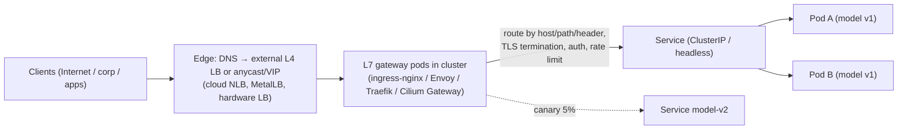

# 5.12 Ingress, load balancers and the Gateway API

| | |
|---|---|
| Level | Intermediate |
| Priority tier | 1 |
| Lab venue | Cluster with a LoadBalancer implementation (cloud or MetalLB); Helm; curl/hey/fortio |
| Part | Part 5: Kubernetes |
| Status | Drafted, labs **untested** |

## Why this matters for AI infrastructure

Inference endpoints, notebooks, experiment trackers, dashboards, model registries and internal tools all need controlled entry points: TLS, authentication, routing by hostname/path/header (model name, tenant), canary and A/B traffic splits between model versions, long timeouts and streaming (Server-Sent Events for token streaming, WebSockets, gRPC), rate limiting per API key, and metrics. The edge is also where AI-specific problems appear: default 60-second proxy timeouts killing long generations, request buffering breaking token streaming, body size limits rejecting large prompts or image batches, uneven load from HTTP/2 connection reuse, and cache-/KV-aware routing needs that classic L7 balancers cannot meet. This chapter covers the Kubernetes mechanisms (Ingress and the newer Gateway API), the controllers behind them, TLS automation, and the operational design of an edge for inference traffic.

## Prerequisites and outcomes

Needs 5.10, 5.11, and HTTP/TLS fundamentals (2.10, 2.20). After this chapter you can:

- Contrast L4 and L7 load balancing and place Service types, Ingress, Gateway API and external LBs correctly.
- Write Ingress resources (hosts, paths, TLS, annotations, IngressClass) and operate popular controllers (ingress-nginx, Traefik, HAProxy, Envoy-based, cloud controllers).
- Use the Gateway API: roles, GatewayClass/Gateway/HTTPRoute/GRPCRoute/TLSRoute/ReferenceGrant, traffic splitting, header matching and filters, and compare with Ingress.
- Automate TLS with cert-manager (ACME, internal CA), and secure the edge (mTLS, OAuth/OIDC auth, WAF, rate limiting, network exposure).
- Provide bare-metal load balancing (MetalLB L2/BGP, kube-vip, Cilium LB IPAM) and understand cloud LB integration.
- Tune for LLM/streaming workloads (timeouts, buffering, HTTP/2, connection draining, body size, retries) and know when to use AI-aware gateways.
- Diagnose edge failures (502/503/504, TLS errors, wrong routing).

## 1. Layers of load balancing



- **L4 (TCP/UDP)** balancing distributes connections without understanding the protocol: Services (5.10), `type: LoadBalancer`, cloud NLBs, MetalLB, IPVS. Fast and protocol-agnostic; cannot route by URL or retry per request; long-lived connections stick.
- **L7 (HTTP/gRPC)** balancing terminates the protocol, makes per-request decisions: host/path/header routing, retries, timeouts, circuit breaking, rate limits, authentication, rewriting, observability per request, traffic splitting, per-request balancing even over HTTP/2.
- A typical stack: **external L4 LB** (single stable IP) → **L7 gateway Deployment/DaemonSet** → **Services** → pods. Alternatively cloud L7 LBs (ALB, GCP HTTP(S) LB) integrate through Ingress/Gateway controllers and route directly to pods (NEG/IP targets), skipping node hops.

## 2. Ingress

An **Ingress** (networking.k8s.io/v1) declares L7 routing rules; an **Ingress controller** (a separate deployment you install) watches Ingress objects and configures a proxy. Kubernetes ships no controller by default. `IngressClass` selects which controller handles an Ingress (`spec.ingressClassName`).

```yaml
apiVersion: networking.k8s.io/v1
kind: Ingress
metadata:
  name: llm-api
  namespace: serving
  annotations:                                   # controller-specific behaviour (ingress-nginx examples)
    nginx.ingress.kubernetes.io/proxy-read-timeout: "600"
    nginx.ingress.kubernetes.io/proxy-send-timeout: "600"
    nginx.ingress.kubernetes.io/proxy-body-size: "64m"
    nginx.ingress.kubernetes.io/proxy-buffering: "off"          # token streaming (SSE)
    nginx.ingress.kubernetes.io/limit-rps: "20"
    cert-manager.io/cluster-issuer: letsencrypt-prod
spec:
  ingressClassName: nginx
  tls:
    - hosts: [llm.example.com]
      secretName: llm-example-tls                # cert-manager creates and renews this Secret
  rules:
    - host: llm.example.com
      http:
        paths:
          - path: /v1/chat
            pathType: Prefix                      # Exact | Prefix | ImplementationSpecific
            backend:
              service: { name: vllm, port: { number: 80 } }
          - path: /v1/embeddings
            pathType: Prefix
            backend:
              service: { name: embeddings, port: { name: http } }
```

Features: virtual hosting by `Host`, path routing (`Exact`, `Prefix`), TLS termination via Secrets (`tls.crt`/`tls.key`), default backend. Everything else (rewrites, redirects, auth, rate limits, timeouts, canary, CORS, WAF) is **controller-specific annotations** — non-portable and untyped, the main motivation for the Gateway API. The Ingress API is frozen (stable, no new features).

In *Kubernetes: Up and Running* Chapter 8 (*HTTP Load Balancing with Ingress*) and *Networking and Kubernetes* Chapters 5 & 6, the authors highlight four operational details of `Ingress` routing:
1. **Paths are passed unmodified to the backend by default (`KUR` Chapter 8):** When a client requests `bandicoot.example.com/a/` and matches an Ingress path rule `path: /a`, **the proxy forwards the request to the backend pod with the `/a/` path intact** (`GET /a/ HTTP/1.1`). If the backend server expects requests at `/` instead of `/a/`, it will return `404 Not Found` unless you configure path rewriting (via an Ingress controller annotation like `nginx.ingress.kubernetes.io/rewrite-target` or a Gateway API `URLRewrite` filter).
2. **`Exact` vs. `Prefix` precedence (`NK` Chapter 5):** If an Ingress or `HTTPRoute` defines both a `Prefix` rule (`/v1`) and an `Exact` rule (`/v1/health`) that match a request, **the `Exact` path match always wins** (and among `Prefix` rules, the longest matching prefix wins, modeled in `evaluate_httproute_and_reference_grant()` in `code/part05/gateway_llm_router.py`).
3. **Default `IngressClass` and `defaultBackend` (`KUR` Chapter 8):** Marking an `IngressClass` with `ingressclass.kubernetes.io/is-default-class: "true"` makes it handle any Ingress that omits `spec.ingressClassName`; setting `spec.defaultBackend` handles requests that do not match any `rules` host/path.
4. **Cloud Container-Native Load Balancing (`NK` Chapter 6):** On GKE (**Network Endpoint Groups `NEGs`**) and AWS EKS (**AWS Load Balancer Controller** with `alb.ingress.kubernetes.io/target-type: ip`), the cloud L7 load balancer watches Pod IPs directly and routes from the cloud edge straight to Pod IPs—bypassing `NodePort` and `kube-proxy` hops entirely and integrating natively with **Google Cloud Armor / Cloud CDN / IAP** or **AWS WAF**.

### Why Ingress has no default controller

Ingress is built differently from most Kubernetes objects. It is split into a common resource specification and a controller implementation. You can create and change Ingress objects like any other object, but by default no code runs to act on them. Someone has to install and manage an outside controller, or the distribution you use has to do it for you. That split is what makes the controller pluggable.

The reason is practical. No single HTTP load balancer works everywhere. Teams run open source proxies, cloud load balancers such as ELB on AWS, and hardware appliances. The Ingress object also arrived before Kubernetes had its common extension features (see Chapter 17), so it will likely change to use them over time.

### Installing Contour

The examples in this chapter use a controller called Contour. Contour is built to configure Envoy, an open source (CNCF) load balancer that can be changed on the fly through an API. Contour translates Ingress objects into something Envoy can understand. The project started at Heptio with real customers and runs in production today, but it is now an independent open source project.

You can install Contour with one line:
```
$ kubectl apply -f https://projectcontour.io/quickstart/contour.yaml
```
The user running this needs `cluster-admin` permissions. The line works for most configurations. It creates a namespace called `projectcontour` and a Deployment with two replicas. It also creates an external-facing Service of `type: LoadBalancer`, sets up permissions through a service account, and installs a CustomResourceDefinition for the extra features covered in "The Future of Ingress."

Because this is a global install, you need wide admin rights on the cluster. When it finishes, look up the external address of Contour:
```
$ kubectl get -n projectcontour service envoy -o wide
NAME CLUSTER-IP EXTERNAL-IP PORT(S) ...
contour 10.106.53.14 a477...amazonaws.com 80:30274/TCP ...
```
Check the `EXTERNAL-IP` column. It holds an IP address on GCP and Azure, and a hostname on AWS. Other clouds may differ. If your cluster does not support `type: LoadBalancer`, change the Contour YAML to use `type: NodePort` and send traffic to the cluster machines another way.

With `minikube`, the `EXTERNAL-IP` column probably stays empty. Open a second terminal and run `minikube tunnel`. It sets up network routes so that every Service of `type: LoadBalancer` gets its own unique IP address.

### Pointing DNS names at the controller

People reach websites by name, not by IP address. Many hostnames can share one external endpoint. The Ingress controller then sends each request to the right upstream service based on the hostname.

This chapter assumes you have a domain called `example.com`. You need two DNS entries: `alpaca.example.com` and `bandicoot.example.com`. Create A records if you have an IP address for the external load balancer. Create CNAME records if you have a hostname instead.

ExternalDNS can manage these records for you. It is a cluster add-on that keeps the IP addresses of Kubernetes Service resources in sync with an external DNS provider. It supports traditional domain registrars as well as public cloud providers.

### Testing with a local hosts file

If you don't have a domain, or you are using a local tool such as `minikube`, you can point the names at the controller in your hosts file. Editing this file needs admin or root rights. The file lives in a different place on each platform, and the change may need extra steps to take effect. On Windows, the file is usually at `C:\Windows\System32\drivers\etc\hosts`. On recent versions of macOS, run `sudo killall -HUP mDNSResponder` after you change it.

Add a line like this one, with the external IP address of Contour:
```
<ip-address> alpaca.example.com bandicoot.example.com
```
If all you have is a hostname, as on AWS, `host -t a <address>` gives you an IP address. That address may change later. Don't forget to remove the line when you are done.

### Creating three sample services

Before you route anything, you need upstream services to route to. The book calls these backends. The next commands create three Deployments of the same `kuard` app, each with three replicas on port 8080. The images differ only by tag: `blue`, `green` and `purple`. Each Deployment also gets a Service.
```
$ kubectl create deployment be-default \
--image=gcr.io/kuar-demo/kuard-amd64:blue \
--replicas=3 \
--port=8080
$ kubectl expose deployment be-default
$ kubectl create deployment alpaca \
--image=gcr.io/kuar-demo/kuard-amd64:green \
--replicas=3 \
--port=8080
$ kubectl expose deployment alpaca
$ kubectl create deployment bandicoot \
--image=gcr.io/kuar-demo/kuard-amd64:purple \
--replicas=3 \
--port=8080
$ kubectl expose deployment bandicoot
$ kubectl get services -o wide
NAME CLUSTER-IP ... PORT(S) ... SELECTOR
alpaca 10.115.245.13 ... 8080/TCP ... run=alpaca
bandicoot 10.115.242.3 ... 8080/TCP ... run=bandicoot
be-default 10.115.246.6 ... 8080/TCP ... run=be-default
kubernetes 10.115.240.1 ... 443/TCP ... <none>
```

### Simplest Ingress: send everything to one service

The simplest use of Ingress is to pass everything it sees to one upstream service. `kubectl` has only limited commands for Ingress, so start with a YAML file.

Example 8-1. `simple-ingress.yaml`
```
apiVersion: networking.k8s.io/v1
kind: Ingress
metadata:
name: simple-ingress
spec:
defaultBackend:
service:
name: alpaca
port:
number: 8080
```
Create it with `kubectl apply`:
```
$ kubectl apply -f simple-ingress.yaml
ingress.extensions/simple-ingress created
```
Check the result with `kubectl get` and `kubectl describe`:
```
$ kubectl get ingress
NAME HOSTS ADDRESS PORTS AGE
simple-ingress * 80 13m
$ kubectl describe ingress simple-ingress
Name: simple-ingress
Namespace: default
Address:
Default backend: alpaca:8080
(172.17.0.6:8080,172.17.0.7:8080,172.17.0.8:8080)
Rules:
Host Path Backends
---- ---- --------
* * alpaca:8080 (172.17.0.6:8080,172.17.0.7:8080,172.17.0.8:8080)
Annotations:
...
Events: <none>
```
With this file, every HTTP request that reaches the controller goes to the `alpaca` service. You can reach it through any of the raw IPs or CNAMEs of the service, which in this case means either `alpaca.example.com` or `bandicoot.example.com`. On its own, this adds little over a plain Service of `type: LoadBalancer`. The next sections try more complex setups.

### Routing by hostname

Ingress gets useful when it routes on something in the request. The most common case is the HTTP `Host` header, which carries the DNS name from the original URL. Example 8-2 adds a second Ingress that sends traffic for `alpaca.example.com` to the `alpaca` service.

Example 8-2. `host-ingress.yaml`
```
apiVersion: networking.k8s.io/v1
kind: Ingress
metadata:
name: host-ingress
spec:
defaultBackend:
service:
name: be-default
port:
number: 8080
rules:
- host: alpaca.example.com
http:
paths:
- pathType: Prefix
path: /
backend:
service:
name: alpaca
port:
number: 8080
```
Create it with `kubectl apply`:
```
$ kubectl apply -f host-ingress.yaml
ingress.extensions/host-ingress created
```
Check that it is set up correctly:
```
$ kubectl get ingress
NAME HOSTS ADDRESS PORTS AGE
host-ingress alpaca.example.com 80 54s
simple-ingress * 80 13m
$ kubectl describe ingress host-ingress
Name: host-ingress
Namespace: default
Address:
Default backend: be-default:8080 (<none>)
Rules:
Host Path Backends
---- ---- --------
alpaca.example.com
/ alpaca:8080 (<none>)
Annotations:
...
Events: <none>
```
Two things in this output look odd. First, there is a reference to `default-http-backend`. Some Ingress controllers use a convention: they send any request they can't handle elsewhere to a service called `default-http-backend` in the `kube-system` namespace. `kubectl` shows that convention to you. Second, no endpoints are listed for the `alpaca` backend. That is a `kubectl` bug, fixed in Kubernetes v1.14.

You should now be able to reach the `alpaca` service at `http://alpaca.example.com`. If you reach the service by other methods, you get the default service instead.

### Routing by path

The next step is to route on the path as well as the hostname. You do this by adding a `path` to the `paths` entry. Example 8-3 sends everything for `bandicoot.example.com` to the `bandicoot` service. It also sends `bandicoot.example.com/a` to the `alpaca` service. You can use this to host several services on different paths of one domain.

Example 8-3. `path-ingress.yaml`
```
apiVersion: networking.k8s.io/v1
kind: Ingress
metadata:
name: path-ingress
spec:
rules:
- host: bandicoot.example.com
http:
paths:
- pathType: Prefix
path: "/"
backend:
service:
name: bandicoot
port:
number: 8080
- pathType: Prefix
path: "/a/"
backend:
service:
name: alpaca
port:
number: 8080
```
When several paths on the same host match, the longest prefix wins. In this example, traffic that starts with `/a/` goes to the `alpaca` service. All other traffic, which starts with `/`, goes to the `bandicoot` service.

The proxy does not change the path as it forwards the request. A request to `bandicoot.example.com/a/` reaches the upstream server with the same path. The upstream service has to be ready to serve that subpath. The `kuard` app has special test code for this. It answers on the root path (`/`) and on a fixed set of subpaths: `/a/`, `/b/` and `/c/`.

### Cleaning up the sample

To remove the sample objects, run:
```
$ kubectl delete ingress host-ingress path-ingress simple-ingress
$ kubectl delete service alpaca bandicoot be-default
$ kubectl delete deployment alpaca bandicoot be-default
```

### Annotations and gotchas

Ingress supports other advanced features too. How well each one works depends on the controller, and two controllers may implement the same feature in slightly different ways. Many of these features are set through annotations on the Ingress object. Annotations are easy to get wrong and hard to validate. They also apply to the whole Ingress object, so they can reach further than you intended. To narrow their scope, split one Ingress object into several. The controller reads them and merges them together.

If you create more than one Ingress object, the controllers should read them all and merge them into one config. Duplicate or conflicting settings, however, have undefined behavior. Different controllers may handle the same conflict differently, and even one controller may behave differently depending on factors that are not obvious.

### Ingress and namespaces

Ingress interacts with namespaces in a few non-obvious ways. For security reasons, an Ingress object can point only to an upstream service in its own namespace. You therefore cannot use one Ingress object to send a subpath to a service in another namespace.

Multiple Ingress objects in different namespaces can, however, define subpaths for the same host. The controller merges them into one final config. This means that Ingress has to be coordinated across the whole cluster. If one namespace is careless, its Ingress object can cause problems, or undefined behavior, in other namespaces.

By default, the Ingress controller places no restriction on which namespaces may claim which hostnames and paths. Advanced users may try to enforce a policy with a custom admission controller. The evolutions of Ingress covered in "The Future of Ingress" also address this problem.

### Path rewriting

Some Ingress controllers can optionally rewrite the path. They change the path in the HTTP request as the request is proxied. This is usually set with an annotation on the Ingress object, and it applies to every request that object handles. With the NGINX Ingress controller, for example, you can set `nginx.ingress.kubernetes.io/rewrite-target: /`. Rewriting can make an upstream service work on a subpath, even when the service was not built for one.

Several implementations go further and support regular expressions in the path. The NGINX controller, for instance, can capture parts of the path and reuse them when it rewrites. How that works, and which regular expression variant is used, depends on the implementation.

Rewriting is not a silver bullet, though, and it often causes bugs. Many web apps link to themselves with absolute paths. An app served on `/subpath` may receive its requests on `/`, then send a user to `/app-path`. It is unclear whether that link is internal, in which case it should be `/subpath/app-path`, or a link to a different app. For that reason, avoid subpaths for complicated applications when you can.

### Serving TLS

Secure HTTPS is now the norm for websites. Ingress supports TLS, as do most Ingress controllers. First, you give Ingress a Secret that holds your certificate and private key. Example 8-4 shows the shape. You can also create the Secret from the command line with `kubectl create secret tls <secret-name> --cert <certificate-pem-file> --key <private-key-pem-file>`.

Example 8-4. `tls-secret.yaml`
```
apiVersion: v1
kind: Secret
metadata:
creationTimestamp: null
name: tls-secret-name
type: kubernetes.io/tls
data:
tls.crt: <base64 encoded certificate>
tls.key: <base64 encoded private key>
```
After the certificate is uploaded, reference it from an Ingress object. The Ingress lists the certificates and the hostnames each one should serve. Example 8-5 shows this. If several Ingress objects name certificates for the same hostname, the behavior is undefined.

Example 8-5. `tls-ingress.yaml`
```
apiVersion: networking.k8s.io/v1
kind: Ingress
metadata:
name: tls-ingress
spec:
tls:
- hosts:
- alpaca.example.com
secretName: tls-secret-name
rules:
- host: alpaca.example.com
http:
paths:
- backend:
serviceName: alpaca
servicePort: 8080
```
Uploading and managing TLS secrets by hand is hard, and certificates can cost a lot. Let's Encrypt helps here. It is a nonprofit that runs a free, API-driven Certificate Authority, so a cluster can fetch and install certificates automatically. This is tricky to set up, but it is very simple to use once it works. The missing piece is cert-manager, an open source project created by Jetstack, a UK startup, and since onboarded to the CNCF. The cert-manager.io website and GitHub repository explain how to install it.

### Where Ingress is heading

Ingress is a useful abstraction for configuring L7 load balancers, but it has not grown to cover every feature users want. Various implementations want to offer more. Many Ingress features are underdefined, so each implementation may expose them differently. That lowers the portability of configurations between implementations.

Ingress is also easy to misconfigure. Multiple objects can combine into conflicts, and implementations resolve those conflicts differently. Merging objects across namespaces also breaks the idea of namespace isolation.

Ingress came before the service mesh idea, exemplified by projects such as Istio and Linkerd, was well known. How Ingress and service meshes should fit together is still being worked out. Chapter 15 covers service meshes in more detail.

The future of HTTP load balancing in Kubernetes looks like the Gateway API. The Kubernetes networking special interest group (SIG) is developing it to provide a more modern API for routing. It focuses on HTTP but also includes resources for Layer 4 (TCP) balancing. The Gateway APIs are still under development, so stick to the Ingress and Service resources that exist in Kubernetes today.

### Controllers

| Controller | Proxy | Notes |
|---|---|---|
| **ingress-nginx** (Kubernetes community) | NGINX | Most common; huge annotation set; snippet annotations are risky (disable `allow-snippet-annotations`); retired/limited maintenance should be checked for your timeline |
| NGINX Inc. Ingress Controller / NGINX Gateway Fabric | NGINX / NGINX Plus | Commercial option, Gateway API-based fabric |
| **Traefik** | Traefik | Dynamic config, CRDs (IngressRoute), middlewares |
| **HAProxy Ingress** | HAProxy | High performance, rich TCP features |
| **Envoy-based**: Contour, Emissary, Envoy Gateway, Istio ingress gateway, Cilium Gateway/Ingress | Envoy | xDS dynamic config, gRPC/HTTP2 first-class, good observability; foundation for Gateway API implementations and meshes |
| **Cloud**: AWS Load Balancer Controller (ALB/NLB), GKE Ingress/Gateway, AGIC (Azure) | Cloud LB | Managed, integrates with WAF/IAM; may route to pod IPs |
| **Kong, Apache APISIX, Ambassador** | Envoy/NGINX | API gateway features: plugins, auth, rate limiting, developer portals |

Deploy the controller as a Deployment (autoscaled) or DaemonSet with `hostNetwork`/NodePort + external LB; give it dedicated nodes for heavy traffic; set resource requests, PDB, anti-affinity, `terminationGracePeriodSeconds` and lifecycle for graceful draining; expose metrics (Prometheus) and access logs (structured JSON to stdout).

### Multi-team Ingress collisions and Contour's `HTTPProxy` root inclusion

In a multi-tenant cluster, the standard `Ingress` API does not prevent two teams in different namespaces from claiming the same `host` (such as `app.bearcanoe.com` in the book's example). Depending on the controller, overlapping rules are either merged in surprising ways or rejected, which can cause production outages. As *Production Kubernetes* (Chapter 6) describes, platform teams solve this in one of two ways:

1. **Validating admission control** (such as an Open Policy Agent / Gatekeeper policy) that checks existing `Ingress` objects across the cluster and rejects duplicate hostnames.
2. **Delegated routing CRDs such as Contour's `HTTPProxy`**: Contour replaces flat `Ingress` objects with a root `HTTPProxy` custom resource and **inclusion** (`includes`). A platform administrator creates a root `HTTPProxy` in an administrative namespace that owns the domain (for example, `app1.bearcanoe.com`) and delegates routing for that domain or path prefix by including `HTTPProxy` resources from the `app1` team's namespace. Because only the root namespace can define top-level virtual hosts, teams cannot collide with another team's hostname. Contour's `HTTPProxy` also supports layer 3/4 TCP proxying via TLS Server Name Indication (`SNI`), as in the book's example (untested here):

```yaml
apiVersion: projectcontour.io/v1
kind: HTTPProxy
metadata:
  name: tcp-proxy
spec:
  virtualhost:
    fqdn: tcp.bearcanoe.com
    tls:
      secretName: secret
  tcpproxy:
    services:
      - name: tcp-app
        port: 8080
```

### Dedicated Ingress node pool and DaemonSet edge pattern

Because Kubernetes does not isolate network I/O or file descriptors via cgroups, noisy application pods can contend with Ingress proxies if they share general worker nodes. *Production Kubernetes* (Chapter 6) recommends reserving a dedicated set of edge nodes for the Ingress tier using four combined settings:

1. **Node labels, taints, and a `DaemonSet`**: label and taint the dedicated ingress nodes, then deploy the Ingress controller as a `DaemonSet` with a matching `nodeSelector` and taint `tolerations`. Having a small, fixed set of edge nodes also simplifies firewall exceptions and static backend pools on hardware load balancers.
2. **Host networking (`hostNetwork: true`) with `ClusterFirstWithHostNet`**: binding the Ingress proxy container directly to the node's network namespace lets incoming packets reach the proxy without traversing the Kubernetes Service `iptables`/`IPVS` fabric. When `hostNetwork: true` is enabled, you must set `dnsPolicy: ClusterFirstWithHostNet` so the proxy can still resolve in-cluster `*.svc.cluster.local` Service names via CoreDNS, as in the book's Pod template snippet (untested here):

```yaml
spec:
  containers:
    - image: nginx
      name: nginx
  dnsPolicy: ClusterFirstWithHostNet
  hostNetwork: true
```

3. **Service `externalTrafficPolicy: Local`**: if the Ingress controller is exposed through a `NodePort` or `LoadBalancer` Service rather than direct host ports, set `externalTrafficPolicy: Local` so external load balancers only send traffic to nodes running a local Ingress proxy replica, avoiding an extra cross-node hop and preserving the client's source IP address (no SNAT).
4. **Spreading across failure domains**: when running as a `Deployment` (or selecting nodes across zones), use Pod anti-affinity rules to spread Ingress controller replicas across availability zones or racks.

## 3. Gateway API

The **Gateway API** (`gateway.networking.k8s.io`, GA for HTTP features in v1) is the successor to Ingress: role-oriented, expressive, portable, extensible, and covering L4/L7 and gateways for mesh (GAMMA). Resources:

| Resource | Owner persona | Purpose |
|---|---|---|
| **GatewayClass** | Infrastructure provider | Names a controller implementation (like StorageClass/IngressClass) |
| **Gateway** | Cluster operator | A deployed listener set: addresses, ports, protocols, TLS, allowed routes (namespaces/selectors) |
| **HTTPRoute / GRPCRoute** | App developer | Hostnames, matches (path, headers, query, method), filters (redirect, rewrite, header modification, mirror, CORS/timeouts in newer releases), backendRefs with weights |
| **TLSRoute / TCPRoute / UDPRoute** | App developer | L4 routing (experimental/standard by release) |
| **ReferenceGrant** | Namespace owner | Permit cross-namespace references (route → Service in another namespace; Gateway → Secret) |
| **BackendTLSPolicy, BackendLBPolicy, policy attachment** | Operator/developer | Backend TLS, load balancing policy, timeouts (via policy attachment pattern; evolving) |

```yaml
apiVersion: gateway.networking.k8s.io/v1
kind: GatewayClass
metadata: { name: envoy }
spec: { controllerName: gateway.envoyproxy.io/gatewayclass-controller }
---
apiVersion: gateway.networking.k8s.io/v1
kind: Gateway
metadata: { name: public, namespace: edge }
spec:
  gatewayClassName: envoy
  listeners:
    - name: https
      protocol: HTTPS
      port: 443
      hostname: "*.ai.example.com"
      tls:
        mode: Terminate
        certificateRefs: [ { name: wildcard-ai-example-com } ]
      allowedRoutes:
        namespaces: { from: Selector, selector: { matchLabels: { gateway-access: public } } }
---
apiVersion: gateway.networking.k8s.io/v1
kind: HTTPRoute
metadata: { name: chat, namespace: serving }
spec:
  parentRefs: [ { name: public, namespace: edge, sectionName: https } ]
  hostnames: ["chat.ai.example.com"]
  rules:
    - matches:
        - path: { type: PathPrefix, value: /v1 }
          headers: [ { name: x-model, value: llama-70b } ]
      backendRefs:
        - { name: vllm-llama70b-v1, port: 80, weight: 95 }       # canary: 95/5 split
        - { name: vllm-llama70b-v2, port: 80, weight: 5 }
      timeouts: { request: 600s, backendRequest: 600s }
      filters:
        - type: RequestHeaderModifier
          requestHeaderModifier: { add: [ { name: x-served-by, value: gateway } ] }
    - matches: [ { path: { type: PathPrefix, value: /healthz } } ]
      filters:
        - type: RequestRedirect
          requestRedirect: { scheme: https, statusCode: 301 }
```

Compared with Ingress: typed fields replace annotations (header matches, weights, redirects, mirroring, timeouts); separation of roles (cluster operators own Gateways, teams own Routes with RBAC); multiple protocols; cross-namespace safety (ReferenceGrant); status conditions on Gateways and Routes (`Accepted`, `ResolvedRefs`, `Programmed`) that tell you why a route isn't working; portable across implementations (Envoy Gateway, Istio, Cilium, Contour, NGINX Gateway Fabric, Traefik, Kong, GKE/AWS/Azure). Migration: tools like `ingress2gateway` convert Ingresses; run both in parallel during migration with different IP/hostnames; map annotations to filters/policies, noting features still implementation-specific.

Gateway API Inference Extension: a project extending Gateway API with an **InferencePool** (a set of model-server pods) and **InferenceModel/Objective** concepts plus an *endpoint picker* that routes requests using model-server metrics (queue depth, KV-cache utilisation, active LoRA adapters, prefix cache) instead of round-robin — directly relevant to LLM serving (Part 15). Treat it as evolving; verify maturity.

## 4. TLS and cert-manager

**cert-manager** automates certificate issuance and renewal through CRDs: `Issuer`/`ClusterIssuer` (ACME/Let's Encrypt, Vault PKI, internal CA, Venafi, self-signed), `Certificate` (desired cert → Secret), and annotations on Ingress/Gateway (`cert-manager.io/cluster-issuer`) to auto-create Certificates. ACME challenges: **HTTP-01** (needs public reachability on port 80; per-host, no wildcards) and **DNS-01** (needs DNS provider API credentials; supports wildcards; works for private clusters). Renewal begins at ~2/3 of lifetime by default (renew 30 days before expiry for 90-day certs). Operate: monitor `certmanager_certificate_expiration_timestamp_seconds`, alert on issuance failures (`kubectl describe certificate/order/challenge`), rate limits of public CAs, secure the issuer credentials, and use an internal CA (Vault, step-ca, cert-manager CA issuer) for private/internal domains and mTLS between services.

```yaml
apiVersion: cert-manager.io/v1
kind: ClusterIssuer
metadata: { name: letsencrypt-prod }
spec:
  acme:
    server: https://acme-v02.api.letsencrypt.org/directory
    email: platform@example.com
    privateKeySecretRef: { name: letsencrypt-prod-account }
    solvers:
      - dns01:
          cloudDNS: { project: my-dns-project, serviceAccountSecretRef: { name: clouddns-sa, key: key.json } }   # prefer workload identity
```

Edge TLS practices: TLS 1.2+ only (prefer 1.3), modern cipher suites, HSTS, OCSP stapling, HTTP→HTTPS redirect, separate certificates per environment, rotate secrets on schedule, restrict who can read TLS Secrets (RBAC), consider terminating TLS at the L4 LB for passthrough vs at the gateway (end-to-end encryption to pods with mTLS in a mesh, 5.28), SNI routing with TLS passthrough for backends that must keep their own certs.

## 5. Bare-metal and GPU-cloud load balancers

Without a cloud, `type: LoadBalancer` stays `<pending>` until you install a controller:

- **MetalLB**: assigns IPs from configured pools. **L2 mode**: one node answers ARP/NDP for the IP (failover in seconds, single-node bandwidth bottleneck, needs same L2 domain; with kube-proxy IPVS set `strictARP`). **BGP mode**: speakers peer with the ToR/routers and advertise /32s (ECMP across nodes for scale; needs router config; aligns with leaf-spine fabrics, 2.15 to 2.16). Configure with `IPAddressPool`, `L2Advertisement`, `BGPPeer`, `BGPAdvertisement` CRDs. Service annotations: `metallb.universe.tf/address-pool`, `loadBalancerIPs`.
- **kube-vip**: VIP for control plane and Services (ARP or BGP), lightweight.
- **Cilium LB IPAM + BGP Control Plane** (or L2 announcements): integrated with the CNI; Maglev hashing and DSR possible with eBPF datapath.
- **Calico BGP service IP advertisement**: advertise Service/cluster IPs via BGP.
- **Hardware / virtual appliances** (F5, A10, NetScaler, HAProxy/keepalived pairs, NVIDIA/Cumulus anycast designs) and **anycast** for multi-site entry.
- Cloud providers: Network LB (L4) vs Application LB (L7); use annotations for internal LBs, health check paths, target types (instance vs IP), idle timeouts (AWS NLB 350 s, ALB 60 s default; GCP backend timeouts 30 s default): **raise these for streaming/LLM endpoints**.

## 6. Designing the edge for AI/LLM traffic

| Concern | Guidance |
|---|---|
| **Timeouts** | Generation can take minutes; set gateway read/idle/request timeouts (e.g., 300-900 s) and cloud LB idle timeouts accordingly; use heartbeats/keepalive comments in SSE streams; client libraries must match |
| **Streaming** | Disable response buffering for SSE/chunked token streams (`proxy_buffering off`, Envoy default is streaming); avoid gzip on streams; HTTP/2 end-to-end if possible; watch idle connection reaping in intermediate NAT/LB |
| **Request size** | Raise body size limits for long prompts, multimodal inputs (images/audio), batch inference (`proxy-body-size`); consider presigned object store uploads for large files instead of proxying through the gateway |
| **Connection handling** | HTTP/2 multiplexing and keep-alive pin to backends; L7 per-request balancing (Envoy `least_request`, `ring_hash`/`maglev` for consistent hashing by session/user for prefix-cache locality); limit max connection age to rebalance |
| **Retries and idempotency** | Do not auto-retry non-idempotent POSTs that already started generating; configure retry budgets and timeouts; use idempotency keys |
| **Backpressure and queues** | Gateways need concurrency limits and queueing per model (max pending requests); return 429/503 with `Retry-After` rather than piling latency; surface queue depth; integrate with autoscaling signals (5.23) |
| **Rate limiting** | Per API key/tenant limits in requests and tokens per minute: gateway-level (Envoy global rate limit service, Kong/APISIX plugins, NGINX `limit_req`), or an LLM gateway (LiteLLM, Portkey, Kong AI Gateway, custom) for token accounting |
| **Authentication** | OIDC (oauth2-proxy, Envoy ext_authz), API keys/JWT validation at the gateway, mTLS for service clients; propagate identity headers; never expose model-serving ports directly |
| **Routing by model/version** | Host/path/header matches; weights for canary (5% → 25% → 100%) with metrics gates (Argo Rollouts/Flagger integrate with Gateway API) (4.26) |
| **Cache-/load-aware routing** | Use endpoint-picker approaches (Gateway API Inference Extension, vLLM production-stack router, llm-d) that use KV-cache and queue metrics, prefix-cache hit probability, LoRA locality — beats round-robin for LLMs (Part 15) |
| **Observability** | Access logs with request id, model, tenant, status, latency, upstream time, tokens; RED metrics per route; distributed tracing (W3C `traceparent`); correlate with model-server metrics |
| **Security** | WAF/rate limiting, request validation (schema), max prompt size, prompt-injection filtering is application-level; isolate public and internal gateways; network policies from gateway namespace to backends only; TLS everywhere |
| **Availability** | ≥3 gateway replicas across zones, PDB, anti-affinity, HPA on connections/CPU, graceful shutdown (drain connections, `lameduck`), multiple LB IPs, DNS failover, health checks that reflect model readiness |
| **Cost/egress** | Keep gateways in the same zone/region as model servers; avoid hairpinning through the Internet; compress responses where not streaming |

### Example: nginx-ingress tuned for streaming inference (annotations)

```yaml
metadata:
  annotations:
    nginx.ingress.kubernetes.io/proxy-connect-timeout: "10"
    nginx.ingress.kubernetes.io/proxy-read-timeout: "900"
    nginx.ingress.kubernetes.io/proxy-send-timeout: "900"
    nginx.ingress.kubernetes.io/proxy-buffering: "off"
    nginx.ingress.kubernetes.io/proxy-request-buffering: "off"
    nginx.ingress.kubernetes.io/proxy-body-size: "100m"
    nginx.ingress.kubernetes.io/backend-protocol: "HTTP"
    nginx.ingress.kubernetes.io/upstream-hash-by: "$http_x_session_id"      # consistent hashing for prefix-cache locality
    nginx.ingress.kubernetes.io/limit-connections: "50"
```

### Example: Envoy Gateway policies (Gateway API attachments)

```yaml
apiVersion: gateway.envoyproxy.io/v1alpha1
kind: BackendTrafficPolicy
metadata: { name: llm-policy, namespace: serving }
spec:
  targetRefs: [ { group: gateway.networking.k8s.io, kind: HTTPRoute, name: chat } ]
  loadBalancer: { type: LeastRequest }
  timeout: { http: { requestTimeout: 900s } }
  retry: { numRetries: 0 }                      # no blind retries of generation requests
  circuitBreaker: { maxPendingRequests: 200, maxParallelRequests: 400 }
```

(Resource kinds and fields vary by implementation and version; this illustrates the attachment pattern.)

## 7. Operating and debugging

Request path: DNS → LB IP → node/LB → gateway pod → Service/endpoints → app pod. Failure by status:

| Status | Meaning | Check |
|---|---|---|
| **404 from the gateway** | No matching host/path/route; default backend | Ingress/HTTPRoute `Accepted`/`ResolvedRefs`, hostname/Host header, path type, IngressClass, namespace allowed by Gateway |
| **502 Bad Gateway** | Backend reset connection / protocol mismatch / bad upstream TLS | Backend pod logs, `backend-protocol`, port, HTTP/1.1 vs HTTP/2, upstream TLS settings, pod crash during rollout |
| **503 Service Unavailable** | No healthy endpoints / overloaded / circuit breaker | EndpointSlices, readiness, outlier detection, `maxPendingRequests` |
| **504 Gateway Timeout** | Upstream took longer than timeout | Raise timeouts, check model latency/queue, LB idle timeouts, retries |
| **413 Request Entity Too Large** | Body limit | Raise size, use presigned uploads |
| **TLS handshake errors** | SNI mismatch, expired/missing cert, wrong secret namespace | `openssl s_client -connect ip:443 -servername host`, cert-manager status, Secret exists in right namespace (Ingress) / ReferenceGrant (Gateway) |
| **429** | Rate limit | Policy, client behaviour, `Retry-After` |
| **Connection resets mid-stream** | Idle/maximum duration timeouts, buffer limits, pod termination | LB idle timeout, `proxy_read_timeout`, SSE heartbeats, rolling update drain |
| **Wrong client IP** | SNAT / `externalTrafficPolicy: Cluster` / proxy protocol missing | `Local` policy, PROXY protocol, `X-Forwarded-For` handling and trusted proxies |
| **Uneven load** | HTTP/2 connection pinning, L4 balancing, sticky hash | Per-request L7 balancing, max connection age |

```bash
kubectl get ingressclass,ingress -A
kubectl describe ingress llm-api -n serving                     # events, backends, TLS
kubectl get gatewayclass,gateway,httproute -A
kubectl describe gateway public -n edge | sed -n '/Conditions/,$p'
kubectl describe httproute chat -n serving | sed -n '/Status/,$p'
kubectl -n ingress-nginx logs deploy/ingress-nginx-controller --tail=100
kubectl -n ingress-nginx exec deploy/ingress-nginx-controller -- cat /etc/nginx/nginx.conf | grep -A5 "server_name llm.example.com"
curl -vk --resolve llm.example.com:443:<LB-IP> https://llm.example.com/v1/models
curl -N -H 'Accept: text/event-stream' https://llm.example.com/v1/chat   # check streaming with -N (no buffering)
openssl s_client -connect <LB-IP>:443 -servername llm.example.com </dev/null | openssl x509 -noout -dates -subject -issuer
kubectl get certificate,certificaterequest,order,challenge -A
```

## 8. Lab

First, run the self-checking Python lab (`code/part05/gateway_llm_router_lab.py`) locally. It verifies the Gateway API `HTTPRoute` matcher (`evaluate_httproute_and_reference_grant`: checking `Exact` vs `PathPrefix` precedence, `x-model` header matching, and cross-namespace `ReferenceGrant` enforcement), the LLM streaming gateway validator (`validate_llm_streaming_gateway_config`), and the KV-cache and queue-aware `InferencePool` endpoint picker (`pick_llm_inference_endpoint`).

```bash
python3 code/part05/gateway_llm_router_lab.py
```

Next, on a cluster with a LoadBalancer implementation and Helm (all interactive shell steps below are `untested here`), work through these exercises:

1. **Ingress basics**: install ingress-nginx and MetalLB (or a cloud LB); deploy two echo services; create an Ingress with host/path rules; test with `curl --resolve`; observe the generated nginx config; add TLS with a self-signed cert, then with cert-manager and an internal CA.
2. **Streaming**: deploy a mock SSE server emitting a token every 200 ms for 5 minutes; observe buffering effects with defaults; set timeouts and `proxy-buffering: off`; verify with `curl -N`; then test through a cloud/LB idle timeout (e.g., 60 s) and add keepalive comments.
3. **Gateway API**: install Envoy Gateway (or Cilium/Istio) and the Gateway API CRDs; create GatewayClass/Gateway/HTTPRoute; weight-based canary 90/10 between two Services; header-based routing; read status conditions after introducing mistakes (missing ReferenceGrant, wrong parentRef).
4. **Migration**: convert the Ingress from step 1 with `ingress2gateway`; compare; run both; document unsupported annotations and equivalents.
5. **Load balancing semantics**: gRPC echo with a single client connection through (a) a Service, (b) ingress-nginx, (c) Envoy with `LeastRequest`; graph per-backend counts; add `maglev`/`ring_hash` keyed by a header and observe stickiness and its effect on prefix-cache hit rate (simulate with an LRU cache in the backend).
6. **Rate limiting and auth**: add per-key rate limiting (Envoy rate limit service or NGINX), and OIDC via oauth2-proxy or JWT validation; test 401/403/429 behaviour and logs.
7. **cert-manager**: issue a certificate via ACME DNS-01 (staging CA) or an internal CA; force renewal; simulate failure (revoke DNS credentials) and use `describe` to read the error; add expiry alerts.
8. **Bare-metal LB**: configure MetalLB in L2 mode, find the announcing node (`kubectl get events`, `arping`), kill that node and measure failover; switch to BGP with FRR and observe ECMP across nodes; test `externalTrafficPolicy: Local` health checks.
9. **Failure drills**: drain a gateway node, roll the gateway Deployment with and without graceful drain, and count dropped requests; scale backend pods to 0 for 503s; set tiny body limit for 413; shorten timeouts for 504s.
10. **LLM-aware routing (optional)**: deploy two mock/real vLLM replicas and a router/endpoint picker (vLLM router, Gateway API Inference Extension if available); compare tail latency vs round-robin under a skewed workload.
11. **Observability**: access logs in JSON, Prometheus metrics, and a dashboard of request rate/errors/duration by route; add tracing headers and view a trace through gateway and backend.
12. **Clean up**.

## 9. Common mistakes

- Default proxy timeouts (60 s) and buffering kill long generations and token streams.
- Relying on controller-specific annotations that silently do nothing under another controller or version (no validation); enabling snippet annotations for untrusted tenants.
- Exposing model server ports (NodePort/LB) directly without auth and rate limiting.
- Using `externalTrafficPolicy: Cluster` and then wondering about client IPs; or `Local` with too few pods.
- One gateway replica or no PDB; no graceful drain; DNS TTLs too long for failover.
- Not allowing the gateway namespace in NetworkPolicies, or not restricting backends to gateway-only ingress.
- Ignoring certificate expiry monitoring; ACME rate limits; HTTP-01 behind a firewall.
- Assuming L7 gateways balance HTTP/2 evenly without configuration; round-robin for LLM traffic when load- and cache-aware routing matters.
- Retrying non-idempotent generation requests.
- Running Ingress and Gateway controllers that both claim the same class/hosts.

## 10. Interview angles

- "Difference between Service type LoadBalancer, Ingress and Gateway API."
- "Why was the Gateway API created? What are GatewayClass, Gateway, HTTPRoute, ReferenceGrant?"
- "How would you expose an LLM inference endpoint securely and reliably? What timeouts and buffering settings matter?"
- "How do you do canary releases for a model version at the gateway?"
- "How does cert-manager work? HTTP-01 vs DNS-01?"
- "How do you provide LoadBalancer Services on bare metal?" (MetalLB L2/BGP.)
- "A client gets 504 after 60 seconds on a long generation. Where do you look?"
- "Why might round-robin load balancing be poor for LLM serving?"

## Exercises

1. **L4 vs. L7 Load Balancing, `Ingress` Mechanics (`KUR` Ch. 8 & `NK` Ch. 5–6), and Dedicated Edge Node Pools (`PK` Ch. 6):** Contrast L4 (`Service type: LoadBalancer`) with L7 (`Ingress` / `Gateway API`), explain why `bandicoot.example.com/a/` reaches the backend as `/a/` unless rewritten (`KUR` Ch. 8), how multi-team hostname collisions are prevented via OPA or Contour `HTTPProxy` root `includes` (`PK` Ch. 6), and how to isolate an Ingress `DaemonSet` on dedicated edge nodes (`hostNetwork: true`, `dnsPolicy: ClusterFirstWithHostNet`, `externalTrafficPolicy: Local`).
2. **The Kubernetes Gateway API (`GatewayClass`, `Gateway`, `HTTPRoute`, `GRPCRoute`, `ReferenceGrant`):** Using `evaluate_httproute_and_reference_grant()` in `code/part05/gateway_llm_router.py`, map the three Gateway API personas (Infrastructure Provider, Cluster Operator, Application Developer), trace how `HTTPRoute` matches on `PathPrefix` + `headers: [{name: x-model, value: llama-70b}]` with a `95/5` canary split, and explain why cross-namespace backend references fail with `RefNotPermitted` without a `ReferenceGrant`.
3. **Automated TLS Lifecycle with `cert-manager` (`Issuer`/`ClusterIssuer`, `HTTP-01` vs. `DNS-01`, and Renewal):** Trace `ClusterIssuer/letsencrypt-prod` in Section 4, compare ACME `HTTP-01` and `DNS-01` challenges across wildcard certificates and private air-gapped/VPC clusters, and explain how `cert-manager` renews certificates at 2/3 of their lifetime.
4. **Bare-Metal Load Balancing (`MetalLB` L2 vs. BGP, `kube-vip`, `Cilium LB IPAM`) vs. Cloud Container-Native LBs (`NEG` / `ALB` IP Mode, `NK` Ch. 6):** Compare MetalLB Layer 2 (`L2Advertisement` ARP/NDP single-node leader) with BGP (`BGPAdvertisement` ECMP across ToR switches), and explain how GKE Container-Native Load Balancing (`NEG`s) and AWS ALB IP target mode route directly to Pod IPs.
5. **Tuning the L7 Edge for Streaming LLM Inference (`SSE`, Timeouts, Buffering, Body Size, Retries, and Consistent Hashing):** Using `validate_llm_streaming_gateway_config()` in `code/part05/gateway_llm_router.py`, explain why default NGINX/Envoy/cloud LB settings break LLM serving (`60s` read/idle timeout -> `504`, `proxy-buffering: on` stalling SSE tokens, `1m` body size -> `413`, automatic POST retries multiplying GPU load), and show both the `ingress-nginx` annotation block and Envoy Gateway `BackendTrafficPolicy`.
6. **KV-Cache and Queue-Aware Routing (`Gateway API Inference Extension` / `InferencePool`) and Debugging Edge HTTP Status Codes (`404`, `413`, `429`, `502`, `503`, `504`):** Using `pick_llm_inference_endpoint()` in `code/part05/gateway_llm_router.py`, explain why round-robin and plain least-connections perform poorly for long-context LLM prompts and LoRA adapters compared to KV-prefix-cache + queue-depth routing, and state the root cause and diagnostic command for HTTP `404`, `413`, `429`, `502`, `503`, and `504` at the gateway.

## Checkpoint questions (20)

<details>
<summary>1. Compare `Service type: LoadBalancer`, `Ingress`, and the `Gateway API`: what layer does each operate at, and how many external IP addresses do 20 HTTP microservices need under each?</summary>

- **`Service type: LoadBalancer` (Layer 4 TCP/UDP):** Provisions a dedicated external L4 load balancer **per Service**—so exposing 20 microservices creates **20 separate cloud load balancers and 20 billable public IPs**, with no URL path or header routing.
- **`Ingress` (Layer 7 HTTP/HTTPS):** A single shared L7 reverse proxy (`ingress-nginx`, Envoy, ALB) exposed behind **1 external IP** routes traffic to all 20 internal `ClusterIP` Services based on `Host` header and URL path, but relies on non-portable annotations for advanced features.
- **`Gateway API` (Layer 4 & Layer 7: HTTP, gRPC, TLS, TCP, UDP):** Role-oriented, strongly typed successor to `Ingress` (`GatewayClass`, `Gateway`, `HTTPRoute`, `GRPCRoute`, `ReferenceGrant`) sharing **1 (or more) managed Gateway listeners** across teams without untyped annotations.
</details>

<details>
<summary>2. In *Kubernetes: Up and Running* Chapter 8, what happens if you create an `Ingress` object in a cluster that has no Ingress controller installed?</summary>

**Nothing happens.** Unlike `Deployment` or `ReplicaSet` (whose controllers are built into `kube-controller-manager`), Kubernetes does **not** include a built-in Ingress controller. `kube-apiserver` stores the `Ingress` YAML in `etcd`, `kubectl get ingress` shows an empty `ADDRESS` column forever, and no traffic is routed until you install an Ingress controller (such as `ingress-nginx`, Contour, Cilium, Traefik, or a cloud controller) matching `spec.ingressClassName`.
</details>

<details>
<summary>3. In `KUR` Chapter 8, if an Ingress rule matches `host: bandicoot.example.com` and `path: /a` (`pathType: Prefix`) and forwards to Service `bandicoot:8080`, what URL path does the `bandicoot` container receive?</summary>

By default, **Ingress does NOT strip or rewrite the matched path prefix**: a client request for `http://bandicoot.example.com/a/status` arrives at the `bandicoot` container as **`GET /a/status HTTP/1.1`**. If the backend application listens at `/status` instead of `/a/status`, it will return `404 Not Found` unless you configure path rewriting (e.g., `nginx.ingress.kubernetes.io/rewrite-target` or a Gateway API `URLRewrite` `ReplacePrefixMatch` filter).
</details>

<details>
<summary>4. In `NK` Chapter 5, if an `Ingress` or `HTTPRoute` contains both a `Prefix` rule for `/v1` and an `Exact` rule for `/v1/models`, which rule wins for a request to `/v1/models`?</summary>

**The `Exact` rule always takes precedence over `Prefix` rules**, regardless of the order in which the rules are listed in the YAML file. Among multiple matching `Prefix` rules (e.g., `/v1` and `/v1/chat`), the **longest matching prefix** (`/v1/chat`) wins.
</details>

<details>
<summary>5. In *Production Kubernetes* Chapter 6, what is the \"Multi-Team Hostname Collision\" problem with standard `Ingress`, and how do Contour's `HTTPProxy` and the Gateway API solve it?</summary>

With standard `Ingress`, any developer with permission to create an `Ingress` in their own namespace (`team-b`) can accidentally or maliciously declare `host: chat.ai.example.com`—hijacking or corrupting production routes owned by `team-a`.
- **Contour's `HTTPProxy` (`PK` Chapter 6):** Introduces **root `HTTPProxy` inclusion (`includes`)** where only a locked-down admin namespace can define top-level virtual hosts (`fqdn: chat.ai.example.com`) and explicitly delegates path prefixes (`/v1/embeddings`) to child `HTTPProxy` objects in `team-b`'s namespace.
- **Gateway API:** Separates the **`Gateway`** (owned by cluster operators in the `edge` namespace, defining the allowed `hostname: "*.ai.example.com"` and `allowedRoutes` namespace selector) from **`HTTPRoute`s** (owned by application teams).
</details>

<details>
<summary>6. Why does `PK` Chapter 6 recommend running high-throughput Ingress/Gateway proxies on dedicated edge nodes with `hostNetwork: true` and `dnsPolicy: ClusterFirstWithHostNet`?</summary>

1. **Dedicated edge nodes (labeled and tainted, running the proxy as a `DaemonSet`):** Isolates proxy CPU, NIC bandwidth, file descriptors, and `conntrack` tables from noisy application/training pods, and gives external hardware load balancers or BGP routers a small, fixed set of edge node IPs.
2. **`hostNetwork: true`:** Binds the proxy directly to host ports `80`/`443` in the root network namespace, bypassing `NodePort` `iptables`/`IPVS` DNAT overhead and preserving client source IPs.
3. **`dnsPolicy: ClusterFirstWithHostNet`:** Because `hostNetwork: true` otherwise causes Kubernetes to default to the host's external `/etc/resolv.conf` (breaking resolution of in-cluster `*.svc.cluster.local` backend names), `ClusterFirstWithHostNet` restores CoreDNS resolution for the host-networked proxy.
</details>

<details>
<summary>7. What are the four core resource kinds in the Gateway API (`gateway.networking.k8s.io/v1`) and which persona manages each?</summary>

1. **`GatewayClass` (Infrastructure Provider):** Defines the controller implementation class (`gateway.envoyproxy.io/gatewayclass-controller`, `io.cilium/gateway-controller`, `gke-l7-global-external-managed`).
2. **`Gateway` (Cluster / Platform Operator):** Declares the physical/virtual load-balancing entry point—listeners, ports (`443`), protocols (`HTTPS`), TLS certificates, and which namespaces are permitted to attach routes (`allowedRoutes`).
3. **`HTTPRoute` / `GRPCRoute` / `TLSRoute` (Application / ML Developer):** Attaches to a parent `Gateway` (`parentRefs`) and defines hostnames, path/header matches, filters, timeouts, and weighted `backendRefs`.
4. **`ReferenceGrant` (Target Namespace Owner):** Explicitly authorizes cross-namespace references (for example, allowing an `HTTPRoute` in `edge` to route to a `Service` in `serving`, or a `Gateway` in `edge` to read a TLS `Secret` in `security`).
</details>

<details>
<summary>8. If an `HTTPRoute` in namespace `serving` tries to attach to a `Gateway` in namespace `edge` (or reference a `Service` in namespace `ops`) and traffic is not flowing, what `status` conditions on the `HTTPRoute` tell you why?</summary>

Run `kubectl describe httproute <name> -n serving` and inspect `status.parents[].conditions`:
- **`Accepted: False` (`Reason: NotAllowedByListeners` or `NoMatchingListenerHostname`):** The `Gateway` in `edge` does not allow routes from namespace `serving` (`allowedRoutes.namespaces`), or the `HTTPRoute`'s `hostnames` do not match the Gateway listener's hostname wildcard.
- **`ResolvedRefs: False` (`Reason: RefNotPermitted` or `BackendNotFound`):** The `HTTPRoute` references a `Service` in another namespace (`ops`) and there is **no `ReferenceGrant` in `ops`** permitting `HTTPRoute`s from `serving` to target that Service.
</details>

<details>
<summary>9. Why should `allow-snippet-annotations` be disabled on `ingress-nginx` in multi-tenant clusters?</summary>

`nginx.ingress.kubernetes.io/configuration-snippet` and `server-snippet` allow any user who can create an `Ingress` object to inject **arbitrary raw `nginx.conf` directives** (including Lua code or file reads) directly into the shared `ingress-nginx-controller` Pod. Because the Ingress controller Pod has cluster-wide permission to read **every TLS `Secret` and ServiceAccount token**, snippet injection has been the source of critical CVEs (such as `CVE-2021-25742` and `CVE-2023-5044`) allowing tenants to steal all cluster Secrets. Always set `allow-snippet-annotations: "false"` (or migrate to the typed Gateway API).
</details>

<details>
<summary>10. Compare `cert-manager` ACME `HTTP-01` vs. `DNS-01` challenges: when must you use `DNS-01`?</summary>

- **`HTTP-01` challenge:** Let's Encrypt makes an inbound HTTP request from the public internet to `http://<your-domain>/.well-known/acme-challenge/<token>` on **port 80** (`cert-manager` temporarily spawns a solver Pod and Ingress rule to answer it). Simple, requires no DNS API credentials, **but fails if port 80 is blocked from the public internet (private/VPC-internal endpoints) and CANNOT issue wildcard certificates (`*.ai.example.com`)**.
- **`DNS-01` challenge:** `cert-manager` uses a cloud DNS API (Cloud DNS, Route53, Cloudflare) to create a temporary **`_acme-challenge.<domain>` `TXT` record**. **Works for private/internal clusters without public inbound port 80 and supports wildcard certificates (`*.ai.example.com`).**
</details>

<details>
<summary>11. What four gateway settings break Server-Sent Events (`SSE`) token streaming on LLM inference endpoints (`/v1/chat/completions` with `"stream": true`) if left at their defaults?</summary>

1. **Response buffering (`proxy-buffering: "on"` in NGINX):** Buffers generated tokens in proxy memory until the response buffer fills or generation completes—so the user sees nothing for 40 seconds and then receives the entire answer in one burst instead of smooth real-time token streaming. Set **`nginx.ingress.kubernetes.io/proxy-buffering: "off"`** (and disable gzip compression on `text/event-stream`).
2. **Short proxy read/send timeouts (`60s` default):** A reasoning model (`DeepSeek-R1`, `o1`-style) or long 8,192-token generation can take 2–10 minutes; a 60s timeout kills the connection mid-stream (`504 Gateway Timeout` or premature EOF). Raise **`proxy-read-timeout` / `requestTimeout` to `600s`–`900s`**.
3. **Cloud Load Balancer idle timeouts (`60s` on AWS ALB, `30s` on GCP BackendService):** Even if the L7 Ingress timeout is 900s, the outer cloud LB will drop the connection if a reasoning model thinks for 65 seconds before emitting the first token. Raise the outer LB idle timeout AND emit periodic SSE comment heartbeats (`: ping\n\n`) every 15s during prefill/thinking.
4. **Small request body size limit (`1m` default in NGINX):** Multimodal prompts with base64 images or 128k-token context windows easily exceed 1 MB (`413 Request Entity Too Large`); raise **`proxy-body-size` to `64m`–`100m`**.
</details>

<details>
<summary>12. Why must automatic HTTP retries on `POST /v1/chat/completions` be disabled (`numRetries: 0`) at the L7 gateway?</summary>

Generating 4,000 tokens for an LLM prompt consumes tens of seconds of expensive GPU compute across 4–8 H100 GPUs. If a gateway automatically retries a `POST` request on a timeout or transient reset (`retries: 3`), **a single slow prompt triggers 4 concurrent 4,000-token generations**, quadrupling GPU queue depth and triggering a cascading latency collapse (retry storm) across the entire inference pool. Only retry fast connect failures before any bytes are sent (`retryOn: connect-failure`), never full `POST` generation timeouts.
</details>

<details>
<summary>13. Why is naive Round-Robin load balancing suboptimal for LLM inference servers (`vLLM`, `TRT-LLM`, `SGLang`), and what does the Gateway API Inference Extension (`InferencePool`) do instead?</summary>

In LLM serving, requests differ in cost by $1,000\times$ (a 10-token prompt vs a 64,000-token prompt), and pods maintain stateful **GPU KV-caches** (including prefix caches of shared system prompts/RAG documents and loaded LoRA adapters). Round-robin blindly sends a 64k-token prompt to a pod whose GPU KV-cache is already 95% full (causing KV-cache preemption/recomputation) or sends a multi-turn chat turn to a pod that doesn't hold the conversation's prefix in its KV-cache.
The **Gateway API Inference Extension (`InferencePool` + Endpoint Picker `EPP`)** scrapes real-time **KV-cache utilization, waiting queue depth, active LoRA adapters, and prefix-cache hashes** from the `vLLM` pods and routes each request to the replica with the highest prefix-cache hit and lowest queue/KV pressure.
</details>

<details>
<summary>14. Why does rate limiting for LLM APIs require both `Requests Per Minute (RPM)` and `Tokens Per Minute (TPM)` controls?</summary>

A classic L7 API gateway (`limit-rps: 20`) treats every HTTP request as cost `1`. However, a tenant sending 10 requests per second with **100,000 input tokens each** consumes **1,000,000 prefill tokens/sec**—saturating an entire H100 cluster while staying well under a `20 RPS` request limit. An AI-aware gateway layer (such as Envoy `ext_proc` / LiteLLM / Kong AI Gateway / APISIX) inspects the prompt token count before forwarding and records completion token usage from the response stream to enforce per-tenant **Tokens Per Minute (`TPM`)** and concurrent-request budgets.
</details>

<details>
<summary>15. In *Networking and Kubernetes* Chapter 6, what is GKE \"Container-Native Load Balancing\" (`NEG`s) / AWS ALB `target-type: ip`, and why is it faster than `NodePort`-based load balancing?</summary>

In traditional cloud load balancing (`target-type: instance`), the external cloud LB sends traffic to a random node's **`NodePort` (`30000-32767`)**, which then uses `kube-proxy` `iptables`/`IPVS` to DNAT and forward the packet over a second network hop to the node actually running the Pod.
With **GKE Network Endpoint Groups (`NEG`s, `cloud.google.com/neg: '{"ingress": true}'`)** or **AWS Load Balancer Controller (`alb.ingress.kubernetes.io/target-type: ip`)**, the cloud controller programs the cloud L7 load balancer with the **actual Pod IPs** from `EndpointSlice`s—so traffic flows **directly from the cloud load balancer to the target Pod IP in 1 hop**, preserving client source IPs and eliminating `NodePort` SNAT and `kube-proxy` hops.
</details>

<details>
<summary>16. Distinguish the exact meanings of HTTP `502 Bad Gateway`, `503 Service Unavailable`, and `504 Gateway Timeout` when returned by an Ingress or Gateway proxy.</summary>

- **`502 Bad Gateway`:** The gateway selected a backend Pod IP and connected, **but received an invalid response or TCP `RST`** (e.g., the backend process crashed mid-request, is speaking plain HTTP when the gateway expects HTTPS/HTTP2, or closed the keep-alive socket just as the gateway sent a request).
- **`503 Service Unavailable`:** The gateway has **zero healthy backend endpoints** in the `EndpointSlice` (all Pods failed `readinessProbe` or selector labels don't match), OR the gateway's **circuit breaker / pending-request queue limit (`maxPendingRequests`)** tripped.
- **`504 Gateway Timeout`:** The gateway connected and sent the request to the backend Pod, **but the backend did not respond within `proxy-read-timeout` / `requestTimeout`**.
</details>

<details>
<summary>17. How do you perform a zero-downtime canary rollout (`95% -> 5%`) of a new model version (`vllm-llama70b-v2`) using the Gateway API?</summary>

Deploy `vllm-llama70b-v1` and `vllm-llama70b-v2` as separate `Deployment`s and `Service`s, and list both in the `HTTPRoute`'s `backendRefs` with explicit **`weight`** values:
```yaml
backendRefs:
  - { name: vllm-llama70b-v1, port: 80, weight: 95 }
  - { name: vllm-llama70b-v2, port: 80, weight: 5 }
```
An automated progressive delivery controller (**Argo Rollouts** or **Flagger**, Chapter 4.26) can automatically adjust these `HTTPRoute` weights (`5 -> 25 -> 50 -> 100`) while checking Prometheus TTFT, ITL, and HTTP 5xx error rates at each step.
</details>

<details>
<summary>18. Why can rolling updates of the Ingress/Gateway controller Pods themselves drop active streaming connections, and how do you prevent it?</summary>

When a Gateway/Ingress proxy Pod is terminated during a controller upgrade, external load balancers take 5–15 seconds to notice the proxy Pod's health check failing, and existing LLM token streams through that proxy Pod can take 2–5 minutes to finish. Prevent dropped streams by configuring on the Gateway/Ingress controller Pod:
1. **`lifecycle.preStop` hook (`sleep 15` or `/wait-shutdown`)** so the proxy fails its LB health check and stops receiving *new* connections from the external LB for 15 seconds before NGINX/Envoy begins draining.
2. **`terminationGracePeriodSeconds: 600`** (matching your max LLM streaming timeout) so NGINX worker processes / Envoy drain existing streams cleanly before exit.
</details>

<details>
<summary>19. How do you test an `Ingress` or `Gateway` route for `https://llm.example.com/v1/models` before updating public DNS records (`KUR` Chapter 8)?</summary>

Use `curl --resolve <host>:<port>:<LB-IP>` (which overrides DNS resolution for `llm.example.com` inside `curl` so both the TCP connection, the TLS **SNI** `ClientHello` extension, and the HTTP **`Host: llm.example.com`** header use the real hostname):
```bash
curl -vk --resolve llm.example.com:443:203.0.113.50 https://llm.example.com/v1/models
```
(Note: simply running `curl -k -H "Host: llm.example.com" https://203.0.113.50/...` sets the HTTP `Host` header, **but fails TLS SNI routing** because the TLS `ClientHello` lacks `servername=llm.example.com`; `--resolve` sets both SNI and `Host` properly.)
</details>

<details>
<summary>20. How do you debug a `Certificate` stuck in `Ready: False` in `cert-manager`?</summary>

Follow the `cert-manager` resource chain from top to bottom with `kubectl describe`:
`Certificate` -> **`CertificateRequest`** -> **`Order`** (ACME) -> **`Challenge`** (`kubectl get certificate,certificaterequest,order,challenge -A`).
`kubectl describe challenge <name>` shows the exact ACME failure reason—such as a firewall blocking Let's Encrypt's HTTP-01 probe to port 80, an Ingress class mismatch on the solver Pod, or missing Cloud DNS IAM permissions for DNS-01 TXT record creation.
</details>

## Sources and review notes

- **Sources read in full:**
  - `kubernetes-up-and-running-3rd-edition` — Brendan Burns, Joe Beda, Kelsey Hightower & Lachlan Evenson, *Kubernetes: Up and Running*, 3rd ed., **Chapter 8: HTTP Load Balancing with Ingress** (read in full: Ingress spec vs Ingress controller, installing Contour, `/etc/hosts` local testing, `defaultBackend`, host and path rules, unmodified upstream path forwarding vs path rewriting, serving TLS with `kubernetes.io/tls` Secrets, `ingressClassName` and `is-default-class`, and multiple-Ingress merge pitfalls).
  - `production-kubernetes` — Josh Rosso, Rich Lander, Alexander Brand & John Harris, *Production Kubernetes*, **Chapter 6: Service Routing** (read in full: Ingress controller deployment considerations, multi-team hostname collisions, Contour `HTTPProxy` root `includes` and TCP SNI proxying, dedicated Ingress node pools with `DaemonSet` + `hostNetwork: true` + `dnsPolicy: ClusterFirstWithHostNet` + `externalTrafficPolicy: Local`).
  - `networking-and-kubernetes` — James Strong & Vallery Lancey, *Networking and Kubernetes*, **Chapter 5: Kubernetes Networking Abstractions** (`Exact` vs `Prefix` path precedence, NGINX Ingress controller, TLS Secrets) and **Chapter 6: Kubernetes and Cloud Networking** (read in full: AWS VPC/EKS with AWS Load Balancer Controller `v2.2.0` & OIDC IAM service account, GCP VPC-native GKE with Container-Native Load Balancing / NEGs / Cloud Armor / IAP, and Azure VNet/AKS).
- **Run here:** `python3 code/part05/gateway_llm_router_lab.py` (3 passed, 0 failed).
- **Explicitly labelled inferences:** The `evaluate_httproute_and_reference_grant`, `validate_llm_streaming_gateway_config`, and `pick_llm_inference_endpoint` models in `code/part05/gateway_llm_router.py` and the `llm-api` `Ingress`, `chat` `HTTPRoute`, `letsencrypt-prod` `ClusterIssuer`, and `llm-policy` `BackendTrafficPolicy` manifests are the author's constructions synthesizing `KUR` Chapter 8, `PK` Chapter 6, and `NK` Chapters 5 & 6 (plus original study items 21, 22, 23, 24, 25, 26, 27, 28, 29, 30, 31, 32, 33, 34, and 35).
- **Not verified on live hardware:** Live `ingress-nginx`, `Envoy Gateway`, `Contour`, `cert-manager`, and `MetalLB` executions (`60s` / `600s` / `900s` timeouts, `64m` / `100m` body size, `limit-rps: 20`, `limit-connections: 50`, `8080`, `443`, `95/5` and `90/10` canary weights, `301`, `90`-day certs / `30`-day renewal, `350 s` AWS NLB / `60 s` ALB / `30 s` GCP timeouts, `maxPendingRequests: 200, maxParallelRequests: 400`, `404`/`413`/`429`/`502`/`503`/`504`, `200 ms` token interval) are marked (`untested here`) where not executed by `gateway_llm_router_lab.py`.
