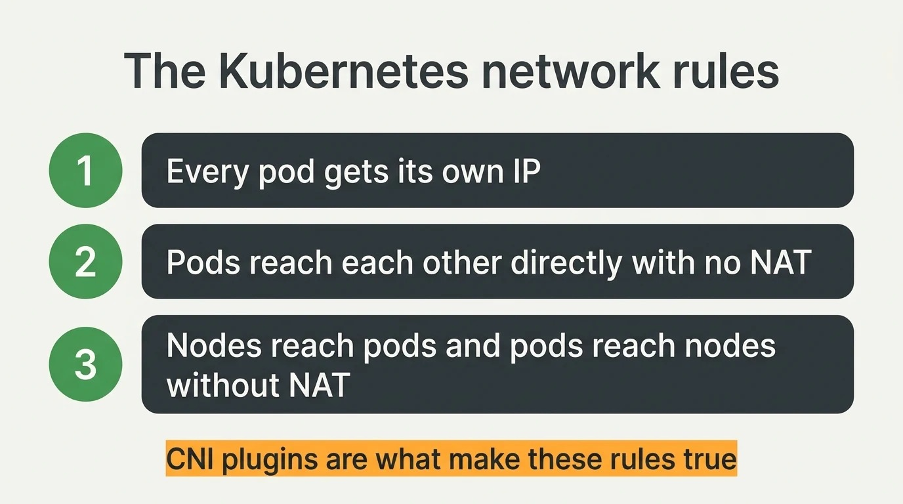
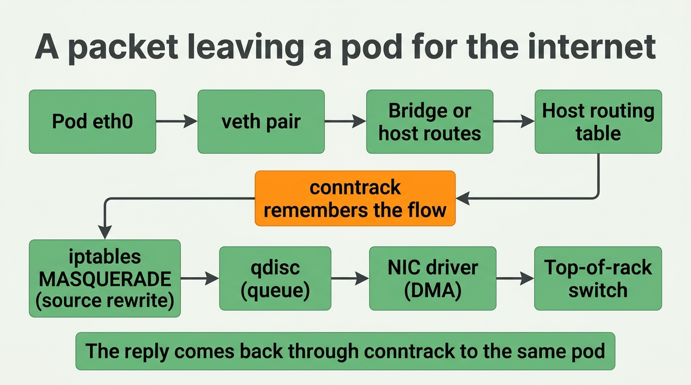
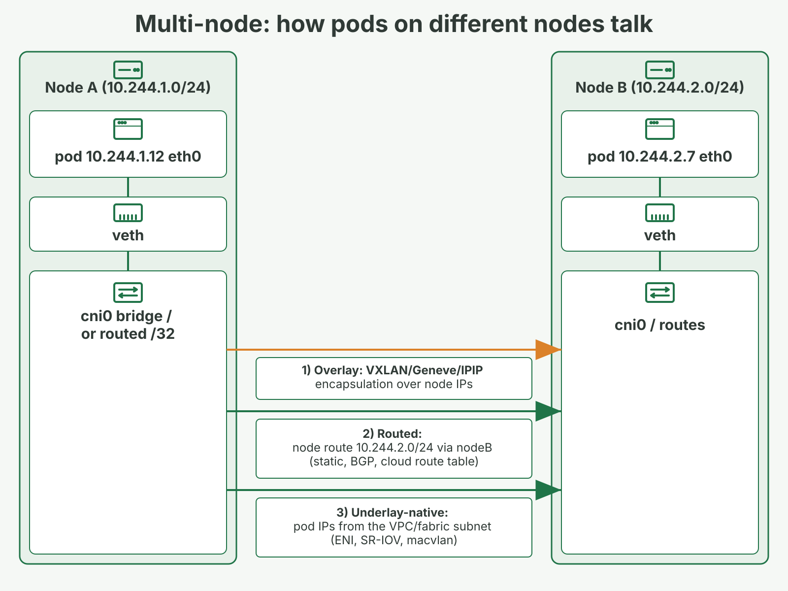
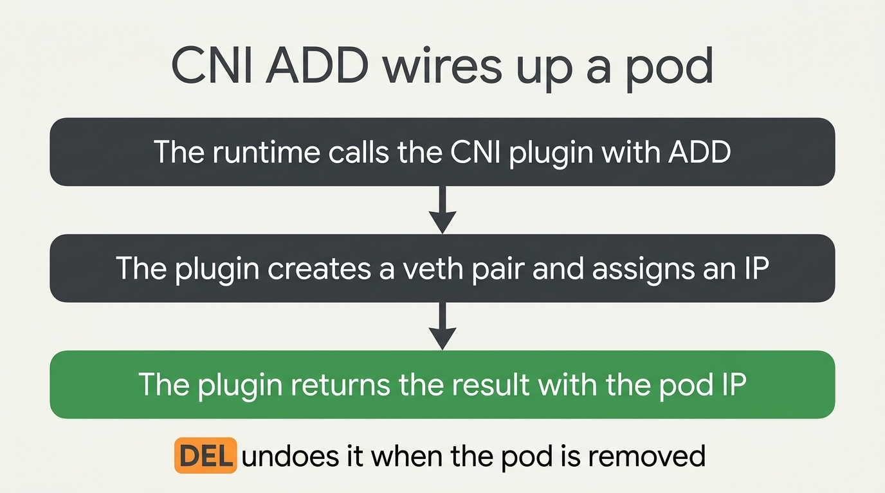

# 5.13 Pod networking under the hood: veth, bridges, routes and CNI plugins

| | |
|---|---|
| Level | Advanced |
| Priority tier | 0 |
| Lab venue | Linux VM (root); iproute2, `bridge`, `nsenter`, `tcpdump`, `ethtool`; Kubernetes cluster with Calico/Flannel/Cilium; optional ConnectX NIC with SR-IOV |
| Part | Part 5: Kubernetes |
| Status | Drafted, labs **untested** |

## Why this matters for AI infrastructure

A distributed training job is only as fast as its network. Collective operations move gigabytes on every step. How each pod attaches to the network decides whether it gets line rate or only a fraction of it.

Think about what happens inside one training step. Each GPU finishes its share of the math, and then the GPUs trade their results so that all of them end up with the same updated weights. That exchange is the collective. If one GPU's network path is slow, every other GPU waits for it at the end of the step. The fast GPUs sit idle while the slow link finishes, so one weak path slows the whole job. That is why a pod's network path is a training question, and not only a platform question.

The default pod network relies on veth, bridge or overlay devices, and on iptables or eBPF. It is built for general microservices connectivity and policy, not for 400 Gb/s RDMA. So GPU clusters use a layered design. A CNI handles the control and general traffic. Secondary high-performance interfaces, such as SR-IOV VFs, macvlan on RDMA NICs or host networking, carry the NCCL traffic.

You cannot debug connectivity problems or design GPU network attachments well without understanding three things. You need to know how a pod's interface is created and how packets leave the node. You also need to know where MTU is lost and how to inspect all of it. Decide early which traffic goes through the CNI and which goes through a secondary interface.

## Prerequisites and outcomes

This chapter builds on 5.8, 5.10 and Part 2. From Part 2 you need Ethernet, IP routing, network namespaces (2.25), Linux networking (2.22 to 2.24) and VLANs and bridges (2.11). The rest of the chapter assumes these, so review them first. The list below is a self-check, not a test you must pass in order. Each line names one ability that a platform engineer uses when a pod cannot reach something.

- State the Kubernetes network model and what it requires from a CNI. The model says every pod has its own IP, that pods communicate without NAT, and that nodes and pods communicate without NAT.
- Reproduce a pod network by hand with `ip netns`, veth pairs, bridges and routes. Then map each primitive to what a CNI plugin does.
- Explain the CNI spec: the config JSON, ADD/DEL/CHECK/VERSION, environment variables, result, chaining and IPAM plugins. Read CNI configs and logs with that understanding.
- Compare the implementation families: bridge with host-local, routed (Calico BGP), overlay (VXLAN, IP-in-IP or Geneve), eBPF (Cilium) and cloud VPC-native (ENI or alias IP). Note the MTU, performance and policy implications of each.
- Describe multi-network pods (Multus), macvlan and ipvlan, SR-IOV with a device plugin, RDMA (shared device plugin, `rdma-cni`) and host networking. Explain how AI workloads use them.
- Inspect and debug pod networking on a node. Check interfaces, routes, neighbours, bridges, MTU, conntrack and flow tracing.

## 1. The Kubernetes network model

Imagine a cluster where pods run on many nodes. Any pod still needs to reach any other pod directly, with no translation step in between. The model sets four requirements to make that work. It calls this the "IP-per-pod" model.



*Figure 5.13.1. Every pod gets its own IP. Pods reach each other directly with no NAT.*

1. Every pod gets a unique IP in a cluster-wide address space. Containers in a pod share that IP.
2. Pods can reach all other pods on any node **without NAT**. The destination sees the sender's pod IP as the source.
3. Agents on a node, such as the kubelet and system daemons, can reach all pods on that node. Pods in the host network namespace can talk to all pods without NAT.
4. Services are virtual IPs layered on top, through kube-proxy or the CNI datapath (5.10). NetworkPolicy is optional, and the CNI implements it (5.15).

The no-NAT rule is easier to see with an example. Suppose pod `10.244.1.12` on Node A calls pod `10.244.2.7` on Node B. The request carries `10.244.1.12` as its source address. Because nothing rewrites that address on the way, Pod B's logs show the real caller, and Pod B's replies go straight back to `10.244.1.12`. If a NAT step rewrote the source to the node's own IP, both of those things would change, and the caller would be hidden behind the node.

Kubernetes itself implements none of this. Kubernetes describes what should be true, and the node does the work. When the kubelet starts a pod, it asks the **container runtime** to create the pod sandbox, which is the network namespace that the pod's containers will share. The runtime then invokes a **CNI plugin** (5.8), and the plugin builds the connectivity. Something must also route pod CIDRs between nodes: the CNI, the cloud or your network fabric. Settle early which of these does that job, because if nobody does it, pods on different nodes cannot reach each other.

## 2. Building pod networking by hand

Suppose a node runs two pods and you want to see what the CNI actually builds for them. You can reproduce the setup yourself, one primitive at a time. A pod's network namespace is a separate copy of the network stack, with its own interfaces, routing table, iptables and sockets. To connect that copy to the node, the CNI creates a **veth pair**. A veth pair is a virtual Ethernet cable: packets that enter one end come out the other. One end goes inside the namespace as `eth0`, and the other stays on the host.



*Figure 5.13.2. From pod to internet: veth, host routing, source rewrite, then the NIC.*

The script below simulates two pods on one node. A bridge joins them, and their egress uses NAT. Read it top to bottom: it creates the namespaces and the bridge, adds one veth pair per pod, then tests pod-to-pod and egress traffic.

```bash
# Simulate two "pods" on one node, connected by a bridge, with NAT for egress
sudo ip netns add pod1; sudo ip netns add pod2
sudo ip link add cni0 type bridge && sudo ip addr add 10.244.1.1/24 dev cni0 && sudo ip link set cni0 up

for n in 1 2; do
  sudo ip link add veth-pod$n type veth peer name eth0 netns pod$n              # veth pair: one end in the namespace
  sudo ip link set veth-pod$n master cni0 && sudo ip link set veth-pod$n up     # host end plugged into the bridge
  sudo ip -n pod$n addr add 10.244.1.1$n/24 dev eth0
  sudo ip -n pod$n link set eth0 up && sudo ip -n pod$n link set lo up
  sudo ip -n pod$n route add default via 10.244.1.1                              # gateway = bridge IP
done
sudo ip netns exec pod1 ping -c2 10.244.1.12                                     # pod to pod: L2 via bridge
sudo sysctl -w net.ipv4.ip_forward=1
sudo iptables -t nat -A POSTROUTING -s 10.244.1.0/24 ! -o cni0 -j MASQUERADE     # egress SNAT to the node IP
sudo ip netns exec pod1 ping -c2 8.8.8.8
```

Before you read the table, walk through the script once in your head. The first line builds the rooms. `ip netns add` makes two network namespaces, which are separate copies of the network stack, and `cni0` is the switch that they will share. The loop then does the same work for each pod. It creates a veth pair, plugs the host end into the bridge, names the pod end `eth0` inside the pod's namespace, and sets the pod's address and default gateway. The gateway is the bridge's own address, `10.244.1.1`, so every packet a pod sends outside its own subnet goes to the bridge first.

Follow one ping to see what happens. When `pod1` (`10.244.1.11`) pings `10.244.1.12`, the destination sits in the same /24, so `pod1` sends the frame directly. It first needs the other pod's MAC address, which it gets through ARP on the local link. The bridge then passes the frame out the other pod's veth, and no routing or NAT is involved. When `pod1` pings `8.8.8.8`, the destination is outside the subnet. The packet therefore goes to the gateway, `cni0`. The MASQUERADE rule rewrites the source address from `10.244.1.11` to the node's own address on the way out. Replies come back to the node, and the connection tracking entry sends them on to `pod1`.

This is what the simple `bridge` CNI plugin does for a single node. The table below lists each primitive and its role. Notice that the bridge handles traffic between local pods, while routing and overlay devices take over once pods on different nodes must talk.

| Primitive | Role in pod networking |
|---|---|
| **Network namespace** | Pod's isolated stack, created by the runtime, shared by all containers in the pod (the pause container holds it) |
| **veth pair** | Point-to-point link between pod namespace and host (or bridge/OVS port) |
| **Bridge (L2 switch)** | Connects all local pods' host-side veths; learns MACs (`bridge fdb`); proxy ARP/hairpin options |
| **Routing** | Per-pod /32 routes on the host to the veth (routed designs), or a node route for the pod CIDR |
| **Overlay device** (vxlan0, geneve, tunl0) | Encapsulates pod traffic between nodes over the underlay |
| **iptables/nftables/eBPF** | NAT (masquerade for egress), policy, kube-proxy Service rules |
| **IPAM** | Allocates pod IPs (host-local ranges per node, cluster-pool, cloud ENI IPs) |

### Multi-node: how pods on different nodes talk

Each node owns a slice of the pod CIDR. The `node.spec.podCIDR` field records that slice. For example, node A might own `10.244.1.0/24` and node B `10.244.2.0/24`. Packets can cross between the two nodes in three ways, and the diagram shows all three.



*Figure 5.13.3. Multi-node: how pods on different nodes talk, as a diagram.*

1. **Overlay**, using Flannel VXLAN, Calico VXLAN or IPIP, Cilium VXLAN or Geneve, or Weave. It works on any L3 network. The cost is encapsulation overhead. VXLAN adds 50 bytes, which reduces the MTU. Encapsulation and decapsulation also take CPU, though modern NICs can offload that work. Overlays make traffic harder to see.
2. **Routed (L3, no encapsulation)**. Nodes learn pod CIDR routes in one of three ways: BGP, from Calico, Cilium BGP or kube-router; static routes; or cloud route tables. The `host-gw` option in Flannel works only when nodes share L2. This design gives the best performance and clean traceability. It does require control of the underlay, or BGP peering with ToR switches. It fits leaf-spine fabrics that run BGP to hosts, as covered in 2.15 and 2.16.
3. **VPC-native or underlay IPs**. Pods get routable IPs straight from the fabric. Examples are the AWS VPC CNI with ENI secondary IPs, GKE alias IPs, Azure CNI, and SR-IOV or macvlan on a physical NIC. There is no overlay and no NAT. The limits are NIC and IP quotas, and how far IPAM scales.

Notice what each family does to the same packet. In the overlay case, the pod packet is wrapped inside an outer packet between node addresses, and the wrapper is removed on arrival. In the routed case, the packet travels unchanged, and the route table on each node picks the next hop. In the underlay-native case, the fabric already knows the pod's address, so the node does nothing special. Each family moves the complexity to a different place: the tunnel, the routing protocol, or the cloud's IP plan.

Chapter 5.14 covers each family in detail.

James Strong and Vallery Lancey show in *Networking and Kubernetes*, chapter 6, *Kubernetes and Cloud Networking*, that subnet sizing must be planned before cluster creation. Josh Rosso and co-authors make the same point about workload routability in *Production Kubernetes*, chapter 5, *Pod Networking*. Two rules follow from this.

- **Subnet Netmask Sizing Formula, from *Networking and Kubernetes*, chapter 6, Table 6-2:** When you size a node subnet, you reserve 4 addresses for network, gateway, broadcast and cloud reserved use. The maximum number of nodes $N$ for an IPv4 prefix length $S$ is then given by this formula:
  `N = 2^(32 - S) - 4  <==>  S = 32 - ceil(log2(N + 4))`
  Take a worked example. Supporting $N = 250$ nodes requires $S = 32 - \lceil \log_2(254) \rceil = 24$. That is a `/24`, which gives 252 usable IPs. In VPC-native mode, Pods also draw IPs or `/24` alias blocks from the VPC. So size the secondary Pod CIDR, such as `10.244.0.0/14` or `/16`, for peak `nodes * maxPods`.
- **Workload Routability and Pod-to-Pod Encryption Trade-offs, from *Production Kubernetes*, chapter 5:** Making Pod IPs routable on the corporate WAN sounds convenient. It exhausts enterprise RFC 1918 address space, though, and it exposes ephemeral Pod IPs beyond the cluster boundary. Keep Pod CIDRs internal to the cluster, and expose services through LoadBalancers or Gateways (5.12). The same care applies to encryption. Before you enable CNI-level WireGuard or IPsec across all Pod traffic, check whether your underlay or service mesh already encrypts traffic. Then account for the 50–60 byte MTU reduction and the CPU overhead on high-bandwidth GPU flows.

Decide which family fits your fabric before you size the pod CIDRs.

The order matters because the family changes what the CIDR has to hold. An overlay can hide a large pod range inside a small underlay, since only node addresses cross the network. A routed design makes every pod block a route that the fabric must learn, so the block sizes show up in the routing tables. A VPC-native design takes each pod address from the cloud's subnet, so the subnet size becomes the pod limit. Sizing the CIDR before you choose the family means guessing at one of those three limits.

## 3. The CNI specification

Suppose a new node joins the cluster and stays `NotReady`, with a message that the CNI plugin is not initialized. The kubelet is running, and so is the runtime. What is missing is the piece that wires pods into the network. To know where to look, you need to understand the contract the runtime uses to call that piece.



*Figure 5.13.4. The runtime calls the CNI plugin with ADD. The plugin wires the network and returns the IP.*

CNI, the Container Network Interface, is a CNCF project. It is a minimal contract between a container runtime and a plugin executable. Think of the runtime as a building manager who calls in an electrician. The manager hands over a work order, which is the network config, along with a few labelled notes, which are the environment variables. The electrician does the wiring and then writes back a receipt that says what was installed. The plugin sets up the network and reports back what it built, in the same way.

The runtime reads its network config from `/etc/cni/net.d/*.conflist`. The first file in lexicographic order wins for the primary network. The example below chains three plugins in one config: calico, portmap and bandwidth.

```json
{
  "cniVersion": "1.0.0",
  "name": "k8s-pod-network",
  "plugins": [
    { "type": "calico",
      "ipam": { "type": "calico-ipam" },
      "policy": { "type": "k8s" },
      "kubernetes": { "kubeconfig": "/etc/cni/net.d/calico-kubeconfig" },
      "mtu": 1450 },
    { "type": "portmap", "capabilities": { "portMappings": true }, "snat": true },
    { "type": "bandwidth", "capabilities": { "bandwidth": true } }
  ]
}
```

Read the JSON as a pipeline. The first plugin, `calico`, creates the pod's interface and asks `calico-ipam` for an address. Its `mtu` of 1450 is the value the chapter's MTU arithmetic gives for a 1500-byte underlay with VXLAN overhead (section 5). The next two plugins, `portmap` and `bandwidth`, run after it and read what it produced. That is why the order in the list matters. Each plugin builds on the result of the one before it.

The plugin executables live in `/opt/cni/bin`. That directory holds bridge, host-local, loopback, portmap, bandwidth, tuning, macvlan, ipvlan, vlan, ptp, sbr, vrf, static, dhcp and firewall. It also holds vendor binaries: calico, cilium-cni, flannel, aws-cni, multus, sriov and rdma.

The runtime runs the plugin with environment variables and passes the network config on stdin. You can think of the environment variables as the header on the work order. They say which command to run, which sandbox to wire, and which namespace to wire it into. The table below lists those variables. You can read them as the plugin's inputs.

| Env var | Meaning |
|---|---|
| `CNI_COMMAND` | `ADD`, `DEL`, `CHECK`, `VERSION` (and `GC`/`STATUS` in newer specs) |
| `CNI_CONTAINERID` | Sandbox ID |
| `CNI_NETNS` | Path to the network namespace (`/var/run/netns/cni-...`) |
| `CNI_IFNAME` | Interface name to create (`eth0`) |
| `CNI_ARGS` | Extra args: `K8S_POD_NAMESPACE=...;K8S_POD_NAME=...;K8S_POD_INFRA_CONTAINER_ID=...` |
| `CNI_PATH` | Where to find other plugins (for IPAM delegation and chaining) |

`ADD` returns a JSON result with `interfaces`, `ips`, `routes` and `dns`. Your plugin must be idempotent. It also has to handle partial failure, and it must treat a `DEL` for state that does not exist without failing. Plugins in a `conflist` run in sequence, and each one receives the previous result as `prevResult`. The main plugin sets up connectivity first. After that, `portmap` adds hostPort DNAT, `bandwidth` applies tc shaping, `tuning` sets sysctls and `firewall` adds rules.

IPAM plugins allocate the addresses, and the main plugin calls one through `ipam.type`. The options are `host-local`, which keeps per-node ranges in `/var/lib/cni/networks/<net>/`; `dhcp`; `static`; Calico block IPAM; Whereabouts, for cluster-wide ranges on secondary networks; and Cilium CRD-based IPAM.

Start by listing the config and plugin directories with `ls /etc/cni/net.d /opt/cni/bin`. To debug a plugin, run it by hand, as shown below.

```bash
sudo CNI_COMMAND=ADD CNI_CONTAINERID=test CNI_NETNS=/var/run/netns/pod1 CNI_IFNAME=eth0 CNI_PATH=/opt/cni/bin \
  /opt/cni/bin/bridge < /tmp/bridge.conf
cat /var/lib/cni/networks/*/*          # host-local allocated IPs (file per IP containing container ID)
journalctl -u containerd -u kubelet | grep -i cni
```

The `cat` line shows the IPs that host-local has allocated, with one file per IP that holds the container ID. The `journalctl` line pulls the CNI messages from the containerd and kubelet logs.

You will meet several failures again and again. A missing or invalid config produces "cni plugin not initialized" and leaves the node NotReady. Stale IPAM allocations after crashes cause IP exhaustion, and the fix is to clean `/var/lib/cni/networks`. A CNI binary that is not executable, or that uses the wrong spec version, also fails. So do plugin timeouts under load, and conflicting configs: when two `*.conflist` files exist, the first one in sort order wins. Leftover interfaces and netns after a runtime crash round out the list. Take the IP exhaustion case as an example. A crash leaves a file behind in `/var/lib/cni`, and `host-local` still counts that address as taken. After enough crashes, the node runs out of addresses even when only a few pods are running. The pods look healthy in the list, but the allocator has no free address to give. That is why the first check is the IPAM state, and not the pod itself.

When a pod fails to start, check the config files and the IPAM state first.

## 4. Implementation families (overview)

Suppose you are building a bare-metal GPU cluster on a leaf-spine fabric that your team controls. Nobody on the team has run a CNI before, and the network team wants to know which option to choose. The table below is the starting point for that conversation.

Every CNI makes different trade-offs, and the table compares them. Read across a row to see what a plugin gives you and what it leaves to you. Flannel is the simplest option and has no policy of its own. Calico and Cilium add rich policy, and Cilium needs a modern kernel to run.

| CNI | Data plane | Cross-node | Policy | Notes |
|---|---|---|---|---|
| **Flannel** | Linux bridge/veth; VXLAN (default) / host-gw | Overlay or L2 routes | None | Simple, minimal; pair with Calico policy ("canal") if policy needed |
| **Calico** | veth + routed /32 on host; iptables or eBPF dataplane | BGP routes (no overlay), or IPIP/VXLAN/WireGuard | Rich NetworkPolicy + GlobalNetworkPolicy | Common in bare metal; BGP peers with ToRs |
| **Cilium** | eBPF (replaces kube-proxy/iptables), veth with tc/XDP programs | Native routing, VXLAN/Geneve, BGP control plane | NetworkPolicy + L7 policy, Hubble observability, ClusterMesh | Needs modern kernel; powerful, complex |
| **Weave** | Overlay (sleeve/fastdp) | VXLAN-like | NetworkPolicy | Largely unmaintained |
| **AWS VPC CNI** | ENI secondary IPs, veth, host routes | VPC native | Via Calico/Cilium or SG for pods | IP-per-pod limits by instance type |
| **GKE/Azure CNI** | Native VPC alias IPs / vnet IPs | Native | Provider policy | |
| **Multus** | Meta-plugin: attaches additional interfaces defined by NetworkAttachmentDefinition CRDs | n/a | n/a | Basis for secondary networks (RDMA, SR-IOV) |
| **kube-router, OVN-Kubernetes, Antrea, Kube-OVN** | BGP+IPVS / OVS-based | Geneve/BGP | Policy | Alternatives for specific needs (OVN-K is OpenShift default) |

The next chapter, 5.14, goes deeper on overlay and routed designs and on eBPF. Chapter 5.15 covers policy enforcement.

## 5. MTU, performance and offloads

A common surprise goes like this. Pods can ping each other, and short API calls succeed, but a large image pull or a `git clone` hangs halfway through. The cause is almost always MTU.

MTU, the maximum transmission unit, is the largest packet a link can carry. Think of it as the width of a doorway. A tunnel wraps each parcel in an extra layer of packaging, so a parcel that fits through an empty doorway may no longer fit once it is boxed. An encapsulated pod packet needs room for its outer headers. So the inner pod MTU equals the underlay MTU minus the encapsulation overhead. The overhead depends on the tunnel: VXLAN 50 bytes, Geneve about 50 or more, IPIP 20, WireGuard 60, and IPsec ESP about 50 to 70.

If you run a 1500-byte underlay, subtract the 50 bytes of VXLAN overhead and the pods get 1450 bytes. With a jumbo underlay of 9000 bytes, the same subtraction gives 8950 bytes for pods.

The arithmetic is simple, but it is easy to run backwards. You subtract the overhead from the underlay to get the pod MTU. You never add the overhead to the pod's size. A pod set to 1500 on a VXLAN network has an outer packet of 1550 bytes, and the underlay does not carry packets that large.

A mismatch does not fail loudly. It blackholes large packets, which shows up as PMTUD failures. PMTUD, Path MTU Discovery, is the normal way a sender learns the smallest MTU along a path. A router that cannot forward a packet sends back an ICMP "fragmentation needed" message, and the sender shrinks its packets. When a firewall blocks that message, the sender never learns, and it keeps sending packets that are silently dropped. Small requests still work, so the symptoms look strange: TLS handshakes hang, large HTTP responses stall, and `ping -s` shows a size threshold. Set the MTU consistently in the CNI config or Helm values. Then verify it end-to-end with `ping -M do -s <size>` across nodes (2.7). If your GPU nodes use 9000-byte frames on the data network, you configure the MTU of the secondary interfaces separately.

Overhead is the next concern. Each veth traversal adds CPU per packet, costing two extra softirq contexts. A bridge with iptables conntrack adds latency, and kernel TCP tuning matters too. eBPF host routing (`bpf.hostRouting`, or "netkit" devices) skips iptables and the upper stack, which lowers latency. Offloads matter as well: GRO, GSO and TSO on veth and NICs, UDP segmentation offload for VXLAN (`tx-udp_tnl-segmentation`), and checksum offload. For multi-queue scale, tune RPS, RFS and XPS, and set IRQ affinity.

Throughput sets expectations. Pod-to-pod traffic over VXLAN on 25 to 100 Gb/s NICs often reaches only a fraction of line rate without tuning. Routed or eBPF native routing approaches line rate for large flows. None of these match RDMA's latency and CPU efficiency, which is why GPU collectives use secondary RDMA networks.

The reason lies in the path a packet takes. On a normal TCP connection, every packet passes through the kernel's network stack on both ends, and each pass costs CPU time. RDMA hands the network card a request and lets the card move the data directly, so the CPU stays out of the loop for most of the work. The CNI path, with its veth, bridge and encapsulation steps, keeps the kernel in the middle of every packet. That is fine for web traffic and too slow for the synchronised bursts that a training step produces.

Separate control-plane traffic from bulk traffic. Keep storage and collective traffic off the CNI where possible. Set the MTU consistently before you tune anything else.

Think of the traffic on a node as a road system. Control traffic is like the ambulance lane, which must never be blocked, and bulk traffic is the freight lane, which can be busy. Mixing them on one lane means a large freight burst can delay the ambulance. Separating them keeps the critical path predictable, and it makes each network easier to measure.

## 6. Secondary networks, SR-IOV and RDMA for AI

Picture a training pod that must send gradients to its peers many times a minute. The general-purpose network is built for ordinary service traffic, so the pod needs a second, faster path for its NCCL traffic. Kubernetes gives you that through Multus and a few related pieces.

### Multus and NetworkAttachmentDefinition

Multus is a "meta CNI". It invokes the primary CNI for `eth0`. Then it runs additional CNI plugins for the networks that the pod annotation `k8s.v1.cni.cncf.io/networks` requests.

```yaml
apiVersion: k8s.cni.cncf.io/v1
kind: NetworkAttachmentDefinition
metadata:
  name: rdma-net-a
  namespace: training
  annotations: { k8s.v1.cni.cncf.io/resourceName: nvidia.com/rdma_shared_device_a }
spec:
  config: |
    {
      "cniVersion": "0.3.1",
      "name": "rdma-net-a",
      "type": "macvlan",
      "master": "ens1f0np0",
      "mode": "bridge",
      "mtu": 9000,
      "ipam": { "type": "whereabouts", "range": "192.168.10.0/24", "exclude": ["192.168.10.0/30"] }
    }
---
apiVersion: v1
kind: Pod
metadata:
  name: nccl-worker
  annotations:
    k8s.v1.cni.cncf.io/networks: rdma-net-a, rdma-net-b      # attach secondary interfaces net1, net2
spec:
  containers:
    - name: worker
      image: nvcr.io/nvidia/pytorch:24.05-py3
      securityContext: { capabilities: { add: [IPC_LOCK] } }
      resources:
        limits:
          nvidia.com/gpu: 8
          nvidia.com/rdma_shared_device_a: 1
          nvidia.com/rdma_shared_device_b: 1
```

Read the pod's annotation as a request list. Multus does not invent networks. It looks up each name in the annotation, finds the matching NetworkAttachmentDefinition, and attaches one interface per name. The `resources` limits do a different job. They ask the scheduler to place the pod on a node that has a free RDMA device, so the pod never lands on a node that has the network but no device left to give it.

The NetworkAttachmentDefinition describes a macvlan network on `ens1f0np0` with a 9000-byte MTU. The pod asks for `rdma-net-a` and `rdma-net-b`, and Multus attaches them as `net1` and `net2`. The resource limits ask for 8 GPUs and one device from each of the two RDMA pools.

Secondary interfaces come in several types, and each suits a different job.

- **macvlan or ipvlan** on a physical RDMA-capable NIC gives the pod its own MAC and IP on that NIC. This is kernel networking only, unless you also expose RDMA devices through the **RDMA shared device plugin**. That plugin exposes `/dev/infiniband/uverbs*` and `rdma_cm` to the pod. The combination works for RoCE on Ethernet. InfiniBand uses `ib-sriov-cni` or IPoIB instead.
- **SR-IOV** works through Virtual Functions. A ConnectX NIC exposes Virtual Functions (VFs). The **SR-IOV network device plugin** advertises them as resources such as `nvidia.com/sriov_vf`, and the **SR-IOV CNI** moves a VF into the pod's namespace. The pod gets near-native performance and its own RDMA device, with control over the GID and PKey. The Network Operator or `sriov-network-operator` sets the VF count and the mode, which is legacy or switchdev.
- **Host device or host networking** uses `hostNetwork: true`, and those pods use node interfaces directly. This is the simplest setup for NCCL, which you tune with `NCCL_SOCKET_IFNAME` and `NCCL_IB_HCA`. The trade-off is weaker isolation, which makes multi-tenancy harder.
- **NVIDIA Network Operator** automates the setup. It deploys the MOFED driver container, the RDMA shared device plugin, the SR-IOV device plugin, Multus, the CNI plugins, Whereabouts or NV-IPAM, and the secondary network custom resources `HostDeviceNetwork`, `MacvlanNetwork` and `IPoIBNetwork`. Part 12 covers it.
- **GPUDirect RDMA and NCCL** inside pods need several things. The GPU and NIC must sit on the same PCIe root or NUMA node, which topology alignment (5.9) covers. The host needs `nvidia_peermem`. The container needs RDMA device nodes, and `memlock` must be unlimited. `NCCL_IB_HCA` and `NCCL_SOCKET_IFNAME` must be set correctly, and the MTU and GID index must match for RoCE. Part 12 covers these details.
- **Rail-optimized** designs map each GPU to its own NIC, which is called a rail. The pod attaches one secondary interface per rail. Naming and ordering must be deterministic, so the rank → GPU → NIC mapping is preserved.

### DPUs and OVS offload

BlueField DPUs can run OVS or OVN-Kubernetes datapaths in hardware. With switchdev and hardware flow offload, pods get VF representors. Policy and encapsulation then run on the DPU instead of the host CPUs. This matters for multi-tenant AI clouds, which Parts 9 and 12 cover.

Decide which secondary interface type each workload needs before you write its pod spec.

A simple way to choose is to ask three questions in order. Does the workload need isolation from other tenants? If yes, SR-IOV is the strongest option, because each pod gets its own hardware function. Does it need RDMA but can share the NIC with its neighbours? Then macvlan with the shared device plugin is usually enough. Is it a single-tenant node that owns all eight GPUs? Then host networking is the simplest path, and it accepts the weaker isolation that comes with it.

## 7. Inspecting pod networking on a node

When a pod cannot reach something, work outward from the pod. Find its network namespace first. Then check the interfaces, routes and rules on each side of the veth pair, and trace the packets as they leave the node. The block below follows that order.

```bash
# Which netns/pod?
crictl pods --name my-pod -q; crictl inspectp <id> | jq -r '.info.runtimeSpec.linux.namespaces[]|select(.type=="network").path'
sudo lsns -t net; ip netns list                      # CNI netns are named cni-<uuid> (may need `ln -s /var/run/netns`)
# Inside the pod's namespace
sudo nsenter --net=/var/run/netns/cni-xxxx ip -br addr; sudo nsenter --net=... ip route; sudo nsenter --net=... ss -ltnp
sudo nsenter --net=... ethtool -S eth0 | head       # veth peer_ifindex statistic
# Find the host side veth
ip -br link | grep -E '^veth|^cali|^lxc|^cni'
ip -d link show cali1234abcd                         # shows link-netnsid and peer
cat /sys/class/net/cali1234abcd/ifindex; sudo nsenter --net=... cat /sys/class/net/eth0/iflink   # match to find the pair
# Host routes / bridge / overlay
ip route | grep -E '10.244|blackhole|tunl0|vxlan'
ip neigh; bridge fdb show | head; bridge link
ip -d link show vxlan.calico | head; ip -s link show flannel.1
# Policy / NAT / conntrack
iptables-save | grep -E 'cali|KUBE' | head -30
nft list ruleset | head -60
conntrack -L | head
# Trace and capture
sudo tcpdump -ni cali1234abcd -w /tmp/pod.pcap
sudo tcpdump -ni any host 10.244.2.7 and icmp
sudo ip netns exec cni-xxxx tcpdump -ni eth0
ping -M do -s 1422 10.244.2.7                        # MTU test for 1450 path
```

Here is how the first block reads in practice. Suppose `my-pod` cannot reach a pod on another node. The first command gives you the path of the pod's network namespace. You then run `ip -br addr` inside that namespace to check that `eth0` has the address you expect. Next you find the host side of the veth by matching the `ifindex` and `iflink` numbers. Each command answers one question: which namespace, which address, which host interface, which route, and where the packet goes next.

If you run Cilium, check its state with `cilium status`, `cilium endpoint list`, `cilium bpf endpoint list`, `hubble observe --pod ns/pod` and `cilium monitor --type drop`. If you run Calico, use `calicoctl node status` to see the BGP peers, then `calicoctl get workloadendpoint -o wide`, `ip route` to find `proto bird` routes, and the Felix logs. Find the pod's namespace before anything else, because every other command depends on it.

## 8. Troubleshooting matrix

Pod networking problems look alike from the outside, so start from the symptom you can see. Find the row that matches it, then run the check in the last column. A single symptom can have more than one cause, so the last column gives you the first check to run, not the only one. Work through the row, and if the check comes back clean, move to the next likely cause. Find the row that matches it, then run the check in the last column. The rows below cover the failures you are most likely to meet.

| Symptom | Likely cause | Check |
|---|---|---|
| Node `NotReady` "cni plugin not initialized" | CNI not installed/misconfigured | `/etc/cni/net.d`, CNI DaemonSet logs |
| Pod stuck `ContainerCreating` "failed to set up sandbox" | CNI ADD failure, IPAM exhausted, MTU/sysctl error | kubelet/containerd logs, `/var/lib/cni`, IP pool usage |
| Pod can reach node but not other pods | Overlay port blocked (UDP 4789/8472), wrong MTU, no routes between nodes, policy | `ip route`, firewall, `tcpdump` on underlay, BGP status |
| Pods on same node OK, cross-node fail | Cross-node path (routes/encap) | node routes for remote CIDR; VXLAN FDB entries; BGP |
| Pod to Internet fails | Missing masquerade/NAT, route, DNS | `iptables -t nat -L POSTROUTING`, node egress, CNI `natOutgoing` |
| Large transfers stall; small OK | MTU mismatch / PMTUD blocked | `ping -M do -s`, set CNI MTU, check ICMP frag-needed |
| Intermittent drops under load | conntrack full, softirq/CPU saturation, ring buffers | `conntrack -S`, `nstat`, `ethtool -S`, `mpstat`, IRQ balance |
| Duplicate/stale IPs | IPAM leaks after crashes | clean allocations, `calicoctl ipam check`, GC |
| Hairpin/same-pod Service fails | Bridge hairpin mode off | `bridge link` hairpin flag; CNI `hairpinMode` |
| Secondary interface missing | Multus annotation typo, NAD namespace/name, device plugin resource not allocated | `kubectl describe pod`, `k8s.v1.cni.cncf.io/network-status` annotation, Multus logs |
| NCCL falls back to TCP | RDMA device not in container, GID/MTU/topology, `NCCL_IB_DISABLE`, peermem | `NCCL_DEBUG=INFO`, `ibv_devinfo`, `ib_write_bw` in pod (Part 12) |
| Slow pod network on VXLAN | Offloads disabled, small MTU, CPU-bound encap | `ethtool -k`, `mpstat`, switch to native routing/eBPF |

Match the symptom first, and only then run the check in the last column. If a large transfer stalls while small requests work, the MTU row is the one you should test first.

Here is how the matrix works during an incident. A team reports that `pip install` hangs on a training pod, but a health check on the same pod responds at once. The symptom says small packets work and large ones do not. That points at the MTU row, so the first check is `ping -M do` at increasing sizes. When the largest size that succeeds matches the MTU you computed, the problem is confirmed, and the fix is to set the CNI MTU consistently. The matrix saves time because it narrows the search before you touch anything.

## 9. Lab

Start with the self-checking Python lab, which you can run locally: `code/part05/cni_pod_networking_sim_lab.py`. Run it as shown below. The lab checks three things. First, the CNI encapsulation MTU and the `ping -M do -s` DF payload calculator, through `compute_pod_mtu_and_df_ping` and `compute_subnet_prefix_for_nodes`, which follow *Networking and Kubernetes* chapter 6 and *Production Kubernetes* chapter 5. Second, the `host-local` and `Whereabouts` IPAM allocator, `CNIHostLocalIPAM`, covering excluded ranges, exhaustion and `DEL` cleanup. Third, the Multus secondary RDMA rail interface planner, `plan_multus_pod_interfaces`.

```bash
python3 code/part05/cni_pod_networking_sim_lab.py
```

The lab is the place where the chapter becomes concrete. Reading that a veth pair connects two namespaces is one thing. Running the commands and watching a ping cross the bridge is another, and most engineers remember the second far better than the first. Start with the simulated node, then move to a real VM when you are comfortable with each step.

Next, take the exercises below to a Linux VM or a Kubernetes cluster. The interactive steps were not run on live hardware while this chapter was written, so treat each result as something to confirm on your own machine.

1. Reproduce the bridge example with two namespaces. Which step gives each pod its gateway?
2. Add a third namespace on a second "node", which is a second VM. Connect the two nodes with static routes and no overlay. Repeat with VXLAN, using `ip link add vxlan0 type vxlan id 42 remote <peer> dev eth0 dstport 4789`. Verify with `tcpdump` on the underlay and show the encapsulation. Measure the MTU effects with `iperf3`.
3. Read a real CNI on a kubeadm cluster. List `/etc/cni/net.d`, the binaries, and `/var/lib/cni`. Call the `bridge` plugin by hand with `CNI_COMMAND=ADD` for a test namespace. Inspect the veth, the routes and the IPAM files, then run `DEL`.
4. Trace a packet between pods on different nodes under Flannel VXLAN, Calico IPIP or VXLAN, and Calico BGP. If you can peer with FRR containers or VMs, do that too (2.27). Record the headers at each hop: the pod veth, the node interface and the underlay. Then compare the MTU and encapsulation.
5. Set the CNI MTU too high and reproduce the stalled transfers. Diagnose them with `ping -M do`. Fix the MTU, then verify with iperf at various sizes.
6. Shrink the per-node pod CIDR, or create many pods, and watch for `failed to allocate for range`. Then recover.
7. Install Multus. Create two NetworkAttachmentDefinitions, one macvlan on a spare NIC or VLAN and one `ipvlan`. Attach them to a pod. Verify `net1`, the IP from Whereabouts, and connectivity between pods on different nodes. Read the `network-status` annotation.
8. On hardware with a ConnectX NIC, enable VFs and deploy the SR-IOV network operator or device plugin. Attach a VF to a pod. Run `ib_write_bw` between two pods, and compare with the primary CNI using `iperf3`. Then run `all_reduce_perf` with `NCCL_IB_HCA` set to the pod's device.
9. Measure pod-to-pod throughput and latency with `iperf3`, `netperf` and `sockperf` over each CNI mode. Toggle offloads, RPS and MTU as you go. Record the CPU usage per Gb/s.
10. Break each of these in turn: the CNI config file, the overlay UDP port, a node route, an IPAM file and the MTU. Use the matrix above to diagnose each one. Then clean up at the end. Remove the namespaces, bridges and VXLAN devices, and restore the CNI config.

## 10. Common mistakes

- Assuming Kubernetes handles pod networking. The node still needs a working CNI and routes for pod CIDRs.
- Overlapping pod or service CIDRs with node or corporate networks.
- Running an inconsistent MTU across nodes or CNIs, and ignoring the encapsulation overhead.
- Leaving the `br_netfilter` and `ip_forward` sysctls unset on nodes.
- Running two CNI configs at once. Stale CNI state after a CNI change survives unless you clean `/etc/cni/net.d`, `/var/lib/cni`, interfaces and iptables.
- Expecting primary-CNI performance for RDMA or NCCL traffic, or running collectives over the overlay.
- Giving GPU pods secondary interfaces in an order that does not match the GPU rails.
- Using hostNetwork widely for convenience, and losing policy and isolation as a result.
- Not monitoring IPAM utilisation and per-node IP limits, especially with cloud VPC CNIs.

Most of these mistakes share one root. A pod network has several layers, and people tend to fix the layer they can see, such as the pod spec, while the fault sits in the bridge, the route or the MTU underneath it. When you feel stuck, go back to the layer list in section 2 and check each one in order.

## 11. Interview angles

Expect questions like these in an interview. A good answer starts from the layer the question names, then moves one level down at a time. Interviewers listen for a clear path from the pod to the node and from the node to the fabric, and they are less impressed by a list of tool names.

- "What is the Kubernetes network model? What does a CNI plugin actually do?"
- "Walk through pod-to-pod traffic across nodes with VXLAN vs BGP routing."
- "What are veth pairs, bridges, and network namespaces? How would you build pod networking by hand?"
- "What is Multus and why do GPU clusters use it?"
- "How do SR-IOV and RDMA devices get into a pod?"
- "Pods can ping but large downloads stall. Why?" (MTU/PMTUD.)
- "How do you debug a pod stuck in ContainerCreating with a CNI error?"
- "Why is the default CNI path not used for NCCL?"

## Exercises

1. Start with the Kubernetes IP-per-Pod network model and the hand-built pod network. Use *Networking and Kubernetes* chapter 3 and *Production Kubernetes* chapter 5 as background. State the four requirements of the Kubernetes network model from Section 1. Then trace each command in Section 2: `ip netns`, `ip link` for the veth pair and the `cni0` bridge, `ip addr`, `ip route`, `sysctl`, and `iptables -t nat MASQUERADE`. Which command gives a pod its address? Which command gives it internet egress?
2. Study the CNI specification, covering `.conflist` chaining, `ADD`, `DEL`, `CHECK` and `VERSION`, and the IPAM plugins. Use *Networking and Kubernetes* chapter 4 as the reference. Run `CNIHostLocalIPAM` from `code/part05/cni_pod_networking_sim.py`. Then explain how `/etc/cni/net.d/10-calico.conflist` chains `calico`, `portmap` and `bandwidth` through `prevResult`. Name the environment variables that the runtime passes to `/opt/cni/bin/*`. Last, explain how `host-local`, `calico-ipam` and `whereabouts` track allocations and exclusions.
3. Compare the implementation families: Flannel, Calico, Cilium, and the cloud VPC-native options (AWS ENI and GKE Alias IP). Then work through subnet sizing from *Networking and Kubernetes* chapter 6. Use `compute_subnet_prefix_for_nodes()` in `code/part05/cni_pod_networking_sim.py` to derive the subnet prefix for $N$ nodes. The formula is $S = 32 - \lceil \log_2(N + 4) \rceil$. Last, compare the overlay (`VXLAN`, `Geneve`), the routed option (`Calico` or `Cilium` BGP) and the underlay-native option (`AWS VPC CNI` or `GKE Alias IPs`). Which one would you pick for a bare-metal fabric?
4. Work through the MTU math for IPIP, VXLAN, Geneve and WireGuard, drawing on *Production Kubernetes* chapter 5. The overheads are IPIP at 20 bytes, VXLAN at 50 bytes and WireGuard at 60 bytes. Use `compute_pod_mtu_and_df_ping()` in `code/part05/cni_pod_networking_sim.py` to calculate the inner Pod MTU on a 1,500-byte underlay. Repeat the calculation for a 9,000-byte underlay. Then explain why `ping -M do -s 1422` succeeds on a 1,450-MTU VXLAN path. Explain also why `-s 1423` fails.
5. Trace the multi-network pods that GPU collectives use. Cover Multus, `NetworkAttachmentDefinition`, macvlan, SR-IOV, the RDMA shared device plugin and rail alignment. Run `plan_multus_pod_interfaces()` in `code/part05/cni_pod_networking_sim.py`. Then trace `NetworkAttachmentDefinition/rdma-net-a` and `Pod/nccl-worker` from Section 6. Last, contrast macvlan, the RDMA shared device plugin, SR-IOV VFs and `hostNetwork: true` for 8-rail, 400 Gb/s NCCL collectives over RoCEv2 or InfiniBand. Which one fits a multi-tenant cluster?
6. Inspect the node-level pod network. Use the exact commands from Section 7 to map a running Pod to its network namespace. Then find the host-side `veth` interface that matches the Pod's `eth0`, using `iflink` and `ifindex`. Inspect the routing and FDB tables. Last, diagnose the top failure modes in Section 8. Which row matches the failure you see first?

## Checkpoint questions (20)

<details>
<summary>1. What are the three fundamental rules of the Kubernetes \"IP-per-Pod\" networking model?</summary>

1. **Every Pod gets its own unique IP address** in the cluster. Containers inside that Pod share the address.
2. **All Pods can reach all other Pods on any node without NAT.** The destination Pod sees the sender's real Pod IP as the source, never a host IP that was rewritten by SNAT.
3. **Node agents on a node can reach all Pods on that node without NAT.** Those agents are `kubelet`, `kube-proxy` and host-networked daemons.
</details>

<details>
<summary>2. How does a Linux `veth` pair work, and how do you match a Pod's `eth0` inside its network namespace to its peer `cali*`/`veth*`/`lxc*` interface on the host?</summary>

A **`veth` (virtual Ethernet) pair** works like a virtual patch cable with two ends. A frame sent into one end comes out the other, even when the two ends sit in different Linux network namespaces.
To find the host-side peer of a Pod's `eth0`, follow these two steps.
1. Inside the Pod's namespace, read `cat /sys/class/net/eth0/iflink`, or run `ip link show eth0` and look for `eth0@if<N>`. The number `<N>` is the **`ifindex` of the peer interface in the host network namespace**.
2. On the host, run `ip -o link | grep "^<N>:"`, or compare the values in `/sys/class/net/*/ifindex`. That gives you the exact host interface, such as `cali1234abcd`, `lxc5678` or `veth90ab`.
</details>

<details>
<summary>3. In a bridge-based CNI (`cni0`), what happens to source and destination MAC and IP addresses when `pod1` (`10.244.1.11`) pings `pod2` (`10.244.2.7`) on a different node via native L3 routing?</summary>

1. `pod1` checks its routing table. `10.244.2.7` is outside `10.244.1.0/24`, so `pod1` ARPs for its default gateway, the `cni0` bridge IP `10.244.1.1` on Node A. It then sends the packet with **src IP `10.244.1.11`, dst IP `10.244.2.7`**, and **dst MAC = `cni0` MAC**.
2. The kernel on Node A receives the packet on `cni0`. It leaves **src IP `10.244.1.11` and dst IP `10.244.2.7` unchanged, with no NAT**. It then looks up `10.244.2.0/24 via <Node_B_IP>` in the host routing table and rewrites the L2 Ethernet header. The source MAC becomes the Node A NIC, and the destination MAC becomes the Node B NIC or the ToR router. The packet then goes to Node B.
3. Node B receives the packet and routes `10.244.2.7` to `cni0` and `veth-pod2`. It delivers the packet to `pod2`, and the source IP `10.244.1.11` is still intact.
</details>

<details>
<summary>4. How does `/etc/cni/net.d/*.conflist` selection work when multiple files exist in `/etc/cni/net.d/`?</summary>

`containerd` or `CRI-O` scans `/etc/cni/net.d/` and loads the **first valid `.conf` or `.conflist` file in lexicographical (ASCII alphabetical) order**. For example, `00-multus.conf` sorts before `05-cilium.conf`, and that sorts before `10-calico.conflist`. Suppose you switch from Calico (`10-calico.conflist`) to Flannel (`10-flannel.conflist`) and leave the Calico file in place. The Calico file sorts first, because `c` comes before `f`. As a result, `containerd` keeps invoking Calico.
</details>

<details>
<summary>5. What is CNI Plugin Chaining in a `.conflist` file, and how do `portmap` and `bandwidth` work?</summary>

In a `.conflist` file, the `"plugins": [...]` array defines an ordered pipeline of CNI binaries. They run one after another on `ADD`, and in reverse order on `DEL`.
1. **Primary plugin (`calico` / `bridge` / `cilium-cni`):** This plugin creates the `veth` pair, calls the `ipam` plugin, assigns the Pod IP and routes, and outputs a JSON result.
2. **`portmap` plugin:** This plugin receives the primary plugin's JSON output as `prevResult` on `stdin`. If the Pod spec declares any `containers[].ports[].hostPort`, it installs host `iptables` or `nftables` `DNAT` rules.
3. **`bandwidth` plugin:** This plugin reads the `kubernetes.io/ingress-bandwidth` and `kubernetes.io/egress-bandwidth` Pod annotations. It then configures Linux `tc` (`Token Bucket Filter` / `ifb`) rate-limiting queues on the Pod's `veth` interface.
</details>

<details>
<summary>6. Compare the three main CNI IPAM models: `host-local`, `calico-ipam` / `cilium` cluster-pool, and `whereabouts`.</summary>

- **`host-local`:** This model allocates IPs from the node's fixed `node.spec.podCIDR`, which is a `/24`. It stores one file per allocated IP on local disk, under **`/var/lib/cni/networks/<net-name>/<ip>`**, and each file holds the sandbox container ID. It is fast and makes no API server calls. The drawback is that after a hard node crash, stale files can leak IPs until someone cleans them up.
- **`calico-ipam` / `cilium` cluster-pool:** This model allocates CIDR blocks to nodes on demand, for example `/26` blocks of 64 IPs in Calico `IPAMBlock` CRDs. A node that runs low on IPs can borrow blocks, and blocks can be reclaimed across nodes.
- **`whereabouts`:** This is a cluster-wide IPAM plugin that stores its state in Kubernetes CRDs, `IPPool` and `OverlappingRangeIPReservation`. You use it with **Multus secondary networks** such as `macvlan`, `ipvlan` and `sriov`. In that setup, nodes share one flat L2 or RDMA subnet, such as `192.168.10.0/24`, instead of each getting a per-node `/24` slice.
</details>

<details>
<summary>7. Calculate the inner Pod MTU on a 1,500-byte underlay for (a) Native Routing / BGP, (b) IP-in-IP (`IPIP`), (c) `VXLAN` / `Geneve`, and (d) `WireGuard`.</summary>

- **Native Routing / BGP:** There is no encapsulation, so the Pod MTU is **`1500` bytes**.
- **IP-in-IP (`tunl0`):** The outer IPv4 header takes `20` bytes. So $1500 - 20 = \mathbf{1480}$ bytes.
- **VXLAN / base Geneve:** The outer Ethernet header takes `14` bytes, the outer IPv4 header `20`, UDP `8` and VXLAN `8`, which adds up to `50` bytes. So $1500 - 50 = \mathbf{1450}$ bytes. Geneve with extra TLV options or IPv6 outer headers needs `60` to `80` bytes instead.
- **WireGuard (IPv4):** The overhead is `60` bytes, or `80` bytes for IPv6. So $1500 - 60 = \mathbf{1440}$ bytes.
</details>

<details>
<summary>8. Why do Pods with a misconfigured MTU succeed on `ping` and short `curl` health checks, but hang indefinitely on `git clone`, `pip install`, or TLS handshakes?</summary>

Short packets are far below any MTU. A `ping` is about 84 bytes, and an HTTP `GET /healthz` is about 200 bytes, so both cross the overlay without trouble. The failure starts when a TLS handshake sends a large certificate chain, or when an HTTP or gRPC stream sends full **1,500-byte TCP MSS segments**. Suppose you left the Pod's `eth0` at `mtu 1500` over a `1450`-byte VXLAN tunnel. The encapsulated packet then reaches **1,550 bytes**, and the underlay NIC or switch drops it. If a firewall blocks the Path MTU Discovery `ICMP Fragmentation Needed` packets, the connection falls into a **PMTUD black hole**, where TCP stalls at 0 B/s.
</details>

<details>
<summary>9. Why does `ping -M do -s 1422 <peer-pod-ip>` test a `1450`-byte Pod MTU?</summary>

The `-s 1422` flag sets the **ICMP payload size** to `1422` bytes. The `-M do` flag sets the IPv4 **`DF` (Don't Fragment)** bit. Add the **`8`-byte ICMP header** and the **`20`-byte IPv4 header**, and the total IP packet comes to:
`1422 + 8 + 20 = 1450 bytes`
If `-s 1422` succeeds and `-s 1423` fails with `Frag needed and DF set (mtu = 1450)`, you have confirmed an unfragmented end-to-end path MTU of 1,450 bytes.
</details>

<details>
<summary>10. Why do AI clusters use a dual-network architecture (Primary CNI on `eth0` + Secondary RDMA networks on `net1..net8`) instead of running NCCL collectives over the primary CNI?</summary>

1. **Encapsulation and kernel stack overhead:** VXLAN and Geneve overlays, `veth` traversals, `iptables` and `conntrack`, and kernel TCP/IP cannot deliver 400 Gb/s line-rate RDMA. GPUDirect RDMA bypasses the host CPU and the OS kernel network stack, using hardware queue pairs on the ConnectX NIC.
2. **Traffic isolation and QoS:** The management network carries `eth0` traffic for the Kubernetes control plane, kubelet heartbeats, DNS and API calls. The rail fabric carries `net1..net8`, which handles 3.2 Tb/s of east-west NCCL collective bursts over InfiniBand or RoCEv2. Keeping them apart means a training burst never starves kubelet heartbeats or triggers false `NotReady` node evictions.
</details>

<details>
<summary>11. How does `Multus` work with `NetworkAttachmentDefinition` (`NAD`) CRDs and the `k8s.v1.cni.cncf.io/networks` Pod annotation?</summary>

1. **Multus (`00-multus.conf`)** installs itself as the first `.conf` file in `/etc/cni/net.d/`.
2. When `RunPodSandbox` invokes Multus, Multus always calls the cluster's primary CNI plugin first, which is Calico or Cilium. That plugin attaches **`eth0`**.
3. Multus then reads the Pod's **`k8s.v1.cni.cncf.io/networks: rdma-net-a, rdma-net-b`** annotation. It fetches the matching **`NetworkAttachmentDefinition` CRDs** from `kube-apiserver`. Next it invokes the secondary CNI plugins, such as `macvlan`, `sriov`, `host-device` and `ipoib`, in the order listed, to attach **`net1`, `net2`, ...**. Finally it writes the resulting IPs, MACs and device info into the Pod's **`k8s.v1.cni.cncf.io/network-status`** annotation.
</details>

<details>
<summary>12. Compare the three ways to expose high-speed RDMA NICs to GPU Pods in Kubernetes: (a) `hostNetwork: true`, (b) `macvlan`/`ipvlan` + `rdma-shared-device-plugin`, and (c) `SR-IOV` (`sriov-cni` + `sriov-network-device-plugin`).</summary>

| Approach | Isolation | RDMA / RoCE Support | Best When |
|---|---|---|---|
| **`hostNetwork: true`** | **None** (Pod shares host network namespace and sees all host interfaces/ports) | Full native access to all host RDMA devices | Single-tenant bare-metal clusters where 1 training Pod owns the whole 8-GPU node |
| **`macvlan` + `rdma-shared-device-plugin`** | Pod has isolated netns with its own MAC/IP (`net1..N`); shares underlying physical RDMA device (`/dev/infiniband/uverbs*`) | Full RoCEv2 GPUDirect RDMA without needing SR-IOV VFs | Multi-Pod / multi-NIC RoCEv2 GPU nodes without SR-IOV VF complexity |
| **`SR-IOV` (`sriov-cni` + VF device plugin)** | **Hardware VF isolation**: each Pod gets its own dedicated PCIe Virtual Function (`VF`), netdev, and RDMA Verbs context | Full InfiniBand (`ib-sriov-cni`) & RoCEv2 line-rate RDMA with hardware QoS/PKey/VLAN | Multi-tenant GPU clouds and fractional-node (1–4 GPU) pods requiring strict hardware isolation |

Each approach trades isolation against RDMA access. The table shows where each one fits, which is the choice you need to make.
</details>

<details>
<summary>13. Why must the ordering of secondary networks in `k8s.v1.cni.cncf.io/networks: rail-0, rail-1, ..., rail-7` be deterministic on an 8-GPU rail-optimized server?</summary>

On an 8-GPU HGX server, each GPU (`GPU 0..7`) connects to a dedicated 400G ConnectX-7 NIC (`NIC 0..7`) under the same PCIe switch (`PIX`). Suppose you launch a Pod that attaches its 8 secondary interfaces in random order. Then `net1` might sit on Socket 1 while `GPU 0` sits on Socket 0. Traffic between `GPU 0` and `net1` must cross the slow inter-socket CPU link instead of using direct PCIe P2P (`GPUDirect RDMA`). That cuts collective bandwidth by 50 to 70 percent. A deterministic `rail-0..7` order keeps `net1..net8` mapped 1:1 to `GPU 0..7`.
</details>

<details>
<summary>14. What are the five requirements inside a Kubernetes Pod for `GPUDirect RDMA` (`NCCL` over RoCEv2 or InfiniBand) to work without falling back to TCP sockets?</summary>

1. **Host kernel module loaded:** `nvidia_peermem` (or DMA-BUF support) must be loaded on the host OS. Check with `lsmod | grep nvidia_peermem`.
2. **RDMA character devices injected:** `/dev/infiniband/uverbs*` and `/dev/infiniband/rdma_cm` must be mounted into the container. The RDMA shared device plugin, the SR-IOV device plugin, or the GPU and Network Operator can do this.
3. **Pinned memory capability and ulimit:** Set `securityContext.capabilities.add: ["IPC_LOCK"]` and `ulimit memlock: unlimited` on the container runtime.
4. **Matching user-space Verbs libraries:** The `libibverbs` and `mlx5` providers inside the container must be compatible with the host OFED or DOCA kernel driver.
5. **PCIe and NUMA alignment, plus NCCL env vars:** The GPU and NIC must sit on the same PCIe root complex. Set `NCCL_IB_HCA`, `NCCL_CROSS_NIC` and `NCCL_IB_GID_INDEX` appropriately.
</details>

<details>
<summary>15. How does AWS VPC CNI (`aws-node`) differ from overlay CNIs like Flannel, and what scaling limit can it hit on smaller EC2 instance types (*Networking and Kubernetes* Chapter 6)?</summary>

AWS VPC CNI does not build an overlay network. It attaches Elastic Network Interfaces (**`ENI`s**) to the EC2 worker node. It then gives Pods **real VPC secondary IPv4 addresses** from the AWS subnet, using a `veth` and host `/32` policy routes.
- **Advantage:** There is no encapsulation overhead. Routing stays native to the VPC, and it integrates with AWS Security Groups for Pods and ALB `target-type: ip`.
- **Limitation:** Each EC2 instance type has a hard limit on `max_ENIs * (IPv4_addresses_per_ENI - 1)`. On large clusters the VPC subnet can run out of IPs quickly, unless prefix delegation (`/28`) or IPv6 is enabled.
</details>

<details>
<summary>16. In *Networking and Kubernetes* Chapter 6, given a requirement to run $N = 500$ Kubernetes nodes in a subnet (where the cloud reserves 4 IPs), what is the largest subnet prefix length $S$ you can use?</summary>

Use the formula `S = 32 - ceil(log2(N + 4))`.
`S = 32 - ceil(log2(504)) = 32 - 9 = /23`
A `/23` subnet provides $2^9 - 4 = 512 - 4 = 508$ usable node IP addresses.
</details>

<details>
<summary>17. What causes a Pod to get stuck in `ContainerCreating` with `failed to allocate for range 0: no IP addresses available in range set`, even when only 20 Pods are currently running on the node?</summary>

The cause is an IPAM leak in `host-local`, or in Calico or Whereabouts. Suppose `containerd` or the node crashed before it finished `CNI_COMMAND=DEL` for terminated sandboxes. Stale IP reservation files then stay on disk in **`/var/lib/cni/networks/<net-name>/`**. Stale `IPAMBlock` or `ippools.whereabouts.cni.cncf.io` records can also remain in the API. To fix it, you compare the container IDs in `/var/lib/cni/networks/<net-name>/*` with the live sandboxes from `crictl pods -q`. Remove the orphaned IP files, or run `calicoctl ipam check --show-problem-ips`. Then upgrade to a CNI version that supports `CNI_COMMAND=GC`.
</details>

<details>
<summary>18. What are `netkit` (BPF-programmable network devices) in modern Cilium / Linux kernels (6.7+), and how do they improve on traditional `veth` pairs?</summary>

A traditional `veth` pair has to cross the networking stack and raise a software interrupt (`NET_RX_SOFTIRQ` backlog) at the namespace boundary between the Pod and the host. **`netkit`** is a kernel virtual device pair built for containers. Cilium's eBPF programs run directly in the Pod's transmit path, so no second softirq context switch happens on the host. That cuts pod-to-host latency and softirq CPU overhead.
</details>

<details>
<summary>19. How do NVIDIA BlueField DPUs offload Pod networking (`OVN-Kubernetes` / `SR-IOV switchdev`) from the host CPUs?</summary>

On a DPU-accelerated node, the physical NIC ports, an embedded ARM complex and a ConnectX eSwitch all live on the **BlueField DPU**. Each Pod gets an **SR-IOV Virtual Function (`VF`)** directly in its network namespace. The matching **VF Representor** port connects to Open vSwitch (`OVS`) or OVN, which runs on the DPU's ARM cores. Active OVS flows, including routing, Geneve or VXLAN encap and decap, security policy and encryption, are **hardware-offloaded (`tc flower` / `hw-tc-offload`) into the ConnectX ASIC eSwitch**. The host x86 or Grace CPUs spend no cycles on CNI packet switching or firewalling.
</details>

<details>
<summary>20. Walk through the diagnostic steps when Pods on the SAME node can talk to each other, but Pods on DIFFERENT nodes cannot.</summary>

Intra-node traffic stays inside the local bridge and veth table, and it never touches the cross-node underlay. So a failure that affects **only cross-node pod traffic** points to the **inter-node routing or overlay path**. Work through these four checks.
1. **Check the node-to-node underlay firewall and security groups.** Is VXLAN (`UDP 4789`, or Flannel `UDP 8472`), Geneve (`UDP 6081`), IPIP (`IP protocol 4`), BGP (`TCP 179`) or WireGuard (`UDP 51820`) blocked between worker nodes?
2. **Check the host routing table on Node A for Node B's Pod CIDR with `ip route show`.** Look for a route for `10.244.2.0/24` that points to Node B, or to `vxlan.calico`, `cilium_vxlan` or `tunl0`.
3. **Check the BGP peering status, if you run routed mode.** Use `calicoctl node status` or `cilium bgp peers`.
4. **Capture packets on both the overlay interface and the physical underlay NIC while you ping across nodes.** Use `tcpdump -ni vxlan.calico` for the overlay and `tcpdump -ni eth0 udp port 4789` for the underlay. This shows whether encapsulated packets leave Node A and arrive at Node B.
</details>

## Sources and review notes

- **Sources read in full:**
  - `networking-and-kubernetes` — James Strong & Vallery Lancey, *Networking and Kubernetes*, **Chapter 3: Container Networking Basics** (`ip netns`, `veth` pairs, bridge vs host networking), **Chapter 4: Kubernetes Networking Introduction** (Kubernetes network model, CNI specification `ADD`/`DEL`/`CHECK`/`VERSION`, IPAM JSON), and **Chapter 6: Kubernetes and Cloud Networking** (subnet sizing formula `N = 2^(32-S) - 4`, AWS VPC CNI ENIs, GCP VPC-native alias IPs, Azure CNI).
  - `production-kubernetes` — Josh Rosso, Rich Lander, Alexander Brand & John Harris, *Production Kubernetes*, **Chapter 5: Pod Networking** (`--pod-network-cidr`, `spec.podCIDRs`, `/etc/cni/net.d`, `/opt/cni/bin`, VXLAN encapsulation and MTU overhead, Calico BGP, Cilium eBPF, workload routability, and encryption trade-offs).
- **Run here:** `python3 code/part05/cni_pod_networking_sim_lab.py` (3 passed, 0 failed).
- **Explicitly labelled inferences:** The `compute_pod_mtu_and_df_ping`, `compute_subnet_prefix_for_nodes`, `CNIHostLocalIPAM`, and `plan_multus_pod_interfaces` models in `code/part05/cni_pod_networking_sim.py` and the `10-calico.conflist`, `rdma-net-a` `NetworkAttachmentDefinition`, and `nccl-worker` Pod manifests are the author's constructions synthesizing *Networking and Kubernetes* Chapters 3, 4, 6 and *Production Kubernetes* Chapter 5 (plus original study items 21, 22, 23, 24, 25, 26, 27, 28, 29, 30, 31, 32, 33, 34, and 35).
- **Not verified on live hardware:** Live `ip netns`, `nsenter`, `bridge`, `calicoctl`, `cilium`, `Multus`, and `SR-IOV`/`ib_write_bw` commands (`400 Gb/s`, `10.244.1.0/24`, `10.244.2.0/24`, `50`B VXLAN / `20`B IPIP / `60`B WireGuard, `mtu: 1450` / `9000` / `8950`, `192.168.10.0/24`, `192.168.10.0/30`, `24.05-py3`, `ping -M do -s 1422`, `UDP 4789/8472`, `vxlan id 42`) are marked (`untested here`) where not executed by `cni_pod_networking_sim_lab.py`.
