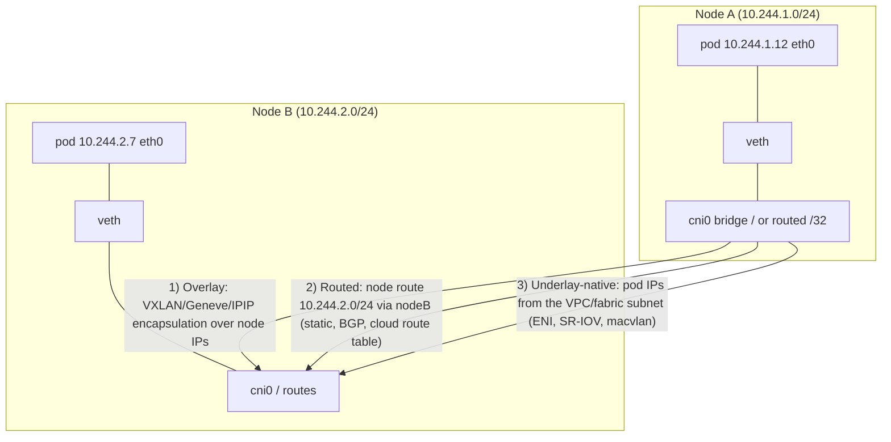

# 5.13 Pod networking under the hood: veth, bridges, routes and CNI plugins

| | |
|---|---|
| Level | Advanced |
| Priority tier | 0 |
| Lab venue | Linux VM (root); iproute2, `bridge`, `nsenter`, `tcpdump`, `ethtool`; Kubernetes cluster with Calico/Flannel/Cilium; optional ConnectX NIC with SR-IOV |
| Part | Part 5: Kubernetes |
| Status | Drafted, labs **untested** |

## Why this matters for AI infrastructure

A distributed training job's performance is bounded by its network: collective operations move gigabytes per step, and the way pods attach to the network decides whether they get line rate or a fraction of it. The default pod network (veth, bridge or overlay, iptables or eBPF) is designed for general microservices connectivity and policy, not for 400 Gb/s RDMA; GPU clusters therefore use a layered design: a CNI for the control and general traffic, plus secondary high-performance interfaces (SR-IOV VFs, macvlan on RDMA NICs, host networking) for NCCL. Understanding how a pod's interface is created, how packets leave the node, where MTU is lost, and how to inspect it all is essential for debugging connectivity problems and for designing GPU network attachments.

## Prerequisites and outcomes

Needs 5.8, 5.10 and Part 2 (Ethernet, IP routing, network namespaces 2.25, Linux networking 2.22 to 2.24, VLANs and bridges 2.11). After this chapter you can:

- State the Kubernetes network model (every pod has its own IP; pods communicate without NAT; nodes and pods communicate without NAT) and what it requires from a CNI.
- Reproduce a pod network by hand with `ip netns`, veth pairs, bridges and routes; map each primitive to what a CNI plugin does.
- Explain the CNI spec (config JSON, ADD/DEL/CHECK/VERSION, environment variables, result, chaining, IPAM plugins) and read CNI configs and logs.
- Compare implementation families: bridge + host-local, routed (Calico BGP), overlay (VXLAN/IP-in-IP/Geneve), eBPF (Cilium), cloud VPC-native (ENI/alias IP), and their MTU, performance and policy implications.
- Describe multi-network pods (Multus), macvlan/ipvlan, SR-IOV with device plugin, RDMA (shared device plugin, `rdma-cni`), host networking, and how they are used for AI.
- Inspect and debug pod networking on nodes (interfaces, routes, neighbours, bridges, MTU, conntrack, flow tracing).

## 1. The Kubernetes network model

Requirements (the "IP-per-pod" model):

1. Every pod gets a unique IP in a cluster-wide address space; containers in a pod share it.
2. Pods can communicate with all other pods on any node **without NAT** (source IP seen by the destination is the sender's pod IP).
3. Agents on a node (kubelet, system daemons) can communicate with all pods on that node; pods in the host network namespace can talk to all pods without NAT.
4. Services (virtual IPs) are layered on top via kube-proxy or the CNI datapath (5.10); NetworkPolicy is optional functionality implemented by the CNI (5.15).

Kubernetes itself implements none of this; the **container runtime** invokes a **CNI plugin** when it creates the pod sandbox (5.8), and the plugin builds the connectivity. The cluster must also route pod CIDRs between nodes (by the CNI, the cloud, or your network fabric).

## 2. Building pod networking by hand

A pod's network namespace is a separate copy of the network stack: its own interfaces, routing table, iptables, sockets. To connect it to the node, the CNI creates a **veth pair** (a virtual Ethernet cable: packets in one end come out the other), places one end inside the namespace (`eth0`) and keeps the other on the host.

```bash
# Simulate two "pods" on one node, connected by a bridge, with NAT for egress
sudo ip netns add pod1; sudo ip netns add pod2
sudo ip link add cni0 type bridge && sudo ip addr add 10.244.1.1/24 dev cni0 && sudo ip link set cni0 up

for n in 1 2; do
  sudo ip link add veth-pod$n type veth peer name eth0 netns pod$n              # veth pair: one end in the namespace
  sudo ip link set veth-pod$n master cni0 && sudo ip link set veth-pod$n up     # host end plugged into the bridge
  sudo ip -n pod$n addr add 10.244.1.1$n/24 dev eth0
  sudo ip -n pod$n link set eth0 up && sudo ip -n pod$n link set lo up
  sudo ip -n pod$n route add default via 10.244.1.1                              # gateway = bridge IP
done
sudo ip netns exec pod1 ping -c2 10.244.1.12                                     # pod to pod: L2 via bridge
sudo sysctl -w net.ipv4.ip_forward=1
sudo iptables -t nat -A POSTROUTING -s 10.244.1.0/24 ! -o cni0 -j MASQUERADE     # egress SNAT to the node IP
sudo ip netns exec pod1 ping -c2 8.8.8.8
```

This is exactly what the simple "bridge" CNI plugin does for a single node. The three primitives and their roles:

| Primitive | Role in pod networking |
|---|---|
| **Network namespace** | Pod's isolated stack, created by the runtime, shared by all containers in the pod (the pause container holds it) |
| **veth pair** | Point-to-point link between pod namespace and host (or bridge/OVS port) |
| **Bridge (L2 switch)** | Connects all local pods' host-side veths; learns MACs (`bridge fdb`); proxy ARP/hairpin options |
| **Routing** | Per-pod /32 routes on the host to the veth (routed designs), or a node route for the pod CIDR |
| **Overlay device** (vxlan0, geneve, tunl0) | Encapsulates pod traffic between nodes over the underlay |
| **iptables/nftables/eBPF** | NAT (masquerade for egress), policy, kube-proxy Service rules |
| **IPAM** | Allocates pod IPs (host-local ranges per node, cluster-pool, cloud ENI IPs) |

### Multi-node: how pods on different nodes talk

Each node owns a pod CIDR slice (`node.spec.podCIDR`, e.g., node A `10.244.1.0/24`, node B `10.244.2.0/24`). Cross-node delivery options:



1. **Overlay** (Flannel VXLAN, Calico VXLAN/IPIP, Cilium VXLAN/Geneve, Weave): works on any L3 network; costs encapsulation overhead (VXLAN 50 bytes, MTU reduction), CPU for encap/decap (offloadable on modern NICs), and complicates visibility.
2. **Routed (L3, no encapsulation)**: nodes learn pod CIDR routes by BGP (Calico, Cilium BGP, kube-router), static routes, or cloud route tables (`host-gw` in Flannel works only when nodes share L2). Best performance and clean traceability; requires control of the underlay (or BGP peering with ToR switches). Fits leaf-spine fabrics with BGP to hosts (2.15, 2.16).
3. **VPC-native / underlay IPs**: pods get routable IPs from the fabric (AWS VPC CNI ENI secondary IPs, GKE alias IPs, Azure CNI, SR-IOV/macvlan on a physical NIC); no overlay, no NAT; limited by NIC/IP quotas and IPAM scale.

Details of each family: 5.14.

## 3. The CNI specification

CNI (Container Network Interface, a CNCF project) is a minimal contract between a container runtime and a plugin executable.

**Config** (`/etc/cni/net.d/*.conflist`, first file lexicographically wins for the primary network):

```json
{
  "cniVersion": "1.0.0",
  "name": "k8s-pod-network",
  "plugins": [
    { "type": "calico",
      "ipam": { "type": "calico-ipam" },
      "policy": { "type": "k8s" },
      "kubernetes": { "kubeconfig": "/etc/cni/net.d/calico-kubeconfig" },
      "mtu": 1450 },
    { "type": "portmap", "capabilities": { "portMappings": true }, "snat": true },
    { "type": "bandwidth", "capabilities": { "bandwidth": true } }
  ]
}
```

**Plugin executables** live in `/opt/cni/bin` (bridge, host-local, loopback, portmap, bandwidth, tuning, macvlan, ipvlan, vlan, ptp, sbr, vrf, static, dhcp, firewall, plus vendor binaries: calico, cilium-cni, flannel, aws-cni, multus, sriov, rdma).

**Invocation**: the runtime executes the plugin with environment variables and the network config on stdin:

| Env var | Meaning |
|---|---|
| `CNI_COMMAND` | `ADD`, `DEL`, `CHECK`, `VERSION` (and `GC`/`STATUS` in newer specs) |
| `CNI_CONTAINERID` | Sandbox ID |
| `CNI_NETNS` | Path to the network namespace (`/var/run/netns/cni-...`) |
| `CNI_IFNAME` | Interface name to create (`eth0`) |
| `CNI_ARGS` | Extra args: `K8S_POD_NAMESPACE=...;K8S_POD_NAME=...;K8S_POD_INFRA_CONTAINER_ID=...` |
| `CNI_PATH` | Where to find other plugins (for IPAM delegation and chaining) |

**ADD** returns a JSON result (`interfaces`, `ips`, `routes`, `dns`). The plugin must be idempotent, handle partial failure and `DEL` of nonexistent state gracefully. **Chaining**: a `conflist` runs plugins in sequence, each receiving the previous result as `prevResult` (e.g., main plugin sets up connectivity; `portmap` adds hostPort DNAT; `bandwidth` applies tc shaping; `tuning` sets sysctls; `firewall` adds rules). **IPAM plugins** (`host-local`: per-node ranges in `/var/lib/cni/networks/<net>/`; `dhcp`; `static`; Calico block IPAM; Whereabouts for cluster-wide ranges on secondary networks; Cilium CRD-based IPAM) are called by the main plugin via `ipam.type`.

Operate: `ls /etc/cni/net.d /opt/cni/bin`; run a plugin by hand for debugging:

```bash
sudo CNI_COMMAND=ADD CNI_CONTAINERID=test CNI_NETNS=/var/run/netns/pod1 CNI_IFNAME=eth0 CNI_PATH=/opt/cni/bin \
  /opt/cni/bin/bridge < /tmp/bridge.conf
cat /var/lib/cni/networks/*/*          # host-local allocated IPs (file per IP containing container ID)
journalctl -u containerd -u kubelet | grep -i cni
```

Common failures: missing/invalid config ("cni plugin not initialized", node NotReady), stale IPAM allocations after crashes (IP exhaustion: clean `/var/lib/cni/networks`), CNI binary not executable or wrong version spec, plugin timeouts under load, conflicting configs (two `*.conflist` files; the first sorts first), leftover interfaces/netns after runtime crash.

## 4. Implementation families (overview)

| CNI | Data plane | Cross-node | Policy | Notes |
|---|---|---|---|---|
| **Flannel** | Linux bridge/veth; VXLAN (default) / host-gw | Overlay or L2 routes | None | Simple, minimal; pair with Calico policy ("canal") if policy needed |
| **Calico** | veth + routed /32 on host; iptables or eBPF dataplane | BGP routes (no overlay), or IPIP/VXLAN/WireGuard | Rich NetworkPolicy + GlobalNetworkPolicy | Common in bare metal; BGP peers with ToRs |
| **Cilium** | eBPF (replaces kube-proxy/iptables), veth with tc/XDP programs | Native routing, VXLAN/Geneve, BGP control plane | NetworkPolicy + L7 policy, Hubble observability, ClusterMesh | Needs modern kernel; powerful, complex |
| **Weave** | Overlay (sleeve/fastdp) | VXLAN-like | NetworkPolicy | Largely unmaintained |
| **AWS VPC CNI** | ENI secondary IPs, veth, host routes | VPC native | Via Calico/Cilium or SG for pods | IP-per-pod limits by instance type |
| **GKE/Azure CNI** | Native VPC alias IPs / vnet IPs | Native | Provider policy | |
| **Multus** | Meta-plugin: attaches additional interfaces defined by NetworkAttachmentDefinition CRDs | n/a | n/a | Basis for secondary networks (RDMA, SR-IOV) |
| **kube-router, OVN-Kubernetes, Antrea, Kube-OVN** | BGP+IPVS / OVS-based | Geneve/BGP | Policy | Alternatives for specific needs (OVN-K is OpenShift default) |

Next chapter (5.14) compares overlay and routed designs and eBPF in depth; 5.15 covers policy enforcement.

## 5. MTU, performance and offloads

- **MTU math**: inner pod MTU = underlay MTU − encapsulation overhead (VXLAN 50, Geneve ~50+, IPIP 20, WireGuard 60, IPsec ESP ~50-70). A 1500-byte underlay gives 1450 for VXLAN pods; with jumbo underlay (9000) pods can have 8950. Mismatches cause blackholed large packets (PMTUD failures) and mysterious stalls with small requests working: symptoms are TLS handshakes hanging, large HTTP responses stalling, `ping -s` size thresholds. Set MTU consistently in the CNI config/Helm values and verify end-to-end with `ping -M do -s <size>` across nodes (2.7). For GPU nodes with 9000-byte frames on the data network, configure the secondary interfaces' MTU separately.
- **Overheads**: veth traversals add CPU per packet (two extra softirq contexts); bridge + iptables conntrack adds latency; kernel TCP tuning matters; eBPF host-routing (`bpf.hostRouting`, "netkit" devices) bypasses iptables and upper stack for lower latency; GRO/GSO/TSO offloads on veth and NICs, UDP segmentation offload for VXLAN (`tx-udp_tnl-segmentation`), checksum offload; RPS/RFS/XPS and IRQ affinity for multi-queue scale.
- **Throughput expectations**: pod-to-pod over VXLAN on 25-100 Gb/s NICs commonly reaches a fraction of line rate without tuning; routed/eBPF native routing approaches line rate for large flows; none of these reach RDMA's latency/CPU efficiency, which is why GPU collectives use secondary RDMA networks.
- **Service of control-plane traffic** vs bulk traffic: keep storage and collective traffic off the CNI where possible.

## 6. Secondary networks, SR-IOV and RDMA for AI

### Multus and NetworkAttachmentDefinition

Multus is a "meta CNI": it invokes the primary CNI for `eth0` and then additional CNI plugins for networks requested by the pod annotation `k8s.v1.cni.cncf.io/networks`.

```yaml
apiVersion: k8s.cni.cncf.io/v1
kind: NetworkAttachmentDefinition
metadata:
  name: rdma-net-a
  namespace: training
  annotations: { k8s.v1.cni.cncf.io/resourceName: nvidia.com/rdma_shared_device_a }
spec:
  config: |
    {
      "cniVersion": "0.3.1",
      "name": "rdma-net-a",
      "type": "macvlan",
      "master": "ens1f0np0",
      "mode": "bridge",
      "mtu": 9000,
      "ipam": { "type": "whereabouts", "range": "192.168.10.0/24", "exclude": ["192.168.10.0/30"] }
    }
---
apiVersion: v1
kind: Pod
metadata:
  name: nccl-worker
  annotations:
    k8s.v1.cni.cncf.io/networks: rdma-net-a, rdma-net-b      # attach secondary interfaces net1, net2
spec:
  containers:
    - name: worker
      image: nvcr.io/nvidia/pytorch:24.05-py3
      securityContext: { capabilities: { add: [IPC_LOCK] } }
      resources:
        limits:
          nvidia.com/gpu: 8
          nvidia.com/rdma_shared_device_a: 1
          nvidia.com/rdma_shared_device_b: 1
```

Secondary interface types:

- **macvlan / ipvlan** on a physical RDMA-capable NIC: the pod gets its own MAC/IP on the NIC; kernel-networking only unless RDMA devices are also exposed via the **RDMA shared device plugin** (exposes `/dev/infiniband/uverbs*` and `rdma_cm` to the pod) — works for RoCE on Ethernet; IB uses `ib-sriov-cni` or IPoIB.
- **SR-IOV**: the NIC (ConnectX) exposes Virtual Functions (VFs); the **SR-IOV network device plugin** advertises them as resources (`nvidia.com/sriov_vf`), the **SR-IOV CNI** moves a VF into the pod's namespace; the pod gets near-native performance and its own RDMA device (GID/PKey control); VF count and mode (legacy vs switchdev) configured by the Network Operator/`sriov-network-operator`.
- **Host device / host networking**: `hostNetwork: true` pods use node interfaces directly; simplest for NCCL (`NCCL_SOCKET_IFNAME`, `NCCL_IB_HCA`) but weakens isolation and complicates multi-tenancy.
- **NVIDIA Network Operator** automates: MOFED driver container, RDMA shared device plugin / SR-IOV device plugin, Multus, CNI plugins, Whereabouts/NV-IPAM, secondary network CRs (`HostDeviceNetwork`, `MacvlanNetwork`, `IPoIBNetwork`) (Part 12).
- **GPUDirect RDMA and NCCL** inside pods require: GPU and NIC on the same PCIe root/NUMA (topology alignment, 5.9), `nvidia_peermem` on the host, RDMA device nodes in the container, `memlock` unlimited, correct `NCCL_IB_HCA`/`NCCL_SOCKET_IFNAME`, and matching MTU/GID index for RoCE (Part 12).
- **Rail-optimized** designs map each GPU to its dedicated NIC ("rail"): the pod attaches one secondary interface per rail; naming and ordering must be deterministic so rank → GPU → NIC mapping is preserved.

### DPUs and OVS offload

BlueField DPUs can run OVS/OVN-Kubernetes datapaths in hardware (switchdev, hardware offload of flows), giving pods VF representors with policy and encapsulation offloaded from host CPUs; relevant to multi-tenant AI clouds (Part 9, 12).

## 7. Inspecting pod networking on a node

```bash
# Which netns/pod?
crictl pods --name my-pod -q; crictl inspectp <id> | jq -r '.info.runtimeSpec.linux.namespaces[]|select(.type=="network").path'
sudo lsns -t net; ip netns list                      # CNI netns are named cni-<uuid> (may need `ln -s /var/run/netns`)
# Inside the pod's namespace
sudo nsenter --net=/var/run/netns/cni-xxxx ip -br addr; sudo nsenter --net=... ip route; sudo nsenter --net=... ss -ltnp
sudo nsenter --net=... ethtool -S eth0 | head       # veth peer_ifindex statistic
# Find the host side veth
ip -br link | grep -E '^veth|^cali|^lxc|^cni'
ip -d link show cali1234abcd                         # shows link-netnsid and peer
cat /sys/class/net/cali1234abcd/ifindex; sudo nsenter --net=... cat /sys/class/net/eth0/iflink   # match to find the pair
# Host routes / bridge / overlay
ip route | grep -E '10.244|blackhole|tunl0|vxlan'
ip neigh; bridge fdb show | head; bridge link
ip -d link show vxlan.calico | head; ip -s link show flannel.1
# Policy / NAT / conntrack
iptables-save | grep -E 'cali|KUBE' | head -30
nft list ruleset | head -60
conntrack -L | head
# Trace and capture
sudo tcpdump -ni cali1234abcd -w /tmp/pod.pcap
sudo tcpdump -ni any host 10.244.2.7 and icmp
sudo ip netns exec cni-xxxx tcpdump -ni eth0
ping -M do -s 1422 10.244.2.7                        # MTU test for 1450 path
```

Cilium: `cilium status`, `cilium endpoint list`, `cilium bpf endpoint list`, `hubble observe --pod ns/pod`, `cilium monitor --type drop`. Calico: `calicoctl node status` (BGP peers), `calicoctl get workloadendpoint -o wide`, `ip route` for `proto bird` routes, Felix logs.

## 8. Troubleshooting matrix

| Symptom | Likely cause | Check |
|---|---|---|
| Node `NotReady` "cni plugin not initialized" | CNI not installed/misconfigured | `/etc/cni/net.d`, CNI DaemonSet logs |
| Pod stuck `ContainerCreating` "failed to set up sandbox" | CNI ADD failure, IPAM exhausted, MTU/sysctl error | kubelet/containerd logs, `/var/lib/cni`, IP pool usage |
| Pod can reach node but not other pods | Overlay port blocked (UDP 4789/8472), wrong MTU, no routes between nodes, policy | `ip route`, firewall, `tcpdump` on underlay, BGP status |
| Pods on same node OK, cross-node fail | Cross-node path (routes/encap) | node routes for remote CIDR; VXLAN FDB entries; BGP |
| Pod to Internet fails | Missing masquerade/NAT, route, DNS | `iptables -t nat -L POSTROUTING`, node egress, CNI `natOutgoing` |
| Large transfers stall; small OK | MTU mismatch / PMTUD blocked | `ping -M do -s`, set CNI MTU, check ICMP frag-needed |
| Intermittent drops under load | conntrack full, softirq/CPU saturation, ring buffers | `conntrack -S`, `nstat`, `ethtool -S`, `mpstat`, IRQ balance |
| Duplicate/stale IPs | IPAM leaks after crashes | clean allocations, `calicoctl ipam check`, GC |
| Hairpin/same-pod Service fails | Bridge hairpin mode off | `bridge link` hairpin flag; CNI `hairpinMode` |
| Secondary interface missing | Multus annotation typo, NAD namespace/name, device plugin resource not allocated | `kubectl describe pod`, `k8s.v1.cni.cncf.io/network-status` annotation, Multus logs |
| NCCL falls back to TCP | RDMA device not in container, GID/MTU/topology, `NCCL_IB_DISABLE`, peermem | `NCCL_DEBUG=INFO`, `ibv_devinfo`, `ib_write_bw` in pod (Part 12) |
| Slow pod network on VXLAN | Offloads disabled, small MTU, CPU-bound encap | `ethtool -k`, `mpstat`, switch to native routing/eBPF |

## 9. Lab (untested)

1. **Hand-built pod network**: reproduce the bridge example with two namespaces, add a third on a second "node" (second VM) using static routes (no overlay), then using VXLAN (`ip link add vxlan0 type vxlan id 42 remote <peer> dev eth0 dstport 4789`); verify with `tcpdump` on the underlay and show encapsulation; measure MTU effects with `iperf3`.
2. **Read a real CNI**: on a kubeadm cluster, list `/etc/cni/net.d`, binaries, and `/var/lib/cni`; call the `bridge` plugin by hand with `CNI_COMMAND=ADD` for a test namespace; inspect veth, routes and IPAM files; run `DEL`.
3. **Trace a packet**: ping between pods on different nodes under Flannel VXLAN, Calico IPIP/VXLAN and Calico BGP (if you can peer with FRR containers/VMs, 2.27): record headers at each hop (pod veth, node interface, underlay), compare MTU and encapsulation.
4. **MTU breakage**: set the CNI MTU too high and reproduce stalled transfers; diagnose with `ping -M do`; fix and verify with iperf at various sizes.
5. **IPAM exhaustion**: shrink the per-node pod CIDR or create many pods; observe `failed to allocate for range`; recover.
6. **Multus**: install Multus; create two NetworkAttachmentDefinitions (macvlan on a spare NIC/VLAN and `ipvlan`); attach to a pod; verify `net1`, IP from Whereabouts, connectivity between pods on different nodes; read the `network-status` annotation.
7. **SR-IOV/RDMA (hardware)**: enable VFs on a ConnectX NIC, deploy the SR-IOV network operator/device plugin, attach a VF to a pod, run `ib_write_bw` between two pods and compare with the primary CNI via `iperf3`; run an `all_reduce_perf` using `NCCL_IB_HCA` set to the pod's device.
8. **Performance tuning**: measure pod-to-pod throughput and latency (`iperf3`, `netperf`, `sockperf`) over each CNI mode; toggle offloads, RPS, MTU; record CPU usage per Gb/s.
9. **Debug drills**: break each of: CNI config file, overlay UDP port, node route, IPAM file, MTU; use the matrix above to diagnose.
10. **Clean up**: remove namespaces, bridges, VXLAN devices; restore CNI config.

Mark tested only after execution.

## 10. Common mistakes

- Assuming Kubernetes handles pod networking; forgetting the node needs a working CNI and routes for pod CIDRs.
- Overlapping pod/service CIDRs with node or corporate networks.
- Inconsistent MTU across nodes/CNIs; ignoring encapsulation overhead.
- Leaving `br_netfilter`/`ip_forward` sysctls unset on nodes.
- Running two CNI configs; stale CNI state after changing CNIs without cleaning `/etc/cni/net.d`, `/var/lib/cni`, interfaces and iptables.
- Expecting primary-CNI performance for RDMA/NCCL traffic; running collectives over the overlay.
- Giving GPU pods secondary interfaces in an order that does not match GPU rails.
- Using hostNetwork widely for convenience and losing policy/isolation.
- Not monitoring IPAM utilisation and per-node IP limits (especially cloud VPC CNIs).

## 11. Interview angles

- "What is the Kubernetes network model? What does a CNI plugin actually do?" 
- "Walk through pod-to-pod traffic across nodes with VXLAN vs BGP routing." 
- "What are veth pairs, bridges, and network namespaces? How would you build pod networking by hand?" 
- "What is Multus and why do GPU clusters use it?" 
- "How do SR-IOV and RDMA devices get into a pod?" 
- "Pods can ping but large downloads stall. Why?" (MTU/PMTUD.)
- "How do you debug a pod stuck in ContainerCreating with a CNI error?" 
- "Why is the default CNI path not used for NCCL?" 

## 12. Checkpoint questions (35)

1. Pod IP rule? **A:** Every pod gets a unique routable IP without NAT between pods.
2. Who creates pod networking? **A:** The CNI plugin invoked by the runtime.
3. What is a veth pair? **A:** Virtual Ethernet cable between two interfaces.
4. What holds the pod netns? **A:** The pause container/sandbox.
5. Role of bridge? **A:** L2 switch for local pod veths.
6. Routed design means? **A:** Per-pod routes, no bridge/overlay.
7. Overlay options? **A:** VXLAN, Geneve, IPIP.
8. VXLAN overhead? **A:** 50 bytes.
9. Where is CNI config? **A:** `/etc/cni/net.d`.
10. Where are CNI binaries? **A:** `/opt/cni/bin`.
11. CNI commands? **A:** ADD, DEL, CHECK, VERSION.
12. Input to CNI plugin? **A:** Env vars + JSON config on stdin.
13. What is chaining? **A:** Sequential plugins passing prevResult.
14. IPAM plugin example? **A:** host-local, Calico IPAM, Whereabouts.
15. Where does host-local store IPs? **A:** `/var/lib/cni/networks/<name>`.
16. What is `portmap`? **A:** hostPort DNAT plugin.
17. What does `bandwidth` do? **A:** tc traffic shaping.
18. Calico data plane choices? **A:** iptables or eBPF; BGP/IPIP/VXLAN.
19. Cilium data plane? **A:** eBPF.
20. Flannel features? **A:** Simple overlay, no policy.
21. MTU symptom? **A:** Small packets work, large stall.
22. Test PMTU? **A:** `ping -M do -s`.
23. What is Multus? **A:** Meta-CNI attaching multiple networks.
24. What CRD defines extra networks? **A:** NetworkAttachmentDefinition.
25. Pod annotation for Multus? **A:** `k8s.v1.cni.cncf.io/networks`.
26. SR-IOV VF means? **A:** Virtual function of a NIC passed to a pod.
27. RDMA device plugin exposes? **A:** `/dev/infiniband/*` devices.
28. Why IPC_LOCK? **A:** Pin memory for RDMA.
29. hostNetwork effect? **A:** Pod uses node network namespace.
30. NVIDIA Network Operator installs? **A:** MOFED, device plugins, Multus, CNIs.
31. What is a rail? **A:** Dedicated NIC path per GPU.
32. Why not NCCL over overlay? **A:** Performance, no RDMA.
33. conntrack role? **A:** Tracks NAT/connection state.
34. Command to find veth peer? **A:** `ip -d link`, `iflink/ifindex`.
35. What BGP tool shows Calico peers? **A:** `calicoctl node status`.

## 13. Sources and review notes

**Written in original words.** Principal sources:

- James Strong and Vallery Lancey, *Networking and Kubernetes* (chapters 3 and 4 on container networking basics and Kubernetes networking abstractions, chapter 6 on network design).
- Josh Rosso et al., *Production Kubernetes* (chapter 5 on pod networking).
- The CNI specification, Calico, Cilium, Multus, SR-IOV and NVIDIA Network Operator documentation; Linux networking man pages.
- Examples are the author's constructions.

**Flagged for verification before publishing:** CNI spec version fields and newer verbs (`GC`, `STATUS`), device plugin resource names for RDMA/SR-IOV, MTU overheads for your encapsulation, plugin binary names, and every command/manifest; all labs are **untested**.
