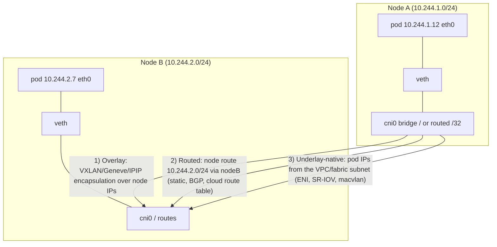

# 5.13 Pod networking under the hood: veth, bridges, routes and CNI plugins

| | |
|---|---|
| Level | Advanced |
| Priority tier | 0 |
| Lab venue | Linux VM (root); iproute2, `bridge`, `nsenter`, `tcpdump`, `ethtool`; Kubernetes cluster with Calico/Flannel/Cilium; optional ConnectX NIC with SR-IOV |
| Part | Part 5: Kubernetes |
| Status | Drafted, labs **untested** |

## Why this matters for AI infrastructure

A distributed training job's performance is bounded by its network: collective operations move gigabytes per step, and the way pods attach to the network decides whether they get line rate or a fraction of it. The default pod network (veth, bridge or overlay, iptables or eBPF) is designed for general microservices connectivity and policy, not for 400 Gb/s RDMA; GPU clusters therefore use a layered design: a CNI for the control and general traffic, plus secondary high-performance interfaces (SR-IOV VFs, macvlan on RDMA NICs, host networking) for NCCL. Understanding how a pod's interface is created, how packets leave the node, where MTU is lost, and how to inspect it all is essential for debugging connectivity problems and for designing GPU network attachments.

## Prerequisites and outcomes

Needs 5.8, 5.10 and Part 2 (Ethernet, IP routing, network namespaces 2.25, Linux networking 2.22 to 2.24, VLANs and bridges 2.11). After this chapter you can:

- State the Kubernetes network model (every pod has its own IP; pods communicate without NAT; nodes and pods communicate without NAT) and what it requires from a CNI.
- Reproduce a pod network by hand with `ip netns`, veth pairs, bridges and routes; map each primitive to what a CNI plugin does.
- Explain the CNI spec (config JSON, ADD/DEL/CHECK/VERSION, environment variables, result, chaining, IPAM plugins) and read CNI configs and logs.
- Compare implementation families: bridge + host-local, routed (Calico BGP), overlay (VXLAN/IP-in-IP/Geneve), eBPF (Cilium), cloud VPC-native (ENI/alias IP), and their MTU, performance and policy implications.
- Describe multi-network pods (Multus), macvlan/ipvlan, SR-IOV with device plugin, RDMA (shared device plugin, `rdma-cni`), host networking, and how they are used for AI.
- Inspect and debug pod networking on nodes (interfaces, routes, neighbours, bridges, MTU, conntrack, flow tracing).

## 1. The Kubernetes network model

Requirements (the "IP-per-pod" model):

1. Every pod gets a unique IP in a cluster-wide address space; containers in a pod share it.
2. Pods can communicate with all other pods on any node **without NAT** (source IP seen by the destination is the sender's pod IP).
3. Agents on a node (kubelet, system daemons) can communicate with all pods on that node; pods in the host network namespace can talk to all pods without NAT.
4. Services (virtual IPs) are layered on top via kube-proxy or the CNI datapath (5.10); NetworkPolicy is optional functionality implemented by the CNI (5.15).

Kubernetes itself implements none of this; the **container runtime** invokes a **CNI plugin** when it creates the pod sandbox (5.8), and the plugin builds the connectivity. The cluster must also route pod CIDRs between nodes (by the CNI, the cloud, or your network fabric).

## 2. Building pod networking by hand

A pod's network namespace is a separate copy of the network stack: its own interfaces, routing table, iptables, sockets. To connect it to the node, the CNI creates a **veth pair** (a virtual Ethernet cable: packets in one end come out the other), places one end inside the namespace (`eth0`) and keeps the other on the host.

```bash
# Simulate two "pods" on one node, connected by a bridge, with NAT for egress
sudo ip netns add pod1; sudo ip netns add pod2
sudo ip link add cni0 type bridge && sudo ip addr add 10.244.1.1/24 dev cni0 && sudo ip link set cni0 up

for n in 1 2; do
  sudo ip link add veth-pod$n type veth peer name eth0 netns pod$n              # veth pair: one end in the namespace
  sudo ip link set veth-pod$n master cni0 && sudo ip link set veth-pod$n up     # host end plugged into the bridge
  sudo ip -n pod$n addr add 10.244.1.1$n/24 dev eth0
  sudo ip -n pod$n link set eth0 up && sudo ip -n pod$n link set lo up
  sudo ip -n pod$n route add default via 10.244.1.1                              # gateway = bridge IP
done
sudo ip netns exec pod1 ping -c2 10.244.1.12                                     # pod to pod: L2 via bridge
sudo sysctl -w net.ipv4.ip_forward=1
sudo iptables -t nat -A POSTROUTING -s 10.244.1.0/24 ! -o cni0 -j MASQUERADE     # egress SNAT to the node IP
sudo ip netns exec pod1 ping -c2 8.8.8.8
```

This is exactly what the simple "bridge" CNI plugin does for a single node. The three primitives and their roles:

| Primitive | Role in pod networking |
|---|---|
| **Network namespace** | Pod's isolated stack, created by the runtime, shared by all containers in the pod (the pause container holds it) |
| **veth pair** | Point-to-point link between pod namespace and host (or bridge/OVS port) |
| **Bridge (L2 switch)** | Connects all local pods' host-side veths; learns MACs (`bridge fdb`); proxy ARP/hairpin options |
| **Routing** | Per-pod /32 routes on the host to the veth (routed designs), or a node route for the pod CIDR |
| **Overlay device** (vxlan0, geneve, tunl0) | Encapsulates pod traffic between nodes over the underlay |
| **iptables/nftables/eBPF** | NAT (masquerade for egress), policy, kube-proxy Service rules |
| **IPAM** | Allocates pod IPs (host-local ranges per node, cluster-pool, cloud ENI IPs) |

### Multi-node: how pods on different nodes talk

Each node owns a pod CIDR slice (`node.spec.podCIDR`, e.g., node A `10.244.1.0/24`, node B `10.244.2.0/24`). Cross-node delivery options:



1. **Overlay** (Flannel VXLAN, Calico VXLAN/IPIP, Cilium VXLAN/Geneve, Weave): works on any L3 network; costs encapsulation overhead (VXLAN 50 bytes, MTU reduction), CPU for encap/decap (offloadable on modern NICs), and complicates visibility.
2. **Routed (L3, no encapsulation)**: nodes learn pod CIDR routes by BGP (Calico, Cilium BGP, kube-router), static routes, or cloud route tables (`host-gw` in Flannel works only when nodes share L2). Best performance and clean traceability; requires control of the underlay (or BGP peering with ToR switches). Fits leaf-spine fabrics with BGP to hosts (2.15, 2.16).
3. **VPC-native / underlay IPs**: pods get routable IPs from the fabric (AWS VPC CNI ENI secondary IPs, GKE alias IPs, Azure CNI, SR-IOV/macvlan on a physical NIC); no overlay, no NAT; limited by NIC/IP quotas and IPAM scale.

As James Strong and Vallery Lancey show in *Networking and Kubernetes* Chapter 6 (*Kubernetes and Cloud Networking*) and Josh Rosso et al. explain in *Production Kubernetes* Chapter 5 (*Pod Networking*), subnet sizing and workload routability must be planned before cluster creation:
- **Subnet Netmask Sizing Formula (`NK` Chapter 6 Table 6-2):** When sizing a node subnet (reserving 4 addresses for network, gateway, broadcast, and cloud reserved use), the maximum number of nodes $N$ for an IPv4 prefix length $S$ is:
  $$N = 2^{(32 - S)} - 4 \quad \Longleftrightarrow \quad S = 32 - \lceil \log_2(N + 4) \rceil$$
  For example, supporting $N = 250$ nodes requires $S = 32 - \lceil \log_2(254) \rceil = 24$ (`/24`, 252 usable IPs); in VPC-native mode where Pods also draw IPs or `/24` alias blocks from the VPC, size the secondary Pod CIDR (`10.244.0.0/14` or `/16`) for peak `nodes * maxPods`.
- **Workload Routability and Pod-to-Pod Encryption Trade-offs (`PK` Chapter 5):** Making Pod IPs directly routable on the corporate WAN sounds convenient, but exhausts enterprise RFC 1918 address space and exposes ephemeral Pod IPs beyond cluster boundaries—keep Pod CIDRs internal to the cluster and expose services through LoadBalancers/Gateways (5.12). Similarly, before enabling CNI-level WireGuard or IPsec encryption across all Pod traffic, check whether your underlay or service mesh already encrypts traffic and account for the 50–60 byte MTU reduction and CPU overhead on high-bandwidth GPU flows.

Details of each family: 5.14.

## 3. The CNI specification

CNI (Container Network Interface, a CNCF project) is a minimal contract between a container runtime and a plugin executable.

**Config** (`/etc/cni/net.d/*.conflist`, first file lexicographically wins for the primary network):

```json
{
  "cniVersion": "1.0.0",
  "name": "k8s-pod-network",
  "plugins": [
    { "type": "calico",
      "ipam": { "type": "calico-ipam" },
      "policy": { "type": "k8s" },
      "kubernetes": { "kubeconfig": "/etc/cni/net.d/calico-kubeconfig" },
      "mtu": 1450 },
    { "type": "portmap", "capabilities": { "portMappings": true }, "snat": true },
    { "type": "bandwidth", "capabilities": { "bandwidth": true } }
  ]
}
```

**Plugin executables** live in `/opt/cni/bin` (bridge, host-local, loopback, portmap, bandwidth, tuning, macvlan, ipvlan, vlan, ptp, sbr, vrf, static, dhcp, firewall, plus vendor binaries: calico, cilium-cni, flannel, aws-cni, multus, sriov, rdma).

**Invocation**: the runtime executes the plugin with environment variables and the network config on stdin:

| Env var | Meaning |
|---|---|
| `CNI_COMMAND` | `ADD`, `DEL`, `CHECK`, `VERSION` (and `GC`/`STATUS` in newer specs) |
| `CNI_CONTAINERID` | Sandbox ID |
| `CNI_NETNS` | Path to the network namespace (`/var/run/netns/cni-...`) |
| `CNI_IFNAME` | Interface name to create (`eth0`) |
| `CNI_ARGS` | Extra args: `K8S_POD_NAMESPACE=...;K8S_POD_NAME=...;K8S_POD_INFRA_CONTAINER_ID=...` |
| `CNI_PATH` | Where to find other plugins (for IPAM delegation and chaining) |

**ADD** returns a JSON result (`interfaces`, `ips`, `routes`, `dns`). The plugin must be idempotent, handle partial failure and `DEL` of nonexistent state gracefully. **Chaining**: a `conflist` runs plugins in sequence, each receiving the previous result as `prevResult` (e.g., main plugin sets up connectivity; `portmap` adds hostPort DNAT; `bandwidth` applies tc shaping; `tuning` sets sysctls; `firewall` adds rules). **IPAM plugins** (`host-local`: per-node ranges in `/var/lib/cni/networks/<net>/`; `dhcp`; `static`; Calico block IPAM; Whereabouts for cluster-wide ranges on secondary networks; Cilium CRD-based IPAM) are called by the main plugin via `ipam.type`.

Operate: `ls /etc/cni/net.d /opt/cni/bin`; run a plugin by hand for debugging:

```bash
sudo CNI_COMMAND=ADD CNI_CONTAINERID=test CNI_NETNS=/var/run/netns/pod1 CNI_IFNAME=eth0 CNI_PATH=/opt/cni/bin \
  /opt/cni/bin/bridge < /tmp/bridge.conf
cat /var/lib/cni/networks/*/*          # host-local allocated IPs (file per IP containing container ID)
journalctl -u containerd -u kubelet | grep -i cni
```

Common failures: missing/invalid config ("cni plugin not initialized", node NotReady), stale IPAM allocations after crashes (IP exhaustion: clean `/var/lib/cni/networks`), CNI binary not executable or wrong version spec, plugin timeouts under load, conflicting configs (two `*.conflist` files; the first sorts first), leftover interfaces/netns after runtime crash.

## 4. Implementation families (overview)

| CNI | Data plane | Cross-node | Policy | Notes |
|---|---|---|---|---|
| **Flannel** | Linux bridge/veth; VXLAN (default) / host-gw | Overlay or L2 routes | None | Simple, minimal; pair with Calico policy ("canal") if policy needed |
| **Calico** | veth + routed /32 on host; iptables or eBPF dataplane | BGP routes (no overlay), or IPIP/VXLAN/WireGuard | Rich NetworkPolicy + GlobalNetworkPolicy | Common in bare metal; BGP peers with ToRs |
| **Cilium** | eBPF (replaces kube-proxy/iptables), veth with tc/XDP programs | Native routing, VXLAN/Geneve, BGP control plane | NetworkPolicy + L7 policy, Hubble observability, ClusterMesh | Needs modern kernel; powerful, complex |
| **Weave** | Overlay (sleeve/fastdp) | VXLAN-like | NetworkPolicy | Largely unmaintained |
| **AWS VPC CNI** | ENI secondary IPs, veth, host routes | VPC native | Via Calico/Cilium or SG for pods | IP-per-pod limits by instance type |
| **GKE/Azure CNI** | Native VPC alias IPs / vnet IPs | Native | Provider policy | |
| **Multus** | Meta-plugin: attaches additional interfaces defined by NetworkAttachmentDefinition CRDs | n/a | n/a | Basis for secondary networks (RDMA, SR-IOV) |
| **kube-router, OVN-Kubernetes, Antrea, Kube-OVN** | BGP+IPVS / OVS-based | Geneve/BGP | Policy | Alternatives for specific needs (OVN-K is OpenShift default) |

Next chapter (5.14) compares overlay and routed designs and eBPF in depth; 5.15 covers policy enforcement.

## 5. MTU, performance and offloads

- **MTU math**: inner pod MTU = underlay MTU − encapsulation overhead (VXLAN 50, Geneve ~50+, IPIP 20, WireGuard 60, IPsec ESP ~50-70). A 1500-byte underlay gives 1450 for VXLAN pods; with jumbo underlay (9000) pods can have 8950. Mismatches cause blackholed large packets (PMTUD failures) and mysterious stalls with small requests working: symptoms are TLS handshakes hanging, large HTTP responses stalling, `ping -s` size thresholds. Set MTU consistently in the CNI config/Helm values and verify end-to-end with `ping -M do -s <size>` across nodes (2.7). For GPU nodes with 9000-byte frames on the data network, configure the secondary interfaces' MTU separately.
- **Overheads**: veth traversals add CPU per packet (two extra softirq contexts); bridge + iptables conntrack adds latency; kernel TCP tuning matters; eBPF host-routing (`bpf.hostRouting`, "netkit" devices) bypasses iptables and upper stack for lower latency; GRO/GSO/TSO offloads on veth and NICs, UDP segmentation offload for VXLAN (`tx-udp_tnl-segmentation`), checksum offload; RPS/RFS/XPS and IRQ affinity for multi-queue scale.
- **Throughput expectations**: pod-to-pod over VXLAN on 25-100 Gb/s NICs commonly reaches a fraction of line rate without tuning; routed/eBPF native routing approaches line rate for large flows; none of these reach RDMA's latency/CPU efficiency, which is why GPU collectives use secondary RDMA networks.
- **Service of control-plane traffic** vs bulk traffic: keep storage and collective traffic off the CNI where possible.

## 6. Secondary networks, SR-IOV and RDMA for AI

### Multus and NetworkAttachmentDefinition

Multus is a "meta CNI": it invokes the primary CNI for `eth0` and then additional CNI plugins for networks requested by the pod annotation `k8s.v1.cni.cncf.io/networks`.

```yaml
apiVersion: k8s.cni.cncf.io/v1
kind: NetworkAttachmentDefinition
metadata:
  name: rdma-net-a
  namespace: training
  annotations: { k8s.v1.cni.cncf.io/resourceName: nvidia.com/rdma_shared_device_a }
spec:
  config: |
    {
      "cniVersion": "0.3.1",
      "name": "rdma-net-a",
      "type": "macvlan",
      "master": "ens1f0np0",
      "mode": "bridge",
      "mtu": 9000,
      "ipam": { "type": "whereabouts", "range": "192.168.10.0/24", "exclude": ["192.168.10.0/30"] }
    }
---
apiVersion: v1
kind: Pod
metadata:
  name: nccl-worker
  annotations:
    k8s.v1.cni.cncf.io/networks: rdma-net-a, rdma-net-b      # attach secondary interfaces net1, net2
spec:
  containers:
    - name: worker
      image: nvcr.io/nvidia/pytorch:24.05-py3
      securityContext: { capabilities: { add: [IPC_LOCK] } }
      resources:
        limits:
          nvidia.com/gpu: 8
          nvidia.com/rdma_shared_device_a: 1
          nvidia.com/rdma_shared_device_b: 1
```

Secondary interface types:

- **macvlan / ipvlan** on a physical RDMA-capable NIC: the pod gets its own MAC/IP on the NIC; kernel-networking only unless RDMA devices are also exposed via the **RDMA shared device plugin** (exposes `/dev/infiniband/uverbs*` and `rdma_cm` to the pod) — works for RoCE on Ethernet; IB uses `ib-sriov-cni` or IPoIB.
- **SR-IOV**: the NIC (ConnectX) exposes Virtual Functions (VFs); the **SR-IOV network device plugin** advertises them as resources (`nvidia.com/sriov_vf`), the **SR-IOV CNI** moves a VF into the pod's namespace; the pod gets near-native performance and its own RDMA device (GID/PKey control); VF count and mode (legacy vs switchdev) configured by the Network Operator/`sriov-network-operator`.
- **Host device / host networking**: `hostNetwork: true` pods use node interfaces directly; simplest for NCCL (`NCCL_SOCKET_IFNAME`, `NCCL_IB_HCA`) but weakens isolation and complicates multi-tenancy.
- **NVIDIA Network Operator** automates: MOFED driver container, RDMA shared device plugin / SR-IOV device plugin, Multus, CNI plugins, Whereabouts/NV-IPAM, secondary network CRs (`HostDeviceNetwork`, `MacvlanNetwork`, `IPoIBNetwork`) (Part 12).
- **GPUDirect RDMA and NCCL** inside pods require: GPU and NIC on the same PCIe root/NUMA (topology alignment, 5.9), `nvidia_peermem` on the host, RDMA device nodes in the container, `memlock` unlimited, correct `NCCL_IB_HCA`/`NCCL_SOCKET_IFNAME`, and matching MTU/GID index for RoCE (Part 12).
- **Rail-optimized** designs map each GPU to its dedicated NIC ("rail"): the pod attaches one secondary interface per rail; naming and ordering must be deterministic so rank → GPU → NIC mapping is preserved.

### DPUs and OVS offload

BlueField DPUs can run OVS/OVN-Kubernetes datapaths in hardware (switchdev, hardware offload of flows), giving pods VF representors with policy and encapsulation offloaded from host CPUs; relevant to multi-tenant AI clouds (Part 9, 12).

## 7. Inspecting pod networking on a node

```bash
# Which netns/pod?
crictl pods --name my-pod -q; crictl inspectp <id> | jq -r '.info.runtimeSpec.linux.namespaces[]|select(.type=="network").path'
sudo lsns -t net; ip netns list                      # CNI netns are named cni-<uuid> (may need `ln -s /var/run/netns`)
# Inside the pod's namespace
sudo nsenter --net=/var/run/netns/cni-xxxx ip -br addr; sudo nsenter --net=... ip route; sudo nsenter --net=... ss -ltnp
sudo nsenter --net=... ethtool -S eth0 | head       # veth peer_ifindex statistic
# Find the host side veth
ip -br link | grep -E '^veth|^cali|^lxc|^cni'
ip -d link show cali1234abcd                         # shows link-netnsid and peer
cat /sys/class/net/cali1234abcd/ifindex; sudo nsenter --net=... cat /sys/class/net/eth0/iflink   # match to find the pair
# Host routes / bridge / overlay
ip route | grep -E '10.244|blackhole|tunl0|vxlan'
ip neigh; bridge fdb show | head; bridge link
ip -d link show vxlan.calico | head; ip -s link show flannel.1
# Policy / NAT / conntrack
iptables-save | grep -E 'cali|KUBE' | head -30
nft list ruleset | head -60
conntrack -L | head
# Trace and capture
sudo tcpdump -ni cali1234abcd -w /tmp/pod.pcap
sudo tcpdump -ni any host 10.244.2.7 and icmp
sudo ip netns exec cni-xxxx tcpdump -ni eth0
ping -M do -s 1422 10.244.2.7                        # MTU test for 1450 path
```

Cilium: `cilium status`, `cilium endpoint list`, `cilium bpf endpoint list`, `hubble observe --pod ns/pod`, `cilium monitor --type drop`. Calico: `calicoctl node status` (BGP peers), `calicoctl get workloadendpoint -o wide`, `ip route` for `proto bird` routes, Felix logs.

## 8. Troubleshooting matrix

| Symptom | Likely cause | Check |
|---|---|---|
| Node `NotReady` "cni plugin not initialized" | CNI not installed/misconfigured | `/etc/cni/net.d`, CNI DaemonSet logs |
| Pod stuck `ContainerCreating` "failed to set up sandbox" | CNI ADD failure, IPAM exhausted, MTU/sysctl error | kubelet/containerd logs, `/var/lib/cni`, IP pool usage |
| Pod can reach node but not other pods | Overlay port blocked (UDP 4789/8472), wrong MTU, no routes between nodes, policy | `ip route`, firewall, `tcpdump` on underlay, BGP status |
| Pods on same node OK, cross-node fail | Cross-node path (routes/encap) | node routes for remote CIDR; VXLAN FDB entries; BGP |
| Pod to Internet fails | Missing masquerade/NAT, route, DNS | `iptables -t nat -L POSTROUTING`, node egress, CNI `natOutgoing` |
| Large transfers stall; small OK | MTU mismatch / PMTUD blocked | `ping -M do -s`, set CNI MTU, check ICMP frag-needed |
| Intermittent drops under load | conntrack full, softirq/CPU saturation, ring buffers | `conntrack -S`, `nstat`, `ethtool -S`, `mpstat`, IRQ balance |
| Duplicate/stale IPs | IPAM leaks after crashes | clean allocations, `calicoctl ipam check`, GC |
| Hairpin/same-pod Service fails | Bridge hairpin mode off | `bridge link` hairpin flag; CNI `hairpinMode` |
| Secondary interface missing | Multus annotation typo, NAD namespace/name, device plugin resource not allocated | `kubectl describe pod`, `k8s.v1.cni.cncf.io/network-status` annotation, Multus logs |
| NCCL falls back to TCP | RDMA device not in container, GID/MTU/topology, `NCCL_IB_DISABLE`, peermem | `NCCL_DEBUG=INFO`, `ibv_devinfo`, `ib_write_bw` in pod (Part 12) |
| Slow pod network on VXLAN | Offloads disabled, small MTU, CPU-bound encap | `ethtool -k`, `mpstat`, switch to native routing/eBPF |

## 9. Lab

First, run the self-checking Python lab (`code/part05/cni_pod_networking_sim_lab.py`) locally. It verifies the CNI encapsulation MTU and `ping -M do -s` DF payload calculator (`compute_pod_mtu_and_df_ping` and `compute_subnet_prefix_for_nodes`, `NK` Ch. 6 & `PK` Ch. 5), the `host-local` / `Whereabouts` IPAM allocator (`CNIHostLocalIPAM`: testing excluded ranges, exhaustion, and `DEL` cleanup), and the Multus secondary RDMA rail interface planner (`plan_multus_pod_interfaces`).

```bash
python3 code/part05/cni_pod_networking_sim_lab.py
```

Next, on a Linux VM or Kubernetes cluster (all interactive shell steps below are `untested here`), work through these exercises:

1. **Hand-built pod network**: reproduce the bridge example with two namespaces, add a third on a second "node" (second VM) using static routes (no overlay), then using VXLAN (`ip link add vxlan0 type vxlan id 42 remote <peer> dev eth0 dstport 4789`); verify with `tcpdump` on the underlay and show encapsulation; measure MTU effects with `iperf3`.
2. **Read a real CNI**: on a kubeadm cluster, list `/etc/cni/net.d`, binaries, and `/var/lib/cni`; call the `bridge` plugin by hand with `CNI_COMMAND=ADD` for a test namespace; inspect veth, routes and IPAM files; run `DEL`.
3. **Trace a packet**: ping between pods on different nodes under Flannel VXLAN, Calico IPIP/VXLAN and Calico BGP (if you can peer with FRR containers/VMs, 2.27): record headers at each hop (pod veth, node interface, underlay), compare MTU and encapsulation.
4. **MTU breakage**: set the CNI MTU too high and reproduce stalled transfers; diagnose with `ping -M do`; fix and verify with iperf at various sizes.
5. **IPAM exhaustion**: shrink the per-node pod CIDR or create many pods; observe `failed to allocate for range`; recover.
6. **Multus**: install Multus; create two NetworkAttachmentDefinitions (macvlan on a spare NIC/VLAN and `ipvlan`); attach to a pod; verify `net1`, IP from Whereabouts, connectivity between pods on different nodes; read the `network-status` annotation.
7. **SR-IOV/RDMA (hardware)**: enable VFs on a ConnectX NIC, deploy the SR-IOV network operator/device plugin, attach a VF to a pod, run `ib_write_bw` between two pods and compare with the primary CNI via `iperf3`; run an `all_reduce_perf` using `NCCL_IB_HCA` set to the pod's device.
8. **Performance tuning**: measure pod-to-pod throughput and latency (`iperf3`, `netperf`, `sockperf`) over each CNI mode; toggle offloads, RPS, MTU; record CPU usage per Gb/s.
9. **Debug drills**: break each of: CNI config file, overlay UDP port, node route, IPAM file, MTU; use the matrix above to diagnose.
10. **Clean up**: remove namespaces, bridges, VXLAN devices; restore CNI config.

## 10. Common mistakes

- Assuming Kubernetes handles pod networking; forgetting the node needs a working CNI and routes for pod CIDRs.
- Overlapping pod/service CIDRs with node or corporate networks.
- Inconsistent MTU across nodes/CNIs; ignoring encapsulation overhead.
- Leaving `br_netfilter`/`ip_forward` sysctls unset on nodes.
- Running two CNI configs; stale CNI state after changing CNIs without cleaning `/etc/cni/net.d`, `/var/lib/cni`, interfaces and iptables.
- Expecting primary-CNI performance for RDMA/NCCL traffic; running collectives over the overlay.
- Giving GPU pods secondary interfaces in an order that does not match GPU rails.
- Using hostNetwork widely for convenience and losing policy/isolation.
- Not monitoring IPAM utilisation and per-node IP limits (especially cloud VPC CNIs).

## 11. Interview angles

- "What is the Kubernetes network model? What does a CNI plugin actually do?"
- "Walk through pod-to-pod traffic across nodes with VXLAN vs BGP routing."
- "What are veth pairs, bridges, and network namespaces? How would you build pod networking by hand?"
- "What is Multus and why do GPU clusters use it?"
- "How do SR-IOV and RDMA devices get into a pod?"
- "Pods can ping but large downloads stall. Why?" (MTU/PMTUD.)
- "How do you debug a pod stuck in ContainerCreating with a CNI error?"
- "Why is the default CNI path not used for NCCL?"

## Exercises

1. **The Kubernetes IP-per-Pod Network Model and Building a Pod Network by Hand (`NK` Ch. 3 & `PK` Ch. 5):** State the 4 requirements of the Kubernetes network model (Section 1), and trace every `ip netns`, `ip link` (`veth` pair + `cni0` bridge), `ip addr`, `ip route`, `sysctl`, and `iptables -t nat MASQUERADE` command in Section 2 to wire two Pods on one node with internet egress.
2. **The CNI Specification (`.conflist` Chaining, `ADD`/`DEL`/`CHECK`/`VERSION`, and IPAM Plugins, `NK` Ch. 4):** Using `CNIHostLocalIPAM` in `code/part05/cni_pod_networking_sim.py`, explain how `/etc/cni/net.d/10-calico.conflist` chains `calico` + `portmap` + `bandwidth` using `prevResult`, what environment variables the runtime passes to `/opt/cni/bin/*`, and how `host-local`, `calico-ipam`, and `whereabouts` track IP allocations and exclusions.
3. **Comparing CNI Implementation Families (`Flannel`, `Calico`, `Cilium`, Cloud VPC-Native `AWS ENI` / `GKE Alias IP`) and Subnet Sizing (`NK` Ch. 6):** Using `compute_subnet_prefix_for_nodes()` in `code/part05/cni_pod_networking_sim.py`, derive the subnet prefix required for $N$ nodes ($S = 32 - \lceil \log_2(N + 4) \rceil$), and compare Overlay (`VXLAN`/`Geneve`), Routed (`Calico`/`Cilium` BGP), and Underlay-Native (`AWS VPC CNI` / `GKE Alias IPs`).
4. **MTU Math (`IPIP`, `VXLAN`, `Geneve`, `WireGuard`) and Diagnosing Blackholed Jumbo/TLS Packets (`PK` Ch. 5):** Using `compute_pod_mtu_and_df_ping()` in `code/part05/cni_pod_networking_sim.py`, calculate the exact inner Pod MTU on a 1,500-byte and 9,000-byte underlay for `IPIP` (-20B), `VXLAN` (-50B), and `WireGuard` (-60B), and explain why `ping -M do -s 1422` succeeds on a 1,450-MTU VXLAN path while `-s 1423` fails.
5. **Multi-Network Pods for GPU Collectives (`Multus`, `NetworkAttachmentDefinition`, `macvlan`, `SR-IOV`, `RDMA Shared Device Plugin`, and Rail Alignment):** Using `plan_multus_pod_interfaces()` in `code/part05/cni_pod_networking_sim.py`, trace `NetworkAttachmentDefinition/rdma-net-a` and `Pod/nccl-worker` in Section 6, contrasting `macvlan` + RDMA shared device plugin, `SR-IOV` VFs, and `hostNetwork: true` for 8-rail 400 Gb/s RoCEv2/InfiniBand NCCL collectives.
6. **Node-Level Pod Network Inspection (`lsns`, `nsenter`, `ifindex`/`iflink`, `bridge fdb`, `tcpdump`, `calicoctl`, `cilium`/`hubble`):** Write the exact commands (Section 7) to map a running Pod to its network namespace, find the host-side `veth` interface matching the Pod's `eth0` via `iflink`/`ifindex`, inspect routing/FDB tables, and diagnose the top failure modes in Section 8.

## Checkpoint questions (20)

<details>
<summary>1. What are the three fundamental rules of the Kubernetes \"IP-per-Pod\" networking model?</summary>

1. **Every Pod gets its own unique IP address** within the cluster (shared by all containers inside that Pod Sandbox).
2. **All Pods can communicate with all other Pods on any node without NAT** (the destination Pod sees the sender Pod's actual Pod IP as the source address, never a SNAT'd host IP).
3. **Node agents (`kubelet`, `kube-proxy`, host-networked Daemons) on a node can communicate with all Pods on that node without NAT.**
</details>

<details>
<summary>2. How does a Linux `veth` pair work, and how do you match a Pod's `eth0` inside its network namespace to its peer `cali*`/`veth*`/`lxc*` interface on the host?</summary>

A **`veth` (virtual Ethernet) pair** acts like a virtual patch cable with two ends: any frame transmitted into one end immediately emerges from the other end, even when the two ends reside in different Linux network namespaces.
To match a Pod's `eth0` to its host-side peer:
1. Inside the Pod's netns, read `cat /sys/class/net/eth0/iflink` (or `ip link show eth0`, looking at `eth0@if<N>`): this integer `<N>` is the **`ifindex` of the peer interface in the host network namespace**.
2. On the host, run `ip -o link | grep "^<N>:"` (or compare `/sys/class/net/*/ifindex`) to find the exact host interface (`cali1234abcd`, `lxc5678`, or `veth90ab`).
</details>

<details>
<summary>3. In a bridge-based CNI (`cni0`), what happens to source and destination MAC and IP addresses when `pod1` (`10.244.1.11`) pings `pod2` (`10.244.2.7`) on a different node via native L3 routing?</summary>

1. `pod1` checks its routing table: `10.244.2.7` is not in `10.244.1.0/24`, so it ARPs for its default gateway (`cni0` bridge IP `10.244.1.1` on Node A) and sends the packet with **src IP `10.244.1.11`, dst IP `10.244.2.7`**, and **dst MAC = `cni0` MAC**.
2. Node A's kernel receives the packet on `cni0`, keeps **src IP `10.244.1.11` and dst IP `10.244.2.7` unchanged (no NAT)**, looks up `10.244.2.0/24 via <Node_B_IP>` in the host routing table, rewrites the L2 Ethernet header (src MAC = Node A NIC, dst MAC = Node B NIC or ToR router), and transmits it to Node B.
3. Node B receives the packet, routes `10.244.2.7` to `cni0` / `veth-pod2`, and delivers it to `pod2` with `src IP = 10.244.1.11` preserved.
</details>

<details>
<summary>4. How does `/etc/cni/net.d/*.conflist` selection work when multiple files exist in `/etc/cni/net.d/`?</summary>

`containerd` / `CRI-O` scans `/etc/cni/net.d/` and loads the **first valid `.conf` or `.conflist` file in lexicographical (ASCII alphabetical) sort order** (for example, `00-multus.conf` sorts before `05-cilium.conf`, which sorts before `10-calico.conflist`). If you switch CNIs from Calico (`10-calico.conflist`) to Flannel (`10-flannel.conflist`) without deleting `10-calico.conflist`, `10-calico.conflist` sorts first (`c` before `f`) and `containerd` will keep invoking Calico.
</details>

<details>
<summary>5. What is CNI Plugin Chaining in a `.conflist` file, and how do `portmap` and `bandwidth` work?</summary>

In a `.conflist` JSON file, the `"plugins": [...]` array defines an ordered pipeline of CNI binaries executed sequentially on `ADD` (and in reverse order on `DEL`):
1. **Primary plugin (`calico` / `bridge` / `cilium-cni`):** Creates the `veth` pair, calls the `ipam` plugin, assigns the Pod IP/routes, and outputs a JSON result.
2. **`portmap` plugin:** Receives the primary plugin's JSON output as `prevResult` on `stdin` and installs host `iptables` / `nftables` `DNAT` rules if the Pod spec declares any `containers[].ports[].hostPort`.
3. **`bandwidth` plugin:** Reads `kubernetes.io/ingress-bandwidth` and `kubernetes.io/egress-bandwidth` Pod annotations and configures Linux `tc` (`Token Bucket Filter` / `ifb`) rate-limiting queues on the Pod's `veth` interface.
</details>

<details>
<summary>6. Compare the three main CNI IPAM models: `host-local`, `calico-ipam` / `cilium` cluster-pool, and `whereabouts`.</summary>

- **`host-local`:** Allocates IPs from the node's fixed `node.spec.podCIDR` (`/24`), storing 1 file per allocated IP on local disk under **`/var/lib/cni/networks/<net-name>/<ip>`** (containing the sandbox container ID). Fast and requires zero API server calls, but if a node crashes hard, stale files can leak IPs until cleaned.
- **`calico-ipam` / `cilium` cluster-pool:** Dynamically allocates CIDR blocks (e.g., `/26` = 64 IPs in Calico `IPAMBlock` CRDs) to nodes on demand and can borrow/reclaim blocks across nodes when a node runs low on IPs.
- **`whereabouts`:** Cluster-wide IPAM plugin stored in Kubernetes CRDs (`IPPool`, `OverlappingRangeIPReservation`), used with **Multus secondary networks** (`macvlan`, `ipvlan`, `sriov`) where nodes share a common flat L2/RDMA subnet (`192.168.10.0/24`) rather than per-node `/24` slices.
</details>

<details>
<summary>7. Calculate the inner Pod MTU on a 1,500-byte underlay for (a) Native Routing / BGP, (b) IP-in-IP (`IPIP`), (c) `VXLAN` / `Geneve`, and (d) `WireGuard`.</summary>

- **Native Routing / BGP (`0` bytes encapsulation):** **`1500` bytes**.
- **IP-in-IP (`tunl0`, outer IPv4 header = `20` bytes):** $1500 - 20 = \mathbf{1480}$ bytes.
- **VXLAN / base Geneve (Outer Ethernet `14`B + Outer IPv4 `20`B + UDP `8`B + VXLAN `8`B = `50` bytes):** $1500 - 50 = \mathbf{1450}$ bytes (note: Geneve with extra TLV options or IPv6 outer headers requires `60`–`80` bytes).
- **WireGuard IPv4 (`60` bytes; `80` bytes for IPv6):** $1500 - 60 = \mathbf{1440}$ bytes.
</details>

<details>
<summary>8. Why do Pods with a misconfigured MTU succeed on `ping` and short `curl` health checks, but hang indefinitely on `git clone`, `pip install`, or TLS handshakes?</summary>

Short packets (`ping` = 84 bytes, HTTP `GET /healthz` = ~200 bytes) are well below any MTU (1450 or 1500) and pass across the overlay without issue. However, as soon as a TLS handshake sends a large certificate chain or an HTTP/gRPC stream sends full **1,500-byte TCP MSS segments** from a Pod whose `eth0` was mistakenly left at `mtu 1500` over a `1450`-byte VXLAN tunnel, the encapsulated packet reaches **1,550 bytes** and is dropped by the underlay NIC/switch (or if Path MTU Discovery `ICMP Fragmentation Needed` packets are blocked by a firewall, enters a **PMTUD black hole** where the TCP connection stalls at 0 B/s).
</details>

<details>
<summary>9. Why does `ping -M do -s 1422 <peer-pod-ip>` test a `1450`-byte Pod MTU?</summary>

The `-s 1422` flag sets the **ICMP payload size** to `1422` bytes, and `-M do` sets the IPv4 **`DF` (Don't Fragment)** bit. Adding the **`8`-byte ICMP header** and the **`20`-byte IPv4 header** produces a total IP packet of:
$$1422 + 8 + 20 = \mathbf{1450\text{ bytes}}$$
If `-s 1422` succeeds and `-s 1423` fails with `Frag needed and DF set (mtu = 1450)`, you have verified an exact end-to-end unfragmented path MTU of 1,450 bytes.
</details>

<details>
<summary>10. Why do AI clusters use a dual-network architecture (Primary CNI on `eth0` + Secondary RDMA networks on `net1..net8`) instead of running NCCL collectives over the primary CNI?</summary>

1. **Encapsulation & kernel stack overhead:** VXLAN/Geneve overlays, `veth` traversals, `iptables`/`conntrack`, and kernel TCP/IP cannot deliver 400 Gb/s line-rate RDMA (`GPUDirect RDMA` bypasses the host CPU and OS kernel network stack entirely via hardware queue pairs on the ConnectX NIC).
2. **Traffic isolation & QoS:** Separating the Kubernetes control plane, kubelet heartbeats, DNS, and API traffic (`eth0` on the management network) from 3.2 Tb/s of east-west NCCL collective bursts (`net1..net8` on the non-blocking InfiniBand/RoCEv2 rail fabric) ensures a training burst never starves `kubelet` heartbeats or triggers false `NotReady` node evictions.
</details>

<details>
<summary>11. How does `Multus` work with `NetworkAttachmentDefinition` (`NAD`) CRDs and the `k8s.v1.cni.cncf.io/networks` Pod annotation?</summary>

1. **Multus (`00-multus.conf`)** installs itself as the first `.conf` file in `/etc/cni/net.d/`.
2. When `RunPodSandbox` invokes Multus, Multus **always calls the cluster's primary CNI plugin first** (Calico/Cilium) to attach **`eth0`**.
3. Multus then inspects the Pod's **`k8s.v1.cni.cncf.io/networks: rdma-net-a, rdma-net-b`** annotation, fetches the corresponding **`NetworkAttachmentDefinition` CRDs** from `kube-apiserver`, invokes the secondary CNI plugins (`macvlan`, `sriov`, `host-device`, `ipoib`) in the exact order listed to attach **`net1`, `net2`, ...**, and writes the resulting IPs/MACs/device info into the Pod's **`k8s.v1.cni.cncf.io/network-status`** annotation.
</details>

<details>
<summary>12. Compare the three ways to expose high-speed RDMA NICs to GPU Pods in Kubernetes: (a) `hostNetwork: true`, (b) `macvlan`/`ipvlan` + `rdma-shared-device-plugin`, and (c) `SR-IOV` (`sriov-cni` + `sriov-network-device-plugin`).</summary>

| Approach | Isolation | RDMA / RoCE Support | Best When |
|---|---|---|---|
| **`hostNetwork: true`** | **None** (Pod shares host network namespace and sees all host interfaces/ports) | Full native access to all host RDMA devices | Single-tenant bare-metal clusters where 1 training Pod owns the whole 8-GPU node |
| **`macvlan` + `rdma-shared-device-plugin`** | Pod has isolated netns with its own MAC/IP (`net1..N`); shares underlying physical RDMA device (`/dev/infiniband/uverbs*`) | Full RoCEv2 GPUDirect RDMA without needing SR-IOV VFs | Multi-Pod / multi-NIC RoCEv2 GPU nodes without SR-IOV VF complexity |
| **`SR-IOV` (`sriov-cni` + VF device plugin)** | **Hardware VF isolation**: each Pod gets its own dedicated PCIe Virtual Function (`VF`), netdev, and RDMA Verbs context | Full InfiniBand (`ib-sriov-cni`) & RoCEv2 line-rate RDMA with hardware QoS/PKey/VLAN | Multi-tenant GPU clouds and fractional-node (1–4 GPU) pods requiring strict hardware isolation |
</details>

<details>
<summary>13. Why must the ordering of secondary networks in `k8s.v1.cni.cncf.io/networks: rail-0, rail-1, ..., rail-7` be deterministic on an 8-GPU rail-optimized server?</summary>

On an 8-GPU HGX server, each GPU (`GPU 0..7`) is physically connected to a dedicated 400G ConnectX-7 NIC (`NIC 0..7`) under the same PCIe switch (`PIX`). If a Pod attaches 8 secondary interfaces in random order so `net1` happens to sit on Socket 1 while `GPU 0` sits on Socket 0, traffic between `GPU 0` and `net1` must traverse the slow inter-socket CPU interconnect instead of direct PCIe P2P (`GPUDirect RDMA`)—cutting collective bandwidth by 50–70%. Deterministic `rail-0..7` ordering ensures `net1..net8` map 1:1 to `GPU 0..7`.
</details>

<details>
<summary>14. What are the five requirements inside a Kubernetes Pod for `GPUDirect RDMA` (`NCCL` over RoCEv2 or InfiniBand) to work without falling back to TCP sockets?</summary>

1. **Host kernel module loaded:** `nvidia_peermem` (or DMA-BUF support) loaded on the host OS (`lsmod | grep nvidia_peermem`).
2. **RDMA character devices injected:** `/dev/infiniband/uverbs*` and `/dev/infiniband/rdma_cm` mounted into the container (via the RDMA shared device plugin, SR-IOV device plugin, or GPU/Network Operator).
3. **Pinned memory capability & ulimit:** `securityContext.capabilities.add: ["IPC_LOCK"]` and `ulimit memlock: unlimited` on the container runtime.
4. **Matching user-space Verbs libraries:** `libibverbs` / `mlx5` providers inside the container compatible with the host OFED/DOCA kernel driver.
5. **PCIe/NUMA alignment & NCCL env vars:** GPU and NIC on the same PCIe root complex, with `NCCL_IB_HCA` and `NCCL_CROSS_NIC` / `NCCL_IB_GID_INDEX` set appropriately.
</details>

<details>
<summary>15. How does AWS VPC CNI (`aws-node`) differ from overlay CNIs like Flannel, and what scaling limit can it hit on smaller EC2 instance types (`NK` Chapter 6)?</summary>

Instead of creating an overlay network, **AWS VPC CNI** attaches Elastic Network Interfaces (**`ENI`s**) to the EC2 worker node and assigns **real VPC secondary IPv4 addresses** from the AWS subnet directly to Pods (`veth` + host `/32` policy routes).
- **Advantage:** Zero encapsulation overhead, native VPC routing, and native integration with AWS Security Groups for Pods and ALB `target-type: ip`.
- **Limitation:** Each EC2 instance type has a hard limit on `max_ENIs * (IPv4_addresses_per_ENI - 1)` (and can exhaust VPC subnet IPs rapidly on large clusters unless prefix delegation `/28` or IPv6 is enabled).
</details>

<details>
<summary>16. In `NK` Chapter 6, given a requirement to run $N = 500$ Kubernetes nodes in a subnet (where the cloud reserves 4 IPs), what is the largest subnet prefix length $S$ you can use?</summary>

Using $S = 32 - \lceil \log_2(N + 4) \rceil$:
$$S = 32 - \lceil \log_2(504) \rceil = 32 - 9 = \mathbf{/23}$$
A `/23` subnet provides $2^9 - 4 = 512 - 4 = 508$ usable node IP addresses.
</details>

<details>
<summary>17. What causes a Pod to get stuck in `ContainerCreating` with `failed to allocate for range 0: no IP addresses available in range set`, even when only 20 Pods are currently running on the node?</summary>

**IPAM leak in `host-local` (or Calico/Whereabouts):** If `containerd` or the node crashed previously without completing `CNI_COMMAND=DEL` for terminated sandboxes, stale IP reservation files remain on disk in **`/var/lib/cni/networks/<net-name>/`** (or stale `IPAMBlock` / `ippools.whereabouts.cni.cncf.io` records remain in the API). Compare the container IDs recorded inside `/var/lib/cni/networks/<net-name>/*` against live sandboxes (`crictl pods -q`), remove orphaned IP files (or run `calicoctl ipam check --show-problem-ips`), and upgrade to CNI versions supporting `CNI_COMMAND=GC`.
</details>

<details>
<summary>18. What are `netkit` (BPF-programmable network devices) in modern Cilium / Linux kernels (6.7+), and how do they improve on traditional `veth` pairs?</summary>

A traditional Linux `veth` pair requires traversing the networking stack and raising a software interrupt (`NET_RX_SOFTIRQ` backlog) when crossing the namespace boundary between the Pod and the host. **`netkit`** is a purpose-built kernel virtual device pair for containers where Cilium's eBPF programs execute directly inside the Pod's transmit path without scheduling a second softirq context switch on the host—cutting pod-to-host latency and softirq CPU overhead.
</details>

<details>
<summary>19. How do NVIDIA BlueField DPUs offload Pod networking (`OVN-Kubernetes` / `SR-IOV switchdev`) from the host CPUs?</summary>

In a DPU-accelerated node, the physical NIC ports and an embedded ARM complex + ConnectX eSwitch live on the **BlueField DPU**. Each Pod receives an **SR-IOV Virtual Function (`VF`)** directly into its network namespace, while the corresponding **VF Representor** port is wired into Open vSwitch (`OVS`) / OVN running on the DPU's ARM cores—and active OVS flows (routing, Geneve/VXLAN encap/decap, security policy, and encryption) are **hardware-offloaded (`tc flower` / `hw-tc-offload`) into the ConnectX ASIC eSwitch**. The host x86/Grace CPUs spend zero cycles on CNI packet switching or firewalling.
</details>

<details>
<summary>20. Walk through the diagnostic steps when Pods on the SAME node can talk to each other, but Pods on DIFFERENT nodes cannot.</summary>

Because intra-node pod-to-pod traffic stays inside the local bridge/veth table without touching the cross-node underlay, a failure that affects **only cross-node pod traffic** points directly to the **inter-node routing or overlay path**:
1. **Check node-to-node underlay firewall / security groups:** Is VXLAN (`UDP 4789` or Flannel `UDP 8472`), Geneve (`UDP 6081`), IPIP (`IP protocol 4`), BGP (`TCP 179`), or WireGuard (`UDP 51820`) blocked between worker nodes?
2. **Check host routing table on Node A for Node B's Pod CIDR (`ip route show`):** Is there a route for `10.244.2.0/24` pointing to Node B (or `vxlan.calico`/`cilium_vxlan`/`tunl0`)?
3. **Check BGP peering status (if routed):** `calicoctl node status` or `cilium bgp peers`.
4. **Capture packets on both the overlay interface (`tcpdump -ni vxlan.calico`) and the physical underlay NIC (`tcpdump -ni eth0 udp port 4789`)** while pinging across nodes to see whether encapsulated packets leave Node A and arrive at Node B.
</details>

## Sources and review notes

- **Sources read in full:**
  - `networking-and-kubernetes` — James Strong & Vallery Lancey, *Networking and Kubernetes*, **Chapter 3: Container Networking Basics** (`ip netns`, `veth` pairs, bridge vs host networking), **Chapter 4: Kubernetes Networking Introduction** (Kubernetes network model, CNI specification `ADD`/`DEL`/`CHECK`/`VERSION`, IPAM JSON), and **Chapter 6: Kubernetes and Cloud Networking** (subnet sizing formula $N = 2^{(32-S)} - 4$, AWS VPC CNI ENIs, GCP VPC-native alias IPs, Azure CNI).
  - `production-kubernetes` — Josh Rosso, Rich Lander, Alexander Brand & John Harris, *Production Kubernetes*, **Chapter 5: Pod Networking** (`--pod-network-cidr`, `spec.podCIDRs`, `/etc/cni/net.d`, `/opt/cni/bin`, VXLAN encapsulation and MTU overhead, Calico BGP, Cilium eBPF, workload routability, and encryption trade-offs).
- **Run here:** `python3 code/part05/cni_pod_networking_sim_lab.py` (3 passed, 0 failed).
- **Explicitly labelled inferences:** The `compute_pod_mtu_and_df_ping`, `compute_subnet_prefix_for_nodes`, `CNIHostLocalIPAM`, and `plan_multus_pod_interfaces` models in `code/part05/cni_pod_networking_sim.py` and the `10-calico.conflist`, `rdma-net-a` `NetworkAttachmentDefinition`, and `nccl-worker` Pod manifests are the author's constructions synthesizing `NK` Chapters 3, 4, 6 and `PK` Chapter 5 (plus original study items 21, 22, 23, 24, 25, 26, 27, 28, 29, 30, 31, 32, 33, 34, and 35).
- **Not verified on live hardware:** Live `ip netns`, `nsenter`, `bridge`, `calicoctl`, `cilium`, `Multus`, and `SR-IOV`/`ib_write_bw` commands (`400 Gb/s`, `10.244.1.0/24`, `10.244.2.0/24`, `50`B VXLAN / `20`B IPIP / `60`B WireGuard, `mtu: 1450` / `9000` / `8950`, `192.168.10.0/24`, `192.168.10.0/30`, `24.05-py3`, `ping -M do -s 1422`, `UDP 4789/8472`, `vxlan id 42`) are marked (`untested here`) where not executed by `cni_pod_networking_sim_lab.py`.
