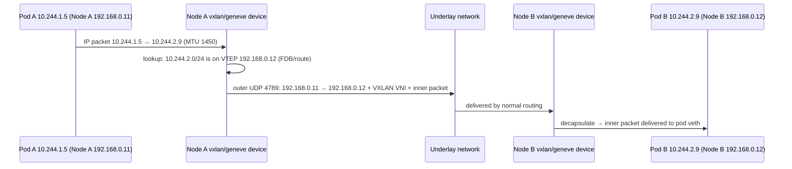
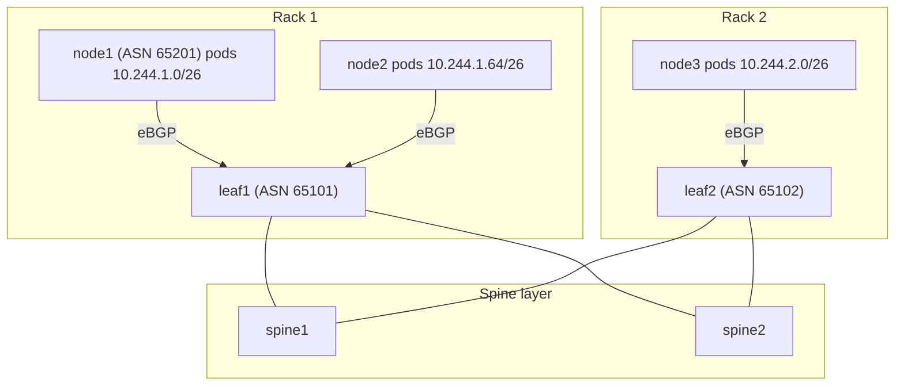

# 5.14 Overlay versus routed pod networking: VXLAN, BGP with Calico, eBPF with Cilium

| | |
|---|---|
| Level | Advanced |
| Priority tier | 1 |
| Lab venue | 3-node cluster; containerlab/FRR (2.27) as a mock ToR; `calicoctl`, `cilium`/`hubble` CLIs; iperf3/netperf |
| Part | Part 5: Kubernetes |
| Status | Drafted, labs **untested** |

## Why this matters for AI infrastructure

The primary pod network of a GPU cluster carries control traffic, service-to-service calls, logs and metrics, data-loader traffic over TCP in non-RDMA setups, checkpoint transfers, and, for many teams, some NCCL traffic over TCP sockets. Its design affects failure domains (a flat L2 versus routed L3), observability (can you see which pod talked to which?), security policy enforcement, throughput per core, and how it integrates with the datacentre fabric that Part 2 and Part 12 describe (leaf-spine with eBPF/BGP). Picking and tuning Calico, Cilium or a cloud-native CNI is a platform architecture decision that is hard to reverse, so this chapter gives a framework to choose, how each mode actually works on the wire, and how to verify and tune it.

## Prerequisites and outcomes

Needs 5.13, plus BGP and VXLAN from Part 2 (2.15 to 2.17), and Linux networking/eBPF from Part 1/2. After this chapter you can:

- Explain how VXLAN, Geneve and IP-in-IP overlays forward pod traffic (FDB/route programming, encapsulation, MTU) and their costs and benefits.
- Explain native routing with BGP (Calico, Cilium BGP Control Plane, kube-router) and integrate pod CIDRs with ToR switches in a leaf-spine fabric (eBGP per node/rack, route reflectors, ECMP, graceful restart, BFD).
- Describe how Cilium's eBPF datapath works: endpoint identities, policy maps, tc/XDP hooks, socket-level load balancing, kube-proxy replacement, host routing, bandwidth manager, WireGuard/IPsec encryption, Hubble flows, ClusterMesh.
- Install and configure Calico and Cilium in each mode; verify routing, MTU, policy, encryption, and observability.
- Compare modes on performance, operational complexity, debuggability, policy features, and kernel dependency; choose for GPU clusters (including coexistence with Multus/SR-IOV).
- Migrate or replace a CNI safely.

## 1. Decision frame

| Question | Why it matters |
|---|---|
| Can the underlay route pod CIDRs (do you control ToR switches / can run BGP)? | Native routing needs the fabric to learn pod routes; otherwise overlay |
| What MTU does the fabric support? | Overlay cost: 50-byte headers; jumbo underlay (9000+) makes overlays cheap |
| What scale (nodes, pods per node, Services)? | iptables-based paths degrade; eBPF scales better; BGP route counts (per-node /26-/24 blocks vs per-pod /32) |
| What policy and observability do you need? | L3/L4 only vs L7 (HTTP/gRPC/Kafka/DNS), flow logs, identity-based policy |
| Kernel versions on nodes? | Cilium eBPF features need 5.4/5.10+; hardware offload; Calico eBPF needs 5.3+ |
| Who operates it? | Calico (iptables/BGP) is familiar to network/Linux engineers; Cilium needs eBPF literacy |
| Multi-cluster, encryption, service mesh needs? | Cilium ClusterMesh, WireGuard, mesh without sidecars (Cilium Service Mesh) |
| Cloud-managed or bare metal? | Managed clusters often fix the CNI (AWS VPC CNI, GKE Dataplane V2 = Cilium, Azure CNI/Cilium) |
| Performance goals for the primary network? | If bulk traffic stays on RDMA secondary networks, primary CNI performance is secondary to reliability and policy |

## 2. Overlay networks

An overlay encapsulates pod packets inside packets addressed between **node IPs**, so the underlay only needs node-to-node reachability.



- **VXLAN** (UDP 4789; Flannel uses 8472 by default, Calico 4789): L2-over-UDP with a 24-bit VNI; the VTEP learns/gets MAC→VTEP mappings via control-plane programming (Flannel/Calico program FDB and neighbor entries so no flooding); 50-byte overhead.
- **Geneve** (UDP 6081): extensible encapsulation with TLV options (Cilium and OVN-Kubernetes use it to carry identity/metadata); ~50+ bytes.
- **IP-in-IP** (protocol 4; Calico): 20-byte overhead, L3 only, fewer features (no multicast), blocked by some clouds; `CrossSubnet` mode encapsulates only when crossing L3 boundaries (route natively within a subnet).
- **WireGuard** can act as an encrypting overlay (Calico, Cilium): 60-byte overhead, kernel module, good performance.

Costs and issues: MTU reduction (set pod MTU = underlay − overhead); CPU for encap/decap (mitigated by UDP tunnel offloads: `tx-udp_tnl-segmentation`, `rx-udp_tunnel-port-offload` on modern NICs; check `ethtool -k`); loss of fabric visibility (flows are node-to-node UDP; ECMP hashing on outer UDP source port derived from inner flow helps spread; some fabrics need `ecmp hash` on UDP ports); troubleshooting needs capture inside tunnels; firewalls must allow the UDP port; overlay hides pod IPs from the fabric (no ACLs on pod IPs, no network-level flow attribution).

When to choose overlays: no control of the underlay; mixed environments; multi-cloud/hybrid with simple connectivity; quick start; small clusters.

## 3. Routed designs with BGP

Without encapsulation, each node advertises its pod CIDR(s) to the fabric (or the fabric learns routes via BGP from nodes). Pod traffic is plain IP on the wire with pod IPs visible end to end.



### Calico in BGP mode

Calico runs **Felix** (programs routes, iptables/eBPF policy) and **BIRD** (BGP daemon) per node, plus **Typha** (fan-out of datastore updates at scale) and the controller. IPAM allocates **blocks** (default /26 per node, dynamically as needed) from IP pools; each node advertises its blocks.

Topologies:

- **Node-to-node mesh** (default): full mesh iBGP among nodes (O(n²) sessions): fine below ~100 nodes.
- **Route reflectors** (RR): a few nodes (or the ToRs) reflect routes; scale to thousands.
- **Peering with ToR switches**: each node peers eBGP with its rack's ToR (`BGPPeer` resources with `nodeSelector`, `peerIP` or `peerSelector`), using unique or shared ASNs per rack as per your fabric design (RFC 7938 style, 2.16); ToRs propagate pod routes to the spine; `nodeToNodeMesh` disabled.

```yaml
apiVersion: projectcalico.org/v3
kind: BGPConfiguration
metadata: { name: default }
spec:
  logSeverityScreen: Info
  nodeToNodeMeshEnabled: false
  asNumber: 65201
  serviceClusterIPs: [ { cidr: 10.96.0.0/12 } ]      # advertise Service IPs (ECMP to nodes)
  serviceLoadBalancerIPs: [ { cidr: 192.168.100.0/24 } ]
---
apiVersion: projectcalico.org/v3
kind: BGPPeer
metadata: { name: rack1-tor }
spec:
  peerIP: 10.0.1.1
  asNumber: 65101
  nodeSelector: rack == 'rack1'
  keepOriginalNextHop: false
---
apiVersion: projectcalico.org/v3
kind: IPPool
metadata: { name: pods-default }
spec:
  cidr: 10.244.0.0/16
  blockSize: 26
  ipipMode: Never
  vxlanMode: Never                 # pure routed; use CrossSubnet if some paths are L3
  natOutgoing: true
  nodeSelector: all()
```

Operational notes: use BFD for sub-second failure detection, graceful restart to keep routes during BIRD restarts, route filters on the ToR (accept only the pod/service ranges from nodes, enforce max-prefix), ECMP across spines, and consider `/32` per-pod routes only with eBPF/host-routing designs (block aggregation keeps routing tables small). Calico Enterprise/OSS differences, `calicoctl node status` for peer state, `ip route` shows `proto bird`.

Other routed options: **Cilium BGP Control Plane** (`CiliumBGPPeeringPolicy`/v2 `CiliumBGPClusterConfig`; advertises pod CIDRs, Services, LB IPs via GoBGP), **kube-router** (BGP + IPVS + network policy in one binary), **MetalLB/FRR-K8s** for Service IPs, **Flannel host-gw** (static routes, L2-adjacent nodes only), cloud route tables (GCE routes, AWS route table CNI mode, Azure UDR).

Benefits: no encap overhead or MTU loss; visible pod IPs for fabric telemetry, ACLs, and flow logs; native ECMP; failures isolated to BGP sessions. Costs: depends on network team cooperation and fabric configuration; need to avoid overlapping/ambiguous prefixes; route churn handling; pods leaving the cluster network must be NATed or routable externally by design.

### Underlay-native / VPC-native

Pods get fabric-routable addresses (AWS VPC CNI with ENI secondary IPs, GKE alias IPs, Azure CNI): simplest for cloud, tied to the provider's limits (IPs per ENI/instance, subnet size, quotas) and security group semantics; custom networking/prefix delegation (AWS) scales IP counts. On bare metal the equivalent is macvlan/ipvlan or SR-IOV with fabric-provided addresses (5.13).

## 4. Cilium and eBPF

Cilium implements CNI, Services, NetworkPolicy, observability, encryption and optionally service mesh and multi-cluster using **eBPF** programs attached to kernel hooks.

### Concepts

- **Identity-based security**: each pod endpoint gets a numeric **security identity** derived from its labels (pods with identical labels share an identity); policy rules are expressed as identity-to-identity allow lists, enforced in eBPF maps, independent of IP addresses (scales better than IP-based iptables rules; works with churn). Identities are propagated across nodes via a kvstore/CRDs and carried in Geneve/VXLAN headers or looked up by IP (ipcache) in native routing.
- **Hooks**: `tc` (traffic control ingress/egress on pod veth/netkit and node devices), **XDP** (earliest packet hook at the NIC driver for load balancing/DDoS), **socket hooks** (`cgroup/connect4`, `sendmsg`, `getpeername`, `bind`) for socket-level load balancing, `sockops`/`sk_msg` for acceleration, kprobes for tracing (Tetragon).
- **Maps**: BPF maps hold Service backends (`lb4_services`, `lb4_backends`), endpoints, policy (`cilium_policy_*`), conntrack (`cilium_ct4_*`), NAT, ipcache, metrics. Updates are incremental atomic map operations (no full rewrites).
- **Datapath modes**: **Tunnel** (VXLAN/Geneve overlay, default), **Native routing** (`routingMode: native`, with `ipv4NativeRoutingCIDR`, relying on fabric/cloud routes or Cilium BGP/auto direct node routes when nodes share L2), **ENI/Azure/Cloud-specific IPAM modes**.
- **kube-proxy replacement** (`kubeProxyReplacement: true`): handles ClusterIP/NodePort/LoadBalancer/externalIPs/hostPort; socket-LB resolves the backend at `connect()` for in-cluster clients (no per-packet DNAT, no conntrack for pod→service), eBPF NAT for external traffic; supports `DSR` (direct server return), `Maglev` hashing, session affinity, graceful backend termination, topology-aware routing, `externalTrafficPolicy`.
- **Host routing / `bpf.masquerade` / BPF host firewall / netkit**: bypass iptables and the host network stack for pod-to-pod and pod-to-external flows (`bpf.hostRouting=true` legacy-iptables bypass), use `netkit` devices (newer kernels) instead of veth for lower overhead, `BIG TCP`, `bandwidth manager` (EDT-based egress rate limiting with `kubernetes.io/egress-bandwidth` annotation and BBR option) — useful for fair sharing of NIC bandwidth.
- **Encryption**: transparent **WireGuard** (node-to-node pod traffic, `encryption.type=wireguard`) or IPsec, optional strict mode; consider overhead and MTU; mTLS via mesh features.
- **Observability**: **Hubble** (flows, DNS, HTTP/gRPC metadata, drops with reasons, service map UI/CLI/metrics), Prometheus metrics, `cilium monitor`; **Tetragon** (runtime security observability and enforcement via eBPF).
- **Policy**: `NetworkPolicy` plus `CiliumNetworkPolicy`/`CiliumClusterwideNetworkPolicy` with L7 rules (HTTP methods/paths, gRPC, Kafka, DNS `toFQDNs` for egress allow-lists by name), entities (`world`, `host`, `kube-apiserver`, `cluster`), CIDR groups, host policies (5.15).
- **Cluster Mesh**: connect multiple clusters (global services, cross-cluster policy, shared identities) (5.35).
- **Service mesh** (sidecar-free) and **Gateway API** implementation, **Ingress** controller, **BGP/L2 announcements** and **LB IPAM**, **egress gateway** (stable egress IPs per namespace/pod: useful for allow-listing GPU job egress to external storage).

### Install (Helm) examples

```bash
helm repo add cilium https://helm.cilium.io && helm repo update
# Tunnel mode (VXLAN), kube-proxy replacement, Hubble
helm upgrade --install cilium cilium/cilium --version 1.16.0 -n kube-system \
  --set kubeProxyReplacement=true --set k8sServiceHost=k8s-api.lab.local --set k8sServicePort=6443 \
  --set routingMode=tunnel --set tunnelProtocol=vxlan \
  --set ipam.mode=cluster-pool --set ipam.operator.clusterPoolIPv4PodCIDRList=10.244.0.0/16 --set ipam.operator.clusterPoolIPv4MaskSize=24 \
  --set hubble.enabled=true --set hubble.relay.enabled=true --set hubble.ui.enabled=true \
  --set bpf.masquerade=true

# Native routing with BGP (fabric learns pod CIDRs) and Maglev + DSR
helm upgrade --install cilium cilium/cilium -n kube-system \
  --set routingMode=native --set ipv4NativeRoutingCIDR=10.244.0.0/16 --set autoDirectNodeRoutes=false \
  --set bgpControlPlane.enabled=true \
  --set kubeProxyReplacement=true --set loadBalancer.mode=dsr --set loadBalancer.algorithm=maglev \
  --set bpf.hostRouting=true --set enableIPv4Masquerade=true \
  --set mtu=9000
cilium status --wait
cilium connectivity test                       # end-to-end validation (needs several minutes)
hubble observe --follow --namespace training --verdict DROPPED
```

(Verify chart version and values for your Cilium release; `kubeadm init --skip-phases=addon/kube-proxy` when replacing kube-proxy from day one.)

### Cilium BGP Control Plane example

```yaml
apiVersion: cilium.io/v2alpha1
kind: CiliumBGPPeeringPolicy
metadata: { name: rack1 }
spec:
  nodeSelector: { matchLabels: { rack: rack1 } }
  virtualRouters:
    - localASN: 65201
      exportPodCIDR: true
      serviceSelector: { matchExpressions: [ { key: advertise, operator: In, values: ["bgp"] } ] }
      neighbors:
        - peerAddress: 10.0.1.1/32
          peerASN: 65101
          connectRetryTimeSeconds: 30
          holdTimeSeconds: 9
          keepAliveTimeSeconds: 3
```

(API versions differ across releases; newer versions use `CiliumBGPClusterConfig`, `CiliumBGPPeerConfig`, `CiliumBGPAdvertisement` v2.)

## 5. Comparison

| Aspect | VXLAN/Geneve overlay | Calico routed BGP (iptables dataplane) | Calico eBPF dataplane | Cilium native routing (eBPF) | Cilium tunnel (eBPF) |
|---|---|---|---|---|---|
| Underlay requirements | Node-to-node UDP | BGP/fabric learns pod CIDRs | Same as Calico routed | Fabric/cloud routes or BGP | Node-to-node UDP |
| Overhead/MTU | −50 B; encap CPU | None | None | None | −50 B |
| Service LB | kube-proxy iptables/IPVS | kube-proxy | Replaces kube-proxy (BPF) | Replaces kube-proxy | Replaces kube-proxy |
| Policy | Depends on CNI (Calico/Cilium) | iptables/ipsets | BPF maps | Identity-based BPF | Identity-based BPF |
| Observability | Weak underlay visibility | Pod IPs visible; iptables counters; Flow logs (Enterprise) | Better | Hubble, deep | Hubble |
| Scale | Good | Excellent (blocks), iptables rule scaling limits | Better | Excellent | Excellent |
| Complexity | Low | Medium (BGP) | Medium | Medium-high | Medium |
| Kernel needs | Modest | Modest | ≥5.3 | ≥5.4/5.10 recommended | ≥4.19 |
| Throughput per core | Moderate | Good | Better | Best (host routing/netkit/DSR) | Good |

Rough performance guidance: with 25-100 Gb/s NICs, tunnelled pod-to-pod TCP throughput often reaches 50-80% of line rate without tuning (CPU-bound); routed/eBPF native with GRO/GSO and appropriate MTU approaches line rate; latency adds ~10-30 µs for overlay encap/decap and iptables traversal vs lower with eBPF host routing. Always benchmark on your hardware (section 7). None substitutes for RDMA when running collectives (5.13).

## 6. Choosing for GPU clusters

- **Primary network is for control and ordinary traffic**; collectives run on secondary RDMA networks (SR-IOV/macvlan/host devices) attached through Multus. Therefore choose the primary CNI for **reliability, policy, observability and operability**, not peak throughput.
- **Bare metal with a BGP fabric** (NVIDIA Spectrum/Cumulus, Arista, Cisco): Calico BGP or Cilium native routing + BGP integrate cleanly; avoid overlays to preserve fabric ECMP and visibility. Align ASN schemes with the fabric design (2.16, Part 12).
- **No fabric control / mixed environments**: VXLAN with jumbo MTU or WireGuard-encrypted tunnels.
- **Managed Kubernetes**: use the provider default unless you need advanced features; GKE Dataplane V2 is Cilium; EKS supports Cilium in chaining/overlay mode alongside VPC CNI; AKS offers Azure CNI Powered by Cilium.
- **Observability and security**: Cilium with Hubble gives per-flow visibility valuable for multi-tenant AI platforms (who is exfiltrating data, which training job hammers the metadata service); Tetragon for runtime policy.
- **Egress control**: AI jobs often need allow-listed egress to object stores, registries and package mirrors: FQDN policies (Cilium `toFQDNs`), egress gateways with stable IPs, or proxy gateways.
- **Coexistence**: Multus attaches secondary networks regardless of the primary; ensure the primary CNI does not interfere with secondary interfaces (Cilium `devices` setting, Calico `interfaceRegexp`/excluded interfaces `IP_AUTODETECTION_METHOD`, Cilium `--devices` for host firewall/BPF NodePort should exclude RDMA NICs).
- **Kernel/OS discipline**: pin kernel versions across GPU nodes (4.17); eBPF features depend on them; test CNI upgrades together with kernel upgrades.
- **Node IP detection**: multi-homed GPU nodes (mgmt, data, RDMA NICs) confuse CNIs that auto-detect the node IP/interface. Set explicitly (`IP_AUTODETECTION_METHOD=interface=eth0` in Calico, `--set devices=eth0` or `k8sServiceHost` in Cilium, kubelet `--node-ip`).
- **Pod density and IP planning**: GPU nodes usually run few pods (tens), so per-node `/26` or `/25` suffice; plan cluster CIDR for node count × block size; avoid wasting space but leave growth.

## 7. Verification and benchmarking

```bash
# Routing and encapsulation
ip route | grep -E 'proto bird|10.244'                  # Calico BGP routes; vxlan/ipip devices
calicoctl node status                                    # BGP peers Established
calicoctl ipam show --show-blocks
cilium status; cilium config view | grep -E 'routing-mode|tunnel|kube-proxy|devices'
cilium bpf lb list | head; cilium bpf ct list global | head; cilium bpf endpoint list
cilium endpoint list
hubble status; hubble observe --pod training/worker-0 --last 50

# MTU
ip link show | grep -E 'mtu (8|9|14|15)'                # node and tunnel MTUs
kubectl exec pod -- ip link show eth0                    # pod MTU
ping -M do -s 8972 <pod-ip-on-other-node>                # jumbo path test

# Performance (pod-to-pod across nodes)
kubectl apply -f iperf3-server.yaml; kubectl exec iperf-client -- iperf3 -c <server-pod-ip> -P 8 -t 30
kubectl exec iperf-client -- iperf3 -c <server> -u -b 0 -l 1400          # UDP/PPS
netperf -H <server> -t TCP_RR -- -r 1,1                                  # latency (transactions/s)
kubectl exec pod -- nuttcp ...                                           # alternative
mpstat -P ALL 1                                                          # per-core usage during the test
ethtool -k <nic> | grep -E 'udp_tnl|gro|gso|tso|rx-udp'                  # offloads
```

Test matrix: same node vs cross-node vs cross-rack; TCP bulk vs small RPCs vs UDP; with/without policy; with/without encryption; at 100/1,000/10,000 Services; during node churn. Record CPU per Gb/s and tail latency. Keep results with kernel/CNI/NIC firmware versions.

## 8. Migration and operations

- **Changing CNI on a live cluster is disruptive**: pods need new networking; methods: drain nodes one by one while removing the old CNI and installing the new (rolling), or build a new cluster and migrate workloads (preferred for large changes). Cilium and Calico both provide migration guides (e.g., Cilium's dual-overlay migration using node labels and `CiliumNodeConfig`).
- **Upgrades**: follow upgrade paths (n → n+1 minor), read release notes about datapath changes, upgrade agents with maxUnavailable limits, test connectivity (`cilium connectivity test`), watch for drops during rollouts; consider pinning eBPF-related options and testing kernel pairs.
- **Capacity**: monitor IPAM pool utilisation, BGP session counts, Typha/agent resource usage, BPF map pressure (`cilium_ct_*` size: `bpf.ctTcpMax`, `bpf.natMax`, `bpf.policyMapMax`), conntrack table pressure, `felix` iptables restore time.
- **Backups**: store CNI configuration as code (Helm values in Git, 4.26); export IPAM state for disaster recovery where relevant.
- **Failure behaviour**: CNI agent down → existing pods keep connectivity (datapath programmed in kernel), new pods fail to start; BGP down → routes withdrawn (use graceful restart); policy engine down → default behaviour (fail-open or closed per config).
- **Security**: restrict access to the CNI's CRDs (they define policy), enable mTLS for Hubble/cilium-agent APIs, rotate WireGuard keys automatically, audit policy changes via GitOps.

## 9. Lab (untested)

1. **Overlay baseline**: install Flannel (VXLAN) or Calico VXLAN on a 3-node cluster; capture VXLAN on the underlay; compute MTU; run iperf3 pod-to-pod; view `bridge fdb`, `ip -d link show flannel.1`.
2. **Routed Calico with FRR**: build a containerlab topology with two ToRs and a spine (2.27); run Calico with `ipipMode: Never`, `vxlanMode: Never`, `nodeToNodeMeshEnabled: false`, peer nodes to ToRs; verify routes at the spine; run iperf3 and compare to the overlay; fail a node and a ToR link and measure convergence with and without BFD.
3. **Route reflectors**: switch Calico to route reflectors; compare session counts; add a node and see block allocation and advertisement.
4. **Cilium tunnel to native**: install Cilium in tunnel mode with Hubble; observe flows; switch to native routing + BGP Control Plane; compare path (`tcpdump` shows plain pod IPs); enable DSR/Maglev and test NodePort source IP preservation.
5. **kube-proxy replacement**: remove kube-proxy; verify Services work; inspect `cilium bpf lb list`; compare with iptables: sync latency with 5,000 Services (kube-burner), CPU, and connection setup latency.
6. **Policy and identity**: create CiliumNetworkPolicy with L7 HTTP rules and `toFQDNs`; observe Hubble verdicts; compare against Calico policy for the same intent (5.15).
7. **Encryption**: enable WireGuard; verify with `cilium encrypt status`/`wg show`; measure throughput and CPU; adjust MTU.
8. **MTU/PMTUD drill**: misconfigure MTU in one node; reproduce stalled transfers; fix.
9. **Performance matrix**: run the benchmark matrix across modes on the same hardware; produce a table of Gb/s, CPU cores used, p99 latency.
10. **Multus coexistence**: attach a secondary macvlan/SR-IOV network to a pod while Cilium or Calico is the primary; verify no interference, then `ib_write_bw`/`iperf3` on the secondary.
11. **Failure/upgrade drills**: roll the CNI agent with a connectivity loop running; kill agents; restart BGP; upgrade minor version in a staging cluster; document disruptions.
12. **Clean up**.

Mark tested only after execution.

## 10. Common mistakes

- Choosing an overlay by default on a fabric that could route pod CIDRs natively; or native routing without actually configuring the fabric to learn/advertise routes.
- Forgetting to reduce pod MTU for encapsulation or to enable jumbo frames end-to-end.
- Running full-mesh BGP beyond a few hundred nodes; no BFD or graceful restart; accepting arbitrary prefixes from nodes on ToRs.
- Enabling eBPF features on old kernels or without checking requirements; mixing kube-proxy and replacement partially.
- Letting the CNI choose the wrong interface/IP on multi-homed GPU nodes; Cilium/Calico binding RDMA NICs.
- Treating the primary CNI as the path for NCCL/storage bandwidth.
- Switching CNIs in place without a migration plan; leftover rules/interfaces from the old CNI.
- Ignoring BPF map sizes, conntrack limits and IPAM exhaustion until an incident.
- Overlapping encryption layers (WireGuard + IPsec + mesh mTLS) without measuring overhead.

## 11. Interview angles

- "Overlay vs routed networking: trade-offs? When BGP to the ToR?" 
- "How does Calico distribute routes? Mesh vs route reflectors vs ToR peering?" 
- "How does Cilium implement policy and Services without iptables? What is a security identity?" 
- "What is kube-proxy replacement and DSR? What are the pitfalls?" 
- "How do you pick a CNI for a GPU cluster on bare metal with a leaf-spine fabric?" 
- "How do you migrate CNIs on a running cluster?" 
- "How would you measure CNI performance and what would you look at?" 
- "Why not run NCCL over the pod network?" 

## 12. Checkpoint questions (35)

1. What does an overlay encapsulate? **A:** Pod packets inside node-to-node packets.
2. VXLAN port? **A:** UDP 4789 (8472 for Flannel default).
3. Geneve port? **A:** UDP 6081.
4. IPIP overhead? **A:** 20 bytes.
5. VXLAN overhead? **A:** 50 bytes.
6. WireGuard overhead? **A:** ~60 bytes.
7. What is routed mode? **A:** Native IP routing of pod CIDRs, no encapsulation.
8. Calico components? **A:** Felix, BIRD, Typha, controllers.
9. Calico IPAM unit? **A:** Blocks (default /26).
10. BGP mesh scalability? **A:** O(n²) sessions; use route reflectors.
11. What is `CrossSubnet`? **A:** Encapsulate only across subnet boundaries.
12. Why BFD? **A:** Fast failure detection.
13. Why route filters on ToRs? **A:** Prevent bad advertisements.
14. Cilium datapath tech? **A:** eBPF.
15. Cilium identity is derived from? **A:** Pod labels.
16. kube-proxy replacement flag? **A:** `kubeProxyReplacement=true`.
17. Socket LB means? **A:** Backend chosen at connect().
18. DSR means? **A:** Direct server return, replies bypass the LB node.
19. Maglev is? **A:** Consistent hashing LB algorithm.
20. Hubble provides? **A:** Flow observability.
21. Tetragon provides? **A:** eBPF runtime security.
22. ClusterMesh does? **A:** Multi-cluster connectivity/policy.
23. Cilium L7 policy examples? **A:** HTTP, gRPC, Kafka, DNS FQDN.
24. Cilium egress gateway for? **A:** Stable egress IPs.
25. Calico eBPF kernel min? **A:** ~5.3.
26. Which CNI does GKE Dataplane V2 use? **A:** Cilium.
27. VPC CNI limits? **A:** IPs per ENI/instance.
28. Overlay cons? **A:** MTU, CPU, reduced visibility.
29. Routed cons? **A:** Needs underlay cooperation.
30. Multi-homed node issue? **A:** CNI picks wrong IP/interface.
31. Fix? **A:** Explicit IP autodetection/devices/node-ip.
32. CNI agent down effect? **A:** Existing pods keep working; new pods fail.
33. How migrate CNIs? **A:** Rolling per-node migration or new cluster.
34. What to monitor for BPF? **A:** Map utilisation and drops.
35. Primary CNI choose for? **A:** Reliability/policy/observability, not NCCL bandwidth.

## 13. Sources and review notes

**Written in original words.** Principal sources:

- James Strong and Vallery Lancey, *Networking and Kubernetes* (chapters 4 to 6 on Kubernetes networking abstractions, CNI implementations, overlays and routed designs).
- Josh Rosso et al., *Production Kubernetes* (chapter 5 on pod networking, CNI selection and operations).
- AI data-centre network design material used in this handbook's Part 2 and Part 12 (leaf-spine, BGP to hosts, RoCE considerations).
- Calico, Cilium, kube-router and Flannel documentation.
- Examples are the author's constructions.

**Flagged for verification before publishing:** Cilium Helm values and CRD API versions (BGP control plane changed across releases), Calico resource fields, kernel version requirements, NIC offload names, performance expectations, and every command/manifest; all labs are **untested**.
