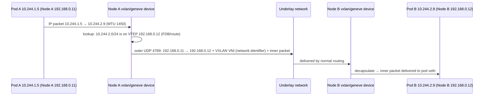
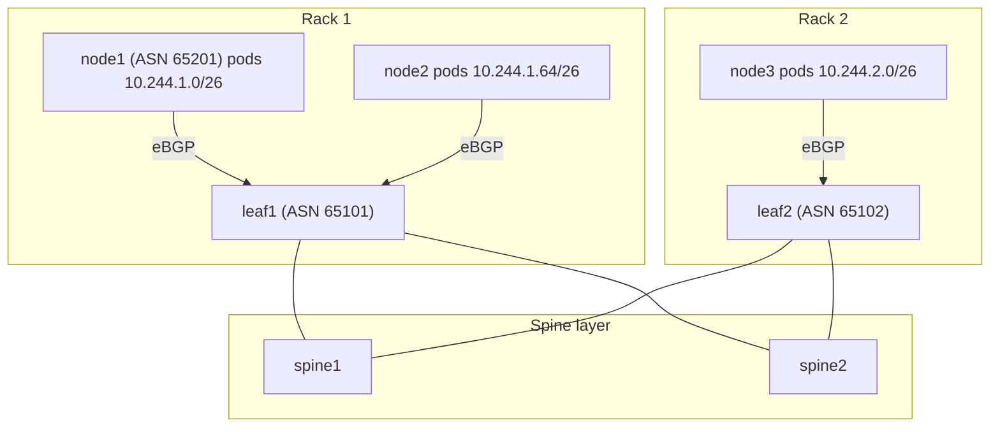

# 5.14 Overlay versus routed pod networking: VXLAN, BGP with Calico, eBPF with Cilium

| | |
|---|---|
| Level | Advanced |
| Priority tier | 1 |
| Lab venue | 3-node cluster; containerlab/FRR (2.27) as a mock ToR; `calicoctl`, `cilium`/`hubble` CLIs; iperf3/netperf |
| Part | Part 5: Kubernetes |
| Status | Drafted, labs **untested** |

## Why this matters for AI infrastructure

Your GPU cluster's primary pod network carries more traffic than most people expect. It handles control traffic, service-to-service calls, logs and metrics, and data-loader traffic over TCP in non-RDMA setups. It also carries checkpoint transfers and, for many teams, some NCCL traffic over TCP sockets.

The design of this network decides several things at once. It sets the failure domains, which can be a flat L2 network or a routed L3 network. It decides whether you can see which pod talked to which, how security policy is enforced, and how much throughput each core delivers. It also decides how the network fits the datacentre fabric that Part 2 and Part 12 describe, a leaf-spine design running eBPF and BGP.

Choosing and tuning Calico, Cilium or a cloud-native CNI is a platform architecture decision, and it is hard to reverse. Think of it like choosing the road layout for a new city. Once the streets are laid and the houses are built, moving a main road is expensive, and every neighbourhood feels the change. This chapter gives you a framework for that choice, shows how each mode works on the wire, and explains how to verify and tune it.

## Prerequisites and outcomes

Before you start, you need chapter 5.13, plus BGP and VXLAN from Part 2 (2.15 to 2.17), and the Linux networking and eBPF material from Part 1 and Part 2. Use the list below as a self-check. Each line names one thing a platform engineer should be able to do with these tools, and each one maps to a section of this chapter.

- Explain how VXLAN, Geneve and IP-in-IP overlays forward pod traffic, covering the forwarding database (FDB) that maps pod addresses to node addresses, route programming, encapsulation and MTU, and what each one costs and gives you.
- Explain native routing with BGP (Calico, Cilium BGP Control Plane, kube-router), and connect pod CIDRs to top-of-rack (ToR) switches in a leaf-spine fabric using eBGP per node or rack, route reflectors, ECMP, graceful restart and BFD.
- Describe how Cilium's eBPF datapath works, including endpoint identities, policy maps, tc and XDP hooks, socket-level load balancing, kube-proxy replacement, host routing, bandwidth manager, WireGuard or IPsec encryption, Hubble flows and ClusterMesh.
- Install and configure Calico and Cilium in each mode, and verify routing, MTU, policy, encryption and observability.
- Compare the modes on performance, operational complexity, debuggability, policy features and kernel dependency, and choose one for GPU clusters, including how it coexists with Multus and SR-IOV.
- Migrate or replace a CNI safely.

If a line feels unfamiliar when you reach its section, slow down there and read again. Running the commands on a cluster of your own is the best way to make the line stick.

## 1. Decision frame

Suppose your team must build a GPU cluster on racks that the network engineers already manage. Before anyone opens a Helm chart, the team needs to know what the fabric can do. This table turns that conversation into a checklist.

Before you read about any mode in detail, answer the questions in this table. Each row exposes a constraint that can rule a mode in or out. Read the right-hand column as the reason behind each question.

| Question | Why it matters |
|---|---|
| Can the underlay route pod CIDRs (do you control ToR switches / can run BGP)? | Native routing needs the fabric to learn pod routes; otherwise overlay |
| What MTU does the fabric support? | Overlay cost: 50-byte headers; jumbo underlay (9000+) makes overlays cheap |
| What scale (nodes, pods per node, Services)? | iptables-based paths degrade; eBPF scales better; BGP route counts (per-node /26-/24 blocks vs per-pod /32) |
| What policy and observability do you need? | L3/L4 only vs L7 (HTTP/gRPC/Kafka/DNS), flow logs, identity-based policy |
| Kernel versions on nodes? | Cilium eBPF features need 5.4/5.10+; hardware offload; Calico eBPF needs 5.3+ |
| Who operates it? | Calico (iptables/BGP) is familiar to network/Linux engineers; Cilium needs eBPF literacy |
| Multi-cluster, encryption, service mesh needs? | Cilium ClusterMesh, WireGuard, mesh without sidecars (Cilium Service Mesh) |
| Cloud-managed or bare metal? | Managed clusters often fix the CNI (AWS VPC CNI, GKE Dataplane V2 = Cilium, Azure CNI/Cilium) |
| Performance goals for the primary network? | If bulk traffic stays on RDMA secondary networks, primary CNI performance is secondary to reliability and policy |

Notice that the scale, MTU and kernel rows often decide the datapath, while the operations row decides how much complexity your team can carry. Answer every row before you pick a mode.

Here is one way to read the table. Suppose the fabric cannot learn pod routes, and the MTU is 1500 bytes. The first row then points you to an overlay, because native routing needs the fabric's help. The MTU row tells you that every pod packet gives up 50 bytes to the tunnel header. If your team also runs a small cluster with a tight budget, the operations row tells you that a simple overlay is easier to carry than a BGP design. Each row narrows the list, and the answers together settle the choice.

## 2. Overlay networks

Picture a pod on Node A that must reach a pod on Node B, while the physical network knows only how to reach nodes. An overlay closes that gap. It wraps each pod packet inside a packet addressed between node IPs, so the underlay needs only node-to-node reachability.



Read the diagram as one packet's trip. The packet leaves Pod A, and the Node A device looks up which VTEP, the tunnel endpoint that does the wrapping, owns the destination subnet. It then wraps the packet in an outer UDP packet addressed from Node A to Node B. Node B strips the outer layer and hands the inner packet to Pod B.

Think of an overlay as a courier box. The pod packet is a letter sealed inside the box. The label on the box carries only the node addresses, so the courier needs to know how to reach each building and nothing more. The receiving node opens the box and passes the letter on unchanged. The letter itself is the same, but the box makes the whole parcel heavier, which is the same as the MTU cost in the next paragraphs.

VXLAN runs over UDP port `4789`, while Flannel uses `8472` by default. It carries layer 2 traffic over UDP, identified by a 24-bit VNI, the VXLAN network identifier. The VTEP learns its MAC-to-VTEP mappings through control-plane programming. Flannel and Calico program the forwarding database (FDB) and neighbor entries, so the network does not need flooding. VXLAN adds 50 bytes of overhead.

Geneve runs over UDP port `6081`. It is an extensible encapsulation, and its TLV options, short for type-length-value, let Cilium and OVN-Kubernetes carry identity and metadata inside the tunnel. Its overhead is ~50+ bytes.

IP-in-IP uses IP protocol `4` and places an inner IP packet inside an outer one. It adds 20 bytes of overhead and works at layer 3 only. It has fewer features, with no multicast, and some clouds block it. Calico's `CrossSubnet` mode encapsulates only when traffic crosses a layer 3 boundary, so traffic inside a subnet routes natively.

WireGuard can act as an encrypting overlay in both Calico and Cilium. It adds 60 bytes of overhead, runs as a kernel module, and performs well.

Overlays come with costs you have to plan for. The MTU shrinks, so set the pod MTU to the underlay MTU minus the overhead. Encapsulation and decapsulation also use CPU. UDP tunnel offloads reduce that cost on modern NICs, named `tx-udp_tnl-segmentation` and `rx-udp_tunnel-port-offload`, and you can check them with `ethtool -k`.

Overlays also change what the fabric can see. Think of the fabric as a postal service that reads only the outside of each envelope. With an overlay, every envelope is addressed from one node to another, and the postal service cannot read the names of the people inside. Flows are node-to-node UDP, so the fabric sees nodes rather than pods. ECMP hashing on the outer UDP source port, which is derived from the inner flow, helps spread traffic, and some fabrics need `ecmp hash` on UDP ports. Firewalls must allow the UDP port. The overlay hides pod IPs from the fabric, so you cannot write ACLs on pod IPs or attribute flows at the network level. Troubleshooting is harder as well, because you have to capture traffic inside the tunnels.

Picture a team that runs servers from several providers and cannot ask any of them to change their routers. An overlay asks nothing of the network beyond basic node-to-node reachability, which is why it suits that team.

Choose an overlay when you have no control of the underlay, when the environment is mixed, when you run multi-cloud or hybrid setups with simple connectivity, when you need a quick start, or when the cluster is small. Without control of the underlay, an overlay is the mode this list points to.

## 3. Routed designs with BGP

Imagine the fabric could route straight to pod addresses. Then no packet would need an outer header. Without encapsulation, each node advertises its pod CIDR(s) to the fabric, or the fabric learns the routes from the nodes over BGP. Pod traffic is then plain IP on the wire, and pod IPs stay visible from end to end.



The diagram shows one leaf switch per rack. Each node peers over eBGP with its rack's leaf, and every leaf connects to both spines. The leaves use ASNs 65101 and 65102, and node1 uses ASN 65201.

An ASN, or autonomous system number, is the label a BGP speaker uses to identify its routing domain. eBGP runs between different ASNs, such as a node and the leaf switch above it. Follow a pod block up the diagram. Node1 advertises `10.244.1.0/26` to its leaf, and the leaf passes that route up to both spines. Every switch then knows which rack holds that block, so it can forward traffic without any tunnel.

### Calico in BGP mode

Calico runs Felix, which programs routes and iptables or eBPF policy, and BIRD, the BGP daemon, on each node. It also runs Typha, which fans out datastore updates at scale, together with the controller. IPAM hands out blocks from IP pools. The blocks default to /26 per node and are allocated as needed. Each node advertises its blocks.

You can arrange the BGP sessions in three ways. The default is a node-to-node mesh, a full iBGP mesh among the nodes. That means O(n²) sessions, which is fine below ~100 nodes. Route reflectors are a few nodes, or the ToRs, that reflect routes, and this design scales to thousands of nodes.

Think of a full mesh as a group chat in which everyone messages everyone else. That works for a small group, but the number of conversations grows much faster than the number of people. A route reflector is closer to a single moderator who relays messages for the whole room. Each node talks to a few moderators, and the moderators pass the news along.

The third option peers each node with its ToR switch. Each node runs eBGP with its rack's ToR, and `BGPPeer` resources choose the peer through `nodeSelector`, `peerIP` or `peerSelector`. Use unique or shared ASNs per rack, following your fabric design in the RFC 7938 style from 2.16. The ToRs then propagate pod routes to the spine, and you disable `nodeToNodeMesh`.

The following manifests set the BGP configuration, one peer for the rack, and the pod IP pool.

```yaml
apiVersion: projectcalico.org/v3
kind: BGPConfiguration
metadata: { name: default }
spec:
  logSeverityScreen: Info
  nodeToNodeMeshEnabled: false
  asNumber: 65201
  serviceClusterIPs: [ { cidr: 10.96.0.0/12 } ]      # advertise Service IPs (ECMP to nodes)
  serviceLoadBalancerIPs: [ { cidr: 192.168.100.0/24 } ]
---
apiVersion: projectcalico.org/v3
kind: BGPPeer
metadata: { name: rack1-tor }
spec:
  peerIP: 10.0.1.1
  asNumber: 65101
  nodeSelector: rack == 'rack1'
  keepOriginalNextHop: false
---
apiVersion: projectcalico.org/v3
kind: IPPool
metadata: { name: pods-default }
spec:
  cidr: 10.244.0.0/16
  blockSize: 26
  ipipMode: Never
  vxlanMode: Never                 # pure routed; use CrossSubnet if some paths are L3
  natOutgoing: true
  nodeSelector: all()
```

The `IPPool` sets `blockSize: 26`, and it turns off both IPIP and VXLAN, which makes it pure routed. If some paths cross layer 3, use `CrossSubnet` instead.

Read the three manifests in order, because each one answers a different question. `BGPConfiguration` answers how this cluster speaks BGP, including its own ASN and the Service ranges it advertises. `BGPPeer` answers who the rack's switch is. `IPPool` answers which address space the pods draw from, and how each node takes its slice of it.

Think of BFD as a heartbeat monitor. The BGP session itself can take a long time to notice that a neighbour has gone quiet, but BFD checks the link many times a second, so the switch learns about the failure fast. Graceful restart works like a substitute teacher. When the regular teacher steps out for a moment, the class keeps going on the existing plan, and the teacher picks up again without the class being sent home.

Once the sessions are up, run them carefully. Use BFD for sub-second failure detection, and enable graceful restart so routes survive a BIRD restart. Filter routes on the ToR, so it accepts only the pod and service ranges from nodes and enforces a maximum prefix count. Spread traffic across spines with ECMP. Consider `/32` per-pod routes only with eBPF or host-routing designs, because block aggregation keeps routing tables small. Keep in mind the differences between Calico Enterprise and Calico OSS. To check peer state, run `calicoctl node status`, and look for `proto bird` in `ip route`.

Other routed options exist as well. Cilium BGP Control Plane uses `CiliumBGPPeeringPolicy`, or the v2 `CiliumBGPClusterConfig`, to advertise pod CIDRs, Services and LB IPs through GoBGP. kube-router combines BGP, IPVS and network policy in one binary. MetalLB and FRR-K8s handle Service IPs. Flannel host-gw uses static routes and works only for nodes that are adjacent at layer 2. Cloud route tables cover GCE routes, the AWS route table CNI mode, and Azure UDRs.

Routed designs have clear benefits. There is no encapsulation overhead and no MTU loss. Pod IPs stay visible to fabric telemetry, ACLs and flow logs. The fabric's native ECMP applies, and a failure stays within the BGP sessions it affects. The costs are real, though. The design depends on network team cooperation and on how the fabric is configured. You must avoid overlapping or ambiguous prefixes, handle route churn, and make sure pods that leave the cluster network are NATed or routable externally by design.

On a fabric that can learn pod routes, a routed design keeps the most visibility.

Routed designs also depend on ECMP, which stands for equal-cost multipath. Picture a supermarket with several checkout lanes of the same length. ECMP sends each flow into one of those lanes, so the load spreads across the spines. Each flow stays in one lane, so its packets arrive in order, and the fabric as a whole uses all of its capacity. That is why the spine layer matters so much in a routed design.

### Underlay-native / VPC-native

Pods can also receive fabric-routable addresses directly. AWS VPC CNI uses ENI secondary IPs, GKE uses alias IPs, and Azure CNI is also in this group. This is the simplest option in the cloud, but it is tied to the provider's limits: IPs per ENI or instance, subnet size, quotas, and security group semantics. Custom networking and prefix delegation on AWS help scale the IP count. On bare metal, the equivalent is macvlan, ipvlan or SR-IOV with fabric-provided addresses, covered in 5.13.

The provider's IP limits decide whether this design fits your cluster.

## 4. Cilium and eBPF

Picture a Service with many pods behind it, and a firewall rule that lists each pod's IP. Every time a pod restarts, its IP changes, and the rule has to change with it. Cilium's approach avoids that churn by naming the workload instead of its address.

Cilium does most of its networking through eBPF programs attached to kernel hooks. eBPF lets small, verified programs run inside the kernel. Cilium uses them to implement the CNI itself, along with Services, NetworkPolicy, observability and encryption. It can also provide a service mesh and multi-cluster networking, all through the same mechanism.

### Concepts

Identity-based security gives each pod endpoint a numeric security identity, derived from its labels. Pods with identical labels share an identity. Policy rules become identity-to-identity allow lists, enforced in eBPF maps, and they do not depend on IP addresses. That scales better than IP-based iptables rules and copes well with churn. Identities reach other nodes through a kvstore or CRDs, and they travel in Geneve or VXLAN headers. In native routing, Cilium looks them up by IP in the ipcache instead.

A simple way to hold the idea is a security badge. An IP address is like a street address, which changes when someone moves house. An identity is like the badge the person wears at work, which stays the same no matter where they sit. A policy that says "the badge for frontend may call the badge for backend" still works after every frontend pod has moved to a new address.

Cilium hooks into several points in the kernel. `tc` handles traffic control ingress and egress on pod veth or netkit devices and on node devices. XDP is the earliest packet hook, at the NIC driver, used for load balancing and DDoS filtering. Socket hooks, including `cgroup/connect4`, `sendmsg`, `getpeername` and `bind`, handle socket-level load balancing. `sockops` and `sk_msg` speed up local traffic, and kprobes support tracing in Tetragon.

The datapath keeps its state in BPF maps. Maps hold Service backends (`lb4_services`, `lb4_backends`), endpoints, policy (`cilium_policy_*`), conntrack (`cilium_ct4_*`), NAT, the ipcache and metrics. Updates are incremental atomic map operations, so Cilium never rewrites a whole map.

Cilium offers three datapath modes. Tunnel mode is the overlay from section 2, so it is the mode to pick when the fabric cannot learn pod routes. Native routing is the routed design from section 3, and it needs the fabric or the cloud to know the pod CIDRs. Tunnel mode uses a VXLAN or Geneve overlay and is the default. Native routing, set with `routingMode: native` and `ipv4NativeRoutingCIDR`, relies on fabric or cloud routes, or on Cilium BGP or automatic direct node routes when nodes share L2. The ENI, Azure and other cloud-specific IPAM modes cover the cloud cases.

kube-proxy replacement, enabled with `kubeProxyReplacement: true`, takes over ClusterIP, NodePort, LoadBalancer, externalIPs and hostPort handling. Socket-LB resolves the backend at `connect()` for in-cluster clients, so pod-to-Service traffic needs no per-packet DNAT and no conntrack. External traffic goes through eBPF NAT. The replacement also supports direct server return (DSR), which lets the backend answer the client without sending the reply back through the node that received the request, Maglev hashing, session affinity, graceful backend termination, topology-aware routing and `externalTrafficPolicy`.

Here is how the Socket-LB step reads for a pod that calls a Service. The pod's `connect()` call is rewritten to a backend pod address before the first packet is built. The packet then carries the real destination, so no per-packet translation is needed. With iptables, by contrast, each packet is rewritten as it passes through the rule chains. Socket-LB moves that work to the moment the connection starts.

Host routing bypasses iptables and the host network stack for pod-to-pod and pod-to-external flows. `bpf.hostRouting=true` provides the legacy iptables bypass. Newer kernels can use netkit devices in place of veth, which lowers overhead. BIG TCP is also available. The bandwidth manager limits egress rate with EDT, using the `kubernetes.io/egress-bandwidth` annotation and an optional BBR setting, which helps share NIC bandwidth fairly.

Encryption comes in two forms. Transparent WireGuard (`encryption.type=wireguard`) covers node-to-node pod traffic, and IPsec is the alternative. Strict mode is optional. Measure the overhead and check the MTU, and use mesh features for mTLS.

Observability comes from Hubble, which reports flows, DNS, HTTP and gRPC metadata, drops with reasons, and a service map through its UI, CLI and metrics. Prometheus metrics and `cilium monitor` add more detail. Tetragon adds runtime security observability and enforcement through eBPF.

Policy combines `NetworkPolicy` with `CiliumNetworkPolicy` and `CiliumClusterwideNetworkPolicy`. These add L7 rules for HTTP methods and paths, gRPC, Kafka and DNS, including `toFQDNs` for egress allow lists by name. They also support entities (`world`, `host`, `kube-apiserver`, `cluster`), CIDR groups and host policies, which chapter 5.15 covers.

Cluster Mesh connects several clusters, with global services, cross-cluster policy and shared identities. Chapter 5.35 covers it. Cilium also offers a sidecar-free service mesh, a Gateway API implementation, an Ingress controller, BGP and L2 announcements with LB IPAM, and an egress gateway. The egress gateway gives each namespace or pod a stable egress IP, which helps when you allow-list GPU job traffic to external storage.

### Install (Helm) examples

The two Helm installs below cover the common choices. The first uses tunnel mode, and the second uses native routing with BGP.

```bash
helm repo add cilium https://helm.cilium.io && helm repo update
# Tunnel mode (VXLAN), kube-proxy replacement, Hubble
helm upgrade --install cilium cilium/cilium --version 1.16.0 -n kube-system \
  --set kubeProxyReplacement=true --set k8sServiceHost=k8s-api.lab.local --set k8sServicePort=6443 \
  --set routingMode=tunnel --set tunnelProtocol=vxlan \
  --set ipam.mode=cluster-pool --set ipam.operator.clusterPoolIPv4PodCIDRList=10.244.0.0/16 --set ipam.operator.clusterPoolIPv4MaskSize=24 \
  --set hubble.enabled=true --set hubble.relay.enabled=true --set hubble.ui.enabled=true \
  --set bpf.masquerade=true

# Native routing with BGP (fabric learns pod CIDRs) and Maglev + DSR
helm upgrade --install cilium cilium/cilium -n kube-system \
  --set routingMode=native --set ipv4NativeRoutingCIDR=10.244.0.0/16 --set autoDirectNodeRoutes=false \
  --set bgpControlPlane.enabled=true \
  --set kubeProxyReplacement=true --set loadBalancer.mode=dsr --set loadBalancer.algorithm=maglev \
  --set bpf.hostRouting=true --set enableIPv4Masquerade=true \
  --set mtu=9000
cilium status --wait
cilium connectivity test                       # end-to-end validation (needs several minutes)
hubble observe --follow --namespace training --verdict DROPPED
```

The first profile keeps pod traffic in a VXLAN tunnel and runs cluster-pool IPAM over `10.244.0.0/16`. The second profile lets the fabric learn the pod CIDRs through BGP, and it pairs Maglev with DSR for load balancing.

Read the two profiles by their flags, not by their length. The tunnel profile sets `routingMode=tunnel` and `tunnelProtocol=vxlan`, which tells Cilium to wrap pod traffic. It also turns on Hubble, so you can see the flows while you learn. The native profile sets `routingMode=native` and `autoDirectNodeRoutes=false`, which hands routing to the fabric and to BGP. It adds the Maglev and DSR load-balancing flags, and it sets `mtu=9000` for a jumbo underlay. Each flag is a decision, so ask yourself what the flag assumes about the network.

Check the chart version and values against your Cilium release. If you replace kube-proxy from day one, run `kubeadm init --skip-phases=addon/kube-proxy`.

### Cilium BGP Control Plane example

Pair the native-routing install with a peering policy like the one below. It advertises the pod CIDRs to the rack's ToR.

```yaml
apiVersion: cilium.io/v2alpha1
kind: CiliumBGPPeeringPolicy
metadata: { name: rack1 }
spec:
  nodeSelector: { matchLabels: { rack: rack1 } }
  virtualRouters:
    - localASN: 65201
      exportPodCIDR: true
      serviceSelector: { matchExpressions: [ { key: advertise, operator: In, values: ["bgp"] } ] }
      neighbors:
        - peerAddress: 10.0.1.1/32
          peerASN: 65101
          connectRetryTimeSeconds: 30
          holdTimeSeconds: 9
          keepAliveTimeSeconds: 3
```

Read the policy from the top down. The `nodeSelector` decides which nodes take part, so only the nodes labelled `rack: rack1` open the session. The `virtualRouters` block sets the local ASN and exports the pod CIDR. The `neighbors` block names the ToR switch, its ASN, and the timers that decide how quickly a silent neighbour is declared dead. The Service selector only advertises Services that carry the `advertise: bgp` label, so a Service without that label stays private.

API versions differ across releases. Newer releases use `CiliumBGPClusterConfig`, `CiliumBGPPeerConfig` and `CiliumBGPAdvertisement` in the v2 API instead.

## 5. Comparison

The table below sets the five data-plane options side by side. Use it to rule a mode out quickly, then read the sections above for the detail.

| Aspect | VXLAN/Geneve overlay | Calico routed BGP (iptables dataplane) | Calico eBPF dataplane | Cilium native routing (eBPF) | Cilium tunnel (eBPF) |
|---|---|---|---|---|---|
| Underlay requirements | Node-to-node UDP | BGP/fabric learns pod CIDRs | Same as Calico routed | Fabric/cloud routes or BGP | Node-to-node UDP |
| Overhead/MTU | −50 B; encap CPU | None | None | None | −50 B |
| Service LB | kube-proxy iptables/IPVS | kube-proxy | Replaces kube-proxy (BPF) | Replaces kube-proxy | Replaces kube-proxy |
| Policy | Depends on CNI (Calico/Cilium) | iptables/ipsets | BPF maps | Identity-based BPF | Identity-based BPF |
| Observability | Weak underlay visibility | Pod IPs visible; iptables counters; Flow logs (Enterprise) | Better | Hubble, deep | Hubble |
| Scale | Good | Excellent (blocks), iptables rule scaling limits | Better | Excellent | Excellent |
| Complexity | Low | Medium (BGP) | Medium | Medium-high | Medium |
| Kernel needs | Modest | Modest | ≥5.3 | ≥5.4/5.10 recommended | ≥4.19 |
| Throughput per core | Moderate | Good | Better | Best (host routing/netkit/DSR) | Good |

Notice that the overlay and tunnel rows carry the MTU cost, while the routed rows do not. Scan the Kernel needs row before you choose an eBPF mode, because the requirements differ between the two.

The throughput-per-core row needs a little care. It does not measure the speed of one link. It measures how much work each CPU core must do to move a gigabit of traffic. A design that uses less CPU per gigabit leaves more cores free for training jobs, which is why the row matters on GPU nodes that are also busy with data loading.

Performance figures depend heavily on your hardware, so treat these as rough guidance. The same CNI can look very different on two servers that differ only in NIC firmware, CPU generation or kernel version. Use the figures to decide which modes deserve a real test on your own hardware, and do not use them as a promise.

Performance figures depend heavily on your hardware, so treat these as rough guidance. Take a 100 Gb/s NIC as an example. A tunnelled pod-to-pod TCP stream without tuning often reaches 50 to 80 percent of line rate, which works out to 50 to 80 Gb/s. The limit is usually CPU. A routed or eBPF native setup with GRO and GSO and a suitable MTU approaches line rate.

Latency tells a similar story. Overlay encapsulation, decapsulation and iptables traversal add about 10 to 30 µs, and eBPF host routing adds less. Benchmark on your own hardware using the method in section 7. Neither mode replaces RDMA when collectives run, as chapter 5.13 explains.

Benchmark on your hardware before you commit to a mode.

## 6. Choosing for GPU clusters

Picture a GPU node as a building with several doors. The front door is the primary network, which carries control and ordinary traffic. The loading dock is the RDMA network, which carries the heavy collective traffic. Choosing the front door's lock is a different job from choosing the loading dock's, and this section is about the front door. The primary network carries control and ordinary traffic, while collectives run on secondary RDMA networks. Those secondary networks use SR-IOV, macvlan or host devices, attached through Multus. Because of that split, you should choose the primary CNI for reliability, policy, observability and operability, not for peak throughput.

On bare metal with a BGP fabric, such as NVIDIA Spectrum or Cumulus, Arista or Cisco, Calico BGP or Cilium native routing with BGP integrates cleanly. Avoid overlays there, because they would hide the fabric's ECMP and visibility. Align your ASN scheme with the fabric design in 2.16 and Part 12.

Walk through the choice with three questions. Do you control the fabric? If you do, and it can run BGP, choose routed Calico or Cilium native routing. If you do not, or if the environment is mixed, use VXLAN with jumbo MTU or WireGuard-encrypted tunnels. If the cluster is managed, accept the provider's default unless you have a specific feature to win.

Without control of the fabric, or in mixed environments, use VXLAN with jumbo MTU or WireGuard-encrypted tunnels.

On managed Kubernetes, use the provider default unless you need advanced features. GKE Dataplane V2 is Cilium. EKS supports Cilium in chaining or overlay mode alongside the VPC CNI. AKS offers Azure CNI Powered by Cilium.

Cilium with Hubble gives per-flow visibility, which matters on multi-tenant AI platforms. You can see who is exfiltrating data, or which training job hammers the metadata service. Tetragon adds runtime policy on top.

AI jobs often need allow-listed egress to object stores, registries and package mirrors. You can meet that need with FQDN policies through Cilium `toFQDNs`, with egress gateways that have stable IPs, or with proxy gateways.

Multus attaches secondary networks no matter what the primary is, so make sure the primary CNI leaves those interfaces alone. Cilium's `devices` setting and Calico's `interfaceRegexp` or excluded interfaces through `IP_AUTODETECTION_METHOD` both control this. For the Cilium `--devices` option used by the host firewall and BPF NodePort, exclude the RDMA NICs.

Pin kernel versions across GPU nodes, as covered in 4.17. eBPF features depend on the kernel, so test CNI upgrades together with kernel upgrades.

Multi-homed GPU nodes, with management, data and RDMA NICs, can confuse CNIs that auto-detect the node IP or interface. Set the interface explicitly. In Calico, use `IP_AUTODETECTION_METHOD=interface=eth0`. In Cilium, use `--set devices=eth0` or `k8sServiceHost`. For kubelet, use `--node-ip`.

GPU nodes usually run only a few pods, tens at most, so a per-node `/26` or `/25` block is usually enough. Plan the cluster CIDR as node count times block size. Avoid wasting space, but leave room to grow.

Choose the primary CNI for reliability, policy and operability, then confirm that the secondary networks are untouched.

A quick check before you sign off on a design is to ask who gets paged. If a routing problem on the primary network wakes the same person who runs the RDMA fabric, the two networks are too tangled. Separating the duties, and making sure each network has its own owner and its own runbook, is as much a design decision as any of the modes above.

## 7. Verification and benchmarking

Suppose a pod on one node cannot reach a pod on another, and the routes look correct on paper. The commands below check routing, encapsulation and cluster health, so you can see what the datapath actually did.

```bash
# Routing and encapsulation
ip route | grep -E 'proto bird|10.244'                  # Calico BGP routes; vxlan/ipip devices
calicoctl node status                                    # BGP peers Established
calicoctl ipam show --show-blocks
cilium status; cilium config view | grep -E 'routing-mode|tunnel|kube-proxy|devices'
cilium bpf lb list | head; cilium bpf ct list global | head; cilium bpf endpoint list
cilium endpoint list
hubble status; hubble observe --pod training/worker-0 --last 50

# MTU
ip link show | grep -E 'mtu (8|9|14|15)'                # node and tunnel MTUs
kubectl exec pod -- ip link show eth0                    # pod MTU
ping -M do -s 8972 <pod-ip-on-other-node>                # jumbo path test

# Performance (pod-to-pod across nodes)
kubectl apply -f iperf3-server.yaml; kubectl exec iperf-client -- iperf3 -c <server-pod-ip> -P 8 -t 30
kubectl exec iperf-client -- iperf3 -c <server> -u -b 0 -l 1400          # UDP/PPS
netperf -H <server> -t TCP_RR -- -r 1,1                                  # latency (transactions/s)
kubectl exec pod -- nuttcp ...                                           # alternative
mpstat -P ALL 1                                                          # per-core usage during the test
ethtool -k <nic> | grep -E 'udp_tnl|gro|gso|tso|rx-udp'                  # offloads
```

Run the groups in order. Check routes and peers first, because a broken route makes every later test meaningless. Then check the MTU, and only then measure performance. The jumbo ping uses a payload of 8972 bytes. That is 28 bytes less than a 9000-byte MTU, because the IPv4 header takes 20 bytes and the ICMP header takes 8, the same arithmetic as chapter 5.13 section 7.

The first group checks routes, BGP peers, BPF state and endpoints. The MTU group checks node, tunnel and pod MTUs, and it sends a jumbo-sized ping to test the path. The performance group runs pod-to-pod across nodes, and it records per-core CPU and NIC offloads during the test.

Vary the test along several axes. Compare the same node, a different node and a different rack. Try TCP bulk, small RPCs and UDP. Run with and without policy, and with and without encryption. Measure at 100, 1,000 and 10,000 Services, and during node churn. Record CPU per Gb/s and tail latency, and keep each run with its kernel, CNI and NIC firmware versions so you can compare modes later.

Read the results with the matrix in mind. A single good number is not a result, because a benchmark that passes on one rack can fail on another. Look for the pattern across the axes. If the tunnel is slow only for small RPCs, the cost is per packet and not per byte. If it is slow only for bulk TCP, the cost is in the encapsulation of large buffers. The pattern tells you where to look next.

## 8. Migration and operations

Suppose your cluster runs fine, and someone proposes a new CNI. Changing the CNI on a live cluster is disruptive, because pods need new networking. You have two methods. You can drain nodes one at a time while you remove the old CNI and install the new one, which is a rolling change. Or you can build a new cluster and move workloads across, which the chapter prefers for large changes.

Changing a CNI in place is like replacing the plumbing in an occupied building one floor at a time. Each floor is a little disruptive, and for a while the building has a mix of old and new pipes. Building a new block and moving the tenants across takes longer, but nobody lives with the mixed plumbing. Cilium and Calico both publish migration guides. Cilium's guide covers a dual-overlay migration that uses node labels and `CiliumNodeConfig`.

Upgrades need the same care. Follow the upgrade paths one minor version at a time, from n to n+1. Read the release notes for datapath changes. Upgrade agents with `maxUnavailable` limits, and test connectivity with `cilium connectivity test`. Watch for drops during rollouts. Consider pinning eBPF-related options, and test the kernel and CNI version pairs.

Capacity needs watching as well. Monitor IPAM pool utilisation, BGP session counts, Typha and agent resource usage, and BPF map pressure. The `cilium_ct_*` map size is set through `bpf.ctTcpMax`, `bpf.natMax` and `bpf.policyMapMax`. Conntrack table pressure and `felix` iptables restore time matter too.

Store the CNI configuration as code, with Helm values in Git, as section 4.26 describes. Where it applies, export IPAM state for disaster recovery.

Know what each failure does. If the CNI agent goes down, existing pods keep their connectivity, because the datapath is programmed in the kernel. New pods fail to start. If BGP goes down, routes are withdrawn, which is why you use graceful restart. If the policy engine goes down, the default behaviour is fail-open or fail-closed, depending on its configuration.

It helps to say the failure modes out loud before an incident does it for you. Fail-open means traffic keeps flowing while the policy engine is broken, which favours availability and gives up some enforcement. Fail-closed means traffic stops, which favours safety and can take a service down with it. Decide which one you want for each component before you deploy it, and write that decision down.

Security needs attention too. Restrict access to the CNI's CRDs, because they define policy. Enable mTLS for the Hubble and `cilium-agent` APIs. Rotate WireGuard keys automatically, and audit policy changes through GitOps.

Capacity and failure are linked. A full IPAM pool looks like a scheduling problem, because new pods stay pending, but the root cause sits in the network layer. A full conntrack or BPF map looks like random connection drops, because only some flows fail. Keep the capacity dashboards next to the failure dashboards, so that the two can be read together during an incident.

For a large CNI change, plan the new cluster and the workload move before you touch the old CNI.

## 9. Lab

Start with the self-checking Python lab, which runs locally and needs no cluster. It verifies four things. It checks the BGP session scaling calculator, `compute_bgp_session_counts`, which compares a full mesh of $N(N-1)/2$ sessions with route reflectors and eBGP ToR peering at 500 nodes. It checks the Calico `CrossSubnet` encapsulation selector, `select_calico_cross_subnet_mode`. It checks the Cilium scaling calculator that compares numeric Security Identities with IP-pair rules, `compare_policy_scaling_ip_vs_identity`. Finally, it checks the selector for the primary interface on multi-homed GPU nodes, `select_primary_cni_node_interface`.

```bash
python3 code/part05/overlay_bgp_cilium_planner_lab.py
```

The Python lab is worth running first because it checks the arithmetic before you spend cluster time. A wrong session count or a wrong MTU is cheap to find on a laptop and expensive to find during a benchmark. Once the planner's numbers agree with your hand calculation, the cluster steps are much easier to trust.

Next, on a 3-node cluster with `calicoctl` or `cilium`/`hubble`, work through the lab below. The shell steps below have not been run against live hardware, so treat each one as a plan until you have seen it work on your own cluster.

1. Start with an overlay baseline on a 3-node cluster. Install Flannel (VXLAN) or Calico VXLAN. Capture VXLAN on the underlay, compute the MTU, and run iperf3 pod-to-pod. Then view `bridge fdb` and `ip -d link show flannel.1`. What does the FDB tell you about where each pod lives?
2. Build a routed Calico setup with FRR. Create a containerlab topology with two ToRs and a spine (2.27). Run Calico with `ipipMode: Never`, `vxlanMode: Never` and `nodeToNodeMeshEnabled: false`. Peer the nodes to the ToRs, and verify the routes at the spine. Run iperf3 and compare the results with the overlay. Next, fail a node and a ToR link, and measure convergence with BFD and without it.
3. Switch Calico to route reflectors. Compare the session counts. Then add a node, and watch the block allocation and the advertisement.
4. Move Cilium from tunnel mode to native routing. Install Cilium in tunnel mode with Hubble, and observe the flows. Switch to native routing with the BGP Control Plane. Compare the paths, and check whether `tcpdump` shows plain pod IPs. Enable DSR and Maglev, then test NodePort source IP preservation.
5. Replace kube-proxy. Remove kube-proxy, and verify that Services still work. Inspect `cilium bpf lb list`. Compare with iptables on three measures: sync latency with 5,000 Services (kube-burner), CPU, and connection setup latency.
6. Test policy and identity. Create a CiliumNetworkPolicy with L7 HTTP rules and `toFQDNs`. Observe the Hubble verdicts. Then compare it with a Calico policy for the same intent (5.15).
7. Enable encryption. Turn on WireGuard, and verify it with `cilium encrypt status` and `wg show`. Measure throughput and CPU. Then adjust the MTU.
8. Run the MTU and PMTUD drill. Misconfigure the MTU on one node. Reproduce the stalled transfers, and then fix them.
9. Run the performance matrix across modes on the same hardware. Produce a table of Gb/s, CPU cores used and p99 latency.
10. Test Multus coexistence. Attach a secondary macvlan or SR-IOV network to a pod while Cilium or Calico is the primary CNI. Verify that there is no interference. Then run `ib_write_bw` or `iperf3` on the secondary network.
11. Run the failure and upgrade drills. Roll the CNI agent while a connectivity loop runs. Kill agents, restart BGP, and upgrade the minor version in a staging cluster. Document the disruptions you see.
12. Clean up.

## 10. Common mistakes

The mistakes below follow directly from the trade-offs in this chapter. Several come from choosing an overlay or native routing without checking what the fabric and the nodes can support.

You might choose an overlay by default on a fabric that could route pod CIDRs natively. You might also choose native routing without configuring the fabric to learn or advertise those routes. Forgetting to reduce the pod MTU for encapsulation, or failing to enable jumbo frames end to end, causes trouble too. Running full-mesh BGP beyond a few hundred nodes, skipping BFD or graceful restart, and accepting arbitrary prefixes from nodes on ToRs are mistakes as well.

Enabling eBPF features on old kernels, or without checking their requirements, is a mistake. So is mixing kube-proxy and its replacement partway. On multi-homed GPU nodes, letting the CNI choose the wrong interface or IP is another one, and so is having Cilium or Calico bind to RDMA NICs. Treating the primary CNI as the path for NCCL or storage bandwidth is also a mistake.

Switching CNIs in place without a migration plan leaves rules and interfaces from the old CNI behind. Ignoring BPF map sizes, conntrack limits and IPAM exhaustion can go unnoticed until an incident. Overlapping encryption layers, such as WireGuard, IPsec and mesh mTLS together, without measuring the overhead is another mistake.

Measure the encryption overhead before you stack a second encryption layer on the first.

The common thread is timing. A choice made early, such as the overlay, the ASN plan or the CNI itself, is expensive to change later, and the cost lands on every node at once. Check the fabric before you design the cluster, and check the kernel before you turn on an eBPF feature. Most of the mistakes above become easy to spot once you ask those two questions in that order.

## 11. Interview angles

Use these questions to test your understanding. Each one maps to a topic in this chapter.

- "Overlay vs routed networking: trade-offs? When BGP to the ToR?"
- "How does Calico distribute routes? Mesh vs route reflectors vs ToR peering?"
- "How does Cilium implement policy and Services without iptables? What is a security identity?"
- "What is kube-proxy replacement and DSR? What are the pitfalls?"
- "How do you pick a CNI for a GPU cluster on bare metal with a leaf-spine fabric?"
- "How do you migrate CNIs on a running cluster?"
- "How would you measure CNI performance and what would you look at?"
- "Why not run NCCL over the pod network?"

Each question points back to one of the sections above. Answer each one in two parts. First give the short answer, then name the trade-off that makes it a real decision. Interviewers usually follow up on that trade-off, so have an example ready.

## Exercises

Each exercise uses a helper function in `code/part05/overlay_bgp_cilium_planner.py`.

1. A packet leaves Pod A on Node A for Pod B on Node B over VXLAN. Trace it with the Section 2 diagram, using the pod addresses and the UDP port given there. Where does the 24-bit VXLAN network identifier (VNI) enter? Where does the forwarding database (FDB) enter? *Production Kubernetes*, Chapter 5, gives the background.
2. Run `select_calico_cross_subnet_mode()`. How does Calico `CrossSubnet` route natively inside a rack? How does it encapsulate between racks?
3. Run `compute_bgp_session_counts()` for 500 nodes. The full mesh should show 124,750 sessions. Route reflectors should show 1,494 sessions with three reflectors. Dual top-of-rack switches should show 1,000 sessions with eBGP. Then read the `BGPConfiguration`, `BGPPeer` and `IPPool` manifests in Section 3.
4. Run `compare_policy_scaling_ip_vs_identity()`. Explain how Cilium turns pod labels into numeric security identities. Then explain why an identity-based policy map holds 2 entries. An IP-based one would need 500,000.
5. Read the two Helm profiles in Section 4. One uses VXLAN tunnelling. The other uses native routing with BGP, Direct Server Return (DSR) and Maglev hashing. Explain what DSR removes from the return path, and what it costs in MTU.
6. Run `select_primary_cni_node_interface()` for a GPU node with one management NIC, one storage NIC and eight RDMA NICs. Why does CNI address autodetection break on that node? How do `IP_AUTODETECTION_METHOD` for Calico or `devices` for Cilium fix it?
7. Design the benchmark matrix from Section 7 with `iperf3`, `netperf TCP_RR` and `mpstat`. Then outline how you would move a live cluster from Flannel or Calico to Cilium. How would you avoid a cluster-wide outage?

## Checkpoint questions (20)

<details>
<summary>1. When a Pod on Node A sends a TCP packet to a Pod on Node B over a VXLAN overlay, what are the outer and inner IP/MAC/UDP headers on the physical wire (Production Kubernetes chapter 5)?</summary>

On the physical wire between Node A (`192.168.0.11`) and Node B (`192.168.0.12`), the packet carries 50 bytes of outer headers around the original inner Ethernet frame. Each header has a specific job:
- **Outer Ethernet header (14B):** the source MAC is the Node A NIC, and the destination MAC is the Node B NIC, or the ToR router MAC.
- **Outer IPv4 header (20B):** the source IP is `192.168.0.11` (Node A), the destination IP is `192.168.0.12` (Node B), and the protocol is UDP (17).
- **Outer UDP header (8B):** the source port is a hash of the inner 5-tuple, which lets ECMP spread the flow across spine links. The destination port is `4789`, the IANA VXLAN port, or `8472` on legacy Flannel.
- **VXLAN header (8B):** it holds the 24-bit Virtual Network Identifier (`VNI`). Cilium also encodes the source Pod's numeric Security Identity here.
- **Inner Ethernet, inner IPv4 and inner TCP payload:** the source IP is `10.244.1.5` (Pod A), and the destination IP is `10.244.2.9` (Pod B).
</details>

<details>
<summary>2. How do `VXLAN`, `Geneve`, and `IP-in-IP` (`IPIP`) differ in header format, overhead, and metadata extensibility?</summary>

- **IP-in-IP (`IPIP`, IP protocol `4`, `tunl0`):** it wraps the inner IPv4 packet directly in an outer IPv4 header, with no L2 Ethernet or UDP header. The overhead is **`20` bytes**. That is low, but the mode carries no metadata or VNI, and it does not support IPv6 or L2 multicast. Some public cloud VPC fabrics block it. Azure is one example, and cross-subnet AWS is another unless the source/dest check is disabled.
- **VXLAN (`UDP 4789`, `50` bytes overhead):** it uses a fixed 8-byte VXLAN header with a 24-bit VNI over UDP. It is supported across switches and clouds, and NICs can offload it with `tx-udp_tnl-segmentation`.
- **Geneve (`UDP 6081`, `50+` bytes overhead):** Geneve stands for Generic Network Virtualization Encapsulation, and the IETF designed it to succeed VXLAN. Its header carries variable-length **TLV (Type-Length-Value) options**, so CNIs such as **Cilium** and **OVN-Kubernetes** can embed security identities, trace IDs and DSR metadata directly in the tunnel header.
</details>

<details>
<summary>3. What is Calico's `CrossSubnet` encapsulation mode (`ipipMode: CrossSubnet` or `vxlanMode: CrossSubnet`), and when is it useful?</summary>

It is useful in a multi-rack or multi-AZ cluster. Nodes within the same rack or subnet share Layer 2 adjacency, so they can route to each other directly through host routes, with no router configuration. Traffic between racks or AZs crosses an L3 router that does not run BGP with the nodes.
- **`CrossSubnet` mode** sends pod-to-pod traffic between nodes in the same L2 subnet natively, without encapsulation. That means 0 bytes of overhead and full line rate.
- It **encapsulates (`IPIP` or `VXLAN`) only when the destination node is in a different subnet**.
</details>

<details>
<summary>4. What are the four main components of a Calico deployment (`Felix`, `BIRD`, `Typha`, `calico-kube-controllers`), and what does each do?</summary>

1. **`Felix` (per-node agent inside `calico-node`):** it watches endpoints and policies, programs kernel routes for local Pod veths (`/32`), configures `iptables`, `nftables` or `eBPF` rules, and manages interface state.
2. **`BIRD` (Border Gateway Protocol daemon inside `calico-node`):** it exchanges Pod CIDR block routes (`/26`) and Service VIPs with other nodes or ToR switches over BGP. You can see these routes as `proto bird` in `ip route`.
3. **`Typha` (scale fan-out proxy):** it sits between `kube-apiserver` and hundreds or thousands of `Felix` agents. It maintains 1 watch cache against `kube-apiserver` and deduplicates the updates it fans out to `Felix`, so 2,000 nodes do not overwhelm the API server.
4. **`calico-kube-controllers`:** a cluster-wide controller that handles IPAM block garbage collection, policy sync and node cleanup.
</details>

<details>
<summary>5. Why does Calico's default `nodeToNodeMeshEnabled: true` (full-mesh iBGP) break down above ~100–200 nodes, and what two topologies replace it?</summary>

In a full iBGP mesh of N nodes, every node opens a TCP/179 session to every other node. That creates **$N(N - 1)/2$ total BGP sessions**, or $N - 1$ sessions per node. At $N = 500$ nodes, the mesh grows to **124,750 BGP sessions**. Those sessions churn CPU and routing updates every time a single `/26` block changes.

Two scalable replacements exist, and both set `nodeToNodeMeshEnabled: false`:
1. **BGP Route Reflectors (`RR`):** designate 2–3 nodes per rack or zone as Route Reflectors. Workers peer only with the RRs, which works out to $3 \times 500 = 1,500$ sessions.
2. **eBGP Peering with Leaf / Top-of-Rack (`ToR`) Switches:** each node peers only with its 2 local ToR switches, using a `BGPPeer` that matches `rack == 'rack1'`. The leaf-spine fabric then distributes the routes through ECMP.
</details>

<details>
<summary>6. Why does Calico allocate Pod IPs in `/26` blocks (`IPAMBlock` = 64 IPs) within a shared `/16` `IPPool` instead of advertising individual `/32` Pod routes over BGP?</summary>

Calico hands out Pod IPs in `/26` blocks, each an `IPAMBlock` of 64 IPs, carved from a shared `/16` `IPPool`. The alternative would be very costly. If a 1,000-node cluster running 60,000 Pods advertised a separate `/32` BGP route for every Pod, **60,000 routes would flood the hardware FIB and TCAM tables of the physical Top-of-Rack switches**. Every Pod creation or deletion would also trigger a cluster-wide BGP `UPDATE` or `WITHDRAW` storm.

Calico avoids this by aggregating each node's Pod IPs into contiguous **`/26` blocks of 64 IPs**. Each node then advertises only **1 or 2 `/26` prefix routes** to its ToR switch. The individual `/32` routes exist only locally, in that node's Linux kernel routing table, where they point to `cali*` veth interfaces.
</details>

<details>
<summary>7. Why should you configure `BFD` (Bidirectional Forwarding Detection) and `Graceful Restart` when peering Kubernetes nodes with ToR switches over BGP?</summary>

- **BFD (`Bidirectional Forwarding Detection`):** standard BGP keepalive and hold timers default to `60s / 180s`, or `3s / 9s` when tuned aggressively. BFD sends lightweight UDP heartbeats every **`100ms`–`300ms`**, with **`multiplier: 3`**. That detects a failed link or dead node in **under 1 second**, so the ToR switch removes that path from ECMP right away.
- **BGP Graceful Restart:** when the `calico-node` or `cilium-agent` DaemonSet is upgraded or restarted, the control-plane BGP daemon restarts while the Linux kernel datapath (`veth`s, routes, eBPF maps) keeps forwarding packets. Graceful Restart tells the ToR switch to keep forwarding along the existing routes during that brief restart. Without it, the switch would withdraw the routes and blackhole live Pod connections.
</details>

<details>
<summary>8. How does Cilium's \"Identity-Based Security\" work, and why does it scale better than IP-based `iptables` / `ipset` policies?</summary>

In a traditional `iptables` CNI, a `NetworkPolicy` that allows `role=frontend` to talk to `role=backend` must compile into IP-address rules and ipsets. Those list every current frontend Pod IP and every backend Pod IP. When Pods autoscale or churn, every node must update its IP sets and run `iptables-restore`.

In **Cilium**, every Pod with the same security-relevant labels gets the exact same numeric Cluster-Wide Security Identity, such as Identity `14902` for Pods labelled `app=vllm, env=prod`.
- Scaling `vllm` from 2 replicas to 1,000 replicas creates **zero new security identities** and **zero changes to BPF policy maps**.
- When a packet arrives, Cilium reads the sender's numeric identity. In tunnel mode, that identity is carried in the VXLAN or Geneve header. In native routing mode, Cilium looks it up in `cilium_ipcache`. Then it performs a single **$O(1)$ BPF hash map lookup**, `cilium_policy_<endpoint_id>[src_identity, dport, proto]`, to allow or drop the packet.
</details>

<details>
<summary>9. Where in the Linux kernel does Cilium attach its eBPF programs (`XDP`, `tc`, `cgroup`, `sockops`)?</summary>

Cilium attaches its programs at four hooks.
1. **`XDP` (eXpress Data Path, inside the NIC driver before `sk_buff` allocation):** this is the earliest possible hook. It handles ultra-fast North-South `NodePort`/`LoadBalancer` hairpining, DSR, and DDoS packet dropping at line rate.
2. **`tc` (Traffic Control ingress/egress `clsact` qdisc on `lxc*`/`netkit` and physical NICs):** it enforces L3/L4 NetworkPolicy, NAT, encapsulation and EDT bandwidth rate-limiting.
3. **`cgroup/connect4`, `sendmsg4`, `recvmsg4` (socket layer):** this implements **Socket-LB (`kube-proxy` replacement)**. It translates `ClusterIP:port` to `<PodIP>:<targetPort>` at `connect()` time, before the packets are constructed.
4. **`sockops` / `sk_msg`:** this short-circuits TCP socket writes between local Pods or sidecars on the same host. The data moves directly in memory, bypassing the TCP/IP stack.
</details>

<details>
<summary>10. What is Direct Server Return (`DSR`, `loadBalancer.mode=dsr`) in Cilium, and why does it require MTU or Geneve/IP-option care?</summary>

Suppose an external client connects to a `NodePort` or `LoadBalancer` Service on **Node A**, and the chosen backend Pod lives on **Node B**. The two modes handle this differently.
- **Standard SNAT mode:** Node A DNATs the destination to Pod B and SNATs the source IP to Node A. Pod B sends its large response back to Node A, which un-NATs it and forwards it to the client. This is **triangle routing**. It doubles bandwidth on Node A and hides the client's source IP.
- **Direct Server Return (`DSR`):** Node A forwards the packet to Node B and keeps the client's real source IP. It encodes the original `Service IP:port` in an IPv4 option, or in a Geneve header in native or Geneve mode. Pod B replies directly to the external client, with source IP `Service IP`, so the return path skips Node A. DSR adds an 8-byte IPv4 option, or a Geneve TLV, on the Node A to Node B hop. Check that your underlay does not drop IP options, or use `dsrDispatch: geneve`.
</details>

<details>
<summary>11. What is `Maglev` (`loadBalancer.algorithm=maglev`) in Cilium's load balancer?</summary>

**Maglev** is Google's consistent-hashing load-balancing algorithm. Cilium implements it in its eBPF service map, `lb4_maglev`. Unlike random or round-robin selection, Maglev gives a stable answer. Suppose 3 external load-balancer or gateway nodes all run Cilium with Maglev, and they receive packets for the same TCP 5-tuple, even after a BGP ECMP path change. Every node hashes that 5-tuple to the exact same backend Pod, without synchronized cross-node conntrack state. If 1 backend Pod is added or removed, about $\approx 1/N$ of flows remap, and all the other flows stay undisturbed.
</details>

<details>
<summary>12. How does Cilium's `EDT` (Earliest Departure Time) Bandwidth Manager improve on traditional Linux `HTB`/`TBF` qdisc rate-limiting?</summary>

Traditional CNI `bandwidth` plugins use Linux `HTB` or `TBF` token-bucket qdiscs. Those take a global queue spinlock across CPU cores (`qdisc lock contention`), and throughput drops sharply on multi-queue 100G NICs. Cilium's **Bandwidth Manager** uses eBPF with **`FQ` (Fair Queueing)** and Earliest Departure Time (`EDT`). An eBPF program stamps each outgoing `sk_buff` with its calculated departure timestamp (`skb->tstamp`), without taking a lock. The hardware or FQ pacing engine then sends the packets smoothly at the Pod's `kubernetes.io/egress-bandwidth` rate. This approach also enables **TCP BBR** congestion control for Pods.
</details>

<details>
<summary>13. What happens on a multi-homed GPU server (with `eth0` management, `eth1` storage, and `ens1f0..7` RDMA NICs) if you do NOT configure explicit interface selection in Calico or Cilium?</summary>

By default, Calico (`IP_AUTODETECTION_METHOD=first-found`) and Cilium (`devices` auto-detection) inspect the host's routing and interface table. They can accidentally pick an **unrouted secondary RDMA rail interface** as the node's primary IP. Examples are `ens1f0np0` at `192.168.10.11` or `ib0`. They can also attach eBPF host-firewall or NodePort programs to the RDMA NICs. Either mistake breaks control-plane BGP and VXLAN peering, and it interferes with GPUDirect RDMA. So always pin the interface:
- **Calico:** set `IP_AUTODETECTION_METHOD=interface=eth0`, or `cidr=10.0.1.0/24`, and exclude RDMA interfaces in `felixConfiguration.bpfDataIfacePattern`.
- **Cilium:** set `--set devices=eth0`, so eBPF attaches only to the primary CNI NIC and leaves `ens1f*` and `mlx5*` untouched for Multus, SR-IOV and RDMA.
</details>

<details>
<summary>14. What is Cilium's `Egress Gateway`, and what AI-infrastructure problem does it solve?</summary>

Normally, when a Pod opens an outbound connection to an external enterprise database, an S3 bucket or a partner API, the node SNATs the packet to that worker node's own IP. In a 500-node GPU cluster, external firewall admins do not want to allow-list 500 dynamic worker node IPs. Cilium's `CiliumEgressGatewayPolicy` routes outbound traffic from matching Pods, such as `namespace: training, app: dataset-fetcher`, through a dedicated pair of **egress gateway nodes**. It then SNATs that traffic to a **single predictable, static egress VIP** that external firewalls can allow-list.
</details>

<details>
<summary>15. Compare WireGuard vs. IPsec for transparent Pod-to-Pod encryption in Cilium/Calico (Production Kubernetes chapter 5).</summary>

- **WireGuard (`encryption.type=wireguard`):** it uses the modern in-kernel Linux WireGuard module with `ChaCha20-Poly1305`. It manages per-node public and private keys automatically through the Cilium or Calico Node CRD, so you do not rotate keys by hand. It delivers higher throughput and simpler operations, and its header overhead is `60` bytes.
- **IPsec (`encryption.type=ipsec`):** it uses Linux kernel XFRM with `AES-GCM-128` or `256`. It can use NIC hardware crypto offload, called inline IPsec, on supported SmartNICs and ConnectX cards. It satisfies strict FIPS 140-2/3 cipher mandates. However, you must rotate the pre-shared keys (PSK), manually or automatically, through the `cilium-ipsec-keys` Secret.
</details>

<details>
<summary>16. What happens to already-running Pods on a node if the `calico-node` or `cilium-agent` DaemonSet Pod crashes or is restarted?</summary>

**Existing Pods keep forwarding packets normally.** The data plane lives inside the Linux kernel. It includes the `veth` or `netkit` interfaces, the kernel routing tables, the `iptables` or `nftables` chains, and the pinned kernel eBPF maps under `/sys/fs/bpf/tc/globals/`. Killing the user-space CNI agent, `cilium-agent` or `Felix`, does not tear down that kernel datapath. However, while the agent is down, **no new Pods can start (`CNI ADD` fails)**, and policy and service map updates on that node pause until the agent restarts.
</details>

<details>
<summary>17. How do you use `hubble observe` to diagnose why a training Pod's connection to a storage service or external API is failing?</summary>

Run:
```bash
hubble observe --pod training/worker-0 --verdict DROPPED --follow
```
Unlike `iptables`, which silently drops packets unless custom `LOG` rules are added, **Hubble** streams real-time eBPF events. Each event shows the exact source and destination Pod names, the numeric Security Identities, the L4 ports, the L7 HTTP and DNS details, and the **exact drop reason**. Examples of drop reasons are `Policy denied`, `Unsupported L3 protocol`, `Stale or unroutable IP` and `CT: Map insertion failed`.
</details>

<details>
<summary>18. What BPF map metrics should you monitor on a large Cilium cluster to prevent sudden connection drops?</summary>

Cilium keeps connection tracking, NAT and policy state in kernel BPF maps. Each map has a fixed size, so a busy node can fill one and then fail to track new connections.

| Map | What it holds |
|---|---|
| `cilium_ct4_global` | IPv4 connection tracking |
| `cilium_snat_v4_external` | Source NAT entries for traffic leaving the cluster |
| `cilium_lb4_services_v2` | Service load-balancing entries |
| `cilium_policy_*` | Network policy entries |

Watch **`cilium_bpf_map_pressure`**, which is the ratio of current entries to maximum capacity. Also watch **`cilium_drop_count_total{reason="CT: Map insertion failed"}`**. On gateway nodes or training nodes with a high connection rate, turn on dynamic sizing for `bpf.ctTcpMax` and `bpf.natMax` with `bpf-map-dynamic-size-ratio: 0.0025`.
</details>

<details>
<summary>19. Which NIC hardware offloads (`ethtool -k`) matter most when running a VXLAN or Geneve overlay on 25–100 Gb/s NICs?</summary>

Check `ethtool -k <nic>` for these two groups.
- **`tx-udp_tnl-segmentation: on` and `tx-udp_tnl-csum-segmentation: on`:** these let the NIC perform TCP Segmentation Offload (**TSO/GSO**) inside VXLAN or Geneve UDP tunnels. Without them, the host CPU must split every 64 KiB TCP buffer into 1,450-byte packets in software before encapsulation. That cuts single-flow TCP throughput by 3x–5x.
- **`rx-udp_tunnel-port-offload: on` and `rx-gro-hw` / `generic-receive-offload: on`:** these enable RSS multi-queue hashing and GRO coalescing on encapsulated UDP tunnel packets.
</details>

<details>
<summary>20. What are the two safe ways to migrate a production cluster from one CNI (e.g., Flannel or Calico) to another (e.g., Cilium)?</summary>

1. **Blue-Green Cluster Replacement:** this is the approach Production Kubernetes chapter 2 prefers. Provision a new cluster with the target CNI, and validate it with `cilium connectivity test` and benchmarks. Replicate stateful data, then shift traffic with DNS or Gateway weights. This approach carries zero risk of mixed-CNI node states.
2. **In-Place Rolling Hybrid Migration (per-node):** use Cilium's documented per-node migration workflow. It uses `CiliumNodeConfig` with a non-conflicting secondary overlay port or Pod CIDR. You cordon and drain one node at a time, switch `/etc/cni/net.d/`, clean up the old CNI interfaces and iptables, and reboot the node before you uncordon it.
</details>

## Sources and review notes

- **Sources read in full:**
  - `production-kubernetes` — Josh Rosso, Rich Lander, Alexander Brand & John Harris, *Production Kubernetes*, **Chapter 5: Pod Networking** (overlay VXLAN vs routed Calico BGP, Cilium CNI, workload routability, and Pod-to-Pod encryption trade-offs).
  - `networking-and-kubernetes` — James Strong & Vallery Lancey, *Networking and Kubernetes*, **Chapters 4–6** (CNI plugins, Cilium `cilium-cni` and connectivity checks, Calico, and cloud VPC-native networking).
- **Run here:** `python3 code/part05/overlay_bgp_cilium_planner_lab.py` (3 passed, 0 failed).
- **Explicitly labelled inferences:** The `compute_bgp_session_counts`, `select_calico_cross_subnet_mode`, `compare_policy_scaling_ip_vs_identity`, and `select_primary_cni_node_interface` models in `code/part05/overlay_bgp_cilium_planner.py` and the Calico `BGPConfiguration`/`BGPPeer`/`IPPool` and Cilium Helm/`CiliumBGPPeeringPolicy` configurations are the author's constructions. They synthesize Production Kubernetes chapter 5 and Networking and Kubernetes chapters 4 to 6, plus original study items 21, 22, 23, 24, 25, 26, 27, 28, 29, 30, 31, 32, 33, 34, and 35.
- **Not verified on live hardware:** Live `calicoctl`, `cilium`, `hubble`, `containerlab`, `iperf3`, and `netperf` executions (`UDP 4789`/`8472`/`6081`, `IPIP` proto `4`, `20`B/`50`B/`60`B overheads, ASN `65101`/`65102`/`65201`, `/26` blocks, `10.244.0.0/16`, `192.168.100.0/24`, Cilium `1.16.0`, `mtu=9000`, `holdTimeSeconds: 9, keepAliveTimeSeconds: 3`, `50-80%` line rate, `10-30 µs` latency, `8972` ping) are marked (not run against live hardware here) where not executed by `overlay_bgp_cilium_planner_lab.py`.
