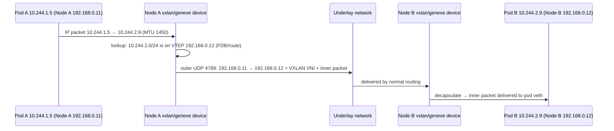
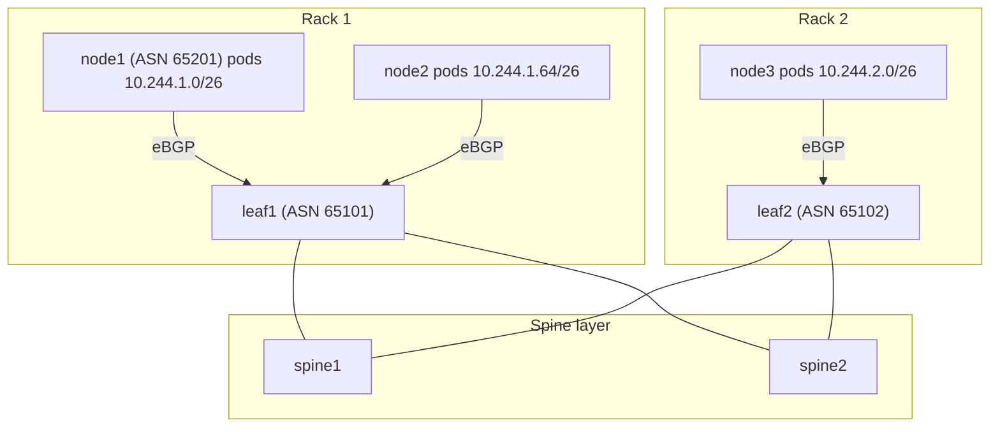

# 5.14 Overlay versus routed pod networking: VXLAN, BGP with Calico, eBPF with Cilium

| | |
|---|---|
| Level | Advanced |
| Priority tier | 1 |
| Lab venue | 3-node cluster; containerlab/FRR (2.27) as a mock ToR; `calicoctl`, `cilium`/`hubble` CLIs; iperf3/netperf |
| Part | Part 5: Kubernetes |
| Status | Drafted, labs **untested** |

## Why this matters for AI infrastructure

The primary pod network of a GPU cluster carries control traffic, service-to-service calls, logs and metrics, data-loader traffic over TCP in non-RDMA setups, checkpoint transfers, and, for many teams, some NCCL traffic over TCP sockets. Its design affects failure domains (a flat L2 versus routed L3), observability (can you see which pod talked to which?), security policy enforcement, throughput per core, and how it integrates with the datacentre fabric that Part 2 and Part 12 describe (leaf-spine with eBPF/BGP). Picking and tuning Calico, Cilium or a cloud-native CNI is a platform architecture decision that is hard to reverse, so this chapter gives a framework to choose, how each mode actually works on the wire, and how to verify and tune it.

## Prerequisites and outcomes

Needs 5.13, plus BGP and VXLAN from Part 2 (2.15 to 2.17), and Linux networking/eBPF from Part 1/2. After this chapter you can:

- Explain how VXLAN, Geneve and IP-in-IP overlays forward pod traffic (FDB/route programming, encapsulation, MTU) and their costs and benefits.
- Explain native routing with BGP (Calico, Cilium BGP Control Plane, kube-router) and integrate pod CIDRs with ToR switches in a leaf-spine fabric (eBGP per node/rack, route reflectors, ECMP, graceful restart, BFD).
- Describe how Cilium's eBPF datapath works: endpoint identities, policy maps, tc/XDP hooks, socket-level load balancing, kube-proxy replacement, host routing, bandwidth manager, WireGuard/IPsec encryption, Hubble flows, ClusterMesh.
- Install and configure Calico and Cilium in each mode; verify routing, MTU, policy, encryption, and observability.
- Compare modes on performance, operational complexity, debuggability, policy features, and kernel dependency; choose for GPU clusters (including coexistence with Multus/SR-IOV).
- Migrate or replace a CNI safely.

## 1. Decision frame

| Question | Why it matters |
|---|---|
| Can the underlay route pod CIDRs (do you control ToR switches / can run BGP)? | Native routing needs the fabric to learn pod routes; otherwise overlay |
| What MTU does the fabric support? | Overlay cost: 50-byte headers; jumbo underlay (9000+) makes overlays cheap |
| What scale (nodes, pods per node, Services)? | iptables-based paths degrade; eBPF scales better; BGP route counts (per-node /26-/24 blocks vs per-pod /32) |
| What policy and observability do you need? | L3/L4 only vs L7 (HTTP/gRPC/Kafka/DNS), flow logs, identity-based policy |
| Kernel versions on nodes? | Cilium eBPF features need 5.4/5.10+; hardware offload; Calico eBPF needs 5.3+ |
| Who operates it? | Calico (iptables/BGP) is familiar to network/Linux engineers; Cilium needs eBPF literacy |
| Multi-cluster, encryption, service mesh needs? | Cilium ClusterMesh, WireGuard, mesh without sidecars (Cilium Service Mesh) |
| Cloud-managed or bare metal? | Managed clusters often fix the CNI (AWS VPC CNI, GKE Dataplane V2 = Cilium, Azure CNI/Cilium) |
| Performance goals for the primary network? | If bulk traffic stays on RDMA secondary networks, primary CNI performance is secondary to reliability and policy |

## 2. Overlay networks

An overlay encapsulates pod packets inside packets addressed between **node IPs**, so the underlay only needs node-to-node reachability.



- **VXLAN** (UDP 4789; Flannel uses 8472 by default, Calico 4789): L2-over-UDP with a 24-bit VNI; the VTEP learns/gets MAC→VTEP mappings via control-plane programming (Flannel/Calico program FDB and neighbor entries so no flooding); 50-byte overhead.
- **Geneve** (UDP 6081): extensible encapsulation with TLV options (Cilium and OVN-Kubernetes use it to carry identity/metadata); ~50+ bytes.
- **IP-in-IP** (protocol 4; Calico): 20-byte overhead, L3 only, fewer features (no multicast), blocked by some clouds; `CrossSubnet` mode encapsulates only when crossing L3 boundaries (route natively within a subnet).
- **WireGuard** can act as an encrypting overlay (Calico, Cilium): 60-byte overhead, kernel module, good performance.

Costs and issues: MTU reduction (set pod MTU = underlay − overhead); CPU for encap/decap (mitigated by UDP tunnel offloads: `tx-udp_tnl-segmentation`, `rx-udp_tunnel-port-offload` on modern NICs; check `ethtool -k`); loss of fabric visibility (flows are node-to-node UDP; ECMP hashing on outer UDP source port derived from inner flow helps spread; some fabrics need `ecmp hash` on UDP ports); troubleshooting needs capture inside tunnels; firewalls must allow the UDP port; overlay hides pod IPs from the fabric (no ACLs on pod IPs, no network-level flow attribution).

When to choose overlays: no control of the underlay; mixed environments; multi-cloud/hybrid with simple connectivity; quick start; small clusters.

## 3. Routed designs with BGP

Without encapsulation, each node advertises its pod CIDR(s) to the fabric (or the fabric learns routes via BGP from nodes). Pod traffic is plain IP on the wire with pod IPs visible end to end.



### Calico in BGP mode

Calico runs **Felix** (programs routes, iptables/eBPF policy) and **BIRD** (BGP daemon) per node, plus **Typha** (fan-out of datastore updates at scale) and the controller. IPAM allocates **blocks** (default /26 per node, dynamically as needed) from IP pools; each node advertises its blocks.

Topologies:

- **Node-to-node mesh** (default): full mesh iBGP among nodes (O(n²) sessions): fine below ~100 nodes.
- **Route reflectors** (RR): a few nodes (or the ToRs) reflect routes; scale to thousands.
- **Peering with ToR switches**: each node peers eBGP with its rack's ToR (`BGPPeer` resources with `nodeSelector`, `peerIP` or `peerSelector`), using unique or shared ASNs per rack as per your fabric design (RFC 7938 style, 2.16); ToRs propagate pod routes to the spine; `nodeToNodeMesh` disabled.

```yaml
apiVersion: projectcalico.org/v3
kind: BGPConfiguration
metadata: { name: default }
spec:
  logSeverityScreen: Info
  nodeToNodeMeshEnabled: false
  asNumber: 65201
  serviceClusterIPs: [ { cidr: 10.96.0.0/12 } ]      # advertise Service IPs (ECMP to nodes)
  serviceLoadBalancerIPs: [ { cidr: 192.168.100.0/24 } ]
---
apiVersion: projectcalico.org/v3
kind: BGPPeer
metadata: { name: rack1-tor }
spec:
  peerIP: 10.0.1.1
  asNumber: 65101
  nodeSelector: rack == 'rack1'
  keepOriginalNextHop: false
---
apiVersion: projectcalico.org/v3
kind: IPPool
metadata: { name: pods-default }
spec:
  cidr: 10.244.0.0/16
  blockSize: 26
  ipipMode: Never
  vxlanMode: Never                 # pure routed; use CrossSubnet if some paths are L3
  natOutgoing: true
  nodeSelector: all()
```

Operational notes: use BFD for sub-second failure detection, graceful restart to keep routes during BIRD restarts, route filters on the ToR (accept only the pod/service ranges from nodes, enforce max-prefix), ECMP across spines, and consider `/32` per-pod routes only with eBPF/host-routing designs (block aggregation keeps routing tables small). Calico Enterprise/OSS differences, `calicoctl node status` for peer state, `ip route` shows `proto bird`.

Other routed options: **Cilium BGP Control Plane** (`CiliumBGPPeeringPolicy`/v2 `CiliumBGPClusterConfig`; advertises pod CIDRs, Services, LB IPs via GoBGP), **kube-router** (BGP + IPVS + network policy in one binary), **MetalLB/FRR-K8s** for Service IPs, **Flannel host-gw** (static routes, L2-adjacent nodes only), cloud route tables (GCE routes, AWS route table CNI mode, Azure UDR).

Benefits: no encap overhead or MTU loss; visible pod IPs for fabric telemetry, ACLs, and flow logs; native ECMP; failures isolated to BGP sessions. Costs: depends on network team cooperation and fabric configuration; need to avoid overlapping/ambiguous prefixes; route churn handling; pods leaving the cluster network must be NATed or routable externally by design.

### Underlay-native / VPC-native

Pods get fabric-routable addresses (AWS VPC CNI with ENI secondary IPs, GKE alias IPs, Azure CNI): simplest for cloud, tied to the provider's limits (IPs per ENI/instance, subnet size, quotas) and security group semantics; custom networking/prefix delegation (AWS) scales IP counts. On bare metal the equivalent is macvlan/ipvlan or SR-IOV with fabric-provided addresses (5.13).

## 4. Cilium and eBPF

Cilium implements CNI, Services, NetworkPolicy, observability, encryption and optionally service mesh and multi-cluster using **eBPF** programs attached to kernel hooks.

### Concepts

- **Identity-based security**: each pod endpoint gets a numeric **security identity** derived from its labels (pods with identical labels share an identity); policy rules are expressed as identity-to-identity allow lists, enforced in eBPF maps, independent of IP addresses (scales better than IP-based iptables rules; works with churn). Identities are propagated across nodes via a kvstore/CRDs and carried in Geneve/VXLAN headers or looked up by IP (ipcache) in native routing.
- **Hooks**: `tc` (traffic control ingress/egress on pod veth/netkit and node devices), **XDP** (earliest packet hook at the NIC driver for load balancing/DDoS), **socket hooks** (`cgroup/connect4`, `sendmsg`, `getpeername`, `bind`) for socket-level load balancing, `sockops`/`sk_msg` for acceleration, kprobes for tracing (Tetragon).
- **Maps**: BPF maps hold Service backends (`lb4_services`, `lb4_backends`), endpoints, policy (`cilium_policy_*`), conntrack (`cilium_ct4_*`), NAT, ipcache, metrics. Updates are incremental atomic map operations (no full rewrites).
- **Datapath modes**: **Tunnel** (VXLAN/Geneve overlay, default), **Native routing** (`routingMode: native`, with `ipv4NativeRoutingCIDR`, relying on fabric/cloud routes or Cilium BGP/auto direct node routes when nodes share L2), **ENI/Azure/Cloud-specific IPAM modes**.
- **kube-proxy replacement** (`kubeProxyReplacement: true`): handles ClusterIP/NodePort/LoadBalancer/externalIPs/hostPort; socket-LB resolves the backend at `connect()` for in-cluster clients (no per-packet DNAT, no conntrack for pod→service), eBPF NAT for external traffic; supports `DSR` (direct server return), `Maglev` hashing, session affinity, graceful backend termination, topology-aware routing, `externalTrafficPolicy`.
- **Host routing / `bpf.masquerade` / BPF host firewall / netkit**: bypass iptables and the host network stack for pod-to-pod and pod-to-external flows (`bpf.hostRouting=true` legacy-iptables bypass), use `netkit` devices (newer kernels) instead of veth for lower overhead, `BIG TCP`, `bandwidth manager` (EDT-based egress rate limiting with `kubernetes.io/egress-bandwidth` annotation and BBR option) — useful for fair sharing of NIC bandwidth.
- **Encryption**: transparent **WireGuard** (node-to-node pod traffic, `encryption.type=wireguard`) or IPsec, optional strict mode; consider overhead and MTU; mTLS via mesh features.
- **Observability**: **Hubble** (flows, DNS, HTTP/gRPC metadata, drops with reasons, service map UI/CLI/metrics), Prometheus metrics, `cilium monitor`; **Tetragon** (runtime security observability and enforcement via eBPF).
- **Policy**: `NetworkPolicy` plus `CiliumNetworkPolicy`/`CiliumClusterwideNetworkPolicy` with L7 rules (HTTP methods/paths, gRPC, Kafka, DNS `toFQDNs` for egress allow-lists by name), entities (`world`, `host`, `kube-apiserver`, `cluster`), CIDR groups, host policies (5.15).
- **Cluster Mesh**: connect multiple clusters (global services, cross-cluster policy, shared identities) (5.35).
- **Service mesh** (sidecar-free) and **Gateway API** implementation, **Ingress** controller, **BGP/L2 announcements** and **LB IPAM**, **egress gateway** (stable egress IPs per namespace/pod: useful for allow-listing GPU job egress to external storage).

### Install (Helm) examples

```bash
helm repo add cilium https://helm.cilium.io && helm repo update
# Tunnel mode (VXLAN), kube-proxy replacement, Hubble
helm upgrade --install cilium cilium/cilium --version 1.16.0 -n kube-system \
  --set kubeProxyReplacement=true --set k8sServiceHost=k8s-api.lab.local --set k8sServicePort=6443 \
  --set routingMode=tunnel --set tunnelProtocol=vxlan \
  --set ipam.mode=cluster-pool --set ipam.operator.clusterPoolIPv4PodCIDRList=10.244.0.0/16 --set ipam.operator.clusterPoolIPv4MaskSize=24 \
  --set hubble.enabled=true --set hubble.relay.enabled=true --set hubble.ui.enabled=true \
  --set bpf.masquerade=true

# Native routing with BGP (fabric learns pod CIDRs) and Maglev + DSR
helm upgrade --install cilium cilium/cilium -n kube-system \
  --set routingMode=native --set ipv4NativeRoutingCIDR=10.244.0.0/16 --set autoDirectNodeRoutes=false \
  --set bgpControlPlane.enabled=true \
  --set kubeProxyReplacement=true --set loadBalancer.mode=dsr --set loadBalancer.algorithm=maglev \
  --set bpf.hostRouting=true --set enableIPv4Masquerade=true \
  --set mtu=9000
cilium status --wait
cilium connectivity test                       # end-to-end validation (needs several minutes)
hubble observe --follow --namespace training --verdict DROPPED
```

(Verify chart version and values for your Cilium release; `kubeadm init --skip-phases=addon/kube-proxy` when replacing kube-proxy from day one.)

### Cilium BGP Control Plane example

```yaml
apiVersion: cilium.io/v2alpha1
kind: CiliumBGPPeeringPolicy
metadata: { name: rack1 }
spec:
  nodeSelector: { matchLabels: { rack: rack1 } }
  virtualRouters:
    - localASN: 65201
      exportPodCIDR: true
      serviceSelector: { matchExpressions: [ { key: advertise, operator: In, values: ["bgp"] } ] }
      neighbors:
        - peerAddress: 10.0.1.1/32
          peerASN: 65101
          connectRetryTimeSeconds: 30
          holdTimeSeconds: 9
          keepAliveTimeSeconds: 3
```

(API versions differ across releases; newer versions use `CiliumBGPClusterConfig`, `CiliumBGPPeerConfig`, `CiliumBGPAdvertisement` v2.)

## 5. Comparison

| Aspect | VXLAN/Geneve overlay | Calico routed BGP (iptables dataplane) | Calico eBPF dataplane | Cilium native routing (eBPF) | Cilium tunnel (eBPF) |
|---|---|---|---|---|---|
| Underlay requirements | Node-to-node UDP | BGP/fabric learns pod CIDRs | Same as Calico routed | Fabric/cloud routes or BGP | Node-to-node UDP |
| Overhead/MTU | −50 B; encap CPU | None | None | None | −50 B |
| Service LB | kube-proxy iptables/IPVS | kube-proxy | Replaces kube-proxy (BPF) | Replaces kube-proxy | Replaces kube-proxy |
| Policy | Depends on CNI (Calico/Cilium) | iptables/ipsets | BPF maps | Identity-based BPF | Identity-based BPF |
| Observability | Weak underlay visibility | Pod IPs visible; iptables counters; Flow logs (Enterprise) | Better | Hubble, deep | Hubble |
| Scale | Good | Excellent (blocks), iptables rule scaling limits | Better | Excellent | Excellent |
| Complexity | Low | Medium (BGP) | Medium | Medium-high | Medium |
| Kernel needs | Modest | Modest | ≥5.3 | ≥5.4/5.10 recommended | ≥4.19 |
| Throughput per core | Moderate | Good | Better | Best (host routing/netkit/DSR) | Good |

Rough performance guidance: with 25-100 Gb/s NICs, tunnelled pod-to-pod TCP throughput often reaches 50-80% of line rate without tuning (CPU-bound); routed/eBPF native with GRO/GSO and appropriate MTU approaches line rate; latency adds ~10-30 µs for overlay encap/decap and iptables traversal vs lower with eBPF host routing. Always benchmark on your hardware (section 7). None substitutes for RDMA when running collectives (5.13).

## 6. Choosing for GPU clusters

- **Primary network is for control and ordinary traffic**; collectives run on secondary RDMA networks (SR-IOV/macvlan/host devices) attached through Multus. Therefore choose the primary CNI for **reliability, policy, observability and operability**, not peak throughput.
- **Bare metal with a BGP fabric** (NVIDIA Spectrum/Cumulus, Arista, Cisco): Calico BGP or Cilium native routing + BGP integrate cleanly; avoid overlays to preserve fabric ECMP and visibility. Align ASN schemes with the fabric design (2.16, Part 12).
- **No fabric control / mixed environments**: VXLAN with jumbo MTU or WireGuard-encrypted tunnels.
- **Managed Kubernetes**: use the provider default unless you need advanced features; GKE Dataplane V2 is Cilium; EKS supports Cilium in chaining/overlay mode alongside VPC CNI; AKS offers Azure CNI Powered by Cilium.
- **Observability and security**: Cilium with Hubble gives per-flow visibility valuable for multi-tenant AI platforms (who is exfiltrating data, which training job hammers the metadata service); Tetragon for runtime policy.
- **Egress control**: AI jobs often need allow-listed egress to object stores, registries and package mirrors: FQDN policies (Cilium `toFQDNs`), egress gateways with stable IPs, or proxy gateways.
- **Coexistence**: Multus attaches secondary networks regardless of the primary; ensure the primary CNI does not interfere with secondary interfaces (Cilium `devices` setting, Calico `interfaceRegexp`/excluded interfaces `IP_AUTODETECTION_METHOD`, Cilium `--devices` for host firewall/BPF NodePort should exclude RDMA NICs).
- **Kernel/OS discipline**: pin kernel versions across GPU nodes (4.17); eBPF features depend on them; test CNI upgrades together with kernel upgrades.
- **Node IP detection**: multi-homed GPU nodes (mgmt, data, RDMA NICs) confuse CNIs that auto-detect the node IP/interface. Set explicitly (`IP_AUTODETECTION_METHOD=interface=eth0` in Calico, `--set devices=eth0` or `k8sServiceHost` in Cilium, kubelet `--node-ip`).
- **Pod density and IP planning**: GPU nodes usually run few pods (tens), so per-node `/26` or `/25` suffice; plan cluster CIDR for node count × block size; avoid wasting space but leave growth.

## 7. Verification and benchmarking

```bash
# Routing and encapsulation
ip route | grep -E 'proto bird|10.244'                  # Calico BGP routes; vxlan/ipip devices
calicoctl node status                                    # BGP peers Established
calicoctl ipam show --show-blocks
cilium status; cilium config view | grep -E 'routing-mode|tunnel|kube-proxy|devices'
cilium bpf lb list | head; cilium bpf ct list global | head; cilium bpf endpoint list
cilium endpoint list
hubble status; hubble observe --pod training/worker-0 --last 50

# MTU
ip link show | grep -E 'mtu (8|9|14|15)'                # node and tunnel MTUs
kubectl exec pod -- ip link show eth0                    # pod MTU
ping -M do -s 8972 <pod-ip-on-other-node>                # jumbo path test

# Performance (pod-to-pod across nodes)
kubectl apply -f iperf3-server.yaml; kubectl exec iperf-client -- iperf3 -c <server-pod-ip> -P 8 -t 30
kubectl exec iperf-client -- iperf3 -c <server> -u -b 0 -l 1400          # UDP/PPS
netperf -H <server> -t TCP_RR -- -r 1,1                                  # latency (transactions/s)
kubectl exec pod -- nuttcp ...                                           # alternative
mpstat -P ALL 1                                                          # per-core usage during the test
ethtool -k <nic> | grep -E 'udp_tnl|gro|gso|tso|rx-udp'                  # offloads
```

Test matrix: same node vs cross-node vs cross-rack; TCP bulk vs small RPCs vs UDP; with/without policy; with/without encryption; at 100/1,000/10,000 Services; during node churn. Record CPU per Gb/s and tail latency. Keep results with kernel/CNI/NIC firmware versions.

## 8. Migration and operations

- **Changing CNI on a live cluster is disruptive**: pods need new networking; methods: drain nodes one by one while removing the old CNI and installing the new (rolling), or build a new cluster and migrate workloads (preferred for large changes). Cilium and Calico both provide migration guides (e.g., Cilium's dual-overlay migration using node labels and `CiliumNodeConfig`).
- **Upgrades**: follow upgrade paths (n → n+1 minor), read release notes about datapath changes, upgrade agents with maxUnavailable limits, test connectivity (`cilium connectivity test`), watch for drops during rollouts; consider pinning eBPF-related options and testing kernel pairs.
- **Capacity**: monitor IPAM pool utilisation, BGP session counts, Typha/agent resource usage, BPF map pressure (`cilium_ct_*` size: `bpf.ctTcpMax`, `bpf.natMax`, `bpf.policyMapMax`), conntrack table pressure, `felix` iptables restore time.
- **Backups**: store CNI configuration as code (Helm values in Git, 4.26); export IPAM state for disaster recovery where relevant.
- **Failure behaviour**: CNI agent down → existing pods keep connectivity (datapath programmed in kernel), new pods fail to start; BGP down → routes withdrawn (use graceful restart); policy engine down → default behaviour (fail-open or closed per config).
- **Security**: restrict access to the CNI's CRDs (they define policy), enable mTLS for Hubble/cilium-agent APIs, rotate WireGuard keys automatically, audit policy changes via GitOps.

## 9. Lab

First, run the self-checking Python lab (`code/part05/overlay_bgp_cilium_planner_lab.py`) locally. It verifies the BGP session scaling calculator (`compute_bgp_session_counts`: comparing Full-Mesh $N(N-1)/2$ vs Route Reflectors vs eBGP ToR peering at 500 nodes) and Calico `CrossSubnet` encapsulation selector (`select_calico_cross_subnet_mode`), the Cilium numeric Security Identity vs IP-pair rule scaling calculator (`compare_policy_scaling_ip_vs_identity`), and the multi-homed GPU node primary interface selector (`select_primary_cni_node_interface`).

```bash
python3 code/part05/overlay_bgp_cilium_planner_lab.py
```

Next, on a 3-node cluster with `calicoctl` or `cilium`/`hubble` (all interactive shell steps below are `untested here`), work through these exercises:

1. **Overlay baseline**: install Flannel (VXLAN) or Calico VXLAN on a 3-node cluster; capture VXLAN on the underlay; compute MTU; run iperf3 pod-to-pod; view `bridge fdb`, `ip -d link show flannel.1`.
2. **Routed Calico with FRR**: build a containerlab topology with two ToRs and a spine (2.27); run Calico with `ipipMode: Never`, `vxlanMode: Never`, `nodeToNodeMeshEnabled: false`, peer nodes to ToRs; verify routes at the spine; run iperf3 and compare to the overlay; fail a node and a ToR link and measure convergence with and without BFD.
3. **Route reflectors**: switch Calico to route reflectors; compare session counts; add a node and see block allocation and advertisement.
4. **Cilium tunnel to native**: install Cilium in tunnel mode with Hubble; observe flows; switch to native routing + BGP Control Plane; compare path (`tcpdump` shows plain pod IPs); enable DSR/Maglev and test NodePort source IP preservation.
5. **kube-proxy replacement**: remove kube-proxy; verify Services work; inspect `cilium bpf lb list`; compare with iptables: sync latency with 5,000 Services (kube-burner), CPU, and connection setup latency.
6. **Policy and identity**: create CiliumNetworkPolicy with L7 HTTP rules and `toFQDNs`; observe Hubble verdicts; compare against Calico policy for the same intent (5.15).
7. **Encryption**: enable WireGuard; verify with `cilium encrypt status`/`wg show`; measure throughput and CPU; adjust MTU.
8. **MTU/PMTUD drill**: misconfigure MTU in one node; reproduce stalled transfers; fix.
9. **Performance matrix**: run the benchmark matrix across modes on the same hardware; produce a table of Gb/s, CPU cores used, p99 latency.
10. **Multus coexistence**: attach a secondary macvlan/SR-IOV network to a pod while Cilium or Calico is the primary; verify no interference, then `ib_write_bw`/`iperf3` on the secondary.
11. **Failure/upgrade drills**: roll the CNI agent with a connectivity loop running; kill agents; restart BGP; upgrade minor version in a staging cluster; document disruptions.
12. **Clean up**.

## 10. Common mistakes

- Choosing an overlay by default on a fabric that could route pod CIDRs natively; or native routing without actually configuring the fabric to learn/advertise routes.
- Forgetting to reduce pod MTU for encapsulation or to enable jumbo frames end-to-end.
- Running full-mesh BGP beyond a few hundred nodes; no BFD or graceful restart; accepting arbitrary prefixes from nodes on ToRs.
- Enabling eBPF features on old kernels or without checking requirements; mixing kube-proxy and replacement partially.
- Letting the CNI choose the wrong interface/IP on multi-homed GPU nodes; Cilium/Calico binding RDMA NICs.
- Treating the primary CNI as the path for NCCL/storage bandwidth.
- Switching CNIs in place without a migration plan; leftover rules/interfaces from the old CNI.
- Ignoring BPF map sizes, conntrack limits and IPAM exhaustion until an incident.
- Overlapping encryption layers (WireGuard + IPsec + mesh mTLS) without measuring overhead.

## 11. Interview angles

- "Overlay vs routed networking: trade-offs? When BGP to the ToR?"
- "How does Calico distribute routes? Mesh vs route reflectors vs ToR peering?"
- "How does Cilium implement policy and Services without iptables? What is a security identity?"
- "What is kube-proxy replacement and DSR? What are the pitfalls?"
- "How do you pick a CNI for a GPU cluster on bare metal with a leaf-spine fabric?"
- "How do you migrate CNIs on a running cluster?"
- "How would you measure CNI performance and what would you look at?"
- "Why not run NCCL over the pod network?"

## Exercises

1. **Overlay Encapsulation (`VXLAN`, `Geneve`, `IPIP`, `WireGuard`) vs. Native Routing (`PK` Ch. 5 & `NK` Ch. 4–5):** Trace the Section 2 sequence diagram for a packet from `Pod A` (`10.244.1.5` on `Node A` `192.168.0.11`) to `Pod B` (`10.244.2.9` on `Node B` `192.168.0.12`) over VXLAN (UDP port `4789`, 24-bit VNI, FDB/neighbor lookup), and use `select_calico_cross_subnet_mode()` in `code/part05/overlay_bgp_cilium_planner.py` to explain how Calico `CrossSubnet` combines native intra-rack routing with cross-rack encapsulation.
2. **Routed BGP Designs with Calico (`Felix`, `BIRD`, `Typha`, `/26` `IPPool` Blocks, and BGP Topologies):** Using `compute_bgp_session_counts()` in `code/part05/overlay_bgp_cilium_planner.py`, calculate the total BGP session count for 500 nodes under (a) Node-to-Node Full Mesh (`124,750` sessions), (b) 3 Route Reflectors (`1,494` sessions), and (c) eBGP Peering with Dual ToR Switches (`1,000` sessions), and trace the `BGPConfiguration`, `BGPPeer`, and `IPPool` manifests in Section 3.
3. **Cilium's eBPF Datapath: Label-Based Security Identities, BPF Maps, `tc`/`XDP`/`cgroup` Hooks, and `netkit`:** Using `compare_policy_scaling_ip_vs_identity()` in `code/part05/overlay_bgp_cilium_planner.py`, explain how Cilium derives numeric Security Identities from Pod labels, why identity-based BPF policy maps stay `O(label sets)` (`2` entries instead of `500,000` IP pairs across `1,000 x 500` Pods), and how `bpf.hostRouting=true` and `netkit` bypass the host `iptables` stack.
4. **Cilium `kubeProxyReplacement`, Direct Server Return (`DSR`), Maglev Consistent Hashing, and BGP Control Plane:** Trace the two Helm installation profiles in Section 4 (Tunnel VXLAN mode vs Native Routing + BGP Control Plane + `loadBalancer.mode=dsr` + `loadBalancer.algorithm=maglev`), explaining how DSR eliminates the return-path node hop for external `NodePort`/`LoadBalancer` traffic and what MTU reservation DSR requires.
5. **Selecting and Hardening the Primary CNI on Multi-Homed Bare-Metal GPU Clusters:** Using `select_primary_cni_node_interface()` in `code/part05/overlay_bgp_cilium_planner.py`, explain why multi-homed GPU nodes (with 1 management NIC, 1 storage NIC, and 8 RDMA `ens1f*`/`ib*` NICs) break CNI IP autodetection unless `IP_AUTODETECTION_METHOD=interface=eth0` (Calico) or `--set devices=eth0` (Cilium) and `kubelet --node-ip` are pinned explicitly.
6. **Benchmarking, Observability (`Hubble`, `Tetragon`, `calicoctl`), and Safe Live CNI Migration:** Design the Section 7 benchmark matrix (`iperf3`, `netperf TCP_RR`, `mpstat`, `ethtool -k` offloads across 100 to 10,000 Services), and outline how to safely migrate a cluster from Flannel/Calico to Cilium without a cluster-wide outage.

## Checkpoint questions (20)

<details>
<summary>1. When a Pod on Node A sends a TCP packet to a Pod on Node B over a VXLAN overlay, what are the outer and inner IP/MAC/UDP headers on the physical wire (`PK` Chapter 5)?</summary>

On the physical wire between Node A (`192.168.0.11`) and Node B (`192.168.0.12`), the packet has **50 bytes of outer headers** wrapping the original inner Ethernet frame:
- **Outer Ethernet header (14B):** `src MAC = Node A NIC`, `dst MAC = Node B NIC` (or ToR router MAC).
- **Outer IPv4 header (20B):** `src IP = 192.168.0.11 (Node A)`, `dst IP = 192.168.0.12 (Node B)`, `proto = UDP (17)`.
- **Outer UDP header (8B):** `src port = hash(inner 5-tuple)` (for ECMP spreading across spine links), `dst port = 4789` (IANA VXLAN; or `8472` on legacy Flannel).
- **VXLAN header (8B):** 24-bit Virtual Network Identifier (`VNI`; Cilium also encodes the source Pod's numeric Security Identity here).
- **Inner Ethernet + Inner IPv4 + Inner TCP payload:** `src IP = 10.244.1.5 (Pod A)`, `dst IP = 10.244.2.9 (Pod B)`.
</details>

<details>
<summary>2. How do `VXLAN`, `Geneve`, and `IP-in-IP` (`IPIP`) differ in header format, overhead, and metadata extensibility?</summary>

- **IP-in-IP (`IPIP`, IP protocol `4`, `tunl0`):** Encapsulates the inner IPv4 packet directly inside an outer IPv4 header with **no L2 Ethernet or UDP header** (**`20` bytes** overhead). Low overhead, but carries no metadata/VNI, does not support IPv6 or L2 multicast, and is blocked by some public cloud VPC fabrics (e.g., Azure and cross-subnet AWS without source/dest check disabled).
- **VXLAN (`UDP 4789`, `50` bytes overhead):** Fixed 8-byte VXLAN header with a 24-bit VNI over UDP; universally supported across switches and clouds, with hardware NIC offloads (`tx-udp_tnl-segmentation`).
- **Geneve (`UDP 6081`, `50+` bytes overhead):** Generic Network Virtualization Encapsulation designed by the IETF to succeed VXLAN; uses variable-length **TLV (Type-Length-Value) options** in the tunnel header so CNIs like **Cilium** and **OVN-Kubernetes** can embed security identities, trace IDs, and DSR metadata directly in the tunnel header.
</details>

<details>
<summary>3. What is Calico's `CrossSubnet` encapsulation mode (`ipipMode: CrossSubnet` or `vxlanMode: CrossSubnet`), and when is it useful?</summary>

In a multi-rack or multi-AZ cluster where nodes within the same rack/subnet share Layer 2 adjacency (so they can route to each other directly via host routes without router configuration) while traffic *between* racks/AZs crosses an L3 router that does not run BGP with the nodes:
- **`CrossSubnet` mode** sends Pod-to-Pod traffic between nodes in the **same L2 subnet natively without encapsulation** (0 byte overhead, full line rate).
- It **encapsulates (`IPIP` or `VXLAN`) only when the destination node is in a different subnet**.
</details>

<details>
<summary>4. What are the four main components of a Calico deployment (`Felix`, `BIRD`, `Typha`, `calico-kube-controllers`), and what does each do?</summary>

1. **`Felix` (per-node agent inside `calico-node`):** Watches endpoints and policies, programs kernel routes for local Pod veths (`/32`), configures `iptables` / `nftables` / `eBPF` rules, and manages interface state.
2. **`BIRD` (Border Gateway Protocol daemon inside `calico-node`):** Exchanges Pod CIDR block routes (`/26`) and Service VIPs with other nodes or ToR switches over BGP (`ip route` shows `proto bird`).
3. **`Typha` (scale fan-out proxy):** Sits between `kube-apiserver` and hundreds/thousands of `Felix` agents—maintaining 1 watch cache against `kube-apiserver` and deduplicating/fanning updates out to `Felix` so 2,000 nodes don't overwhelm the API server.
4. **`calico-kube-controllers`:** Cluster-wide controller managing IPAM block garbage collection, policy sync, and node cleanup.
</details>

<details>
<summary>5. Why does Calico's default `nodeToNodeMeshEnabled: true` (full-mesh iBGP) break down above ~100–200 nodes, and what two topologies replace it?</summary>

In an $N$-node full iBGP mesh, every node opens a TCP/179 session to every other node, creating **$N(N - 1)/2$ total BGP sessions** ($N - 1$ sessions per node). At $N = 500$ nodes, that is **124,750 BGP sessions** churning CPU and routing updates whenever a single `/26` block changes.
Two scalable replacements (`nodeToNodeMeshEnabled: false`):
1. **BGP Route Reflectors (`RR`):** Designate 2–3 nodes per rack/zone as Route Reflectors; workers peer only with the RRs ($3 \times 500 = 1,500$ sessions).
2. **eBGP Peering with Leaf / Top-of-Rack (`ToR`) Switches:** Each node peers only with its 2 local ToR switches (`BGPPeer` matching `rack == 'rack1'`), and the leaf-spine fabric distributes the routes via ECMP.
</details>

<details>
<summary>6. Why does Calico allocate Pod IPs in `/26` blocks (`IPAMBlock` = 64 IPs) within a shared `/16` `IPPool` instead of advertising individual `/32` Pod routes over BGP?</summary>

If a 1,000-node cluster running 60,000 Pods advertised a separate `/32` BGP route for every single Pod, **60,000 routes would flood the hardware FIB/TCAM tables of the physical Top-of-Rack switches**, and every Pod creation or deletion would trigger a cluster-wide BGP `UPDATE`/`WITHDRAW` storm. By aggregating Pod IPs on each node into contiguous **`/26` blocks (64 IPs)**, each node advertises only **1 or 2 `/26` prefix routes** to its ToR switch, and individual `/32` routes exist only locally inside that node's Linux kernel routing table (pointing to `cali*` veth interfaces).
</details>

<details>
<summary>7. Why should you configure `BFD` (Bidirectional Forwarding Detection) and `Graceful Restart` when peering Kubernetes nodes with ToR switches over BGP?</summary>

- **BFD (`Bidirectional Forwarding Detection`):** Standard BGP keepalive/hold timers default to `60s / 180s` (or `3s / 9s` when tuned aggressively). BFD exchanges lightweight UDP heartbeats every **`100ms`–`300ms` (`multiplier: 3`)**, detecting a failed link or dead node in **under 1 second** so the ToR switch immediately removes that path from ECMP.
- **BGP Graceful Restart:** When the `calico-node` or `cilium-agent` DaemonSet is upgraded or restarted, the control-plane BGP daemon restarts **while the Linux kernel datapath (`veth`s, routes, eBPF maps) is still forwarding packets normally**. Graceful Restart tells the ToR switch to **keep forwarding traffic along the existing routes** during the brief BGP daemon restart instead of withdrawing routes and blackholing live Pod connections.
</details>

<details>
<summary>8. How does Cilium's \"Identity-Based Security\" work, and why does it scale better than IP-based `iptables` / `ipset` policies?</summary>

In traditional `iptables` CNIs, a `NetworkPolicy` allowing `role=frontend` to talk to `role=backend` must be compiled into IP-address rules/ipsets listing every current `frontend` Pod IP and `backend` Pod IP. Whenever Pods autoscale or churn, every node must update IP sets and run `iptables-restore`.
In **Cilium**, every Pod with the same set of security-relevant labels (`app=vllm, env=prod`) is assigned the **exact same numeric Cluster-Wide Security Identity** (e.g., Identity `14902`).
- Scaling `vllm` from 2 replicas to 1,000 replicas creates **zero new security identities** and **zero changes to BPF policy maps**.
- When a packet arrives, Cilium reads the sender's numeric identity (carried in the VXLAN/Geneve header in tunnel mode, or looked up in `cilium_ipcache` in native routing mode) and performs a single **$O(1)$ BPF hash map lookup** (`cilium_policy_<endpoint_id>[src_identity, dport, proto]`) to allow or drop the packet.
</details>

<details>
<summary>9. Where in the Linux kernel does Cilium attach its eBPF programs (`XDP`, `tc`, `cgroup`, `sockops`)?</summary>

1. **`XDP` (eXpress Data Path, inside the NIC driver before `sk_buff` allocation):** Earliest possible hook; used for ultra-fast North-South `NodePort`/`LoadBalancer` hairpining, DSR, and DDoS packet dropping at line rate.
2. **`tc` (Traffic Control ingress/egress `clsact` qdisc on `lxc*`/`netkit` and physical NICs):** Enforces L3/L4 NetworkPolicy, NAT, encapsulation, and EDT bandwidth rate-limiting.
3. **`cgroup/connect4`, `sendmsg4`, `recvmsg4` (Socket layer):** Implements **Socket-LB (`kube-proxy` replacement)**, translating `ClusterIP:port` to `<PodIP>:<targetPort>` at `connect()` time before packets are constructed.
4. **`sockops` / `sk_msg`:** Short-circuits TCP socket writes between local pods/sidecars on the same host directly in memory, bypassing the TCP/IP stack.
</details>

<details>
<summary>10. What is Direct Server Return (`DSR`, `loadBalancer.mode=dsr`) in Cilium, and why does it require MTU or Geneve/IP-option care?</summary>

When an external client connects to a `NodePort` or `LoadBalancer` Service on **Node A**, and the selected backend Pod lives on **Node B**:
- **Standard SNAT mode:** Node A DNATs the destination to Pod B and **SNATs the source IP to Node A**. Pod B sends the large response back to Node A, which un-NATs it and forwards it to the client (**triangle routing**, doubling bandwidth on Node A and hiding the client's source IP).
- **Direct Server Return (`DSR`):** Node A forwards the packet to Node B **preserving the client's real source IP** and encoding the original `Service IP:port` (via an IPv4 option / Geneve header in native/Geneve mode). Pod B on Node B replies **directly to the external client** with source IP = `Service IP`—bypassing Node A on the return path. Because DSR injects an 8-byte IPv4 option (or Geneve TLV) on the Node A -> Node B hop, verify your underlay does not drop IP options (or use `dsrDispatch: geneve`).
</details>

<details>
<summary>11. What is `Maglev` (`loadBalancer.algorithm=maglev`) in Cilium's load balancer?</summary>

**Maglev** is Google's consistent-hashing load-balancing algorithm implemented in Cilium's eBPF service map (`lb4_maglev`). Unlike random or round-robin selection, if 3 external load-balancer / gateway nodes all run Cilium with Maglev and receive packets belonging to the same TCP 5-tuple (even after a BGP ECMP path change), **every node hashes that 5-tuple to the exact same backend Pod** without needing synchronized cross-node conntrack state—and if 1 backend Pod is added or removed, $\approx 1/N$ of flows remap while all other flows stay undisturbed.
</details>

<details>
<summary>12. How does Cilium's `EDT` (Earliest Departure Time) Bandwidth Manager improve on traditional Linux `HTB`/`TBF` qdisc rate-limiting?</summary>

Traditional CNI `bandwidth` plugins use Linux `HTB`/`TBF` token-bucket qdiscs, which take a global queue spinlock across CPU cores (`qdisc lock contention`) and drop throughput sharply on multi-queue 100G NICs. Cilium's **Bandwidth Manager** uses **eBPF + `FQ` (Fair Queueing) with Earliest Departure Time (`EDT`)**: an eBPF program simply stamps each outgoing `sk_buff` with its calculated departure timestamp (`skb->tstamp`) locklessly, and the hardware/FQ scheduler pacing engine transmits packets smoothly at the Pod's `kubernetes.io/egress-bandwidth` rate (also enabling **TCP BBR** congestion control for Pods).
</details>

<details>
<summary>13. What happens on a multi-homed GPU server (with `eth0` management, `eth1` storage, and `ens1f0..7` RDMA NICs) if you do NOT configure explicit interface selection in Calico or Cilium?</summary>

By default, Calico (`IP_AUTODETECTION_METHOD=first-found`) and Cilium (`devices` auto-detection) inspect the host's routing/interface table and can accidentally pick an **unrouted secondary RDMA rail interface (`ens1f0np0` `192.168.10.11` or `ib0`)** as the node's primary IP, or attach eBPF host-firewall/NodePort programs to the RDMA NICs. This breaks control-plane BGP/VXLAN peering and interferes with GPUDirect RDMA. Always pin:
- **Calico:** `IP_AUTODETECTION_METHOD=interface=eth0` (or `cidr=10.0.1.0/24`) and exclude RDMA interfaces in `felixConfiguration.bpfDataIfacePattern`.
- **Cilium:** `--set devices=eth0` (so eBPF attaches only to the primary CNI NIC, leaving `ens1f*`/`mlx5*` untouched for Multus/SR-IOV/RDMA).
</details>

<details>
<summary>14. What is Cilium's `Egress Gateway`, and what AI-infrastructure problem does it solve?</summary>

Normally, when a Pod initiates an outbound connection to an external enterprise database, S3 bucket, or partner API, the node SNATs the packet to **that worker node's own IP**. In a 500-node GPU cluster, external firewall admins do not want to allow-list 500 dynamic worker node IPs. **Cilium `CiliumEgressGatewayPolicy`** routes outbound traffic from matching Pods (e.g., `namespace: training, app: dataset-fetcher`) through a dedicated pair of **egress gateway nodes** and SNATs it to a **single predictable, static egress VIP** that external firewalls can allow-list.
</details>

<details>
<summary>15. Compare WireGuard vs. IPsec for transparent Pod-to-Pod encryption in Cilium/Calico (`PK` Chapter 5).</summary>

- **WireGuard (`encryption.type=wireguard`):** Uses the modern in-kernel Linux WireGuard module (`ChaCha20-Poly1305`), automatically manages per-node public/private keys via the Cilium/Calico Node CRD without manual key rotation, and delivers higher throughput and simpler operations (`60`-byte header overhead).
- **IPsec (`encryption.type=ipsec`):** Uses Linux kernel XFRM (`AES-GCM-128`/`256`), can leverage NIC hardware crypto offload (`inline IPsec`) on supported SmartNICs/ConnectX cards, and satisfies strict FIPS 140-2/3 cipher mandates, but requires manual/automated PSK rotation (`cilium-ipsec-keys` Secret).
</details>

<details>
<summary>16. What happens to already-running Pods on a node if the `calico-node` or `cilium-agent` DaemonSet Pod crashes or is restarted?</summary>

**Existing Pods continue forwarding packets normally.** Because the data plane (`veth`/`netkit` interfaces, kernel routing tables, `iptables`/`nftables` chains, and pinned kernel eBPF maps under `/sys/fs/bpf/tc/globals/`) resides **inside the Linux kernel**, killing the user-space CNI agent (`cilium-agent` or `Felix`) does not tear down the kernel data path. However, while the agent is down, **no new Pods can start (`CNI ADD` fails)** and policy/service map updates on that node are paused until the agent restarts.
</details>

<details>
<summary>17. How do you use `hubble observe` to diagnose why a training Pod's connection to a storage service or external API is failing?</summary>

Run:
```bash
hubble observe --pod training/worker-0 --verdict DROPPED --follow
```
Unlike `iptables` (which silently drops packets unless custom `LOG` rules are added), **Hubble** streams real-time eBPF events showing the exact source/destination Pod names, numeric Security Identities, L4 ports, L7 HTTP/DNS details, and the **exact drop reason** (e.g., `Policy denied`, `Unsupported L3 protocol`, `Stale or unroutable IP`, `CT: Map insertion failed`).
</details>

<details>
<summary>18. What BPF map metrics should you monitor on a large Cilium cluster to prevent sudden connection drops?</summary>

Cilium stores connection tracking, NAT, and policy state in fixed-size kernel BPF maps (`cilium_ct4_global`, `cilium_snat_v4_external`, `cilium_lb4_services_v2`, `cilium_policy_*`). Monitor **`cilium_bpf_map_pressure`** (ratio of current entries to max capacity) and **`cilium_drop_count_total{reason="CT: Map insertion failed"}`**. On high-connection-rate gateway or training nodes, enable `bpf.ctTcpMax` / `bpf.natMax` dynamic sizing (`bpf-map-dynamic-size-ratio: 0.0025`).
</details>

<details>
<summary>19. Which NIC hardware offloads (`ethtool -k`) matter most when running a VXLAN or Geneve overlay on 25–100 Gb/s NICs?</summary>

Check `ethtool -k <nic>` for:
- **`tx-udp_tnl-segmentation: on` & `tx-udp_tnl-csum-segmentation: on`:** Allows the NIC hardware to perform TCP Segmentation Offload (**TSO/GSO**) *inside* VXLAN/Geneve UDP tunnels. If disabled, the host CPU must segment every 64 KiB TCP buffer into 1,450-byte packets in software before encapsulation, cutting single-flow TCP throughput by 3x–5x.
- **`rx-udp_tunnel-port-offload: on` & `rx-gro-hw` / `generic-receive-offload: on`:** Enables RSS multi-queue hashing and GRO coalescing on encapsulated UDP tunnel packets.
</details>

<details>
<summary>20. What are the two safe ways to migrate a production cluster from one CNI (e.g., Flannel or Calico) to another (e.g., Cilium)?</summary>

1. **Blue-Green Cluster Replacement (`PK` Chapter 2 preferred):** Provision a new cluster with the target CNI, validate with `cilium connectivity test` and benchmarks, replicate stateful data, and shift traffic via DNS/Gateway weights. Zero risk of mixed-CNI node states.
2. **In-Place Rolling Hybrid Migration (per-node):** Use Cilium's documented **per-node migration workflow** (`CiliumNodeConfig` with a non-conflicting secondary overlay port/Pod CIDR, cordoning and draining one node at a time, switching `/etc/cni/net.d/`, cleaning old CNI interfaces/iptables, and rebooting the node before uncordoning).
</details>

## Sources and review notes

- **Sources read in full:**
  - `production-kubernetes` — Josh Rosso, Rich Lander, Alexander Brand & John Harris, *Production Kubernetes*, **Chapter 5: Pod Networking** (overlay VXLAN vs routed Calico BGP, Cilium CNI, workload routability, and Pod-to-Pod encryption trade-offs).
  - `networking-and-kubernetes` — James Strong & Vallery Lancey, *Networking and Kubernetes*, **Chapters 4–6** (CNI plugins, Cilium `cilium-cni` and connectivity checks, Calico, and cloud VPC-native networking).
- **Run here:** `python3 code/part05/overlay_bgp_cilium_planner_lab.py` (3 passed, 0 failed).
- **Explicitly labelled inferences:** The `compute_bgp_session_counts`, `select_calico_cross_subnet_mode`, `compare_policy_scaling_ip_vs_identity`, and `select_primary_cni_node_interface` models in `code/part05/overlay_bgp_cilium_planner.py` and the Calico `BGPConfiguration`/`BGPPeer`/`IPPool` and Cilium Helm/`CiliumBGPPeeringPolicy` configurations are the author's constructions synthesizing `PK` Chapter 5 and `NK` Chapters 4–6 (plus original study items 21, 22, 23, 24, 25, 26, 27, 28, 29, 30, 31, 32, 33, 34, and 35).
- **Not verified on live hardware:** Live `calicoctl`, `cilium`, `hubble`, `containerlab`, `iperf3`, and `netperf` executions (`UDP 4789`/`8472`/`6081`, `IPIP` proto `4`, `20`B/`50`B/`60`B overheads, ASN `65101`/`65102`/`65201`, `/26` blocks, `10.244.0.0/16`, `192.168.100.0/24`, Cilium `1.16.0`, `mtu=9000`, `holdTimeSeconds: 9, keepAliveTimeSeconds: 3`, `50-80%` line rate, `10-30 µs` latency, `8972` ping) are marked (`untested here`) where not executed by `overlay_bgp_cilium_planner_lab.py`.
