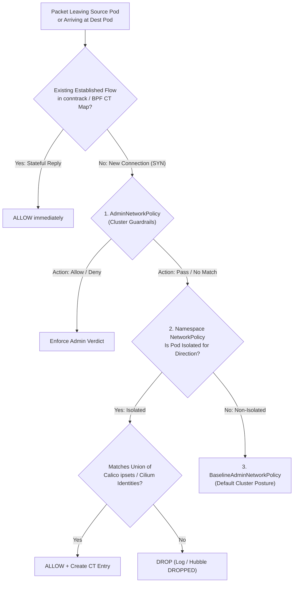

# 5.15 NetworkPolicy and the kernel: netfilter, conntrack and eBPF

| | |
|---|---|
| Level | Advanced |
| Priority tier | 1 |
| Lab venue | Kubernetes with Calico or Cilium (Flannel alone does not enforce policy); `kubectl`, `calicoctl`/`cilium`/`hubble`, `iptables-save`, `nft`, `ipset`, `conntrack`, `tcpdump` |
| Part | Part 5: Kubernetes |
| Status | Drafted, labs **untested** |

## Why this matters for AI infrastructure

Kubernetes networking is flat and open by default: any pod can connect to any other pod and to the node. In a shared GPU platform that means one team's notebook could reach another team's model server, a compromised dependency in a training job could scan the cluster, metadata endpoints and the API server, and data-exfiltration paths are wide open. NetworkPolicy is the baseline control to segment tenants and workloads (inference vs training vs data services vs system components), to constrain egress to approved storage and registries, and to meet compliance requirements. Because enforcement lives in the node kernel (iptables/ipsets or eBPF programs), misunderstanding its semantics produces both security holes and self-inflicted outages (DNS blocked, probes failing, operators unable to reach webhooks). This chapter explains the API precisely, shows how enforcement works in the kernel, and gives practical policy patterns and testing methods for AI platforms.

## Prerequisites and outcomes

Needs 5.10, 5.13, 5.14 and Linux netfilter basics (2.23). After this chapter you can:

- Write correct `NetworkPolicy` resources: pod selectors, namespace selectors, ipBlock, ports (including port ranges), ingress/egress, policy types, additive semantics; predict allow/deny for any flow.
- Implement a layered pattern: default-deny per namespace, DNS/probe/system allowances, per-app allow rules, controlled egress.
- Explain how CNIs enforce policy: iptables chains + ipsets (Calico), eBPF policy maps with identities (Cilium), nftables; and how conntrack makes policies stateful.
- Use extended policy APIs (CalicoGlobalNetworkPolicy, CiliumNetworkPolicy, AdminNetworkPolicy/BaselineAdminNetworkPolicy) and L7/FQDN rules.
- Test and observe policy (Hubble, Calico flow logs, `cilium policy trace`, netshoot, kube-netpol linting tools) and debug failures.
- Design policy for multi-tenant GPU clusters including the traps (node-local traffic, hostNetwork pods, probes, webhooks, metadata services, RDMA/secondary networks).

## 1. The NetworkPolicy API

NetworkPolicy is namespaced, additive, and **allow-list based**. Key facts:

- A policy **selects pods** (`podSelector`) in its own namespace. Pods not selected by any policy for a given direction are **non-isolated** for that direction (all traffic allowed). Once a pod is selected by at least one policy that includes the direction in `policyTypes`, it becomes **isolated** for that direction: only traffic allowed by the union of all applicable policies is permitted.
- Policies are **additive**: there are no deny rules and no ordering; the allowed set is the union of all matching rules.
- **Stateful**: reply traffic for an allowed connection is automatically allowed (via connection tracking); policies describe the direction in which the connection is *initiated*.
- `policyTypes` default: `Ingress` always; `Egress` only if the policy has egress rules. Specify explicitly to avoid surprises.
- Enforcement is **implemented by the CNI**: with a CNI that doesn't support NetworkPolicy (plain Flannel, basic bridge), policies are accepted by the API and silently ignored.

```yaml
apiVersion: networking.k8s.io/v1
kind: NetworkPolicy
metadata:
  name: allow-gateway-to-model
  namespace: serving
spec:
  podSelector:                                  # pods this policy applies to
    matchLabels: { app: vllm }
  policyTypes: [Ingress, Egress]
  ingress:
    - from:
        - namespaceSelector:                     # AND within one element: pods labelled in namespaces labelled
            matchLabels: { kubernetes.io/metadata.name: edge }
          podSelector:
            matchLabels: { app: gateway }
        - ipBlock:                               # separate list element = OR
            cidr: 10.20.0.0/16
            except: [10.20.5.0/24]
      ports:
        - { protocol: TCP, port: 8000 }
        - { protocol: TCP, port: 9000, endPort: 9010 }
  egress:
    - to:
        - namespaceSelector: { matchLabels: { kubernetes.io/metadata.name: kube-system } }
          podSelector: { matchLabels: { k8s-app: kube-dns } }
      ports: [ { protocol: UDP, port: 53 }, { protocol: TCP, port: 53 } ]
    - to: [ { ipBlock: { cidr: 10.30.0.0/16 } } ]   # object storage VIPs
      ports: [ { protocol: TCP, port: 443 } ]
```

### Selector semantics (a common source of mistakes)

Within a `from`/`to` list:

- Each **list element** is OR'd with the others.
- Within one element, `namespaceSelector` **and** `podSelector` are AND'd (pods matching `podSelector` in namespaces matching `namespaceSelector`).
- An element with only `podSelector` means "pods in the **policy's own namespace**"; with only `namespaceSelector` means "all pods in matching namespaces"; an empty `namespaceSelector: {}` matches all namespaces; an empty `podSelector: {}` matches all pods (in the relevant namespace scope).
- `ipBlock` matches IP ranges (with `except`), intended for **cluster-external** IPs; pod IPs are ephemeral and CNI-dependent in how/if `ipBlock` applies to them; avoid using it to select pods.
- Namespaces have the automatic label `kubernetes.io/metadata.name: <name>`, which makes by-name namespace selection reliable.
- An **empty `ingress: []`/no rules with `policyTypes: [Ingress]`** denies all ingress to selected pods; `ingress: [{}]` allows all.
- Ports: protocol default TCP; named ports allowed (resolved per target pod); `endPort` ranges; SCTP support depends on the CNI. Omitting `ports` allows all ports for that peer.

### Default-deny and baseline patterns

```yaml
# 1. Default deny all ingress and egress in a namespace
apiVersion: networking.k8s.io/v1
kind: NetworkPolicy
metadata: { name: default-deny-all, namespace: team-a }
spec:
  podSelector: {}
  policyTypes: [Ingress, Egress]
---
# 2. Allow DNS egress for all pods (otherwise nothing resolves)
apiVersion: networking.k8s.io/v1
kind: NetworkPolicy
metadata: { name: allow-dns, namespace: team-a }
spec:
  podSelector: {}
  policyTypes: [Egress]
  egress:
    - to:
        - namespaceSelector: { matchLabels: { kubernetes.io/metadata.name: kube-system } }
          podSelector: { matchLabels: { k8s-app: kube-dns } }
        - ipBlock: { cidr: 169.254.20.10/32 }          # NodeLocal DNSCache (5.11)
      ports: [ { protocol: UDP, port: 53 }, { protocol: TCP, port: 53 } ]
---
# 3. Allow same-namespace traffic (optional baseline for a team namespace)
apiVersion: networking.k8s.io/v1
kind: NetworkPolicy
metadata: { name: allow-same-namespace, namespace: team-a }
spec:
  podSelector: {}
  policyTypes: [Ingress]
  ingress: [ { from: [ { podSelector: {} } ] } ]
```

Design guidance: start with default-deny **ingress** everywhere (low risk), then add default-deny **egress** with explicit DNS, API server, storage, registry and monitoring allowances; roll out gradually using policy audit/logging modes (Calico staged policies, Cilium audit mode, Hubble) to see what would be blocked; manage policies as code (GitOps, 4.26) with label conventions (`app`, `tier`, `team`) and shared "building block" policies.

## 2. Things NetworkPolicy does not do (and traps)

| Gap/trap | Detail | Mitigation |
|---|---|---|
| No cluster-wide policy | Policies are namespaced; a platform-wide rule must be repeated per namespace | Admin/Baseline policies, CNI global policies, Kyverno generating default policies per namespace |
| No explicit deny / ordering | Cannot say "allow all except X" across policies | Use CNI extended policies with ordering and deny actions (Calico, Cilium, AdminNetworkPolicy) |
| No L7 (HTTP path, gRPC method, DNS names) | Only L3/L4 | CiliumNetworkPolicy L7, Calico Enterprise/Istio AuthorizationPolicy, proxies |
| No FQDN egress | `ipBlock` requires static IPs; SaaS endpoints change | Cilium `toFQDNs`, Calico DNS policy (Enterprise), egress proxies |
| Node-local traffic | Traffic from the pod's own node (kubelet probes, hostPort) is generally allowed by CNIs regardless; cross-node host traffic treatment varies | Understand your CNI: Calico `defaultEndpointToHostAction`, Cilium host policies; ensure probes work with deny |
| `hostNetwork` pods | Not subject to pod NetworkPolicy (they share the node's identity) | Pod Security to restrict hostNetwork; host firewall policies (Calico HostEndpoints, Cilium host policy) |
| Service IPs | Policies see pods (post-DNAT) in most CNIs; selecting by ClusterIP via `ipBlock` is unreliable | Match backend pods by labels |
| Egress to cluster services | Egress rules should target pod endpoints (post-NAT), not ClusterIP, except in implementations that evaluate pre-NAT | Test; prefer selectors |
| API server access | Egress to the Kubernetes API (`kubernetes.default`) is a node/control-plane IP | Allow `ipBlock` for control plane IPs or use Cilium `toEntities: kube-apiserver` |
| Admission webhooks | API server (host network or control plane) must reach webhook pods | Allow ingress from control plane CIDRs/nodes to webhook ports |
| Probes | Kubelet probes originate from the node | Allowed by default in most CNIs; with host firewalls allow node → pod |
| Multi-network pods | Policy applies to the primary CNI interface only; Multus secondary interfaces (RDMA) bypass it | Treat RDMA fabrics as separate trust domains (VLAN/PKey isolation); `MultiNetworkPolicy` for supported plugins |
| Cross-cluster / external traffic | Source IP may be SNATed by LBs (`externalTrafficPolicy`), breaking `ipBlock` | Use `Local` policy, PROXY protocol, or L7 auth |
| Policy creation races | A pod can start before policy is programmed (brief allow window or deny window) | Some CNIs block endpoint creation until policy loaded (Cilium), readiness gating |
| Logging | Standard API has no logging | CNI features: Calico flow logs/log action, Cilium Hubble |

## 3. How enforcement works in the kernel



### Netfilter basics and conntrack

Policy engines hook packets traversing the node: pod egress on the host-side veth (or tc ingress on the veth), pod ingress when delivering to the veth, and node-to-pod traffic. Linux **netfilter** provides hooks (`PREROUTING`, `FORWARD`, `INPUT`, `OUTPUT`, `POSTROUTING`) used by iptables/nftables; **conntrack** tracks flows so rules can match `ESTABLISHED,RELATED` and replies pass automatically (the "stateful" property). Because conntrack entries persist across rule changes, an already-established connection may continue after a policy that would block new connections is applied (until it ends or the entry times out), a frequent confusion when testing; to cut existing flows delete the conntrack entries (`conntrack -D`) or use CNI features that flush on policy change.

### Calico (iptables dataplane)

Felix compiles policy into iptables chains with **ipsets** for selectors:

```text
cali-FORWARD → cali-from-wl-dispatch / cali-to-wl-dispatch
cali-from-wl-dispatch → cali-fw-<iface>  (traffic from workload <iface>): applies egress policies of that pod
cali-to-wl-dispatch   → cali-tw-<iface>  (traffic to workload): applies ingress policies
cali-pi-<policy> / cali-po-<policy>     chains per policy ingress/egress rules
ipsets: cali40s:<selector-hash> (sets of pod IPs matching a selector), cali40masq-ipam-pools ...
Rule form: -m set --match-set cali40s:xxxx src -p tcp --dport 8000 -j MARK --set-xmark 0x10000/0x10000 (allow mark) ... drop at end of profile chain
```

Selectors become ipsets maintained incrementally (membership changes = `ipset add/del`, cheap); rule counts grow with policies × ports, not with pod counts. Calico's **eBPF dataplane** replaces this with BPF programs and maps. Inspect: `iptables-save | grep cali-`, `ipset list | head`, `calicoctl get networkpolicy -A -o wide`, `calicoctl get globalnetworkpolicy`, `calicoctl get workloadendpoint -n ns pod -o yaml` (shows applied profiles).

### Cilium (eBPF)

Each endpoint has BPF programs at tc ingress/egress on its device; identities (from labels) replace IPs in policy decisions. The policy map per endpoint (`cilium_policy_<id>`) contains entries keyed by (identity, port, protocol, direction) with allow/deny flags and optional L7 redirect to Envoy. Pod → pod: egress program looks up the destination identity via `ipcache`, checks the source endpoint's egress policy, then the destination's ingress policy is checked at the receiver (for local) or via identity carried in the tunnel header (for remote). Connection tracking in BPF CT maps makes it stateful; policy verdicts are reported to Hubble. L7 policies redirect matching flows to a per-node Envoy proxy (adds latency but allows HTTP/gRPC/Kafka/DNS awareness; DNS-based `toFQDNs` rules use the DNS proxy to learn IPs for names and update maps with TTL). Inspect: `cilium endpoint list`, `cilium policy get`, `cilium bpf policy get <ep-id>`, `cilium monitor --type policy-verdict`, `hubble observe --verdict DROPPED`, `cilium policy trace --src-k8s-pod ns:pod --dst-k8s-pod ns:pod --dport 8000`.

### nftables-based and other implementations

Antrea (OVS flows), OVN-Kubernetes (OVN ACLs/OVS), kube-router (iptables + ipsets), and nftables backends exist; semantics are the Kubernetes API's, differences are in extended features and performance. Cloud: AWS VPC CNI supports policy via eBPF in newer versions or Calico add-on; GKE Dataplane V2 (Cilium) and Azure NPM/Cilium.

### Performance considerations

Policy evaluation cost is O(#rules) per new connection in iptables (ipset lookups are O(1) per set), BPF map lookups O(1); most cost is on connection establishment. Large numbers of policies/selectors increase compile time and memory (Felix full resyncs, Cilium regeneration); avoid thousands of near-duplicate policies (generate fewer, label-driven ones). Egress to large dynamic FQDN sets expands maps. For AI nodes, policy overhead matters less for long-lived bulk flows and more for connection-heavy services (ingress gateways, DNS).

## 4. Extended policy models

### Calico

`NetworkPolicy` (namespaced) and `GlobalNetworkPolicy` (cluster-wide, can target host endpoints) with `order` (priority), `Allow`/`Deny`/`Log`/`Pass` actions, `selector` expressions on labels (`app == 'x' && has(team)`), namespace selectors, service accounts selectors, ICMP, protocols, CIDRs, `doNotTrack`/`preDNAT`/`applyOnForward` for host policies, staged policies (`StagedNetworkPolicy`) to preview effects, and tiers (Enterprise) for hierarchical governance.

```yaml
apiVersion: projectcalico.org/v3
kind: GlobalNetworkPolicy
metadata: { name: deny-metadata-and-private-egress }
spec:
  order: 100
  selector: has(tenant)
  types: [Egress]
  egress:
    - action: Deny
      destination: { nets: [169.254.169.254/32] }          # cloud metadata endpoint
    - action: Allow
      destination: { selector: app == 'object-gateway' }
    - action: Allow
      protocol: UDP
      destination: { ports: [53] }
```

### Cilium

`CiliumNetworkPolicy` / `CiliumClusterwideNetworkPolicy`: `endpointSelector`, `ingress`/`egress` plus `ingressDeny`/`egressDeny` (deny takes precedence), `fromEntities`/`toEntities` (`world`, `cluster`, `host`, `remote-node`, `kube-apiserver`, `health`), `toFQDNs` (`matchName`, `matchPattern`), `toCIDR/toCIDRSet`, `toServices`, `toPorts` with L7 `rules.http` (`method`, `path`, headers), `kafka`, `dns`; `CiliumCIDRGroup`; host policies (`nodeSelector`); policy audit mode (`policyAuditMode`); `enable-policy` modes (`default`, `always`, `never`).

```yaml
apiVersion: cilium.io/v2
kind: CiliumNetworkPolicy
metadata: { name: trainer-egress, namespace: training }
spec:
  endpointSelector: { matchLabels: { app: trainer } }
  egress:
    - toEndpoints:
        - matchLabels: { "k8s:io.kubernetes.pod.namespace": kube-system, "k8s:k8s-app": kube-dns }
      toPorts:
        - ports: [ { port: "53", protocol: ANY } ]
          rules: { dns: [ { matchPattern: "*" } ] }          # enable DNS visibility for toFQDNs learning
    - toFQDNs:
        - matchName: storage.googleapis.com
        - matchPattern: "*.huggingface.co"
      toPorts: [ { ports: [ { port: "443", protocol: TCP } ] } ]
    - toEntities: [kube-apiserver]
```

### Admin and baseline network policies

The `policy.networking.k8s.io` API group (SIG Network) defines **AdminNetworkPolicy** (cluster-scoped, evaluated *before* namespace NetworkPolicies, with `Allow`/`Deny`/`Pass` and priority; cluster admins set guardrails that tenants cannot override) and **BaselineAdminNetworkPolicy** (default posture evaluated *after* NetworkPolicies; e.g., default deny egress to the Internet unless allowed). Support is arriving in Cilium, Calico, OVN-K, Antrea and others: a standard route to cluster-wide guardrails for multi-tenant platforms; verify implementation maturity.

## 5. Policy design for a multi-tenant GPU platform

Tiers of the cluster and their expected flows:

| Zone | Examples | Policy stance |
|---|---|---|
| **Edge** | Ingress/Gateway, auth proxy | Ingress from LB/Internet on 443; egress to tenant model namespaces only |
| **Serving** | vLLM/Triton/gateways | Ingress only from gateway namespace; egress to storage/registry/metrics/DNS; no pod-to-pod across tenants |
| **Training** | Jobs, operators, launcher pods | Intra-job pod communication (rendezvous, NCCL over TCP if used) allowed within the job's label; egress to datasets/checkpoint storage; deny to other tenants; secondary RDMA networks isolated at fabric level |
| **Data services** | Vector DB, feature store, metadata (MLflow), object gateways | Ingress from approved client namespaces/labels; egress limited |
| **Platform/system** | kube-system, monitoring, GPU operator, Argo CD, cert-manager, Kueue | Controlled interactions; webhook/metrics/API server reachability |
| **Interactive** | Notebooks (JupyterHub) | Egress allow-list (package mirrors, internal APIs), no access to other tenants or cloud metadata; time-limited |
| **Untrusted code** | Customer containers, arbitrary notebooks | Default deny egress except specific proxies; sandboxed runtimes (5.2); no node/API access |

Practical rules:

1. **Label discipline** underpins policy: standardise `app.kubernetes.io/name`, `team`, `tier`, `job-name`/`training.kubeflow.org/job-name`; operators propagate job labels to pods; policy selects by those labels.
2. **Default deny + building blocks**: namespaces created by automation (Terraform/GitOps, 4.25) get default-deny and DNS/allowlist baseline automatically; teams add app-specific rules by PR.
3. **Protect the control plane and metadata**: deny egress to the cloud metadata IP (169.254.169.254) and to node/management networks from tenant pods; allow only the Kubernetes API where needed (operators), preferably through narrow RBAC.
4. **Training job communication**: allow all intra-job traffic by a label selector (`job-name: run-142`) in both directions; if workers need peer discovery before readiness (5.11), the policy allows the headless Service ports; sidecars, exporters and probes must be included. For NCCL over the secondary RDMA network, policy does not apply, so enforce isolation on the fabric (separate VLANs/VRFs, IB partition keys, or per-tenant physical racks) and keep primary-network policy for control traffic.
5. **Egress to storage and registries**: allow by CIDR of internal storage gateways; for SaaS endpoints use FQDN-capable policies or an egress proxy/gateway with allow-lists and logging.
6. **Observability**: enable flow logging/Hubble in audit mode first; review dropped flows weekly; alert on denies from production workloads (misconfiguration) and on allow-flows to forbidden destinations.
7. **Test in CI**: render policies and run `kubectl` e2e tests with netshoot (connect tests matrix) or tools such as `netassert`, `cyclonus` (NetworkPolicy conformance/test generator), Cilium connectivity tests, `kube-linter`/`kubesec` for missing policies, `kubectl-np-viewer`/Network Policy Editor (editor.networkpolicy.io) for visualisation and review.
8. **Break-glass and debugging**: provide a documented way to diagnose (policy trace, Hubble) and to temporarily widen a policy via PR with expiry, not by deleting the default-deny.

## 6. Testing and debugging

Method: define the exact flow (source pod, destination pod/IP, port, direction), identify applicable policies for both ends, predict, then test.

```bash
# What policies select this pod?
kubectl get netpol -n serving -o wide
kubectl describe netpol allow-gateway-to-model -n serving
# Quick tests
kubectl run -n edge tester --rm -it --image=nicolaka/netshoot --restart=Never -- bash
  curl -m 3 -v http://vllm.serving.svc:8000/health
  nc -vz -w 3 <pod-ip> 8000
# Is traffic dropped by policy? (Cilium)
hubble observe --from-pod edge/tester --to-pod serving/vllm-xxx --verdict DROPPED --last 20
cilium policy trace --src-k8s-pod edge:tester --dst-k8s-pod serving:vllm-xxx --dport 8000/tcp
cilium monitor --type drop
# Calico
calicoctl get networkpolicy -n serving -o yaml
sudo iptables -L cali-tw-<iface> -n -v --line-numbers | head -40          # counters on drop rules
sudo iptables -L | grep -E 'DROP.*cali'                                   # packet counters
calico-node -bird-ready; kubectl logs -n calico-system ds/calico-node | grep -i policy
# kernel view
conntrack -L -p tcp --dport 8000 | head
sudo tcpdump -ni <host-veth> 'tcp port 8000' -c 20                       # see SYN without SYN-ACK: dropped upstream
dmesg | grep -i 'cali\|DROP'                                              # if Log action configured
```

| Symptom | Likely cause | Fix |
|---|---|---|
| Everything breaks after default-deny | DNS egress missing; probes/webhooks/API server blocked | Add DNS allow; check kubelet probe paths (node-origin traffic); allow control-plane → webhook |
| Policy has no effect | CNI doesn't enforce policy; policy selects wrong namespace/labels; `policyTypes` missing | Verify CNI support, `kubectl get netpol -o yaml`, label match |
| Allowed flow still blocked | Missing reverse policy on the other end (ingress on dest AND egress on source if both isolated) | Check both sides; named port mismatch; SNAT hides source IP |
| Established connection survives new deny | conntrack | Delete conntrack entries / restart connection |
| `ipBlock` for pod IPs doesn't work | Pod IPs aren't intended for ipBlock (or SNAT in path) | Use podSelector/namespaceSelector |
| Works from node, not from pod | Node-origin traffic exempt | Test from a pod in the right namespace |
| Intermittent failures after pod restarts | Endpoint policy not yet programmed; ipset sync delay | Readiness gates; CNI settings for policy-before-start |
| Egress to Internet blocked unexpectedly | Default deny egress with no `world` allow or NAT/masquerade interplay | Add explicit egress; check proxies |
| Cross-namespace allow not working | Namespace label mismatch (`kubernetes.io/metadata.name`), AND/OR semantic error in selector list | Review the `from` list structure |
| NCCL/MPI works across tenants | Secondary network not under policy | Enforce at fabric/VLAN/PKey level |
| High CPU on CNI agent during policy churn | Too many policies/selectors; frequent label changes | Consolidate policies; avoid per-job unique policies; use stable labels |

## 7. Lab

First, run the self-checking Python lab (`code/part05/networkpolicy_evaluator_lab.py`) locally. It verifies the `NetworkPolicy` `from`/`to` peer selector evaluator (`evaluate_peer_list`: contrasting single-element `namespaceSelector` AND `podSelector` against the accidental two-element OR YAML dash bug, plus `ipBlock` `cidr`/`except` matching) and the `AdminNetworkPolicy -> NetworkPolicy -> BaselineAdminNetworkPolicy` precedence evaluator (`evaluate_policy_hierarchy`).

```bash
python3 code/part05/networkpolicy_evaluator_lab.py
```

Next, on a Kubernetes cluster with Calico or Cilium (all interactive shell steps below are `untested here`), work through these exercises:

1. **Prove CNI enforcement**: on a CNI without policy (Flannel), apply default-deny and show no effect; on Calico/Cilium show enforcement; read the netfilter/BPF artefacts.
2. **Selector semantics**: build the namespace/pod selector truth table by creating `from` lists with AND/OR variations and testing each with netshoot; record results.
3. **Layered policy**: implement default deny + DNS + gateway-to-app + app-to-DB rules for a three-tier app in two namespaces; add egress allowance to an "object store" pod by CIDR and by FQDN (Cilium `toFQDNs`).
4. **Kernel view**: for Calico, trace one packet through `cali-*` chains with counters and `ipset` membership; for Cilium, read the endpoint policy map and run `cilium policy trace`; compare which is easier to reason about.
5. **conntrack effect**: start a long TCP connection, apply a deny policy, show the connection continues; flush conntrack and show it breaks; discuss operational implications.
6. **Probe and webhook traps**: apply default-deny egress+ingress and break readiness probes/webhooks (use a validating webhook pod); restore by allowing node/control-plane sources.
7. **hostNetwork bypass**: show a `hostNetwork` pod ignoring pod policies; add a host policy (Calico HostEndpoint or Cilium host policy) and Pod Security restriction.
8. **Global guardrails**: create a Calico `GlobalNetworkPolicy` or Cilium clusterwide deny for the metadata IP and cross-tenant traffic; then, if available, an AdminNetworkPolicy/BaselineAdminNetworkPolicy and observe precedence versus namespace policies.
9. **Training job policy**: deploy a 4-pod distributed job (headless Service) with default-deny; write the policy that allows intra-job traffic by job label and egress to storage; verify rendezvous works, then block a neighbour tenant.
10. **Observability and audit mode**: enable Hubble (or Calico flow logs); run policies in audit/staged mode; produce a report of flows that would be denied; promote to enforce.
11. **Policy testing in CI**: generate a connectivity matrix test (expected allow/deny pairs) and run with cyclonus or a custom script against a kind cluster in CI (4.13).
12. **Scale test**: create thousands of pods and hundreds of policies; measure agent CPU/memory and time-to-enforce; compare Calico iptables, Calico eBPF and Cilium.
13. **Clean up**.

## 8. Common mistakes

- Creating NetworkPolicies on a CNI that doesn't enforce them and believing the cluster is segmented.
- Default-deny egress without DNS, API server, or probe allowances; breaking operators and webhooks.
- Misreading selector AND/OR semantics (a missing dash converts OR into AND, widening or narrowing the rule).
- Using `ipBlock` for pod or Service IPs; ignoring SNAT effects on source IP.
- Assuming policy covers `hostNetwork` pods, node processes, and secondary (Multus/RDMA) interfaces.
- Testing only from the node (exempt) or only the allow path (never the deny).
- Forgetting both directions: ingress on the destination and egress on the source must both permit.
- Per-job unique policies at scale, causing agent churn.
- No audit/rollout mode; no flow visibility; applying cluster-wide deny during peak hours.
- Treating NetworkPolicy as the only isolation: it does not replace authentication, authorisation, mTLS, runtime isolation or fabric-level tenant separation.

## 9. Interview angles

- "How does NetworkPolicy work? What's the default? What is additive semantics?"
- "Write a policy that only allows the gateway namespace to reach model servers on 8000, with DNS egress."
- "AND vs OR in `from` selectors."
- "How does Calico implement policy? How does Cilium? What changes with eBPF?"
- "Why do established connections survive a new deny rule?" (conntrack.)
- "How would you isolate tenants on a shared GPU cluster, including RDMA traffic?"
- "What are AdminNetworkPolicy and Cilium/Calico global policies for?"
- "After applying default-deny everything broke. What did you forget?"

## Exercises

1. **`NetworkPolicy` Isolation Semantics, Additive Union Rules, and the Single-Dash AND vs. OR YAML Trap (`NK` Ch. 4–5):** Using `evaluate_peer_list()` in `code/part05/networkpolicy_evaluator.py`, explain what makes a Pod "isolated" vs "non-isolated" for `Ingress` and `Egress`, and show the exact difference in YAML and security behavior between placing `namespaceSelector` and `podSelector` in a single `from` list element (AND) versus two separate `from` list elements (OR).
2. **Building a Layered Multi-Tenant Namespace Baseline (`default-deny-all` + `allow-dns` + `allow-same-namespace` + `allow-gateway-to-model`):** Trace the four `NetworkPolicy` manifests in Section 1, explaining why `allow-dns` must permit both `UDP/53` and `TCP/53` to `kube-system` (`k8s-app: kube-dns`) and `169.254.20.10/32` (`NodeLocal DNSCache`), and why both source egress and destination ingress policies must permit a cross-namespace flow when both ends are isolated.
3. **Kernel Enforcement Under the Hood: `conntrack` Statefulness, Calico `iptables` + `ipset` (`cali40s:*`), and Cilium `eBPF` Identity Maps:** Trace how Calico (`cali-from-wl-dispatch` -> `cali-fw-<iface>`, `cali-to-wl-dispatch` -> `cali-tw-<iface>`, and `cali40s:<hash>` `ipset`s) and Cilium (`cilium_policy_<ep_id>` keyed by numeric Security Identity + Envoy L7 redirect) enforce policies in the kernel, and explain why an already-established TCP flow continues working after a deny policy is applied until `conntrack -D` flushes the flow.
4. **Extended Policy Models: Calico `GlobalNetworkPolicy`, Cilium `CiliumNetworkPolicy` (`toFQDNs`, `toEntities`, L7 HTTP), and `AdminNetworkPolicy` / `BaselineAdminNetworkPolicy`:** Using `evaluate_policy_hierarchy()` in `code/part05/networkpolicy_evaluator.py`, trace the evaluation precedence of `AdminNetworkPolicy` (`Allow`/`Deny`/`Pass`) -> `NetworkPolicy` -> `BaselineAdminNetworkPolicy`, and show how `GlobalNetworkPolicy` blocks `169.254.169.254/32` (cloud metadata) while `CiliumNetworkPolicy` allows egress to `*.huggingface.co` via `toFQDNs`.
5. **The 12 `NetworkPolicy` Traps on GPU Clusters (`hostNetwork`, Secondary Multus/RDMA Interfaces, Webhooks, API Server Egress, and Service DNAT):** Explain why standard `NetworkPolicy` does **not** filter traffic on `hostNetwork: true` pods or secondary Multus RDMA/SR-IOV interfaces (`net1..net8`), how to isolate RDMA traffic at the fabric level (VLANs / InfiniBand PKeys), and why admission webhooks break if default-deny ingress blocks the control-plane nodes.
6. **Testing, Auditing, and Debugging Policies (`cilium policy trace`, `hubble observe`, `iptables -L -v`, and `cyclonus`):** Given a connection timeout from `edge/tester` to `serving/vllm-xxx:8000`, write the exact Calico (`iptables -L cali-tw-... -v`) and Cilium (`cilium policy trace` and `hubble observe --verdict DROPPED`) commands to prove whether `NetworkPolicy` dropped the packet.

## Checkpoint questions (20)

<details>
<summary>1. What does it mean that Kubernetes `NetworkPolicy` is \"non-isolated by default\", \"isolated on selection\", and \"strictly additive\"?</summary>

- **Non-isolated by default:** Until a Pod is matched by the `spec.podSelector` of at least one `NetworkPolicy` that includes `Ingress` (or `Egress`) in `spec.policyTypes`, **100% of ingress (or egress) traffic to/from that Pod is allowed**.
- **Isolated on selection:** As soon as **even one** `NetworkPolicy` selects a Pod for `Ingress`, the Pod becomes **isolated for Ingress**—meaning **all ingress traffic is denied EXCEPT what is explicitly permitted** by matching policies.
- **Strictly additive (no deny rules in standard `NetworkPolicy`):** If 3 `NetworkPolicy` objects select the same Pod, the allowed traffic is the **mathematical union (OR)** of the traffic allowed by all 3 policies. You cannot write a "deny" rule in a standard `networking.k8s.io/v1` `NetworkPolicy` to override another `NetworkPolicy`'s allow rule.
</details>

<details>
<summary>2. What is the difference between these two `ingress.from` blocks (the single-dash YAML indentation bug)?</summary>

**Block A (one `-`, AND semantics):**
```yaml
from:
  - namespaceSelector:
      matchLabels: { kubernetes.io/metadata.name: edge }
    podSelector:
      matchLabels: { app: gateway }
```
**Block B (two `-` dashes, OR semantics):**
```yaml
from:
  - namespaceSelector:
      matchLabels: { kubernetes.io/metadata.name: edge }
  - podSelector:
      matchLabels: { app: gateway }
```
- **Block A (AND):** Allows traffic **only** from Pods labeled `app: gateway` that are running **inside** the `edge` namespace.
- **Block B (OR):** Allows traffic from **EVERY Pod in the `edge` namespace** (regardless of its labels) **OR** any Pod labeled `app: gateway` in the **policy's own namespace** (`serving`)—accidentally opening the model server to every pod in `edge`.
</details>

<details>
<summary>3. If `spec.policyTypes` is omitted from a `NetworkPolicy`, how does Kubernetes infer whether the policy applies to `Ingress`, `Egress`, or both?</summary>

By default, if `spec.policyTypes` is omitted:
- Kubernetes **always** includes **`["Ingress"]`**.
- Kubernetes includes **`"Egress"`** **only if** the policy contains a `spec.egress` field.
Consequently, if you write a policy intending to restrict only `Egress` (`spec.egress: [...]`) and forget to set **`policyTypes: [Egress]`**, Kubernetes defaults `policyTypes` to **`[Ingress, Egress]`** with an empty `ingress` section—**silently blocking all inbound traffic to your Pods**. Always write `policyTypes` explicitly.
</details>

<details>
<summary>4. How do you write a `NetworkPolicy` that denies all Ingress and all Egress in a namespace (`default-deny-all`), vs. one that allows all Ingress?</summary>

- **Deny all Ingress and Egress (`default-deny-all`):** Select all Pods (`podSelector: {}`), declare `policyTypes: [Ingress, Egress]`, and omit (or leave empty `[]`) both `ingress` and `egress`:
  ```yaml
  spec:
    podSelector: {}
    policyTypes: [Ingress, Egress]
  ```
- **Allow all Ingress:** Include an empty rule object `[{}]` inside `ingress`:
  ```yaml
  spec:
    podSelector: {}
    policyTypes: [Ingress]
    ingress:
      - {}
  ```
</details>

<details>
<summary>5. What happens when you apply a `NetworkPolicy` on a cluster whose CNI plugin (such as basic Flannel) does not implement a NetworkPolicy controller?</summary>

**`kube-apiserver` accepts and stores the `NetworkPolicy` object with zero warnings or errors, and the CNI silently ignores it—leaving all traffic wide open.** Always verify your CNI supports and has enabled NetworkPolicy enforcement, and run an automated positive/negative connectivity test in CI (`cyclonus` / `netshoot`) to prove unauthorized connections are actually dropped.
</details>

<details>
<summary>6. Why is `NetworkPolicy` described as \"stateful\", and why does an already-open TCP stream continue working after you apply a `default-deny` policy?</summary>

In both `iptables`/`nftables` (`-m conntrack --ctstate ESTABLISHED,RELATED -j ACCEPT`) and Cilium (`cilium_ct4_global` eBPF connection tracking map), policy rules are evaluated **when a new connection is initiated (`SYN` / first packet)**, and the resulting `conntrack` entry automatically permits return packets and subsequent packets on that established flow.
Because the kernel checks `ESTABLISHED` **before** walking the policy chains (in standard `iptables` layouts), a long-lived TCP/gRPC connection opened *before* a `default-deny` policy was applied will continue passing traffic until the connection closes or its conntrack entry is flushed (`conntrack -D`).
</details>

<details>
<summary>7. How does Calico's `iptables` dataplane avoid an `O(Pods)` rule explosion inside `iptables` chains when enforcing label selectors?</summary>

Instead of writing a separate `iptables` rule for every Pod IP matching `app=gateway`, Calico's `Felix` agent creates a single Linux kernel **`ipset` hash table** per unique selector (`cali40s:<selector-hash>`) and writes **one fixed `iptables` rule** (`-m set --match-set cali40s:<hash> src -p tcp --dport 8000 -j MARK --set-xmark 0x10000/0x10000`). When Pods scale up or down, `Felix` simply adds or removes the Pod IP in the kernel `ipset` in $O(1)$ time without rewriting the `iptables` policy chain.
</details>

<details>
<summary>8. Why should you NEVER use `ipBlock` in a `NetworkPolicy` to select in-cluster Pods or `ClusterIP` Services?</summary>

1. **Pod IPs are ephemeral:** Whenever a Pod restarts or reschedules onto another node, its IP changes.
2. **Service `ClusterIP`s are DNAT'd before policy evaluation in most CNIs:** When a Pod connects to a `ClusterIP`, `kube-proxy` (or Cilium Socket-LB) translates the destination IP from `ClusterIP` to the backend **`PodIP`** before the egress/ingress policy filter runs—so an `ipBlock` matching the `ClusterIP` will not match the post-DNAT packet.
3. **SNAT on external/hairpin paths:** Masquerading can rewrite source IPs.
Always use **`podSelector` and `namespaceSelector`** for in-cluster traffic, and reserve `ipBlock` strictly for external physical subnets/VIPs (like `169.254.169.254/32` or an external storage array CIDR).
</details>

<details>
<summary>9. For a packet from Pod A (in `ns-a`) to reach Pod B (in `ns-b`), what must be true if BOTH Pod A and Pod B are isolated by `NetworkPolicy`?</summary>

Both ends are evaluated independently:
1. Pod A's **Egress** policies in `ns-a` must explicitly allow outbound traffic to Pod B (in `ns-b`) on the destination port.
2. **AND** Pod B's **Ingress** policies in `ns-b` must explicitly allow inbound traffic from Pod A (in `ns-a`) on the destination port.
If *either* side denies the flow, the packet is dropped.
</details>

<details>
<summary>10. What breaks immediately when you apply `default-deny-all` (`policyTypes: [Ingress, Egress]`) to a namespace without adding any allow rules, and what remains working?</summary>

- **What breaks immediately:** All **DNS resolution** (`UDP/TCP 53` to `kube-dns` / `NodeLocal DNSCache` is blocked on Egress), all outbound calls to `kube-apiserver` (`kubernetes.default`), object storage, and other Pods, and all inbound requests from Ingress gateways or Prometheus scrapers.
- **What still works:** **`kubelet` liveness/readiness/startup probes** originating from the Pod's own host node (because CNIs explicitly exempt local host-to-pod traffic so kubelet health checks continue to function).
</details>

<details>
<summary>11. Why can a `default-deny` `NetworkPolicy` break a `ValidatingAdmissionWebhook` or `MutatingAdmissionWebhook` Pod (or `metrics-server`), and how do you fix it?</summary>

When `kube-apiserver` invokes an admission webhook (or an aggregated API server like `metrics-server`), the HTTPS connection originates from the **control-plane node IPs** (or the `konnectivity-agent` Pods), *not* from a labeled Pod inside the webhook's namespace. If a `default-deny-ingress` policy selects the webhook Pod and only allows same-namespace Pods, **`kube-apiserver`'s webhook calls time out**—which, if `failurePolicy: Fail` is set, blocks API writes across the cluster. Always allow ingress to webhook ports (`443`/`8443`/`9443`) from the control-plane node CIDR (or `fromEntities: [kube-apiserver, host, remote-node]` in Cilium).
</details>

<details>
<summary>12. Does a standard Kubernetes `NetworkPolicy` restrict traffic on (a) `hostNetwork: true` Pods or (b) secondary `Multus` RDMA interfaces (`net1..net8`)?</summary>

**No to both:**
1. **`hostNetwork: true` Pods** share the node's root network namespace and node IP; standard pod-level `NetworkPolicy` does not apply to them (use Pod Security Admission to forbid `hostNetwork: true` for tenant workloads, and use Calico `HostEndpoint` / Cilium Host Firewall policies to protect node interfaces).
2. **Secondary `Multus` interfaces (`net1..net8`, `macvlan`, `SR-IOV` VFs, InfiniBand)** bypass the primary CNI (`eth0`) entirely. To isolate multi-tenant GPU workloads on RDMA secondary networks, enforce isolation in the **network fabric / NIC hardware** using **per-tenant VLANs / VRFs** (for RoCEv2 Ethernet) or **InfiniBand Partition Keys (`P_Key`s)** managed by `UFM` / Network Operator.
</details>

<details>
<summary>13. Why must tenant Pods on cloud GPU clusters be blocked from reaching `169.254.169.254/32` (`GlobalNetworkPolicy` / `CiliumClusterwideNetworkPolicy`)?</summary>

`169.254.169.254` is the cloud **Instance Metadata Service (`IMDS`)** on AWS, GCP (`metadata.google.internal`), and Azure. Unless blocked by a network policy (or GKE Workload Identity metadata concealment / AWS IMDSv2 hop-limit `1`), any untrusted notebook or training container on a worker node can query `http://169.254.169.254/...` and steal the **worker node VM's IAM role credentials** (`kubelet` / node service account). Always block `169.254.169.254/32` in a cluster-wide egress policy (`except: [169.254.169.254/32]`).
</details>

<details>
<summary>14. How does Cilium's `toFQDNs` egress policy (`matchPattern: "*.huggingface.co"`) work at the kernel level?</summary>

Kernel packet filters (`tc` eBPF or `iptables`) only see IP addresses in IP headers, not DNS hostnames. When a `CiliumNetworkPolicy` includes a `toFQDNs` rule (paired with a port `53` `rules.dns` rule):
1. Cilium redirects the Pod's outbound port `53` DNS queries through Cilium's **per-node DNS Proxy**.
2. When the Pod queries `cdn-lfs.huggingface.co` (which matches `*.huggingface.co`), the DNS proxy inspects the DNS response, extracts the returned IP addresses (`A`/`AAAA`), **inserts those IPs into the Pod's eBPF policy map (`cilium_policy_<id>`)** for the duration of the DNS TTL, and only then returns the DNS answer to the Pod.
3. When the Pod connects to that IP on TCP port `443` milliseconds later, the eBPF map already allows it.
</details>

<details>
<summary>15. Compare `AdminNetworkPolicy`, `NetworkPolicy`, and `BaselineAdminNetworkPolicy` (`policy.networking.k8s.io`).</summary>

They form a 3-tier evaluation hierarchy:
1. **`AdminNetworkPolicy` (Cluster-scoped, evaluated FIRST, owned by Platform/Security Admins):** Supports `Allow`, **`Deny`**, and `Pass` actions with numeric priority. A `Deny` rule here (e.g., blocking tenant-A from talking to tenant-B or blocking `169.254.169.254/32`) **cannot be overridden by any namespace `NetworkPolicy`**. A `Pass` rule delegates the decision to tier 2.
2. **`NetworkPolicy` (Namespace-scoped, evaluated SECOND, owned by Application/ML Teams):** Standard additive `Allow` policies within a namespace.
3. **`BaselineAdminNetworkPolicy` (Cluster-scoped, evaluated LAST for non-isolated traffic, owned by Platform Admins):** Sets the default fallback posture (e.g., default-deny cross-namespace ingress across the entire cluster) whenever a namespace owner has not written a `NetworkPolicy`, while still allowing namespace owners to open ports via standard `NetworkPolicy`.
</details>

<details>
<summary>16. How do you safely roll out new `NetworkPolicy` rules in production without causing surprise outages (`StagedNetworkPolicy` / `policyAuditMode`)?</summary>

Never apply an untested `default-deny` policy directly in enforce mode in production:
1. **Audit / Staged mode first:** In Calico, deploy a **`StagedNetworkPolicy` / `StagedGlobalNetworkPolicy`**; in Cilium, enable **`policyAuditMode: true`** on the policy or endpoint.
2. **Observe would-be drops:** Watch `hubble observe --verdict AUDIT` (or Calico flow logs) over a full business cycle (including cron jobs, backups, and metrics scrapes) to identify any legitimate flows missing from the allow-list.
3. **Promote to enforce mode** in GitOps once audit logs show zero legitimate flows would be dropped.
</details>

<details>
<summary>17. Why does creating 5,000 separate per-Job `NetworkPolicy` objects on a large batch cluster hurt CNI agent performance, and what is the better pattern?</summary>

If a workflow engine creates a brand-new `NetworkPolicy` object for every training Job (`allow-job-1`, `allow-job-2`, ..., `allow-job-5000`), `Felix` (Calico) and `cilium-agent` must recompile thousands of policy chains/maps on every node whenever jobs start or finish.
Instead, use a **small, fixed set of static tier/zone policies** (e.g., 3–5 policies per namespace) and label Pods with standardized role/tier labels (`tier: training-worker`, `storage-access: allowed`)—or use Calico's label expression `selector` / Cilium's security identities so pods join existing policies automatically without creating new `NetworkPolicy` objects per job.
</details>

<details>
<summary>18. What is the \"Policy Creation Race\" at Pod startup, and how do CNIs prevent a newly started Pod from having a brief window of unrestricted network access?</summary>

When a Pod starts, if `CNI ADD` finishes wiring `eth0` *before* the CNI agent (`Felix` or `cilium-agent`) has computed and installed the Pod's `NetworkPolicy` rules on that interface, the Pod could briefly send or receive unauthorized packets for a few hundred milliseconds (or conversely, fail its first startup connection if default-deny is applied before allow rules load). Modern CNIs (such as Cilium and Calico) synchronize **`CNI ADD`** with the local agent so `RunPodSandbox` does not return until the endpoint's initial policy program/chains are atomically attached in the kernel.
</details>

<details>
<summary>19. How do you use `cilium policy trace` and `iptables -L cali-tw-<iface> -v` to debug a blocked connection?</summary>

- **In Cilium:**
  `cilium policy trace --src-k8s-pod edge:tester --dst-k8s-pod serving:vllm-0 --dport 8000/tcp`
  This prints the source and destination numeric Security Identities, lists every matching `CiliumNetworkPolicy` / `NetworkPolicy`, and outputs `Final verdict: ALLOWED` or `DENIED`. Pair with `hubble observe --from-pod edge/tester --verdict DROPPED`.
- **In Calico (`iptables` mode):**
  Find the target Pod's host `cali*` interface (`calicoctl get workloadendpoint -n serving`), then run:
  `sudo iptables -L cali-tw-<cali-iface> -n -v --line-numbers`
  Watch the packet/byte counters on each rule and on the final `DROP` rule while running `nc -vz <pod-ip> 8000`.
</details>

<details>
<summary>20. Why is `NetworkPolicy` necessary but NOT sufficient for complete multi-tenant security on a shared GPU Kubernetes cluster?</summary>

`NetworkPolicy` only filters L3/L4 (and in Cilium, L7) packet headers on the **primary CNI network**:
1. It does **not** authenticate identity cryptographically or encrypt traffic on the wire (use **mTLS** via Service Mesh or WireGuard).
2. It does **not** isolate the shared host Linux kernel or `/dev/nvidia*` driver state (use **Pod Security Admission**, `seccomp`, or **Kata / Confidential Containers** for untrusted code).
3. It does **not** police **secondary RDMA/InfiniBand networks** (use fabric VLANs/VRFs or IB `P_Key`s).
4. It does **not** replace Kubernetes **RBAC** and Admission Policy (`Kyverno` / `OPA Gatekeeper` / `ValidatingAdmissionPolicy`).
</details>

## Sources and review notes

- **Sources read in full:**
  - `networking-and-kubernetes` — James Strong & Vallery Lancey, *Networking and Kubernetes*, **Chapter 4: Kubernetes Networking Introduction** (NetworkPolicy API, `podSelector`/`namespaceSelector`/`ipBlock`, default-deny, and kubelet probe exemptions) and **Chapter 5: Kubernetes Networking Abstractions** (CNI policy enforcement, Calico, Cilium).
  - `production-kubernetes` — Josh Rosso, Rich Lander, Alexander Brand & John Harris, *Production Kubernetes*, **Chapter 5: Pod Networking** (NetworkPolicy enforcement and multi-tenancy considerations).
  - `nvidia-devops` (`volume-03/03-k8s-networking-security-ops-masterclass.md`): networking and security operations masterclass (CNI dataplane, NetworkPolicy, multi-tenancy, and admission).
- **Run here:** `python3 code/part05/networkpolicy_evaluator_lab.py` (3 passed, 0 failed).
- **Explicitly labelled inferences:** The `match_networkpolicy_peer`, `evaluate_peer_list`, and `evaluate_policy_hierarchy` models in `code/part05/networkpolicy_evaluator.py` and the `allow-gateway-to-model`, `default-deny-all`, `allow-dns`, `deny-metadata-and-private-egress` (`GlobalNetworkPolicy`), and `trainer-egress` (`CiliumNetworkPolicy`) manifests are the author's constructions synthesizing `NK` Chapters 4 & 5, `PK` Chapter 5, and `volume-03/03` (plus original study items 21, 22, 23, 24, 25, 26, 27, 28, 29, 30, 31, 32, 33, 34, and 35).
- **Not verified on live hardware:** Live `kubectl`, `calicoctl`, `cilium policy trace`, `hubble observe`, `iptables`, `ipset`, and `cyclonus` executions (`10.20.0.0/16`, `10.20.5.0/24`, ports `8000`/`9000..9010`/`53`/`443`, `10.30.0.0/16`, `169.254.20.10/32`, `0x10000/0x10000`, `order: 100`, `169.254.169.254/32`) are marked (`untested here`) where not executed by `networkpolicy_evaluator_lab.py`.
