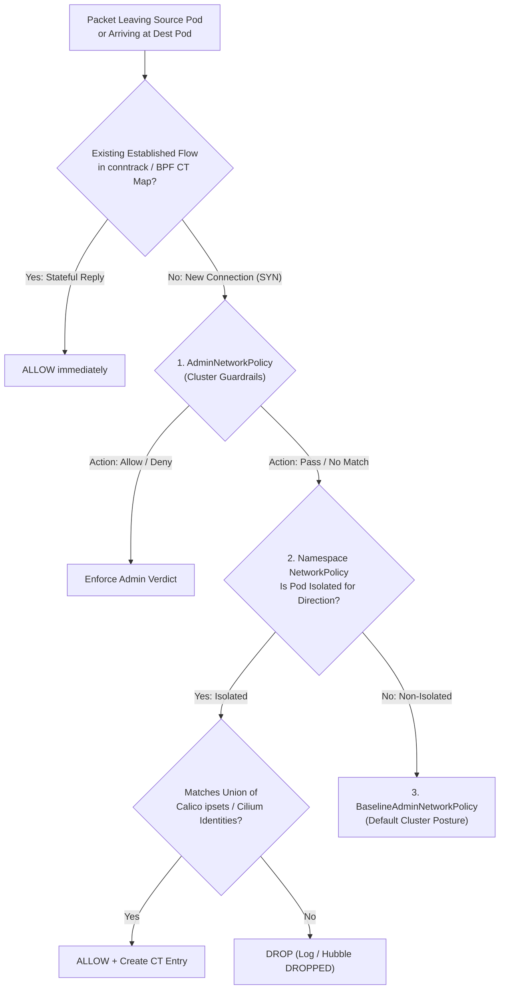

# 5.15 NetworkPolicy and the kernel: netfilter, conntrack and eBPF

| | |
|---|---|
| Level | Advanced |
| Priority tier | 1 |
| Lab venue | Kubernetes with Calico or Cilium (Flannel alone does not enforce policy); `kubectl`, `calicoctl`/`cilium`/`hubble`, `iptables-save`, `nft`, `ipset`, `conntrack`, `tcpdump` |
| Part | Part 5: Kubernetes |
| Status | Drafted, labs **untested** |

## Why this matters for AI infrastructure

Picture a shared GPU platform where one team's notebook can open a connection to another team's model server. That is the default. Kubernetes networking is flat and open: any pod can connect to any other pod and to the node. Think of it as an open-plan office with no doors between the rooms. Anyone who gets into one room can walk into all the others. A compromised dependency in a training job could then scan the cluster, the metadata endpoints and the API server. Data could also leave through paths nobody has closed.

NetworkPolicy is the baseline control for this problem. You use it to segment tenants and workloads into inference, training, data services and system components. You also use it to constrain egress to approved storage and registries, and to meet compliance requirements.

Enforcement lives in the node kernel, through iptables and ipsets or through eBPF programs. That is why a wrong guess about the semantics costs you twice. It can open a security hole, or it can cause an outage nobody intended, such as blocked DNS, failing probes or operators that cannot reach their webhooks. This chapter explains the API precisely. It then shows how enforcement works in the kernel, and gives practical policy patterns and testing methods for AI platforms.

## Prerequisites and outcomes

Start with chapters 5.10, 5.13 and 5.14, plus the Linux netfilter basics from chapter 2.23. Use the list below as a self-check. Each line names one skill that a platform engineer uses when writing or debugging policy, and each one maps to a section of this chapter.

- Write correct `NetworkPolicy` resources. They use pod selectors, namespace selectors, `ipBlock`, ports and port ranges, ingress and egress rules, and policy types. You should understand additive semantics and predict whether any flow is allowed or denied.
- Build a layered pattern: default-deny for each namespace, then DNS, probe and system allowances, then per-app allow rules, and finally controlled egress.
- Explain how CNIs enforce policy. Calico uses iptables chains with ipsets, Cilium uses eBPF policy maps keyed by identities, and nftables is another option. You should also explain how conntrack makes policies stateful.
- Use the extended policy APIs, namely CalicoGlobalNetworkPolicy, CiliumNetworkPolicy, AdminNetworkPolicy and BaselineAdminNetworkPolicy, along with L7 and FQDN rules.
- Test and observe policy with Hubble, Calico flow logs, `cilium policy trace`, netshoot and kube-netpol linting tools, and debug the failures you find.
- Design policy for multi-tenant GPU clusters, and recognize the traps: node-local traffic, `hostNetwork` pods, probes, webhooks, metadata services, and RDMA or secondary networks.

If a line feels unfamiliar when you reach its section, go back and read that section slowly. A policy is easiest to trust once you have watched it allow one flow and block another.

## 1. The NetworkPolicy API

Suppose you want only the gateway to reach your model server. Without a policy, every pod in the cluster can reach it. A `NetworkPolicy` closes that gap, but its rules are easy to misread. So start with the key ideas.

Think of a policy as a guest list at a door. Pods that are not on any list may come in freely, but once a list names the model server, anyone not on it is turned away. A second list, written by a different team, may add more names. The door admits anyone who appears on at least one list. Nothing on a list ever removes a name from another list, and that single rule explains most of what follows.

A `NetworkPolicy` belongs to one namespace. It is additive, and it works from an allow-list. A policy selects pods with `podSelector` in its own namespace. A pod that no policy selects for a given direction is non-isolated in that direction, so all of its traffic is allowed. Once at least one policy selects the pod and lists that direction in `policyTypes`, the pod becomes isolated in that direction. From then on, only the union of all applicable policies gets through. In plain terms, a flow passes if any one policy allows it.

Policies are additive. There are no deny rules and no ordering, so the allowed set is the union of all matching rules. Policies are also stateful. Reply traffic for an allowed connection is automatically allowed, through connection tracking. A policy describes the direction in which the connection is initiated.

The `policyTypes` field defaults to `Ingress` always. It defaults to `Egress` only when the policy has egress rules. Set it explicitly to avoid surprises. Enforcement belongs to the CNI, not to the API. With a CNI that does not support NetworkPolicy, such as plain Flannel or a basic bridge, the API accepts your policies and silently ignores them.

The manifest below shows the pattern. Read it as two halves. Ingress decides who may reach the model, and egress decides where the model may call. Port 9000 through 9010 is eleven ports in one rule.

Walk one request through the ingress half. A gateway pod in the `edge` namespace calls the vLLM pod on port 8000. The first `from` element names the `edge` namespace and the `app: gateway` label, and the request matches both of those, so it is allowed. Now take a pod labelled `app: debug` in the same `edge` namespace. It fails the `app: gateway` check, and it is not inside the `10.20.0.0/16` block either, so it is refused. The egress half works the same way. The model may reach DNS and the object storage range on port 443, and nothing else is on its list.

```yaml
apiVersion: networking.k8s.io/v1
kind: NetworkPolicy
metadata:
  name: allow-gateway-to-model
  namespace: serving
spec:
  podSelector:                                  # pods this policy applies to
    matchLabels: { app: vllm }
  policyTypes: [Ingress, Egress]
  ingress:
    - from:
        - namespaceSelector:                     # AND within one element: pods labelled in namespaces labelled
            matchLabels: { kubernetes.io/metadata.name: edge }
          podSelector:
            matchLabels: { app: gateway }
        - ipBlock:                               # separate list element = OR
            cidr: 10.20.0.0/16
            except: [10.20.5.0/24]
      ports:
        - { protocol: TCP, port: 8000 }
        - { protocol: TCP, port: 9000, endPort: 9010 }
  egress:
    - to:
        - namespaceSelector: { matchLabels: { kubernetes.io/metadata.name: kube-system } }
          podSelector: { matchLabels: { k8s-app: kube-dns } }
      ports: [ { protocol: UDP, port: 53 }, { protocol: TCP, port: 53 } ]
    - to: [ { ipBlock: { cidr: 10.30.0.0/16 } } ]   # object storage VIPs
      ports: [ { protocol: TCP, port: 443 } ]
```

### Selector semantics (a common source of mistakes)

Most mistakes with NetworkPolicy come from selectors, so read them slowly. Inside one `from` or `to` list, each list element is OR'd with the others. Inside one element, `namespaceSelector` and `podSelector` are AND'd. The rule then matches pods with that label inside namespaces with that label.

Here is the same idea in plain words. If one list element holds both a namespace label and a pod label, a pod has to match both, like a visitor who must be on the guest list and also wear a badge. If the two labels sit in separate elements, a pod needs to match only one of them. The YAML dash decides which of those two rules you wrote, so a missing dash can quietly widen the door.

Take the single-element form first, and build its truth table. A pod that matches both labels is allowed. A pod that matches only the pod label, in the wrong namespace, is refused. A pod that matches only the namespace is refused as well. A pod that matches neither is refused. Checking these four cases before you ship a policy is the quickest way to catch an AND-versus-OR mistake.

An element that holds only a `podSelector` means pods in the policy's own namespace. An element that holds only a `namespaceSelector` means all pods in the matching namespaces. An empty `namespaceSelector: {}` matches all namespaces. An empty `podSelector: {}` matches all pods in the relevant namespace scope.

Think of the selectors as a sorting machine. A `podSelector` sorts by the label on the pod card, and a `namespaceSelector` sorts by the label on the namespace folder. An element with both sorts twice, and only the cards that pass both sorts come out the far end. Walk a worked case. A pod labelled `app: gateway` in the `edge` namespace passes both sorts, and it is allowed. The same label in the `serving` namespace fails the namespace sort, so it is refused.

Use `ipBlock` for cluster-external IPs. Pod IPs are ephemeral, and how or whether `ipBlock` applies to them depends on the CNI. Avoid using it to select pods. Every namespace also carries the automatic label `kubernetes.io/metadata.name: <name>`, so selecting a namespace by name is reliable.

An empty `ingress: []`, or no rules with `policyTypes: [Ingress]`, denies all ingress to the selected pods. By contrast, `ingress: [{}]` allows all of it. Protocol defaults to TCP. Named ports are allowed and resolve per target pod, and `endPort` covers a range. SCTP support depends on the CNI. If you omit `ports`, the peer may use any port.

Before you write any `from` list, check whether each element is an OR and whether the fields inside it are an AND.

### Default-deny and baseline patterns

The three policies below form a baseline you can apply to a namespace. The first denies everything, the second restores DNS, and the third allows traffic inside the namespace.

```yaml
# 1. Default deny all ingress and egress in a namespace
apiVersion: networking.k8s.io/v1
kind: NetworkPolicy
metadata: { name: default-deny-all, namespace: team-a }
spec:
  podSelector: {}
  policyTypes: [Ingress, Egress]
---
# 2. Allow DNS egress for all pods (otherwise nothing resolves)
apiVersion: networking.k8s.io/v1
kind: NetworkPolicy
metadata: { name: allow-dns, namespace: team-a }
spec:
  podSelector: {}
  policyTypes: [Egress]
  egress:
    - to:
        - namespaceSelector: { matchLabels: { kubernetes.io/metadata.name: kube-system } }
          podSelector: { matchLabels: { k8s-app: kube-dns } }
        - ipBlock: { cidr: 169.254.20.10/32 }          # NodeLocal DNSCache (5.11)
      ports: [ { protocol: UDP, port: 53 }, { protocol: TCP, port: 53 } ]
---
# 3. Allow same-namespace traffic (optional baseline for a team namespace)
apiVersion: networking.k8s.io/v1
kind: NetworkPolicy
metadata: { name: allow-same-namespace, namespace: team-a }
spec:
  podSelector: {}
  policyTypes: [Ingress]
  ingress: [ { from: [ { podSelector: {} } ] } ]
```

Read the three policies as layers. The first closes the doors, so nothing is allowed by accident. The second gives every pod a way to ask for a name, and without it nothing resolves, which is the most common surprise after a default deny. The third opens the team's own rooms to each other. Each layer is small, and each one has a single job.

Design guidance follows from these patterns. Start with default-deny ingress everywhere, because it carries the lowest risk. Then add default-deny egress, with explicit allowances for DNS, the API server, storage, registries and monitoring. Roll this out gradually. Calico staged policies, Cilium audit mode and Hubble show what would be blocked before you enforce anything. Manage policies as code through GitOps (4.26), using the labels `app`, `tier` and `team` and shared building-block policies. Keeping policy in Git gives you a history of every widened allowance, with the person who asked for it and the reason. That history is what an auditor will ask for, and it is also what you will want during an incident, when the question is "what changed last Tuesday?"

A practical habit is to review policy changes the same way you review application code. A reviewer should be able to read a pull request and answer three questions. Which pods does this select? Which new flow does it allow? Does it leave the default deny in place? If the answer to any of those is unclear, the change is not ready to merge.

Start with ingress, and add egress only after audit mode shows what it would block.

### Proving a default deny with a test Pod

A policy on paper is not proof. *Kubernetes: Up and Running* (3rd edition, Chapter 19) tests the rules with a small application in its own namespace. You run the app, expose it as a Service, and call it from a second Pod. Then you add a default deny, and finally a policy that lets through the one source you want. Each step shows what changed.

Start with a fresh namespace, then the `kuard` Pod:

```bash
$ kubectl create ns kuard-networkpolicy
namespace/kuard-networkpolicy created
```

Save this manifest as `kuard-pod.yaml`:

```yaml
apiVersion: v1
kind: Pod
metadata:
  name: kuard
  labels:
    app: kuard
spec:
  containers:
  - image: gcr.io/kuar-demo/kuard-amd64:blue
    name: kuard
    ports:
    - containerPort: 8080
      name: http
      protocol: TCP
```

Create the Pod and expose it as a Service:

```bash
$ kubectl apply -f kuard-pod.yaml \
--namespace kuard-networkpolicy
pod/kuard created
$ kubectl expose pod kuard --port=80 --target-port=8080 \
--namespace kuard-networkpolicy
pod/kuard created
```

Now start a test Pod, with no policy in place, and fetch the page from `kuard`:

```bash
$ kubectl run test-source --rm -ti --image busybox /bin/sh \
--namespace kuard-networkpolicy
If you don't see a command prompt, try pressing enter.
/ # wget -q kuard -O -
<!doctype html>
<html lang="en">
<head>
<meta charset="utf-8">
<title><KUAR Demo></title>
...
```

The test Pod reaches `kuard`, so traffic flows freely. That result is your baseline. Every later step is measured against it, so write it down before you change anything.

Next, save this default deny as `networkpolicy-default-deny.yaml`. It selects every Pod in the namespace and allows no ingress:

```yaml
apiVersion: networking.k8s.io/v1
kind: NetworkPolicy
metadata:
  name: default-deny-ingress
spec:
  podSelector: {}
  policyTypes:
  - Ingress
```

```bash
$ kubectl apply -f networkpolicy-default-deny.yaml \
--namespace kuard-networkpolicy
networkpolicy.networking.k8s.io/default-deny-ingress created
$ kubectl run test-source --rm -ti --image busybox /bin/sh \
--namespace kuard-networkpolicy
If you don't see a command prompt, try pressing enter.
/ # wget -q --timeout=5 kuard -O -
wget: download timed out
```

The test Pod can no longer reach `kuard`, because of the default deny. The timeout is the signal you are looking for. The `wget` did not get a refusal from `kuard`. The packet was dropped before it arrived, so the request just waited until the five-second timeout ran out. Now allow only the test source. Save this policy as `networkpolicy-kuard-allow-test-source.yaml`. It selects Pods labeled `app: kuard` and allows ingress from Pods labeled `run: test-source`:

```yaml
kind: NetworkPolicy
apiVersion: networking.k8s.io/v1
metadata:
  name: access-kuard
spec:
  podSelector:
    matchLabels:
      app: kuard
  ingress:
  - from:
    - podSelector:
        matchLabels:
          run: test-source
```

```bash
$ kubectl apply \
-f networkpolicy-kuard-allow-test-source.yaml \
--namespace kuard-networkpolicy
networkpolicy.networking.k8s.io/access-kuard created
$ kubectl run test-source --rm -ti --image busybox /bin/sh \
--namespace kuard-networkpolicy
If you don't see a command prompt, try pressing enter.
/ # wget -q kuard -O -
<!doctype html>
<html lang="en">
<head>
<meta charset="utf-8">
<title><KUAR Demo></title>
...
```

The test Pod can reach `kuard` again, and only through the rule you wrote. Clean up the test namespace when you finish:

```bash
$ kubectl delete namespace kuard-networkpolicy
namespace "kuard-networkpolicy" deleted
```

Notice the order of the three steps. The open test shows the starting point. The deny test shows that the default works. The allow test shows that one rule opens exactly one door, and nothing else. Skip any of the three and you have only half of the proof.

Network Policy adds one more layer of security. It builds on the ideas of defense in depth and least privilege, and it works best when you test each layer as you add it.

## 2. Things NetworkPolicy does not do (and traps)

Imagine a platform team that applies a default deny on Monday. On Tuesday, the readiness probes on one node start failing, and nobody remembers changing the probe settings. The cause is a gap in what the policy covers, not a bug in the policy itself. This section lists the gaps that catch teams like that one.

NetworkPolicy has gaps, and several of them catch teams off guard. A policy set that looks complete can still leave a path open, or it can block a probe your platform depends on. The table lists the common traps, with a mitigation for each one.

| Gap/trap | Detail | Mitigation |
|---|---|---|
| No cluster-wide policy | Policies are namespaced; a platform-wide rule must be repeated per namespace | Admin/Baseline policies, CNI global policies, Kyverno generating default policies per namespace |
| No explicit deny / ordering | Cannot say "allow all except X" across policies | Use CNI extended policies with ordering and deny actions (Calico, Cilium, AdminNetworkPolicy) |
| No L7 (HTTP path, gRPC method, DNS names) | Only L3/L4 | CiliumNetworkPolicy L7, Calico Enterprise/Istio AuthorizationPolicy, proxies |
| No FQDN egress | `ipBlock` requires static IPs; SaaS endpoints change | Cilium `toFQDNs`, Calico DNS policy (Enterprise), egress proxies |
| Node-local traffic | Traffic from the pod's own node (kubelet probes, hostPort) is generally allowed by CNIs regardless; cross-node host traffic treatment varies | Understand your CNI: Calico `defaultEndpointToHostAction`, Cilium host policies; ensure probes work with deny |
| `hostNetwork` pods | Not subject to pod NetworkPolicy (they share the node's identity) | Pod Security to restrict hostNetwork; host firewall policies (Calico HostEndpoints, Cilium host policy) |
| Service IPs | Policies see pods (post-DNAT) in most CNIs; selecting by ClusterIP via `ipBlock` is unreliable | Match backend pods by labels |
| Egress to cluster services | Egress rules should target pod endpoints (post-NAT), not ClusterIP, except in implementations that evaluate pre-NAT | Test; prefer selectors |
| API server access | Egress to the Kubernetes API (`kubernetes.default`) is a node/control-plane IP | Allow `ipBlock` for control plane IPs or use Cilium `toEntities: kube-apiserver` |
| Admission webhooks | API server (host network or control plane) must reach webhook pods | Allow ingress from control plane CIDRs/nodes to webhook ports |
| Probes | Kubelet probes originate from the node | Allowed by default in most CNIs; with host firewalls allow node → pod |
| Multi-network pods | Policy applies to the primary CNI interface only; Multus secondary interfaces (RDMA) bypass it | Treat RDMA fabrics as separate trust domains (VLAN/PKey isolation); `MultiNetworkPolicy` for supported plugins |
| Cross-cluster / external traffic | Source IP may be SNATed by LBs (`externalTrafficPolicy`), breaking `ipBlock` | Use `Local` policy, PROXY protocol, or L7 auth |
| Policy creation races | A pod can start before policy is programmed (brief allow window or deny window) | Some CNIs block endpoint creation until policy loaded (Cilium), readiness gating |
| Logging | Standard API has no logging | CNI features: Calico flow logs/log action, Cilium Hubble |

Read the table as a list of questions to ask your platform before go-live. Take the probe row as an example. The question is whether your node's health checks can still reach the pods after the default deny. If the answer depends on the CNI and the host firewall, you need to test it on the node itself, because the policy text alone will not tell you.

Most of these mitigations depend on which CNI you run, so check its features before you rely on one. The traps that hit AI platforms hardest are the probe, webhook and RDMA rows.

## 3. How enforcement works in the kernel

When a packet leaves a source pod or arrives at a destination pod, the policy engine checks it in a fixed order. The diagram shows that order. The sections after it explain each stage in turn.



Read the diagram from the top, as you would trace a flow through it. An established flow is allowed straight away. A new connection goes through the admin policy first, then the namespace policy, and then the baseline policy when the pod is not isolated.

Picture an airport. Passengers who already passed security and are on the flight are not checked again at the gate. A new passenger goes through the checkpoints in order: the airport-wide rules first, then the airline's rules, and then the general rules that apply to anyone without a booking. The diagram works the same way. Conntrack is the record of people already on the plane, and the checkpoints only run for new arrivals.

### Netfilter basics and conntrack

Policy engines hook into packets as they cross the node. Pod egress is caught on the host-side veth, or at tc ingress on the veth. Pod ingress is caught when the packet is delivered to the veth, and node-to-pod traffic is caught as well. Linux netfilter provides the hooks `PREROUTING`, `FORWARD`, `INPUT`, `OUTPUT` and `POSTROUTING`, which iptables and nftables use.

Conntrack tracks flows, so a rule can match `ESTABLISHED,RELATED`, and replies pass automatically. That is the stateful property. Think of the conntrack table as a list of connections that are already open, with the addresses and ports on each side. When a reply arrives, the kernel checks that list first, and a match goes through without the policy being read again. Conntrack entries persist across rule changes, so an established connection can keep running after you apply a policy that would block new connections. This is a common surprise during testing. The connection continues until it ends or its entry times out. To cut existing flows, delete the entries with `conntrack -D`, or use CNI features that flush on policy change.

### Calico (iptables dataplane)

When you run Calico, its Felix agent compiles policy into iptables chains. It uses ipsets for the selectors:

```text
cali-FORWARD → cali-from-wl-dispatch / cali-to-wl-dispatch
cali-from-wl-dispatch → cali-fw-<iface>  (traffic from workload <iface>): applies egress policies of that pod
cali-to-wl-dispatch   → cali-tw-<iface>  (traffic to workload): applies ingress policies
cali-pi-<policy> / cali-po-<policy>     chains per policy ingress/egress rules
ipsets: cali40s:<selector-hash> (sets of pod IPs matching a selector), cali40masq-ipam-pools ...
Rule form: -m set --match-set cali40s:xxxx src -p tcp --dport 8000 -j MARK --set-xmark 0x10000/0x10000 (allow mark) ... drop at end of profile chain
```

In plain words, Calico builds a list of pod addresses for each selector and then checks packets against that list. When a pod with the right label appears, its address is added to the list. The rules that read the list do not change. That is why Calico can keep up with pods that come and go all day.

Selectors become ipsets, and ipsets update incrementally. A membership change is just an `ipset add` or `ipset del`, which is cheap. The number of rules grows with policies times ports, not with the number of pods. Calico's eBPF dataplane replaces these chains with BPF programs and maps. To inspect the result, run `iptables-save | grep cali-`, `ipset list | head`, `calicoctl get networkpolicy -A -o wide` and `calicoctl get globalnetworkpolicy`. The last command, `calicoctl get workloadendpoint -n ns pod -o yaml`, shows the applied profiles.

### Cilium (eBPF)

Each endpoint has BPF programs at tc ingress and egress on its device. In plain words, Cilium gives each set of labels a number, and the kernel checks that number instead of an address. A pod's label set is turned into an identity once, and the policy table is a lookup keyed by that number. The result is easy to reason about, because "this identity may reach that port" reads the same way on every node.

Identities, which come from labels, replace IP addresses in policy decisions. The policy map for each endpoint, `cilium_policy_<id>`, holds entries keyed by identity, port, protocol and direction. Each entry carries an allow or deny flag, and it can redirect matching traffic to Envoy for L7 handling.

For pod-to-pod traffic, the egress program looks up the destination identity in `ipcache` and checks the source endpoint's egress policy. The destination's ingress policy is checked next, at the receiver for local pods or through the identity carried in the tunnel header for remote pods. Connection tracking in BPF CT maps makes the flow stateful, and verdicts are reported to Hubble. L7 policies redirect matching flows to a per-node Envoy proxy. That adds latency, but it gives the policy awareness of HTTP, gRPC, Kafka and DNS. DNS-based `toFQDNs` rules use the DNS proxy to learn the IPs behind a name, and they update the maps with TTLs. To inspect Cilium, run `cilium endpoint list`, `cilium policy get`, `cilium bpf policy get <ep-id>`, `cilium monitor --type policy-verdict`, `hubble observe --verdict DROPPED`, and `cilium policy trace --src-k8s-pod ns:pod --dst-k8s-pod ns:pod --dport 8000`.

### nftables-based and other implementations

Several other CNIs exist. Antrea uses OVS flows, OVN-Kubernetes uses OVN ACLs and OVS, and kube-router uses iptables with ipsets. nftables backends also exist. In every case the semantics come from the Kubernetes API, and the differences show up in extended features and performance. In the cloud, AWS VPC CNI supports policy through eBPF in newer versions or through a Calico add-on. GKE Dataplane V2 is Cilium, and Azure offers NPM or Cilium.

### Performance considerations

Policy evaluation in iptables costs O(#rules) per new connection, while ipset lookups are O(1) per set. BPF map lookups are also O(1). Most of the cost lands on connection establishment. Large numbers of policies and selectors increase compile time and memory, as seen in Felix full resyncs and Cilium regeneration. So avoid thousands of near-duplicate policies, and generate fewer label-driven ones. Egress to large dynamic FQDN sets expands the maps. For AI nodes, policy overhead matters less for long-lived bulk flows, and more for connection-heavy services such as ingress gateways and DNS.

If you see CNI agent CPU climb when policies change, keep your policies few and label-driven. When you do see that climb, the usual cause is churn rather than size. Many small changes, such as one policy per job, trigger a recompile each time, and the total work grows with the number of changes.

A useful analogy is a building with a single security desk and many visitor badges. One desk that checks badges against one list is quick. If every team hands the desk its own list, the desk spends its time sorting lists instead of checking visitors. Policy engines behave the same way. Fewer, broader rules that match labels give the agent a small amount of work to repeat each time something changes.

## 4. Extended policy models

Suppose your security team wants to block the cloud metadata address for every tenant, no matter what any namespace policy says. A standard NetworkPolicy cannot express that, because it lives inside one namespace and has no deny rule. Standard NetworkPolicy cannot express a cluster-wide deny, so each CNI offers its own extended model. You will meet Calico first.

### Calico

Calico adds `NetworkPolicy` (namespaced) and `GlobalNetworkPolicy` (cluster-wide, and able to target host endpoints). Each one takes an `order` for priority and four actions: `Allow`, `Deny`, `Log` and `Pass`. Selectors use label expressions such as `app == 'x' && has(team)`. For host policies, `doNotTrack`, `preDNAT` and `applyOnForward` apply. `StagedNetworkPolicy` previews a policy's effect before you enforce it, and tiers (Enterprise only) add hierarchical governance.

```yaml
apiVersion: projectcalico.org/v3
kind: GlobalNetworkPolicy
metadata: { name: deny-metadata-and-private-egress }
spec:
  order: 100
  selector: has(tenant)
  types: [Egress]
  egress:
    - action: Deny
      destination: { nets: [169.254.169.254/32] }          # cloud metadata endpoint
    - action: Allow
      destination: { selector: app == 'object-gateway' }
    - action: Allow
      protocol: UDP
      destination: { ports: [53] }
```

This policy denies the metadata address first, then allows the object gateway, and finally allows DNS over UDP port 53. The `order` field sets its priority, here 100.

Read the rules as an ordered checklist. A packet headed for the metadata address matches the first rule and is denied, so the later allow rules never see it. A packet for the object gateway skips the first rule, matches the second, and is allowed. DNS on UDP port 53 reaches the last rule. The order of the list is what makes the deny work, so keep the deny above any broad allow in the same policy.

### Cilium

Cilium offers `CiliumNetworkPolicy` and `CiliumClusterwideNetworkPolicy`. Besides `ingress` and `egress`, they have `ingressDeny` and `egressDeny`, and deny takes precedence. Entity selectors such as `fromEntities` and `toEntities` cover `world`, `cluster`, `host`, `remote-node`, `kube-apiserver` and `health`. Destinations can be matched with `toFQDNs` (`matchName` or `matchPattern`) or `toCIDR`/`toCIDRSet`. A `toPorts` rule can carry L7 rules under `rules.http`, or Kafka and DNS rules. Other options include `toServices`, `CiliumCIDRGroup`, host policies that use `nodeSelector`, a policy audit mode (`policyAuditMode`), and `enable-policy` modes `default`, `always` and `never`.

```yaml
apiVersion: cilium.io/v2
kind: CiliumNetworkPolicy
metadata: { name: trainer-egress, namespace: training }
spec:
  endpointSelector: { matchLabels: { app: trainer } }
  egress:
    - toEndpoints:
        - matchLabels: { "k8s:io.kubernetes.pod.namespace": kube-system, "k8s:k8s-app": kube-dns }
      toPorts:
        - ports: [ { port: "53", protocol: ANY } ]
          rules: { dns: [ { matchPattern: "*" } ] }          # enable DNS visibility for toFQDNs learning
    - toFQDNs:
        - matchName: storage.googleapis.com
        - matchPattern: "*.huggingface.co"
      toPorts: [ { ports: [ { port: "443", protocol: TCP } ] } ]
    - toEntities: [kube-apiserver]
```

The DNS rule does more than allow lookups. It gives Cilium visibility into DNS, so it can learn the addresses behind the `toFQDNs` names. Traffic to `*.huggingface.co` and `storage.googleapis.com` is then allowed on TCP port 443.

Walk through the three egress blocks in order. The first block lets the trainer reach the DNS pods, which is what lets Cilium watch the answers. The second block allows the two named destinations on port 443, and it relies on the answers the first block observed. The third block allows the Kubernetes API by entity name, so you do not have to hard-code the API server's address. Remove the first block and the second block stops working, because Cilium no longer learns which addresses belong to those names. That dependency is the most common mistake with `toFQDNs`.

### Admin and baseline network policies

The `policy.networking.k8s.io` API group, defined by SIG Network, adds two cluster-scoped kinds. `AdminNetworkPolicy` runs before namespace NetworkPolicies. It supports `Allow`, `Deny` and `Pass` with a priority, so cluster admins can set guardrails that tenants cannot override. `BaselineAdminNetworkPolicy` runs after NetworkPolicies and sets the default posture. For example, it can deny egress to the Internet unless something else allows it. Cilium, Calico, OVN-K, Antrea and others are adding support. Check how mature each implementation is before you depend on it.

Read the two cluster-wide kinds as a pair of bookends. The admin policy sits at the front of the evaluation, so a platform team can put a fence that no namespace owner can climb over. The baseline sits at the back, so it only decides what happens to traffic that no namespace policy has claimed. A team that writes its own NetworkPolicy can still open a port, because the baseline is a default rather than a wall. The admin layer is the one that a tenant cannot override.

### Network identity with Calico and Cilium

For a long time, teams used the network itself as identity. IP addresses, VPNs and firewalls decided which application could reach which service. Cloud native systems break that model. Containers share network stacks and machines, and workloads move between nodes often. The result is a constant churn of IP addresses. In a multicloud, API-driven setup, calls also leave the cluster for providers that need proof of who is calling.

So host IPs and firewalls cannot establish workload identity on their own. They still help, but only as an extra layer of defense in depth. They work best when the policy also knows the workload context, such as its namespace, labels or service account. Networking and security teams often resist this change. Most security postures remain possible, so start from the real requirement rather than the tool.

CNI tools can add that context. They combine packet-level data with metadata from the Kubernetes API. Calico and Cilium show two different ways to do it.

The contrast is easier to hold in mind as a question. Calico keeps asking "which addresses belong to this workload?" and then filters by address. Cilium asks "which identity does this workload carry?" and then filters by identity. Both answers come from the same Kubernetes data, but the second one survives an address change without any update to the rules. That difference explains most of the trade-offs in the sections that follow.

Calico enforces policy at layers 3 (network) and 4 (transport). It restricts traffic between pods by namespace, labels and other metadata. It does this by changing the node's `iptables` or `ipvs` rules to allow or block IP addresses. Calico can also decide by service account at layer 7, using a component called Dikastes. Dikastes works with Envoy, either standalone or inside a mesh such as Istio. It runs as a sidecar next to Envoy. Envoy first checks the caller's certificate against the Istio CA, then asks Dikastes for a decision. Dikastes reads Calico policy objects like this one:

```yaml
apiVersion: projectcalico.org/v3
kind: GlobalNetworkPolicy
metadata:
  name: summary
spec:
  selector: app == 'summary'
  ingress:
    - action: Allow
      source:
        serviceAccounts:
          names: ["customer"]
        namespaceSelector: app == 'bank'
  egress:
    - action: Allow
```

This rule covers pods labeled `app: summary`. It admits calls only from pods running under the `customer` service account, in namespaces labeled `app: bank`. The Felix node agent in the Calico control plane works out which pods run under each service account and which IP addresses they use. It then syncs that mapping to Dikastes over a Unix socket.

The extra check matters for Istio. Istio stores each service account's PKI assets in a Secret in the cluster. If an attacker stole that Secret, they could pose as the account by presenting its assets, even without running as that account. Dikastes checks the pod's real identity against Kubernetes data, which blocks that attack. The trade-off is that Dikastes needs a mesh such as Istio or standalone Envoy on every connected service. That adds complexity. Its claims also depend on the mesh being present, so they are not independently verifiable. Calico and Istio are both cross-platform, so this setup can also cover applications that run outside Kubernetes.

Cilium also enforces policy at layers 3 and 4, by namespace and labels. It can restrict access by service account at layer 7 without extra tooling. It does not use IP addresses to enforce policy. Instead, Cilium computes an identity for each unique pod or endpoint from a set of selectors. It encodes that identity into each packet and enforces the decision with eBPF hooks in the datapath.

Here is how Cilium assigns identities for one application. The pods share a namespace, a service account and most labels. The last pod carries one extra label, so Cilium gives it a different identity:

```text
$ kubectl exec -it -n kube-system cilium-oid9h -- cilium endpoint list
NAMESPACE   NAME                             ENDPOINT ID   IDENTITY ID
default     deathstar-657477f57d-jpzgb       1474          1597
default     deathstar-657477f57d-knxrl       2151          1597
default     deathstar-657477f57d-xw2tr       16            1597
default     deathstar-657477f57d-xz2kk       2237          1597
default     deathstar-657477f57d-zzz65       1             57962
```

If you removed the divergent label, that last pod would get the same identity as its four peers. That granularity gives you fine control over identity per pod. Cilium also implements the Kubernetes NetworkPolicy API, and it adds its own richer objects. This policy targets service accounts directly:

```yaml
apiVersion: "cilium.io/v2"
kind: CiliumNetworkPolicy
metadata:
  name: "k8s-svc-account"
spec:
  endpointSelector:
    matchLabels:
      io.cilium.k8s.policy.serviceaccount: leia
  ingress:
  - fromEndpoints:
    - matchLabels:
        io.cilium.k8s.policy.serviceaccount: luke
    toPorts:
    - ports:
      - port: '80'
        protocol: TCP
      rules:
        http:
        - method: GET
          path: "/public$"
```

The `io.cilium.k8s.policy.*` label selectors pick out service accounts. Cilium then checks its registry of identities to allow or restrict access. This policy lets pods using the `luke` account reach `/public` on port 80. Pods with the `leia` account are the ones being protected. Like Calico, Cilium works across Kubernetes and non-Kubernetes environments. Every connected service must run Cilium for its identities to be verifiable, so the networking setup grows more complex. Cilium does not need a service mesh component to work, though.

## 5. Policy design for a multi-tenant GPU platform

Not every zone of the cluster deserves the same policy. A serving zone with a gateway in front of it has different needs from a training zone full of jobs. The table lists each zone, the workloads it runs and the stance to take.

| Zone | Examples | Policy stance |
|---|---|---|
| **Edge** | Ingress/Gateway, auth proxy | Ingress from LB/Internet on 443; egress to tenant model namespaces only |
| **Serving** | vLLM/Triton/gateways | Ingress only from gateway namespace; egress to storage/registry/metrics/DNS; no pod-to-pod across tenants |
| **Training** | Jobs, operators, launcher pods | Intra-job pod communication (rendezvous, NCCL over TCP if used) allowed within the job's label; egress to datasets/checkpoint storage; deny to other tenants; secondary RDMA networks isolated at fabric level |
| **Data services** | Vector DB, feature store, metadata (MLflow), object gateways | Ingress from approved client namespaces/labels; egress limited |
| **Platform/system** | kube-system, monitoring, GPU operator, Argo CD, cert-manager, Kueue | Controlled interactions; webhook/metrics/API server reachability |
| **Interactive** | Notebooks (JupyterHub) | Egress allow-list (package mirrors, internal APIs), no access to other tenants or cloud metadata; time-limited |
| **Untrusted code** | Customer containers, arbitrary notebooks | Default deny egress except specific proxies; sandboxed runtimes (5.2); no node/API access |

Read each row as the default you should start from for that zone. A row is a starting door, not a final answer. Each zone can still tighten or loosen its rule once you see real traffic. The rules below apply those stances to real workloads.

Think of this table as the floor plan of a building. The serving zone has a front desk, the training zone has a loading dock, and the untrusted zone has a locked room with no windows. Each one needs a different lock, even though the same kind of key opens all of them.

1. Label discipline holds the whole design together, so settle it first. Standardize `app.kubernetes.io/name`, `team`, `tier` and `job-name` or `training.kubeflow.org/job-name`. Operators propagate job labels to pods, and policies select pods by those labels.
2. Use default deny with building blocks. Namespaces created by automation (Terraform or GitOps, 4.25) get a default-deny policy and a DNS and allow-list baseline automatically. Teams then add app-specific rules through a pull request.
3. Protect the control plane and the metadata service. Deny egress from tenant pods to the cloud metadata IP (169.254.169.254) and to node or management networks. Allow the Kubernetes API only where operators need it, and prefer narrow RBAC for that access.
4. Allow intra-job traffic for training. Permit all traffic within the job by a label selector such as `job-name: run-142`, in both directions. If workers discover peers before they are ready (5.11), the policy must allow the headless Service ports. Sidecars, exporters and probes must be included too. NCCL over the secondary RDMA network is outside NetworkPolicy, so enforce that isolation on the fabric, using separate VLANs or VRFs, InfiniBand partition keys, or per-tenant physical racks. Keep the primary-network policy for control traffic.
5. Allow egress to storage and registries by the CIDR of internal storage gateways. For SaaS endpoints, use FQDN-capable policies, or an egress proxy or gateway with allow-lists and logging.
6. Turn on observability early. Enable flow logging or Hubble in audit mode first, review dropped flows weekly, and alert on denies from production workloads, which usually signal a misconfiguration. Also alert on allowed flows to forbidden destinations.
7. Test policy in CI. Render the policies and run `kubectl` end-to-end tests with netshoot as a connectivity matrix. Tools such as `netassert`, `cyclonus` (a NetworkPolicy conformance and test generator), Cilium connectivity tests, `kube-linter` and `kubesec` catch missing policies. `kubectl-np-viewer` and the Network Policy Editor (editor.networkpolicy.io) help you visualize and review policies.
8. Provide a documented break-glass path. Give operators a way to diagnose with policy trace and Hubble, and to widen a policy temporarily through a pull request with an expiry. Never widen it by deleting the default-deny.

Rules 3 and 6 are the two that most often get skipped. Rule 3 protects the metadata service and the node networks, which are the places an attacker goes first after a compromise. Rule 6 makes sure that someone other than the author sees each drop, so that a broken policy does not stay silent for weeks.

Rules 2 and 8 explain why the default deny is worth protecting. Once a team starts widening the default deny to make one job work, every other job loses its guarantee too. Change only the allowances that a specific workload needs, and write each change down with its reason.

Protect the default-deny, and change only the allowances you need.

## 6. Testing and debugging

The method is simple to state. Define the exact flow: source pod, destination pod or IP, port and direction. Identify the applicable policies at both ends, predict the result, and then test it. The commands below follow that order, with Kubernetes checks first and then the tool for your CNI.

Take the flow from section 1 as an example. The source is a tester pod in `edge`, and the destination is the vLLM pod in `serving`, on TCP port 8000. Before you run anything, predict the answer. A flow from the `edge` gateway would be allowed, and a flow from the tester is not on the list, so it should be dropped. The test then tells you whether your prediction was right. If the two disagree, your mental model of the policy is wrong, and that is the thing to fix.

```bash
# What policies select this pod?
kubectl get netpol -n serving -o wide
kubectl describe netpol allow-gateway-to-model -n serving
# Quick tests
kubectl run -n edge tester --rm -it --image=nicolaka/netshoot --restart=Never -- bash
  curl -m 3 -v http://vllm.serving.svc:8000/health
  nc -vz -w 3 <pod-ip> 8000
# Is traffic dropped by policy? (Cilium)
hubble observe --from-pod edge/tester --to-pod serving/vllm-xxx --verdict DROPPED --last 20
cilium policy trace --src-k8s-pod edge:tester --dst-k8s-pod serving:vllm-xxx --dport 8000/tcp
cilium monitor --type drop
# Calico
calicoctl get networkpolicy -n serving -o yaml
sudo iptables -L cali-tw-<iface> -n -v --line-numbers | head -40          # counters on drop rules
sudo iptables -L | grep -E 'DROP.*cali'                                   # packet counters
calico-node -bird-ready; kubectl logs -n calico-system ds/calico-node | grep -i policy
# kernel view
conntrack -L -p tcp --dport 8000 | head
sudo tcpdump -ni <host-veth> 'tcp port 8000' -c 20                       # see SYN without SYN-ACK: dropped upstream
dmesg | grep -i 'cali\|DROP'                                              # if Log action configured
```

Read the output of the commands above as evidence, not as a verdict. A `hubble observe` line with a DROPPED verdict tells you the packet was dropped, and the reason field tells you which rule family made the call. A counter on a `DROP` rule that goes up while you run the test tells you the same thing from the Calico side. If neither counter moves while the connection still times out, the packet never reached the policy engine, and the cause lies further down the path.

When a flow fails, match the symptom to its likely cause in the table below before you change anything. Each row pairs a symptom with a cause and a fix.

| Symptom | Likely cause | Fix |
|---|---|---|
| Everything breaks after default-deny | DNS egress missing; probes/webhooks/API server blocked | Add DNS allow; check kubelet probe paths (node-origin traffic); allow control-plane → webhook |
| Policy has no effect | CNI doesn't enforce policy; policy selects wrong namespace/labels; `policyTypes` missing | Verify CNI support, `kubectl get netpol -o yaml`, label match |
| Allowed flow still blocked | Missing reverse policy on the other end (ingress on dest AND egress on source if both isolated) | Check both sides; named port mismatch; SNAT hides source IP |
| Established connection survives new deny | conntrack | Delete conntrack entries / restart connection |
| `ipBlock` for pod IPs doesn't work | Pod IPs aren't intended for ipBlock (or SNAT in path) | Use podSelector/namespaceSelector |
| Works from node, not from pod | Node-origin traffic exempt | Test from a pod in the right namespace |
| Intermittent failures after pod restarts | Endpoint policy not yet programmed; ipset sync delay | Readiness gates; CNI settings for policy-before-start |
| Egress to Internet blocked unexpectedly | Default deny egress with no `world` allow or NAT/masquerade interplay | Add explicit egress; check proxies |
| Cross-namespace allow not working | Namespace label mismatch (`kubernetes.io/metadata.name`), AND/OR semantic error in selector list | Review the `from` list structure |
| NCCL/MPI works across tenants | Secondary network not under policy | Enforce at fabric/VLAN/PKey level |
| High CPU on CNI agent during policy churn | Too many policies/selectors; frequent label changes | Consolidate policies; avoid per-job unique policies; use stable labels |

Before you widen any policy, use a trace to confirm which side is dropping the packet. A timeout looks the same from both ends, so the trace is the only way to tell the source's egress rule from the destination's ingress rule.

## 7. Lab

Start on your own machine, where you can run the lab without a cluster. Run the self-checking Python lab, `code/part05/networkpolicy_evaluator_lab.py`. It verifies the `from`/`to` peer selector evaluator, `evaluate_peer_list`. The check contrasts a single-element `namespaceSelector` AND `podSelector` with the accidental two-element OR caused by a YAML dash bug. It also tests `ipBlock` matching with `cidr` and `except`. Finally, it checks the precedence evaluator, `evaluate_policy_hierarchy`, for `AdminNetworkPolicy`, then `NetworkPolicy`, then `BaselineAdminNetworkPolicy`.

```bash
python3 code/part05/networkpolicy_evaluator_lab.py
```

The remaining steps need a Kubernetes cluster with Calico or Cilium. The interactive steps in this section were not run in this chapter, so treat each one as a plan until you have seen it work. Work through these exercises in order.

1. Prove CNI enforcement. Use a CNI without policy support, such as Flannel, and apply default-deny. Does it change anything? Then use Calico or Cilium and show real enforcement. Read the netfilter and BPF artifacts afterwards.
2. Map the selector semantics. Build a namespace and pod selector truth table by writing `from` lists with AND and OR variations. Test each variation with netshoot, and record the results in the table.
3. Build a layered policy for a three-tier app across two namespaces. Add default deny, DNS, gateway-to-app and app-to-DB rules. Then allow egress to an object store pod. Start with a CIDR rule. Next, replace it with an FQDN rule using Cilium `toFQDNs`.
4. Read the kernel view. On Calico, trace one packet through the `cali-*` chains, using the counters and the `ipset` membership. On Cilium, read the endpoint policy map and run `cilium policy trace`. Which of the two is easier for you to reason about?
5. Observe the conntrack effect. Start a long TCP connection, and then apply a deny policy. The connection should continue. Flush conntrack, and check that the connection breaks. What does this mean for operations?
6. Test the probe and webhook traps. Apply default-deny egress and ingress, and watch the readiness probes and webhooks break. Use a validating webhook pod for this. Then restore the traffic by allowing node and control-plane sources.
7. Show the hostNetwork bypass. Run a `hostNetwork` pod that ignores pod policies. Then add a host policy, using a Calico HostEndpoint or a Cilium host policy. Add a Pod Security restriction as well.
8. Add global guardrails. Create a Calico `GlobalNetworkPolicy` or a Cilium clusterwide deny that blocks the metadata IP and cross-tenant traffic. If your cluster supports it, add an AdminNetworkPolicy and a BaselineAdminNetworkPolicy. Then observe their precedence over namespace policies.
9. Test a training job's policy. Deploy a four-pod distributed job behind a headless Service, with default-deny in place. Write a policy that allows intra-job traffic by job label, and allows egress to storage. Verify that rendezvous works. Then block a neighbouring tenant.
10. Turn on observability and audit mode. Enable Hubble or Calico flow logs, and run the policies in audit or staged mode. Produce a report of the flows that would be denied. Then promote the policies to enforce.
11. Test policy in CI. Generate a connectivity matrix of expected allow and deny pairs. Run it with cyclonus, or with a custom script against a kind cluster in CI (4.13).
12. Run a scale test with thousands of pods and hundreds of policies. Measure the agent's CPU and memory, and the time to enforce. Then compare Calico iptables, Calico eBPF and Cilium.
13. Clean up.

## 8. Common mistakes

Watch for these mistakes as you write your own policies. Most of them come from the same habit, which is trusting a policy file without checking what the cluster actually enforces. Each one below is cheap to check, and expensive to discover during an incident.

- Creating NetworkPolicies on a CNI that does not enforce them, then believing the cluster is segmented.
- Applying default-deny egress without allowing DNS, the API server or probes, which breaks operators and webhooks.
- Misreading the AND and OR semantics of selectors. A missing dash turns an OR into an AND, which can widen or narrow the rule.
- Using `ipBlock` for pod or Service IPs, and ignoring how SNAT changes the source IP.
- Assuming the policy covers `hostNetwork` pods, node processes, and secondary (Multus or RDMA) interfaces.
- Testing only from the node, which is exempt, or testing only the allow path and never the deny.
- Forgetting that both directions matter. Ingress on the destination and egress on the source must both permit the flow.
- Writing a unique policy per job at scale, which causes agent churn.
- Skipping audit or rollout mode and flow visibility, or applying a cluster-wide deny during peak hours.
- Treating NetworkPolicy as the only isolation. It does not replace authentication, authorization, mTLS, runtime isolation or fabric-level tenant separation.

## 9. Interview angles

Interviewers often start with the basics. Be ready to explain how NetworkPolicy works, what the default is, and what additive semantics mean. A strong answer uses the guest-list picture: a pod is open until a policy selects it, and then only the names on the lists get through. When you explain AND and OR, point at the dash in the YAML, because that is where the difference lives.

- "How does NetworkPolicy work? What's the default? What is additive semantics?"
- "Write a policy that only allows the gateway namespace to reach model servers on 8000, with DNS egress."
- "AND vs OR in `from` selectors."
- "How does Calico implement policy? How does Cilium? What changes with eBPF?"
- "Why do established connections survive a new deny rule?" (conntrack.)
- "How would you isolate tenants on a shared GPU cluster, including RDMA traffic?"
- "What are AdminNetworkPolicy and Cilium/Calico global policies for?"
- "After applying default-deny everything broke. What did you forget?"

## Exercises

You can work through these six exercises in order.

1. Use `evaluate_peer_list()` in `code/part05/networkpolicy_evaluator.py` to explain the isolation rules. What makes a pod isolated for `Ingress`, and what makes it non-isolated? Then cover the additive union rules. Include the single-dash AND-versus-OR trap from *Networking and Kubernetes*, chapters 4 and 5. Last, show the difference in YAML and in security behavior. Put `namespaceSelector` and `podSelector` in one `from` element, and then in two separate elements.
2. Trace the four manifests in Section 1: `default-deny-all`, `allow-dns`, `allow-same-namespace` and `allow-gateway-to-model`. They form a layered baseline for a multi-tenant namespace. Why must `allow-dns` permit `UDP/53` and `TCP/53` to `kube-system`? Why must it also permit `169.254.20.10/32`? Last, explain why both ends must allow a cross-namespace flow when both are isolated.
3. Trace how enforcement works in the kernel. For Calico, follow `cali-from-wl-dispatch` to `cali-fw-<iface>`, and `cali-to-wl-dispatch` to `cali-tw-<iface>`. Include the `cali40s:<hash>` ipsets. For Cilium, follow the `cilium_policy_<ep_id>` identity maps, which are keyed by numeric Security Identity, and then the Envoy L7 redirect. Why does an established TCP flow keep working after a deny policy? It keeps working until `conntrack -D` flushes it.
4. Use `evaluate_policy_hierarchy()` in `code/part05/networkpolicy_evaluator.py` to trace the precedence. The order is `AdminNetworkPolicy` with `Allow`, `Deny` or `Pass`, then `NetworkPolicy`, then `BaselineAdminNetworkPolicy`. Cover the extended policy models too. How does a `GlobalNetworkPolicy` block `169.254.169.254/32`, the cloud metadata address? How does a `CiliumNetworkPolicy` using `toFQDNs`, `toEntities` and L7 HTTP allow egress to `*.huggingface.co`?
5. Explain why standard NetworkPolicy does not filter traffic on `hostNetwork: true` pods. Explain the same for the secondary Multus RDMA and SR-IOV interfaces (`net1..net8`). Describe how to isolate RDMA traffic at the fabric level, using VLANs or InfiniBand PKeys. Then explain why admission webhooks break if default-deny ingress blocks the control-plane nodes. The traps covered here are `hostNetwork`, secondary RDMA interfaces, webhooks, API server egress and Service DNAT.
6. A connection from `edge/tester` to `serving/vllm-xxx:8000` times out. Write the exact Calico commands, starting with `iptables -L cali-tw-... -v`. Then write the Cilium commands, `cilium policy trace` and `hubble observe --verdict DROPPED`. Use them to prove whether NetworkPolicy dropped the packet. Last, cover the testing and auditing side, with `cyclonus` in the mix.

## Checkpoint questions (20)

<details>
<summary>1. What does it mean that Kubernetes `NetworkPolicy` is \"non-isolated by default\", \"isolated on selection\", and \"strictly additive\"?</summary>

- **Non-isolated by default:** A pod stays open until a `NetworkPolicy` selects it with `spec.podSelector` and lists `Ingress` (or `Egress`) in `spec.policyTypes`. Until then, 100% of its ingress (or egress) traffic is allowed.
- **Isolated on selection:** Once even one policy selects the pod for `Ingress`, the pod is isolated for ingress. Everything is denied except what a matching policy explicitly allows.
- **Strictly additive:** If three `NetworkPolicy` objects select the same pod, the allowed traffic is the union (OR) of what all three allow. A standard `networking.k8s.io/v1` `NetworkPolicy` has no deny rule, so you cannot use one to override another policy's allow rule.
</details>

<details>
<summary>2. What is the difference between these two `ingress.from` blocks (the single-dash YAML indentation bug)?</summary>

**Block A (one `-`, AND semantics):**
```yaml
from:
  - namespaceSelector:
      matchLabels: { kubernetes.io/metadata.name: edge }
    podSelector:
      matchLabels: { app: gateway }
```
**Block B (two `-` dashes, OR semantics):**
```yaml
from:
  - namespaceSelector:
      matchLabels: { kubernetes.io/metadata.name: edge }
  - podSelector:
      matchLabels: { app: gateway }
```
- **Block A (AND):** Only pods labeled `app: gateway` that run inside the `edge` namespace are allowed.
- **Block B (OR):** Every pod in the `edge` namespace is allowed, whatever its labels. Pods labeled `app: gateway` in the policy's own namespace (`serving`) are allowed too. That accidentally opens the model server to every pod in `edge`.
</details>

<details>
<summary>3. If `spec.policyTypes` is omitted from a `NetworkPolicy`, how does Kubernetes infer whether the policy applies to `Ingress`, `Egress`, or both?</summary>

When `spec.policyTypes` is omitted, Kubernetes always includes `["Ingress"]`. It includes `"Egress"` only if the policy has a `spec.egress` field. Suppose you write a policy meant to restrict only egress, with `spec.egress: [...]`, and forget `policyTypes: [Egress]`. Kubernetes then sets `policyTypes` to `[Ingress, Egress]` with an empty `ingress` section. The result silently blocks all inbound traffic to your pods. Always write `policyTypes` explicitly.
</details>

<details>
<summary>4. How do you write a `NetworkPolicy` that denies all Ingress and all Egress in a namespace (`default-deny-all`), vs. one that allows all Ingress?</summary>

- **Deny all Ingress and Egress (`default-deny-all`):** Select every pod with `podSelector: {}`, declare `policyTypes: [Ingress, Egress]`, and leave out both `ingress` and `egress`, or set them to an empty `[]`:
  ```yaml
  spec:
    podSelector: {}
    policyTypes: [Ingress, Egress]
  ```
- **Allow all Ingress:** Put an empty rule object, `[{}]`, inside `ingress`:
  ```yaml
  spec:
    podSelector: {}
    policyTypes: [Ingress]
    ingress:
      - {}
  ```
</details>

<details>
<summary>5. What happens when you apply a `NetworkPolicy` on a cluster whose CNI plugin (such as basic Flannel) does not implement a NetworkPolicy controller?</summary>

The `kube-apiserver` accepts and stores the object with no warnings or errors. The CNI ignores it silently, so all traffic stays wide open. Always confirm that your CNI supports and has enabled NetworkPolicy enforcement. Then run a positive and negative connectivity test in CI, with `cyclonus` or `netshoot`, to prove that unauthorized connections are really dropped.
</details>

<details>
<summary>6. Why is `NetworkPolicy` described as \"stateful\", and why does an already-open TCP stream continue working after you apply a `default-deny` policy?</summary>

In `iptables` or `nftables`, the rule `-m conntrack --ctstate ESTABLISHED,RELATED -j ACCEPT` does this work. Cilium does it with its `cilium_ct4_global` eBPF connection tracking map. Policy rules are checked when a new connection starts, at the `SYN` or first packet. The `conntrack` entry then lets return packets and later packets on that flow through automatically.

Standard `iptables` layouts check `ESTABLISHED` before they walk the policy chains. So a long-lived TCP or gRPC connection, opened before the `default-deny` policy existed, keeps passing traffic. It does so until the connection closes or its `conntrack` entry is flushed with `conntrack -D`.
</details>

<details>
<summary>7. How does Calico's `iptables` dataplane avoid an `O(Pods)` rule explosion inside `iptables` chains when enforcing label selectors?</summary>

Calico does not write one `iptables` rule per pod IP that matches `app=gateway`. Its `Felix` agent creates one Linux kernel `ipset` hash table for each unique selector, named `cali40s:<selector-hash>`. It then writes one fixed `iptables` rule, such as `-m set --match-set cali40s:<hash> src -p tcp --dport 8000 -j MARK --set-xmark 0x10000/0x10000`. When pods scale up or down, `Felix` adds or removes the pod IP in the kernel `ipset` in $O(1)$ time. The `iptables` chain itself is never rewritten.
</details>

<details>
<summary>8. Why should you NEVER use `ipBlock` in a `NetworkPolicy` to select in-cluster Pods or `ClusterIP` Services?</summary>

There are three reasons. First, pod IPs are ephemeral: a pod that restarts or moves to another node gets a new IP. Second, most CNIs rewrite a `ClusterIP` to the backend `PodIP` (DNAT) before the policy filter runs. `kube-proxy`, or Cilium Socket-LB, does this, so an `ipBlock` that matches the `ClusterIP` will not match the packet. Third, masquerading on external or hairpin paths can rewrite source IPs. Use `podSelector` and `namespaceSelector` for in-cluster traffic. Reserve `ipBlock` for external subnets and VIPs, such as `169.254.169.254/32` or an external storage array CIDR.
</details>

<details>
<summary>9. For a packet from Pod A (in `ns-a`) to reach Pod B (in `ns-b`), what must be true if BOTH Pod A and Pod B are isolated by `NetworkPolicy`?</summary>

Each end is checked on its own. Pod A's egress policies in `ns-a` must allow traffic to Pod B on the destination port. At the same time, Pod B's ingress policies in `ns-b` must allow traffic from Pod A on that port. If either side denies the flow, the packet is dropped.
</details>

<details>
<summary>10. What breaks immediately when you apply `default-deny-all` (`policyTypes: [Ingress, Egress]`) to a namespace without adding any allow rules, and what remains working?</summary>

- **What breaks at once:** All DNS resolution fails, because egress on `UDP/TCP 53` to `kube-dns` or NodeLocal DNSCache is blocked. Outbound calls to `kube-apiserver` (`kubernetes.default`) stop, and so do calls to object storage and other pods. Inbound requests from ingress gateways or Prometheus scrapers stop too.
- **What still works:** `kubelet` liveness, readiness and startup probes keep working. They come from the pod's own host node, and CNIs exempt local host-to-pod traffic, so health checks continue.
</details>

<details>
<summary>11. Why can a `default-deny` `NetworkPolicy` break a `ValidatingAdmissionWebhook` or `MutatingAdmissionWebhook` Pod (or `metrics-server`), and how do you fix it?</summary>

When `kube-apiserver` calls an admission webhook, or an aggregated API server such as `metrics-server`, the HTTPS connection starts at the control-plane node IPs, or at the `konnectivity-agent` pods. It does not come from a labeled pod in the webhook's namespace. If a `default-deny-ingress` policy selects the webhook pod and allows only same-namespace pods, the webhook calls from `kube-apiserver` time out. With `failurePolicy: Fail` set, that blocks API writes across the whole cluster. Allow ingress to the webhook ports (`443`, `8443` or `9443`) from the control-plane node CIDR. In Cilium, use `fromEntities: [kube-apiserver, host, remote-node]` instead.
</details>

<details>
<summary>12. Does a standard Kubernetes `NetworkPolicy` restrict traffic on (a) `hostNetwork: true` Pods or (b) secondary `Multus` RDMA interfaces (`net1..net8`)?</summary>

Standard NetworkPolicy restricts neither.
1. `hostNetwork: true` pods share the node's root network namespace and node IP, so pod-level NetworkPolicy does not apply to them. Use Pod Security Admission to forbid `hostNetwork: true` for tenant workloads. To protect node interfaces, use Calico `HostEndpoint` or Cilium Host Firewall policies.
2. Secondary `Multus` interfaces (`net1..net8`, `macvlan`, `SR-IOV` VFs, InfiniBand) bypass the primary CNI (`eth0`) entirely. To isolate multi-tenant GPU workloads on RDMA networks, enforce isolation in the fabric and NIC hardware. Use per-tenant VLANs or VRFs for RoCEv2 Ethernet, or InfiniBand Partition Keys (`P_Key`s) managed by `UFM` or the Network Operator.
</details>

<details>
<summary>13. Why must tenant Pods on cloud GPU clusters be blocked from reaching `169.254.169.254/32` (`GlobalNetworkPolicy` / `CiliumClusterwideNetworkPolicy`)?</summary>

`169.254.169.254` is the cloud Instance Metadata Service (`IMDS`) on AWS, GCP (`metadata.google.internal`) and Azure. Without a network policy, or without protection such as GKE Workload Identity metadata concealment or the AWS IMDSv2 hop limit of `1`, an untrusted notebook or training container on a worker node can reach it. From there it can query `http://169.254.169.254/...` and steal the worker node VM's IAM role credentials, which belong to `kubelet` and the node service account. Block `169.254.169.254/32` in a cluster-wide egress policy, using `except: [169.254.169.254/32]`.
</details>

<details>
<summary>14. How does Cilium's `toFQDNs` egress policy (`matchPattern: "*.huggingface.co"`) work at the kernel level?</summary>

Kernel packet filters, whether `tc` eBPF or `iptables`, see only IP addresses in the headers. They never see DNS names. When a `CiliumNetworkPolicy` has a `toFQDNs` rule, Cilium also needs a port `53` `rules.dns` rule. Then the flow works in three steps.
1. Cilium redirects the pod's outbound DNS queries on port `53` through the per-node DNS Proxy.
2. When the pod queries `cdn-lfs.huggingface.co`, which matches `*.huggingface.co`, the proxy reads the DNS response and extracts the returned `A` and `AAAA` addresses. It inserts them into the pod's eBPF policy map, `cilium_policy_<id>`, for the length of the DNS TTL. Only then does it return the answer to the pod.
3. When the pod connects to one of those IPs on TCP port `443` a few milliseconds later, the eBPF map already allows the connection.
</details>

<details>
<summary>15. Compare `AdminNetworkPolicy`, `NetworkPolicy`, and `BaselineAdminNetworkPolicy` (`policy.networking.k8s.io`).</summary>

They form a three-tier evaluation hierarchy.
1. `AdminNetworkPolicy` is cluster-scoped and evaluated first. Platform or security admins own it. It supports `Allow`, `Deny` and `Pass` actions, with numeric priority. A `Deny` here, such as blocking tenant A from tenant B or blocking `169.254.169.254/32`, cannot be overridden by any namespace `NetworkPolicy`. A `Pass` hands the decision to the second tier.
2. `NetworkPolicy` is namespace-scoped and evaluated second. Application and ML teams own it. It holds standard additive `Allow` rules within the namespace.
3. `BaselineAdminNetworkPolicy` is cluster-scoped and evaluated last, for non-isolated traffic. Platform admins own it. It sets the default posture, for example default-deny cross-namespace ingress across the cluster. That posture applies when a namespace owner has written no `NetworkPolicy`. Namespace owners can still open ports with a standard `NetworkPolicy`.
</details>

<details>
<summary>16. How do you safely roll out new `NetworkPolicy` rules in production without causing surprise outages (`StagedNetworkPolicy` / `policyAuditMode`)?</summary>

Never apply an untested `default-deny` policy straight into enforce mode in production. Follow three steps.
1. Start in audit or staged mode. In Calico, deploy a `StagedNetworkPolicy` or `StagedGlobalNetworkPolicy`. In Cilium, set `policyAuditMode: true` on the policy or the endpoint.
2. Watch the would-be drops with `hubble observe --verdict AUDIT`, or with Calico flow logs. Watch over a full business cycle, including cron jobs, backups and metrics scrapes. That shows any legitimate flow missing from the allow-list.
3. Promote the policy to enforce mode through GitOps, once the audit logs show that no legitimate flow would be dropped.
</details>

<details>
<summary>17. Why does creating 5,000 separate per-Job `NetworkPolicy` objects on a large batch cluster hurt CNI agent performance, and what is the better pattern?</summary>

Suppose a workflow engine creates a new `NetworkPolicy` for every training job, from `allow-job-1`, through `allow-job-2`, up to `allow-job-5000`. Then `Felix` in Calico and `cilium-agent` must recompile thousands of policy chains or maps on every node, each time a job starts or finishes. A better pattern uses a small, fixed set of static tier and zone policies, perhaps three to five per namespace. Label the pods with standard role and tier labels, such as `tier: training-worker` and `storage-access: allowed`. Pods then join the existing policies automatically, with no new `NetworkPolicy` per job. Calico's label expression `selector`, or Cilium's security identities, do the same job.
</details>

<details>
<summary>18. What is the \"Policy Creation Race\" at Pod startup, and how do CNIs prevent a newly started Pod from having a brief window of unrestricted network access?</summary>

A race can happen at pod startup. If `CNI ADD` finishes wiring `eth0` before the CNI agent, `Felix` or `cilium-agent`, has computed and installed the pod's `NetworkPolicy` rules on that interface, the pod can send or receive unauthorized packets for a few hundred milliseconds. The reverse is also possible. If default-deny is applied before the allow rules load, the pod's first startup connection can fail. Modern CNIs such as Cilium and Calico synchronize `CNI ADD` with the local agent. So `RunPodSandbox` does not return until the endpoint's initial policy program or chains are attached in the kernel, all at once.
</details>

<details>
<summary>19. How do you use `cilium policy trace` and `iptables -L cali-tw-<iface> -v` to debug a blocked connection?</summary>

- **In Cilium:**
  `cilium policy trace --src-k8s-pod edge:tester --dst-k8s-pod serving:vllm-0 --dport 8000/tcp`
  The output prints the source and destination numeric Security Identities and lists every matching `CiliumNetworkPolicy` or `NetworkPolicy`. It ends with `Final verdict: ALLOWED` or `DENIED`. Pair it with `hubble observe --from-pod edge/tester --verdict DROPPED`.
- **In Calico (`iptables` mode):**
  Find the target pod's host `cali*` interface with `calicoctl get workloadendpoint -n serving`. Then run `sudo iptables -L cali-tw-<cali-iface> -n -v --line-numbers`. While you run `nc -vz <pod-ip> 8000`, watch the packet and byte counters on each rule and on the final `DROP` rule.
</details>

<details>
<summary>20. Why is `NetworkPolicy` necessary but NOT sufficient for complete multi-tenant security on a shared GPU Kubernetes cluster?</summary>

NetworkPolicy filters only L3 and L4 headers on the primary CNI network, and in Cilium it also filters L7. It leaves four gaps.
1. It does not authenticate identity cryptographically, and it does not encrypt traffic on the wire. For that, use mTLS through a service mesh, or WireGuard.
2. It does not isolate the shared host kernel or the `/dev/nvidia*` driver state. For untrusted code, use Pod Security Admission, `seccomp`, or Kata and Confidential Containers.
3. It does not police secondary RDMA or InfiniBand networks. Use fabric VLANs or VRFs, or IB `P_Key`s.
4. It does not replace Kubernetes RBAC or admission policy, which means Kyverno, OPA Gatekeeper or `ValidatingAdmissionPolicy`.
</details>

## Sources and review notes

- **Sources read in full:**
  - `networking-and-kubernetes` — James Strong & Vallery Lancey, *Networking and Kubernetes*, **Chapter 4: Kubernetes Networking Introduction** (NetworkPolicy API, `podSelector`/`namespaceSelector`/`ipBlock`, default-deny, and kubelet probe exemptions) and **Chapter 5: Kubernetes Networking Abstractions** (CNI policy enforcement, Calico, Cilium).
  - `production-kubernetes` — Josh Rosso, Rich Lander, Alexander Brand & John Harris, *Production Kubernetes*, **Chapter 5: Pod Networking** (NetworkPolicy enforcement and multi-tenancy considerations).
  - `nvidia-devops` (`volume-03/03-k8s-networking-security-ops-masterclass.md`): networking and security operations masterclass (CNI dataplane, NetworkPolicy, multi-tenancy, and admission).
- `production-kubernetes` — Josh Rosso, Rich Lander, Alexander Brand & John Harris, *Production Kubernetes*, **Chapter 10: Identity** (read for network identity: Calico `GlobalNetworkPolicy` with service accounts and Dikastes, and Cilium identity assignment and `CiliumNetworkPolicy` service-account rules).
- `kubernetes-up-and-running-3rd-edition` — Brendan Burns, Joe Beda, Kelsey Hightower & Lachlan Evenson, *Kubernetes: Up and Running*, 3rd ed., **Chapter 19: Securing Applications in Kubernetes** (the NetworkPolicy default-deny and allow test walkthrough in the `kuard-networkpolicy` namespace).
- **Run here:** `python3 code/part05/networkpolicy_evaluator_lab.py` (3 passed, 0 failed).
- **Explicitly labelled inferences:** The `match_networkpolicy_peer`, `evaluate_peer_list`, and `evaluate_policy_hierarchy` models in `code/part05/networkpolicy_evaluator.py` and the `allow-gateway-to-model`, `default-deny-all`, `allow-dns`, `deny-metadata-and-private-egress` (`GlobalNetworkPolicy`), and `trainer-egress` (`CiliumNetworkPolicy`) manifests are the author's constructions synthesizing Networking and Kubernetes Chapters 4 & 5, Production Kubernetes Chapter 5, and `volume-03/03` (plus original study items 21, 22, 23, 24, 25, 26, 27, 28, 29, 30, 31, 32, 33, 34, and 35).
- **Not verified on live hardware:** Live `kubectl`, `calicoctl`, `cilium policy trace`, `hubble observe`, `iptables`, `ipset`, and `cyclonus` executions (`10.20.0.0/16`, `10.20.5.0/24`, ports `8000`/`9000..9010`/`53`/`443`, `10.30.0.0/16`, `169.254.20.10/32`, `0x10000/0x10000`, `order: 100`, `169.254.169.254/32`) are marked (`untested here`) where not executed by `networkpolicy_evaluator_lab.py`.
