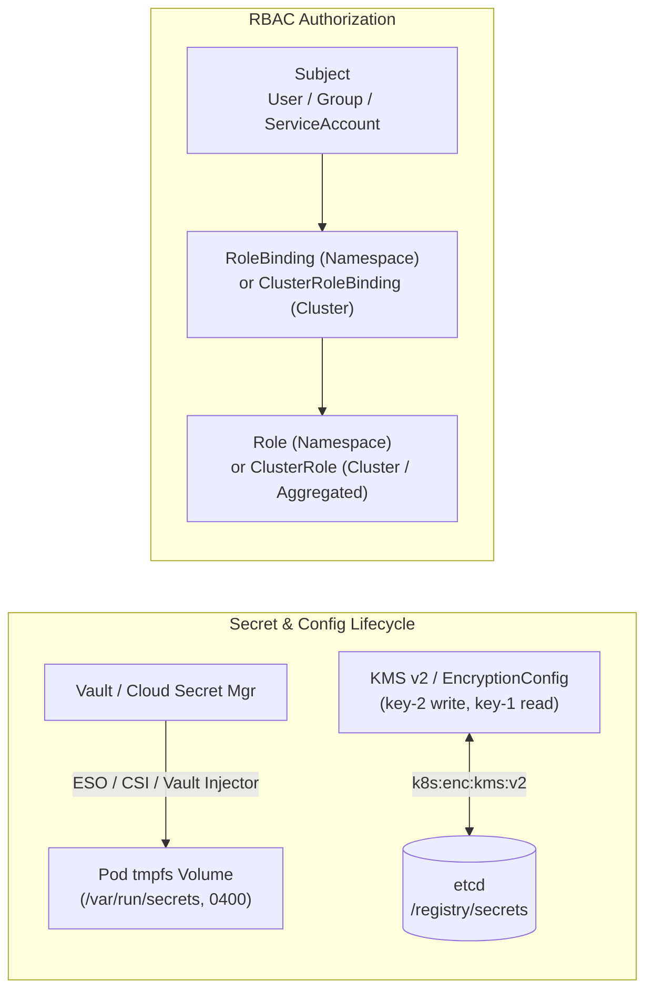

# 5.16 Configuration, secrets and RBAC

| | |
|---|---|
| Level | Intermediate |
| Priority tier | 0 |
| Lab venue | kind or kubeadm cluster; `kubectl auth can-i`, `rakkess`/`kubectl-who-can` optional; External Secrets Operator and Vault dev for the external store lab |
| Part | Part 5: Kubernetes |
| Status | Drafted, labs **untested** |

## Why this matters for AI infrastructure

Consider a notebook that carries one token. Whether that token can read every team's checkpoints depends on how you injected it and how far you scoped it. AI platforms collect a lot of sensitive material. They hold object-store credentials for datasets and checkpoints, model hub tokens and API keys for LLM providers. They also hold registry credentials, database passwords for metadata stores, signing keys, and service tokens that operators use to reach the API. Configuration matters just as much: model parameters, tokenizer paths, NCCL environment, scheduler settings and feature flags all live there too.

How you inject, rotate and scope these values decides how far a single failure can reach. A leaked notebook can read every team's checkpoints, and a compromised job can create GPU pods without limit. RBAC is the authorisation layer for the Kubernetes API itself. A mistaken ClusterRoleBinding to `system:authenticated`, or a broad `nodes/proxy` grant, is a cluster-wide compromise. This chapter covers configuration objects, secret handling practices and RBAC design.

## Prerequisites and outcomes

This chapter builds on 5.5 and 5.7, so review those first. When you finish, you should be able to:

- Use ConfigMaps and Secrets correctly. That covers env vars, files, projected volumes, immutability, size limits and update propagation. You will also choose the injection method for each use case.
- Explain what Secrets really are: base64-encoded API objects in etcd. You will know how to encrypt them at rest with KMS, restrict access with RBAC, and integrate external secret stores such as External Secrets Operator, Secrets Store CSI, Vault Agent, and SOPS or Sealed Secrets.
- Describe authentication methods (certificates, tokens, OIDC), ServiceAccounts with projected or bound tokens, and workload identity to cloud IAM.
- Design RBAC with Roles, ClusterRoles, bindings, verbs, resources, subresources, aggregation and default roles. You will apply least-privilege patterns for multi-tenant AI platforms and recognize common escalation paths.
- Audit and test permissions with `can-i`, `auth whoami`, audit logs, RBAC reports and policy-as-code.
- Operate secrets and RBAC safely in GitOps pipelines.

## 1. ConfigMaps

Suppose a training job needs a log level and a hyperparameter file. Those settings are not confidential, so they belong in a ConfigMap rather than a Secret. A ConfigMap holds non-confidential configuration as key-value pairs. Use `data` for UTF-8 text and `binaryData` for bytes. The total size is up to ~1 MiB, which is the etcd and object limit. You can create one from literals, files or directories:

```bash
kubectl create configmap trainer-config --from-literal=LOG_LEVEL=info --from-file=hparams.yaml
kubectl create configmap nccl-env --from-env-file=nccl.env
```

The pod spec below shows three ways to consume a ConfigMap. `envFrom` loads every key as an environment variable, `env` picks out a single key, and `volumeMounts` places the files into the container.

```yaml
spec:
  containers:
    - name: trainer
      envFrom:
        - configMapRef: { name: nccl-env }                   # all keys as env vars
      env:
        - name: LOG_LEVEL
          valueFrom: { configMapKeyRef: { name: trainer-config, key: LOG_LEVEL, optional: true } }
      volumeMounts:
        - { name: cfg, mountPath: /etc/trainer, readOnly: true }
  volumes:
    - name: cfg
      configMap:
        name: trainer-config
        items: [ { key: hparams.yaml, path: hparams.yaml, mode: 0444 } ]
        defaultMode: 0444
```

Each consumption method behaves differently when the ConfigMap changes, and that matters for config reloads. Environment variables are resolved when the container starts. Updating the ConfigMap does not change running processes. Names must be valid env var names, and keys with dots or dashes cannot be used with `envFrom` without remapping.

Volume mounts update eventually. The kubelet sync period and cache TTL mean a change typically arrives within about 1 to 2 minutes. The update happens through an atomic symlink swap of the `..data` directory. `subPath` mounts never receive updates. Your application must re-read the files, or be signalled, to pick up a change. Config reloaders automate the restart: a sidecar, `reloader`, or `kubectl rollout restart` triggered by a hash annotation. A common GitOps pattern puts a hash of the ConfigMap into the pod template annotations. Helm uses `checksum/config` for this, and Kustomize uses hashed names from `configMapGenerator`. A config change then rolls the Deployment.

Setting `immutable: true` makes a ConfigMap or Secret unchangeable. That protects you from accidental edits. It also reduces API server load, because kubelets stop watching the object, and that matters at scale. To change an immutable object, create a new name and roll the pods onto it.

Keep ConfigMaps small. Do not store datasets, models or large JSON blobs in them. Per-job generated configs should stay small too, because thousands of per-pod ConfigMaps create etcd and watch load. For binary content, use `binaryData`. For multi-line text, use `|` block scalars.

The downward API, through `fieldRef` and `resourceFieldRef`, exposes pod metadata and resource limits to the container. The pod name, namespace, IP, node name, labels, and CPU and memory limits can arrive as env vars or files. That helps when you derive a rank or ID, or size workers for NUMA.

Three details from *Kubernetes: Up and Running* Chapter 13 come up often. The first is the key naming rule. The rule is in Table 13-1. A key may begin with an optional dot (`.`). It then needs a letter or digit (`[a-zA-Z0-9]`), followed by any mix of letters, digits, dots (`.`), dashes (`-`) and underscores (`_`). A key cannot contain consecutive `..` or spaces. So `.auth_token`, `Key.pem` and `config_file` are valid, while `Token..properties`, `auth file.json` and `_password.txt` are invalid. The `validate_configmap_or_secret_key()` function in `code/part05/rbac_secrets_validator.py` models this rule.

The second detail is variable substitution. Kubernetes expands `$(ENV_VAR_NAME)` inside `command` and `args`. It uses the environment variables you defined earlier in `spec.containers[].env`. For example, `command: ["/kuard", "$(EXTRA_PARAM)"]` substitutes the value of `EXTRA_PARAM`.

The third detail is how to update a file-backed ConfigMap or Secret without `kubectl edit`. Pipe a client-side dry run into `kubectl replace`:

`kubectl create configmap my-config --from-file=my-config.txt --dry-run=client -o yaml | kubectl replace -f -`

The diagram below ties these pieces together. A Secret moves from an external store into a pod's tmpfs volume, while RBAC decides who can read the objects.



For a config change to reach running pods, pick a rollout pattern now and wire the hash into the pod template.

## 2. Secrets

A Secret looks much like a ConfigMap. Its `data` field holds base64-encoded values, and `stringData` accepts write-only plain text. Kubernetes treats it differently, though. When a Secret is mounted, it sits in tmpfs on the node, and the kubelet does not write it to disk. RBAC restricts it through its own `secrets` resource, and it is eligible for encryption at rest. The types are `Opaque`, `kubernetes.io/tls` (which uses `tls.crt` and `tls.key`), `kubernetes.io/dockerconfigjson` for image pulls, `kubernetes.io/basic-auth`, `kubernetes.io/ssh-auth`, `kubernetes.io/service-account-token` (the legacy type) and `bootstrap.kubernetes.io/token`.

Secrets are not encrypted by default. Base64 is an encoding, not protection. Anyone with `get` or `list` on secrets can read them. So can someone who runs `exec` into a pod that mounts them, someone who reads etcd or an etcd backup, or someone with `nodes/proxy`. The security model therefore rests on five layers.

1. RBAC with tight `secrets` permissions. Avoid `list` and `watch` on all secrets, because listing reveals contents. Avoid wildcards too.
2. Encryption at rest in etcd. Configure the API server `EncryptionConfiguration` with a **KMS v2** provider, such as a cloud KMS or Vault transit, for envelope encryption. `aescbc` or `secretbox` with local keys is weaker, because the key sits on disk on the control plane. Rotate keys, then re-encrypt existing secrets with `kubectl get secrets -A -o json | kubectl replace -f -`. To verify, run `etcdctl get /registry/secrets/ns/name`. The output should show the `k8s:enc:kms:v2:` prefix.
3. Transport and node protection. TLS protects traffic between components. Secrets go only to nodes that run pods needing them, under the Node authorizer. They are mounted on tmpfs, and nodes sit inside the trust boundary.
4. Minimising exposure. Prefer files over env vars. Env vars show up in `/proc/<pid>/environ`, crash dumps, child processes, logs and runtime inspect output. Set `defaultMode: 0400` and `readOnly: true`, use `fsGroup`, avoid logging, and set `automountServiceAccountToken: false` where the workload does not need it.
5. Short-lived credentials instead of long-lived ones. Workload identity, projected tokens and dynamic secrets from Vault all fit here.

```yaml
apiVersion: v1
kind: Secret
metadata: { name: hf-token, namespace: training }
type: Opaque
stringData: { token: "hf_xxx" }                 # example only; never commit real values to Git
immutable: true
---
spec:
  containers:
    - name: trainer
      volumeMounts: [ { name: hf, mountPath: /var/run/secrets/hf, readOnly: true } ]
      env: [ { name: HF_TOKEN_FILE, value: /var/run/secrets/hf/token } ]
  volumes:
    - name: hf
      secret: { secretName: hf-token, defaultMode: 0400 }
```

### Defense in depth for secrets

How well you protect secret data comes down to how deep you are willing to go. Most teams start with choices that are "safe enough," then harden them over time. That approach carries risk and technical debt, and accepting that is part of the job. A wrong call about what is "safe enough" can still end in a bad headline, so it helps to know each layer.

Defense can start at the physical layer. Google, for example, has described its datacenter security in whitepapers and videos. The approach includes metal detectors, vehicle barriers and several layers of building security. When drives are retired, staff zero out the data, then crush or shred the drives. This section does not go deep into physical security, but it shows how seriously providers treat the hardware under your cluster.

Disk encryption is the next layer. Most cloud providers encrypt their physical disks at rest, using their own keys or keys you supply. That makes it very hard for anyone at the provider to read your data. On Linux, a common method for full block encryption is LUKS. It works with the dm-crypt subsystem, which has been in the Linux kernel since version 2.6. Dedicated storage systems such as vSAN, Ceph or Gluster each offer their own encryption at rest.

On AWS, enable encryption for Elastic Block Storage, and turn on encryption by default as a best-practice setting. Google Cloud encrypts at rest by default. You can also configure it with the Key Management Service, or KMS, to supply your own keys.

Whatever trust you place in your cloud provider or datacenter operators, make encryption at rest your default. It also guards against mistakes. Virtual machine snapshots are easy to create, and each one is a file that can leak onto a network. If someone picks the wrong option in a UI or an API field, encrypted data stays useless without the private key.

Transport security is a separate concern. Encryption at rest does not cover data moving across the network, and a secret in flight is exposed the moment one hop skips TLS. Those hops include the path from you to the cluster through `kubectl`, and the path from the kubelet to the API server. Communication with the API server and etcd should always use TLS. Most installers already do this by default. You may only need to supply a Certificate Authority, or CA, to generate the certificates, and you may not need to replace the default CA.

Application encryption means your workload encrypts its own data with a key, at the user space level. Picture a dotfile full of credentials on a laptop. Disk encryption protects that file if someone pulls out the drive. If someone logs in as you, though, they can read the file. Encrypting the dotfile with a strong, password-protected `gpg` key closes that gap, because the attacker still sees only unreadable bits.

The rest of this chapter assumes that two things are already true in your cluster. Encryption at rest is enabled in the filesystem or storage systems that Kubernetes uses. TLS is enabled for all Kubernetes components and etcd. With those in place, we can look at how Kubernetes handles secrets itself. The etcd side of this is covered in 5.5.

### The Secret API, RBAC verbs, and scope

Suppose a workload needs its database login. The Secret API is one of the most used APIs in Kubernetes. You can create Secret objects in many ways, but workloads read them through one consistent API. Secrets look much like ConfigMaps, and workloads consume them the same way, through environment variables or volumes. Here is a Secret with base64 data:

```
apiVersion: v1
kind: Secret
metadata:
name: mysecret
type: Opaque
data:
dbuser: aGVwdGlvCg==
dbkey: YmVhcmNhbm9lCg==
```

The `data` field holds base64 encoded values, and every Kubernetes Secret stores its data this way. If you want to submit plain strings, use the `stringData` field instead:

```
apiVersion: v1
kind: Secret
metadata:
name: mysecret
type: Opaque
stringData:
dbuser: heptio
dbkey: bearcanoe
```

The API server encodes `stringData` when it applies the object to etcd. Many people assume this encoding protects Secrets, but it does not. Secret data can hold strange characters or binary data, and base64 makes sure that data is stored correctly. Protection comes from RBAC instead, so the verbs matter. These three verbs decide what a caller can do with Secrets:

- `get`: retrieve the data of a known Secret by its name.
- `list`: get a list of all Secrets and their data.
- `watch`: watch for any Secret change or any change to Secret data.

Small RBAC mistakes can expose a lot. Granting `list` exposes every Secret in a Namespace. A ClusterRoleBinding used by accident can expose the whole cluster. In many cases, users do not need any of these verbs at all. A user's RBAC does not decide which Secrets a workload can use, though. The kubelet handles that part. As long as a Pod references a valid Secret, the kubelet makes it available through the method you choose.

Secrets are Namespace scoped. Without copying a Secret into other Namespaces, a Pod can reference only Secrets in its own Namespace. That also means any Pod in a Namespace can reach any Secret there. Think carefully about how you share Namespaces among workloads. Admission control can add checks on top of this model, which is a topic for a later chapter.

### Consumption models: environment variables, volumes, and the client API

Workloads can consume a Secret in three ways. The right choice may depend on what the application expects, and each choice comes with trade-offs.

Environment variables are the first option. A workload can inject Secret data into them. The YAML names an environment variable and points to a key in a Secret. This helps workloads that already expect an environment variable, because the application code may not need to change. Here is a Pod that does this:

```
apiVersion: v1
kind: Pod
metadata:
name: nginx
spec:
containers:
- name: nginx
image: nginx
env:
- name: USER
valueFrom:
secretKeyRef:
name: mysecret
key: dbuser
- name: PASS
valueFrom:
secretKeyRef:
name: mysecret
key: dbkey
```

In that example, the application sees the variable `USER`. `mysecret` is the Secret object, and `dbuser` is the key inside it that gets injected into `USER`.

Environment variables have a downside: they cannot hot reload. A change to a Secret does not reach the Pod until the Pod is re-created. That can happen through manual action or through a system event, such as a reschedule. Some people also consider environment variables less secure than volume mounts. That point is debatable, but the leak paths are real. Process and container runtime inspection can show environment variables in plain text. Some frameworks, libraries and languages dump environment variables into logs in debug or crash modes. Weigh these risks before you use environment variables.

Volumes are the second option. The Pod spec defines a volume that references the Secret, and the container mounts that volume with a `volumeMount`:

```
apiVersion: v1
kind: Pod
metadata:
name: nginx
spec:
containers:
- name: nginx
image: nginx
volumeMounts:
- name: creds
readOnly: true
mountPath: "/etc/credentials"
volumes:
- name: creds
secret:
secretName: mysecret
```

The `volumes` entry is the Pod-level volume, and its name must match the mount. The `volumeMounts` entry places that volume into the container filesystem at `mountPath`. With this Pod, the Secret data appears under `/etc/credentials`, and each key and value pair gets its own file:

```
root@nginx:/# cat /etc/credentials/db
dbkey dbuser
```

Volumes have the biggest advantage in updates. When the Secret changes, the kubelet reloads it, and the container filesystem shows the new value without a Pod restart. On Linux, the kubelet uses tmpfs, which keeps Secret data in memory only. You can confirm this on the Linux host through the mount table:

```
# grep 'secret/creds' secret/creds
tmpfs
/var/lib/kubelet/pods/
e98df9fe-a970-416b-9ddf-bcaff15dff87/volumes/
kubernetes.io~secret/creds tmpfs rw,relatime 0 0
```

When the `nginx` Pod leaves this host, the mount goes away with it. Keep Secret data small, which makes credentials and keys the right fit. Do not use a Secret as a pseudo database. On the application side, watching the directory or file and re-injecting the values is enough. The application never needs to talk to the API server, and teams have seen this pattern work well in many workloads.

The last model is client API consumption, and it is not a core Kubernetes feature. The application talks to the kube-apiserver to fetch Secrets itself. Frameworks and libraries can make this easier. For Java, Spring Cloud Kubernetes connects Spring's PropertySource type to Kubernetes, so the application can read Secrets and ConfigMaps.

Be careful with this approach. The book generally discourages it. Even for ConfigMaps, it is less than ideal to have each application talk to the API server. We prefer applications that do not need to know where they run. An app that can run on a VM should also run on Kubernetes or another container service. Most languages already read environment variables and files, and the kubelet can deliver Secret data through those channels. Direct access adds another connection and another watch on the API server. Each workload then needs its own ServiceAccount with RBAC to read its Secrets. When the kubelet delivers Secrets, no ServiceAccount is needed, and the `default` ServiceAccount can and should be disabled altogether.

### Image pull secrets

`kubectl create secret docker-registry regcred --docker-server=... --docker-username=... --docker-password=...` produces a `kubernetes.io/dockerconfigjson` Secret. Attach it through `imagePullSecrets` on pods, or on the ServiceAccount with `kubectl patch serviceaccount default -p '{"imagePullSecrets":[{"name":"regcred"}]}'`. The better option avoids a stored password altogether. Node-level credential providers, which are kubelet image credential provider plugins for ECR, GCR and ACR, or workload identity, mean no long-lived password exists.

### GitOps-safe secret management

Never commit plaintext Secrets to Git. The approaches below keep the values out of the repository. Related options are covered in 4.12 and 4.26. The table lists the main patterns and notes for each. Notice which rows still create a native Secret in etcd, and which keep the value out of etcd entirely.

| Approach | How | Notes |
|---|---|---|
| **External Secrets Operator (ESO)** | `ExternalSecret`/`SecretStore` CRs reference Vault/AWS SM/GCP SM/Azure KV; ESO syncs into native Secrets | Secret values never in Git; native Secret still in etcd; refresh intervals handle rotation |
| **Secrets Store CSI Driver** (`secrets-store-csi-driver`, `SecretProviderClass`) | Mounts secrets from a vault as a volume via `driver: secrets-store.csi.k8s.io` and a `SecretProviderClass` (and optionally syncs to a Secret) | Avoids etcd persistence when not syncing; per-pod volume; provider pods needed |
| **Vault Agent Injector / Vault Secrets Operator** | Sidecar/operator renders secrets into the pod via Vault Kubernetes auth | Dynamic secrets and leases |
| **Sealed Secrets** (`SealedSecrets`, `kubeseal`) | Encrypt a Secret into a `SealedSecret` (`bitnami.com/v1alpha1`) with `kubeseal` using the cluster public key; controller decrypts to a Secret | Simple; cluster-bound key; rotate keys every 30 days |
| **SOPS** (age/KMS) with Flux/Argo plugins | Encrypted YAML in Git, decrypted at apply | Reviewable diffs (keys visible) |
| **CSI/Workload Identity** | Pods authenticate to cloud APIs with federated tokens, no secret at all | Best for cloud resources |

### Sealed Secrets in depth

Declarative workflows raise a hard question. Your manifests belong in Git, but the credentials and keys they use do not. Teams that want a pure GitOps model often keep secrets out of Git entirely, and that breaks the pattern. The other option is to seal the secret, so its committed form reveals nothing useful.

Asymmetric cryptography makes sealing possible. An encryption key, usually public, locks the secret. A decryption key, usually private, unlocks it. A secret sealed with the public key stays protected as long as the private key stays safe. You still need a cipher you trust, a safe private key, and rotation policies for both keys and secret data.

The Bitnami `sealed-secrets` project is a common open source choice. Its `sealed-secret-controller` runs in the cluster and generates the keys by default. Developers use the `kubeseal` command-line tool, which needs only the public key. To get started, deploy the controller:

```bash
kubectl apply -f
https://github.com/bitnami-labs/sealed-secrets/releases/\
download/v0.9.8/controller.yaml
```

You can bring your own certificates, but by default the controller creates them. The public and private keys sit in a Kubernetes Secret at `kube-system/sealed-secret-key`. Do not read that Secret directly. Instead, clients should fetch the encryption key from the controller's endpoint, with this command:

```bash
kubeseal --fetch-cert
```

How you expose that endpoint is up to you. Once `kubeseal` has the public key, it can turn a Secret into a SealedSecret. You can start with an ordinary Secret:

```
apiVersion: v1
kind: Secret
metadata:
name: mysecret
type: Opaque
data:
dbuser: aGVwdGlvCg==
dbkey: YmVhcmNhbm9lCg==
```

Run `kubeseal` against that file to produce encrypted JSON:

```bash
kubeseal mysecret.yaml
```

```
{
"kind": "SealedSecret",
"apiVersion": "bitnami.com/v1alpha1",
"metadata": {
"name": "mysecret",
"namespace": "default",
"creationTimestamp": null
},
"spec": {
"template": {
"metadata": {
"name": "mysecret",
"namespace": "default",
"creationTimestamp": null
},
"type": "Opaque"
},
"encryptedData": {
"dbkey": "gCHJL+3bTRLw6vL4Gf......",
"dbuser": "AgCHJL+3bT......"
}
},
"status": {
}
}
```

This object can go anywhere in your repository. As long as the sealing key held by the controller stays uncompromised, the data stays safe. The controller turns the SealedSecret into a standard Secret, and that Secret records the SealedSecret as its owner:

```
ownerReferences:
- apiVersion: bitnami.com/v1alpha1
controller: true
kind: SealedSecret
name: mysecret
uid: 49ce4ab0-3b48-4c8c-8450-d3c90aceb9ee
```

If you delete the SealedSecret, its corresponding Secret is garbage collected.

Key renewal deserves attention. If the sealing private key leaks, for example through an RBAC misconfiguration, treat every sealed secret as compromised. By default, the controller renews the key every 30 days. The new key does not replace the old ones. It joins the list of keys that can unseal data, and it is used for all new encryption. Existing SealedSecrets are not re-encrypted. If the key leaks, you should:

- Immediately rotate your encryption key.
- Rotate all existing secrets.

Re-encrypting alone is not good enough. Someone could go through Git history, find an old encrypted file, and use the compromised key on it. Keep a rotation strategy for passwords and a renewal strategy for keys.

Namespace binding comes next. A SealedSecret uses its Namespace during encryption, so it belongs to the Namespace where it was created and cannot simply be moved to another one. This default is the most secure choice, so leave it as is. The sealed-secrets documentation covers configurable access policies.

Multicluster setups make sealed secrets harder. Many topologies treat clusters as ephemeral. Unless you share private keys among all of them, each cluster needs its own keys. Developers also need a place to fetch the encryption key, and that place multiplies from one cluster to many. The problem is solvable, but plan for it.

Know the scope of this tool before you rely on it. A common misunderstanding is that SealedSecrets replaces encrypting etcd, or running an enterprise secret store such as Vault. It does not. The approach lets you encrypt data and store it safely in Git. The private key and unencrypted secrets still end up in Kubernetes. Without steps beyond the Secret API defaults, they sit unencrypted at the application layer. Know the scope of every tool you choose.

### Rotation

Rotation only works when consumers reload. File mounts update automatically through the kubelet refresh, but the application still has to re-read them. Environment-variable secrets need a pod restart. You can use a reloader controller keyed on the secret hash, or run `kubectl rollout restart`. For databases and tokens, use two-phase rotation: add the new credential, switch consumers over, and then remove the old one. You can automate this with ESO refresh and Reloader, Vault dynamic leases, or cert-manager for certificates (see 5.12).

### HashiCorp Vault Agent Injector and Kubernetes authentication

Instead of syncing external secrets into etcd as Kubernetes `Secret` objects, you can let the HashiCorp Vault Agent Injector deliver them. The injector uses a `MutatingWebhookConfiguration`, named `vault-agent-injector-cfg`, to add two containers. The first is a `vault-agent-init` init container, which fetches initial secrets before the workload starts. The second is an optional `vault-agent` sidecar, which keeps secrets updated. Both write rendered files onto an in-memory volume mounted at `/vault/secrets`. As detailed in *Production Kubernetes* Chapter 7, the injector watches for Pod annotations:

- `vault.hashicorp.com/agent-inject: "true"` instructs the webhook to inject the `vault-agent-init` init container. The book's example uses `vault:1.3.2` for it.
- `vault.hashicorp.com/agent-inject-status: "update"` is optional. It instructs the webhook to also inject the long-running `vault-agent` sidecar, which refreshes leased or rotated secrets.
- `vault.hashicorp.com/role: "<role>"` selects the Vault Kubernetes auth role. You can also bind the role in the agent configuration.
- `vault.hashicorp.com/agent-inject-secret-<filename>: "<vault-path>"` tells the agent which Vault secret to write to `/vault/secrets/<filename>`. For example, `vault.hashicorp.com/agent-inject-secret-db-creds: "secrets/db/creds"` or `vault.hashicorp.com/agent-inject-secret-config` works.
- `vault.hashicorp.com/agent-inject-template-<filename>` formats the rendered file with a Go template instead of the default Go map print format. In the book's example (untested here), a Pod template formats database credentials into a JDBC connection string at `/vault/secrets/db-creds`. A `config` secret lands at `/vault/secrets/config` instead:

```yaml
spec:
  template:
    metadata:
      annotations:
        vault.hashicorp.com/agent-inject: "true"
        vault.hashicorp.com/agent-inject-status: "update"
        vault.hashicorp.com/role: "database"
        vault.hashicorp.com/agent-inject-secret-db-creds: "secrets/db/creds"
        vault.hashicorp.com/agent-inject-template-db-creds: |
          {{- with secret "secrets/db/creds" -}}
          jdbc:oracle:thin:{{ .Data.data.username }}/{{ .Data.data.password }}
          {{- end }}
```

Injection is the approach we highly recommend when it is possible. It decouples the secret store from the application entirely. The trade-off is that the platform now has to offer secret injection as a service, and that adds complexity.

The webhook runs on every Pod CREATE or UPDATE event, but it changes only the Pods that carry the annotations. By default, Vault writes each secret in the format of a printed Go map, and all secrets go into `/vault/secrets`:

```
key: map[k:v],
key: map[k:v]
```

Authentication and authorization are the hard part of this model. You can set Vault to authenticate Pods with their existing ServiceAccount tokens. Vault then validates the requester's identity through the TokenReview API. It must still decide whether that ServiceAccount is allowed to read the secret. Those policies and bindings live in Vault, and you must maintain them there.

To let Pods authenticate to Vault with their Kubernetes ServiceAccount tokens, Vault validates those tokens against the Kubernetes `TokenReview` API. You enable and configure the Kubernetes auth method inside Vault. Then you write a policy and bind a Vault role to the Pod's ServiceAccount name and Namespace. The book's example (untested here) follows these steps:

```bash
# Enable Kubernetes authentication in Vault (untested here)
vault auth enable kubernetes

# Configure Vault to talk to the Kubernetes API server for TokenReview checks (untested here)
vault write auth/kubernetes/config \
  kubernetes_host="https://$KUBERNETES_PORT_443_TCP_ADDR:443" \
  kubernetes_ca_cert=@/var/run/secrets/kubernetes.io/serviceaccount/ca.crt \
  token_reviewer_jwt="$(cat /var/run/secrets/kubernetes.io/serviceaccount/token)"

# Create a read policy in Vault for team-a secrets (untested here)
vault policy write team-a - <<EOF
path "secret/data/team-a/*" {
  capabilities = ["read"]
}
EOF

# Bind the Kubernetes ServiceAccount 'webapp' in namespace 'team-a' to the policy (untested here)
vault write auth/kubernetes/role/database \
  bound_service_account_names=webapp \
  bound_service_account_namespaces=team-a \
  policies=team-a \
  ttl=20m
```

### Secrets Store CSI driver and CyberArk

CyberArk is another option that many clients already use. It offers a Credential Provider and a Dynamic Access Provider (DAP). Like Vault, it supports `initContainers` that run alongside your application to talk to DAP.

A newer approach is the `secrets-store-csi-driver`. At the time of writing, the book describes it as a Kubernetes subproject within `kubernetes-sigs`. It lets Pods use externally hosted secrets without a sidecar or an initContainer. Secret access starts to feel like a platform service instead of something each application integrates with. The driver runs as a DaemonSet, with a driver Pod on every host, much like a storage CSI driver.

The driver relies on a provider to look up secrets in the external system. For Vault, that means installing the `vault-provider` binary on every host, in the location set by the driver's `provider-dir` mount. The binary may already exist on the host, or a DaemonSet-like process often installs it. This approach raises open questions. When a Pod does not request the secret itself, who handles identity? The driver or provider must work that out, because they make requests on the Pod's behalf.

The main API is the `SecretProviderClass`. For Vault, it looks like this:

```
apiVersion: secrets-store.csi.x-k8s.io/v1alpha1
kind: SecretProviderClass
metadata:
name: apitoken
spec:
provider: vault
parameters:
roleName: "teama"
vaultAddress: "https://vault.secret-store:8000"
objects: |
array:
- |
objectPath: "/secret/team-a"
objectName: "apitoken"
objectVersion: ""
```

The `vaultAddress` points to the Vault service, named `vault`, in the `secret-store` Namespace. The `objectPath` is the path in Vault where the key/value object was written, and `objectName` is the object to look up in `team-a`. With the SecretProviderClass in place, a Pod references it like this:

```
kind: Pod
apiVersion: v1
metadata:
name: busybox
spec:
containers:
- image:
name: busybox
volumeMounts:
- name: secrets-api
mountPath: "/etc/secrets/apitoken"
readOnly: true
volumes:
- name: secrets-api
csi:
driver: secrets-store.csi.k8s.com
readOnly: true
volumeAttributes:
secretProviderClass: "apitoken"
```

When this Pod starts, the driver and provider try to retrieve the secret. If authentication and authorization to the external provider succeed, the secret appears in a volume mount, like any Kubernetes Secret. From the driver Pod on the node, you can read the logs to see the command sent to the provider:

```
level=info msg="provider command invoked: /etc/kubernetes/
secrets-store-csi-providers/vault/provider-vault --attributes [REDACTED]
--secrets [REDACTED] [--targetPath /var/lib/kubelet/pods/
643d7d88-fa58-4f3f-a7eb-341c0adb5a88/volumes/kubernetes.io~csi/
secrets-store-inline/mount --permission 420]"
```

This approach is worth keeping an eye on. Its user experience and its ability to abstract secret providers look promising. If the project stabilizes and providers mature, it could become common for teams building application platforms on Kubernetes.

### Best practices for secrets

Application consumption of secrets depends heavily on the language and frameworks in use. The variance is high, but these practices apply broadly.

Always audit secret interaction. A Kubernetes cluster should run with auditing enabled. Audit events tell you which resources were touched, when, and by whom. For mutations, they also show what changed, and auditing secret events is critical when you react to access issues. The cluster audit documentation has the details.

Do not leak secrets. Leaking a secret is never desirable, and in multitenant clusters it is easy to do by accident. A common mistake is logging a secret. Engineers building operators often deal with secrets for the systems they manage, and during development they may log those values to debug. Logs go to stdout and stderr, and many platforms forward them to a log analysis system. The secret can then travel in plain text through many environments. Manifests with test secrets can also slip into source control, so keep test values out of your repositories.

Prefer volumes over environment variables. Most applications should read secrets from volumes. Environment variables leak more easily, for example through an `echo` command during testing, or when a framework dumps them at startup or during a crash. Volumes do not solve every leak, though. Their key benefit for developers is that they update automatically when a secret changes, which supports hot-reloading of tokens. A change to an environment variable requires a Pod restart.

Keep secret store providers unknown to your application. Applications can fetch secrets in many ways, from a call inside business logic to an environment variable set at startup. Separation of concerns says the application should not care whether Kubernetes, Vault or another provider manages the secret. That keeps the app portable and reduces its complexity. To fetch from a provider, an app must know how to talk to it and must authenticate to it. Prefer environment variables or volumes, with volumes as the ideal. An app can watch the filesystem for changes, and it does not matter which store is behind the files. Framework libraries that talk to the API server directly, such as Spring's, are convenient. Still, weigh the points above before you use them.

### Choosing how an application reads ConfigMaps and Secrets

Config should come from the platform at runtime, not from inside the container image. A baked-in setting ties the binary to one environment. It also exposes secrets to anyone who can pull the image. Kubernetes offers three ways to deliver config to a Pod, and they differ in how well they suit each app.

Mounting a ConfigMap or Secret as a file is the preferred method. The Pod spec names the volume and the path where it appears. This example mounts the `my-config` ConfigMap at `/etc/my-app/config.json`:

```yaml
apiVersion: v1
kind: Pod
metadata:
  name: my-app
spec:
  containers:
  - image: my-app
    name: my-app:v0.1.0
    volumeMounts:
    - name: my-config
      mountPath: /etc/my-app/config.json
  volumes:
  - name: my-config
    configMap:
      name: my-config
```

Files in a volume update in place, so you can change config without restarting the app or re-creating the Pod. The app has to notice the change, though. It must watch the file and reload its settings. Many libraries do this for you. When an app cannot, a sidecar container can watch the file and send the main process a signal, such as `SIGHUP`, when new config appears.

Environment variables are the natural choice when the app reads its settings from the environment or from command-line flags. This Pod sets `DEBUG` from the `debug` key in `my-config`:

```yaml
apiVersion: v1
kind: Pod
metadata:
  name: my-app
spec:
  containers:
  - name: my-app
    image: my-app:v0.1.0
    env:
    - name: DEBUG
      valueFrom:
        configMapKeyRef:
          name: my-config
          key: debug
```

Environment variables have two downsides. A change to the ConfigMap or Secret does not reach a running Pod until it restarts. Also, some frameworks print their whole environment at startup or during a crash. For a Secret, that can leak the password into a log file.

The third option is to have the app call the Kubernetes API directly. It reads ConfigMaps and Secrets from the API server and can watch them for changes. Client libraries and some frameworks, such as Spring Cloud Kubernetes, offer this. The convenience comes at a cost. The app is now tied to Kubernetes, and it needs a ServiceAccount with RBAC permissions. Each app that polls the API also adds load to the control plane. Those issues are why the book prefers volume mounts and environment variables. They keep the application decoupled from the platform.

### Injecting workload metadata with the Downward API

Some workloads need to know facts about themselves. They may need their Namespace, their labels, or their resource limits. The Downward API provides those facts without the app having to talk to Kubernetes. As with ConfigMaps and Secrets, you can deliver the values as environment variables or as files.

This Pod receives its memory limit in the `MEM_LIMIT` environment variable:

```yaml
apiVersion: v1
kind: Pod
metadata:
  name: my-app
spec:
  containers:
  - name: my-app
    image: my-app:0.1.0
    command: [ "my-app" ]
    env:
    - name: MEM_LIMIT
      valueFrom:
        resourceFieldRef:
          containerName: my-app
          resource: limits.memory
```

The app reads `MEM_LIMIT` like any other setting. It can then size its heap or worker pool to fit inside the container.

### Offloading external secret systems to the platform

Kubernetes Secrets are not the only option. External systems such as HashiCorp Vault offer features that Kubernetes Secrets lack. Vault provides dynamic secrets, secret rotation and time-based tokens. If your app already uses Vault, keep using it on Kubernetes. Even if you do not use Vault yet, it is worth comparing it with Kubernetes Secrets.

Teams that run an external system get the most value when the platform handles the integration. The platform can expose a Vault secret to a Pod as a volume or as an environment variable. The application then consumes a plain file or variable and does not need to know where the secret came from. This keeps each application simpler, and it standardizes how every team gets its secrets.

## 3. Projected volumes and ServiceAccount tokens

A pod often needs a token, a CA bundle and its own labels at the same time. A projected volume gathers those in one directory. A projected volume combines several sources in one directory. The sources are `secret`, `configMap`, `downwardAPI`, `serviceAccountToken`, and `clusterTrustBundle`, which holds CA bundles. The example below combines three of them.

```yaml
volumes:
  - name: creds
    projected:
      sources:
        - serviceAccountToken:
            path: sa-token
            audience: vault                 # token valid only for this audience
            expirationSeconds: 3600         # kubelet refreshes before expiry
        - configMap: { name: ca-bundle, items: [ { key: ca.crt, path: ca.crt } ] }
        - downwardAPI: { items: [ { path: labels, fieldRef: { fieldPath: metadata.labels } } ] }
```

Notice the `serviceAccountToken` source. Its token is valid only for the `vault` audience. `expirationSeconds: 3600` means the kubelet refreshes the token before it expires.

### ServiceAccounts

Every namespace has a `default` ServiceAccount, and pods use it unless `serviceAccountName` is set. Since 1.22+, pods receive a bound ServiceAccount token. The token is a JWT signed by the API server, and it is audience-bound to the API server. It is time-limited, with a default of about 1 h, and it is refreshed automatically. It is also bound to the pod, node and Secret object, and it becomes invalid when the pod is deleted. The token is mounted at `/var/run/secrets/kubernetes.io/serviceaccount/token` through a projected volume. It replaces legacy token Secrets, which never expired. Those are no longer auto-created since 1.24. Create an explicit `type: kubernetes.io/service-account-token` Secret only when you truly need one. For short-lived tokens, use `kubectl create token <sa> --duration=...` instead.

Follow these practices when you set up ServiceAccounts:

- Use one ServiceAccount per workload, with least-privilege RBAC. Never use `default` for anything privileged.
- Set `automountServiceAccountToken: false` on the ServiceAccount or the pod if the workload does not call the API.
- For external systems such as Vault, cloud federation, SPIFFE-like identities or OIDC discovery, use projected tokens with custom audiences instead of passing long-lived keys.

Workload identity federation maps Kubernetes ServiceAccounts to cloud IAM identities without keys. Examples are GKE Workload Identity, EKS IAM Roles for Service Accounts (IRSA), EKS Pod Identity, and Azure Workload Identity. The cluster's OIDC issuer URL is registered with cloud IAM, which trusts tokens for specific `namespace/serviceaccount` subjects. Training pods then reach buckets and registries with short-lived credentials. See 4.22 and 5.34 for more. For bare-metal clusters, expose the cluster's OIDC issuer with `--service-account-issuer` and `--service-account-jwks-uri`, and trust it from Vault, AWS or GCP.

Give each workload its own ServiceAccount, and grant it only the RBAC it needs.

### Service Account tokens and TokenReview

Every pod runs under a ServiceAccount, and the account gives a group of pods one identity. If no account is assigned, the pod gets the default ServiceAccount of its namespace. Each ServiceAccount has a Secret that holds a JSON Web Token (JWT). Unless you say otherwise, that token is mounted into each pod that uses the account. The pod can then call the Kubernetes API, or other services, with it. The book's example shows the account pointing at its token Secret:

```yaml
apiVersion: v1
kind: ServiceAccount
metadata:
  name: default
  namespace: default
secrets:
- name: default-token-mf9v2
```

The Secret holds the signed token and a CA certificate, plus annotations that name the account and its unique ID:

```yaml
apiVersion: v1
data:
  ca.crt: <.. SNIP ...>
  namespace: ZGVmYXVsdA==
  token: <.. SNIP ...>
kind: Secret
metadata:
  annotations:
    kubernetes.io/service-account.name: default
    kubernetes.io/service-account.uid: 59aee446-b36e-420f-99eb-a68895084c98
  name: default-token-mf9v2
  namespace: default
type: kubernetes.io/service-account-token
```

Set `serviceAccountName` in the pod spec to choose an account. The Secret's token is then mounted at `/var/run/secrets/kubernetes.io/serviceaccount/`. The application reads it and sends it to other services in the cluster. The receiving service should not trust the token blindly. It checks the token by calling the TokenReview API:

```bash
curl -X "POST" "https://<kubernetes API IP>:<kubernetes API Port>\
/apis/authentication.k8s.io/v1/tokenreviews" \
  -H 'Authorization: Bearer <token>' \
  -H 'Content-Type: application/json; charset=utf-8' \
  -d $'{
  "kind": "TokenReview",
  "apiVersion": "authentication.k8s.io/v1",
  "spec": {
    "token": "<token to verify>"
  }
}'
```

The API server replies with the token's metadata and whether it authenticated. A valid token returns something like this:

```json
{
  "kind": "TokenReview",
  "apiVersion": "authentication.k8s.io/v1",
  "metadata": {
    "creationTimestamp": null
  },
  "spec": {
    "token": "<token to verify>"
  },
  "status": {
    "authenticated": true,
    "user": {
      "username": "system:serviceaccount:default:default",
      "uid": "4afdf4d0-46d2-11e9-8716-005056bf4b40",
      "groups": [
        "system:serviceaccounts",
        "system:serviceaccounts:default",
        "system:authenticated"
      ]
    }
  }
}
```

Service Account tokens have been part of Kubernetes since early on, and they fit the platform well. The operator keeps tight control, because a token stops working when its ServiceAccount or Secret is deleted. They are a weak identifier in three ways, though. First, a token is scoped to a ServiceAccount. It cannot prove anything finer, such as one pod or one container. Second, your application must call TokenReview through a custom component to verify a caller. Third, a token belongs to one cluster. Using a token from cluster A to identify callers in cluster B means exposing each cluster's TokenReview API and encoding extra cluster metadata. The book does not recommend that path for cross-cluster identity.

Create a unique ServiceAccount for each workload that needs API access, so you can grant permissions precisely. If a workload never calls the API, set `automountServiceAccountToken: false` on its ServiceAccount. You can set the same field on the Pod. When both are set, the Pod field wins. Setting it on the namespace's default ServiceAccount is a sound baseline.

### Projected service account tokens (PSAT)

The book dates projected service account tokens to Kubernetes v1.12. They build on ordinary tokens and fix three weak points: no time to live (TTL), wide scope and long persistence. Before they work, the API server needs a few flags:

```yaml
spec:
  containers:
  - command:
    - kube-apiserver
    - --service-account-signing-key-file=/etc/kubernetes/pki/sa.key
    - --service-account-key-file=/etc/kubernetes/pki/sa.pub
    - --service-account-issuer=api
    - --service-account-api-audiences=api
    # Additional flags removed for brevity
    image: k8s.gcr.io/kube-apiserver:v1.17.3
```

The flow for checking identity looks much like the SAT flow. The difference is how the pod gets its token. Instead of reading the automounted token, the pod reads a projected token mounted as a volume. You can set a TTL and a custom audience on that token:

```yaml
apiVersion: v1
kind: Pod
metadata:
  name: test
  labels:
    app: test
spec:
  serviceAccountName: test
  containers:
  - name: test
    image: ubuntu:bionic
    command: ['sh', '-c', 'echo Hello Kubernetes! && sleep 3600']
    volumeMounts:
    - mountPath: /var/run/secrets/tokens
      name: app-token
  volumes:
  - name: app-token
    projected:
      sources:
      - serviceAccountToken:
          audience: api
          expirationSeconds: 600
          path: app-token
```

The `audience` field stops a receiving application from reusing the token to pose as the caller. The audience should match the destination. Here the destination is the API server itself. A PSAT needs a dedicated ServiceAccount. Kubernetes does not mount PSATs for a namespace's default account.

Receiving services still verify the token with TokenReview. With a PSAT, the review also checks that the TTL has not expired. It returns extra data about the calling pod, including its name and UID. That scope is tighter than an ordinary token, which only names the account:

```json
"extra": {
  "authentication.kubernetes.io/pod-name": ["test"],
  "authentication.kubernetes.io/pod-uid":
  ["8b9bc1be-c71f-4551-aeb9-2759887cbde0"]
}
```

The SAT and PSAT flows are nearly the same. The only real differences are the validity and granularity of the identity. The API server also checks the audience, and it rejects a token whose audience does not match its configuration. Projected tokens give you tight integration, configurable TTLs and scope down to individual pods. They also serve as building blocks for stronger patterns.

## 4. Authentication

When a request reaches the API server, the first question is who is calling. The API server answers it with the methods below. Section 5.5 covers the basics.

Client certificates are one option. The certificate's CN sets the user, and its O field sets the groups. Kubelets use them, and so does the admin kubeconfig from kubeadm. Avoid long-lived admin certificates for humans.

Bearer tokens are another option. These include ServiceAccount JWTs. Static token files are deprecated.

OIDC tokens come from an identity provider such as Dex, Keycloak, Okta or Entra. The `id_token` claims map to a username and groups, through the `--oidc-*` flags or the structured `AuthenticationConfiguration`.

Webhook token authentication hands the check to a cloud IAM authenticator, such as `aws-iam-authenticator` or `gke-gcloud-auth-plugin`. An authenticating proxy relies on front proxy headers, and aggregated APIs use it. Anonymous requests are the last case.

Humans should authenticate through OIDC SSO with MFA and short-lived tokens. Tools such as `kubelogin`, `kubectl oidc-login` or `kubectl --token` handle that, and the groups from the token map to the groups used by RBAC. Machines use ServiceAccount tokens or federated workload identities. Run `kubectl auth whoami` to see the identity the API server resolved.

Give humans OIDC login with MFA, and keep machines on ServiceAccount tokens or workload identities.

### Shared secrets: static token and password files

A shared secret is a value that both the caller and the server hold. A database password is one example. Kubernetes offers two static options that use this model for API access. In the first, you give the API server a CSV file that maps usernames, and optionally groups, to static tokens. A client sends the token as a Bearer token in the `Authorization` header. In the second, the CSV maps usernames and optional groups to passwords. The client sends them base64-encoded in the HTTP Basic `Authorization` header.

Kubernetes has no User or Group object. Those names exist only for identification in RBAC RoleBindings. The method that authenticates a caller decides who the user is. A static file can map a token to a name, a client certificate can carry the name in its CN, and an OAuth request can supply it as a field. The book sees that design as a strength, because it lets the cluster plug in different systems and hand the job to the tool built for it.

The book does not recommend either static option. Its reasons are these:

- The token and password files sit in plain text where the API server can read them. A compromised API server node is a bigger problem anyway. The real risk is the repository that holds the setup assets, because it must be secured, audited and kept current.
- Neither the static tokens nor the username and password pairs expire. If one leaks, you must find the breach quickly, remove the credential and restart the API server.
- Any change to these files needs an API server restart. One restart is simple, but many organizations now rebuild and redeploy instead of editing running machines. That makes a restart a heavier action.

The shared secret model has one more problem, outside Kubernetes. An untrusted entity cannot authenticate to a secret store to get an identity in the first place. The book calls this the secure introduction problem, and it returns to it later.

### Client certificates from the CSR flow

The PKI model uses certificates and keys to identify users. kubeadm builds that PKI when it creates a cluster, and it gives you a kubeconfig, usually called `admin.conf`, that holds the `kubernetes-admin` user. That file is essentially the root key to the cluster. To see which user it logs in as, decode the `client-certificate-data` field and read it with `openssl`. The output shows the subject `O=system:masters, CN=kubernetes-admin`. The `CN` is the username. Any `O` (Organization) value becomes a group the user belongs to.

To let other users get certificates, the controller manager needs a cluster signing certificate and key. You set `--cluster-signing-cert-file` and `--cluster-signing-key-file` to point at the cluster CA:

```yaml
spec:
  containers:
  - command:
    - kube-controller-manager
    - --cluster-signing-cert-file=/etc/kubernetes/pki/ca.crt
    - --cluster-signing-key-file=/etc/kubernetes/pki/ca.key
    # Additional flags removed for brevity
    image: k8s.gcr.io/kube-controller-manager:v1.17.3
```

Any entity with the right RBAC can submit a CertificateSigningRequest (CSR) object to the API. If users should submit their own requests, you need a path for them. Some teams grant the `system:anonymous` user or the `system:unauthenticated` group permission to submit and read CSRs. That is risky. Never let unauthenticated users reach the API server in general. A safer pattern is a thin self-service portal. The portal runs with the permissions it needs, users log in to it with SSO, and it starts the CSR flow for them.

The user can create the private key locally, or the portal can generate it for them. The CSR carries the metadata to encode in the certificate, including the username and any groups. The book creates a request for a user named `john`:

```bash
$ openssl req -new -key john.key -out john.csr -subj "/CN=john"
$ openssl req -in john.csr -text
Certificate Request:
    Data:
        Version: 0 (0x0)
        Subject: CN=john
        Subject Public Key Info:
            Public Key Algorithm: rsaEncryption
                Public-Key: (1024 bit)
```

The portal then submits the request as a CertificateSigningRequest object, usually through the API rather than by hand:

```yaml
apiVersion: certificates.k8s.io/v1beta1
kind: CertificateSigningRequest
metadata:
  name: john
spec:
  request: $(cat john.csr | base64 | tr -d '\n')
  usages:
  - client auth
```

The object starts in a `pending` state. It records the base64-encoded request and the requestor. For an automated flow using a pod's ServiceAccount token, the requestor is that ServiceAccount. A portal shows the account it runs under. The request stays unissued until an administrator, or an automated check, approves it. Approval needs care, because it issues a certificate that proves identity. The check must confirm that the submitter is who they claim to be, either with extra identifying metadata or an out-of-band process.

After approval, the portal retrieves the certificate from the CSR `status` field. The user logs back in to pick it up. The book's approved request looks like this:

```yaml
apiVersion: certificates.k8s.io/v1beta1
kind: CertificateSigningRequest
metadata:
  name: my-app
status:
  certificate: <.. SNIP ...>
  conditions:
  - lastUpdateTime: "2020-03-04T15:45:30Z"
    message: This CSR was approved by kubectl certificate approve.
    reason: KubectlApprove
    type: Approved
```

The decoded certificate carries the identity in its `CN` field, here `john`. You then build a kubeconfig that pairs your private key with the approved certificate in the `client-certificate-data` field. That kubeconfig lets you talk to the API server as `john`.

The book has seen teams automate this, with a system that issues certificates from SSO logins. It does not recommend this as the main authentication method, for several reasons:

- Certificates from the CSR flow cannot be revoked before they expire. Kubernetes has no certificate revocation list or OCSP stapling support.
- You must run and maintain extra PKI, plus a component that issues certificates from external logins.
- Certificates should have short lifetimes, so that a leaked key-and-certificate pair does not last long. Short lifetimes cause high churn, and new certificates must reach users regularly.
- You must verify who is asking for each certificate. Automation can do that with external metadata. Without it, out-of-band checks are too slow, especially with short lifetimes.
- Each certificate works in one cluster only. Teams often run 10 to 100 clusters, so unique credentials per cluster multiply the work and degrade the user experience.

Keep `admin.conf` in a secure place even when you use other login methods. If those methods fail, it is the break-glass path into the cluster.

### OIDC for robot users and kubeconfig generation

OIDC is the book's preferred choice for humans. Most organizations already run an SSO system, such as Okta, Auth0, Google or an internal LDAP or AD directory. Using it gives one place to manage accounts and remove access. It also lets users reach downstream applications without exposing their credentials to them. Many clusters can share one identity provider, which reduces differences between them.

Kubernetes accepts OIDC directly, and configuring it is straightforward when your provider exposes the standard endpoints. Some cases need more tooling. If you have several identity providers, you need an OIDC aggregator, because Kubernetes supports only one provider in its configuration. The book has used Dex, a sandbox project of the Cloud Native Computing Foundation, many times. Keycloak and UAA offer similar features. Authentication sits on the critical path to the cluster, so optimize for availability and stability. Each of these tools is one more component to configure, update and secure.

OIDC gives you a token, not a kubeconfig. Someone has to turn that token into a usable kubeconfig. The book's team built a web UI called Gangway for this. It logs in through an OIDC provider and generates a valid kubeconfig from the returned token, with the right endpoints and certificates.

OIDC also has a limit. The specification requires users to log in through the provider's own web page, so the credentials never reach the consuming application. Robot users, such as CI/CD systems, cannot answer a web login challenge. The book has seen three answers:

- If robot users are tied to centrally managed accounts, write a `kubectl` authentication plug-in. It logs in to the external system and receives a token. Kubernetes then verifies that token through the webhook token authenticator. This takes custom code for the token generator and webhook server.
- For robot accounts that need no central management, use certificate-based authentication. You must then manage certificate issuance and rotation yourself, but no custom component is needed.
- The simplest option is a ServiceAccount for the tool. Use the token it generates. In-cluster tools receive that credential mounted in their pod. Tools outside the cluster need the token copied to a secure location they can read. ServiceAccounts are covered in more detail above.

## 5. RBAC

RBAC decides whether a request proceeds. It authorises requests by verbs on resources within namespaces. Four API objects do the work, and the table compares them.

| Object | Scope | Meaning |
|---|---|---|
| `Role` | Namespace | Set of allowed rules in that namespace |
| `ClusterRole` | Cluster | Rules for cluster-scoped resources (nodes, PVs, CRDs), non-resource URLs (`/healthz`, `/metrics`), or reusable across namespaces |
| `RoleBinding` | Namespace | Grants a Role or ClusterRole's permissions to subjects **within that namespace** |
| `ClusterRoleBinding` | Cluster | Grants a ClusterRole's permissions cluster-wide |

A binding's subjects can be a `User`, a `Group` or a `ServiceAccount`. Each rule names `apiGroups`, `resources`, and `verbs`. It can add `resourceNames` to restrict it to specific objects, or `nonResourceURLs`. Resources can include subresources such as `pods/exec`, `pods/log`, `pods/eviction`, `nodes/proxy` and `deployments/scale`. The verbs are `get`, `list`, `watch`, `create`, `update`, `patch`, `delete` and `deletecollection`. The special verbs are `impersonate`, `bind`, `escalate`, `approve`, `sign` and `use`.

The Role and RoleBinding below show how those parts fit together.

```yaml
apiVersion: rbac.authorization.k8s.io/v1
kind: Role
metadata: { name: trainer-runner, namespace: team-a }
rules:
  - apiGroups: [""]
    resources: ["pods", "pods/log"]
    verbs: ["get", "list", "watch"]
  - apiGroups: ["batch"]
    resources: ["jobs"]
    verbs: ["get", "list", "watch", "create", "delete"]
  - apiGroups: ["kubeflow.org"]
    resources: ["pytorchjobs"]
    verbs: ["*"]
  - apiGroups: [""]
    resources: ["configmaps"]
    resourceNames: ["trainer-config"]
    verbs: ["get"]
---
apiVersion: rbac.authorization.k8s.io/v1
kind: RoleBinding
metadata: { name: team-a-researchers, namespace: team-a }
subjects:
  - { kind: Group, name: "oidc:team-a-researchers", apiGroup: rbac.authorization.k8s.io }
  - { kind: ServiceAccount, name: ci-runner, namespace: ci }
roleRef: { kind: Role, name: trainer-runner, apiGroup: rbac.authorization.k8s.io }
```

Notice that the RoleBinding names an OIDC group and a ServiceAccount from another namespace.

### Properties

RBAC is additive only. There are no deny rules, so the permissions are the union of all bindings. A user with `edit` cannot be denied one verb, except by removing the binding or by using an admission policy.

A binding's `roleRef` cannot be changed. To point a binding at a different role, delete it and create it again.

The default roles are `cluster-admin`, which can do everything, and `admin`, which is a namespace admin including RBAC within the namespace. `edit` reads and writes most objects, but not roles or bindings. It can read secrets and run pods, so in practice it gives access to namespace ServiceAccount tokens. `view` reads most objects but not secrets. System roles include `system:node`, `system:kube-scheduler`, `system:discovery`, `system:public-info-viewer` and `system:basic-user`.

*Kubernetes: Up and Running* (3rd edition, Chapter 14) notes that `kube-apiserver` automatically reconciles built-in `ClusterRole` objects on startup. It overwrites any manual edit, unless you first set the annotation `rbac.authorization.kubernetes.io/autoupdate: "false"` on the `ClusterRole`.

Aggregation works through labels. ClusterRoles with an `aggregationRule` collect rules from other ClusterRoles that carry a matching label, such as `rbac.authorization.k8s.io/aggregate-to-edit: "true"`. CRD authors ship ClusterRoles with those labels to extend `view/edit/admin` with their custom resources, such as Kueue or Argo.

Several built-in groups exist: `system:authenticated`, `system:unauthenticated`, `system:serviceaccounts`, `system:serviceaccounts:<ns>` and `system:masters`. `system:masters` is unrestricted and bypasses RBAC, so avoid it in certificates.

Escalation prevention is the next concern. You cannot create or update a Role or binding that grants permissions you do not hold, unless you have the `escalate` or `bind` verb on roles. The `impersonate` verb lets you act as someone else. A `create` on `pods` is powerful. It implies reading any Secret or ServiceAccount token in that namespace by mounting it, and it can reach node access through hostPath or privileged pods. A `create` on `pods/exec` gives you a shell in pods. `nodes/proxy` gives you kubelet API access, which means exec on any pod on the node. A `get` on `secrets` gives you credentials, and a `create` on `serviceaccounts/token` mints tokens. Wildcard verbs or resources, and `cluster-admin` bindings to groups such as `system:authenticated`, are never appropriate. Updating `validatingwebhookconfigurations` or `mutatingwebhookconfigurations`, or CRDs, can disrupt the cluster. A `get` or `list` on `secrets` cluster-wide amounts to a cluster compromise.

### Design patterns for AI platforms

The patterns below cover the common cases on a shared GPU cluster. Decide who owns each namespace and each CRD before you write any role.

1. Give each team a namespace per team or project. Bind OIDC groups to `edit` or custom roles per namespace. Only platform admins should get cluster-scoped write access.
2. Tailor roles to each workflow. Examples include `job-submitter`, which can create and delete Jobs, PyTorchJobs and LocalQueue workloads. It can read pods, logs and events, but it gets no secrets and no exec in prod. Other examples are `notebook-user`; `inference-deployer`, which manages Deployments, Services, HPA and InferenceService objects; `viewer`, which gets view and metrics; and `queue-admin`, which edits Kueue ClusterQueues for team leads through a ClusterRole and a RoleBinding that scope the access.
3. Give operators and controllers only the minimum cluster permissions they need. Generate those from kubebuilder markers and review them. Use a separate ServiceAccount for each controller, and use `resourceNames` wherever you can.
4. CI/CD identities should be namespaced ServiceAccounts or federated identities, which apply only into their own namespaces. Pipelines should never get cluster-admin. Argo CD and Flux projects restrict destinations (4.26).
5. Break-glass access should be time-bound and granted through a controlled process. An example is a temporary RoleBinding made by an access broker, or `kubectl create token` for a break-glass ServiceAccount, with audit logging. Humans should not hold permanent cluster-admin.
6. Separate duties clearly. The platform team owns CRDs, webhooks, policies and nodes. App teams own namespace content.
7. Pod Security and admission policy complement RBAC. RBAC says who can create pods. Pod Security Admission (PSA), Kyverno or ValidatingAdmissionPolicy says what pods may look like (5.21).
8. Give observability its own read access. A dedicated ClusterRole for Prometheus can `get`, `list` and `watch` pods, nodes, endpoints and services, plus the `/metrics` non-resource URL. Avoid `nodes/proxy` where possible. Use dedicated metrics endpoints, or the kubelet `/metrics` with `nodes/metrics` only.
9. Multi-tenant inference platforms usually give end users no Kubernetes RBAC at all. Users call an API gateway with API keys or JWTs (5.12). Kubernetes RBAC is for engineers and automation.
10. Store RBAC as code with owners, using CODEOWNERS. Review diffs before they merge. Reconcile declaratively with `kubectl auth reconcile -f some-rbac-config.yaml`, which supports `--dry-run`, as shown in *Kubernetes: Up and Running* Chapter 14 (untested here). Run an access review regularly with `kubectl-who-can`, `rbac-tool`, `rakkess`, `kubectl auth can-i --list`, `rbac-lookup`, KubiScan, or the Kubescape, Polaris and Trivy RBAC checks.

### Least-privilege admin elevation via RBAC `impersonate` (`sudo`-style workflow)

Binding `cluster-admin` straight to an operator's daily identity invites accidents. An engineer with the wrong `kubeconfig` context active can run destructive commands with full rights. *Production Kubernetes* Chapter 10 recommends a `sudo`-style privilege-elevation pattern, built on Kubernetes user impersonation. It works in three steps:

1. By default, bind the operations group, `ops-team` in the book's example, to the built-in read-only `view` `ClusterRole`, through `cluster-admin-view`.
2. Bind the `cluster-admin` `ClusterRole` to a synthetic `User` named `cluster-admin`, through `cluster-admin-crb`. No human can log in as that user directly.
3. Grant `ops-team` a `cluster-admin-impersonator` `ClusterRole`. It has `verbs: ["impersonate"]` on `resources: ["users"]`, restricted to `resourceNames: ["cluster-admin"]`.

In the book's example (untested here), the three RBAC manifests look like this:

```yaml
apiVersion: rbac.authorization.k8s.io/v1
kind: ClusterRoleBinding
metadata:
  name: cluster-admin-view
roleRef:
  apiGroup: rbac.authorization.k8s.io
  kind: ClusterRole
  name: view
subjects:
  - apiGroup: rbac.authorization.k8s.io
    kind: Group
    name: ops-team
---
apiVersion: rbac.authorization.k8s.io/v1
kind: ClusterRoleBinding
metadata:
  name: cluster-admin-crb
roleRef:
  apiGroup: rbac.authorization.k8s.io
  kind: ClusterRole
  name: cluster-admin
subjects:
  - apiGroup: rbac.authorization.k8s.io
    kind: User
    name: cluster-admin
---
apiVersion: rbac.authorization.k8s.io/v1
kind: ClusterRole
metadata:
  name: cluster-admin-impersonator
rules:
  - apiGroups: [""]
    resources: ["users"]
    verbs: ["impersonate"]
    resourceNames: ["cluster-admin"]
---
apiVersion: rbac.authorization.k8s.io/v1
kind: ClusterRoleBinding
metadata:
  name: cluster-admin-impersonate
roleRef:
  apiGroup: rbac.authorization.k8s.io
  kind: ClusterRole
  name: cluster-admin-impersonator
subjects:
  - apiGroup: rbac.authorization.k8s.io
    kind: Group
    name: ops-team
```

With this in place, an operator named `john`, who belongs to `ops-team`, has read-only access by default. A write requires an explicit `--as=cluster-admin`. Both the real user and `impersonatedUser` then appear in the Kubernetes audit log (untested here):

```bash
kubectl get configmaps
# No resources found.
kubectl create configmap my-config --from-literal=test=test
# Error from server (Forbidden): configmaps is forbidden: User "john" cannot create resource "configmaps" in API group "" in the namespace "default"
kubectl --as=cluster-admin create configmap my-config --from-literal=test=test
# configmap/my-config created
```

Kubernetes has no group object. The `ops-team` group is a set of attributes that the identity carries, such as an x509 certificate field or an OIDC claim. Because of that, the three steps above work with whatever identity method you chose. Give every team the same shape: a group, a read-only view role, and a separate admin user that only members can impersonate. This removes many costly mistakes. Impersonation also shows up in the audit log. You can see the original user log in, impersonate `cluster-admin`, and then act. That gives you a trail of who actually did what.

Impersonation needs its own permission. An impersonated user is denied when the caller lacks the `impersonate` verb on users, groups or service accounts. The impersonation pattern resembles `sudo` on Linux. Users see everything by default, and they must elevate on purpose to write. That deliberate step cuts the chance of an accident from the wrong kubeconfig.

### Testing and auditing RBAC

These commands test what an identity can do, and they help reveal bindings that grant too much access.

```bash
kubectl auth can-i create pods -n team-a --as=jane@example.com
kubectl auth can-i '*' '*' --as=system:serviceaccount:ci:ci-runner            # should be no
kubectl auth can-i --list -n team-a --as=system:serviceaccount:team-a:trainer
kubectl auth whoami
kubectl get clusterrolebinding -o json | jq -r '.items[] | select(.subjects[]?.name=="system:authenticated") | .metadata.name'
kubectl get clusterrolebindings,rolebindings -A -o wide | grep -E 'cluster-admin|system:masters'
kubectl who-can get secrets -n team-a            # krew plugin: kubectl-who-can
rbac-tool viz / rbac-tool lookup jane@example.com / rakkess --as jane
```

Audit logging, covered in 5.5, records `authorization.k8s.io/decision` and the reasons for it. Alert on `create` of ClusterRoleBindings, `exec` into production pods, secret reads by unusual identities, and token creation.

## 6. Configuration management patterns for AI workloads

A training job's settings come from several places at once: the image, a ConfigMap, the job spec and a Secret. Knowing how they stack saves a lot of debugging.

- Settings stack from image defaults, to a ConfigMap at the cluster or environment level, to per-job overrides through env or args, and finally to secrets for credentials. Keep model hyperparameters in versioned config files, in Git, MLflow or W&B, rather than in ad-hoc env vars. Mount them at read-only paths.
- Operators such as the Training Operator and MPI Operator write hostfiles and env. Avoid per-pod ConfigMaps at scale. If you need them, use `immutable` and TTL cleanup. A Job's `ttlSecondsAfterFinished` cleans up its pods, but owned ConfigMaps need ownerReferences.
- Feature flags live in a ConfigMap and drive rollouts. Trigger those rollouts with a hash, and keep the flags in GitOps.
- Large artefacts, such as model weights and tokenizers, belong on a PVC, in object storage or in an OCI image volume, not in ConfigMaps.
- Use Kustomize overlays or Helm values for each environment. Secrets come through ESO references that differ per environment, while the manifests stay identical.
- Schema-validate your config with JSON Schema, or with pydantic in the app. Run `kubeconform` on manifests (4.13). Add startup self-checks that fail fast with clear messages.
- `LimitRange`, `ResourceQuota`, default `PriorityClass` and default `StorageClass` mean some config choices come from the platform (5.22).

Decide which layer owns each setting before you add one more env var.

## 7. Failure modes and troubleshooting

Your first sign of trouble is usually a symptom, not a cause. The table maps common symptoms to their likely causes and fixes. Check the symptom column first, because it tells you which command to run next.

| Symptom | Likely cause | Fix |
|---|---|---|
| Pod `CreateContainerConfigError` | Referenced ConfigMap/Secret/key missing | `describe pod`, create object, mark `optional` if appropriate |
| Config change not applied | Env var snapshot; `subPath`; app doesn't reload; kubelet sync delay | Rolling restart with hash annotation; avoid subPath; reload signal |
| `forbidden: User cannot list resource ... in API group` | Missing RBAC | `auth can-i`, add minimal rule; check subresource and group names |
| Operator can't reconcile after upgrade | New RBAC rules in new version not applied (Helm CRD/RBAC drift) | Update ClusterRole from chart; review diffs |
| Secret visible in logs/describe | Printed by app; env dumped | Mount as file, fix logging, rotate |
| Image pull `unauthorized` | Missing/expired pull secret | Check SA `imagePullSecrets`, credential provider, token expiry |
| `Unauthorized` (401) for kubectl | Expired OIDC token / cert / wrong context | Re-login, check `kubectl config view`, clock skew |
| Webhooks/SA tokens fail after clock skew or key rotation | JWT signing key changed, issuer mismatch | Keep issuer/keys stable; roll consumers |
| ServiceAccount token missing | Auto-mount disabled / token Secret not created (≥1.24) | Use projected token; `kubectl create token` |
| Overbroad access discovered | Wildcards, `edit` with secrets, exec rights | Tighten roles, remove bindings, rotate secrets |
| etcd compromised concern | Plaintext secrets in etcd/backups | Enable KMS encryption, rotate secrets, secure backups |

## 8. Lab

Start with the self-checking Python lab, `code/part05/rbac_secrets_validator_lab.py`, and run it locally. It checks three things. It verifies the `ConfigMap`/`Secret` key syntax validator, `validate_configmap_or_secret_key`, which follows *Kubernetes: Up and Running* Chapter 13, Table 13-1. It verifies the `EncryptionConfiguration` key-rotation simulator, `simulate_etcd_encryption_key_rotation`, which follows *Production Kubernetes* Chapter 7. It also verifies the RBAC `impersonate` `sudo`-workflow and privilege-escalation auditor, `evaluate_rbac_and_audit_escalations`, which follows *Kubernetes: Up and Running* Chapter 14 and *Production Kubernetes* Chapter 10.

```bash
python3 code/part05/rbac_secrets_validator_lab.py
```

Next, work through these exercises on a `kind` or `kubeadm` cluster. All interactive shell steps below are `untested here`.

1. Mount a ConfigMap as an env var, as a volume, and with `subPath`. Change it, and measure which mounts update and how long they take. Then use `immutable` and a hashed-name generator to roll deployments.
2. Create a Secret and read it back with `kubectl get -o yaml | base64 -d`. Then read it from etcd with `etcdctl`, where it appears in plaintext. Enable `EncryptionConfiguration` with a local `aescbc` key for the lab, or with a KMS plugin. Verify the `k8s:enc:` prefix, and re-encrypt the existing secrets.
3. Show a Secret read through an env var in `/proc/1/environ`, through `kubectl exec`, through the `pods/exec` permission, and through the node at `/var/lib/kubelet/pods/*/volumes`. Then decide on mitigations.
4. Deploy Vault dev and External Secrets Operator. Sync a Vault KV into a Secret, rotate the value in Vault, and observe the refresh and the consumer reload with Reloader. Try the Secrets Store CSI driver as an alternative.
5. Encrypt a Secret for Git with Sealed Secrets or with SOPS and age. Deploy it through GitOps, then verify that the plaintext never appears in Git or logs.
6. Inspect a pod's projected token and decode the JWT claims: `aud`, `exp` and `kubernetes.io`. Create a token with a custom audience, and call the API with it. Delete the pod and show that the token is invalidated. Then show `automountServiceAccountToken: false`.
7. Configure the cluster OIDC issuer and trust it from a cloud provider or Vault. Have a pod obtain short-lived cloud credentials without secrets. Verify bucket access, then revoke it by removing the binding.
8. Create a `job-submitter` Role and bind it to a test user or group, using certificates or impersonation. Verify `can-i` for allowed and denied actions. Add aggregation through a labelled ClusterRole that extends `view` with a CRD.
9. As a user with `create pods` in a namespace, mount another ServiceAccount's token, or run privileged if PSA is absent. Demonstrate it. Then block it with Pod Security Admission and RBAC tightening.
10. Run `rbac-tool`, `rakkess`, `kubectl-who-can` or Kubescape against the cluster. List dangerous bindings, such as `system:authenticated`, wildcards and `nodes/proxy`, and then remediate them.
11. Enable an audit policy. Perform secret reads, exec and RoleBinding changes, then query the logs to reconstruct what happened. Write alerts from what you find.
12. Implement a time-bound elevation, such as a temporary RoleBinding created by a controller or script that expires. Test it, then review the audit trail.
13. Clean up.

## 9. Common mistakes

This list collects the mistakes the chapter has warned about.

- Believing that Secrets are encrypted is a mistake, and so is storing real secrets in Git or ConfigMaps. Printing secrets from env vars into logs is another.
- Granting `list/watch` on secrets cluster-wide, to monitoring or `view` roles, is a mistake.
- Using `cluster-admin` for CI/CD, operators or developers is a mistake. So is binding roles to `system:authenticated`.
- Forgetting that `create pods` is roughly equivalent to reading secrets and tokens in the namespace leads to trouble. So does allowing `pods/exec` in prod.
- Using the `default` ServiceAccount with extra permissions is a mistake, and so is leaving token automount on everywhere.
- Relying on env-var ConfigMap changes to propagate is a mistake. Using `subPath` for configs that must reload is another.
- Using long-lived static credentials instead of workload identity is a mistake, and so is sharing credentials across teams.
- Not rotating secrets or keys is a mistake. So is skipping re-encryption after you enable KMS.
- Skipping audit review of RBAC lets roles accumulate wildcards over time.
- Treating RBAC as sufficient, without an admission policy for pod security or namespace quotas, leaves gaps.

Pick the bullet that matches your cluster, and check it first.

## 10. Interview angles

Use these questions to test your understanding of the chapter.

- "Are Kubernetes Secrets secure? How do you protect them?"
- "ConfigMap env vs volume: update behaviour? What is `immutable`?"
- "Explain Role, ClusterRole, RoleBinding, ClusterRoleBinding; can a RoleBinding reference a ClusterRole?"
- "What ServiceAccount token changed in 1.22/1.24? What is a bound token?"
- "How do pods access cloud storage without keys?" (workload identity.)
- "Name RBAC permissions that are effectively cluster-admin."
- "How would you design access for 20 research teams on a shared GPU cluster?"
- "How do you keep secrets out of Git and rotate them safely?"

## Exercises

1. Work through ConfigMap and Secret consumption, the key naming rules (*Kubernetes: Up and Running* Chapter 13, Table 13-1), live updates and `immutable: true`. Using `validate_configmap_or_secret_key()` in `code/part05/rbac_secrets_validator.py`, explain why `.auth_token`, `Key.pem` and `config_file` are valid keys, while `Token..properties`, `auth file.json` and `_password.txt` are rejected. Then explain how `$(VAR)` substitution works in `command` and `args`. Explain why volume-mounted ConfigMaps update through the `..data` symlink swap, while env vars and `subPath` mounts do not. Finally, explain why `immutable: true` reduces kubelet and API server watch load.
2. Study encryption at rest, comparing KMS v2 with `secretbox` in `EncryptionConfiguration`, and safe key rotation (*Production Kubernetes* Chapter 7). Using `simulate_etcd_encryption_key_rotation()` in `code/part05/rbac_secrets_validator.py`, explain why Secrets are stored as plaintext base64 in `etcd` by default. Explain how `EncryptionConfiguration` orders providers and keys. Then explain why removing `secret-key-1` before running `kubectl get secrets -A -o json | kubectl replace -f -` with `secret-key-2` breaks existing Secrets (`unable to transform key`).
3. Compare the 6 GitOps-safe secret patterns in Section 2. Trace the `vault.hashicorp.com/agent-inject-*` annotations and the Go template from *Production Kubernetes* Chapter 7. Then write the 4 `vault` CLI commands that configure Vault's Kubernetes `TokenReview` auth method for ServiceAccount `team-a/webapp`.
4. Trace the `projected` volume from Section 3, including `serviceAccountToken` with `audience: vault` and `expirationSeconds: 3600`, the `configMap` source, and the `downwardAPI` source. Explain how bound JWT tokens from the `TokenRequest` API differ from the legacy never-expiring Secret tokens removed in 1.24. Then explain how OIDC workload identity federation eliminates static cloud keys.
5. Design multi-tenant RBAC with `Role`, `ClusterRole`, `RoleBinding`, `ClusterRoleBinding`, aggregation and `autoupdate: "false"` (*Kubernetes: Up and Running* Chapter 14). Explain how a `RoleBinding` in `team-a` that references a `ClusterRole` keeps permissions strictly inside `team-a`. Explain how an `aggregationRule` (`rbac.authorization.k8s.io/aggregate-to-edit: "true"`) extends built-in roles with CRDs such as `PyTorchJob` and `LocalQueue`. Explain how `kubectl auth reconcile -f` and `kubectl auth can-i --subresource=logs` work. Finally, explain why `rbac.authorization.kubernetes.io/autoupdate: "false"` is needed when you customize built-in ClusterRoles.
6. Audit RBAC escalation paths: `create pods`, `pods/exec`, `nodes/proxy`, `escalate`, `bind` and `impersonate`. Also study the `sudo`-style impersonation pattern from *Production Kubernetes* Chapter 10. Using `evaluate_rbac_and_audit_escalations()` in `code/part05/rbac_secrets_validator.py`, explain why `create` on `pods`, `get/list/watch` on `secrets`, and `nodes/proxy` are privilege-escalation vectors. Then trace the 4 RBAC manifests (`cluster-admin-view`, `cluster-admin-crb`, `cluster-admin-impersonator` and `cluster-admin-impersonate`). They require engineers to pass `--as=cluster-admin` for write operations.

## Checkpoint questions (20)

<details>
<summary>1. In *Kubernetes: Up and Running* Chapter 13, what are the syntax rules for keys inside a `ConfigMap` or `Secret`, and how do you reference a ConfigMap env var inside a container's `command` or `args`?</summary>

- **Key syntax rules (Table 13-1):** A key may start with one optional dot (`.`). It then needs a letter or number (`[a-zA-Z0-9]`), followed by any mix of letters, numbers, dots, dashes (`-`) and underscores (`_`). Keys cannot contain spaces (`auth file.json`) or double dots (`Token..properties`), and they cannot start with an underscore (`_password.txt`).
- **Referencing env vars in `command` / `args`:** Use Kubernetes's own `$(VAR_NAME)` syntax. It is not `$VAR_NAME` or `${VAR_NAME}`, which need a shell. For example: `args: ["--log-level=$(LOG_LEVEL)"]`.
</details>

<details>
<summary>2. Compare what happens when you update a `ConfigMap` or `Secret` that is consumed via (a) `env` / `envFrom`, (b) a directory `volumeMount`, and (c) a `subPath` `volumeMount`.</summary>

1. **`env` / `envFrom`:** Environment variables are injected only when the container is created. They never update while the container runs, so the pod needs a rollout or restart.
2. **Directory `volumeMount` (`mountPath: /etc/trainer`):** The kubelet syncs the volume within ~60–120 seconds. It performs an atomic symlink swap of the `..data` directory, which updates all mounted files in place without restarting the container.
3. **`subPath` `volumeMount` (`subPath: hparams.yaml`):** Linux bind-mounts the original file inode directly, so a `subPath` mount never receives updates when the ConfigMap or Secret changes.
</details>

<details>
<summary>3. What are the two benefits of setting `immutable: true` on a `ConfigMap` or `Secret`?</summary>

1. **Safety against accidental live mutation:** `kube-apiserver` rejects any `PUT` or `PATCH` that tries to modify `data`, `binaryData` or `immutable`. To change the config, create a new versioned ConfigMap name, such as `trainer-config-v2`, and roll the Deployment.
2. **Control-plane scalability on 5,000-node clusters:** Once `kubelet` sees `immutable: true` on a mounted ConfigMap or Secret, it closes its watch or poll on that object. That cuts `kube-apiserver` watch load across thousands of nodes.
</details>

<details>
<summary>4. Why is a default Kubernetes `Secret` no more confidential in `etcd` than a `ConfigMap`, and what five controls actually protect Secrets?</summary>

Base64 is only an encoding. `Secret.data` values are merely base64-encoded (`echo "..." | base64 -d`), so binary bytes can be represented in JSON and YAML. They are persisted in `etcd` as unencrypted cleartext. Real protection takes five controls:
1. Encryption at rest in `etcd`, using `EncryptionConfiguration` with a KMS v2 provider.
2. Least-privilege RBAC. Never grant cluster-wide `get`, `list` or `watch` on `secrets` to `view` or monitoring roles, because `list` or `watch` on `secrets` returns the full secret payloads of every Secret.
3. Read-only file mounts, with `defaultMode: 0400` and a `tmpfs` memory volume, rather than environment variables. Env vars leak into `/proc/<pid>/environ`, crash dumps and child processes.
4. External secret stores (`ESO`, `Secrets Store CSI Driver`, `Vault Agent Injector`), so plaintext secrets never enter Git.
5. Keyless, short-lived identities (`Workload Identity` or projected tokens) whenever the target service supports OIDC or IAM.
</details>

<details>
<summary>5. In *Production Kubernetes* Chapter 7, how does `EncryptionConfiguration` order providers and keys, and what is the exact procedure to rotate an encryption key without breaking existing Secrets?</summary>

`kube-apiserver` always uses the first provider, and the first key inside it, to encrypt new writes. It uses all listed providers and keys, in order, to decrypt existing objects on read. To rotate from `secret-key-1` to `secret-key-2`, follow these steps from *Production Kubernetes* Chapter 7:
1. Add `secret-key-2` below `secret-key-1` on all API servers. If the API servers restart one at a time, every server can already decrypt `secret-key-2` before any server starts writing with it.
2. Move `secret-key-2` to the first position, keep `secret-key-1` second so existing Secrets stay readable, and restart the `kube-apiserver` instances.
3. Re-encrypt all existing Secrets in `etcd` with `secret-key-2`: `kubectl get secrets --all-namespaces -o json | kubectl replace -f -`
4. Remove `secret-key-1` from `EncryptionConfiguration`.
</details>

<details>
<summary>6. Compare the `External Secrets Operator` (`ESO`), the `Secrets Store CSI Driver`, and the `HashiCorp Vault Agent Injector` in *Production Kubernetes* Chapter 7.</summary>

- **External Secrets Operator (`ESO`):** A controller watches `ExternalSecret` CRs and fetches secret values from AWS, GCP or Azure Secret Manager, or from Vault. It creates native Kubernetes `Secret` objects. Consumption is simple, through standard `secretKeyRef` or volumes. The secret payload is still stored in `etcd`.
- **Secrets Store CSI Driver (`secrets-store.csi.k8s.io` with `SecretProviderClass`):** A node-level CSI driver fetches secrets straight from Vault or a cloud KMS, and mounts them into the pod as an in-memory volume. It creates no Kubernetes `Secret` in `etcd`, unless secret syncing is enabled.
- **HashiCorp Vault Agent Injector:** A mutating admission webhook adds a `vault-agent-init` init container and a `vault-agent` sidecar, based on `vault.hashicorp.com/agent-inject-*` annotations. The pod authenticates with its ServiceAccount JWT, checked through the `TokenReview` API. Dynamic or leased templates, such as JDBC strings, are rendered into an in-memory `emptyDir` at `/vault/secrets/`, without touching `etcd`.
</details>

<details>
<summary>7. How did Kubernetes `ServiceAccount` tokens change in Kubernetes 1.22 and 1.24 (`TokenRequest` bound tokens vs. legacy Secret tokens)?</summary>

- **Legacy tokens (before 1.22, with auto-creation removed in 1.24):** Creating a `ServiceAccount` also created a `Secret` of type `kubernetes.io/service-account-token`. That Secret held a static JWT with no expiration (`exp` omitted) and no audience restriction, stored permanently in `etcd`. If it leaked, it stayed valid until someone deleted the Secret.
- **Bound ServiceAccount tokens (the default from 1.22 onward, through the `TokenRequest` API and a `projected` volume):** The token mounted at `/var/run/secrets/kubernetes.io/serviceaccount/token` is a short-lived JWT, lasting ~1 hour. The kubelet rotates it automatically at 80% of its lifetime. It is audience-bound, and its claims include the pod's `name` and `uid` (`kubernetes.io.pod.uid`). It is never stored in `etcd`, and it becomes invalid as soon as the pod is deleted or the time expires.
</details>

<details>
<summary>8. How do you generate a short-lived `ServiceAccount` token on the CLI (e.g., for testing or break-glass access), and how do you mount a token scoped to a custom audience (`vault`) inside a Pod?</summary>

- **CLI (`TokenRequest` API):**
  `kubectl create token trainer-sa -n team-a --duration=30m --audience=vault`
- **Pod `projected` volume:**
  ```yaml
  volumes:
    - name: vault-token
      projected:
        sources:
          - serviceAccountToken:
              path: token
              audience: vault
              expirationSeconds: 3600
  ```
</details>

<details>
<summary>9. Explain the four RBAC object types (`Role`, `ClusterRole`, `RoleBinding`, `ClusterRoleBinding`) and what happens when a `RoleBinding` references a `ClusterRole`.</summary>

- **`Role` (namespaced):** Defines permissions (`rules`) within a single namespace.
- **`ClusterRole` (cluster-scoped):** Defines permissions on cluster-scoped resources such as `nodes`, `persistentvolumes` and `customresourcedefinitions`. It can also cover non-resource URLs such as `/healthz` and `/metrics`, or hold reusable namespaced rules for `pods`, `deployments` and `jobs`.
- **`ClusterRoleBinding` (cluster-scoped):** Binds a `ClusterRole` to subjects across every namespace in the cluster.
- **`RoleBinding` (namespaced) referencing a `ClusterRole`:** This is a powerful reuse pattern. A `RoleBinding` inside namespace `team-a` that binds the reusable `edit`, `admin` or `trainer-runner` `ClusterRole` grants the subject those permissions strictly inside `team-a`. You avoid duplicating identical `Role` definitions across 50 team namespaces.
</details>

<details>
<summary>10. What is the difference between the built-in `view`, `edit`, `admin`, and `cluster-admin` ClusterRoles regarding `Secret`s and `RoleBinding`s?</summary>

- **`view`:** Read-only (`get`, `list`, `watch`) on most namespaced resources. It explicitly excludes `secrets`, to prevent credential leaks, and it excludes `roles` and `rolebindings`.
- **`edit`:** Read and write on workloads such as `pods`, `deployments`, `jobs`, `services` and `configmaps`. It also includes read and write on `secrets`, plus `pods/exec`. It excludes `roles` and `rolebindings`.
- **`admin`:** Everything in `edit`, plus read and write on `roles` and `rolebindings` within that namespace. A team lead can manage namespace access this way, though not `ResourceQuota` or the `Namespace` itself.
- **`cluster-admin`:** An unrestricted superuser, with `verbs: ["*"]`, `resources: ["*"]` and `nonResourceURLs: ["*"]` across the entire cluster.
</details>

<details>
<summary>11. How do Aggregated ClusterRoles (`aggregationRule`) work when you install a new Operator like `Kueue` or the `Kubeflow Training Operator`?</summary>

The built-in `view`, `edit` and `admin` ClusterRoles use an `aggregationRule.clusterRoleSelectors` block. It matches labels such as `rbac.authorization.k8s.io/aggregate-to-edit: "true"`. When you install the Kubeflow Training Operator, its Helm chart adds a small ClusterRole, `kubeflow-pytorchjobs-edit`. That role carries the label and grants `create`, `get`, `list`, `watch` and `delete` on `pytorchjobs`. The `kube-controller-manager`'s clusterrole-aggregation controller merges those rules into `edit` and `admin` automatically. So every team bound to `edit` can submit `PyTorchJob`s right away, without anyone editing the core `edit` ClusterRole.
</details>

<details>
<summary>12. In *Kubernetes: Up and Running* Chapter 14, why do manual edits to a built-in `ClusterRole` disappear when `kube-apiserver` restarts, and what annotation prevents this?</summary>

On startup, `kube-apiserver` runs a bootstrap reconciliation loop. It resets the built-in `system:*`, `view`, `edit`, `admin` and `cluster-admin` ClusterRoles and ClusterRoleBindings to their default rules when `rbac.authorization.kubernetes.io/autoupdate` is `"true"`, which is the default. To keep a deliberate customization, set this in the role's `metadata.annotations`:
**`rbac.authorization.kubernetes.io/autoupdate: "false"`**
Creating a separate custom ClusterRole is almost always cleaner, though.
</details>

<details>
<summary>13. Why is granting `create` on `pods` in a namespace practically equivalent to granting `get` on every `Secret` and `ServiceAccount` token in that namespace?</summary>

Even if an engineer's `Role` has zero permissions on `secrets`, `create` on `pods` in namespace `team-a` is enough to reach them. That engineer can create a Pod that mounts any Secret in `team-a` as a volume, or sets `serviceAccountName: privileged-sa` in `team-a`. The Pod can then print the secret or token to `stdout`, where `kubectl logs` shows it, or send it over the network. Treat `create` on `pods` and other workloads as full read access to every secret and ServiceAccount in that namespace. If a namespace holds sensitive operator credentials, restrict arbitrary Pod creation.
</details>

<details>
<summary>14. Name six RBAC permissions that allow an attacker to escalate privileges to `cluster-admin` if granted at cluster scope.</summary>

1. `get`, `list` or `watch` on `secrets` cluster-wide reads every operator, webhook and controller ServiceAccount token, or TLS private key, in `kube-system`.
2. `create` or `patch` on `pods` (or `daemonsets`) in `kube-system`, or on any node without Pod Security restrictions, allows `hostPath: /` and `privileged: true`.
3. `create` or `get` on `nodes/proxy` gives direct access to every kubelet API (`:10250/exec`). That allows command execution inside any Pod on any node, without audit logs on `kube-apiserver`.
4. `escalate` and `bind` on `clusterroles` or `clusterrolebindings` bypass the built-in RBAC privilege-escalation check. The user can bind themselves to `cluster-admin`.
5. `impersonate` on `users`, `groups` (`system:masters`), or `serviceaccounts`.
6. `create` on `serviceaccounts/token`, or `update` on `validatingwebhookconfigurations` or `mutatingwebhookconfigurations`. The first mints tokens for any ServiceAccount. The second can inject a malicious container into `kube-system` Pods.
</details>

<details>
<summary>15. Why is using a client certificate with `O = system:masters` dangerous for day-to-day human administration, and how can you revoke it if leaked?</summary>

The `system:masters` group is hardcoded into `kube-apiserver`'s authentication layer. It is an unconditional superuser that completely bypasses the RBAC authorizer. No ClusterRoleBinding deletion or webhook can block it. Kubernetes also does not support X.509 certificate revocation lists (`CRL`s) or OCSP for client certificates. So the only way to revoke a leaked `system:masters` client certificate, such as `/etc/kubernetes/admin.conf`, is to rotate the entire cluster Root CA (`ca.crt` and `ca.key`) and re-issue every certificate in the cluster. Humans should authenticate with short-lived OIDC tokens, never with `system:masters` certificates.
</details>

<details>
<summary>16. Walk through the `sudo`-style RBAC Impersonation pattern from *Production Kubernetes* Chapter 10.</summary>

Instead of binding the `ops-team` group straight to `cluster-admin`, the pattern uses three bindings:
1. Bind `Group: ops-team` to the read-only `view` ClusterRole, through `cluster-admin-view`. Routine `kubectl` commands then cannot accidentally delete or change production objects.
2. Bind `User: cluster-admin`, a synthetic username that no human logs in as directly, to the `cluster-admin` ClusterRole.
3. Grant `Group: ops-team` a ClusterRole, `cluster-admin-impersonator`, with `verbs: ["impersonate"]`, `resources: ["users"]` and `resourceNames: ["cluster-admin"]`.

When an on-call engineer intentionally needs admin rights, they pass `kubectl --as=cluster-admin ...`. The API server audit log then records both the real human identity (`user.username: "john"`) and `impersonatedUser.username: "cluster-admin"`.
</details>

<details>
<summary>17. In *Kubernetes: Up and Running* Chapter 14, how do you test RBAC permissions for a specific subresource (such as `pods/logs` or `pods/exec`) or another ServiceAccount using `kubectl auth can-i`, and what does `kubectl auth reconcile` do?</summary>

- **Test a subresource or an impersonated ServiceAccount:**
  `kubectl auth can-i get pods --subresource=logs -n team-a --as=system:serviceaccount:team-a:trainer`
  `kubectl auth can-i create pods --subresource=exec -n team-a --as=jane@example.com`
- **Reconcile RBAC manifests from Git declaratively (`kubectl auth reconcile`):**
  `kubectl auth reconcile -f rbac-roles.yaml --dry-run=client`. It synchronizes `Role`, `ClusterRole`, `RoleBinding` and `ClusterRoleBinding` objects safely.
</details>

<details>
<summary>18. Why is `roleRef` immutable on a `RoleBinding` and `ClusterRoleBinding`?</summary>

Kubernetes makes `roleRef` immutable so that someone who can only `update` or `patch` a binding's `subjects` cannot change `roleRef.name` from `view` to `admin` or `cluster-admin`. To change which Role or ClusterRole a binding points to, delete the binding and apply the new one, or run `kubectl replace --force -f binding.yaml`.
</details>

<details>
<summary>19. How do you trigger an automatic rolling restart of a `Deployment` whenever its mounted `ConfigMap` or `Secret` changes in GitOps?</summary>

Use one of three standard patterns:
1. **Kustomize `configMapGenerator` / `secretGenerator`:** The generator appends a content hash to the generated name, such as `trainer-config-8g2m9k4f`, and rewrites every Deployment reference to that hashed name. Any change creates a new immutable ConfigMap and triggers a standard Deployment rolling update.
2. **Helm checksum annotation on the Pod template:**
   `annotations: { checksum/config: {{ include (print $.Template.BasePath "/configmap.yaml") . | sha256sum }} }`
3. **Stakater `Reloader` controller:** It watches `reloader.stakater.com/auto: "true"` annotations on Deployments, and triggers a rolling update whenever a referenced ConfigMap or Secret changes.
</details>

<details>
<summary>20. How do RBAC and Admission Policy (`Pod Security Admission` / `Kyverno` / `ValidatingAdmissionPolicy`) complement each other?</summary>

- **RBAC (authorization):** RBAC inspects only the API request envelope: the caller identity, the verb `create`, the resource `pods` and the namespace `team-a`. It cannot look inside the YAML body. If RBAC allows `create` on `pods`, RBAC alone cannot stop `privileged: true`, `hostNetwork: true` or a `hostPath: /` mount.
- **Admission control (Pod Security Admission, ValidatingAdmissionPolicy, Kyverno, Gatekeeper):** Admission control inspects the actual `spec` of the object after RBAC passes. It rejects pods that request `privileged: true`, `hostPath`, unauthorized registries or excessive GPUs. Both layers are mandatory in a multi-tenant AI cluster.
</details>

## Sources and review notes

- **Sources read in full:**
  - `kubernetes-up-and-running-3rd-edition` — Brendan Burns, Joe Beda, Kelsey Hightower & Lachlan Evenson, *Kubernetes: Up and Running*, 3rd ed., **Chapter 13: ConfigMaps and Secrets** (read in full: ConfigMaps, `kuard-config` Pod consuming env vars, `$(EXTRA_PARAM)` CLI substitution, and volume mounts, Secrets, `kuard-tls`, key naming constraints `Table 13-1`, and live updates via `create --dry-run -o yaml | replace`) and **Chapter 14: Role-Based Access Control for Kubernetes** (read in full: identity and auth, `Role`/`ClusterRole` and `RoleBinding`/`ClusterRoleBinding`, built-in roles and `rbac.authorization.kubernetes.io/autoupdate: "false"`, `kubectl auth can-i --subresource`, `kubectl auth reconcile`, and ClusterRole aggregation).
  - `production-kubernetes` — Josh Rosso, Rich Lander, Alexander Brand & John Harris, *Production Kubernetes*, **Chapter 7: Secret Management** (read in full: defense in depth, etcd threat model, `EncryptionConfiguration` with `secretbox` and `kms` providers and safe 2-key rotation, `tmpfs` secret mounts, Sealed Secrets, HashiCorp Vault `TokenReview` Kubernetes auth, Vault Agent Injector `MutatingWebhookConfiguration` and Go template annotations, and `secrets-store-csi-driver` `SecretProviderClass`) and **Chapter 10: Identity** (read in full: OIDC authentication and RBAC `cluster-admin-impersonator` `sudo`-style privilege elevation).
- `production-kubernetes` — Josh Rosso, Rich Lander, Alexander Brand & John Harris, *Production Kubernetes*, **Chapter 10: Identity** (read for the shared secret and static token files, the CSR client certificate flow with `CertificateSigningRequest`, OIDC with Dex and Gangway, and the Service Account token and PSAT sections).
- `production-kubernetes` — Josh Rosso, Rich Lander, Alexander Brand & John Harris, *Production Kubernetes*, **Chapter 14: Application Considerations** (read in full: ConfigMap and Secret consumption by volume, environment variable and API, the Downward API `MEM_LIMIT` example, and the external secrets platform-service guidance).
- **Run here:** `python3 code/part05/rbac_secrets_validator_lab.py` (3 passed, 0 failed).
- **Explicitly labelled inferences:** The `validate_configmap_or_secret_key`, `simulate_etcd_encryption_key_rotation`, and `evaluate_rbac_and_audit_escalations` models in `code/part05/rbac_secrets_validator.py` and the `trainer-config`, `hf-token`, `creds` projected volume, and `trainer-runner` RBAC manifests are the author's constructions synthesizing `KUR` Chapters 13 & 14 and `PK` Chapters 7 & 10 (plus original study items 21, 22, 23, 24, 25, 26, 27, 28, 29, 30, 31, 32, 33, 34, 35, 36, 37, 38, 39, and 40).
- **Not verified on live hardware:** Live `kubectl`, `etcdctl`, `vault`, and `kubeseal` executions (`~1 MiB`, `0444`, `0400`, `30 days`, `vault:1.3.2`, `ttl=20m`, `expirationSeconds: 3600`, `1.22+` / `1.24`, `401`) are marked (`untested here`) where not executed by `rbac_secrets_validator_lab.py`.
