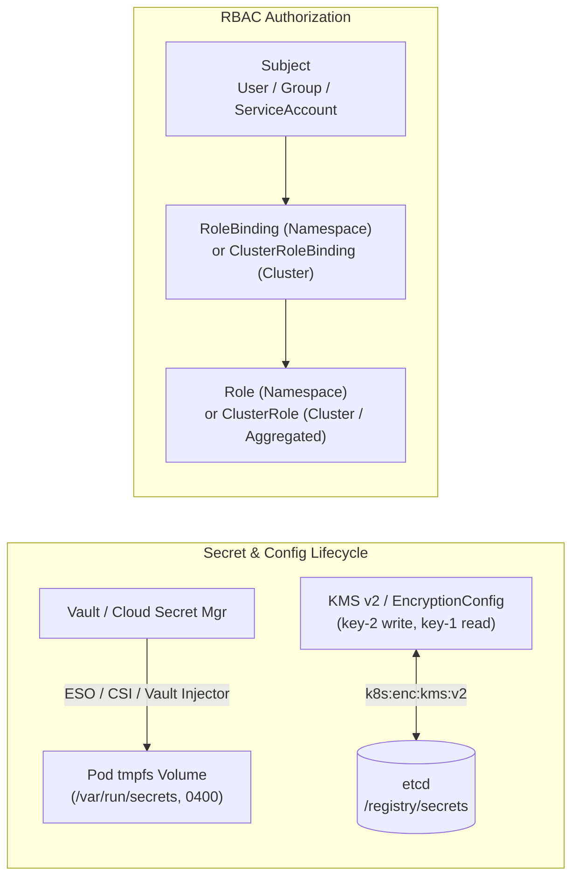

# 5.16 Configuration, secrets and RBAC

| | |
|---|---|
| Level | Intermediate |
| Priority tier | 0 |
| Lab venue | kind or kubeadm cluster; `kubectl auth can-i`, `rakkess`/`kubectl-who-can` optional; External Secrets Operator and Vault dev for the external store lab |
| Part | Part 5: Kubernetes |
| Status | Drafted, labs **untested** |

## Why this matters for AI infrastructure

AI platforms accumulate sensitive material: object-store credentials for datasets and checkpoints, model hub tokens, API keys for LLM providers, registry credentials, database passwords for metadata stores, signing keys, and service tokens that operators use to reach the API. They also accumulate configuration: model parameters, tokenizer paths, NCCL environment, scheduler settings, feature flags. How you inject, rotate, and scope these decides whether a leaked notebook can read every team's checkpoints or a compromised job can create GPU pods without limit. RBAC is the authorisation layer for the Kubernetes API itself; a mistaken ClusterRoleBinding to `system:authenticated` or a broad `nodes/proxy` grant is a cluster-wide compromise. This chapter covers configuration objects, secret handling practices, and RBAC design.

## Prerequisites and outcomes

Needs 5.5 and 5.7. After this chapter you can:

- Use ConfigMaps and Secrets correctly (env vars, files, projected volumes, immutability, size limits, update propagation) and choose the injection method per use-case.
- Explain what Secrets really are (base64-encoded API objects in etcd), how to encrypt them at rest with KMS, restrict access with RBAC, and integrate external secret stores (External Secrets Operator, Secrets Store CSI, Vault Agent, SOPS/Sealed Secrets).
- Describe authentication methods (certificates, tokens, OIDC), ServiceAccounts with projected/bound tokens, and workload identity to cloud IAM.
- Design RBAC: Roles/ClusterRoles/bindings, verbs/resources/subresources, aggregation, default roles, least privilege patterns for multi-tenant AI platforms, and common escalation paths.
- Audit and test permissions (`can-i`, `auth whoami`, audit logs, RBAC reports, policy-as-code).
- Operate secrets and RBAC safely in GitOps pipelines.

## 1. ConfigMaps

A **ConfigMap** holds non-confidential configuration as key-value pairs (`data` for UTF-8, `binaryData` for bytes), up to ~1 MiB total (etcd/object limit). Create from literals, files or directories:

```bash
kubectl create configmap trainer-config --from-literal=LOG_LEVEL=info --from-file=hparams.yaml
kubectl create configmap nccl-env --from-env-file=nccl.env
```

Consumption patterns:

```yaml
spec:
  containers:
    - name: trainer
      envFrom:
        - configMapRef: { name: nccl-env }                   # all keys as env vars
      env:
        - name: LOG_LEVEL
          valueFrom: { configMapKeyRef: { name: trainer-config, key: LOG_LEVEL, optional: true } }
      volumeMounts:
        - { name: cfg, mountPath: /etc/trainer, readOnly: true }
  volumes:
    - name: cfg
      configMap:
        name: trainer-config
        items: [ { key: hparams.yaml, path: hparams.yaml, mode: 0444 } ]
        defaultMode: 0444
```

Semantics to know:

- **Environment variables** are resolved at container start; updating the ConfigMap does **not** change running processes. Names must be valid env var names; keys with dots/dashes can't be used with `envFrom` without remapping.
- **Volume mounts** are updated eventually (kubelet sync period + cache TTL, typically within ~1 to 2 minutes) via an atomic symlink swap of the `..data` directory. **`subPath` mounts do not receive updates**. Applications must re-read files (or be signalled) to pick up changes; config reloaders (e.g., sidecars, `reloader`, `kubectl rollout restart` triggered by a hash annotation) automate restarts: common GitOps pattern is to include a hash of the ConfigMap in the pod template annotations (Helm `checksum/config`, Kustomize `configMapGenerator` hashed names) so a config change rolls the Deployment.
- **Immutable ConfigMaps/Secrets** (`immutable: true`): cannot be changed, protect against accidental edits, and reduce API server load (kubelets stop watching them), valuable at scale; replace by creating a new name and rolling pods.
- **Size and structure**: don't store datasets, models or large JSON blobs; ConfigMaps are for small config. Keep per-job generated configs small; thousands of per-pod ConfigMaps create etcd and watch load.
- **Binary and multi-line**: use `binaryData` or `|` block scalars.
- **Downward API** (`fieldRef`/`resourceFieldRef`) exposes pod metadata and resource limits to the container (pod name, namespace, IP, node name, labels, CPU/memory limits) as env vars or files: useful for rank/ID derivation, NUMA/worker sizing.
- **Key Naming Constraints, Command-Line Variable Substitution `$(VAR)`, and Declarative Updates (`KUR` Chapter 13):**
  1. *Key naming syntax (`KUR` Chapter 13 Table 13-1):* Keys in a `ConfigMap` or `Secret` may begin with an optional dot (`.`), followed by an alphanumeric letter or digit (`[a-zA-Z0-9]`), and then alphanumeric characters, dots (`.`), dashes (`-`), and underscores (`_`), without consecutive `..` or spaces (for example, `.auth_token`, `Key.pem`, and `config_file` are valid, whereas `Token..properties`, `auth file.json`, and `_password.txt` are invalid; modeled in `validate_configmap_or_secret_key()` in `code/part05/rbac_secrets_validator.py`).
  2. *Referencing ConfigMap/Secret env vars in container `command` / `args`:* Kubernetes expands `$(ENV_VAR_NAME)` syntax inside `command` and `args` arrays using environment variables defined earlier in `spec.containers[].env` (e.g., `command: ["/kuard", "$(EXTRA_PARAM)"]`).
  3. *Updating a file-backed ConfigMap or Secret without `kubectl edit`:* Pipe `create --dry-run=client -o yaml` into `kubectl replace -f -`:
     `kubectl create configmap my-config --from-file=my-config.txt --dry-run=client -o yaml | kubectl replace -f -`



## 2. Secrets

A **Secret** has the same shape as a ConfigMap (`data` base64-encoded, `stringData` write-only plain text) but is treated differently: kept in tmpfs on nodes when mounted, not written to disk by the kubelet, restricted by RBAC (separate `secrets` resource), and eligible for encryption at rest. Types: `Opaque`, `kubernetes.io/tls` (`tls.crt`/`tls.key`), `kubernetes.io/dockerconfigjson` (image pull), `kubernetes.io/basic-auth`, `kubernetes.io/ssh-auth`, `kubernetes.io/service-account-token` (legacy), `bootstrap.kubernetes.io/token`.

**Secrets are not encrypted by default.** Base64 is an encoding, not protection. Anyone with `get`/`list` on secrets (or `exec` into a pod mounting them, or read access to etcd or etcd backups, or `nodes/proxy`) can read them. The security model rests on:

1. **RBAC**: tight `secrets` permissions (avoid `list`/`watch` on all secrets: listing reveals contents; avoid wildcards).
2. **Encryption at rest** in etcd via the API server `EncryptionConfiguration` with a **KMS v2** provider (cloud KMS, Vault transit, etc.) for envelope encryption; `aescbc`/`secretbox` with local keys is weaker (key on disk of the control plane). Rotate keys; re-encrypt existing secrets (`kubectl get secrets -A -o json | kubectl replace -f -`). Verify: `etcdctl get /registry/secrets/ns/name` shows `k8s:enc:kms:v2:` prefix. As *Production Kubernetes* Chapter 7 demonstrates, **the order of providers and keys inside `EncryptionConfiguration` is critical**:
   - The **first** provider (and the **first key** in its `keys` list) is used to encrypt all newly written or updated Secrets.
   - Subsequent providers/keys in the list (including `- identity: {}` at the bottom for unencrypted legacy Secrets) are used only as **fallbacks to decrypt existing Secrets** on read.
   - Therefore, when rotating from `secret-key-1` to `secret-key-2`, you must **first add `secret-key-2` above `secret-key-1`** (keeping `secret-key-1` in second position) across all API servers, run `kubectl get secrets --all-namespaces -o json | kubectl replace -f -` to re-encrypt every Secret with `secret-key-2`, and **only then** remove `secret-key-1` (if you remove `secret-key-1` before re-encrypting, `kube-apiserver` fails to read existing Secrets with `Internal error occurred: unable to transform key ... no matching key was found`, modeled in `simulate_etcd_encryption_key_rotation()` in `code/part05/rbac_secrets_validator.py`).
3. **Transport and node protection**: TLS between components; secrets are only sent to nodes that run pods needing them (Node authorizer); mounted on tmpfs; nodes are in the trust boundary.
4. **Minimising exposure**: prefer files over env vars (env vars appear in `/proc/<pid>/environ`, crash dumps, child processes, logs and runtime inspect output); set `defaultMode: 0400` and `readOnly: true`; use `fsGroup`; avoid logging; use `automountServiceAccountToken: false` where not needed.
5. **Short-lived credentials** over long-lived: workload identity, projected tokens, dynamic secrets from Vault.

```yaml
apiVersion: v1
kind: Secret
metadata: { name: hf-token, namespace: training }
type: Opaque
stringData: { token: "hf_xxx" }                 # example only; never commit real values to Git
immutable: true
---
spec:
  containers:
    - name: trainer
      volumeMounts: [ { name: hf, mountPath: /var/run/secrets/hf, readOnly: true } ]
      env: [ { name: HF_TOKEN_FILE, value: /var/run/secrets/hf/token } ]
  volumes:
    - name: hf
      secret: { secretName: hf-token, defaultMode: 0400 }
```

### Defense in depth for secrets

Protecting secret data mostly comes down to how deep you are willing to go. Most teams make sensible choices that keep them "safe enough," then harden those choices over time. That approach carries risk and technical debt, and that is part of the job. A wrong judgment about "safe enough" can still lead to a bad headline, so it helps to know each layer.

Defense can start at the physical layer. Google, for example, has described its datacenter security in whitepapers and videos. Its approach includes metal detectors, vehicle barriers, and several layers of building security. When drives are retired, staff zero out the data, then crush or shred the drives. This section does not go deep into physical security, but it shows how seriously providers treat the hardware under your cluster.

Disk encryption is the next layer. Most cloud providers encrypt their physical disks at rest, using their own keys or keys you supply. That makes it very hard for anyone at the provider to read your data. On Linux, a common method for full block encryption is LUKS, which works with the dm-crypt subsystem available in the Linux kernel since version 2.6. Dedicated storage systems such as vSAN, Ceph, or Gluster each offer their own encryption at rest. On AWS, enable encryption for Elastic Block Storage, and turn on encryption by default as a best-practice setting. Google Cloud encrypts at rest by default, and you can configure it with Key Management Service (KMS) to supply your own keys.

Whatever trust you place in your cloud provider or datacenter operators, encryption at rest should be your default. It also guards against mistakes. Virtual machine snapshots are easy to create, and each one is a file that can leak onto a network. If someone picks the wrong option in a UI or an API field, encrypted data stays useless without the private key.

**Transport security.** Encryption at rest does not cover data moving across the network. A secret in flight is exposed the moment one hop skips TLS. Those hops include the human-to-system path through `kubectl` and the system-to-system path from the kubelet to the API server. Communication with the API server and etcd should always use TLS. Most installers already do this by default. You may only need to supply a Certificate Authority (CA) to generate the certificates, and you may not need to replace the default CA.

**Application encryption.** Application encryption means your workload encrypts its own data with a key, at the user space level. Picture a dotfile full of credentials on a laptop. Disk encryption protects that file if someone pulls out the drive. If someone logs in as you, though, they can read the file. Encrypting the dotfile with a strong, password-protected `gpg` key closes that gap, because the attacker still sees only unreadable bits.

The rest of this chapter assumes two things are already true in your cluster:

- Encryption at rest is enabled in the filesystem or storage systems that Kubernetes uses.
- TLS is enabled for all Kubernetes components and etcd.

With those in place, we can look at how Kubernetes handles secrets itself. The etcd side of this is covered in 5.5.

### The Secret API, RBAC verbs, and scope

The Secret API is one of the most used APIs in Kubernetes. There are many ways to create Secret objects, but the API gives workloads one consistent way to read them. Secrets look a lot like ConfigMaps, and workloads consume them the same way, through environment variables or volumes. Here is a Secret with base64 data:

```
apiVersion: v1
kind: Secret
metadata:
name: mysecret
type: Opaque
data:
dbuser: aGVwdGlvCg==
dbkey: YmVhcmNhbm9lCg==
```

The `data` field holds base64 encoded values, and every Kubernetes Secret stores its data this way. If you want to submit plain strings, use the `stringData` field instead:

```
apiVersion: v1
kind: Secret
metadata:
name: mysecret
type: Opaque
stringData:
dbuser: heptio
dbkey: bearcanoe
```

The API server encodes `stringData` when it applies the object to etcd. Many people assume Kubernetes encodes Secrets as a security measure. It does not. Secret data can hold strange characters or binary data, and base64 makes sure it is stored correctly. Protection comes from RBAC instead, so the verbs matter:

- `get`: retrieve the data of a known Secret by its name.
- `list`: get a list of all Secrets and their data.
- `watch`: watch for any Secret change or any change to Secret data.

Small RBAC mistakes can expose a lot. Granting `list` exposes every Secret in a Namespace. A ClusterRoleBinding used by accident can expose the whole cluster. In many cases, users do not need any of these verbs at all. A user's RBAC does not decide which Secrets a workload can use. The kubelet handles that: as long as a Pod references a valid Secret, the kubelet makes it available through the method you choose.

Secrets are Namespace scoped. Without copying a Secret into other Namespaces, a Pod can reference only Secrets in its own Namespace. That also means any Pod in a Namespace can reach any Secret there. Think carefully about how you share Namespaces among workloads. Admission control can add checks on top of this model, which is a topic for a later chapter.

### Consumption models: environment variables, volumes, and the client API

Workloads can consume a Secret in three ways. The right choice may depend on what the application expects, and each choice comes with trade-offs.

**Environment variables.** A workload can inject Secret data into environment variables. The YAML names an environment variable and points to a key in a Secret. This helps workloads that already expect an environment variable, because the application code may not need to change. Here is a Pod that does this:

```
apiVersion: v1
kind: Pod
metadata:
name: nginx
spec:
containers:
- name: nginx
image: nginx
env:
- name: USER
valueFrom:
secretKeyRef:
name: mysecret
key: dbuser
- name: PASS
valueFrom:
secretKeyRef:
name: mysecret
key: dbkey
```

In that example, `USER` is the environment variable the application sees. `mysecret` is the name of the Secret object, and `dbuser` is the key inside it that gets injected into `USER`.

The downside is that environment variables cannot hot reload. A change to a Secret does not reach the Pod until the Pod is re-created. That can happen through manual action or through a system event, such as a reschedule. Some people also consider environment variables less secure than volume mounts. That point is debatable, but the leak paths are real. Process and container runtime inspection can show environment variables in plain text. Some frameworks, libraries, or languages dump environment variables into logs in debug or crash modes. Weigh these risks before you use environment variables.

**Volumes.** Secret objects can also reach a workload through volumes. The Pod spec defines a volume that references the Secret. The container then mounts that volume with a `volumeMount`:

```
apiVersion: v1
kind: Pod
metadata:
name: nginx
spec:
containers:
- name: nginx
image: nginx
volumeMounts:
- name: creds
readOnly: true
mountPath: "/etc/credentials"
volumes:
- name: creds
secret:
secretName: mysecret
```

The `volumes` entry is the Pod-level volume, and its name must match the mount. The `volumeMounts` entry places that volume into the container filesystem at `mountPath`. With this Pod, the Secret data appears under `/etc/credentials`, and each key/value pair gets its own file:

```
root@nginx:/# cat /etc/credentials/db
dbkey dbuser
```

The biggest benefit of volumes is dynamic updates. When the Secret changes, the kubelet reloads it, and the container filesystem shows the new value without a Pod restart. On Linux, the kubelet uses tmpfs, which keeps Secret data in memory only. You can confirm this on the Linux host through the mount table:

```
# grep 'secret/creds' secret/creds
tmpfs
/var/lib/kubelet/pods/
e98df9fe-a970-416b-9ddf-bcaff15dff87/volumes/
kubernetes.io~secret/creds tmpfs rw,relatime 0 0
```

If the `nginx` Pod leaves this host, the mount goes away with it. Secret data should stay small, so credentials and keys are the right fit. Do not use a Secret as a pseudo database. From the application's side, a simple watch on the directory or file, then re-injecting the values, is enough. The application does not need to talk to the API server, and teams have seen this pattern work well in many workloads.

**Client API consumption.** The last model is not a core Kubernetes feature. The application talks to the kube-apiserver to fetch Secrets itself. Frameworks and libraries can make this easier. For Java, Spring Cloud Kubernetes connects Spring's PropertySource type to Kubernetes, so it can read Secrets and ConfigMaps.

**Be careful with this approach.** The book generally discourages it. Even for ConfigMaps, it is less than ideal to have each application talk to the API server. We prefer applications that do not need to know where they run. An app that can run on a VM should also run on Kubernetes or another container service. Most languages already read environment variables and files, and the kubelet can deliver Secret data through those channels. Direct access adds another connection and another watch on the API server. Each workload then needs its own ServiceAccount with RBAC to read its Secrets. When the kubelet delivers Secrets, no ServiceAccount is needed, and the `default` ServiceAccount can and should be disabled altogether.

### Image pull secrets

`kubectl create secret docker-registry regcred --docker-server=... --docker-username=... --docker-password=...` produces `kubernetes.io/dockerconfigjson`; attach through `imagePullSecrets` on pods or the ServiceAccount (`kubectl patch serviceaccount default -p '{"imagePullSecrets":[{"name":"regcred"}]}'`). Better: node-level credential providers (kubelet image credential provider plugins for ECR/GCR/ACR) or workload identity so no long-lived password exists.

### GitOps-safe secret management

Never commit plaintext Secrets. Options (4.12, 4.26):

| Approach | How | Notes |
|---|---|---|
| **External Secrets Operator (ESO)** | `ExternalSecret`/`SecretStore` CRs reference Vault/AWS SM/GCP SM/Azure KV; ESO syncs into native Secrets | Secret values never in Git; native Secret still in etcd; refresh intervals handle rotation |
| **Secrets Store CSI Driver** (`secrets-store-csi-driver`, `SecretProviderClass`) | Mounts secrets from a vault as a volume via `driver: secrets-store.csi.k8s.io` and a `SecretProviderClass` (and optionally syncs to a Secret) | Avoids etcd persistence when not syncing; per-pod volume; provider pods needed |
| **Vault Agent Injector / Vault Secrets Operator** | Sidecar/operator renders secrets into the pod via Vault Kubernetes auth | Dynamic secrets and leases |
| **Sealed Secrets** (`SealedSecrets`, `kubeseal`) | Encrypt a Secret into a `SealedSecret` (`bitnami.com/v1alpha1`) with `kubeseal` using the cluster public key; controller decrypts to a Secret | Simple; cluster-bound key; rotate keys every 30 days |
| **SOPS** (age/KMS) with Flux/Argo plugins | Encrypted YAML in Git, decrypted at apply | Reviewable diffs (keys visible) |
| **CSI/Workload Identity** | Pods authenticate to cloud APIs with federated tokens, no secret at all | Best for cloud resources |

### Sealed Secrets in depth

Declarative workflows raise a hard question. Your manifests belong in Git, but the credentials and keys they use do not. Teams that want a pure GitOps model often keep secrets out of it entirely, which breaks the pattern. The other option is to seal the secret, so its committed form reveals nothing useful.

Asymmetric cryptography makes sealing possible. An encryption key, usually public, locks the secret. A decryption key, usually private, unlocks it. A secret sealed with the public key stays protected as long as the private key stays safe. You still need a cipher you trust, a safe private key, and rotation policies for both keys and secret data.

The Bitnami `sealed-secrets` project is a common open source choice. Its `sealed-secret-controller` runs in the cluster and generates the keys by default. Developers use the `kubeseal` command-line tool, which needs only the public key. To get started, deploy the controller:

```bash
kubectl apply -f
https://github.com/bitnami-labs/sealed-secrets/releases/\
download/v0.9.8/controller.yaml
```

You can bring your own certificates, but by default the controller creates them. The public and private keys sit in a Kubernetes Secret at `kube-system/sealed-secret-key`. Do not read that Secret directly. Clients should fetch the encryption key from the controller's endpoint instead, with this command:

```bash
kubeseal --fetch-cert
```

How you expose that endpoint is up to you. Once `kubeseal` has the public key, it can turn a Secret into a SealedSecret. You can start with an ordinary Secret:

```
apiVersion: v1
kind: Secret
metadata:
name: mysecret
type: Opaque
data:
dbuser: aGVwdGlvCg==
dbkey: YmVhcmNhbm9lCg==
```

Run `kubeseal` against that file to produce encrypted JSON:

```bash
kubeseal mysecret.yaml
```

```
{
"kind": "SealedSecret",
"apiVersion": "bitnami.com/v1alpha1",
"metadata": {
"name": "mysecret",
"namespace": "default",
"creationTimestamp": null
},
"spec": {
"template": {
"metadata": {
"name": "mysecret",
"namespace": "default",
"creationTimestamp": null
},
"type": "Opaque"
},
"encryptedData": {
"dbkey": "gCHJL+3bTRLw6vL4Gf......",
"dbuser": "AgCHJL+3bT......"
}
},
"status": {
}
}
```

This object can go anywhere in your repository. As long as the sealing key held by the controller stays uncompromised, the data stays safe. The controller turns the SealedSecret into a standard Secret, and that Secret records the SealedSecret as its owner:

```
ownerReferences:
- apiVersion: bitnami.com/v1alpha1
controller: true
kind: SealedSecret
name: mysecret
uid: 49ce4ab0-3b48-4c8c-8450-d3c90aceb9ee
```

If you delete the SealedSecret, its corresponding Secret is garbage collected.

**Key renewal.** If the sealing private key leaks, for example through an RBAC misconfiguration, treat every sealed secret as compromised. Renewal matters here, so understand its scope. By default, the controller renews the key every 30 days. The new key does not replace the old ones. It is added to the list of keys that can unseal data, and it is used for all new encryption. Existing SealedSecrets are not re-encrypted.

If the key leaks, you should:

- Immediately rotate your encryption key.
- Rotate all existing secrets.

Re-encrypting alone is not good enough. Someone could go into Git history, find an old encrypted file, and use the compromised key on it. Keep rotation strategies for passwords and renewal strategies for keys.

**Namespace binding.** SealedSecrets uses the Namespace during encryption. That makes a SealedSecret belong to the Namespace where it was created, so it cannot simply be moved to another one. This default is the most secure choice, so leave it as is. The sealed-secrets documentation covers configurable access policies.

**Multicluster models.** Sealed-secret models get harder across many clusters. Many topologies treat clusters as ephemeral. Unless you share private keys among all of them, each cluster needs its own keys. Developers also need a place to fetch the encryption key, and that point grows from one cluster to many. It is solvable, but it is worth planning for.

**Know the scope.** A common misunderstanding is that SealedSecrets replaces encrypting etcd or running an enterprise secret store such as Vault. It does not. The approach lets you encrypt data and store it safely in Git. The private key and unencrypted secrets still end up in Kubernetes, so without steps beyond the Secret API defaults, they sit unencrypted at the application layer. Know the scope of every tool you choose.

### Rotation

Rotation requires consumers to reload: file mounts update automatically (kubelet refresh), apps must re-read; env-var-based secrets require pod restart (use a reloader controller keyed on secret hash, or `kubectl rollout restart`). Two-phase rotation (add new credential, switch consumers, remove old) for databases and tokens; automate with ESO refresh + Reloader, Vault dynamic leases, cert-manager for certs (5.12).

### HashiCorp Vault Agent Injector and Kubernetes authentication

Instead of syncing external secrets into etcd as Kubernetes `Secret` objects, the **HashiCorp Vault Agent Injector** uses a `MutatingWebhookConfiguration` (`vault-agent-injector-cfg`) to inject a `vault-agent-init` init container (to fetch initial secrets before the workload starts) and an optional `vault-agent` sidecar container (to keep secrets updated) that write rendered files onto an in-memory volume mounted at `/vault/secrets`. As detailed in *Production Kubernetes* (Chapter 7), the injector watches for Pod annotations:

- `vault.hashicorp.com/agent-inject: "true"` instructs the webhook to inject the `vault-agent-init` init container (`vault:1.3.2` in the book's example).
- `vault.hashicorp.com/agent-inject-status: "update"` (optional) instructs the webhook to also inject the long-running `vault-agent` sidecar to refresh leased or rotated secrets.
- `vault.hashicorp.com/role: "<role>"` (or the role bound in the agent configuration) selects the Vault Kubernetes auth role.
- `vault.hashicorp.com/agent-inject-secret-<filename>: "<vault-path>"` (for example, `vault.hashicorp.com/agent-inject-secret-db-creds: "secrets/db/creds"` or `vault.hashicorp.com/agent-inject-secret-config`) tells the agent which Vault secret to write to `/vault/secrets/<filename>`.
- `vault.hashicorp.com/agent-inject-template-<filename>` formats the rendered file using a Go template instead of the default Go map print format. In the book's example (untested here), a Pod template formats database credentials into a JDBC connection string at `/vault/secrets/db-creds` (or `/vault/secrets/config` for a `config` secret):

```yaml
spec:
  template:
    metadata:
      annotations:
        vault.hashicorp.com/agent-inject: "true"
        vault.hashicorp.com/agent-inject-status: "update"
        vault.hashicorp.com/role: "database"
        vault.hashicorp.com/agent-inject-secret-db-creds: "secrets/db/creds"
        vault.hashicorp.com/agent-inject-template-db-creds: |
          {{- with secret "secrets/db/creds" -}}
          jdbc:oracle:thin:{{ .Data.data.username }}/{{ .Data.data.password }}
          {{- end }}
```

Injection is the approach we highly recommend when it is possible. It decouples the secret store from the application entirely. The trade-off is that the platform now has to offer secret injection as a service, which adds complexity.

The webhook runs on every Pod CREATE or UPDATE event, but it changes only the Pods that carry the annotations. By default, Vault writes each secret in the format of a printed Go map, and all secrets go into `/vault/secrets`:

```
key: map[k:v],
key: map[k:v]
```

Authentication and authorization are the hard part of this model. You can set Vault to authenticate Pods with their existing ServiceAccount tokens. Vault then validates the requester's identity through the TokenReview API. It must still decide whether that ServiceAccount is allowed to read the secret. Those policies and bindings live in Vault, and you must maintain them there.

To let Pods authenticate to Vault using their Kubernetes ServiceAccount tokens (validated by Vault against the Kubernetes `TokenReview` API), you enable and configure the Kubernetes auth method inside Vault, write a policy, and bind a Vault role to the Pod's ServiceAccount name and Namespace, as in the book's example (untested here):

```bash
# Enable Kubernetes authentication in Vault (untested here)
vault auth enable kubernetes

# Configure Vault to talk to the Kubernetes API server for TokenReview checks (untested here)
vault write auth/kubernetes/config \
  kubernetes_host="https://$KUBERNETES_PORT_443_TCP_ADDR:443" \
  kubernetes_ca_cert=@/var/run/secrets/kubernetes.io/serviceaccount/ca.crt \
  token_reviewer_jwt="$(cat /var/run/secrets/kubernetes.io/serviceaccount/token)"

# Create a read policy in Vault for team-a secrets (untested here)
vault policy write team-a - <<EOF
path "secret/data/team-a/*" {
  capabilities = ["read"]
}
EOF

# Bind the Kubernetes ServiceAccount 'webapp' in namespace 'team-a' to the policy (untested here)
vault write auth/kubernetes/role/database \
  bound_service_account_names=webapp \
  bound_service_account_namespaces=team-a \
  policies=team-a \
  ttl=20m
```

### Secrets Store CSI driver and CyberArk

CyberArk is another option many clients already use. It offers a Credential Provider and a Dynamic Access Provider (DAP). Like Vault, it supports `initContainers` that run alongside your application to talk to DAP.

A newer approach is the `secrets-store-csi-driver`. At the time of writing, the book describes it as a Kubernetes subproject within `kubernetes-sigs`. It lets Pods use externally hosted secrets without a sidecar or an initContainer. Secret access starts to feel like a platform service rather than something each application integrates with. The driver runs a driver Pod as a DaemonSet on every host, much like a storage CSI driver.

The driver relies on a provider to look up secrets in the external system. For Vault, that means installing the `vault-provider` binary on every host, in the location set by the driver's `provider-dir` mount. The binary may already exist on the host, or a DaemonSet-like process often installs it. This approach raises open questions. When a Pod does not request the secret itself, who handles identity? The driver or provider must work that out, because they make requests on the Pod's behalf.

The main API is the `SecretProviderClass`. For Vault, it looks like this:

```
apiVersion: secrets-store.csi.x-k8s.io/v1alpha1
kind: SecretProviderClass
metadata:
name: apitoken
spec:
provider: vault
parameters:
roleName: "teama"
vaultAddress: "https://vault.secret-store:8000"
objects: |
array:
- |
objectPath: "/secret/team-a"
objectName: "apitoken"
objectVersion: ""
```

The `vaultAddress` points to the Vault service, named `vault`, in the `secret-store` Namespace. The `objectPath` is the path in Vault where the key/value object was written. The `objectName` is the actual object to look up in `team-a`. With the SecretProviderClass in place, a Pod references it like this:

```
kind: Pod
apiVersion: v1
metadata:
name: busybox
spec:
containers:
- image:
name: busybox
volumeMounts:
- name: secrets-api
mountPath: "/etc/secrets/apitoken"
readOnly: true
volumes:
- name: secrets-api
csi:
driver: secrets-store.csi.k8s.com
readOnly: true
volumeAttributes:
secretProviderClass: "apitoken"
```

When this Pod starts, the driver and provider try to retrieve the secret. If authentication and authorization to the external provider succeed, the secret appears in a volume mount, like any Kubernetes Secret. From the driver Pod on the node, you can read the logs to see the command sent to the provider:

```
level=info msg="provider command invoked: /etc/kubernetes/
secrets-store-csi-providers/vault/provider-vault --attributes [REDACTED]
--secrets [REDACTED] [--targetPath /var/lib/kubelet/pods/
643d7d88-fa58-4f3f-a7eb-341c0adb5a88/volumes/kubernetes.io~csi/
secrets-store-inline/mount --permission 420]"
```

This approach is worth keeping an eye on. Its user experience and its ability to abstract secret providers look promising. If the project stabilizes and providers mature, it could become common for teams building application platforms on Kubernetes.

### Best practices for secrets

Application consumption of secrets depends heavily on the language and frameworks in use. The variance is high, but these practices apply broadly.

**Always audit secret interaction.** A Kubernetes cluster should run with auditing enabled. Audit events tell you which resources were touched, when, and by whom. For mutations, they also show what changed. Auditing secret events is critical when you react to access issues. The cluster audit documentation has the details.

**Do not leak secrets.** Leaking a secret is never desirable, and in multitenant clusters it is easy to do by accident. A common mistake is logging a secret. Engineers building operators often deal with secrets for the systems they manage, and during development they may log those values to debug. Logs go to stdout and stderr, and many platforms forward them to a log analysis system. The secret can then travel in plain text through many environments. Manifests with test secrets can also slip into source control, so keep test values out of your repositories.

**Prefer volumes over environment variables.** Most applications should read secrets from volumes. Environment variables leak more easily, for example through an `echo` command during testing, or when a framework dumps them at startup or during a crash. Volumes do not solve every leak, though. The key benefit for developers is that volumes update automatically when a secret changes, which supports hot-reloading of tokens. A change to an environment variable requires a Pod restart.

**Keep secret store providers unknown to your application.** Applications can fetch secrets in many ways, from a call inside business logic to an environment variable set at startup. Separation of concerns says the application should not care whether Kubernetes, Vault, or another provider manages the secret. That keeps the app portable and reduces its complexity. To fetch from a provider, an app must know how to talk to it and must authenticate to it. Prefer environment variables or volumes, with volumes as the ideal. An app can watch the filesystem for changes, and it does not matter which store is behind the files. Framework libraries that talk to the API server directly, such as Spring's, are convenient. Still, weigh the points above before you use them.

## 3. Projected volumes and ServiceAccount tokens

A **projected** volume combines several sources in one directory: `secret`, `configMap`, `downwardAPI`, `serviceAccountToken`, `clusterTrustBundle` (CA bundles).

```yaml
volumes:
  - name: creds
    projected:
      sources:
        - serviceAccountToken:
            path: sa-token
            audience: vault                 # token valid only for this audience
            expirationSeconds: 3600         # kubelet refreshes before expiry
        - configMap: { name: ca-bundle, items: [ { key: ca.crt, path: ca.crt } ] }
        - downwardAPI: { items: [ { path: labels, fieldRef: { fieldPath: metadata.labels } } ] }
```

### ServiceAccounts

Every namespace has a `default` ServiceAccount; pods use it unless `serviceAccountName` is set. Since 1.22+ pods receive a **bound ServiceAccount token** (a JWT signed by the API server, audience-bound to the API server, time-limited (default ~1 h, auto-refreshed), bound to the pod/node/secret object, invalidated when the pod is deleted) mounted at `/var/run/secrets/kubernetes.io/serviceaccount/token` (via projected volume), replacing legacy never-expiring token Secrets (no longer auto-created since 1.24; create explicit `type: kubernetes.io/service-account-token` Secrets only when truly required, or use `kubectl create token <sa> --duration=...` for short-lived tokens). Best practices:

- One ServiceAccount per workload with **least-privilege RBAC**; never use `default` for anything privileged.
- `automountServiceAccountToken: false` on SA or pod if the workload does not call the API.
- Use **projected tokens with custom audiences** for external systems (Vault, cloud federation, SPIFFE-like identities, OIDC discovery) instead of passing long-lived keys.
- **Workload identity federation**: map Kubernetes ServiceAccounts to cloud IAM identities without keys: GKE Workload Identity, EKS IAM Roles for Service Accounts (IRSA) / Pod Identity, Azure Workload Identity; the cluster's OIDC issuer URL is registered with the cloud IAM, which trusts tokens for specific `namespace/serviceaccount` subjects; training pods then access buckets/registries with short-lived credentials (4.22, 5.34). For bare-metal clusters, expose the cluster's OIDC issuer (`--service-account-issuer`, `--service-account-jwks-uri`) and trust it from Vault/AWS/GCP.

## 4. Authentication

How the API server identifies callers (5.5): **client certificates** (CN = user, O = groups; used by kubelets, admin kubeconfig from kubeadm: avoid long-lived admin certs for humans), **bearer tokens** (ServiceAccount JWTs; static token files deprecated), **OIDC** (id_token from Dex/Keycloak/Okta/Entra; claims → username/groups via `--oidc-*` flags or the structured `AuthenticationConfiguration`), **webhook token authentication** (cloud IAM authenticators like `aws-iam-authenticator`, `gke-gcloud-auth-plugin`), **authenticating proxy** (front proxy headers; used by aggregated APIs), anonymous. Humans should authenticate through OIDC SSO with MFA and short-lived tokens (e.g., `kubelogin`/`kubectl oidc-login`, `kubectl --token`), mapped to groups used by RBAC. Machines use ServiceAccount tokens or federated workload identities. `kubectl auth whoami` shows the resolved identity.

## 5. RBAC

RBAC authorises requests by **verbs** on **resources** within **namespaces**. Four API objects:

| Object | Scope | Meaning |
|---|---|---|
| `Role` | Namespace | Set of allowed rules in that namespace |
| `ClusterRole` | Cluster | Rules for cluster-scoped resources (nodes, PVs, CRDs), non-resource URLs (`/healthz`, `/metrics`), or reusable across namespaces |
| `RoleBinding` | Namespace | Grants a Role or ClusterRole's permissions to subjects **within that namespace** |
| `ClusterRoleBinding` | Cluster | Grants a ClusterRole's permissions cluster-wide |

Subjects: `User`, `Group`, `ServiceAccount`. Rules: `apiGroups`, `resources` (with subresources like `pods/exec`, `pods/log`, `pods/eviction`, `nodes/proxy`, `deployments/scale`), `resourceNames` (restrict to specific objects), `verbs` (`get`, `list`, `watch`, `create`, `update`, `patch`, `delete`, `deletecollection`, plus special: `impersonate`, `bind`, `escalate`, `approve`, `sign`, `use`), `nonResourceURLs`.

```yaml
apiVersion: rbac.authorization.k8s.io/v1
kind: Role
metadata: { name: trainer-runner, namespace: team-a }
rules:
  - apiGroups: [""]
    resources: ["pods", "pods/log"]
    verbs: ["get", "list", "watch"]
  - apiGroups: ["batch"]
    resources: ["jobs"]
    verbs: ["get", "list", "watch", "create", "delete"]
  - apiGroups: ["kubeflow.org"]
    resources: ["pytorchjobs"]
    verbs: ["*"]
  - apiGroups: [""]
    resources: ["configmaps"]
    resourceNames: ["trainer-config"]
    verbs: ["get"]
---
apiVersion: rbac.authorization.k8s.io/v1
kind: RoleBinding
metadata: { name: team-a-researchers, namespace: team-a }
subjects:
  - { kind: Group, name: "oidc:team-a-researchers", apiGroup: rbac.authorization.k8s.io }
  - { kind: ServiceAccount, name: ci-runner, namespace: ci }
roleRef: { kind: Role, name: trainer-runner, apiGroup: rbac.authorization.k8s.io }
```

### Properties

- **Additive only**: no deny rules; permissions are the union of all bindings; a user with `edit` cannot be denied one verb except by removing the binding or using admission policy.
- **Bindings are immutable in `roleRef`**: to change the role referenced, delete and recreate the binding.
- **Default roles**: `cluster-admin` (everything), `admin` (namespace admin incl. RBAC within namespace), `edit` (read/write most objects, not roles/bindings; can read secrets, run pods → effectively access to namespace service account tokens), `view` (read most objects but not secrets), plus system roles (`system:node`, `system:kube-scheduler`, `system:discovery`, `system:public-info-viewer`, `system:basic-user`). **Auto-reconciliation of built-in roles**: as *Kubernetes: Up and Running* (3rd edition, Chapter 14) notes, `kube-apiserver` automatically reconciles built-in `ClusterRole` objects on startup and overwrites any manual edits unless you first set the annotation `rbac.authorization.kubernetes.io/autoupdate: "false"` on the `ClusterRole`. **Aggregation**: ClusterRoles with `aggregationRule` collect rules from other ClusterRoles by label (`rbac.authorization.k8s.io/aggregate-to-edit: "true"`); CRD authors ship ClusterRoles labelled to extend `view/edit/admin` with their custom resources (e.g., Kueue, Argo).
- **Groups**: `system:authenticated`, `system:unauthenticated`, `system:serviceaccounts`, `system:serviceaccounts:<ns>`, `system:masters` (unrestricted, bypasses RBAC; avoid in certificates).
- **Escalation prevention**: you cannot create or update a Role/binding granting permissions you don't hold, unless you have the `escalate`/`bind` verbs on roles; `impersonate` allows acting as others; `create` on `pods` implies reading any Secret/ServiceAccount token in that namespace (by mounting) and potentially node access (hostPath, privileged): pod creation is a powerful permission; `create` on `pods/exec` equals shell in pods; `nodes/proxy` equals kubelet API access (exec on any pod on the node); `get` on `secrets` equals credentials; `create` on `serviceaccounts/token` mints tokens; `*` verbs/resources and `cluster-admin` bindings to groups like `system:authenticated` are never appropriate; `update` on `validatingwebhookconfigurations`/`mutatingwebhookconfigurations` or CRDs can disrupt the cluster; `get/list` on `secrets` cluster-wide is cluster compromise.

### Design patterns for AI platforms

1. **Namespace per team/project**; bind OIDC groups to `edit`/custom roles per namespace; no one except platform admins gets cluster-scoped write.
2. **Roles tailored to workflow**: `job-submitter` (create/delete Jobs/PyTorchJobs/LocalQueue workloads, read pods/logs/events, no secrets, no exec in prod), `notebook-user`, `inference-deployer` (Deployments/Services/HPA/InferenceService), `viewer` (view + metrics), `queue-admin` (Kueue ClusterQueue edits for team leads via ClusterRole + RoleBinding scoping).
3. **Operators and controllers** get the minimum cluster permissions they need (generate from kubebuilder markers, review them); separate service accounts per controller; use `resourceNames` where possible.
4. **CI/CD identities**: namespaced SAs or federated identities with permissions to apply only into their namespaces; no cluster-admin for pipelines; Argo CD/Flux projects restrict destinations (4.26).
5. **Break-glass**: time-bound elevated access via a controlled process (e.g., temporary RoleBinding by an access broker, `kubectl create token` for a break-glass SA, audit-logged), not permanent cluster-admin for humans.
6. **Separation of duties**: platform team owns CRDs, webhooks, policies, nodes; app teams own namespace content.
7. **Pod Security + admission policy complement RBAC**: RBAC says who can create pods; PSA/Kyverno/ValidatingAdmissionPolicy says what pods may look like (5.21).
8. **Read access for observability**: dedicated ClusterRole for Prometheus (`get/list/watch` on pods, nodes, endpoints, services; `/metrics` non-resource URL); avoid `nodes/proxy` where possible (use dedicated metrics endpoints or kubelet `/metrics` with `nodes/metrics` only).
9. **Multi-tenant inference platforms**: end users don't get Kubernetes RBAC at all; they call an API gateway with API keys/JWTs (5.12); Kubernetes RBAC is for engineers and automation.
10. **Documentation and review**: store RBAC as code with owners (CODEOWNERS), diff/review changes, reconcile declaratively with `kubectl auth reconcile -f some-rbac-config.yaml` (supports `--dry-run`, as shown in *Kubernetes: Up and Running*, Chapter 14; untested here), and run regularly an access review (`kubectl-who-can`, `rbac-tool`, `rakkess`, `kubectl auth can-i --list`, `rbac-lookup`, KubiScan, Kubescape/Polaris/Trivy RBAC checks).

### Least-privilege admin elevation via RBAC `impersonate` (`sudo`-style workflow)

Binding `cluster-admin` directly to an operator's daily user or group identity risks accidental destructive commands when an engineer has the wrong `kubeconfig` context active. *Production Kubernetes* (Chapter 10) recommends a `sudo`-style privilege-elevation pattern built on Kubernetes user impersonation:

1. Bind the operations group (`ops-team` in the book's example) to the built-in read-only `view` `ClusterRole` by default (`cluster-admin-view`).
2. Bind the `cluster-admin` `ClusterRole` to a synthetic `User` named `cluster-admin` (`cluster-admin-crb`) that no human can log in as directly.
3. Grant the `ops-team` group a `cluster-admin-impersonator` `ClusterRole` with `verbs: ["impersonate"]` on `resources: ["users"]` restricted to `resourceNames: ["cluster-admin"]`.

In the book's example (untested here), the three RBAC manifests look like this:

```yaml
apiVersion: rbac.authorization.k8s.io/v1
kind: ClusterRoleBinding
metadata:
  name: cluster-admin-view
roleRef:
  apiGroup: rbac.authorization.k8s.io
  kind: ClusterRole
  name: view
subjects:
  - apiGroup: rbac.authorization.k8s.io
    kind: Group
    name: ops-team
---
apiVersion: rbac.authorization.k8s.io/v1
kind: ClusterRoleBinding
metadata:
  name: cluster-admin-crb
roleRef:
  apiGroup: rbac.authorization.k8s.io
  kind: ClusterRole
  name: cluster-admin
subjects:
  - apiGroup: rbac.authorization.k8s.io
    kind: User
    name: cluster-admin
---
apiVersion: rbac.authorization.k8s.io/v1
kind: ClusterRole
metadata:
  name: cluster-admin-impersonator
rules:
  - apiGroups: [""]
    resources: ["users"]
    verbs: ["impersonate"]
    resourceNames: ["cluster-admin"]
---
apiVersion: rbac.authorization.k8s.io/v1
kind: ClusterRoleBinding
metadata:
  name: cluster-admin-impersonate
roleRef:
  apiGroup: rbac.authorization.k8s.io
  kind: ClusterRole
  name: cluster-admin-impersonator
subjects:
  - apiGroup: rbac.authorization.k8s.io
    kind: Group
    name: ops-team
```

With this in place, an operator (`john` in `ops-team`) has read-only access by default and must explicitly pass `--as=cluster-admin` to perform a write, leaving both the real user and `impersonatedUser` in the Kubernetes audit log (untested here):

```bash
kubectl get configmaps
# No resources found.
kubectl create configmap my-config --from-literal=test=test
# Error from server (Forbidden): configmaps is forbidden: User "john" cannot create resource "configmaps" in API group "" in the namespace "default"
kubectl --as=cluster-admin create configmap my-config --from-literal=test=test
# configmap/my-config created
```

### Testing and auditing RBAC

```bash
kubectl auth can-i create pods -n team-a --as=jane@example.com
kubectl auth can-i '*' '*' --as=system:serviceaccount:ci:ci-runner            # should be no
kubectl auth can-i --list -n team-a --as=system:serviceaccount:team-a:trainer
kubectl auth whoami
kubectl get clusterrolebinding -o json | jq -r '.items[] | select(.subjects[]?.name=="system:authenticated") | .metadata.name'
kubectl get clusterrolebindings,rolebindings -A -o wide | grep -E 'cluster-admin|system:masters'
kubectl who-can get secrets -n team-a            # krew plugin: kubectl-who-can
rbac-tool viz / rbac-tool lookup jane@example.com / rakkess --as jane
```

Audit logging (5.5) records `authorization.k8s.io/decision` and reasons; alert on `create` of ClusterRoleBindings, `exec` into production pods, secret reads by unusual identities, and token creation.

## 6. Configuration management patterns for AI workloads

- **Hierarchy**: image defaults < ConfigMap (cluster/env-level) < per-job overrides (env/args) < secrets (credentials). Keep model hyperparameters in versioned config files (Git, MLflow/W&B) rather than ad-hoc env vars; mount at read-only paths.
- **Generated configs**: operators (Training Operator, MPI Operator) write hostfiles and env; avoid per-pod ConfigMaps at scale; if needed use `immutable` and TTL cleanup (Job `ttlSecondsAfterFinished` cleans pods, but owned ConfigMaps need ownerReferences).
- **Feature flags and rollout**: ConfigMap-driven flags with hash-triggered rollouts; keep in GitOps.
- **Large artefacts**: model weights/tokenizers via PVC/object storage/OCI image volumes, not ConfigMaps.
- **Environment promotion**: Kustomize overlays/Helm values per environment; secrets via ESO references that differ per environment while manifests stay identical.
- **Validation**: schema-validate config (JSON Schema, pydantic in the app), `kubeconform` for manifests (4.13), startup self-checks failing fast with clear messages.
- **Namespaced defaults**: `LimitRange`, `ResourceQuota`, default `PriorityClass`, default `StorageClass` mean config choices are partly platform-provided (5.22).

## 7. Failure modes and troubleshooting

| Symptom | Likely cause | Fix |
|---|---|---|
| Pod `CreateContainerConfigError` | Referenced ConfigMap/Secret/key missing | `describe pod`, create object, mark `optional` if appropriate |
| Config change not applied | Env var snapshot; `subPath`; app doesn't reload; kubelet sync delay | Rolling restart with hash annotation; avoid subPath; reload signal |
| `forbidden: User cannot list resource ... in API group` | Missing RBAC | `auth can-i`, add minimal rule; check subresource and group names |
| Operator can't reconcile after upgrade | New RBAC rules in new version not applied (Helm CRD/RBAC drift) | Update ClusterRole from chart; review diffs |
| Secret visible in logs/describe | Printed by app; env dumped | Mount as file, fix logging, rotate |
| Image pull `unauthorized` | Missing/expired pull secret | Check SA `imagePullSecrets`, credential provider, token expiry |
| `Unauthorized` (401) for kubectl | Expired OIDC token / cert / wrong context | Re-login, check `kubectl config view`, clock skew |
| Webhooks/SA tokens fail after clock skew or key rotation | JWT signing key changed, issuer mismatch | Keep issuer/keys stable; roll consumers |
| ServiceAccount token missing | Auto-mount disabled / token Secret not created (≥1.24) | Use projected token; `kubectl create token` |
| Overbroad access discovered | Wildcards, `edit` with secrets, exec rights | Tighten roles, remove bindings, rotate secrets |
| etcd compromised concern | Plaintext secrets in etcd/backups | Enable KMS encryption, rotate secrets, secure backups |

## 8. Lab

First, run the self-checking Python lab (`code/part05/rbac_secrets_validator_lab.py`) locally. It verifies the `ConfigMap`/`Secret` key syntax validator (`validate_configmap_or_secret_key`, `KUR` Ch. 13 Table 13-1), the `EncryptionConfiguration` key-rotation simulator (`simulate_etcd_encryption_key_rotation`, `PK` Ch. 7), and the RBAC `impersonate` `sudo`-workflow and privilege-escalation auditor (`evaluate_rbac_and_audit_escalations`, `KUR` Ch. 14 & `PK` Ch. 10).

```bash
python3 code/part05/rbac_secrets_validator_lab.py
```

Next, on a `kind` or `kubeadm` cluster (all interactive shell steps below are `untested here`), work through these exercises:

1. **ConfigMap propagation**: mount a ConfigMap as env, as volume, and with `subPath`; change it and measure which update and how long; use `immutable` and a hashed-name generator to roll deployments.
2. **Secrets reality check**: create a Secret, read it with `kubectl get -o yaml | base64 -d`, read it from etcd with `etcdctl` (plaintext); enable `EncryptionConfiguration` with a local `aescbc` key (lab) or a KMS plugin; verify `k8s:enc:` prefix; re-encrypt existing secrets.
3. **Exposure paths**: show a Secret read via env var in `/proc/1/environ`, via `kubectl exec`, via `pods/exec` permission, and via the node (`/var/lib/kubelet/pods/*/volumes`); decide mitigations.
4. **External secrets**: deploy Vault dev and External Secrets Operator; sync a Vault KV into a Secret; rotate in Vault and observe the refresh and consumer reload (Reloader); try the Secrets Store CSI driver as an alternative.
5. **Sealed Secrets / SOPS**: encrypt a Secret for Git with Sealed Secrets or SOPS+age; deploy via GitOps; verify the plaintext never appears in Git or logs.
6. **ServiceAccount tokens**: inspect a pod's projected token (decode JWT claims: `aud`, `exp`, `kubernetes.io`); create a token with a custom audience; call the API with it; delete the pod and show invalidation; show `automountServiceAccountToken: false`.
7. **Workload identity**: configure the cluster OIDC issuer and trust it from a cloud/Vault; have a pod obtain short-lived cloud credentials without secrets; verify bucket access and revocation by removing the binding.
8. **RBAC from scratch**: create a `job-submitter` Role and bind to a test user/group using certificates or impersonation; verify `can-i` for allowed and denied actions; add aggregation via a labelled ClusterRole to extend `view` with a CRD.
9. **Escalation paths**: as a user with `create pods` in a namespace, mount another ServiceAccount's token or run privileged (if PSA absent); demonstrate; then block with Pod Security Admission and RBAC tightening.
10. **RBAC audit**: run `rbac-tool`/`rakkess`/`kubectl-who-can`/Kubescape against the cluster; list dangerous bindings (`system:authenticated`, wildcards, `nodes/proxy`); remediate.
11. **Audit logging**: enable an audit policy; perform secret reads, exec, and RoleBinding changes; query logs to reconstruct; write alerts.
12. **Break-glass**: implement a time-bound elevation (temporary RoleBinding with a controller or script and expiry); test and review the audit trail.
13. **Clean up**.

## 9. Common mistakes

- Believing Secrets are encrypted; storing real secrets in Git or ConfigMaps; secrets in env vars printed to logs.
- Granting `list/watch` on secrets (cluster-wide) to monitoring or "view" roles.
- Using `cluster-admin` for CI/CD, operators or developers; binding roles to `system:authenticated`.
- Forgetting that `create pods` ≈ read secrets/tokens in the namespace; allowing `pods/exec` in prod.
- Using the `default` ServiceAccount with extra permissions; leaving token automount on everywhere.
- Relying on env-var ConfigMap changes to propagate; `subPath` for configs that must reload.
- Long-lived static credentials instead of workload identity; shared credentials across teams.
- Not rotating secrets/keys; no re-encryption after enabling KMS.
- No audit review of RBAC; roles accumulate wildcards over time.
- Treating RBAC as sufficient: no admission policy for pod security; no namespace quotas.

## 10. Interview angles

- "Are Kubernetes Secrets secure? How do you protect them?"
- "ConfigMap env vs volume: update behaviour? What is `immutable`?"
- "Explain Role, ClusterRole, RoleBinding, ClusterRoleBinding; can a RoleBinding reference a ClusterRole?"
- "What ServiceAccount token changed in 1.22/1.24? What is a bound token?"
- "How do pods access cloud storage without keys?" (workload identity.)
- "Name RBAC permissions that are effectively cluster-admin."
- "How would you design access for 20 research teams on a shared GPU cluster?"
- "How do you keep secrets out of Git and rotate them safely?"

## Exercises

1. **`ConfigMap` and `Secret` Consumption Patterns, Key Naming Rules (`KUR` Ch. 13 Table 13-1), Live Updates, and `immutable: true`:** Using `validate_configmap_or_secret_key()` in `code/part05/rbac_secrets_validator.py`, explain why `.auth_token`, `Key.pem`, and `config_file` are valid keys while `Token..properties`, `auth file.json`, and `_password.txt` are rejected, how `$(VAR)` substitution works in `command`/`args`, why volume-mounted ConfigMaps update (`..data` symlink swap) while env vars and `subPath` mounts do not, and why `immutable: true` reduces kubelet/API-server watch load.
2. **Securing Kubernetes `Secret`s at Rest (`EncryptionConfiguration` KMS v2 vs. `secretbox`) and Safe Key Rotation (`PK` Chapter 7):** Using `simulate_etcd_encryption_key_rotation()` in `code/part05/rbac_secrets_validator.py`, explain why `Secret`s are stored in plaintext base64 in `etcd` by default, how `EncryptionConfiguration` orders providers/keys, and why removing `secret-key-1` before running `kubectl get secrets -A -o json | kubectl replace -f -` with `secret-key-2` breaks existing Secrets (`unable to transform key`).
3. **External Secret Stores (`ESO`, `Secrets Store CSI Driver`, `Vault Agent Injector`, `Sealed Secrets`, `SOPS`) and Vault Kubernetes Auth (`PK` Chapter 7):** Compare the 6 GitOps-safe secret patterns in Section 2, trace the `vault.hashicorp.com/agent-inject-*` annotations and Go template in `PK` Chapter 7, and write the 4 `vault` CLI commands to configure Vault's Kubernetes `TokenReview` auth method for ServiceAccount `team-a/webapp`.
4. **Projected Volumes, Bound `ServiceAccount` Tokens (Kubernetes 1.22+/1.24+), and Cloud Workload Identity Federation:** Trace the `projected` volume in Section 3 (`serviceAccountToken` with `audience: vault` and `expirationSeconds: 3600`, `configMap`, `downwardAPI`), explain how bound JWT tokens (`TokenRequest` API) differ from legacy never-expiring Secret tokens removed in 1.24, and explain how OIDC Workload Identity federation eliminates static cloud keys.
5. **Designing Multi-Tenant RBAC (`Role`, `ClusterRole`, `RoleBinding`, `ClusterRoleBinding`, Aggregation, and `autoupdate: "false"`, `KUR` Chapter 14):** Explain how a `RoleBinding` in `team-a` referencing a `ClusterRole` scopes permissions strictly to `team-a`, how `aggregationRule` (`rbac.authorization.k8s.io/aggregate-to-edit: "true"`) extends built-in roles with CRDs (`PyTorchJob`, `LocalQueue`), how `kubectl auth reconcile -f` and `kubectl auth can-i --subresource=logs` work, and why `rbac.authorization.kubernetes.io/autoupdate: "false"` is needed when customizing built-in ClusterRoles.
6. **Auditing RBAC Escalation Paths (`create pods`, `pods/exec`, `nodes/proxy`, `escalate`, `bind`, `impersonate`) and the `sudo`-Style Impersonation Pattern (`PK` Chapter 10):** Using `evaluate_rbac_and_audit_escalations()` in `code/part05/rbac_secrets_validator.py`, explain why `create` on `pods`, `get/list/watch` on `secrets`, and `nodes/proxy` are privilege-escalation vectors, and trace the 4 RBAC manifests (`cluster-admin-view`, `cluster-admin-crb`, `cluster-admin-impersonator`, `cluster-admin-impersonate`) that require engineers to pass `--as=cluster-admin` for write operations.

## Checkpoint questions (20)

<details>
<summary>1. In *Kubernetes: Up and Running* Chapter 13, what are the syntax rules for keys inside a `ConfigMap` or `Secret`, and how do you reference a ConfigMap env var inside a container's `command` or `args`?</summary>

- **Key syntax rules (`Table 13-1`):** A key may start with an optional single dot (`.`), followed by a letter or number (`[a-zA-Z0-9]`), and then any combination of letters, numbers, single dots (`.`), dashes (`-`), and underscores (`_`). Keys cannot contain spaces (`auth file.json`), double dots (`Token..properties`), or start with an underscore (`_password.txt`).
- **Referencing env vars in `command` / `args`:** Use Kubernetes's **`$(VAR_NAME)`** parenthesized syntax (not `$VAR_NAME` or `${VAR_NAME}`, which require a shell): e.g., `args: ["--log-level=$(LOG_LEVEL)"]`.
</details>

<details>
<summary>2. Compare what happens when you update a `ConfigMap` or `Secret` that is consumed via (a) `env` / `envFrom`, (b) a directory `volumeMount`, and (c) a `subPath` `volumeMount`.</summary>

1. **`env` / `envFrom`:** Environment variables are injected into the process only at container creation time and **never update** while the container is running (requires a Pod rollout/restart).
2. **Directory `volumeMount` (`mountPath: /etc/trainer`):** `kubelet` periodically syncs the volume (within ~60–120 seconds) and performs an **atomic symlink swap of the `..data` directory**, updating all mounted files in place without restarting the container.
3. **`subPath` `volumeMount` (`subPath: hparams.yaml`):** Because Linux bind-mounts the original file inode directly, **a `subPath` mount NEVER receives updates** when the `ConfigMap` or `Secret` changes.
</details>

<details>
<summary>3. What are the two benefits of setting `immutable: true` on a `ConfigMap` or `Secret`?</summary>

1. **Safety against accidental live mutation:** `kube-apiserver` rejects any `PUT`/`PATCH` attempt to modify `data`, `binaryData`, or `immutable` (to change the config, you create a new versioned `ConfigMap` name like `trainer-config-v2` and roll the Deployment).
2. **Control-plane scalability on 5,000-node clusters:** Once `kubelet` sees `immutable: true` on a mounted `ConfigMap` or `Secret`, **`kubelet` closes its watch/poll on that object**, dramatically reducing `kube-apiserver` watch load across thousands of nodes.
</details>

<details>
<summary>4. Why is a default Kubernetes `Secret` no more confidential in `etcd` than a `ConfigMap`, and what five controls actually protect Secrets?</summary>

By default, `Secret.data` values are merely **base64-encoded** (`echo "..." | base64 -d`) so binary bytes can be represented in JSON/YAML, and are persisted in `etcd` in **unencrypted cleartext**. Real protection requires five controls:
1. **Encryption at rest in `etcd` (`EncryptionConfiguration` with a KMS v2 provider).**
2. **Least-privilege RBAC** (never grant cluster-wide `get`/`list`/`watch` on `secrets` to `view` or monitoring roles; note that `list` or `watch` on `secrets` returns the full secret payloads of every Secret).
3. **Mount as read-only files (`defaultMode: 0400`, `tmpfs` memory volume)** rather than environment variables (which leak into `/proc/<pid>/environ`, crash dumps, and child processes).
4. **Use external secret stores (`ESO`, `Secrets Store CSI Driver`, `Vault Agent Injector`)** so plaintext secrets never enter Git.
5. **Prefer keyless short-lived identities (`Workload Identity` / projected tokens)** whenever the target service supports OIDC/IAM.
</details>

<details>
<summary>5. In *Production Kubernetes* Chapter 7, how does `EncryptionConfiguration` order providers and keys, and what is the exact procedure to rotate an encryption key without breaking existing Secrets?</summary>

In `EncryptionConfiguration`, **`kube-apiserver` always uses the FIRST provider (and the FIRST key inside that provider) to encrypt new writes**, while using all listed providers/keys in order to decrypt existing objects on read.
To rotate from `secret-key-1` to `secret-key-2` (`PK` Chapter 7):
1. Add `secret-key-2` to `EncryptionConfiguration` **below `secret-key-1`** on all API servers (if API servers restart one at a time, every API server can already decrypt `secret-key-2` before any server starts writing with it).
2. Move **`secret-key-2` to the FIRST position** (keeping `secret-key-1` in the second position so existing Secrets remain readable) and restart `kube-apiserver`s.
3. Re-encrypt all existing Secrets in `etcd` with `secret-key-2`:
   **`kubectl get secrets --all-namespaces -o json | kubectl replace -f -`**
4. Remove `secret-key-1` from `EncryptionConfiguration`.
</details>

<details>
<summary>6. Compare the `External Secrets Operator` (`ESO`), the `Secrets Store CSI Driver`, and the `HashiCorp Vault Agent Injector` (`PK` Chapter 7).</summary>

- **External Secrets Operator (`ESO`):** Controller watches `ExternalSecret` CRs, fetches secret values from AWS/GCP/Azure Secret Manager or Vault, and creates **native Kubernetes `Secret` objects** (simple consumption via standard `secretKeyRef`/volumes, **but the secret payload is stored in `etcd`**).
- **Secrets Store CSI Driver (`secrets-store.csi.k8s.io` + `SecretProviderClass`):** Node-level CSI driver fetches secrets directly from Vault/cloud KMS and mounts them as an in-memory volume into the Pod **without creating a Kubernetes `Secret` in `etcd`** (unless optional secret syncing is enabled).
- **HashiCorp Vault Agent Injector (`PK` Chapter 7):** Mutating admission webhook injects a `vault-agent-init` init container and `vault-agent` sidecar based on `vault.hashicorp.com/agent-inject-*` annotations; authenticates via the Pod's ServiceAccount JWT (`TokenReview` API) and renders dynamic/leased templates (e.g., JDBC strings) to an in-memory `emptyDir` at `/vault/secrets/` **without touching `etcd`**.
</details>

<details>
<summary>7. How did Kubernetes `ServiceAccount` tokens change in Kubernetes 1.22 and 1.24 (`TokenRequest` bound tokens vs. legacy Secret tokens)?</summary>

- **Legacy tokens (< 1.22, auto-creation removed in 1.24):** Creating a `ServiceAccount` automatically created a `Secret` (`type: kubernetes.io/service-account-token`) containing a **static JWT with no expiration date (`exp` omitted) and no audience restriction** stored permanently in `etcd`. If leaked, that token remained valid forever until the Secret was deleted.
- **Bound ServiceAccount Tokens (default in 1.22+ via `TokenRequest` API & `projected` volume):** The token mounted at `/var/run/secrets/kubernetes.io/serviceaccount/token` is a **short-lived (~1 hour, auto-rotated by `kubelet` at 80% of lifetime), audience-bound JWT** containing the Pod's `name` and `uid` in its claims (`kubernetes.io.pod.uid`). It is **never stored in `etcd`** and becomes immediately invalid as soon as the Pod is deleted or the time expires.
</details>

<details>
<summary>8. How do you generate a short-lived `ServiceAccount` token on the CLI (e.g., for testing or break-glass access), and how do you mount a token scoped to a custom audience (`vault`) inside a Pod?</summary>

- **CLI (`TokenRequest` API):**
  `kubectl create token trainer-sa -n team-a --duration=30m --audience=vault`
- **Pod `projected` volume:**
  ```yaml
  volumes:
    - name: vault-token
      projected:
        sources:
          - serviceAccountToken:
              path: token
              audience: vault
              expirationSeconds: 3600
  ```
</details>

<details>
<summary>9. Explain the four RBAC object types (`Role`, `ClusterRole`, `RoleBinding`, `ClusterRoleBinding`) and what happens when a `RoleBinding` references a `ClusterRole`.</summary>

- **`Role` (Namespaced):** Defines permissions (`rules`) within a single namespace.
- **`ClusterRole` (Cluster-scoped):** Defines permissions on cluster-scoped resources (`nodes`, `persistentvolumes`, `customresourcedefinitions`), non-resource URLs (`/healthz`, `/metrics`), OR reusable namespaced rules (`pods`, `deployments`, `jobs`).
- **`ClusterRoleBinding` (Cluster-scoped):** Binds a `ClusterRole` to subjects across **every namespace in the entire cluster**.
- **`RoleBinding` (Namespaced) referencing a `ClusterRole`:** A powerful reuse pattern. Binding the reusable `edit` (or `admin` / `trainer-runner`) `ClusterRole` via a **`RoleBinding` inside namespace `team-a`** grants the subject those permissions **strictly inside `team-a` only**—avoiding duplicating identical `Role` definitions across 50 team namespaces.
</details>

<details>
<summary>10. What is the difference between the built-in `view`, `edit`, `admin`, and `cluster-admin` ClusterRoles regarding `Secret`s and `RoleBinding`s?</summary>

- **`view`:** Read-only (`get`, `list`, `watch`) on most namespaced resources; **explicitly excludes `secrets`** (to prevent credential leaks) and excludes `roles`/`rolebindings`.
- **`edit`:** Read/write on workloads (`pods`, `deployments`, `jobs`, `services`, `configmaps`) **AND includes read/write on `secrets`** (plus `pods/exec`), **but excludes `roles` and `rolebindings`**.
- **`admin`:** Everything in `edit` **PLUS read/write on `roles` and `rolebindings` within that namespace** (allowing a team lead to manage namespace access, though not `ResourceQuota`s or the `Namespace` itself).
- **`cluster-admin`:** Unrestricted superuser (`verbs: ["*"], resources: ["*"]` and `nonResourceURLs: ["*"]`) across the entire cluster.
</details>

<details>
<summary>11. How do Aggregated ClusterRoles (`aggregationRule`) work when you install a new Operator like `Kueue` or the `Kubeflow Training Operator`?</summary>

The built-in `view`, `edit`, and `admin` `ClusterRole`s use an **`aggregationRule.clusterRoleSelectors`** block matching labels like `rbac.authorization.k8s.io/aggregate-to-edit: "true"`. When you install the Kubeflow Training Operator, its Helm chart includes a small `ClusterRole` (`kubeflow-pytorchjobs-edit`) carrying that label and granting `create`/`get`/`list`/`watch`/`delete` on `pytorchjobs`. `kube-controller-manager`'s clusterrole-aggregation controller automatically merges those rules into `edit` and `admin`—so every team bound to `edit` can immediately submit `PyTorchJob`s without editing the core `edit` ClusterRole.
</details>

<details>
<summary>12. In *Kubernetes: Up and Running* Chapter 14, why do manual edits to a built-in `ClusterRole` disappear when `kube-apiserver` restarts, and what annotation prevents this?</summary>

On startup, `kube-apiserver` runs a bootstrap reconciliation loop that resets all built-in `system:*`, `view`, `edit`, `admin`, and `cluster-admin` `ClusterRole`s and `ClusterRoleBinding`s back to their default rules if `rbac.authorization.kubernetes.io/autoupdate` is `"true"` (the default). To prevent `kube-apiserver` from overwriting a deliberate customization on a built-in role, set:
**`rbac.authorization.kubernetes.io/autoupdate: "false"`**
in the role's `metadata.annotations` (though creating a separate custom `ClusterRole` is almost always cleaner).
</details>

<details>
<summary>13. Why is granting `create` on `pods` in a namespace practically equivalent to granting `get` on every `Secret` and `ServiceAccount` token in that namespace?</summary>

Even if an engineer's `Role` has **zero permissions on `secrets`**, if they have `create` on `pods` (or `deployments`/`jobs`/`daemonsets`) in namespace `team-a`, they can create a Pod that mounts **any `Secret` in `team-a` as a volume** (or sets `serviceAccountName: privileged-sa` in `team-a`) and prints the secret/token to `stdout` (`kubectl logs`) or exfiltrates it over the network. Therefore, treat `create` on `pods`/workloads as full read access to all secrets and ServiceAccounts within that namespace, and restrict arbitrary Pod creation if a namespace holds sensitive operator credentials.
</details>

<details>
<summary>14. Name six RBAC permissions that allow an attacker to escalate privileges to `cluster-admin` if granted at cluster scope.</summary>

1. **`get` / `list` / `watch` on `secrets` cluster-wide:** Reads every operator, webhook, and controller ServiceAccount token or TLS private key in `kube-system`.
2. **`create` / `patch` on `pods` (or `daemonsets`) in `kube-system`** (or on any node without Pod Security restrictions, allowing `hostPath: /` + `privileged: true`).
3. **`create` / `get` on `nodes/proxy`:** Direct access to every kubelet API (`:10250/exec`), allowing command execution inside any Pod on any node without audit logs on `kube-apiserver`.
4. **`escalate` and `bind` verbs on `clusterroles` / `clusterrolebindings`:** Bypasses Kubernetes's built-in RBAC privilege-escalation check, allowing the user to bind themselves to `cluster-admin`.
5. **`impersonate` on `users` / `groups` (`system:masters`) / `serviceaccounts`.**
6. **`create` on `serviceaccounts/token` or `Update` on `validatingwebhookconfigurations` / `mutatingwebhookconfigurations`:** Mints tokens for any SA or injects a malicious container into `kube-system` Pods.
</details>

<details>
<summary>15. Why is using a client certificate with `O = system:masters` dangerous for day-to-day human administration, and how can you revoke it if leaked?</summary>

The **`system:masters`** group is hardcoded inside `kube-apiserver`'s authentication layer as an **unconditional superuser that completely bypasses the RBAC authorizer**: no `ClusterRoleBinding` deletion or webhook can block `system:masters`. Worse, because Kubernetes does not support X.509 Certificate Revocation Lists (`CRL`s) or OCSP for client certificates, **the only way to revoke a leaked `system:masters` client certificate (`/etc/kubernetes/admin.conf`) is to rotate the entire cluster Root CA (`ca.crt`/`ca.key`) and re-issue every certificate in the cluster**. Humans must authenticate via short-lived OIDC tokens, never `system:masters` certs.
</details>

<details>
<summary>16. Walk through the `sudo`-style RBAC Impersonation pattern from *Production Kubernetes* Chapter 10.</summary>

Instead of binding the `ops-team` group directly to `cluster-admin`:
1. Bind `Group: ops-team` to the read-only **`view`** `ClusterRole` (`cluster-admin-view`), so routine `kubectl` commands cannot accidentally delete or mutate production objects.
2. Bind **`User: cluster-admin`** (a synthetic username no human logs in as directly) to the `cluster-admin` `ClusterRole`.
3. Grant `Group: ops-team` a `ClusterRole` (`cluster-admin-impersonator`) with **`verbs: ["impersonate"]`, `resources: ["users"]`, `resourceNames: ["cluster-admin"]`**.
When an on-call engineer intentionally needs admin privileges, they pass **`kubectl --as=cluster-admin ...`**—and the API server audit log records both the real human identity (`user.username: "john"`) and `impersonatedUser.username: "cluster-admin"`.
</details>

<details>
<summary>17. In `KUR` Chapter 14, how do you test RBAC permissions for a specific subresource (such as `pods/logs` or `pods/exec`) or another ServiceAccount using `kubectl auth can-i`, and what does `kubectl auth reconcile` do?</summary>

- **Test a subresource and impersonated ServiceAccount:**
  `kubectl auth can-i get pods --subresource=logs -n team-a --as=system:serviceaccount:team-a:trainer`
  `kubectl auth can-i create pods --subresource=exec -n team-a --as=jane@example.com`
- **Declaratively reconcile RBAC manifests from Git (`kubectl auth reconcile`):**
  `kubectl auth reconcile -f rbac-roles.yaml --dry-run=client` (synchronizes `Role`, `ClusterRole`, `RoleBinding`, and `ClusterRoleBinding` objects safely).
</details>

<details>
<summary>18. Why is `roleRef` immutable on a `RoleBinding` and `ClusterRoleBinding`?</summary>

Kubernetes makes `roleRef` immutable after creation so that a user who only has permission to `update`/`patch` a `RoleBinding`'s `subjects` list cannot change `roleRef.name` from `view` to `admin` or `cluster-admin`. To change which `Role` or `ClusterRole` a binding points to, you must `kubectl delete` the binding and `kubectl apply` the new one (or run `kubectl replace --force -f binding.yaml`).
</details>

<details>
<summary>19. How do you trigger an automatic rolling restart of a `Deployment` whenever its mounted `ConfigMap` or `Secret` changes in GitOps?</summary>

Use one of three standard patterns:
1. **Kustomize `configMapGenerator` / `secretGenerator`:** Automatically appends a content hash suffix to the generated name (`trainer-config-8g2m9k4f`) and rewrites all Deployment references to that hashed name—so any change to the config creates a new immutable ConfigMap and triggers a standard Deployment rolling update.
2. **Helm checksum annotation on the Pod template:**
   `annotations: { checksum/config: {{ include (print $.Template.BasePath "/configmap.yaml") . | sha256sum }} }`
3. **Stakater `Reloader` controller:** Watches `reloader.stakater.com/auto: "true"` annotations on Deployments and triggers a rolling update whenever a referenced ConfigMap or Secret changes.
</details>

<details>
<summary>20. How do RBAC and Admission Policy (`Pod Security Admission` / `Kyverno` / `ValidatingAdmissionPolicy`) complement each other?</summary>

- **RBAC (Authorization):** Inspects **only the API request envelope** (Caller identity, Verb `create`, Resource `pods`, Namespace `team-a`). RBAC **cannot inspect the contents of the YAML body**—if RBAC allows a user to `create` `pods`, RBAC alone cannot stop them from setting `privileged: true`, `hostNetwork: true`, or mounting `hostPath: /`.
- **Admission Control (`Pod Security Admission`, `ValidatingAdmissionPolicy`, `Kyverno`, `Gatekeeper`):** Inspects the **actual YAML payload (`spec`)** of the object after RBAC passes, rejecting pods that request `privileged: true`, `hostPath`, unauthorized registries, or excessive GPUs. Both layers are mandatory in a multi-tenant AI cluster.
</details>

## Sources and review notes

- **Sources read in full:**
  - `kubernetes-up-and-running-3rd-edition` — Brendan Burns, Joe Beda, Kelsey Hightower & Lachlan Evenson, *Kubernetes: Up and Running*, 3rd ed., **Chapter 13: ConfigMaps and Secrets** (read in full: ConfigMaps, `kuard-config` Pod consuming env vars, `$(EXTRA_PARAM)` CLI substitution, and volume mounts, Secrets, `kuard-tls`, key naming constraints `Table 13-1`, and live updates via `create --dry-run -o yaml | replace`) and **Chapter 14: Role-Based Access Control for Kubernetes** (read in full: identity and auth, `Role`/`ClusterRole` and `RoleBinding`/`ClusterRoleBinding`, built-in roles and `rbac.authorization.kubernetes.io/autoupdate: "false"`, `kubectl auth can-i --subresource`, `kubectl auth reconcile`, and ClusterRole aggregation).
  - `production-kubernetes` — Josh Rosso, Rich Lander, Alexander Brand & John Harris, *Production Kubernetes*, **Chapter 7: Secret Management** (read in full: defense in depth, etcd threat model, `EncryptionConfiguration` with `secretbox` and `kms` providers and safe 2-key rotation, `tmpfs` secret mounts, Sealed Secrets, HashiCorp Vault `TokenReview` Kubernetes auth, Vault Agent Injector `MutatingWebhookConfiguration` and Go template annotations, and `secrets-store-csi-driver` `SecretProviderClass`) and **Chapter 10: Identity** (read in full: OIDC authentication and RBAC `cluster-admin-impersonator` `sudo`-style privilege elevation).
- **Run here:** `python3 code/part05/rbac_secrets_validator_lab.py` (3 passed, 0 failed).
- **Explicitly labelled inferences:** The `validate_configmap_or_secret_key`, `simulate_etcd_encryption_key_rotation`, and `evaluate_rbac_and_audit_escalations` models in `code/part05/rbac_secrets_validator.py` and the `trainer-config`, `hf-token`, `creds` projected volume, and `trainer-runner` RBAC manifests are the author's constructions synthesizing `KUR` Chapters 13 & 14 and `PK` Chapters 7 & 10 (plus original study items 21, 22, 23, 24, 25, 26, 27, 28, 29, 30, 31, 32, 33, 34, 35, 36, 37, 38, 39, and 40).
- **Not verified on live hardware:** Live `kubectl`, `etcdctl`, `vault`, and `kubeseal` executions (`~1 MiB`, `0444`, `0400`, `30 days`, `vault:1.3.2`, `ttl=20m`, `expirationSeconds: 3600`, `1.22+` / `1.24`, `401`) are marked (`untested here`) where not executed by `rbac_secrets_validator_lab.py`.
