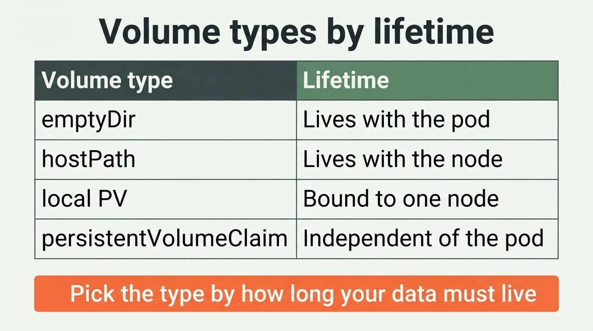
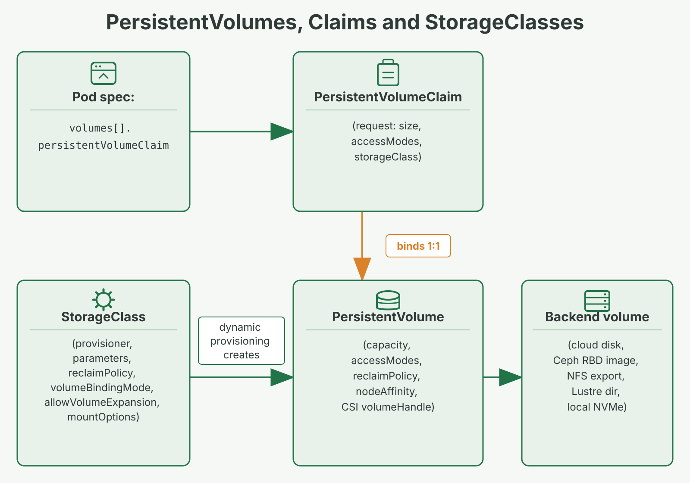
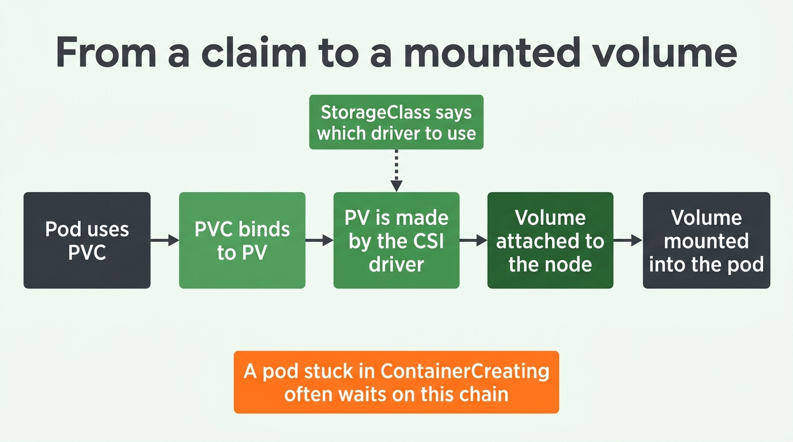
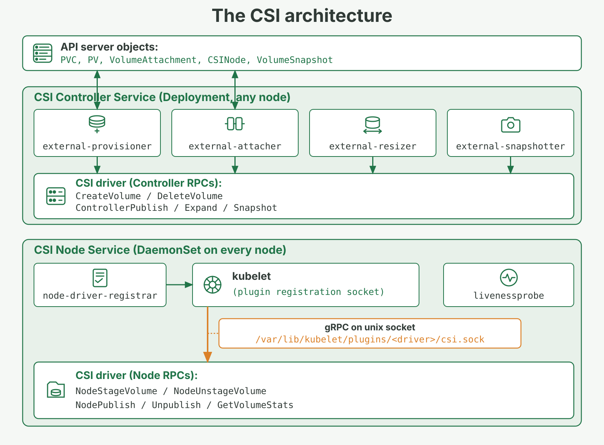
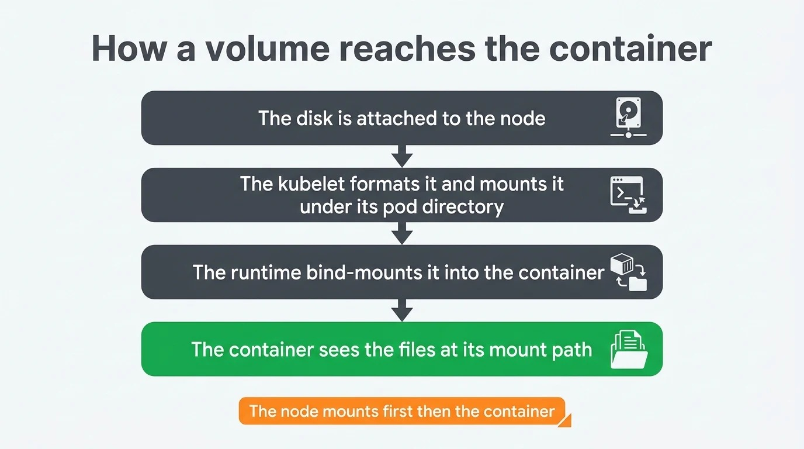
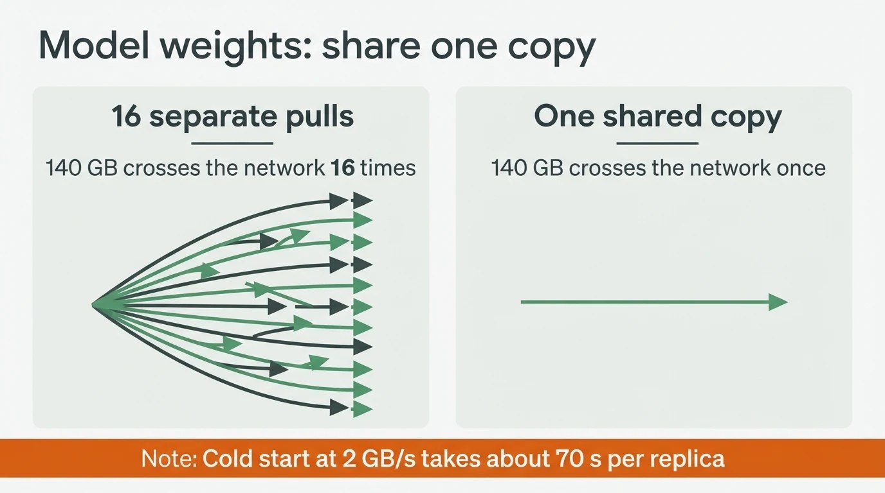
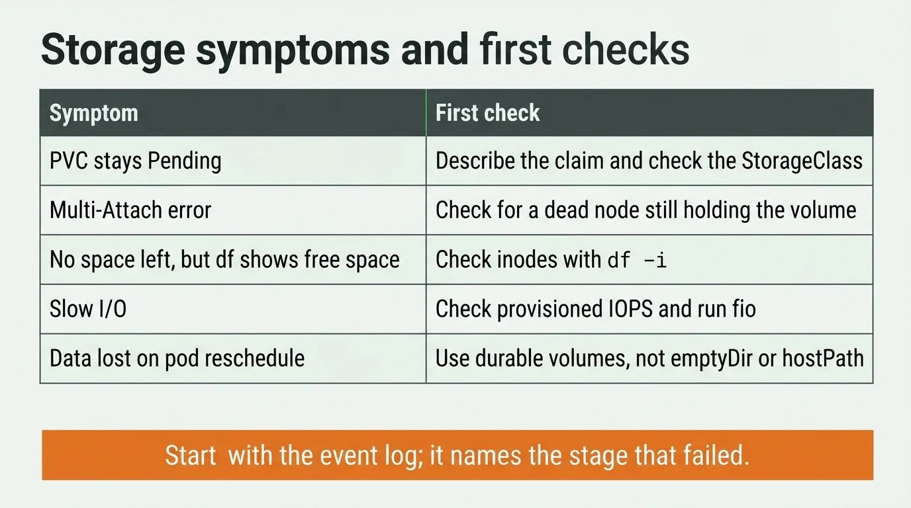

# 5.17 Storage internals: volumes, PV and PVC, CSI and mounts

| | |
|---|---|
| Level | Advanced |
| Priority tier | 0 |
| Lab venue | kind/kubeadm with `local-path`/NFS provisioner and `csi-driver-host-path`; optional Rook-Ceph; `fio`, `findmnt`, `lsblk` |
| Part | Part 5: Kubernetes |
| Status | Drafted, labs **untested** |

## Why this matters for AI infrastructure

Imagine a training run that stalls because the dataset cannot reach the GPUs fast enough. Data is half of every AI job. Training reads terabytes of tokenised data, writes multi-hundred-gigabyte checkpoints on a schedule, and inference servers load tens or hundreds of gigabytes of weights at startup. Storage choices decide whether 1,000 GPUs sit idle waiting on a dataset. They also decide whether a checkpoint takes 30 seconds or 15 minutes, which sets how much compute you lose on each failure. They decide whether a pod can move to another node and keep its data, and whether a node failure loses state. Kubernetes hides most of this behind abstractions: volumes, PersistentVolumes, StorageClasses and CSI drivers. Those abstractions still carry mechanics that affect performance, failure behaviour and cost. This chapter explains the abstractions, the CSI protocol and the mount mechanics. It also covers the patterns that suit datasets, checkpoints, caches and model weights. Part 13 covers the storage systems themselves. Think of this chapter as the bridge between the two. Part 13 explains how a storage system keeps bytes safe. This chapter explains how Kubernetes asks for those bytes, delivers them to a pod and cleans them up afterward.

## Prerequisites and outcomes

This chapter builds on 5.7, 5.8 and 5.9, and on Linux storage from 1.12 to 1.16: block devices, filesystems and mounts. When you finish, you should be able to do the following.

- Choose the right volume type (`emptyDir`, `hostPath`, `configMap`, `projected`, `persistentVolumeClaim`, `ephemeral`, `image`, CSI inline) for each use case.
- Explain the PV, PVC and StorageClass model, including static versus dynamic provisioning, binding, reclaim policies, volume binding modes, access modes, volume modes, expansion, snapshots, clones and topology.
- Describe the CSI architecture and its call sequence. The controller handles Create, Delete, Publish, Unpublish, Expand and Snapshot. The node handles Stage, Publish, Unpublish, Unstage and GetVolumeStats. You should also know the sidecars: external-provisioner, external-attacher, external-resizer, external-snapshotter, node-driver-registrar and livenessprobe.
- Trace what the kernel does for block and file volumes: attach, format, mount, and bind mount into the pod. You should also know how failures show up.
- Design storage for AI work, including dataset access, checkpoint writes, model weight distribution, caches, local NVMe, shared parallel filesystems and object storage mounts. Set realistic throughput and consistency expectations.
- Operate and debug the system: stuck attachments, multi-attach errors, mount failures, full volumes, slow I/O, orphaned volumes, backups and snapshots.

Read the list as a set of questions you should be able to answer by the end. Each question points to a section below, so when one stumps you, the section it names is the place to return to.

## 1. Volume types at a glance

Every pod needs a place to put its files, and the volume type decides how long that place lasts. If you are choosing a type for a new workload, decide first how long your data must live. Pick the wrong type and your data disappears when the pod moves. Think of the volume types as different kinds of storage. One is a shelf in the room, which gets cleared when the room is cleared. Another is a locker rented in your name, which stays rented after you leave the building. The table below compares the main types by lifetime and typical use.


*Figure 5.17.V. Only a PersistentVolumeClaim outlives the pod, so durable data belongs there.*


| Type | Lifetime | Typical use | Notes |
|---|---|---|---|
| `emptyDir` | Pod | Scratch, caches, sharing between containers; `medium: Memory` for tmpfs | On node disk by default; counts toward ephemeral-storage; lost on pod removal (survives container restarts) |
| `hostPath` | Node | Node agents, device access, logs | Security risk; ties pod to a node; avoid for apps |
| `local` PV | Node-bound PV | Local NVMe for datasets/caches/DBs | Requires node affinity; no dynamic provisioning by default (use local-static-provisioner, TopoLVM, OpenEBS LVM/ZFS, Rancher local-path) |
| `configMap` / `secret` / `downwardAPI` / `projected` | Pod | Config and identity (5.16) | tmpfs |
| `persistentVolumeClaim` | Independent of pod | Durable data | Bound to a PV by the control plane |
| Generic `ephemeral` volume | Pod | Per-pod PVC created and deleted with the pod | Uses any StorageClass; dynamic scratch with quotas/snapshots |
| CSI inline ephemeral | Pod | Secrets Store, cert delivery, special drivers | Driver-defined |
| `image` volume | Pod | Mount an OCI image/artefact (model weights, tools) read-only | Newer feature; uses container runtime image pulling and caching |
| `nfs`, `iscsi`, `cephfs`, `rbd`, cloud disk entry types | | Legacy in-tree plugins | Largely migrated to CSI (in-tree removal) |

Lifetime works like nested boxes. A container sits inside a pod, and a pod sits on a node. A volume tied to the pod disappears with the pod, and a volume tied to the node disappears with the node. A claim sits outside both boxes, which is why it can survive both. The lifetime column is the one to check first. A volume that lives as long as the pod survives a container restart, but not a pod deletion. A volume that lives as long as the node disappears with the node. Only a persistentVolumeClaim is independent of the pod, which is why durable data belongs there. The table gives the comparison; the rest of this chapter explains how the durable options work.

### Block, file and object storage

Applications expect one of three storage types, and that choice decides which storage system and Kubernetes integration you need. File storage is the most common type. A file system sits on top of a block device, so the application writes files the same way it would on any operating system.

A block device is the layer underneath the file system. You can skip the file system and give the application the raw block device instead. Every file system adds some overhead to writes. Most workloads never notice it, but a workload that needs raw blocks can use storage systems that support them.

Object storage has no conventional folder hierarchy. The application gives each piece of unstructured data a unique identifier, adds some metadata, and stores it. Cloud object stores such as Amazon S3 are popular for images and binaries, partly because they offer a full web API and access control.

Applications usually reach object stores directly. They use a library to authenticate and talk to the provider. Object storage has less standard interfaces than files or blocks, so platform teams rarely offer it as a transparent service. Plan for that early. A file or block volume can be mounted for the developer, but an object store usually needs the application's own code to call it. A simple way to remember the three is this. File storage is a filing cabinet with folders. Block storage is a stack of numbered drawers that a file system has to organize. Object storage is a warehouse where every item carries a label and nothing sits on shelves.

## 2. PersistentVolumes, Claims and StorageClasses

A training engineer asks for "2 TB for checkpoints" and expects it to appear on the right machine. Three objects make that happen. The claim states the need, the PersistentVolume is the storage that satisfies it, and the StorageClass describes how new storage should be created. Think of the claim as a purchase order, the PV as the item that arrives, and the StorageClass as the catalog that says how each item is made. The diagram shows how they connect.



*Figure 5.17.1. PersistentVolumes, Claims and StorageClasses, as a diagram.*

A PersistentVolume is a cluster-scoped record of a piece of storage. It holds the capacity, access modes, reclaim policy, mount options, node affinity, and a source that names the CSI driver, a `volumeHandle` and its attributes. An administrator can create one by hand, which is called static provisioning. A provisioner can also create one on demand, which is called dynamic provisioning. A PersistentVolumeClaim is the namespaced request. It names a size, access modes, a volume mode, a StorageClass and optionally a selector or a `volumeName`. The PV controller then binds the claim to a suitable volume. It prefers the smallest volume that meets the capacity, class, modes, selector and node affinity. The binding is exclusive and one to one.

Consider a concrete case. A claim asks for 2Ti with the class `fast-nvme`. The PV controller looks for an unbound volume that fits. If none fits, a provisioner in that class creates one. From then on the claim and the volume belong to each other, and no other claim can use that volume until the first claim is gone.

A StorageClass names a provisioner and the parameters it should use when it creates volumes. If you set the annotation `storageclass.kubernetes.io/is-default-class: "true"`, that class applies to any claim that leaves out `storageClassName`. Setting `storageClassName: ""` means the claim uses no class at all, so it can only bind to a static volume. Think of the default-class annotation as a house rule. Anyone who does not name a class gets the house default. That is convenient, but it also means a claim can land on a disk type nobody chose on purpose. Setting an empty class name is the opposite rule. It says "no class," so the claim waits for a volume that someone created by hand.

```yaml
apiVersion: storage.k8s.io/v1
kind: StorageClass
metadata: { name: fast-nvme }
provisioner: ebs.csi.aws.com            # or pd.csi.storage.gke.io, rook-ceph.rbd.csi.ceph.com, lustre.csi.hpe.com, csi.vast.com ...
parameters: { type: gp3, iops: "6000", throughput: "500", encrypted: "true" }
reclaimPolicy: Delete                   # Delete | Retain
allowVolumeExpansion: true
volumeBindingMode: WaitForFirstConsumer # Immediate | WaitForFirstConsumer
mountOptions: [noatime]
allowedTopologies:
  - matchLabelExpressions: [ { key: topology.kubernetes.io/zone, values: [us-central1-a, us-central1-b] } ]
---
apiVersion: v1
kind: PersistentVolumeClaim
metadata: { name: checkpoints, namespace: training }
spec:
  accessModes: [ReadWriteOnce]
  storageClassName: fast-nvme
  volumeMode: Filesystem                # Filesystem | Block
  resources: { requests: { storage: 2Ti } }
```

The manifest above asks for a 2Ti volume, and the class decides how that volume is built. Look at `volumeBindingMode` and `reclaimPolicy` first, because they change what happens later.

Walk through the StorageClass one field at a time. `provisioner` names the driver that does the work. `parameters` are that driver's own settings, such as the disk type and the IOPS. `reclaimPolicy` says what happens to the data later. `allowVolumeExpansion` lets you grow the claim, and `allowedTopologies` limits the zones where the disk may be created. The claim on the other side is short. It asks for a size, an access mode and a class, and nothing more.

### Key properties

Access modes describe how a volume may be mounted. `ReadWriteOnce` (RWO) means one node can mount it read-write, and several pods on that node may use it. `ReadOnlyMany` (ROX) allows read-only mounts across nodes. `ReadWriteMany` (RWX) allows read-write mounts across nodes. `ReadWriteOncePod` (RWOP) allows exactly one pod. The driver declares these capabilities. The filesystem does not enforce them, except where the backend does. Block devices such as cloud disks and RBD images are usually RWO. Shared filesystems such as NFS, CephFS, Lustre, WEKA, FSx and Filestore are usually RWX. An access mode is a promise the driver makes about how a volume may be attached. It is not a lock on the data. Two pods on the same node can both write to an RWO volume, and the filesystem will not stop them from overwriting each other's files.

Volume binding mode controls when storage gets created. With `Immediate`, the volume is provisioned and bound as soon as the claim exists. The zone is chosen without knowing where the pod will run, so the pod may later be unschedulable because the volume's zone has no GPUs. With `WaitForFirstConsumer`, provisioning waits until a pod using the claim is scheduled. The volume is then created in that pod's topology, meaning its zone or node. The documentation strongly recommends this mode for zonal block storage and local volumes. Think of `Immediate` as ordering a cake before you know the guest list. If the venue turns out to be in the wrong city, you have paid for a cake nobody can eat. `WaitForFirstConsumer` waits for the guest list. Suppose the claim is created first and the pod that uses it is scheduled a moment later. Under `WaitForFirstConsumer`, the disk is created in the zone where that pod landed. Under `Immediate`, it was created earlier, in whatever zone the provisioner happened to pick.

Reclaim policy decides what happens to the data when the claim goes away. `Delete` is the default for dynamic volumes. Deleting the claim then deletes the PV and the backend volume. `Retain` releases the PV and keeps the data for manual recovery or rebinding. An administrator must then clean up the volume and clear its `claimRef`. For checkpoint and dataset volumes, use `Retain` or a backup or snapshot policy. Reserve `Delete` for scratch space. Think of `Delete` as shredding a document when you throw away its folder, and `Retain` as putting the folder in a labelled archive box. For a dataset that took a week to prepare, the archive box is the safer choice.

Volume expansion works when `allowVolumeExpansion: true` is set. You edit `spec.resources.requests.storage` on the claim. The external-resizer then expands the backend volume, which is controller expansion. The node plugin then expands the filesystem, either online or on the next mount, depending on the driver. Shrinking a volume is not supported. A useful picture is a shop that adds a room to its building. The builders knock through the wall first, which is the controller stage. Then the staff fit out the room, which is the node stage. Until that second stage runs, the extra space exists, but nobody can use it.

Volume modes are `Filesystem`, the default, and `Block`. In `Filesystem` mode the kubelet and CSI format and mount the volume. In `Block` mode the raw device appears as `/dev/xxx` through `volumeDevices`. Databases, direct I/O and GPUDirect Storage experiments often use `Block` mode. Think of `Filesystem` mode as handing the application a formatted disk with folders already laid out. `Block` mode hands over the bare disk, and the application decides how to lay out its own data. Software that manages its own on-disk pages often wants that control, because it does not need a file system sitting between it and the disk.

Topology keeps pods near their storage. A CSI driver reports the zone, node or rack it can reach, and it records that in the PV's `nodeAffinity`. The scheduler's VolumeBinding plugin respects this, so pods are pinned to nodes that can reach the volume. Think of `nodeAffinity` on a PV as a delivery address. The volume can only be picked up in the zone where it lives, so the scheduler has to send the pod to that zone.

Storage protection finalizers stop a volume from being deleted while something uses it. The finalizers `kubernetes.io/pvc-protection` and `pv-protection` keep the object alive. A PVC shows `Terminating` until the pods stop using it. Think of a finalizer as a "do not remove yet" sticker. Kubernetes will not finish the deletion while the sticker is on the object, and the sticker comes off only when the last pod stops using the claim.

Snapshots and clones use the `VolumeSnapshot`, `VolumeSnapshotClass` and `VolumeSnapshotContent` objects, managed by external-snapshotter. A claim's `dataSource` can restore from a snapshot or clone from another PVC. These snapshots are crash-consistent unless the application quiesces itself first. Think of a crash-consistent snapshot as a photo of a busy kitchen. Everything in the photo was really there, but a pot that was still simmering may need a moment before it is safe to serve. An application that flushes its own writes first is like a cook who turns off the burners before the photo. Volume populators, set through `dataSourceRef`, fill a new volume from other sources such as an object store or an OCI image. That is useful for pre-seeding datasets and model weights.

Some newer features are worth checking against your cluster version. These include volume group snapshots, CSI storage capacity tracking (`CSIStorageCapacity`), and `VolumeAttributesClass`. The last one lets you change IOPS and throughput without recreating the volume. Ephemeral storage limits are also in this group.

StatefulSet claims need their own care. The `persistentVolumeClaimRetentionPolicy` field controls whether those claims are deleted on scale-down or on delete (see 5.7).

Before you create the first claim in a namespace, decide which claims must use `Retain`. Make that decision with the data owner in the room, not after the first accidental deletion.

### Offering storage classes to developers

Platform teams often need to offer more than one kind of disk. Many applications only persist files and do not need fast reads or writes. Others need fast disks with a set number of IOPS per gigabyte. One StorageClass per offering lets developers choose by name, and the `parameters` field maps each offering to what the provider can do. Think of the classes as a menu. Each item has a name, a description and a price, and the developer orders by name without needing to know how the kitchen works.

Consider two offerings. `default-block` uses optimized HDD and reaches 40 to 90 MB/s per volume. `performance-block` uses io1 SSD and reaches about 1000 MB/s per volume. The costs below are AWS prices as recorded when this material was written, so check current rates before you budget.

| Offering name | Storage type | Max throughput per volume | AWS cost |
|---|---|---|---|
| `default-block` | HDD (optimized) | 40–90 MB/s | $0.045 per GB per month |
| `performance-block` | SSD (io1) | ~1000 MB/s | $0.125 per GB per month + $0.065 per provisioned IOPS per month |

```yaml
kind: StorageClass
apiVersion: storage.k8s.io/v1
metadata:
  name: default-block
  annotations:
    storageclass.kubernetes.io/is-default-class: "true"
provisioner: ebs.csi.aws.com
allowVolumeExpansion: true
volumeBindingMode: WaitForFirstConsumer
parameters:
  type: st1
---
kind: StorageClass
apiVersion: storage.k8s.io/v1
metadata:
  name: performance-block
provisioner: ebs.csi.aws.com
parameters:
  type: io1
  iopsPerGB: "20"
```

The `name` is what claims reference. The default annotation makes `default-block` the class for any claim that leaves out a class. Both classes use the same `provisioner`, which maps them to the AWS EBS CSI driver. `allowVolumeExpansion: true` lets developers grow their claims later.

`volumeBindingMode: WaitForFirstConsumer` delays creation until a pod uses the claim. The volume then lands in the pod's availability zone. It also stops unused claims from creating disks that you pay for. A claim that no pod ever mounts costs nothing under this mode, because no disk is created for it. That is why the binding mode affects the bill as well as where the disk lands.

Now suppose a developer needs one cheap disk and one fast disk. The first claim, `pvc0`, asks for 11Gi and names no class. The second, `pvc1`, asks for 14Gi and names `performance-block`.

```yaml
apiVersion: v1
kind: PersistentVolumeClaim
metadata:
  name: pvc0
spec:
  resources:
    requests:
      storage: 11Gi
---
apiVersion: v1
kind: PersistentVolumeClaim
metadata:
  name: pvc1
spec:
  resources:
    requests:
      storage: 14Gi
  storageClassName: performance-block
```

`pvc0` takes the default class and the usual defaults: RWO access and filesystem mode. Its volume is not created until a pod consumes the claim, so the claim waits in `Pending` until then. You do not pay for disk that nobody uses. `pvc1` names its class, so the driver creates an unattached volume right away. That volume attaches quickly when a pod needs it. Read the two claims as two different requests. `pvc0` is the easy one. It takes whatever the cluster treats as normal, and it waits until a pod needs it. `pvc1` is explicit. It names its class, so the driver starts provisioning right away.

**Warning:** Letting developers create claims also lets them name any StorageClass. If that is a problem, add validating admission control to check each request.

### Resizing a volume in practice

Resizing takes two stages, and the second is easy to miss. The external-resizer sidecar detects the larger size in the claim and forwards it to the driver. The driver grows the disk through the cloud API, which is controller expansion.

The new space is still unusable at this point. The filesystem still covers only the original size. The node plug-in must then expand the filesystem, and it can do this without terminating the pod. The node logs show the work. Look for this sequence when a resize seems stuck. The controller side must finish first, and the node side can only start once the disk is larger.

```
mount_linux.go: Attempting to determine if disk "/dev/nvme1n1" is formatted
using blkid with args: ([-p -s TYPE -s PTTYPE -o export /dev/nvme1n1])
mount_linux.go: Output: "DEVNAME=/dev/nvme1n1\nTYPE=ext4\n", err: <nil>
resizefs_linux.go: ResizeFS.Resize - Expanding mounted volume /dev/nvme1n1
resizefs_linux.go: Device /dev/nvme1n1 resized successfully
```

The first lines check which filesystem sits on the device, here `ext4`. The last lines confirm that the resize finished. Read the log in order. If it stops after the `blkid` check, the node plugin never reached the resize step, and the next place to look is the node plugin's own logs.

**Warning:** Kubernetes does not allow a claim to shrink. Unless the CSI driver works around this, going smaller means creating a new volume. Keep this in mind before you grow a volume.

### Snapshots and restores in practice

A team's checkpoint volume is deleted by mistake on a Friday afternoon. Without a snapshot from the night before, the last good checkpoint is gone with it. Snapshots exist to make that earlier copy cheap to take and quick to restore.

Snapshots let you take periodic copies of a volume's data. The work is split across two controllers, each responsible for one custom resource. The `VolumeSnapshot` object drives the snapshot lifecycle. The external-snapshotter sidecar then manages the matching `VolumeSnapshotContent` object and forwards requests to the driver.

**Note:** When this material was written, these objects were CRDs rather than core Kubernetes API objects. The CSI driver or your Kubernetes distribution must install the CRD definitions first. Check which snapshot API version your cluster serves before you apply the manifests below.

Snapshots are offered through a snapshot class, which works like a StorageClass:

```yaml
apiVersion: snapshot.storage.k8s.io/v1beta1
kind: VolumeSnapshotClass
metadata:
  name: default-snapshots
driver: ebs.csi.aws.com
deletionPolicy: Delete
```

The `driver` field names the driver that receives snapshot requests. `deletionPolicy: Delete` removes the content object when the snapshot is deleted. Depending on what the provider supports, the underlying volume can be deleted too. Think of a VolumeSnapshotClass as a recipe card. It names the driver that makes the snapshot and sets the rule for what happens to the leftovers when the snapshot is thrown away.

A snapshot is created in the same namespace as the application and its claim:

```yaml
apiVersion: snapshot.storage.k8s.io/v1beta1
kind: VolumeSnapshot
metadata:
  name: snap1
spec:
  volumeSnapshotClassName: default-snapshots
  source:
    persistentVolumeClaimName: pvc0
```

`volumeSnapshotClassName` picks the class, which tells the driver how to take the snapshot. `persistentVolumeClaimName` names the claim whose volume should be copied. Once the driver finishes, the snapshot reports `ReadyToUse`. Read that state as the moment the snapshot can be trusted for a restore. Before it, a restore may fail or fill the new volume with incomplete data, so check the status before you tell anyone the backup is safe.

Suppose the original volume fails, or its claim is deleted by mistake. You can rebuild the data with a new claim whose `dataSource` points at the snapshot:

```yaml
apiVersion: v1
kind: PersistentVolumeClaim
metadata:
  name: pvc-reclaim
spec:
  accessModes:
    - ReadWriteOnce
  storageClassName: default-block
  resources:
    requests:
      storage: 600Gi
  dataSource:
    name: snap1
    kind: VolumeSnapshot
    apiGroup: snapshot.storage.k8s.io
```

The new claim uses the snapshot to fill its volume. Once a pod is recreated to use this claim, the container sees the last snapshotted state again. Think about what the restore does not bring back. It does not recreate the pod, the ConfigMap or the Service. It only rebuilds the volume, so the pod still needs its own manifest that mounts the new claim.

A snapshot is only a primitive, which means it is a building block rather than a finished plan. Think of the snapshot as the ingredient and the backup schedule as the recipe that uses it. Scheduling and retention are your job. You might run snapshots from a CronJob, write a custom controller, or use Velero to back up Kubernetes objects and data volumes on a schedule.

### Integrating External and Replicated Stateful Storage (*Kubernetes: Up and Running* Chapter 16 & *Production Kubernetes* Chapter 4)

Kubernetes: Up and Running Chapter 16 and Production Kubernetes Chapter 4 describe three patterns for connecting stateful storage to a workload. Each pattern adds more of the cluster's own machinery, so it helps to read them in order. Think of the three patterns as three levels of commitment. The first keeps the database outside the cluster and gives it a name inside. The second moves the database into the cluster but keeps just one copy. The third runs several copies that know about each other.

The first pattern covers a database or storage appliance that lives outside Kubernetes. You represent it as a Kubernetes Service, so applications use the normal service discovery. You have two options. An `ExternalName` service with `externalName: database.company.com` creates a CNAME record, so `external-database.default.svc.cluster.local` points to `database.company.com`. Or you create a Service named `external-ip-database` with no `spec.selector`, and a matching `Endpoints` object. That object lists `subsets: [{ addresses: [{ ip: 192.168.0.1 }], ports: [{ port: 3306 }] }]`, which points the Service at the external address. You can also list the addresses in an EndpointSlice instead. Think of the Service as a forwarding address. Applications inside the cluster use the familiar name, and Kubernetes forwards their traffic to the database that lives outside.

The second pattern runs a singleton stateful pod. A `ReplicaSet` or `Deployment` with `replicas: 1` mounts a `PersistentVolumeClaim`. In the example, `claimName: database` mounts at `/var/lib/mysql`. The data survives pod and node restarts. The catch is that you cannot scale past one replica on a single RWO volume without risking concurrent corruption. Think of a singleton as one filing cabinet in one office. The claim keeps the cabinet's contents safe across pod restarts and node restarts, but it does not create a second cabinet. If the office itself is lost, you need a copy somewhere else.

The third pattern runs a replicated cluster, such as a 3-node MongoDB, Qdrant, Milvus or etcd. It combines three pieces. The first is a headless Service with `clusterIP: None`, `name: mongo` and `port: 27017`. CoreDNS then publishes a stable record for each pod: `mongo-0.mongo.default.svc.cluster.local`, `mongo-1.mongo` and `mongo-2.mongo`. The second is a `StatefulSet` with `serviceName: "mongo"` and `replicas: 3`. It uses `volumeClaimTemplates`, so each replica gets its own PVC: `database-mongo-0`, `database-mongo-1` and `database-mongo-2`. Startup is ordinal, from `0` to `1` to `2`. The third is an `initContainer` named `init-mongo`. It mounts a ConfigMap, `mongo-init` with `init.sh`. The script uses `mongo-0.mongo` as the primary through `rs.initiate`. It then joins `mongo-1.mongo` and `mongo-2.mongo` with `rs.add`, forming the replica set `rs0`.

Think of the StatefulSet as a row of named chairs. Each chair has a stable name, so `mongo-0` is always the first one. Each chair also gets its own locker, which is its PVC. The init container plays the usher. It seats the first member as the primary and then adds the others one by one, so the group forms in a known order.

Which pattern you pick depends on whether the data must be replicated or simply kept. A singleton is simpler to run, but it cannot scale beyond one replica. A practical rule of thumb is to start with the simplest pattern that keeps the data you need. Move to the replicated pattern when a single copy becomes a risk you cannot accept.

## 3. The CSI architecture

The Container Storage Interface, or CSI, is a gRPC specification between an orchestrator and a storage driver. Kubernetes uses sidecar containers around the driver. This means a driver author implements only the CSI services and leaves the Kubernetes wiring to the sidecars. Think of CSI as a standard power socket. Each storage vendor builds its own device, and the cluster offers one standard socket. The sidecars are the adapters that connect that socket to Kubernetes objects.



*Figure 5.17.2. A pod asks for storage with a claim. The CSI driver creates and mounts the volume.*



*Figure 5.17.3. The CSI architecture, as a diagram.*

The controller runs as a Deployment on any node. The node service runs as a DaemonSet on every node. The diagram shows which sidecar watches which object and calls which driver function. Read the controller side first, then the node side. If you are tracing a failed volume, follow the steps in order until you find where it stops. Think of the sidecars as office staff on the Kubernetes side. They take requests from the API objects and pass them along. The driver is the crew on the storage side, and it does not need to understand Kubernetes objects at all.

### Why CSI replaced in-tree plugins

Imagine that a bug in the AWS volume code needs a fix today. Under the old model, that fix would wait for the next Kubernetes release, and every cluster on every cloud would receive the new code, whether it used AWS or not. Early Kubernetes shipped storage providers inside its own code. These were in-tree plugins, and examples include AWS EBS, GlusterFS, GCE PD and Ceph RBD. The core project had to hold the logic for every provider, and that code shipped inside control plane components.

That model had real costs. A provider could not be updated on its own schedule, because every change waited for a Kubernetes release. Every cluster also carried code it never used. A cluster running on AWS still contained code for Google Persistent Disks.

FlexVolume drivers tried to move this code out of the core project. They are now in maintenance mode, and CSI is the path forward. Provider code lives in out-of-tree projects, which you can manage separately from the cluster. A cluster on AWS now carries the AWS code and not the Google Persistent Disk code, and each driver can ship a fix on its own schedule.

### Controller and node services

CSI splits the driver into a controller service and a node service. The Kubernetes control plane does not call the controller service directly. Storage community controllers, called sidecars, watch Kubernetes objects and translate them into CSI calls. A new claim, for example, leads to a `CreateVolumeRequest`. Sidecars talk to the driver over UNIX sockets, so they usually run next to it. Think of the sidecars as the waiters and the driver as the kitchen. The waiters never cook, and the kitchen never reads the order tickets directly. The ticket has to pass through a waiter first.

The controller service creates and deletes volumes at the provider. It also handles optional features such as snapshots and expansion. The sidecars that sit with it are these:

- `external-provisioner` watches claims. When one asks for storage, it creates the volume and then creates the PV object.
- `external-attacher` watches `VolumeAttachment` objects and sends attach and detach requests to the driver.
- `external-resizer` detects size changes in claims and sends expansion requests.
- `external-snapshotter` handles `VolumeSnapshotContent` objects and sends snapshot requests.

Driver authors do not have to use these sidecars. Using them is still encouraged, because it stops every driver from repeating the same logic.

The node service runs on each node. It mounts attached volumes, sets up their filesystems, and mounts them into pods. The kubelet makes these requests. Two sidecars often run in the node Pod. `node-driver-registrar` tells the kubelet that the driver exists. `liveness-probe` reports whether the driver is healthy.

Many drivers ship the controller and node code in one binary. They choose a mode with an environment variable such as `X_CSI_MODE`. The only firm rules are that the driver registers with the kubelet and implements the CSI endpoints. Both services also answer identity calls. These report plugin information, capabilities and health.

### Lifecycle for a dynamically provisioned volume

A training pod is scheduled, and the volume it needs must be ready before its container can start. Several components have to hand the volume along in order, and each step waits on the one before it. Follow one volume from creation to teardown. The sequence has seven steps.

1. A PVC is created. The external-provisioner sees an unbound claim for its class. With `WaitForFirstConsumer`, it waits until the scheduler selects a node and annotates the PVC with `volume.kubernetes.io/selected-node`. It then calls `CreateVolume`, passing the size, the parameters, the topology requirements and, optionally, a snapshot or clone source. Finally it creates the PV with the CSI `volumeHandle`.
2. The PV controller binds the PVC to the PV.
3. For drivers with `attachRequired: true`, which is typical for block devices, the attach/detach controller creates a `VolumeAttachment` object. The external-attacher calls `ControllerPublishVolume`, which attaches the disk to the node VM or maps the LUN. The status then shows `attached: true`. Shared filesystems such as NFS, CephFS and Lustre usually skip this step.
4. If the driver advertises `STAGE_UNSTAGE_VOLUME`, the kubelet calls `NodeStageVolume` once per node per volume. The node formats the device with mkfs if needed and mounts it at a global staging path, `/var/lib/kubelet/plugins/kubernetes.io/csi/<driver>/<hash>/globalmount`.
5. For each pod that uses the volume, the kubelet calls `NodePublishVolume`. This bind-mounts or mounts from the staging path into `/var/lib/kubelet/pods/<uid>/volumes/kubernetes.io~csi/<pv>/mount`, using the pod's options for read-only access and fsGroup handling. The container runtime then bind-mounts that path into the container.
6. While the volume is in use, `NodeGetVolumeStats` feeds the `kubelet_volume_stats_*` metrics for capacity, used space and inodes.
7. Teardown runs in reverse. `NodeUnpublishVolume` runs for each pod. `NodeUnstageVolume` runs when the last pod on the node stops. `ControllerUnpublishVolume` detaches the disk. If the PVC is deleted with the `Delete` reclaim policy, `DeleteVolume` runs last.

Read the seven steps as a chain of hand-offs. If a pod is stuck, the event log tells you which hand-off did not happen. You then need to look only at the component responsible for that step, rather than at the whole stack.

Multi-attach errors are the most common surprise in this lifecycle. Think of an RWO block volume as a rented power tool that only one site may hold at a time. If the renter's truck breaks down on the road, the tool still counts as signed out to that truck until someone confirms it is no longer in use. Forcing the return too early risks two sites running the same tool at once. If you see one of these errors, find which node still holds the attachment before you delete anything. An RWO block volume still attached to a failed or unreachable node cannot attach to another node. The attach/detach controller waits for a safe detach. After the node is unhealthy, a forced detach happens once the 6-minute `maxWaitForUnmountDuration` passes. The `out-of-service` taint speeds this up for non-graceful shutdowns, and some drivers add fencing. The symptom looks like this: `Multi-Attach error for volume ... Volume is already exclusively attached to one node`.

### fsGroup, permissions and SELinux

Setting `securityContext.fsGroup` tells the kubelet, or the CSI driver through `fsGroupPolicy`, to chown and chmod the volume contents on mount. The recursive walk is slow on a volume with millions of files. Use `fsGroupChangePolicy: OnRootMismatch`, or a driver that applies the group at mount time. See `fsGroupPolicy` on the CSIDriver object. SELinux relabeling has the same cost on large trees, controlled by `seLinuxChangePolicy` or a mount with `-o context=`. For datasets made of many small files, it is usually better to mount read-only with the correct ownership already baked in. Think of `fsGroup` as changing the lock on every room of a building by walking the halls. One lock is quick. Millions of locks take a long time, and every pod start pays that bill again.

### CSI driver capabilities and ecosystems

Each CSIDriver object declares its behaviour. The fields include `attachRequired`, `podInfoOnMount`, `volumeLifecycleModes`, `fsGroupPolicy`, `storageCapacity`, `requiresRepublish` and `seLinuxMount`. Each node also registers itself in a `CSINode` object, which lists `topologyKeys` and `allocatable.count`, the maximum number of volumes that node can attach. Read these fields as lines on a driver's product sheet. `attachRequired` says whether the disk must be attached before it is used. `fsGroupPolicy` says whether the kubelet or the driver handles group ownership. Check them before you approve a driver for production.

Drivers fall into several groups. Cloud block drivers include EBS, GCE PD or Hyperdisk, and Azure Disk. Cloud file drivers include EFS, Filestore, Azure Files and FSx for Lustre or ONTAP. Object-as-filesystem drivers include the S3 CSI driver with Mountpoint and the GCS FUSE CSI driver. Ceph drivers come from Rook, with RBD and CephFS. NFS drivers include csi-driver-nfs and the NFS subdir provisioner. Parallel filesystem drivers include Lustre, BeeGFS, WEKA, VAST, GPFS or IBM Storage Scale, DDN EXAScaler, and the Pure, NetApp and Dell CSI drivers. Local drivers include TopoLVM, OpenEBS, Longhorn and local-path. Node-local caching layers include Alluxio, the JuiceFS CSI driver and Fluid. Vendor drivers also exist for GPUDirect Storage. A quick way to sort this long list is by what you are trying to do. Block drivers suit a workload with one writer. File drivers suit shared datasets and home directories. Object-as-filesystem drivers suit read-heavy data that already lives in a bucket.

Each controller should run with replicas and leader election. Node plugins run as privileged DaemonSets with mount propagation set to `Bidirectional`. Treat them as part of the node's trusted base. "Privileged" means the plugin can mount things that an ordinary container cannot, so a compromised plugin is a serious event.

Before you approve a driver for production, read its CSIDriver object and check `attachRequired`, `fsGroupPolicy` and `storageCapacity`.

### Installing the driver and giving it access

Before the driver can manage volumes, it must identify itself to the provider. You have three options. The first is to set permissions on the instance profile of the Kubernetes nodes. That keeps credentials out of Kubernetes, but every workload that can reach the AWS API gets the same privileges. Think of the three options as three ways to give a contractor a key. You can leave a key under the mat that anyone can find. You can hand a key to one named contractor. Or you can hand over a sealed envelope. The envelope is the one you still have to protect.

The second option is likely the most secure. An identity service grants IAM permissions to specific workloads, and kiam is an example of such a project. The third option is a secret that is mounted into the driver. It looks like this, with your own values in place of the placeholders:

```yaml
apiVersion: v1
kind: Secret
metadata:
  name: aws-secret
  namespace: kube-system
stringData:
  key_id: "<access-key-id>"
  access_key: "<secret-access-key>"
```

**Warning:** This account can change the underlying storage system. Manage access to this secret carefully.

With the access in place, you install the CSI components. The controller runs as a Deployment. With several replicas, it uses leader election to choose the active instance. The node plugin runs as a DaemonSet, which places one Pod on every node. Each node plugin registers with its kubelet, and the kubelet then creates a `CSINode` object for the node. Install the controller first and watch it come up. Then install the node plugin and check that each node registers. A driver that runs on the controller but never appears on a node cannot mount anything.

A three-node cluster looks like this:

```
$ kubectl get csinode
NAME                                        DRIVERS   AGE
ip-10-0-0-205.us-west-2.compute.internal    1         97m
ip-10-0-0-224.us-west-2.compute.internal    1         79m
ip-10-0-0-236.us-west-2.compute.internal    1         98m
```

Each node lists one driver. The `CSINode` object for one node shows the details. Read the output as a quick health check. Each node should list the driver you installed, and a node that is missing from the list is a node where pods will fail to mount:

```yaml
apiVersion: storage.k8s.io/v1
kind: CSINode
metadata:
  name: ip-10-0-0-205.us-west-2.compute.internal
spec:
  drivers:
  - allocatable:
      count: 25
    name: ebs.csi.aws.com
    nodeID: i-0284ac0df4da1d584
    topologyKeys:
    - topology.ebs.csi.aws.com/zone
```

The `allocatable.count` is the most volumes that node can take. Once a node is picked for a workload, that node's details go into the `CreateVolumeRequest`, so the driver knows where to create the volume. The `topologyKeys` field matters when nodes cannot all reach the same storage. In AWS, a Pod scheduled in one availability zone needs its volume created in that same zone. Think of `allocatable.count` as the number of seats on a bus. Once the seats are full, the next passenger waits, even if the bus is otherwise empty. A pod that needs one more volume waits for the same reason.

## 4. Mount mechanics (what the kernel does)

Suppose a pod starts, reports that its data folder is missing, and nobody can say what happened in between. The kernel did a series of quiet steps before your program ran at all. When a pod starts, the kernel does a lot of quiet work before your program runs. Knowing these steps helps you find a failed mount on the node.



*Figure 5.17.4. The kubelet mounts the volume on the node first, then bind-mounts it into the container.*

- The kubelet creates directories under `/var/lib/kubelet/pods/<pod-uid>/volumes/<plugin>/<volume>/`. Bind mounts expose them in the container's mount namespace. Mount propagation, which can be `None` (the default), `HostToContainer` or `Bidirectional`, controls whether a mount made inside or outside a namespace is visible on the other side. CSI node plugins and some agents need this. Think of mount propagation as a window between two rooms. With `None`, the window is painted shut, so a mount made in one room stays in that room. `Bidirectional` opens the window in both directions.
- A block-backed volume follows a fixed path. Attach creates a device, such as `/dev/nvme1n1`, `/dev/sdb` or an entry under `/dev/disk/by-id/...`. On first use, `mkfs.ext4/xfs` formats it, based on the driver's `fsType` parameter. XFS is often preferred for large datasets and checkpoints, while ext4 is the default. The volume is then mounted at the staging path with options such as `noatime` and `discard`, and each pod gets a bind mount. Think of attach as plugging in a new hard disk, format as partitioning it with a fresh file system, and mount as opening a folder on that disk. A bind mount is then a shortcut from each pod's folder to that same opened folder, so every pod sees the same bytes.
- Network filesystems mount through kernel clients, using `mount -t nfs4`, `lustre`, the `cephfs` kernel or FUSE client, or `wekafs`. Others use FUSE, including S3 and GCS FUSE, JuiceFS and gcsfuse. FUSE runs a userspace daemon. That daemon can live inside the CSI node plugin or in a per-volume pod. If it crashes or restarts, running pods' mounts can break with `Transport endpoint is not connected`. A simple way to picture FUSE is this. The kernel hands each file request to a program running in user space, and that program does the real work. If the program stops, the requests have nowhere to go, even though the mount still looks present.
- To inspect a volume on the node, use `findmnt -T /var/lib/kubelet/pods/<uid>/volumes/...`, `mount | grep csi`, `lsblk -f`, `df -h`, `ls -l /dev/disk/by-id` and `cat /proc/self/mountinfo`. Inside the container, use `findmnt`, `df -h /data` and `stat -f /data`, which report the filesystem type and IDs. Run the node commands when you want to see what the kernel actually mounted, instead of what Kubernetes says it mounted. The two can differ, and the kernel's view is the one that matters for I/O.
- Ephemeral storage lives in several places. Writable layers sit under the runtime root. `emptyDir` data sits under `/var/lib/kubelet/pods/<uid>/volumes/kubernetes.io~empty-dir/`. Logs go under `/var/log/pods`. All of these sit on the node's root, image or container filesystems. They are subject to ephemeral-storage requests, limits and eviction (see 5.9).
- A `volumeMode: Block` volume has no filesystem. The kubelet bind-mounts the device node into the container as `devicePath`, using `securityContext` and `volumeDevices`.
- A `subPath` creates a bind mount to one subdirectory. Security fixes constrain how symlinks are handled. A `subPathExpr` uses environment or Downward API values to create per-pod directories on a shared volume. This is a common pattern for per-rank checkpoint directories. Think of `subPath` as opening a door to one room of a shared house, instead of handing over the key to the whole building. `subPathExpr` builds the room number from the pod's own environment, so each pod gets its own room without anyone typing the number by hand.
- Set `readOnly: true` on dataset mounts. You can also add `nosuid,nodev,noexec` as node mount options for defence in depth. Think of a read-only mount as a library book. Many people can read it, and nobody can write notes in the margins.

## 5. Storage patterns for AI/ML workloads

Different AI workloads read and write data in very different ways. A training job reads the same dataset many times. A checkpoint writes hundreds of gigabytes in one burst. An inference replica reads the same weights once at startup. The table matches each need to a storage pattern.


*Figure 5.17.V. Sharing one cached copy of model weights moves the bytes once instead of once per replica.*


| Need | Preferred pattern | Notes |
|---|---|---|
| **Training datasets** (TB, many reads) | RWX shared parallel filesystem (Lustre/WEKA/VAST/BeeGFS/GPFS) mounted read-only; or sharded files on object storage streamed with a data loader (WebDataset, Mosaic Streaming); node-local NVMe cache (Alluxio/Fluid/JuiceFS/`emptyDir` on NVMe) for hot shards | Metadata-heavy small files hurt; pre-pack into large shards; align reads with filesystem stripe size |
| **Checkpoints** (hundreds of GB, bursty writes, many ranks) | Parallel FS or fast RWX with high write throughput; write per-rank shards in parallel (sharded/distributed checkpointing); async checkpoint to local NVMe then drain to durable storage; atomic rename; retention policy | Checkpoint time = size / aggregate write bandwidth; failures lose work since last good checkpoint; object storage via multipart upload or FS gateway |
| **Model weights for inference** | Read-only PVC (RWX/ROX), `image` volume / OCI artefact, init container sync from object store to local NVMe, or a node-local cache (DaemonSet pre-pull); share across replicas | Cold start dominated by read bandwidth: 140 GB at 2 GB/s = 70 s; parallel read, page cache warm, avoid per-pod duplication across the network; consider `hostPath`/local PV prepopulated by a DaemonSet |
| **Scratch/spill** (shuffle, temp files, compile caches) | `emptyDir` on local NVMe (ensure kubelet's dir is on NVMe) or generic ephemeral volumes; set `ephemeral-storage` limits | Not durable; counts for eviction |
| **Databases / vector stores / metadata** | RWO block volumes with `WaitForFirstConsumer`, StatefulSets, snapshots and backups; or managed services | Zone affinity matters |
| **Experiment tracking, registries** | Object storage + DB; PVCs for local state | Avoid RWO volumes for multi-replica |
| **Shared home directories / notebooks** | RWX NFS/CephFS/FSx | Quotas per user, ownership via fsGroup/UIDs, backup |
| **Direct GPU data path** | GPUDirect Storage (cuFile) with supported parallel filesystems and NVMe; CSI driver must preserve the kernel client; container needs `/dev/nvidia-fs` and compatible mount (Part 13) | Hardware/driver specific |

The table is a lookup, so use it by starting from your workload. Training data and checkpoints usually need different answers, even on the same cluster. A training run reads a dataset steadily for hours, but it writes a checkpoint in a sudden burst. A storage system that handles steady reads well may still struggle with that burst, and the reverse is also true.

Throughput planning is simple arithmetic, and it is worth doing on paper before you buy anything. Take the GPU count, the sample rate and the sample size, and multiply them. The product is the read bandwidth the dataset must sustain. If the number is larger than the volume can deliver, the GPUs will wait, no matter how fast they are. For training, multiply the number of GPUs by each GPU's sample rate and by the bytes per sample. For a checkpoint, divide the checkpoint size by the target stall time. For cold start, divide the weights size by the acceptable start time. Then compare the result with the limits of the volume and driver. Those limits include per-volume IOPS and throughput caps on cloud block storage, and client mount concurrency on a parallel filesystem. They also include per-node network bandwidth and the number of readers at the same time. Test with `fio`, `ior`, `mdtest` or `dd` from a pod, and watch `iostat`, `nfsiostat` or `lctl` on the node (see Part 13). Kubernetes adds no overhead on the data path of kernel mounts. CSI-based FUSE drivers can bottleneck on a single userspace process, so check that case first.

For a worked example, take the cold-start case. A model with 140 GB of weights, read at 2 GB/s, takes 140 / 2 = 70 seconds per replica. If 16 replicas each pull their own copy over the network, the same bytes cross the network 16 times. That is why a shared or cached copy usually wins. Notice the multiplier. Sixteen separate pulls move sixteen times the bytes, and that is where the time goes. A shared copy moves the bytes once, and everyone reads from that single copy.

Before you commit to a pattern, do the division for your own checkpoint size and your target stall time.

## 6. Operations and failure modes


*Figure 5.17.V. Start with the event log, then check the layer it names, such as the volume, inodes, IOPS, or volume type.*


### Capacity and monitoring

A volume that looked fine on Monday is full by Friday, and the job that writes to it fails in the middle of the night. Watch the storage metrics, so that you hear about a filling volume long before the job does. `kubelet_volume_stats_used_bytes` and `kubelet_volume_stats_capacity_bytes` show space. `kubelet_volume_stats_inodes_used/_inodes` shows inodes. Alert at 80% for both bytes and inodes, so you hear about a filling volume early. The CSI sidecars export `csi_sidecar_operations_seconds`, and the kubelet exports `storage_operation_duration_seconds` and `volume_manager_total_volumes`. PV phases such as Pending, Bound, Released and Failed are visible through `kube_persistentvolumeclaim_status_phase` and `kube_persistentvolume_status_phase`. Backend metrics come from Ceph and the file server.

Quotas keep one team from taking every volume. A `ResourceQuota` can limit `requests.storage`, `persistentvolumeclaims` and the per-class `<class>.storageclass.storage.k8s.io/requests.storage`. A `LimitRange` sets the minimum and maximum PVC size. Think of quotas as the spending cap on a shared company card. Each team can spend up to its limit, and no single team can drain the card for everyone else.

### Troubleshooting

A pod has been stuck in `ContainerCreating` for several minutes. Its owner wants to know whether the problem is the disk, the node or the driver. The table below maps each symptom to its likely cause and the first check to run.

| Symptom | Likely cause | Check/fix |
|---|---|---|
| PVC stays `Pending` | No default class, wrong class, provisioner down, `WaitForFirstConsumer` with no pod, quota, topology unsatisfiable | `kubectl describe pvc` events; `kubectl get sc`; provisioner logs; create a consuming pod |
| Pod `ContainerCreating`: `FailedMount` / `FailedAttachVolume` | Attach/stage failure, wrong zone, driver not registered on node (`CSINode`), mount options, auth | events, `kubectl get volumeattachment`, node plugin logs, `findmnt`, cloud console |
| `Multi-Attach error` | RWO volume attached to another (possibly dead) node | Wait/force detach, delete stuck pod/VolumeAttachment carefully; use RWOP/StatefulSet semantics; out-of-service taint |
| `AttachVolume.Attach failed ... limit` | Per-node volume attach limit | Reduce volumes per node, spread pods; CSINode `allocatable.count` |
| `permission denied` in pod | UID/GID mismatch, fsGroup, SELinux, root-squash on NFS | `securityContext`, NFS export options (`no_root_squash` carefully), init chown, `fsGroupChangePolicy` |
| Pod startup slow with big volume | Recursive chown/relabel | `fsGroupChangePolicy: OnRootMismatch`, avoid fsGroup on huge trees |
| `Transport endpoint is not connected` | FUSE daemon died/restarted | Restart pods; fix driver; use drivers with recovery |
| `no space left on device` but df shows free | Inode exhaustion, quota, reserved blocks, overlay upper dir full | `df -i`, quotas, `tune2fs`/xfs quota |
| Slow I/O | Throttled cloud volume IOPS, noisy neighbour, network, small block sizes, metadata-heavy workload | `fio` with matching pattern, `iostat -x`, backend metrics, increase provisioned IOPS/throughput, local cache |
| PVC `Terminating` forever | Pod still using it / finalizer | Delete pods; check `kubernetes.io/pvc-protection`; VolumeAttachment cleanup |
| PV `Released` not reusable | `claimRef` retained | Clear `claimRef` after data check; or re-create PVC with `volumeName` |
| Data lost on pod reschedule | Used `emptyDir`/`hostPath`/local volume without replication | Use durable volumes; design for node failure |
| Expansion stuck | `FileSystemResizePending`, driver lacks online expand | Restart pod to trigger node expansion; check resizer logs |
| Snapshot fails | Missing snapshot CRDs/controller, driver unsupported, class mismatch | Install external-snapshotter, `VolumeSnapshotClass` driver name |

When a volume misbehaves, you can start with the symptom in the table below. Start with the event log for the claim or the pod, because it names the stage that failed. The table then gives the likely cause for each stage.

### Data protection

A snapshot is not a backup, because it lives on the same volume system it protects. Think of a snapshot as a photocopy kept in the same filing cabinet. If the cabinet catches fire, the photocopy burns with the original. A backup is a copy kept in a different building. Use real backup tools instead. Velero with CSI snapshots and object storage is one option, and Kasten K10 and Longhorn or Ceph RBD mirroring are others. Cloud-native backup services also work. Test your restores, keep `Retain` on the PVs holding irreplaceable data, and replicate critical stores across zones or regions. Protect object-storage buckets with versioning or object lock (see 4.24), and encrypt data at rest with CSI parameters and KMS. Define a recovery point objective (RPO) and a recovery time objective (RTO) for each data class. Checkpoint durability is cheaper than recomputing lost work, so tier it: write fast to local NVMe, then copy asynchronously to durable storage.

### Security

Picture a tenant in a shared cluster who asks for storage and could, through a careless setting, be handed a volume that holds another team's files. The guardrails below exist to stop that. A namespaced PVC binds to a cluster-scoped PV. This means anyone who can create PVs or `hostPath` volumes can read host data. Restrict this with RBAC and admission control. Pod Security forbids `hostPath` in the baseline and restricted profiles. Multi-tenant access control on PVCs relies on namespaces. For shared filesystems, you also need per-tenant subdirectories, quotas, export rules and UID mapping. Node plugins run privileged. Avoid sharing one RWX volume across tenants unless the filesystem itself isolates them. Encrypt traffic where the backend supports it, such as NFS over Kerberos or TLS, Lustre over o2ib trusted networks, or Ceph msgr2 secure mode.

Before you let a team create PVs, confirm that RBAC and admission control block `hostPath` for them.

## 7. Lab

Start with the self-checking Python lab, `code/part05/csi_storage_simulator_lab.py`. Run it locally first. It checks three things: the zonal GPU placement evaluator, `evaluate_zonal_pvc_binding`, which reads the `StorageClass` `volumeBindingMode` (`Immediate` versus `WaitForFirstConsumer`); the `Multi-Attach error` checker for CSI `VolumeAttachment` objects with `RWO`, `RWOP` and `RWX`, named `check_csi_volume_attachment`; and the bandwidth calculator for AI training checkpoints and inference weight loading, `compute_checkpoint_and_weight_timings`. The zonal evaluator follows the binding rules in *Production Kubernetes* Chapter 4. Because the lab runs on your laptop, a failure there points at the logic, not at a cloud disk.

```bash
python3 code/part05/csi_storage_simulator_lab.py
```

Next, move to a `kind` or `kubeadm` cluster. The interactive shell steps below were not run on live hardware, so treat each one as a plan to verify. Work through these exercises in order.

1. Provision and bind a volume. Install `local-path-provisioner` or `csi-driver-host-path`. Create a StorageClass and a PVC, once with `Immediate` and once with `WaitForFirstConsumer`. Watch the PV get created and bound. Consume the volume from a pod. Then delete the pod and the PVC under both `Delete` and `Retain`, and inspect the backend each time.
2. Trace the CSI sequence. With the hostpath CSI driver and verbose logs, follow the `CreateVolume`, `NodeStageVolume` and `NodePublishVolume` calls in the driver logs while you create and delete a pod. List the staging and publish paths, run `findmnt` on them, and observe the bind mounts inside the container.
3. Test access modes and attach behaviour. With a block driver, such as a cloud disk or Ceph RBD through Rook on kind, run two pods on different nodes that mount one RWO PVC. Observe the `Multi-Attach` error or the scheduling result. Then test RWOP. With an NFS RWX share, mount it from two pods at once and test whether writes are visible and how locking behaves.
4. Work with topology. Label the nodes with zones. Create a zonal StorageClass that uses `WaitForFirstConsumer`. Then show the `Immediate` trap, where the volume is provisioned in a zone that lacks the GPU or taint the pod needs, and show the fix.
5. Expand and snapshot. Expand a PVC online. Create a `VolumeSnapshot`, restore it to a new PVC through `dataSource`, and clone a PVC. Check the data and the consistency behaviour while writes continue.
6. Measure the fsGroup cost. Create a volume with 1 million small files. Start a pod with `fsGroup` and time its startup. Add `fsGroupChangePolicy: OnRootMismatch` and compare. If SELinux applies, examine its relabeling as well.
7. Compare ephemeral and local storage. Create a generic ephemeral volume. Run `fio`, sequential and random, against an `emptyDir` on NVMe and on the root disk. Build a local PV with node affinity and a StatefulSet. Then kill the node and observe what cannot be recovered and what constrains rescheduling.
8. Benchmark checkpoints. Write 100 GB of checkpoint-like shards from N pods to four targets: local NVMe, NFS RWX, a cloud disk RWO, and object storage through FUSE or CSI. Plot time against parallelism, and identify the bottleneck, whether a single FUSE process, the NIC or the server. Then implement the asynchronous stage-to-local-then-drain pattern.
9. Test model weights. Serve a 20 GB model from four sources: a PVC, an init-container copy into `emptyDir`, a hostPath or local PV pre-populated by a DaemonSet, and an `image` volume if your cluster supports it. Measure the cold start with and without the page cache.
10. Run failure drills. Kill the node that holds an RWO volume to trigger a Multi-Attach error. Restart the CSI node plugin during I/O. Restart a FUSE-based driver. Fill the inodes. Practise each recovery and record how long it takes.
11. Test backup and restore. Use Velero with CSI snapshots to MinIO. Back up a namespace, delete it, restore it, and verify the PV data.
12. Set up monitoring. Build a dashboard for PVC usage, attach and mount latency, and CSI errors. Add alerts at 80% for bytes and inodes, and test one alert.
13. Clean up.

The first step runs locally, so it needs no cluster. As you go, note what you observe at each step, because the exercises ask you to measure and compare. Only the later steps need a real cluster, so schedule those carefully. Keep a simple log with the command, the output and one sentence on what surprised you. That log becomes your own troubleshooting notes when a real volume misbehaves.

## 8. Common mistakes

Most storage incidents trace back to a short list of mistakes. Each bullet below started as a reasonable-looking default that nobody revisited.

- Putting data that must survive node loss on `emptyDir`, `hostPath` or local volumes.
- Using `Immediate` binding for zonal storage. This creates volumes in zones where pods cannot run.
- Sharing RWO volumes between pods on different nodes. Also treating access modes as if they were locks.
- Leaving the default `Delete` reclaim policy on irreplaceable data. An accidental PVC deletion then destroys the data.
- Running a recursive fsGroup chown on a huge dataset. Also creating per-pod PVCs in thousands of jobs and never cleaning them up.
- Checkpointing synchronously to slow storage. Letting many ranks write to one file or volume creates a bottleneck. Skipping integrity checks and retention is another common gap.
- Underestimating per-volume throughput and IOPS limits, and per-node attach limits.
- Skipping `Retain`, snapshots or backups, or never testing restores. Treating snapshots as backups.
- Using FUSE-based drivers for latency-sensitive training without knowing their single-process limits.
- Ignoring inode limits and not monitoring PVC usage.
- Placing kubelet and container storage on the same small root disk as logs and images.

Fix any of these in your own cluster before the data matters. Most of these mistakes come from one assumption: that storage behaves the same way whatever its class, access mode or location. Check each one against the troubleshooting table in section 6 before you ship.

## 9. Interview angles

Storage questions often start with a short complaint, such as "the pod is stuck." A strong answer walks the chain from the claim to the mount, and says which hand-off is most likely to have failed.

- Explain PV, PVC, StorageClass and dynamic provisioning.
- What is CSI? Describe the controller and node services and the call sequence from PVC creation to a mounted volume.
- RWO vs RWX vs RWOP; what do access modes actually guarantee?
- What is `WaitForFirstConsumer` and why does it matter?
- A pod is stuck in ContainerCreating with a Multi-Attach error. Why and how do you fix it?
- How would you design storage for a multi-node LLM training job: dataset reads, checkpoint writes, and fast restart?
- How do you serve a 140 GB model to many inference replicas efficiently?
- How do you back up and restore stateful workloads on Kubernetes?

Each question has a short answer in the checkpoints below. Try answering each one aloud before you read the answer.

## Exercises

Each exercise asks you to trace one piece of the storage stack, and to explain what you see in your own words.

1. A zonal GPU job sits in `Pending` because its volume was created in the wrong zone. Work through the binding model that caused it.
Trace the 1:1 binding lifecycle between a namespaced `PVC` and a cluster-scoped `PV`.
Use `evaluate_zonal_pvc_binding()` in `code/part05/csi_storage_simulator.py`.
Explain why `volumeBindingMode: Immediate` causes a scheduling deadlock.
Use this scenario: a zonal block volume is provisioned in `us-central1-a`, while the available GPU nodes sit in `us-central1-b`.
This exercise draws on Production Kubernetes Chapter 4.
2. A GPU node crashes while a volume is still attached to it. Work out why the next pod cannot start.
Contrast `ReadWriteOnce`, which allows multiple pods on the same single node, with `ReadWriteOncePod`, which allows exactly one pod.
Use `check_csi_volume_attachment()` in `code/part05/csi_storage_simulator.py`.
Explain what triggers `Multi-Attach error for volume` when a GPU node crashes.
Then state how `node.kubernetes.io/out-of-service` resolves it.
Then state how the 6-minute `maxWaitForUnmountDuration` resolves it.
The access modes are `RWO`, `ROX`, `RWX` and `RWOP`, and the reclaim policies are `Delete` and `Retain`.
3. A volume is slow to mount, and you need to find the stage that is failing. Trace the sequence from the Section 3 diagram.
Follow the 7-step CSI sequence in order: `CreateVolume`, then `ControllerPublishVolume` and `VolumeAttachment`, then `NodeStageVolume` with `blkid` and `mkfs`, then `NodePublishVolume` with its bind mount.
Continue with `NodeGetVolumeStats`.
Finish with `NodeUnpublishVolume`, `NodeUnstageVolume` and `ControllerUnpublishVolume`.
Name the exact Kubernetes sidecar container responsible for each controller RPC.
This exercise draws on Production Kubernetes Chapter 4.
4. A node plugin and a FUSE driver both affect what a running container can see. Work through how each one fits in.
Explain why a CSI Node DaemonSet needs `mountPropagation: Bidirectional` on `/var/lib/kubelet/pods`.
Describe how ResizeFS, which runs `ControllerExpandVolume` and then `NodeExpandVolume`, expands an `ext4` or `xfs` volume online, as Production Kubernetes Chapter 4 explains.
Then explain why a crashed FUSE daemon leaves running containers with `Transport endpoint is not connected`.
Cover bind mounts, `subPathExpr`, and FUSE versus kernel clients as you do.
5. A team must put a database on Kubernetes, and there are three ways to do it. Compare them using *Kubernetes: Up and Running* Chapter 16.
The first pattern is external storage, reached through an `ExternalName` or selector-less `Service` with `Endpoints`.
The second is a singleton MySQL with a PVC.
The third is a replicated MongoDB built from a `StatefulSet` and a headless Service (`mongo-0.mongo..mongo-2.mongo`).
Compare the three patterns, paying attention to `volumeClaimTemplates` and the `init-mongo` replica-set bootstrap in the third.
6. A team must store checkpoints and serve a large model, and the budget is limited. Work out the timings first, then design the tiers.
Use `compute_checkpoint_and_weight_timings()` in `code/part05/csi_storage_simulator.py` to calculate the checkpoint stall time.
Use the same function to calculate the cold-start weight loading time for 140 GB of LLM weights.
Then design a complete storage tiering strategy.
The strategy should combine shared parallel filesystems (`Lustre`, `WEKA` or `VAST`), local NVMe (`emptyDir` or `TopoLVM` for async checkpoint staging), and `Velero` with `VolumeSnapshot` for data protection.

## Checkpoint questions (20)

<details>
<summary>1. What is the scope of a `PersistentVolume` (`PV`), a `PersistentVolumeClaim` (`PVC`), and a `StorageClass` (`SC`), and how are a `PVC` and `PV` bound?</summary>

A PV and a StorageClass are cluster-scoped, so they have no namespace. A PVC is namespaced, because it is a request that belongs to one team's space. The PVC states its size, `accessModes`, `storageClassName` and `volumeMode`. A PV and a PVC bind one to one, and the binding is exclusive. The link is recorded in `pv.spec.claimRef` and `pvc.spec.volumeName`. Suppose a PVC asks for `10Gi` and binds to a static `100Gi` PV. Then no other PVC can claim the remaining `90Gi` of that PV. Several pods in the same namespace can still reference that one PVC.
</details>

<details>
<summary>2. Why should every zonal block `StorageClass` (`ebs.csi.aws.com`, `pd.csi.storage.gke.io`, local NVMe) set `volumeBindingMode: WaitForFirstConsumer` instead of `Immediate` (Production Kubernetes Chapter 4)?</summary>

With `volumeBindingMode: Immediate`, the CSI provisioner creates the cloud disk as soon as the PVC is applied. That happens before `kube-scheduler` knows which pod will use the disk or where GPU capacity exists. If the provisioner picks zone `us-central1-a` at random, and your H100 GPU node pool is in `us-central1-b`, the pod later fails to schedule and stays stuck. The error reads `0/N nodes are available: node(s) had volume node affinity conflict`.

With `WaitForFirstConsumer`, provisioning waits until a pod that mounts the PVC is scheduled. `kube-scheduler` first picks a feasible GPU node in `us-central1-b`. It annotates the PVC with `volume.kubernetes.io/selected-node`, and the provisioner then creates the disk in `us-central1-b`. (Production Kubernetes Chapter 4 covers this behaviour.)
</details>

<details>
<summary>3. Compare the four PVC `accessModes` (`ReadWriteOnce`, `ReadOnlyMany`, `ReadWriteMany`, `ReadWriteOncePod`): can two Pods on the SAME node mount a `ReadWriteOnce` (`RWO`) volume simultaneously?</summary>

- **`ReadWriteOnce` (`RWO`):** The volume attaches read-write to a single node. Multiple pods on that same node may mount it at the same time, so the answer is yes.
- **`ReadWriteOncePod` (`RWOP`):** Only one pod in the whole cluster can mount the volume. This stops two pods on the same node from writing to the same SQLite, RocksDB or checkpoint directory at once.
- **`ReadOnlyMany` (`ROX`):** Many nodes can mount it read-only at the same time.
- **`ReadWriteMany` (`RWX`):** Many nodes can mount it read-write at the same time. This needs a shared, clustered filesystem such as NFS, CephFS, Lustre, WEKA, VAST, Filestore or FSx.
</details>

<details>
<summary>4. What happens to a `PersistentVolume` when a user runs `kubectl delete pvc data` under `reclaimPolicy: Delete` vs. `reclaimPolicy: Retain`, and why can't a `Released` PV be immediately bound to a new PVC?</summary>

With `reclaimPolicy: Delete`, which is the default for dynamic StorageClasses, deleting the PVC also deletes the PV and the physical cloud disk or storage volume beneath it. All the data is lost for good.

With `reclaimPolicy: Retain`, deleting the PVC leaves the PV and the physical disk intact. The PV's phase changes from `Bound` to `Released`.

A `Released` PV cannot bind to a new PVC on its own. It still holds the old claim's reference in `pv.spec.claimRef`, because the volume still contains the previous user's data. An administrator must first check or back up that data. Then they delete `spec.claimRef` from the PV. Only after that does the PV return to `Available` and become bindable.
</details>

<details>
<summary>5. What prevents a `PVC` (or `PV`) from being deleted while a running Pod is still mounting it?</summary>

Kubernetes's built-in Storage Object in Use Protection controller adds the finalizer `kubernetes.io/pvc-protection` to every PVC. It adds `kubernetes.io/pv-protection` to every PV. Suppose you run `kubectl delete pvc checkpoints` while `trainer-0` still mounts `checkpoints`. `kube-apiserver` sets `deletionTimestamp` on the PVC, and the status shows `Terminating`. The PVC stays alive until `trainer-0` terminates. Then the controller removes the finalizer and the deletion completes.
</details>

<details>
<summary>6. Name the five standard Kubernetes CSI Sidecar containers and state what each one watches and calls.</summary>

1. **`external-provisioner`:** Watches PVC objects and calls `CreateVolume` and `DeleteVolume` on the CSI driver. It also creates and deletes PV objects.
2. **`external-attacher`:** Watches `VolumeAttachment` objects, which the attach/detach controller in `kube-controller-manager` creates. It calls `ControllerPublishVolume` and `ControllerUnpublishVolume` to attach block disks to nodes and detach them.
3. **`external-resizer`:** Watches for PVC size increases. It calls `ControllerExpandVolume` and sets the `FileSystemResizePending` condition on the PVC, so the kubelet can run `NodeExpandVolume`.
4. **`external-snapshotter`:** Watches `VolumeSnapshot` objects. It calls `CreateSnapshot` and `DeleteSnapshot`, and manages `VolumeSnapshotContent`.
5. **`node-driver-registrar`:** Runs on each node in the DaemonSet. It fetches driver information through `NodeGetInfo`, then registers the CSI node plugin's Unix socket with the local `kubelet`.
</details>

<details>
<summary>7. Trace the exact difference between `ControllerPublishVolume`, `NodeStageVolume`, and `NodePublishVolume` when mounting an AWS EBS or GCP Persistent Disk (Production Kubernetes Chapter 4).</summary>

1. **`ControllerPublishVolume`** runs on the control plane and calls the cloud API. On AWS that is EC2 `AttachVolume`, and on GCP it is `attachDisk`. The hypervisor attaches the block device, such as `/dev/nvme1n1` or `/dev/sdb`, to the worker VM.
2. **`NodeStageVolume`** runs in the node plugin once per volume per node. It inspects the new device with `blkid`. If the device is unformatted, it runs `mkfs.ext4` or `mkfs.xfs`. Then it mounts the device on a node-global staging directory, `/var/lib/kubelet/plugins/kubernetes.io/csi/.../globalmount`.
3. **`NodePublishVolume`** runs in the node plugin once per pod that mounts the volume. It creates a Linux bind mount from the global staging directory to the pod's private volume path, `/var/lib/kubelet/pods/<pod-uid>/volumes/kubernetes.io~csi/<pv>/mount`.
</details>

<details>
<summary>8. Why must a CSI Node DaemonSet container configure `mountPropagation: Bidirectional` on its `/var/lib/kubelet/pods` volume mount?</summary>

By default, `mountPropagation: None` applies. A mount made inside a container's mount namespace stays in that container, invisible to the host and to other containers. The CSI node plugin runs in a DaemonSet container (`csi-node`). During `NodeStageVolume` and `NodePublishVolume`, it makes bind mounts that must show up on the host, because the kubelet and `runc` need them to pass into workload pods. So the container's mount of `/var/lib/kubelet` must set `mountPropagation: Bidirectional`.
</details>

<details>
<summary>9. What causes `Multi-Attach error for volume ... Volume is already exclusively attached to one node and can't be attached to another`, and how do you resolve it?</summary>

This happens when a pod that mounts an `RWO` (`ReadWriteOnce`) block volume on `node-a` is rescheduled to `node-b`, after `node-a` crashes suddenly or loses network. The kubelet on `node-a` is unreachable. So nothing can confirm that the old container unmounted the disk. The `VolumeAttachment` for `node-a` stays in place, which prevents two nodes from writing to the same `ext4` or `xfs` block device at once.

To resolve it, use one of two routes. You can wait for the attach/detach controller's `maxWaitForUnmountDuration`, which is 6 minutes, and it will force-detach the unhealthy node's volume. Or you can fence or power off `node-a` through its BMC or the cloud API, then apply the `node.kubernetes.io/out-of-service=nodeshutdown:NoExecute` taint to `node-a`. Kubernetes then detaches the volume at once and attaches it to `node-b`.
</details>

<details>
<summary>10. How does Online PVC Volume Expansion (`allowVolumeExpansion: true`) work in two phases (Production Kubernetes Chapter 4)?</summary>

Suppose you raise `spec.resources.requests.storage` on a PVC from `200Gi` to `500Gi`. Its StorageClass has `allowVolumeExpansion: true`. Expansion then runs in two phases.

1. **Controller expansion:** The external-resizer calls `ControllerExpandVolume`. It resizes the underlying cloud disk or Ceph RBD image from 200 GiB to 500 GiB. It also sets the `FileSystemResizePending` condition on the PVC.
2. **Node filesystem expansion:** When a pod mounts the volume, or the next time it mounts, the kubelet calls `NodeExpandVolume`. This runs `ResizeFS` (`resize2fs`) for `ext4` or `xfs_growfs` for `xfs`. The filesystem grows online to fill the 500 GiB device.
</details>

<details>
<summary>11. What is the difference between a CSI `VolumeSnapshot` and a real Disaster-Recovery Backup (`Velero` / `Kasten`)?</summary>

A `VolumeSnapshot` (`snapshot.storage.k8s.io/v1`) asks the storage array or cloud provider to take a point-in-time snapshot. Examples are an EBS snapshot, a GCP PD snapshot, or a Ceph RBD copy-on-write snapshot. Many on-premises CSI snapshots live on the same storage cluster or pool as the primary volume. So if that cluster fails catastrophically, both the PV and the snapshot are lost. A `VolumeSnapshot` also does not back up your Kubernetes manifests, such as StatefulSets, ConfigMaps, Secrets and Services. A complete solution like Velero or Kasten K10 pairs CSI snapshots with replication to an off-cluster object store, such as S3 or GCS. It backs up all the Kubernetes API resources together.
</details>

<details>
<summary>12. Why do FUSE-based CSI drivers (such as `gcsfuse`, `s3fs` / Mountpoint for S3, or `JuiceFS` in FUSE mode) sometimes fail with `Transport endpoint is not connected`, and what are their performance trade-offs?</summary>

Unlike kernel filesystem clients such as `nfs`, `lustre`, `wekafs`, `ext4` and `xfs`, a FUSE (Filesystem in Userspace) mount depends on a user-space daemon. That daemon reads and writes `/dev/fuse`.

1. **`Transport endpoint is not connected` (`ENOTCONN`):** If the FUSE daemon container crashes, gets OOM-killed, or restarts during a CSI DaemonSet upgrade while application pods still run, the file descriptor on `/dev/fuse` in those pods is orphaned. Every file operation then fails with that error. The fix is to restart the application pod. The exception is a driver with a FUSE pass-through or file-descriptor handover recovery proxy.
2. **Performance trade-off:** Every read or write that misses the page cache crosses the kernel-to-userspace boundary twice. The path runs from the app through VFS and `/dev/fuse` to the FUSE daemon, and back through VFS. This suits large sequential `.tar` shards, such as WebDataset, and model weight loads. It performs poorly on millions of tiny random `open()` and `stat()` calls.
</details>

<details>
<summary>13. How do `subPath` and `subPathExpr` work on shared `RWX` checkpoint volumes across distributed training ranks?</summary>

Suppose 64 training pods all mount the same shared RWX PVC, `checkpoints`. If they all write into the root directory with no coordination, their filenames can collide. `subPathExpr` solves this. It takes a Downward API environment variable, such as `POD_NAME` or `JOB_COMPLETION_INDEX`, and builds a path for each pod:

```yaml
env:
  - name: RANK_ID
    valueFrom: { fieldRef: { fieldPath: "metadata.annotations['batch.kubernetes.io/job-completion-index']" } }
volumeMounts:
  - name: ckpt
    mountPath: /ckpt/my-rank
    subPathExpr: runs/$(RUN_ID)/rank-$(RANK_ID)
```

The mount creates an isolated subdirectory for each worker, such as `/ckpt/runs/142/rank-0` and `rank-1`, and bind-mounts it automatically.
</details>

<details>
<summary>14. Why can a Pod write fail with `No space left on device` (`ENOSPC`) even when `df -h` shows 40% free disk space on the PVC?</summary>

The cause is inode exhaustion, which `df -i` shows as `IUse% = 100%`. A traditional `ext4` filesystem fixes its number of inodes when it is formatted. Suppose an ML preprocessing job writes 20 million tiny 4 KB image or JSON files to an `ext4` volume. Every inode gets used up while 40% of the byte capacity is still free.

The fixes are to pack training datasets into large sequential shard archives, such as `.tar` for WebDataset, `.parquet`, `.mds` or `.tfrecord`. You can also format large volumes with `xfs`, which allocates inodes dynamically, or choose a filesystem with higher inode density. And you should alert on `kubelet_volume_stats_inodes_used / kubelet_volume_stats_inodes > 0.8`.
</details>

<details>
<summary>15. In *Kubernetes: Up and Running* Chapter 16, how does the 3-replica MongoDB `StatefulSet` (`mongo-0`, `mongo-1`, `mongo-2`) bootstrap its replica set automatically using a `ConfigMap` and Headless Service?</summary>

1. The headless Service, with `name: mongo` and `clusterIP: None`, gives each pod a stable DNS name: `mongo-0.mongo.default.svc.cluster.local`, `mongo-1.mongo` and `mongo-2.mongo`.
2. A `StatefulSet` starts its pods one at a time, in ordinal order from `0` to `1` to `2`. The `mongo-init` script checks the pod's hostname.
   - When `mongo-0` starts, the script initialises the replica set with `rs.initiate({_id: "rs0", members: [{_id: 0, host: "mongo-0.mongo:27017"}]})`.
   - When `mongo-1` and `mongo-2` start, their init script connects to `mongo-0.mongo:27017` and runs `rs.add("<hostname>.mongo:27017")` to join the primary.
3. Each pod stores `/data/db` on its own PVC from `volumeClaimTemplates`, named `database-mongo-0..2`. Each pod also runs a `livenessProbe` with `mongo --eval "db.serverStatus()"`.
</details>

<details>
<summary>16. Compare the four best ways to distribute a 140 GB LLM model weight directory to 16 `vLLM` inference Pods scaling up simultaneously.</summary>

Suppose 16 pods read 140 GB each over the network at once. That is 16 times 140 GB, or 2.24 TB. A standard 2 GB/s NAS or cloud bucket gateway takes 18 minutes or more to start all the pods. There are four patterns that scale better.

1. **High-bandwidth parallel filesystem (`Lustre`, `WEKA` or `VAST` as an `RWX` or `ROX` PVC):** It delivers 50 to 200 GB/s of aggregate read throughput across nodes.
2. **Pre-populated node-local NVMe cache:** A DaemonSet syncs popular model weights onto each GPU node's local RAID-0 NVMe array, once. Inference pods mount that NVMe read-only at 20 to 40 GB/s. At 25 GB/s, 140 GB takes 140 / 25 = 5.6 seconds. Fluid, Alluxio or JuiceFS can manage the cache.
3. **Kubernetes `image` volume with an OCI model artifact and a P2P registry:** You package the weights as an OCI artifact and mount it through `volumes[].image`. Nodes share blocks peer to peer over the 100G or 400G cluster network, and they cache layers in `containerd`. Spegel or Dragonfly can provide the P2P registry.
4. **Parallel multipart object-store streaming into local NVMe `emptyDir`:** Tools such as `s5cmd`, `hf_transfer`, `tensorizer` or `safetensors` with mmap pull the weights over a fast network.
</details>

<details>
<summary>17. How do Asynchronous Two-Tier Checkpointing (`Local NVMe` -> `Durable Parallel FS / Object Store`) and Sharded Checkpointing (`torch.distributed.checkpoint`) minimize GPU training stall time?</summary>

Suppose a 512-GPU job saves a 1 TB distributed checkpoint, which is 1,000 GB, every 30 minutes.

- With a synchronous write to a 2 GB/s network volume, all 512 GPUs stall for 1000 / 2 = 500 seconds, or 8.3 minutes, on every checkpoint.
- With two-tier async and sharded checkpointing, the work splits into two stages.
  1. Each of the 64 nodes writes its own 15.6 GB shard, using `torch.distributed.checkpoint` or Megatron `dist_ckpt`. It writes straight to its local NVMe `emptyDir` or local PV at about 15 GB/s per node. The GPU stall is about 1 second.
  2. Training resumes at once. A background process or thread flushes the shards from local NVMe to the durable RWX parallel filesystem or to an S3 or GCS bucket. When all 64 shards succeed, it commits an atomic manifest.
</details>

<details>
<summary>18. What is a Kubernetes `Generic Ephemeral Volume` (`volumes[].ephemeral.volumeClaimTemplate`), and when is it better than `emptyDir`?</summary>

An `emptyDir` is just a directory on the node's root or kubelet filesystem, or in RAM as a `tmpfs`. A generic ephemeral volume is different. Kubernetes provisions a real CSI PersistentVolumeClaim for it, tied to the pod's lifecycle. The claim is created when the pod is scheduled and deleted when the pod is deleted. That lets a scratch volume use any CSI StorageClass, such as provisioned-IOPS NVMe block volumes, TopoLVM thin-provisioned LVMs with hardware disk quotas, or array-level encryption and snapshots. It also avoids leaving orphaned PVCs behind when a Job finishes.
</details>

<details>
<summary>19. What is required on a Kubernetes GPU node to use `GPUDirect Storage` (`GDS` / `cuFile`) inside a Pod?</summary>

GPUDirect Storage, or GDS, lets NVMe drives or RDMA-capable parallel filesystems, such as WEKA, VAST, Lustre, DDN EXAScaler or IBM Storage Scale, move data directly into and out of GPU HBM memory. The transfer uses `cuFileRead` and `cuFileWrite` over PCIe. It skips the host CPU page cache, so no bounce buffers are needed. To use GDS inside Kubernetes, you need three things.

1. The `nvidia-fs` (`nvidia_fs.ko`) kernel module, loaded on the host node, with `/dev/nvidia-fs*` exposed to the container. The NVIDIA GPU Operator manages this when you set `gds.enabled=true`.
2. A kernel-native CSI mount. Examples are native `wekafs`, `lustre`, or local NVMe with `xfs` or `ext4` mounted with `O_DIRECT` support. FUSE mounts cannot do GDS DMA.
3. The `IPC_LOCK` capability, and a `cufile.json` configured inside the container.
</details>

<details>
<summary>20. What does `CSINode` (`kubectl get csinodes -o yaml`) tell you when a Pod fails to schedule with `0/10 nodes are available: 10 node(s) exceed max volume count`?</summary>

Each CSI node plugin registers its capabilities in the node's `CSINode` object, under `spec.drivers[]`. That object tells you three things. It shows whether the CSI driver is installed and running on that node. It lists the `topologyKeys`, such as `["topology.kubernetes.io/zone"]`. And it gives `allocatable.count`, the maximum number of volumes from that driver one node can attach. For example, AWS EBS and GCP PD cap disk attachments per instance type at 16, 28 or 128. If pods on a node mount too many separate small PVCs, the scheduler blocks new pods with `exceed max volume count`.
</details>

## Sources and review notes

- **Sources read in full:**
  - `kubernetes-up-and-running-3rd-edition` — Brendan Burns, Joe Beda, Kelsey Hightower & Lachlan Evenson, *Kubernetes: Up and Running*, 3rd ed., **Chapter 16: Integrating Storage Solutions and Kubernetes** (read in full: importing external storage services via `ExternalName` and selector-less `Service` + `Endpoints`, running a singleton MySQL Pod with a `PersistentVolume` and `PersistentVolumeClaim`, dynamic volume provisioning, and deploying a 3-replica MongoDB `StatefulSet` with a Headless Service `mongo-0.mongo..mongo-2.mongo`, `volumeClaimTemplates`, `init-mongo` `ConfigMap` replica-set initialization, and `livenessProbe`).
  - `production-kubernetes` — Josh Rosso, Rich Lander, Alexander Brand & John Harris, *Production Kubernetes*, **Chapter 4: Container Storage** (read in full: Block vs File vs Object storage Table 4-1, in-tree to out-of-tree CSI transition, `CSIDriver` and `CSINode`, `StorageClass` parameters and `Immediate` vs `WaitForFirstConsumer` binding modes, `blkid` and `ResizeFS` online volume expansion, and `VolumeSnapshot` / `VolumeSnapshotClass`).
  - `nvidia-devops` (`volume-03/02-k8s-node-storage-masterclass.md`): node and storage masterclass (CSI architecture, `StatefulSet`s, minimal CSI driver walkthrough, and production storage log analysis).
- **Run here:** `python3 code/part05/csi_storage_simulator_lab.py` (3 passed, 0 failed).
- **Explicitly labelled inferences:** The `evaluate_zonal_pvc_binding`, `check_csi_volume_attachment`, and `compute_checkpoint_and_weight_timings` models in `code/part05/csi_storage_simulator.py` and the `fast-nvme` `StorageClass` and `checkpoints` `PVC` manifests are the author's constructions synthesizing *Kubernetes: Up and Running* Chapter 16, *Production Kubernetes* Chapter 4, and `volume-03/02` (plus original study items 21, 22, 23, 24, 25, 26, 27, 28, 29, 30, 31, 32, 33, 34, 35, 36, 37, 38, 39, and 40).
- **Not verified on live hardware:** Live CSI driver, `fio`, `findmnt`, `lsblk`, and `Velero` executions (`1,000` GPUs, `30 seconds` vs `15 minutes` checkpoint, `iops: "6000", throughput: "500"`, `2Ti`, `6-minute` `maxWaitForUnmountDuration`, `140 GB at 2 GB/s = 70 s`, `80%` alert threshold, `1 million` small files, `100 GB` / `20 GB` benchmarks) are marked (`untested here`) where not executed by `csi_storage_simulator_lab.py`.
