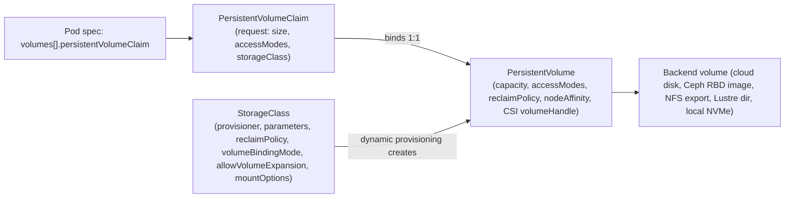
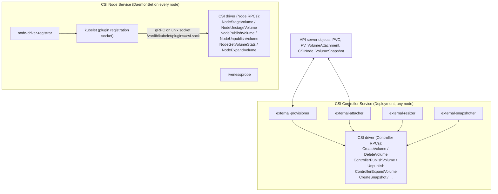

# 5.17 Storage internals: volumes, PV and PVC, CSI and mounts

| | |
|---|---|
| Level | Advanced |
| Priority tier | 0 |
| Lab venue | kind/kubeadm with `local-path`/NFS provisioner and `csi-driver-host-path`; optional Rook-Ceph; `fio`, `findmnt`, `lsblk` |
| Part | Part 5: Kubernetes |
| Status | Drafted, labs **untested** |

## Why this matters for AI infrastructure

Data is half of every AI job: training reads terabytes of tokenised data, periodically writes multi-hundred-gigabyte checkpoints, and inference servers load tens or hundreds of gigabytes of weights at startup. Storage choices decide whether 1,000 GPUs idle waiting on a dataset, whether a checkpoint takes 30 seconds or 15 minutes (and thus how much compute is wasted per failure), whether a pod can be rescheduled to another node with its data, and whether a node failure loses state. Kubernetes' abstractions (volumes, PersistentVolumes, StorageClasses, CSI drivers) hide mechanics that matter for performance, failure semantics and cost. This chapter explains the abstractions, the CSI protocol and mount mechanics, and the patterns appropriate for datasets, checkpoints, caches and model weights (Part 13 covers the storage systems themselves).

## Prerequisites and outcomes

Needs 5.7, 5.8, 5.9 and Linux storage (1.12 to 1.16: block devices, filesystems, mounts). After this chapter you can:

- Choose among volume types (`emptyDir`, `hostPath`, `configMap`, `projected`, `persistentVolumeClaim`, `ephemeral`, `image`, CSI inline) for each use case.
- Explain the PV/PVC/StorageClass model: static vs dynamic provisioning, binding, reclaim policies, volume binding modes, access modes, volume modes, expansion, snapshots/clones, topology.
- Describe the CSI architecture and call sequence (controller: Create/Delete/Publish/Unpublish/Expand/Snapshot; node: Stage/Publish/Unpublish/Unstage/GetVolumeStats) and sidecars (external-provisioner/attacher/resizer/snapshotter/node-driver-registrar/livenessprobe).
- Trace what happens at the kernel level for block and file volumes (attach, format, mount, bind mount into the pod) and how failures present.
- Design storage for AI: dataset access, checkpoint writes, model weight distribution, caches, local NVMe, shared parallel filesystems, object storage mounts; set expectations for throughput and consistency.
- Operate and debug: stuck attachments, multi-attach errors, mount failures, full volumes, slow I/O, orphaned volumes, backups and snapshots.

## 1. Volume types at a glance

| Type | Lifetime | Typical use | Notes |
|---|---|---|---|
| `emptyDir` | Pod | Scratch, caches, sharing between containers; `medium: Memory` for tmpfs | On node disk by default; counts toward ephemeral-storage; lost on pod removal (survives container restarts) |
| `hostPath` | Node | Node agents, device access, logs | Security risk; ties pod to a node; avoid for apps |
| `local` PV | Node-bound PV | Local NVMe for datasets/caches/DBs | Requires node affinity; no dynamic provisioning by default (use local-static-provisioner, TopoLVM, OpenEBS LVM/ZFS, Rancher local-path) |
| `configMap` / `secret` / `downwardAPI` / `projected` | Pod | Config and identity (5.16) | tmpfs |
| `persistentVolumeClaim` | Independent of pod | Durable data | Bound to a PV by the control plane |
| Generic `ephemeral` volume | Pod | Per-pod PVC created and deleted with the pod | Uses any StorageClass; dynamic scratch with quotas/snapshots |
| CSI inline ephemeral | Pod | Secrets Store, cert delivery, special drivers | Driver-defined |
| `image` volume | Pod | Mount an OCI image/artefact (model weights, tools) read-only | Newer feature; uses container runtime image pulling and caching |
| `nfs`, `iscsi`, `cephfs`, `rbd`, cloud disk entry types | | Legacy in-tree plugins | Largely migrated to CSI (in-tree removal) |

## 2. PersistentVolumes, Claims and StorageClasses



- **PV**: cluster-scoped representation of a piece of storage (capacity, access modes, reclaim policy, mount options, node affinity, source = CSI driver + `volumeHandle` + attributes). Created manually (**static**) or by a provisioner (**dynamic**).
- **PVC**: namespaced request for storage (size, access modes, volume mode, StorageClass, optional selector or `volumeName`). The **PV controller** binds a PVC to a suitable PV (smallest satisfying capacity, matching class/modes/selector/node affinity); binding is exclusive 1:1.
- **StorageClass**: names a provisioner and parameters for dynamic provisioning. A default class (annotation `storageclass.kubernetes.io/is-default-class: "true"`) applies to PVCs that omit `storageClassName`; `storageClassName: ""` means no class (static only).

```yaml
apiVersion: storage.k8s.io/v1
kind: StorageClass
metadata: { name: fast-nvme }
provisioner: ebs.csi.aws.com            # or pd.csi.storage.gke.io, rook-ceph.rbd.csi.ceph.com, lustre.csi.hpe.com, csi.vast.com ...
parameters: { type: gp3, iops: "6000", throughput: "500", encrypted: "true" }
reclaimPolicy: Delete                   # Delete | Retain
allowVolumeExpansion: true
volumeBindingMode: WaitForFirstConsumer # Immediate | WaitForFirstConsumer
mountOptions: [noatime]
allowedTopologies:
  - matchLabelExpressions: [ { key: topology.kubernetes.io/zone, values: [us-central1-a, us-central1-b] } ]
---
apiVersion: v1
kind: PersistentVolumeClaim
metadata: { name: checkpoints, namespace: training }
spec:
  accessModes: [ReadWriteOnce]
  storageClassName: fast-nvme
  volumeMode: Filesystem                # Filesystem | Block
  resources: { requests: { storage: 2Ti } }
```

### Key properties

- **Access modes** describe how a volume may be mounted: `ReadWriteOnce` (RWO: read-write by a single *node*, multiple pods on that node allowed), `ReadOnlyMany` (ROX), `ReadWriteMany` (RWX), `ReadWriteOncePod` (RWOP: single pod; stable). They are capabilities declared by the driver, **not enforced by the filesystem** except where the backend enforces them. Block devices (cloud disks, RBD) are typically RWO; shared filesystems (NFS, CephFS, Lustre, WEKA, FSx, Filestore) RWX.
- **Volume binding modes**: `Immediate` provisions/binds as soon as the PVC is created (zone chosen without scheduling info → pod may later be unschedulable because the volume's zone has no GPUs); **`WaitForFirstConsumer`** delays provisioning until a pod using the PVC is scheduled, then provisions in the pod's topology (zone/node): strongly recommended for zonal block storage and local volumes.
- **Reclaim policy**: `Delete` (default for dynamic; deleting the PVC deletes PV and backend volume), `Retain` (PV released, data kept for manual recovery/rebinding; admin must clean up and clear `claimRef`). For checkpoint and dataset volumes use `Retain` or backup/snapshot policies; use `Delete` for scratch.
- **Volume expansion** (`allowVolumeExpansion: true`): edit the PVC's `spec.resources.requests.storage`; the external-resizer expands the backend volume (controller expansion) and the node plugin expands the filesystem (online or on next mount depending on driver). Shrinking is unsupported.
- **Volume modes**: `Filesystem` (default; kubelet/CSI formats and mounts) or `Block` (raw device exposed as `/dev/xxx` via `volumeDevices`): used by databases/direct I/O/GPUDirect Storage experiments.
- **Topology**: CSI drivers report accessible topology (zone, node, rack) in PV `nodeAffinity`; the scheduler's VolumeBinding plugin respects it; pods are pinned to nodes that can reach the volume.
- **StorageProtection finalizers**: `kubernetes.io/pvc-protection` and `pv-protection` prevent deletion while in use (a PVC shows `Terminating` until pods stop using it).
- **Snapshots & clones**: `VolumeSnapshot` / `VolumeSnapshotClass` / `VolumeSnapshotContent` (external-snapshotter); PVC `dataSource` for restore-from-snapshot or clone-from-PVC; crash-consistent unless the app quiesces. **Volume populators** (`dataSourceRef`) allow populating a new volume from arbitrary sources (e.g., an object store or OCI image) — useful for pre-seeding datasets/model weights.
- **Volume group snapshots, CSI storage capacity tracking (`CSIStorageCapacity`), `VolumeAttributesClass`** (modify IOPS/throughput without recreating), ephemeral storage limits: newer features to check in your version.
- **Retention of StatefulSet PVCs**: `persistentVolumeClaimRetentionPolicy` controls deletion on scale-down/delete (5.7).

## 3. The CSI architecture

The **Container Storage Interface** is a gRPC specification between orchestrators and storage drivers; Kubernetes' implementation uses sidecar containers so driver authors implement only the CSI services.



### Lifecycle for a dynamically provisioned volume

1. **PVC created** → external-provisioner sees an unbound PVC for its class (for `WaitForFirstConsumer`, after the scheduler selects a node and annotates the PVC with `volume.kubernetes.io/selected-node`) → calls `CreateVolume` (size, parameters, topology requirements, optionally snapshot/clone source) → creates the **PV** with CSI `volumeHandle`.
2. **PV controller binds** PVC ↔ PV.
3. **Attach** (for drivers with `attachRequired: true`, e.g., block devices): the attach/detach controller creates a **`VolumeAttachment`** object; external-attacher calls `ControllerPublishVolume` (attach disk to node VM / map LUN); status `attached: true`. Shared filesystems (NFS, CephFS, Lustre) typically skip attach.
4. **Node staging** (if the driver advertises `STAGE_UNSTAGE_VOLUME`): kubelet calls `NodeStageVolume` once per node per volume: format (mkfs) if needed and mount to a **global staging path** `/var/lib/kubelet/plugins/kubernetes.io/csi/<driver>/<hash>/globalmount`.
5. **Node publish**: for each pod using the volume, kubelet calls `NodePublishVolume` which **bind-mounts** (or mounts) from staging to `/var/lib/kubelet/pods/<uid>/volumes/kubernetes.io~csi/<pv>/mount` with the pod's options (read-only, fsGroup handling); the runtime then bind-mounts that path into the container.
6. **Use**: `NodeGetVolumeStats` feeds `kubelet_volume_stats_*` metrics (capacity/used/inodes).
7. **Teardown**: `NodeUnpublishVolume` per pod, `NodeUnstageVolume` when the last pod on the node stops, then `ControllerUnpublishVolume` (detach), and on PVC deletion with `Delete` reclaim: `DeleteVolume`.

Multi-attach errors: an RWO block volume still attached to a failed/unreachable node cannot attach elsewhere until detached (the attach/detach controller waits for safe detach; 6-minute `maxWaitForUnmountDuration` forced detach after node unhealthy; non-graceful shutdown handling via `out-of-service` taint speeds this; some drivers fence). Symptom: `Multi-Attach error for volume ... Volume is already exclusively attached to one node`.

### fsGroup, permissions and SELinux

`securityContext.fsGroup` makes the kubelet (or CSI via `fsGroupPolicy`) chown/chmod the volume contents recursively on mount, slow for millions of files; use `fsGroupChangePolicy: OnRootMismatch` or drivers that apply the group at mount time (see `fsGroupPolicy` on the CSIDriver object). SELinux relabeling (`seLinuxChangePolicy`, mount `-o context=`) similarly costs on large trees. For datasets with many small files, prefer read-only mounts with correct ownership baked in.

### CSI driver capabilities and ecosystems

Check `CSIDriver` objects (`attachRequired`, `podInfoOnMount`, `volumeLifecycleModes`, `fsGroupPolicy`, `storageCapacity`, `requiresRepublish`, `seLinuxMount`) and `CSINode` for per-node registration (`topologyKeys`, `allocatable.count` max volumes per node). Drivers by category: cloud block (EBS, GCE PD/Hyperdisk, Azure Disk), cloud file (EFS, Filestore, Azure Files, FSx for Lustre/ONTAP), object-as-filesystem (S3 CSI/Mountpoint, GCS FUSE CSI), Ceph (Rook: RBD/CephFS), NFS (csi-driver-nfs, NFS subdir provisioner), parallel filesystems (Lustre, BeeGFS, WEKA, VAST, GPFS/IBM Storage Scale, DDN EXAScaler, Pure/NetApp/Dell CSI), local (TopoLVM, OpenEBS, Longhorn, local-path), node-local caching layers (Alluxio, JuiceFS CSI, Fluid), and vendor drivers for GPUDirect Storage. Run each driver's controller with replicas and leader election; node plugins are privileged DaemonSets (mount propagation `Bidirectional`), so treat them as part of the node's trusted base.

## 4. Mount mechanics (what the kernel does)

- Kubelet creates directories under `/var/lib/kubelet/pods/<pod-uid>/volumes/<plugin>/<volume>/`; **bind mounts** expose them in the container's mount namespace; **mount propagation** (`None` default, `HostToContainer`, `Bidirectional`) controls whether mounts made inside/outside are visible across namespaces (needed by CSI node plugins and some agents).
- Block-backed volumes: attach → device appears (`/dev/nvme1n1`, `/dev/sdb`, `/dev/disk/by-id/...`) → `mkfs.ext4/xfs` on first use (driver `fsType` parameter; XFS often preferred for large datasets and checkpoints; ext4 default) → mount at the staging path with options (`noatime`, `discard`) → bind mount per pod.
- Network filesystems: mount via kernel clients (`mount -t nfs4`, `lustre`, `cephfs` kernel/FUSE, `wekafs`) or FUSE (S3/GCS FUSE, JuiceFS, gcsfuse): FUSE runs a userspace daemon (inside the CSI node plugin or per-volume pod) whose crash or restart can break running pods' mounts ("Transport endpoint is not connected").
- Inspect on the node: `findmnt -T /var/lib/kubelet/pods/<uid>/volumes/...`, `mount | grep csi`, `lsblk -f`, `df -h`, `ls -l /dev/disk/by-id`, `cat /proc/self/mountinfo`. Inside the container: `findmnt`, `df -h /data`, `stat -f /data` (filesystem type/IDs).
- **Ephemeral storage** paths: container writable layers under the runtime root, `emptyDir` under `/var/lib/kubelet/pods/<uid>/volumes/kubernetes.io~empty-dir/`, logs under `/var/log/pods`: all on node root/image/container filesystems and subject to ephemeral-storage requests/limits and eviction (5.9).
- **Block volumes** (`volumeMode: Block`): no filesystem; kubelet bind-mounts the device node into the container as `devicePath`; with `securityContext` and `volumeDevices`.
- **Subpaths and permissions**: `subPath` creates a bind mount to a subdirectory (security fixes constrain symlink handling); `subPathExpr` uses env/Downward values for per-pod directories on a shared volume (common for per-rank checkpoint dirs).
- **Read-only and `noexec`**: set `readOnly: true` on dataset mounts; node mount options can add `nosuid,nodev,noexec` for defence in depth.

## 5. Storage patterns for AI/ML workloads

| Need | Preferred pattern | Notes |
|---|---|---|
| **Training datasets** (TB, many reads) | RWX shared parallel filesystem (Lustre/WEKA/VAST/BeeGFS/GPFS) mounted read-only; or sharded files on object storage streamed with a data loader (WebDataset, Mosaic Streaming); node-local NVMe cache (Alluxio/Fluid/JuiceFS/`emptyDir` on NVMe) for hot shards | Metadata-heavy small files hurt; pre-pack into large shards; align reads with filesystem stripe size |
| **Checkpoints** (hundreds of GB, bursty writes, many ranks) | Parallel FS or fast RWX with high write throughput; write per-rank shards in parallel (sharded/distributed checkpointing); async checkpoint to local NVMe then drain to durable storage; atomic rename; retention policy | Checkpoint time = size / aggregate write bandwidth; failures lose work since last good checkpoint; object storage via multipart upload or FS gateway |
| **Model weights for inference** | Read-only PVC (RWX/ROX), `image` volume / OCI artefact, init container sync from object store to local NVMe, or a node-local cache (DaemonSet pre-pull); share across replicas | Cold start dominated by read bandwidth: 140 GB at 2 GB/s = 70 s; parallel read, page cache warm, avoid per-pod duplication across the network; consider `hostPath`/local PV prepopulated by a DaemonSet |
| **Scratch/spill** (shuffle, temp files, compile caches) | `emptyDir` on local NVMe (ensure kubelet's dir is on NVMe) or generic ephemeral volumes; set `ephemeral-storage` limits | Not durable; counts for eviction |
| **Databases / vector stores / metadata** | RWO block volumes with `WaitForFirstConsumer`, StatefulSets, snapshots and backups; or managed services | Zone affinity matters |
| **Experiment tracking, registries** | Object storage + DB; PVCs for local state | Avoid RWO volumes for multi-replica |
| **Shared home directories / notebooks** | RWX NFS/CephFS/FSx | Quotas per user, ownership via fsGroup/UIDs, backup |
| **Direct GPU data path** | GPUDirect Storage (cuFile) with supported parallel filesystems and NVMe; CSI driver must preserve the kernel client; container needs `/dev/nvidia-fs` and compatible mount (Part 13) | Hardware/driver specific |

Throughput planning: compute required GB/s = (GPUs × per-GPU sample rate × bytes/sample) for training; for checkpoints = checkpoint size / target stall time; for cold start = weights size / acceptable start time. Compare against volume/driver limits (per-volume IOPS/throughput caps on cloud block storage, client mount concurrency on parallel FS, per-node network bandwidth, number of simultaneous readers). Use `fio`/`ior`/`mdtest`/`dd` from a pod, and `iostat`/`nfsiostat`/`lctl` on nodes (Part 13). Kubernetes adds no overhead on the data path of kernel mounts, but CSI-based FUSE drivers can bottleneck on a single userspace process.

## 6. Operations and failure modes

### Capacity and monitoring

Metrics: `kubelet_volume_stats_used_bytes`, `_capacity_bytes`, `_inodes_used/_inodes` (alert at 80% bytes and inodes), CSI sidecar metrics (`csi_sidecar_operations_seconds`), `storage_operation_duration_seconds`, `volume_manager_total_volumes`, PV phases (Pending/Bound/Released/Failed), `kube_persistentvolumeclaim_status_phase`, `kube_persistentvolume_status_phase`, backend metrics (Ceph, FS server). Quotas: `ResourceQuota` for `requests.storage`, `persistentvolumeclaims`, per-class (`<class>.storageclass.storage.k8s.io/requests.storage`); `LimitRange` min/max PVC size.

### Troubleshooting

| Symptom | Likely cause | Check/fix |
|---|---|---|
| PVC stays `Pending` | No default class, wrong class, provisioner down, `WaitForFirstConsumer` with no pod, quota, topology unsatisfiable | `kubectl describe pvc` events; `kubectl get sc`; provisioner logs; create a consuming pod |
| Pod `ContainerCreating`: `FailedMount` / `FailedAttachVolume` | Attach/stage failure, wrong zone, driver not registered on node (`CSINode`), mount options, auth | events, `kubectl get volumeattachment`, node plugin logs, `findmnt`, cloud console |
| `Multi-Attach error` | RWO volume attached to another (possibly dead) node | Wait/force detach, delete stuck pod/VolumeAttachment carefully; use RWOP/StatefulSet semantics; out-of-service taint |
| `AttachVolume.Attach failed ... limit` | Per-node volume attach limit | Reduce volumes per node, spread pods; CSINode `allocatable.count` |
| `permission denied` in pod | UID/GID mismatch, fsGroup, SELinux, root-squash on NFS | `securityContext`, NFS export options (`no_root_squash` carefully), init chown, `fsGroupChangePolicy` |
| Pod startup slow with big volume | Recursive chown/relabel | `fsGroupChangePolicy: OnRootMismatch`, avoid fsGroup on huge trees |
| `Transport endpoint is not connected` | FUSE daemon died/restarted | Restart pods; fix driver; use drivers with recovery |
| `no space left on device` but df shows free | Inode exhaustion, quota, reserved blocks, overlay upper dir full | `df -i`, quotas, `tune2fs`/xfs quota |
| Slow I/O | Throttled cloud volume IOPS, noisy neighbour, network, small block sizes, metadata-heavy workload | `fio` with matching pattern, `iostat -x`, backend metrics, increase provisioned IOPS/throughput, local cache |
| PVC `Terminating` forever | Pod still using it / finalizer | Delete pods; check `kubernetes.io/pvc-protection`; VolumeAttachment cleanup |
| PV `Released` not reusable | `claimRef` retained | Clear `claimRef` after data check; or re-create PVC with `volumeName` |
| Data lost on pod reschedule | Used `emptyDir`/`hostPath`/local volume without replication | Use durable volumes; design for node failure |
| Expansion stuck | `FileSystemResizePending`, driver lacks online expand | Restart pod to trigger node expansion; check resizer logs |
| Snapshot fails | Missing snapshot CRDs/controller, driver unsupported, class mismatch | Install external-snapshotter, `VolumeSnapshotClass` driver name |

### Data protection

Snapshots are not backups (they live with the volume); use **backup tools** (Velero + CSI snapshots and object storage, Kasten K10, Longhorn/Ceph RBD mirroring, cloud-native backup services), test restores, keep PV `Retain` for irreplaceable data, replicate across zones/regions for critical stores, protect object-storage buckets with versioning/object lock (4.24), encrypt at rest (CSI parameters, KMS), and define RPO/RTO per data class. Checkpoint durability is cheaper than recomputation: tier it (local NVMe fast, then asynchronous copy to durable storage).

### Security

Namespaced PVCs bound to cluster-scoped PVs: a user who can create PVs or `hostPath` volumes can read host data; restrict via RBAC and admission (Pod Security forbids hostPath in baseline/restricted). Multi-tenant PVC access control relies on namespaces and, for shared filesystems, per-tenant subdirectories/quotas, export rules and UID mapping. Node plugins run privileged. Avoid sharing one RWX volume across tenants without filesystem-level isolation. Encrypt in transit where supported (NFS over Kerberos/TLS, Lustre with o2ib trusted networks, Ceph msgr2 secure mode).

## 7. Lab (untested)

1. **Provision and bind**: install `local-path-provisioner` or `csi-driver-host-path`; create a StorageClass and PVC (Immediate and WaitForFirstConsumer); watch PV creation and binding; consume from a pod; delete the pod and PVC with `Delete` and `Retain` policies and inspect the backend.
2. **CSI sequence**: with the hostpath CSI driver and verbose logs, trace `CreateVolume`, `NodeStageVolume`, `NodePublishVolume` calls (driver logs) as you create/delete a pod; list the staging and publish paths; `findmnt` them; observe bind mounts in the container.
3. **Access modes and attach**: with a block driver (cloud disk or Ceph RBD via Rook/kind-local), try two pods on different nodes mounting an RWO PVC (observe `Multi-Attach`/scheduling), then RWOP semantics; with NFS RWX mount from two pods concurrently and test write visibility/locking.
4. **Topology**: label nodes with zones; create a zonal StorageClass with `WaitForFirstConsumer`; demonstrate the Immediate-mode trap (volume provisioned in a zone without the pod's required GPU/taint) and the fix.
5. **Expansion and snapshots**: expand a PVC online; create a `VolumeSnapshot`, restore to a new PVC (`dataSource`), clone a PVC; verify data and consistency semantics under writes.
6. **fsGroup cost**: create a volume with 1 million small files; start a pod with `fsGroup` and measure startup; add `fsGroupChangePolicy: OnRootMismatch` and compare; examine SELinux relabeling if applicable.
7. **Ephemeral and local**: generic ephemeral volume; `emptyDir` on NVMe vs root disk with `fio` (sequential and random); local PV with node affinity and a StatefulSet; kill the node and observe unrecoverability/rescheduling constraints.
8. **Checkpoint benchmark**: write 100 GB of checkpoint-like shards from N pods to (a) local NVMe, (b) NFS RWX, (c) cloud disk RWO, (d) object storage via FUSE/CSI; plot time vs parallelism; identify the bottleneck (single FUSE process, NIC, server). Implement async stage-to-local-then-drain.
9. **Model weights**: serve a 20 GB model from (a) PVC, (b) init-container copy to `emptyDir`, (c) hostPath/local PV pre-populated by a DaemonSet, (d) `image` volume if available; measure cold start with and without page cache.
10. **Failure drills**: kill the node holding an RWO volume (Multi-Attach), restart the CSI node plugin during I/O, restart a FUSE-based driver, fill inodes; practise recoveries and document timings.
11. **Backup/restore**: Velero with CSI snapshots to MinIO; back up a namespace; delete; restore; verify PV data.
12. **Monitoring**: dashboard for PVC usage, attach/mount latency, CSI errors; alerts at 80% bytes and inodes; test an alert.
13. **Clean up**.

Mark tested only after execution.

## 8. Common mistakes

- Using `emptyDir`/`hostPath`/local volumes for data that must survive node loss.
- `Immediate` binding for zonal storage, creating volumes where pods can't run.
- RWO volumes shared by multiple pods across nodes; treating access modes as enforced locking.
- Default `Delete` reclaim policy on irreplaceable data (accidental PVC deletion destroys data).
- Recursive `fsGroup` chown on huge datasets; per-pod PVCs created by thousands of jobs without cleanup.
- Checkpointing synchronously to slow storage; many ranks writing to one file/volume bottleneck; no integrity checks or retention.
- Underestimating per-volume throughput/IOPS limits and per-node attach limits.
- Skipping `Retain`, snapshots/backups, or restore tests; treating snapshots as backups.
- FUSE-based drivers for latency-sensitive training without understanding their single-process limits.
- Ignoring inode limits; not monitoring PVC usage.
- Putting kubelet and container storage on the same small root disk as logs and images.

## 9. Interview angles

- "Explain PV, PVC, StorageClass and dynamic provisioning." 
- "What is CSI? Describe the controller and node services and the call sequence from PVC creation to a mounted volume." 
- "RWO vs RWX vs RWOP; what do access modes actually guarantee?" 
- "What is `WaitForFirstConsumer` and why does it matter?" 
- "A pod is stuck in ContainerCreating with a Multi-Attach error. Why and how do you fix it?" 
- "How would you design storage for a multi-node LLM training job: dataset reads, checkpoint writes, and fast restart?" 
- "How do you serve a 140 GB model to many inference replicas efficiently?" 
- "How do you back up and restore stateful workloads on Kubernetes?" 

## 10. Checkpoint questions (40)

1. PV scope? **A:** Cluster-scoped.
2. PVC scope? **A:** Namespaced.
3. Static vs dynamic provisioning? **A:** Admin-created PVs vs StorageClass-created on demand.
4. Reclaim policies? **A:** Delete, Retain.
5. Binding modes? **A:** Immediate, WaitForFirstConsumer.
6. Why WFFC? **A:** Provision in the pod's topology.
7. Access modes list? **A:** RWO, ROX, RWX, RWOP.
8. RWO means? **A:** One node read-write.
9. RWOP means? **A:** One pod only.
10. Are access modes enforced by filesystems? **A:** Not generally.
11. Volume modes? **A:** Filesystem, Block.
12. Can PVCs shrink? **A:** No.
13. Expansion flag? **A:** `allowVolumeExpansion`.
14. CSI transport? **A:** gRPC over unix sockets.
15. CSI controller RPC examples? **A:** CreateVolume, ControllerPublishVolume.
16. CSI node RPC examples? **A:** NodeStageVolume, NodePublishVolume.
17. What does Stage do? **A:** Mount to a node-global staging path (format if needed).
18. What does Publish do? **A:** Bind mount to the pod path.
19. What object records attachment? **A:** VolumeAttachment.
20. Sidecar for provisioning? **A:** external-provisioner.
21. Sidecar for registration? **A:** node-driver-registrar.
22. `CSINode` shows? **A:** Per-node driver registration/topology/limits.
23. `CSIDriver` field `attachRequired`? **A:** Whether attach step is needed.
24. Snapshot API? **A:** VolumeSnapshot/Class/Content.
25. Clone how? **A:** PVC `dataSource` from another PVC.
26. Populator use? **A:** Fill new volumes from arbitrary sources.
27. Multi-Attach cause? **A:** RWO volume still attached to another node.
28. fsGroup cost? **A:** Recursive ownership change on mount.
29. Mitigation? **A:** `fsGroupChangePolicy: OnRootMismatch`.
30. Where are pod volumes on node? **A:** `/var/lib/kubelet/pods/<uid>/volumes`.
31. Mount propagation for CSI node plugin? **A:** Bidirectional.
32. FUSE failure symptom? **A:** Transport endpoint not connected.
33. `emptyDir` counts toward? **A:** Ephemeral storage.
34. Local PV requires? **A:** Node affinity.
35. Checkpoint time formula? **A:** Size ÷ aggregate write bandwidth.
36. Weights cold start formula? **A:** Size ÷ read bandwidth.
37. Snapshots vs backups? **A:** Snapshots are not independent backups.
38. Backup tool example? **A:** Velero.
39. Metric for PVC usage? **A:** `kubelet_volume_stats_used_bytes`.
40. Stuck `Terminating` PVC cause? **A:** Still used by a pod (protection finalizer).

## 11. Sources and review notes

**Written in original words.** Principal sources:

- Brendan Burns et al., *Kubernetes: Up and Running* (3rd edition; chapter 16 on integrating storage solutions and Kubernetes).
- Josh Rosso et al., *Production Kubernetes* (chapter 4 on container storage).
- The author's `nvidia-devops` repository, volume 03 (node and storage masterclass: CSI, StatefulSets, a minimal CSI driver walkthrough, production logs analysis).
- Kubernetes documentation (volumes, PV/PVC, StorageClass, CSI, snapshots, storage capacity tracking) and CSI specification.
- Examples are the author's constructions.

**Flagged for verification before publishing:** feature status for `image` volumes, VolumeAttributesClass, volume group snapshots, RWOP and non-graceful shutdown detach timers by version; driver parameter names; throughput numbers; and every manifest/command; all labs are **untested**.
