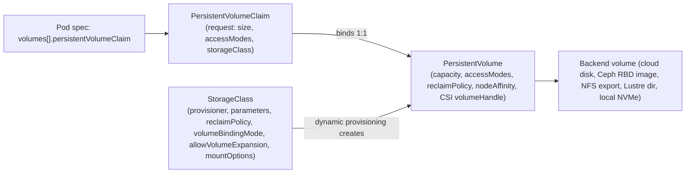
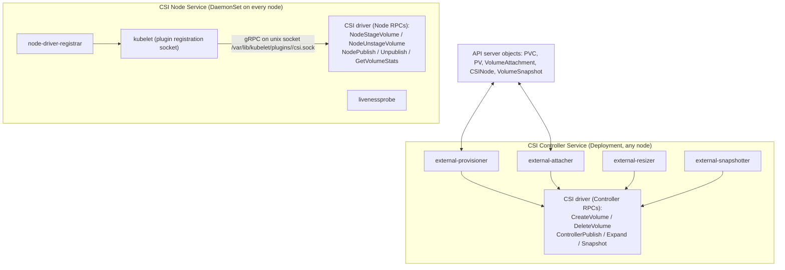

# 5.17 Storage internals: volumes, PV and PVC, CSI and mounts

| | |
|---|---|
| Level | Advanced |
| Priority tier | 0 |
| Lab venue | kind/kubeadm with `local-path`/NFS provisioner and `csi-driver-host-path`; optional Rook-Ceph; `fio`, `findmnt`, `lsblk` |
| Part | Part 5: Kubernetes |
| Status | Drafted, labs **untested** |

## Why this matters for AI infrastructure

Data is half of every AI job: training reads terabytes of tokenised data, periodically writes multi-hundred-gigabyte checkpoints, and inference servers load tens or hundreds of gigabytes of weights at startup. Storage choices decide whether 1,000 GPUs idle waiting on a dataset, whether a checkpoint takes 30 seconds or 15 minutes (and thus how much compute is wasted per failure), whether a pod can be rescheduled to another node with its data, and whether a node failure loses state. Kubernetes' abstractions (volumes, PersistentVolumes, StorageClasses, CSI drivers) hide mechanics that matter for performance, failure semantics and cost. This chapter explains the abstractions, the CSI protocol and mount mechanics, and the patterns appropriate for datasets, checkpoints, caches and model weights (Part 13 covers the storage systems themselves).

## Prerequisites and outcomes

Needs 5.7, 5.8, 5.9 and Linux storage (1.12 to 1.16: block devices, filesystems, mounts). After this chapter you can:

- Choose among volume types (`emptyDir`, `hostPath`, `configMap`, `projected`, `persistentVolumeClaim`, `ephemeral`, `image`, CSI inline) for each use case.
- Explain the PV/PVC/StorageClass model: static vs dynamic provisioning, binding, reclaim policies, volume binding modes, access modes, volume modes, expansion, snapshots/clones, topology.
- Describe the CSI architecture and call sequence (controller: Create/Delete/Publish/Unpublish/Expand/Snapshot; node: Stage/Publish/Unpublish/Unstage/GetVolumeStats) and sidecars (external-provisioner/attacher/resizer/snapshotter/node-driver-registrar/livenessprobe).
- Trace what happens at the kernel level for block and file volumes (attach, format, mount, bind mount into the pod) and how failures present.
- Design storage for AI: dataset access, checkpoint writes, model weight distribution, caches, local NVMe, shared parallel filesystems, object storage mounts; set expectations for throughput and consistency.
- Operate and debug: stuck attachments, multi-attach errors, mount failures, full volumes, slow I/O, orphaned volumes, backups and snapshots.

## 1. Volume types at a glance

| Type | Lifetime | Typical use | Notes |
|---|---|---|---|
| `emptyDir` | Pod | Scratch, caches, sharing between containers; `medium: Memory` for tmpfs | On node disk by default; counts toward ephemeral-storage; lost on pod removal (survives container restarts) |
| `hostPath` | Node | Node agents, device access, logs | Security risk; ties pod to a node; avoid for apps |
| `local` PV | Node-bound PV | Local NVMe for datasets/caches/DBs | Requires node affinity; no dynamic provisioning by default (use local-static-provisioner, TopoLVM, OpenEBS LVM/ZFS, Rancher local-path) |
| `configMap` / `secret` / `downwardAPI` / `projected` | Pod | Config and identity (5.16) | tmpfs |
| `persistentVolumeClaim` | Independent of pod | Durable data | Bound to a PV by the control plane |
| Generic `ephemeral` volume | Pod | Per-pod PVC created and deleted with the pod | Uses any StorageClass; dynamic scratch with quotas/snapshots |
| CSI inline ephemeral | Pod | Secrets Store, cert delivery, special drivers | Driver-defined |
| `image` volume | Pod | Mount an OCI image/artefact (model weights, tools) read-only | Newer feature; uses container runtime image pulling and caching |
| `nfs`, `iscsi`, `cephfs`, `rbd`, cloud disk entry types | | Legacy in-tree plugins | Largely migrated to CSI (in-tree removal) |

## 2. PersistentVolumes, Claims and StorageClasses



- **PV**: cluster-scoped representation of a piece of storage (capacity, access modes, reclaim policy, mount options, node affinity, source = CSI driver + `volumeHandle` + attributes). Created manually (**static**) or by a provisioner (**dynamic**).
- **PVC**: namespaced request for storage (size, access modes, volume mode, StorageClass, optional selector or `volumeName`). The **PV controller** binds a PVC to a suitable PV (smallest satisfying capacity, matching class/modes/selector/node affinity); binding is exclusive 1:1.
- **StorageClass**: names a provisioner and parameters for dynamic provisioning. A default class (annotation `storageclass.kubernetes.io/is-default-class: "true"`) applies to PVCs that omit `storageClassName`; `storageClassName: ""` means no class (static only).

```yaml
apiVersion: storage.k8s.io/v1
kind: StorageClass
metadata: { name: fast-nvme }
provisioner: ebs.csi.aws.com            # or pd.csi.storage.gke.io, rook-ceph.rbd.csi.ceph.com, lustre.csi.hpe.com, csi.vast.com ...
parameters: { type: gp3, iops: "6000", throughput: "500", encrypted: "true" }
reclaimPolicy: Delete                   # Delete | Retain
allowVolumeExpansion: true
volumeBindingMode: WaitForFirstConsumer # Immediate | WaitForFirstConsumer
mountOptions: [noatime]
allowedTopologies:
  - matchLabelExpressions: [ { key: topology.kubernetes.io/zone, values: [us-central1-a, us-central1-b] } ]
---
apiVersion: v1
kind: PersistentVolumeClaim
metadata: { name: checkpoints, namespace: training }
spec:
  accessModes: [ReadWriteOnce]
  storageClassName: fast-nvme
  volumeMode: Filesystem                # Filesystem | Block
  resources: { requests: { storage: 2Ti } }
```

### Key properties

- **Access modes** describe how a volume may be mounted: `ReadWriteOnce` (RWO: read-write by a single *node*, multiple pods on that node allowed), `ReadOnlyMany` (ROX), `ReadWriteMany` (RWX), `ReadWriteOncePod` (RWOP: single pod; stable). They are capabilities declared by the driver, **not enforced by the filesystem** except where the backend enforces them. Block devices (cloud disks, RBD) are typically RWO; shared filesystems (NFS, CephFS, Lustre, WEKA, FSx, Filestore) RWX.
- **Volume binding modes**: `Immediate` provisions/binds as soon as the PVC is created (zone chosen without scheduling info → pod may later be unschedulable because the volume's zone has no GPUs); **`WaitForFirstConsumer`** delays provisioning until a pod using the PVC is scheduled, then provisions in the pod's topology (zone/node): strongly recommended for zonal block storage and local volumes.
- **Reclaim policy**: `Delete` (default for dynamic; deleting the PVC deletes PV and backend volume), `Retain` (PV released, data kept for manual recovery/rebinding; admin must clean up and clear `claimRef`). For checkpoint and dataset volumes use `Retain` or backup/snapshot policies; use `Delete` for scratch.
- **Volume expansion** (`allowVolumeExpansion: true`): edit the PVC's `spec.resources.requests.storage`; the external-resizer expands the backend volume (controller expansion) and the node plugin expands the filesystem (online or on next mount depending on driver). Shrinking is unsupported.
- **Volume modes**: `Filesystem` (default; kubelet/CSI formats and mounts) or `Block` (raw device exposed as `/dev/xxx` via `volumeDevices`): used by databases/direct I/O/GPUDirect Storage experiments.
- **Topology**: CSI drivers report accessible topology (zone, node, rack) in PV `nodeAffinity`; the scheduler's VolumeBinding plugin respects it; pods are pinned to nodes that can reach the volume.
- **StorageProtection finalizers**: `kubernetes.io/pvc-protection` and `pv-protection` prevent deletion while in use (a PVC shows `Terminating` until pods stop using it).
- **Snapshots & clones**: `VolumeSnapshot` / `VolumeSnapshotClass` / `VolumeSnapshotContent` (external-snapshotter); PVC `dataSource` for restore-from-snapshot or clone-from-PVC; crash-consistent unless the app quiesces. **Volume populators** (`dataSourceRef`) allow populating a new volume from arbitrary sources (e.g., an object store or OCI image) — useful for pre-seeding datasets/model weights.
- **Volume group snapshots, CSI storage capacity tracking (`CSIStorageCapacity`), `VolumeAttributesClass`** (modify IOPS/throughput without recreating), ephemeral storage limits: newer features to check in your version.
- **Retention of StatefulSet PVCs**: `persistentVolumeClaimRetentionPolicy` controls deletion on scale-down/delete (5.7).

### Integrating External and Replicated Stateful Storage (`KUR` Chapter 16 & `PK` Chapter 4)

In *Kubernetes: Up and Running* Chapter 16 (*Integrating Storage Solutions and Kubernetes*) and *Production Kubernetes* Chapter 4 (*Container Storage*), the authors trace three progressive patterns for connecting stateful storage to Kubernetes workloads:
1. **Importing External Storage Services into Cluster DNS (`KUR` Chapter 16):** When a database or storage appliance lives outside Kubernetes, represent it as a Kubernetes `Service` so applications use standard service discovery:
   - *External DNS name (`type: ExternalName`):* `externalName: database.company.com` creates a CNAME record (`external-database.default.svc.cluster.local -> database.company.com`).
   - *External IP address(es) (Selector-less `Service` + manual `Endpoints` / `EndpointSlice`):* Create a `Service` (`external-ip-database`) with no `spec.selector` and a matching `Endpoints` object listing `subsets: [{ addresses: [{ ip: 192.168.0.1 }], ports: [{ port: 3306 }] }]`.
2. **Singleton Stateful Pod (`ReplicaSet`/`Deployment` with `replicas: 1` + `PVC`, `KUR` Chapter 16):** Mounting a `PersistentVolumeClaim` (`claimName: database` at `/var/lib/mysql`) into a single-replica controller survives pod/node restarts without data loss, **but cannot scale beyond 1 replica** on a single RWO volume without risking concurrent corruption.
3. **Replicated Cloud-Native Storage with `StatefulSet` + Headless Service + `volumeClaimTemplates` (`KUR` Chapter 16):** For a 3-node MongoDB (or Qdrant/Milvus/etcd) cluster, combine:
   - A **Headless Service (`clusterIP: None`, `name: mongo`, `port: 27017`)** so CoreDNS publishes stable per-pod records `mongo-0.mongo.default.svc.cluster.local`, `mongo-1.mongo`, and `mongo-2.mongo`.
   - A **`StatefulSet` (`serviceName: "mongo"`, `replicas: 3`)** with **`volumeClaimTemplates`** so each replica gets its own dedicated PVC (`database-mongo-0`, `database-mongo-1`, `database-mongo-2`) and deterministic ordinal startup (`0 -> 1 -> 2`).
   - An **`initContainer` (`init-mongo`)** mounting a `ConfigMap` (`mongo-init` `init.sh`) that uses `mongo-0.mongo` as the primary (`rs.initiate`) and automatically joins `mongo-1.mongo` and `mongo-2.mongo` (`rs.add`) into replica set `rs0`.

## 3. The CSI architecture

The **Container Storage Interface** is a gRPC specification between orchestrators and storage drivers; Kubernetes' implementation uses sidecar containers so driver authors implement only the CSI services.



### Lifecycle for a dynamically provisioned volume

1. **PVC created** → external-provisioner sees an unbound PVC for its class (for `WaitForFirstConsumer`, after the scheduler selects a node and annotates the PVC with `volume.kubernetes.io/selected-node`) → calls `CreateVolume` (size, parameters, topology requirements, optionally snapshot/clone source) → creates the **PV** with CSI `volumeHandle`.
2. **PV controller binds** PVC ↔ PV.
3. **Attach** (for drivers with `attachRequired: true`, e.g., block devices): the attach/detach controller creates a **`VolumeAttachment`** object; external-attacher calls `ControllerPublishVolume` (attach disk to node VM / map LUN); status `attached: true`. Shared filesystems (NFS, CephFS, Lustre) typically skip attach.
4. **Node staging** (if the driver advertises `STAGE_UNSTAGE_VOLUME`): kubelet calls `NodeStageVolume` once per node per volume: format (mkfs) if needed and mount to a **global staging path** `/var/lib/kubelet/plugins/kubernetes.io/csi/<driver>/<hash>/globalmount`.
5. **Node publish**: for each pod using the volume, kubelet calls `NodePublishVolume` which **bind-mounts** (or mounts) from staging to `/var/lib/kubelet/pods/<uid>/volumes/kubernetes.io~csi/<pv>/mount` with the pod's options (read-only, fsGroup handling); the runtime then bind-mounts that path into the container.
6. **Use**: `NodeGetVolumeStats` feeds `kubelet_volume_stats_*` metrics (capacity/used/inodes).
7. **Teardown**: `NodeUnpublishVolume` per pod, `NodeUnstageVolume` when the last pod on the node stops, then `ControllerUnpublishVolume` (detach), and on PVC deletion with `Delete` reclaim: `DeleteVolume`.

Multi-attach errors: an RWO block volume still attached to a failed/unreachable node cannot attach elsewhere until detached (the attach/detach controller waits for safe detach; 6-minute `maxWaitForUnmountDuration` forced detach after node unhealthy; non-graceful shutdown handling via `out-of-service` taint speeds this; some drivers fence). Symptom: `Multi-Attach error for volume ... Volume is already exclusively attached to one node`.

### fsGroup, permissions and SELinux

`securityContext.fsGroup` makes the kubelet (or CSI via `fsGroupPolicy`) chown/chmod the volume contents recursively on mount, slow for millions of files; use `fsGroupChangePolicy: OnRootMismatch` or drivers that apply the group at mount time (see `fsGroupPolicy` on the CSIDriver object). SELinux relabeling (`seLinuxChangePolicy`, mount `-o context=`) similarly costs on large trees. For datasets with many small files, prefer read-only mounts with correct ownership baked in.

### CSI driver capabilities and ecosystems

Check `CSIDriver` objects (`attachRequired`, `podInfoOnMount`, `volumeLifecycleModes`, `fsGroupPolicy`, `storageCapacity`, `requiresRepublish`, `seLinuxMount`) and `CSINode` for per-node registration (`topologyKeys`, `allocatable.count` max volumes per node). Drivers by category: cloud block (EBS, GCE PD/Hyperdisk, Azure Disk), cloud file (EFS, Filestore, Azure Files, FSx for Lustre/ONTAP), object-as-filesystem (S3 CSI/Mountpoint, GCS FUSE CSI), Ceph (Rook: RBD/CephFS), NFS (csi-driver-nfs, NFS subdir provisioner), parallel filesystems (Lustre, BeeGFS, WEKA, VAST, GPFS/IBM Storage Scale, DDN EXAScaler, Pure/NetApp/Dell CSI), local (TopoLVM, OpenEBS, Longhorn, local-path), node-local caching layers (Alluxio, JuiceFS CSI, Fluid), and vendor drivers for GPUDirect Storage. Run each driver's controller with replicas and leader election; node plugins are privileged DaemonSets (mount propagation `Bidirectional`), so treat them as part of the node's trusted base.

## 4. Mount mechanics (what the kernel does)

- Kubelet creates directories under `/var/lib/kubelet/pods/<pod-uid>/volumes/<plugin>/<volume>/`; **bind mounts** expose them in the container's mount namespace; **mount propagation** (`None` default, `HostToContainer`, `Bidirectional`) controls whether mounts made inside/outside are visible across namespaces (needed by CSI node plugins and some agents).
- Block-backed volumes: attach → device appears (`/dev/nvme1n1`, `/dev/sdb`, `/dev/disk/by-id/...`) → `mkfs.ext4/xfs` on first use (driver `fsType` parameter; XFS often preferred for large datasets and checkpoints; ext4 default) → mount at the staging path with options (`noatime`, `discard`) → bind mount per pod.
- Network filesystems: mount via kernel clients (`mount -t nfs4`, `lustre`, `cephfs` kernel/FUSE, `wekafs`) or FUSE (S3/GCS FUSE, JuiceFS, gcsfuse): FUSE runs a userspace daemon (inside the CSI node plugin or per-volume pod) whose crash or restart can break running pods' mounts ("Transport endpoint is not connected").
- Inspect on the node: `findmnt -T /var/lib/kubelet/pods/<uid>/volumes/...`, `mount | grep csi`, `lsblk -f`, `df -h`, `ls -l /dev/disk/by-id`, `cat /proc/self/mountinfo`. Inside the container: `findmnt`, `df -h /data`, `stat -f /data` (filesystem type/IDs).
- **Ephemeral storage** paths: container writable layers under the runtime root, `emptyDir` under `/var/lib/kubelet/pods/<uid>/volumes/kubernetes.io~empty-dir/`, logs under `/var/log/pods`: all on node root/image/container filesystems and subject to ephemeral-storage requests/limits and eviction (5.9).
- **Block volumes** (`volumeMode: Block`): no filesystem; kubelet bind-mounts the device node into the container as `devicePath`; with `securityContext` and `volumeDevices`.
- **Subpaths and permissions**: `subPath` creates a bind mount to a subdirectory (security fixes constrain symlink handling); `subPathExpr` uses env/Downward values for per-pod directories on a shared volume (common for per-rank checkpoint dirs).
- **Read-only and `noexec`**: set `readOnly: true` on dataset mounts; node mount options can add `nosuid,nodev,noexec` for defence in depth.

## 5. Storage patterns for AI/ML workloads

| Need | Preferred pattern | Notes |
|---|---|---|
| **Training datasets** (TB, many reads) | RWX shared parallel filesystem (Lustre/WEKA/VAST/BeeGFS/GPFS) mounted read-only; or sharded files on object storage streamed with a data loader (WebDataset, Mosaic Streaming); node-local NVMe cache (Alluxio/Fluid/JuiceFS/`emptyDir` on NVMe) for hot shards | Metadata-heavy small files hurt; pre-pack into large shards; align reads with filesystem stripe size |
| **Checkpoints** (hundreds of GB, bursty writes, many ranks) | Parallel FS or fast RWX with high write throughput; write per-rank shards in parallel (sharded/distributed checkpointing); async checkpoint to local NVMe then drain to durable storage; atomic rename; retention policy | Checkpoint time = size / aggregate write bandwidth; failures lose work since last good checkpoint; object storage via multipart upload or FS gateway |
| **Model weights for inference** | Read-only PVC (RWX/ROX), `image` volume / OCI artefact, init container sync from object store to local NVMe, or a node-local cache (DaemonSet pre-pull); share across replicas | Cold start dominated by read bandwidth: 140 GB at 2 GB/s = 70 s; parallel read, page cache warm, avoid per-pod duplication across the network; consider `hostPath`/local PV prepopulated by a DaemonSet |
| **Scratch/spill** (shuffle, temp files, compile caches) | `emptyDir` on local NVMe (ensure kubelet's dir is on NVMe) or generic ephemeral volumes; set `ephemeral-storage` limits | Not durable; counts for eviction |
| **Databases / vector stores / metadata** | RWO block volumes with `WaitForFirstConsumer`, StatefulSets, snapshots and backups; or managed services | Zone affinity matters |
| **Experiment tracking, registries** | Object storage + DB; PVCs for local state | Avoid RWO volumes for multi-replica |
| **Shared home directories / notebooks** | RWX NFS/CephFS/FSx | Quotas per user, ownership via fsGroup/UIDs, backup |
| **Direct GPU data path** | GPUDirect Storage (cuFile) with supported parallel filesystems and NVMe; CSI driver must preserve the kernel client; container needs `/dev/nvidia-fs` and compatible mount (Part 13) | Hardware/driver specific |

Throughput planning: compute required GB/s = (GPUs × per-GPU sample rate × bytes/sample) for training; for checkpoints = checkpoint size / target stall time; for cold start = weights size / acceptable start time. Compare against volume/driver limits (per-volume IOPS/throughput caps on cloud block storage, client mount concurrency on parallel FS, per-node network bandwidth, number of simultaneous readers). Use `fio`/`ior`/`mdtest`/`dd` from a pod, and `iostat`/`nfsiostat`/`lctl` on nodes (Part 13). Kubernetes adds no overhead on the data path of kernel mounts, but CSI-based FUSE drivers can bottleneck on a single userspace process.

## 6. Operations and failure modes

### Capacity and monitoring

Metrics: `kubelet_volume_stats_used_bytes`, `_capacity_bytes`, `_inodes_used/_inodes` (alert at 80% bytes and inodes), CSI sidecar metrics (`csi_sidecar_operations_seconds`), `storage_operation_duration_seconds`, `volume_manager_total_volumes`, PV phases (Pending/Bound/Released/Failed), `kube_persistentvolumeclaim_status_phase`, `kube_persistentvolume_status_phase`, backend metrics (Ceph, FS server). Quotas: `ResourceQuota` for `requests.storage`, `persistentvolumeclaims`, per-class (`<class>.storageclass.storage.k8s.io/requests.storage`); `LimitRange` min/max PVC size.

### Troubleshooting

| Symptom | Likely cause | Check/fix |
|---|---|---|
| PVC stays `Pending` | No default class, wrong class, provisioner down, `WaitForFirstConsumer` with no pod, quota, topology unsatisfiable | `kubectl describe pvc` events; `kubectl get sc`; provisioner logs; create a consuming pod |
| Pod `ContainerCreating`: `FailedMount` / `FailedAttachVolume` | Attach/stage failure, wrong zone, driver not registered on node (`CSINode`), mount options, auth | events, `kubectl get volumeattachment`, node plugin logs, `findmnt`, cloud console |
| `Multi-Attach error` | RWO volume attached to another (possibly dead) node | Wait/force detach, delete stuck pod/VolumeAttachment carefully; use RWOP/StatefulSet semantics; out-of-service taint |
| `AttachVolume.Attach failed ... limit` | Per-node volume attach limit | Reduce volumes per node, spread pods; CSINode `allocatable.count` |
| `permission denied` in pod | UID/GID mismatch, fsGroup, SELinux, root-squash on NFS | `securityContext`, NFS export options (`no_root_squash` carefully), init chown, `fsGroupChangePolicy` |
| Pod startup slow with big volume | Recursive chown/relabel | `fsGroupChangePolicy: OnRootMismatch`, avoid fsGroup on huge trees |
| `Transport endpoint is not connected` | FUSE daemon died/restarted | Restart pods; fix driver; use drivers with recovery |
| `no space left on device` but df shows free | Inode exhaustion, quota, reserved blocks, overlay upper dir full | `df -i`, quotas, `tune2fs`/xfs quota |
| Slow I/O | Throttled cloud volume IOPS, noisy neighbour, network, small block sizes, metadata-heavy workload | `fio` with matching pattern, `iostat -x`, backend metrics, increase provisioned IOPS/throughput, local cache |
| PVC `Terminating` forever | Pod still using it / finalizer | Delete pods; check `kubernetes.io/pvc-protection`; VolumeAttachment cleanup |
| PV `Released` not reusable | `claimRef` retained | Clear `claimRef` after data check; or re-create PVC with `volumeName` |
| Data lost on pod reschedule | Used `emptyDir`/`hostPath`/local volume without replication | Use durable volumes; design for node failure |
| Expansion stuck | `FileSystemResizePending`, driver lacks online expand | Restart pod to trigger node expansion; check resizer logs |
| Snapshot fails | Missing snapshot CRDs/controller, driver unsupported, class mismatch | Install external-snapshotter, `VolumeSnapshotClass` driver name |

### Data protection

Snapshots are not backups (they live with the volume); use **backup tools** (Velero + CSI snapshots and object storage, Kasten K10, Longhorn/Ceph RBD mirroring, cloud-native backup services), test restores, keep PV `Retain` for irreplaceable data, replicate across zones/regions for critical stores, protect object-storage buckets with versioning/object lock (4.24), encrypt at rest (CSI parameters, KMS), and define RPO/RTO per data class. Checkpoint durability is cheaper than recomputation: tier it (local NVMe fast, then asynchronous copy to durable storage).

### Security

Namespaced PVCs bound to cluster-scoped PVs: a user who can create PVs or `hostPath` volumes can read host data; restrict via RBAC and admission (Pod Security forbids hostPath in baseline/restricted). Multi-tenant PVC access control relies on namespaces and, for shared filesystems, per-tenant subdirectories/quotas, export rules and UID mapping. Node plugins run privileged. Avoid sharing one RWX volume across tenants without filesystem-level isolation. Encrypt in transit where supported (NFS over Kerberos/TLS, Lustre with o2ib trusted networks, Ceph msgr2 secure mode).

## 7. Lab

First, run the self-checking Python lab (`code/part05/csi_storage_simulator_lab.py`) locally. It verifies the `StorageClass` `volumeBindingMode` (`Immediate` vs `WaitForFirstConsumer`) zonal GPU placement evaluator (`evaluate_zonal_pvc_binding`, `PK` Ch. 4), the CSI `VolumeAttachment` `RWO`/`RWOP`/`RWX` `Multi-Attach error` checker (`check_csi_volume_attachment`), and the AI training checkpoint and inference weight-loading bandwidth calculator (`compute_checkpoint_and_weight_timings`).

```bash
python3 code/part05/csi_storage_simulator_lab.py
```

Next, on a `kind` or `kubeadm` cluster (all interactive shell steps below are `untested here`), work through these exercises:

1. **Provision and bind**: install `local-path-provisioner` or `csi-driver-host-path`; create a StorageClass and PVC (Immediate and WaitForFirstConsumer); watch PV creation and binding; consume from a pod; delete the pod and PVC with `Delete` and `Retain` policies and inspect the backend.
2. **CSI sequence**: with the hostpath CSI driver and verbose logs, trace `CreateVolume`, `NodeStageVolume`, `NodePublishVolume` calls (driver logs) as you create/delete a pod; list the staging and publish paths; `findmnt` them; observe bind mounts in the container.
3. **Access modes and attach**: with a block driver (cloud disk or Ceph RBD via Rook/kind-local), try two pods on different nodes mounting an RWO PVC (observe `Multi-Attach`/scheduling), then RWOP semantics; with NFS RWX mount from two pods concurrently and test write visibility/locking.
4. **Topology**: label nodes with zones; create a zonal StorageClass with `WaitForFirstConsumer`; demonstrate the Immediate-mode trap (volume provisioned in a zone without the pod's required GPU/taint) and the fix.
5. **Expansion and snapshots**: expand a PVC online; create a `VolumeSnapshot`, restore to a new PVC (`dataSource`), clone a PVC; verify data and consistency semantics under writes.
6. **fsGroup cost**: create a volume with 1 million small files; start a pod with `fsGroup` and measure startup; add `fsGroupChangePolicy: OnRootMismatch` and compare; examine SELinux relabeling if applicable.
7. **Ephemeral and local**: generic ephemeral volume; `emptyDir` on NVMe vs root disk with `fio` (sequential and random); local PV with node affinity and a StatefulSet; kill the node and observe unrecoverability/rescheduling constraints.
8. **Checkpoint benchmark**: write 100 GB of checkpoint-like shards from N pods to (a) local NVMe, (b) NFS RWX, (c) cloud disk RWO, (d) object storage via FUSE/CSI; plot time vs parallelism; identify the bottleneck (single FUSE process, NIC, server). Implement async stage-to-local-then-drain.
9. **Model weights**: serve a 20 GB model from (a) PVC, (b) init-container copy to `emptyDir`, (c) hostPath/local PV pre-populated by a DaemonSet, (d) `image` volume if available; measure cold start with and without page cache.
10. **Failure drills**: kill the node holding an RWO volume (Multi-Attach), restart the CSI node plugin during I/O, restart a FUSE-based driver, fill inodes; practise recoveries and document timings.
11. **Backup/restore**: Velero with CSI snapshots to MinIO; back up a namespace; delete; restore; verify PV data.
12. **Monitoring**: dashboard for PVC usage, attach/mount latency, CSI errors; alerts at 80% bytes and inodes; test an alert.
13. **Clean up**.

## 8. Common mistakes

- Using `emptyDir`/`hostPath`/local volumes for data that must survive node loss.
- `Immediate` binding for zonal storage, creating volumes where pods can't run.
- RWO volumes shared by multiple pods across nodes; treating access modes as enforced locking.
- Default `Delete` reclaim policy on irreplaceable data (accidental PVC deletion destroys data).
- Recursive `fsGroup` chown on huge datasets; per-pod PVCs created by thousands of jobs without cleanup.
- Checkpointing synchronously to slow storage; many ranks writing to one file/volume bottleneck; no integrity checks or retention.
- Underestimating per-volume throughput/IOPS limits and per-node attach limits.
- Skipping `Retain`, snapshots/backups, or restore tests; treating snapshots as backups.
- FUSE-based drivers for latency-sensitive training without understanding their single-process limits.
- Ignoring inode limits; not monitoring PVC usage.
- Putting kubelet and container storage on the same small root disk as logs and images.

## 9. Interview angles

- "Explain PV, PVC, StorageClass and dynamic provisioning."
- "What is CSI? Describe the controller and node services and the call sequence from PVC creation to a mounted volume."
- "RWO vs RWX vs RWOP; what do access modes actually guarantee?"
- "What is `WaitForFirstConsumer` and why does it matter?"
- "A pod is stuck in ContainerCreating with a Multi-Attach error. Why and how do you fix it?"
- "How would you design storage for a multi-node LLM training job: dataset reads, checkpoint writes, and fast restart?"
- "How do you serve a 140 GB model to many inference replicas efficiently?"
- "How do you back up and restore stateful workloads on Kubernetes?"

## Exercises

1. **`PersistentVolume`, `PersistentVolumeClaim`, `StorageClass`, and `Immediate` vs. `WaitForFirstConsumer` (`PK` Chapter 4):** Using `evaluate_zonal_pvc_binding()` in `code/part05/csi_storage_simulator.py`, trace the 1:1 binding lifecycle between a namespaced `PVC` and a cluster-scoped `PV`, and explain why `volumeBindingMode: Immediate` causes a scheduling deadlock when a zonal block volume is provisioned in `us-central1-a` while available GPU nodes are in `us-central1-b`.
2. **Access Modes (`RWO`, `ROX`, `RWX`, `RWOP`), Reclaim Policies (`Delete` vs. `Retain`), and `Multi-Attach error` Recovery:** Using `check_csi_volume_attachment()` in `code/part05/csi_storage_simulator.py`, contrast `ReadWriteOnce` (single-node, multiple pods allowed on that same node) with `ReadWriteOncePod` (single pod), explain what triggers `Multi-Attach error for volume` when a GPU node crashes, and state how `node.kubernetes.io/out-of-service` or the 6-minute `maxWaitForUnmountDuration` resolves it.
3. **Inside the CSI Architecture: Controller Sidecars, Node DaemonSet, and the 7-Step Lifecycle (`PK` Chapter 4):** Trace the Section 3 diagram and 7-step CSI sequence (`CreateVolume` -> `ControllerPublishVolume` / `VolumeAttachment` -> `NodeStageVolume` `blkid`/`mkfs` -> `NodePublishVolume` bind-mount -> `NodeGetVolumeStats` -> `NodeUnpublishVolume` / `NodeUnstageVolume` / `ControllerUnpublishVolume`), naming the exact Kubernetes sidecar container responsible for each controller RPC.
4. **Linux Kernel Mount Mechanics (`bind` Mounts, `mountPropagation: Bidirectional`, `subPathExpr`, FUSE vs. Kernel Clients, and Online Expansion):** Explain why a CSI Node DaemonSet requires `mountPropagation: Bidirectional` on `/var/lib/kubelet/pods`, how `ResizeFS` (`ControllerExpandVolume` -> `NodeExpandVolume`) expands an `ext4`/`xfs` volume online (`PK` Ch. 4), and why a crashing FUSE daemon leaves running containers with `Transport endpoint is not connected`.
5. **Integrating External and Replicated Stateful Storage (`KUR` Chapter 16):** Compare `KUR` Chapter 16's three patterns: (a) external storage via `ExternalName` or selector-less `Service` + `Endpoints`, (b) singleton MySQL with a `PVC`, and (c) replicated MongoDB `StatefulSet` + Headless Service (`mongo-0.mongo..mongo-2.mongo`) + `volumeClaimTemplates` + `init-mongo` replica-set bootstrap.
6. **Storage Architecture and Throughput Sizing for AI Training Datasets, Checkpoints, and 140 GB LLM Weights:** Using `compute_checkpoint_and_weight_timings()` in `code/part05/csi_storage_simulator.py`, calculate checkpoint stall time and cold-start weight loading time, and design a complete storage tiering strategy combining shared parallel filesystems (`Lustre`/`WEKA`/`VAST`), local NVMe (`emptyDir` / `TopoLVM` async checkpoint staging), and `Velero` + `VolumeSnapshot` data protection.

## Checkpoint questions (20)

<details>
<summary>1. What is the scope of a `PersistentVolume` (`PV`), a `PersistentVolumeClaim` (`PVC`), and a `StorageClass` (`SC`), and how are a `PVC` and `PV` bound?</summary>

- **`PersistentVolume` (`PV`) and `StorageClass` (`SC`):** **Cluster-scoped** resources (no namespace).
- **`PersistentVolumeClaim` (`PVC`):** **Namespaced** resource requesting storage (`size`, `accessModes`, `storageClassName`, `volumeMode`).
- **1:1 Exclusive Binding:** A `PV` and `PVC` have an **exclusive 1-to-1 binding** (via `pv.spec.claimRef` and `pvc.spec.volumeName`). Even if a `PVC` requests only `10Gi` and binds to a static `100Gi` `PV`, no other `PVC` can claim the remaining `90Gi` of that `PV` (though multiple Pods in the same namespace can reference that single `PVC`).
</details>

<details>
<summary>2. Why should every zonal block `StorageClass` (`ebs.csi.aws.com`, `pd.csi.storage.gke.io`, local NVMe) set `volumeBindingMode: WaitForFirstConsumer` instead of `Immediate` (`PK` Chapter 4)?</summary>

With **`volumeBindingMode: Immediate`**, the CSI provisioner creates the cloud disk **the instant the `PVC` YAML is applied**—*before* `kube-scheduler` knows which Pod will use it or where GPU capacity exists. If the provisioner picks zone `us-central1-a` at random, and your H100 GPU node pool is in `us-central1-b`, the Pod later fails scheduling permanently with **`0/N nodes are available: node(s) had volume node affinity conflict`**.
With **`WaitForFirstConsumer`**, PVC provisioning is delayed until a Pod mounting the PVC is scheduled; `kube-scheduler` picks a feasible GPU node in `us-central1-b` first, annotates the PVC with **`volume.kubernetes.io/selected-node`**, and the provisioner creates the disk in `us-central1-b`.
</details>

<details>
<summary>3. Compare the four PVC `accessModes` (`ReadWriteOnce`, `ReadOnlyMany`, `ReadWriteMany`, `ReadWriteOncePod`): can two Pods on the SAME node mount a `ReadWriteOnce` (`RWO`) volume simultaneously?</summary>

- **`ReadWriteOnce` (`RWO`):** The volume can be attached read-write to a **single Node**—and **YES, multiple Pods running on that SAME node are allowed to mount an `RWO` volume simultaneously**.
- **`ReadWriteOncePod` (`RWOP`):** Restricts the volume so that **only a single Pod in the entire cluster** can mount it (preventing two pods on the same node from concurrently writing to the same SQLite/RocksDB/checkpoint directory).
- **`ReadOnlyMany` (`ROX`):** Can be mounted read-only across multiple nodes simultaneously.
- **`ReadWriteMany` (`RWX`):** Can be mounted read-write across multiple nodes simultaneously (requires a shared/clustered filesystem like NFS, CephFS, Lustre, WEKA, VAST, Filestore, or FSx).
</details>

<details>
<summary>4. What happens to a `PersistentVolume` when a user runs `kubectl delete pvc data` under `reclaimPolicy: Delete` vs. `reclaimPolicy: Retain`, and why can't a `Released` PV be immediately bound to a new PVC?</summary>

- **`reclaimPolicy: Delete` (default for dynamic StorageClasses):** Deleting the `PVC` automatically deletes **both the `PV` object and the underlying physical cloud disk / storage volume** (destroying all data permanently).
- **`reclaimPolicy: Retain`:** Deleting the `PVC` leaves the `PV` and the underlying physical disk intact, and transitions the `PV`'s status phase from `Bound` to **`Released`**.
- **Why a `Released` PV cannot bind to a new PVC automatically:** The `PV` still holds the old PVC's reference in **`pv.spec.claimRef`** (because the volume still contains the previous user's sensitive data). After an admin verifies/backs up the data and manually deletes `spec.claimRef` from the `PV`, the `PV` transitions back to **`Available`** and can bind to a new `PVC`.
</details>

<details>
<summary>5. What prevents a `PVC` (or `PV`) from being deleted while a running Pod is still mounting it?</summary>

Kubernetes's built-in **Storage Object in Use Protection** controller automatically adds the finalizer **`kubernetes.io/pvc-protection`** to every `PVC` (and **`kubernetes.io/pv-protection`** to every `PV`). If you run `kubectl delete pvc checkpoints` while `trainer-0` is still mounting `checkpoints`, `kube-apiserver` sets `deletionTimestamp` (`Status: Terminating`) on the PVC **and keeps it alive until `trainer-0` terminates**, at which point the controller removes the finalizer and completes deletion.
</details>

<details>
<summary>6. Name the five standard Kubernetes CSI Sidecar containers and state what each one watches and calls.</summary>

1. **`external-provisioner`:** Watches `PersistentVolumeClaim` objects -> calls CSI **`CreateVolume` / `DeleteVolume`** and creates/deletes `PV` objects.
2. **`external-attacher`:** Watches `VolumeAttachment` objects (created by `kube-controller-manager`'s attach/detach controller) -> calls CSI **`ControllerPublishVolume` / `ControllerUnpublishVolume`** to attach/detach block disks to/from nodes.
3. **`external-resizer`:** Watches `PVC` size increases -> calls CSI **`ControllerExpandVolume`** and sets the `FileSystemResizePending` condition on the PVC for `kubelet` to run `NodeExpandVolume`.
4. **`external-snapshotter`:** Watches `VolumeSnapshot` objects -> calls CSI **`CreateSnapshot` / `DeleteSnapshot`** and manages `VolumeSnapshotContent`.
5. **`node-driver-registrar` (on each node DaemonSet):** Fetches driver info via `NodeGetInfo` and registers the CSI node plugin's Unix socket with the local **`kubelet`**.
</details>

<details>
<summary>7. Trace the exact difference between `ControllerPublishVolume`, `NodeStageVolume`, and `NodePublishVolume` when mounting an AWS EBS or GCP Persistent Disk (`PK` Chapter 4).</summary>

1. **`ControllerPublishVolume` (Control plane -> Cloud API):** Calls the AWS EC2 `AttachVolume` or GCP `attachDisk` API so the virtual hypervisor attaches the block device (`/dev/nvme1n1` or `/dev/sdb`) to the worker VM.
2. **`NodeStageVolume` (Node plugin, once per volume per node):** Inspects the newly attached block device with **`blkid`** (`PK` Chapter 4); if unformatted, runs **`mkfs.ext4` / `mkfs.xfs`**, and mounts the device onto a **node-global staging directory** (`/var/lib/kubelet/plugins/kubernetes.io/csi/.../globalmount`).
3. **`NodePublishVolume` (Node plugin, once per Pod mounting the volume):** Creates a **Linux bind-mount** from the global staging directory to the Pod's private volume path (`/var/lib/kubelet/pods/<pod-uid>/volumes/kubernetes.io~csi/<pv>/mount`).
</details>

<details>
<summary>8. Why must a CSI Node DaemonSet container configure `mountPropagation: Bidirectional` on its `/var/lib/kubelet/pods` volume mount?</summary>

By default in Linux and Kubernetes (`mountPropagation: None`), any `mount` syscall executed *inside* a container's mount namespace is **isolated to that container** and invisible to the host OS and other containers. Because the CSI Node Plugin runs inside a DaemonSet container (`csi-node`) and executes `mount` / bind-mount calls during `NodeStageVolume` and `NodePublishVolume` that **must appear on the host filesystem** (so `kubelet` and `runc` can pass them into workload Pods), the CSI node container's volume mount for `/var/lib/kubelet` must set **`mountPropagation: Bidirectional`**.
</details>

<details>
<summary>9. What causes `Multi-Attach error for volume ... Volume is already exclusively attached to one node and can't be attached to another`, and how do you resolve it?</summary>

This occurs when a Pod mounting an **`RWO` (`ReadWriteOnce`) block volume** on `node-a` is rescheduled onto `node-b` after `node-a` abruptly crashes or loses network connectivity. Because `node-a`'s `kubelet` is unreachable, it cannot confirm that the old container unmounted the disk, so the `VolumeAttachment` for `node-a` remains attached to prevent two nodes from corrupting the `ext4`/`xfs` block device simultaneously.
**Resolution:**
- Wait for the attach/detach controller's **`maxWaitForUnmountDuration` (6 minutes)** to force-detach the unhealthy node's volume, OR
- Fence/power off `node-a` via BMC/cloud API and apply the **`node.kubernetes.io/out-of-service=nodeshutdown:NoExecute`** taint to `node-a` so Kubernetes immediately detaches the volume and attaches it to `node-b`.
</details>

<details>
<summary>10. How does Online PVC Volume Expansion (`allowVolumeExpansion: true`) work in two phases (`PK` Chapter 4)?</summary>

When you increase `spec.resources.requests.storage` from `200Gi` to `500Gi` on a PVC whose `StorageClass` has `allowVolumeExpansion: true`:
1. **Phase 1 — Controller Expansion (`external-resizer` -> `ControllerExpandVolume`):** Resizes the underlying cloud disk or Ceph RBD image from 200 GiB to 500 GiB and sets condition **`FileSystemResizePending`** on the PVC.
2. **Phase 2 — Node Filesystem Expansion (`kubelet` -> `NodeExpandVolume`):** When a Pod is mounting the volume (or next mounts it), `kubelet` calls `NodeExpandVolume` (`ResizeFS` in `PK` Chapter 4), which invokes **`resize2fs`** (for `ext4`) or **`xfs_growfs`** (for `xfs`) online to expand the filesystem to fill the 500 GiB block device.
</details>

<details>
<summary>11. What is the difference between a CSI `VolumeSnapshot` and a real Disaster-Recovery Backup (`Velero` / `Kasten`)?</summary>

A **`VolumeSnapshot`** (`snapshot.storage.k8s.io/v1`) instructs the underlying storage array or cloud provider to take a point-in-time snapshot (e.g., an EBS snapshot, GCP PD snapshot, or Ceph RBD CoW snapshot). However, **many on-prem CSI snapshots reside on the exact same storage cluster/pool as the primary volume** (so if the Ceph cluster or storage array suffers a catastrophic failure, both the PV and the snapshot are lost), and a `VolumeSnapshot` does not back up your Kubernetes YAML manifests (`StatefulSet`, `ConfigMap`, `Secret`, `Service`). A complete backup solution like **Velero** (or **Kasten K10**) pairs CSI `VolumeSnapshot`s with **off-cluster object-store replication (S3/GCS)** and backs up all Kubernetes API resources together.
</details>

<details>
<summary>12. Why do FUSE-based CSI drivers (such as `gcsfuse`, `s3fs` / Mountpoint for S3, or `JuiceFS` in FUSE mode) sometimes fail with `Transport endpoint is not connected`, and what are their performance trade-offs?</summary>

Unlike kernel filesystem clients (`nfs`, `lustre`, `wekafs`, `ext4`, `xfs`), a **FUSE (`Filesystem in Userspace`)** mount relies on a **user-space daemon process** reading and writing `/dev/fuse`.
1. **`Transport endpoint is not connected` (`ENOTCONN`):** If the user-space FUSE daemon container crashes, is OOM-killed, or is restarted during a CSI DaemonSet upgrade while application Pods are still running, the existing `/dev/fuse` file descriptor inside the application Pods is orphaned and every file operation fails with `Transport endpoint is not connected` until the application Pod is restarted (unless the CSI driver uses a FUSE pass-through/fd-handover recovery proxy).
2. **Performance trade-off:** Every file read/write not in page cache crosses the kernel-to-userspace boundary twice (`App -> VFS -> /dev/fuse -> FUSE daemon -> VFS/Socket`). Great for streaming large sequential `.tar` shards (`WebDataset`) or loading model weights, **poor for millions of tiny random `open()`/`stat()` calls**.
</details>

<details>
<summary>13. How do `subPath` and `subPathExpr` work on shared `RWX` checkpoint volumes across distributed training ranks?</summary>

When 64 training Pods mount the same shared `RWX` PVC (`checkpoints`), having all 64 Pods write into the same root directory without coordination can cause filename collisions. Using **`subPathExpr`** with a Downward API environment variable (`POD_NAME` or `JOB_COMPLETION_INDEX`):
```yaml
env:
  - name: RANK_ID
    valueFrom: { fieldRef: { fieldPath: "metadata.annotations['batch.kubernetes.io/job-completion-index']" } }
volumeMounts:
  - name: ckpt
    mountPath: /ckpt/my-rank
    subPathExpr: runs/$(RUN_ID)/rank-$(RANK_ID)
```
automatically creates and bind-mounts an isolated `/ckpt/runs/142/rank-0`, `rank-1`, ... subdirectory per worker Pod.
</details>

<details>
<summary>14. Why can a Pod write fail with `No space left on device` (`ENOSPC`) even when `df -h` shows 40% free disk space on the PVC?</summary>

**Inode exhaustion (`df -i` shows `IUse% = 100%`).** Traditional `ext4` filesystems format a fixed number of inodes at `mkfs` time. If an ML preprocessing job writes 20 million tiny 4 KB image or JSON files onto an `ext4` volume, all inodes are consumed while 40% of the byte capacity remains free.
**Fixes:** Pack training datasets into large sequential shard archives (`.tar` `WebDataset`, `.parquet`, `.mds`, `.tfrecord`), format large volumes with **`xfs`** (which allocates inodes dynamically) or higher inode density, and alert on **`kubelet_volume_stats_inodes_used / kubelet_volume_stats_inodes > 0.8`**.
</details>

<details>
<summary>15. In *Kubernetes: Up and Running* Chapter 16, how does the 3-replica MongoDB `StatefulSet` (`mongo-0`, `mongo-1`, `mongo-2`) bootstrap its replica set automatically using a `ConfigMap` and Headless Service?</summary>

1. The Headless Service (`name: mongo, clusterIP: None`) gives the Pods deterministic DNS names: `mongo-0.mongo.default.svc.cluster.local`, `mongo-1.mongo`, and `mongo-2.mongo`.
2. Because `StatefulSet` starts Pods sequentially in ordinal order (`0 -> 1 -> 2`), the `mongo-init` script checks the Pod's hostname:
   - When **`mongo-0`** starts, it initializes the replica set (`rs.initiate({_id: "rs0", members: [{_id: 0, host: "mongo-0.mongo:27017"}]})`).
   - When **`mongo-1` and `mongo-2`** start, their init script connects to `mongo-0.mongo:27017` and runs `rs.add("<hostname>.mongo:27017")` to join the primary.
3. Each Pod stores `/data/db` on its own `volumeClaimTemplates` PVC (`database-mongo-0..2`) and runs a `livenessProbe` (`mongo --eval "db.serverStatus()"`).
</details>

<details>
<summary>16. Compare the four best ways to distribute a 140 GB LLM model weight directory to 16 `vLLM` inference Pods scaling up simultaneously.</summary>

If 16 Pods simultaneously read 140 GB over the network (`16 * 140 GB = 2.24 TB`), a standard 2 GB/s NAS or cloud bucket gateway will take **18+ minutes** to start the pods. Four scalable patterns:
1. **High-bandwidth parallel filesystem (`Lustre` / `WEKA` / `VAST` `RWX`/`ROX` PVC):** Delivers 50–200 GB/s aggregate read throughput across nodes.
2. **Pre-populated Node-Local NVMe Cache (via a DaemonSet or `Fluid`/`Alluxio`/`JuiceFS`):** A DaemonSet syncs popular model weights onto each GPU node's local RAID-0 NVMe array once; inference Pods mount the local NVMe read-only at **20–40 GB/s** (`140 GB / 25 GB/s = 5.6 seconds`).
3. **Kubernetes `image` Volume (OCI Model Artifact) + P2P Registry (`Spegel` / `Dragonfly`):** Package weights as an OCI artifact mounted via `volumes[].image`; nodes share blocks peer-to-peer over the 100G/400G cluster network and cache layers in `containerd`.
4. **Parallel Multipart Object-Store Streaming (`s5cmd` / `hf_transfer` / `tensorizer` / `safetensors` mmap over fast network) into local NVMe `emptyDir`.**
</details>

<details>
<summary>17. How do Asynchronous Two-Tier Checkpointing (`Local NVMe` -> `Durable Parallel FS / Object Store`) and Sharded Checkpointing (`torch.distributed.checkpoint`) minimize GPU training stall time?</summary>

Suppose a 512-GPU training job saves a **1 TB (`1,000 GB`) distributed state checkpoint** every 30 minutes:
- **Synchronous write to a 2 GB/s network volume:** Stalls all 512 GPUs for **`1000 / 2 = 500 seconds` (8.3 minutes)** on every checkpoint.
- **Two-tier async + sharded checkpointing:**
  1. Each of the 64 nodes writes its own **15.6 GB shard** (`torch.distributed.checkpoint` / Megatron `dist_ckpt`) directly to its **local NVMe `emptyDir` / Local PV** at ~15 GB/s per node (**~1 second GPU stall**).
  2. Training resumes immediately on the GPUs while a background process/thread asynchronously flushes the checkpoint shards from local NVMe to the durable `RWX` parallel filesystem or S3/GCS bucket and performs an atomic manifest commit once all 64 shards succeed.
</details>

<details>
<summary>18. What is a Kubernetes `Generic Ephemeral Volume` (`volumes[].ephemeral.volumeClaimTemplate`), and when is it better than `emptyDir`?</summary>

An `emptyDir` is just a directory on the node's root/kubelet filesystem (or RAM `tmpfs`). A **Generic Ephemeral Volume** instructs Kubernetes to dynamically provision a real **CSI `PersistentVolumeClaim`** bound to the Pod's lifecycle (automatically created when the Pod is scheduled and automatically deleted when the Pod is deleted). This lets a scratch volume use any **CSI `StorageClass`**—such as dedicated provisioned-IOPS NVMe block volumes, `TopoLVM` thin-provisioned LVMs with strict hardware disk quotas, or storage-array encryption/snapshots—without leaving orphaned PVCs behind when the Job finishes.
</details>

<details>
<summary>19. What is required on a Kubernetes GPU node to use `GPUDirect Storage` (`GDS` / `cuFile`) inside a Pod?</summary>

**GPUDirect Storage (`GDS`)** allows NVMe drives or RDMA-capable parallel filesystems (WEKA, VAST, Lustre, DDN EXAScaler, IBM Storage Scale) to DMA data directly into and out of **GPU HBM memory (`cuFileRead`/`cuFileWrite`)** over PCIe without bouncing through host CPU page cache (`bounce buffers`). Inside Kubernetes, GDS requires:
1. **`nvidia-fs` (`nvidia_fs.ko`) kernel module** loaded on the host node and `/dev/nvidia-fs*` exposed to the container (managed by the NVIDIA GPU Operator with `gds.enabled=true`).
2. **A kernel-native CSI mount** (e.g., native `wekafs`, `lustre`, or local NVMe `xfs`/`ext4` mounted with `O_DIRECT` support—FUSE mounts cannot do GDS DMA).
3. **`IPC_LOCK` capability** and `cufile.json` configured inside the container.
</details>

<details>
<summary>20. What does `CSINode` (`kubectl get csinodes -o yaml`) tell you when a Pod fails to schedule with `0/10 nodes are available: 10 node(s) exceed max volume count`?</summary>

Every CSI node plugin registers its capabilities in the node's **`CSINode`** object (`spec.drivers[]`), including:
- Whether the CSI driver is actually installed and running on that node.
- **`topologyKeys`** (`["topology.kubernetes.io/zone"]`).
- **`allocatable.count`:** The maximum number of volumes of that CSI driver that can be attached to a single node (for example, AWS EBS and GCP PD enforce per-instance-type disk attachment limits like 16, 28, or 128 disks). If Pods on a node mount too many separate small PVCs, `kube-scheduler` blocks new Pods with `exceed max volume count`.
</details>

## Sources and review notes

- **Sources read in full:**
  - `kubernetes-up-and-running-3rd-edition` — Brendan Burns, Joe Beda, Kelsey Hightower & Lachlan Evenson, *Kubernetes: Up and Running*, 3rd ed., **Chapter 16: Integrating Storage Solutions and Kubernetes** (read in full: importing external storage services via `ExternalName` and selector-less `Service` + `Endpoints`, running a singleton MySQL Pod with a `PersistentVolume` and `PersistentVolumeClaim`, dynamic volume provisioning, and deploying a 3-replica MongoDB `StatefulSet` with a Headless Service `mongo-0.mongo..mongo-2.mongo`, `volumeClaimTemplates`, `init-mongo` `ConfigMap` replica-set initialization, and `livenessProbe`).
  - `production-kubernetes` — Josh Rosso, Rich Lander, Alexander Brand & John Harris, *Production Kubernetes*, **Chapter 4: Container Storage** (read in full: Block vs File vs Object storage Table 4-1, in-tree to out-of-tree CSI transition, `CSIDriver` and `CSINode`, `StorageClass` parameters and `Immediate` vs `WaitForFirstConsumer` binding modes, `blkid` and `ResizeFS` online volume expansion, and `VolumeSnapshot` / `VolumeSnapshotClass`).
  - `nvidia-devops` (`volume-03/02-k8s-node-storage-masterclass.md`): node and storage masterclass (CSI architecture, `StatefulSet`s, minimal CSI driver walkthrough, and production storage log analysis).
- **Run here:** `python3 code/part05/csi_storage_simulator_lab.py` (3 passed, 0 failed).
- **Explicitly labelled inferences:** The `evaluate_zonal_pvc_binding`, `check_csi_volume_attachment`, and `compute_checkpoint_and_weight_timings` models in `code/part05/csi_storage_simulator.py` and the `fast-nvme` `StorageClass` and `checkpoints` `PVC` manifests are the author's constructions synthesizing `KUR` Chapter 16, `PK` Chapter 4, and `volume-03/02` (plus original study items 21, 22, 23, 24, 25, 26, 27, 28, 29, 30, 31, 32, 33, 34, 35, 36, 37, 38, 39, and 40).
- **Not verified on live hardware:** Live CSI driver, `fio`, `findmnt`, `lsblk`, and `Velero` executions (`1,000` GPUs, `30 seconds` vs `15 minutes` checkpoint, `iops: "6000", throughput: "500"`, `2Ti`, `6-minute` `maxWaitForUnmountDuration`, `140 GB at 2 GB/s = 70 s`, `80%` alert threshold, `1 million` small files, `100 GB` / `20 GB` benchmarks) are marked (`untested here`) where not executed by `csi_storage_simulator_lab.py`.
