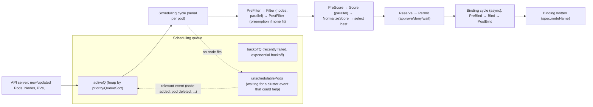

# 5.18 Scheduling in depth: kube-scheduler, affinity, taints, priority and preemption

| | |
|---|---|
| Level | Advanced |
| Priority tier | 0 |
| Lab venue | kind/kubeadm with 4+ nodes; labels/taints; Kueue, Volcano or scheduler-plugins for gang/queueing; `kwok` for simulated nodes at scale |
| Part | Part 5: Kubernetes |
| Status | Drafted, labs **untested** |

## Why this matters for AI infrastructure

GPUs are scarce, expensive and topologically structured; the scheduler decides where each pod goes, and bad decisions cost real money. A default scheduler that places eight 8-GPU training pods one at a time can strand seven of them waiting for the eighth (deadlock), spread a latency-sensitive inference service onto the same failing node, fragment a cluster so that no node has 8 free GPUs even though 40 are free, let background jobs hold GPUs that production inference needs, or put two GPUs of one pod across NUMA nodes and halve their bandwidth. Doing this well requires understanding the built-in scheduler's mechanics (filters, scores, affinity, taints, priority, preemption), where it falls short for batch/gang workloads, and how queueing systems (Kueue, Volcano) and device allocation (device plugins, DRA) complete the picture.

## Prerequisites and outcomes

Needs 5.3, 5.7, 5.9. After this chapter you can:

- Describe the scheduling cycle (queues, PreFilter/Filter/PostFilter/Score/Reserve/Permit/Bind) and what the scheduler does and does not know.
- Use `nodeSelector`, node affinity, pod affinity/anti-affinity, `topologySpreadConstraints`, taints/tolerations, and `nodeName`; choose the right one and write correct manifests; understand required vs preferred, `IgnoredDuringExecution`, and AND/OR semantics.
- Use PriorityClasses, preemption policies, and PodDisruptionBudgets; explain victim selection and why preemption can cascade; design priority tiers for training/inference/interactive/system.
- Explain resource accounting (requests, extended resources, overhead, allocatable), bin-packing vs spreading strategies (`NodeResourcesFit` scoring strategies), and fragmentation.
- Describe gang scheduling and queueing: why pod-by-pod scheduling fails for distributed jobs; Kueue (admission control, ResourceFlavors, ClusterQueues, LocalQueues, cohorts, preemption, fair sharing), Volcano (PodGroup, queues, actions/plugins), coscheduling plugin, JobSet; Slurm integration notions.
- Reason about topology: NUMA/Topology Manager, NodeResourceTopology (NFD) scheduling, rack/rail/NVLink-domain awareness via labels, DRA and structured parameters.
- Tune and scale the scheduler (parallelism, percentageOfNodesToScore, profiles, plugins, multiple schedulers) and debug Pending pods and unexpected placements.

## 1. The scheduler's job and model

The scheduler watches Pods with no `spec.nodeName`, picks a node per pod, and writes a binding. It reasons over the API's view: Node `allocatable`, existing pods' requests, labels, taints, volumes, and policies. It does **not** observe actual utilisation (unless a plugin is added), network proximity (beyond labels), or GPU health (beyond what device plugins/labels/taints expose). It schedules **one pod at a time** (with a snapshot of the cluster) and is not aware of job-level groups unless a plugin provides it.



Details:

- **Queues**: pods sorted by `QueueSort` (default: priority, then arrival time). Failing pods go to the **unschedulable** pool with the plugins that rejected them; they are retried when an event they care about happens (node added/changed, pod deleted, PVC bound...) or after `podMaxInUnschedulablePodsDuration` (5 min); backoff increases to a maximum (default 10 s).
- **Filter** removes nodes that can't run the pod: `NodeResourcesFit` (requests vs allocatable minus assigned), `NodePorts`, `NodeAffinity`/`NodeSelector`, `TaintToleration`, `InterPodAffinity` (hard rules), `PodTopologySpread` (hard), `VolumeBinding`/`VolumeZone`/`VolumeRestrictions`/`NodeVolumeLimits`, `NodeUnschedulable` (cordon), `NodeName`, `DynamicResources` (DRA), plus custom plugins. Only a fraction of nodes may be examined in big clusters (`percentageOfNodesToScore`).
- **PostFilter** runs when no node passes: default plugin `DefaultPreemption` tries to free room by evicting lower-priority pods (section 5).
- **Score** ranks feasible nodes 0 to 100 with weights: `NodeResourcesFit` (strategy `LeastAllocated` default, `MostAllocated` for bin-packing, `RequestedToCapacityRatio` custom curves), `NodeResourcesBalancedAllocation`, `ImageLocality` (nodes that already have the image), `InterPodAffinity` (preferred), `NodeAffinity` (preferred), `TaintToleration` (prefer fewer intolerable PreferNoSchedule taints), `PodTopologySpread` (soft), `VolumeBinding`. Highest total wins; ties are broken randomly.
- **Reserve** assumes the placement in the scheduler cache (so the next pod sees it); **Permit** can hold the pod "waiting" (coscheduling/gang plugins wait here until the group can all be placed, then release); **Bind** writes the Binding (or lets a plugin bind) asynchronously; failures roll back via `Unreserve`.
- **Scheduler configuration**: `KubeSchedulerConfiguration` with **profiles** (named schedulers, each with plugin sets/weights/args, selected by `pod.spec.schedulerName`), `percentageOfNodesToScore`, `parallelism`, leader election, extenders (webhooks, deprecated in favour of plugins). Example: a `gpu-binpack` profile using `MostAllocated` to fill nodes before opening new ones, and a `default-scheduler` profile spreading.

```yaml
apiVersion: kubescheduler.config.k8s.io/v1
kind: KubeSchedulerConfiguration
percentageOfNodesToScore: 50
parallelism: 16
profiles:
  - schedulerName: default-scheduler
  - schedulerName: gpu-binpack
    pluginConfig:
      - name: NodeResourcesFit
        args:
          scoringStrategy:
            type: MostAllocated
            resources:
              - { name: nvidia.com/gpu, weight: 5 }
              - { name: cpu, weight: 1 }
              - { name: memory, weight: 1 }
    plugins:
      score:
        disabled: [ { name: NodeResourcesBalancedAllocation } ]
```

Pods choose with `schedulerName: gpu-binpack`. Running multiple schedulers (or profiles) that manage overlapping nodes without coordination causes races; profiles inside one scheduler share its cache and avoid that.

## 2. Resource fit and accounting

- **Requests, not usage**: the scheduler sums `requests` of pods already assigned (including those still starting) and compares to `allocatable` (5.9). Limits are ignored for fit (except when requests default to limits). Pods with no requests (BestEffort) consume 0 for fit, which can overload nodes (use `LimitRange` defaults).
- **Extended resources** (`nvidia.com/gpu`, `rdma/*`, hugepages): integers advertised by device plugins in `status.capacity/allocatable`; requested in `limits` (and requests equal limits). GPU counting is by number, not identity: the scheduler knows "node has 8 free" but not which GPUs; the **kubelet device manager** picks specific devices (with `GetPreferredAllocation` hints for NVLink-aware choices). Fractional GPUs only exist via MIG/time-slicing/MPS advertised as separate resource names (`nvidia.com/mig-1g.10gb`) or DRA.
- **Init container and sidecar math**: effective pod request = max(largest init container, sum of app containers) (+ sidecar contributions), plus RuntimeClass overhead.
- **Pod overhead**, **ephemeral storage**, **PVC attach limits per node** are also filters.
- **Fragmentation**: a cluster with 64 GPUs free spread as 4 per node cannot run an 8-GPU pod. Mitigations: bin-packing profile (`MostAllocated`) for GPU nodes, node pools of homogeneous sizes, scheduling large jobs first (priority), reserving whole nodes for multi-GPU jobs via taints/labels, defragmentation by preemption/consolidation (descheduler), and gang/queue systems that admit big jobs when capacity exists.

## 3. Placement constraints

### nodeSelector and node affinity

```yaml
spec:
  nodeSelector:
    nvidia.com/gpu.product: NVIDIA-H100-80GB-HBM3        # simple equality (AND of all pairs)
  affinity:
    nodeAffinity:
      requiredDuringSchedulingIgnoredDuringExecution:      # hard rule (filter)
        nodeSelectorTerms:                                  # terms are OR'd
          - matchExpressions:                               # expressions within a term are AND'd
              - { key: topology.kubernetes.io/zone, operator: In, values: [us-central1-a, us-central1-b] }
              - { key: node.kubernetes.io/instance-type, operator: NotIn, values: [a3-edgegpu-8g] }
      preferredDuringSchedulingIgnoredDuringExecution:     # soft rule (score)
        - weight: 80
          preference:
            matchExpressions: [ { key: example.com/nvlink-domain, operator: In, values: [domain-3] } ]
```

Operators: `In`, `NotIn`, `Exists`, `DoesNotExist`, `Gt`, `Lt`. "IgnoredDuringExecution" means running pods are not evicted if node labels change. Labels come from kubelet (zone, region, hostname, os, arch, instance-type), cloud providers, NFD (CPU flags, PCI devices), GPU Feature Discovery (`nvidia.com/gpu.product`, `.count`, `.memory`, `nvidia.com/mig.capable`), and your own platform labels (rack, rail, NVLink domain/clique, pool, tenant, lifecycle).

### Pod affinity and anti-affinity

Attract/repel pods relative to other pods' **topology domains** (`topologyKey` = a node label; `kubernetes.io/hostname` = same node, `topology.kubernetes.io/zone` = same zone, rack label = same rack).

```yaml
affinity:
  podAntiAffinity:
    requiredDuringSchedulingIgnoredDuringExecution:
      - labelSelector: { matchLabels: { app: vllm } }
        topologyKey: kubernetes.io/hostname              # at most one vllm pod per node
  podAffinity:
    preferredDuringSchedulingIgnoredDuringExecution:
      - weight: 50
        podAffinityTerm:
          labelSelector: { matchLabels: { app: embedding-cache } }
          topologyKey: topology.example.com/rack         # prefer same rack as the cache
```

Costs: pod (anti-)affinity is computationally expensive (O(pods × nodes) per cycle); avoid cluster-wide `required` anti-affinity at thousands of nodes; prefer `topologySpreadConstraints` for spreading. `namespaceSelector` and `matchLabelKeys`/`mismatchLabelKeys` (newer) refine the target set.

### Topology spread constraints

```yaml
topologySpreadConstraints:
  - maxSkew: 1
    topologyKey: topology.kubernetes.io/zone
    whenUnsatisfiable: DoNotSchedule                     # or ScheduleAnyway (soft)
    labelSelector: { matchLabels: { app: vllm } }
    matchLabelKeys: [pod-template-hash]                  # skew computed per ReplicaSet revision
    minDomains: 3
```

`maxSkew` bounds the difference in matching-pod counts between the most and least populated domains. Use for HA spreading across zones/nodes/racks; combine `hostname` + `zone` constraints. `nodeAffinityPolicy`/`nodeTaintsPolicy` control whether non-matching nodes count as domains.

### Taints and tolerations

A **taint** on a node (`key=value:effect`) repels pods that do not **tolerate** it: effects `NoSchedule` (new pods not scheduled), `PreferNoSchedule` (soft), `NoExecute` (also evicts running pods unless tolerated, optionally for `tolerationSeconds`).

```bash
kubectl taint nodes gpu-node-1 nvidia.com/gpu=present:NoSchedule
kubectl taint nodes gpu-node-1 nvidia.com/gpu=present:NoSchedule-            # remove
kubectl taint nodes gpu-node-2 maintenance=true:NoExecute
```

```yaml
tolerations:
  - { key: nvidia.com/gpu, operator: Exists, effect: NoSchedule }
  - { key: node.kubernetes.io/unreachable, operator: Exists, effect: NoExecute, tolerationSeconds: 60 }   # faster failover than default 300
```

System taints applied automatically: `node.kubernetes.io/not-ready`, `unreachable`, `memory-pressure`, `disk-pressure`, `pid-pressure`, `network-unavailable`, `unschedulable` (cordon), cloud `uninitialized`. Patterns: **dedicated GPU pools** (taint + node label; workloads need toleration *and* nodeSelector/affinity, since a toleration only permits placement), **per-tenant pools** (taint `tenant=a`), **spot/preemptible pools** (taint and tolerate only workloads that checkpoint), **reserved system nodes**. Admission plugins like `ExtendedResourceToleration` can auto-add tolerations for pods requesting `nvidia.com/gpu` when nodes are tainted by that key (convenient: users need not add tolerations).

### Other fields

`nodeName` bypasses the scheduler (no checks), `schedulerName`, `priorityClassName`, `runtimeClassName`, `hostPort` conflicts, `resourceClaims`, `schedulingGates` (hold a pod from scheduling until a controller removes gates: used by Kueue/queueing and capacity controllers), `readinessGates`, `topologySpreadConstraints`, `affinity`. Cordon: `kubectl cordon` sets `spec.unschedulable` (tainted `unschedulable`); `drain` cordons + evicts respecting PDBs.

## 4. Priority, preemption and disruption

### PriorityClass

```yaml
apiVersion: scheduling.k8s.io/v1
kind: PriorityClass
metadata: { name: inference-critical }
value: 1000000
globalDefault: false
preemptionPolicy: PreemptLowerPriority            # or Never
description: "Production serving; may preempt training"
---
apiVersion: scheduling.k8s.io/v1
kind: PriorityClass
metadata: { name: training-low }
value: 1000
preemptionPolicy: Never                            # waits in queue; never evicts others
```

- Priority is an integer; larger = more important. System classes: `system-cluster-critical` (2000000000) and `system-node-critical` (2000001000) are reserved for core components. User values should stay well below. `globalDefault: true` for at most one class sets the default priority for pods without a class (default 0 if none).
- Priority orders the **scheduling queue**, decides **preemption** victims, and influences **node-pressure eviction** order (after QoS/over-request, 5.9).
- **Preemption** (PostFilter): when a high-priority pod fits nowhere, the scheduler simulates removing lower-priority pods on candidate nodes (respecting PodDisruptionBudgets on a best-effort basis and graceful termination), selects the candidate node minimising victims (fewest PDB violations, lowest highest-victim-priority, fewest victims, latest start time), sets `status.nominatedNodeName`, deletes victims (with their grace periods), and the preemptor schedules once resources free (other pods may take the room meanwhile). `preemptionPolicy: Never` pods are placed ahead in the queue but never evict.
- Pitfalls: preemption cascades (victims get rescheduled and preempt others); evicting a multi-pod training job by killing one pod wastes the entire job's progress (the rest idle until the operator restarts all) — so give training pods non-preemptible, higher or equal priority within their tier, or use queue-level preemption (Kueue preempts whole workloads, checkpoint-aware), and ensure workloads handle SIGTERM with checkpointing; priority inversion if low-priority pods hold resources needed by high-priority pods that cannot preempt due to PDBs or affinity; abuse of `system-*` classes (restricted by ResourceQuota scopes `PriorityClass`); high-priority pods can starve others forever.
- **PodDisruptionBudget** protects availability from *voluntary* disruption (drains, autoscaler, preemption best-effort): `minAvailable`/`maxUnavailable`, `unhealthyPodEvictionPolicy`. For single-replica jobs a PDB `maxUnavailable: 0` blocks node drains (5.19); prefer Job-level resilience.
- **Suggested tiers for AI platforms**: `system-*` (infra), `inference-prod` (high), `training-high/normal` (non-preempting among themselves, quota-controlled), `interactive-notebook` (medium, with time limits), `training-best-effort/spot` (low, preemptible, checkpoints often). Pair with Kueue preemption policies (section 6) so the queue system, not raw kube preemption, resolves contention among batch jobs.

## 5. Why default scheduling fails for distributed jobs

A distributed training job of N pods needs all N running to make progress. The default scheduler places pods independently: if only N−1 fit, N−1 pods start and **hold their GPUs idle** waiting for the last; another job may do the same; both stall in deadlock (resource hold-and-wait). Also, partial placement ignores locality (pods spread across racks/IB leaf domains).

Required capabilities: **all-or-nothing admission** (gang), **queueing with fairness/quotas** across teams, **preemption at job granularity**, **topology awareness** (same rack/NVLink domain/leaf), **backfilling** (small jobs fill gaps), **elasticity**, and **checkpoint-aware** disruption. Kubernetes provides building blocks; add-ons provide the policy.

### Kueue

Kueue (SIG Scheduling) is a **job queueing and quota controller** that sits in front of kube-scheduler: it controls *when* a workload's pods may be created/run; kube-scheduler still places pods. Objects:

| Object | Purpose |
|---|---|
| `ResourceFlavor` | A variant of resources (GPU model/pool/spot vs on-demand), mapped to node labels/taints/tolerations injected into admitted workloads |
| `ClusterQueue` | Cluster-scoped quota per flavor (`nominalQuota`, `borrowingLimit`, `lendingLimit`), queueing strategy (`StrictFIFO`/`BestEffortFIFO`), cohort membership, preemption policy, namespace selector, admission checks |
| `LocalQueue` | Namespaced entry point that points to a ClusterQueue; users label jobs `kueue.x-k8s.io/queue-name` |
| `Cohort` | Group of ClusterQueues that can borrow unused quota from each other (fair sharing, hierarchical cohorts) |
| `Workload` | Kueue's internal representation of a job (resource requests, priority); admitted/evicted by Kueue |
| `WorkloadPriorityClass` | Priority for queueing decisions independent of pod priority |
| `AdmissionCheck` | Gate admission on external conditions (e.g., ProvisioningRequest to a cluster autoscaler for atomic capacity, MultiKueue for multi-cluster dispatch) |

Supported job types: batch/v1 Job, JobSet, MPIJob, PyTorchJob/TFJob (Kubeflow Training Operator), RayJob/RayCluster, plain Pods and groups, Deployments/StatefulSets (newer), AppWrapper; frameworks integrate by suspending (`spec.suspend: true`) the job until admitted, then unsuspending with injected node selectors (flavor). Pods of a job are created only after quota is reserved, avoiding partial starts; for all-or-nothing readiness, `waitForPodsReady` can evict workloads whose pods don't become ready in time.

```yaml
apiVersion: kueue.x-k8s.io/v1beta1
kind: ResourceFlavor
metadata: { name: h100-ondemand }
spec:
  nodeLabels: { nvidia.com/gpu.product: NVIDIA-H100-80GB-HBM3, pool: h100-ondemand }
  tolerations: [ { key: nvidia.com/gpu, operator: Exists, effect: NoSchedule } ]
---
apiVersion: kueue.x-k8s.io/v1beta1
kind: ClusterQueue
metadata: { name: research }
spec:
  cohort: gpu-fleet
  namespaceSelector: { matchLabels: { team: research } }
  queueingStrategy: BestEffortFIFO
  preemption:
    reclaimWithinCohort: Any                 # take back lent quota from borrowers
    borrowWithinCohort: { policy: LowerPriority, maxPriorityThreshold: 100 }
    withinClusterQueue: LowerPriority
  resourceGroups:
    - coveredResources: [cpu, memory, nvidia.com/gpu]
      flavors:
        - name: h100-ondemand
          resources:
            - { name: cpu,            nominalQuota: 1024 }
            - { name: memory,         nominalQuota: 8Ti }
            - { name: nvidia.com/gpu, nominalQuota: 128, borrowingLimit: 64, lendingLimit: 32 }
---
apiVersion: kueue.x-k8s.io/v1beta1
kind: LocalQueue
metadata: { name: research-gpu, namespace: research-ns }
spec: { clusterQueue: research }
---
apiVersion: batch/v1
kind: Job
metadata:
  name: pretrain-llama
  namespace: research-ns
  labels: { kueue.x-k8s.io/queue-name: research-gpu, kueue.x-k8s.io/priority-class: training-normal }
spec:
  suspend: true
  parallelism: 8
  completions: 8
  # template with 8-GPU pods ...
```

Kueue also offers **topology-aware scheduling (TAS)** (placing a workload's pods in the best-fitting topology level such as block/rack using node labels), fair sharing with weights, partial admission, elastic jobs, dynamic resource requests, and MultiKueue for federation (5.35).

### Volcano

A batch scheduler (CNCF) with its own scheduler binary and CRDs: `Queue` (weight, capability, reclaimable), `PodGroup` (minMember, minResources → gang), `Job` (vcjob with tasks, lifecycle policies), plugins/actions (`enqueue`, `allocate`, `preempt`, `reclaim`, `backfill`) with plugins (`gang`, `priority`, `drf` fairness, `proportion`, `binpack`, `nodeorder`, `predicates`, `task-topology`, `numa-aware`, network-topology-aware via HyperNode). Pods set `schedulerName: volcano` and a PodGroup. Compared with Kueue: Volcano replaces kube-scheduler for batch pods (richer batch-specific policy in one place, more intrusive), Kueue complements the default scheduler (lighter integration with standard Jobs and operators). Often chosen: Kueue for new platform builds; Volcano where its HPC-style policies or existing deployments are established.

### Other gang mechanisms

- **Coscheduling plugin** (scheduler-plugins project): `PodGroup` CRD and a Permit plugin that holds pods until `minMember` can be placed; same scheduler, additional plugins (also `CapacityScheduling` elastic quotas, `NodeResourceTopologyMatch`, `Trimaran` load-aware scoring, `NetworkAware` scheduling).
- **JobSet** (Kubernetes SIG Apps/Batch): API for groups of Jobs with success/failure policies, startup order, and DNS (headless Service) — the base for multi-slice/multi-host training; integrates with Kueue.
- **Kubeflow Training Operator / MPI Operator v2 / KubeRay** use PodGroup/Kueue integration for gang semantics.
- **Native gang scheduling** work in Kubernetes (Workload API, PodGroup concepts in recent releases) is emerging; check release notes before adopting external solutions.
- **Slurm on Kubernetes** (SchedMD/Slinky, SUNK on CoreWeave, Soperator on Nebius): run Slurm as the batch scheduler with Kubernetes managing the nodes; useful for HPC teams (Part 6).

## 6. Topology-aware and device-aware scheduling

- **Why**: GPU↔GPU bandwidth depends on NVLink domain, GPU↔NIC on PCIe/NUMA proximity, node↔node on rail/leaf/spine hops; mis-placement reduces NCCL bandwidth substantially (Part 12).
- **Kubelet side**: Topology Manager aligns CPU/memory/devices on a NUMA node at admission (5.9); but the scheduler isn't aware, so pods may be scheduled and then rejected (`TopologyAffinityError`) — use **NodeResourceTopology** (NFD topology updater exports per-NUMA allocatable via `NodeResourceTopology` CRDs) with the scheduler-plugins `NodeResourceTopologyMatch` plugin, or DRA.
- **Fabric side**: label nodes with `topology.example.com/block`, `/rack`, `/leaf`, `/nvlink-domain` (or use cloud-provided `topology.kubernetes.io/*` and `cloud.google.com/gce-topology-block/subblock/host` labels); use required node affinity or topology spread/pod affinity with those keys for job pods; Kueue TAS and Volcano network-topology plugins automate "fit this job within the lowest topology level that has capacity". For multi-node NVLink systems (NVL72) the domain is a rack-scale unit: schedule whole-domain jobs onto one domain and respect IMEX/NVLink partition boundaries (Part 9, 12).
- **DRA (Dynamic Resource Allocation)**: devices are described in `ResourceSlice`s published by drivers (attributes like product, memory, MIG profile, PCI root, NVLink domain), pods reference `ResourceClaim`/`ResourceClaimTemplate`s with CEL selectors and constraints (e.g., "4 GPUs on the same PCIe root", "GPU and NIC aligned"); the scheduler's `DynamicResources` plugin allocates during scheduling, so placement is topology-aware without kubelet rejections; supports sharing claims, admin access, prioritized alternatives, partitionable devices (MIG), and consumable capacity (newer features). NVIDIA's DRA driver provides `gpu.nvidia.com` and (for multi-node NVLink) `compute-domain` device classes. Migration path: device plugin and DRA can coexist per resource; verify your Kubernetes and driver versions (Part 11).

```yaml
apiVersion: resource.k8s.io/v1
kind: ResourceClaimTemplate
metadata: { name: four-gpus-same-root }
spec:
  spec:
    devices:
      requests:
        - name: gpu
          exactly:
            deviceClassName: gpu.nvidia.com
            count: 4
            selectors:
              - cel: { expression: "device.attributes['gpu.nvidia.com'].productName == 'NVIDIA H100 80GB HBM3'" }
      constraints:
        - requests: [gpu]
          matchAttribute: "resource.kubernetes.io/pcieRoot"
```

(Attribute names and API versions differ by driver and Kubernetes release; verify.)

## 7. Descheduling, autoscaling and scheduler tuning

- **Descheduler**: periodically evicts pods to improve placement (remove duplicates, balance utilisation, violate-affinity fixes, node-taint cleanup, low node utilisation consolidation); use with PDBs and on non-training pods only.
- **Cluster autoscaler / Karpenter** react to Pending pods by adding nodes (and removing underused ones): GPU node scale-up takes minutes and capacity is not guaranteed; combine with Kueue ProvisioningRequest for atomic multi-node provisioning (5.23).
- **Scale tuning** (1,000+ nodes): `percentageOfNodesToScore` (default adaptive 50% down to 5%; lower speeds up large clusters, fewer candidates), `parallelism`, minimising expensive plugins (inter-pod affinity), scheduler QPS/burst for the client, high-availability with leader election, avoiding webhook latency on pod creation, `unschedulable` queue behaviour; metrics: `scheduler_pending_pods{queue}`, `scheduler_schedule_attempts_total{result}`, `scheduler_e2e_scheduling_duration_seconds`, `scheduler_scheduling_attempt_duration_seconds`, `scheduler_plugin_execution_duration_seconds`, `scheduler_preemption_attempts_total`, `scheduler_queue_incoming_pods_total`. Typical default throughput hundreds of pods/second in small clusters, tens to ~100 pods/s with complex constraints; a 10,000-pod job creation burst takes minutes — gang jobs should be created suspended and admitted by Kueue so pods arrive in controlled bursts.
- **Image locality** scoring helps large GPU images (pods prefer nodes with the image); pre-pull DaemonSets reduce skew.
- **Node pools** (labels + taints) simplify scheduling rules and autoscaling; avoid gigantic heterogeneous pools.

## 8. Debugging scheduling

```bash
kubectl get pod p -o wide; kubectl describe pod p | sed -n '/Events/,$p'
# FailedScheduling: 0/20 nodes are available: 8 Insufficient nvidia.com/gpu, 6 node(s) had untolerated taint {nvidia.com/gpu: present}, 6 node(s) didn't match Pod's node affinity/selector. preemption: 0/20 nodes are available: ...
kubectl get nodes -L nvidia.com/gpu.product,topology.kubernetes.io/zone
kubectl describe node n | sed -n '/Allocated resources/,/Events/p'               # requests vs allocatable
kubectl get pods -A -o wide --field-selector spec.nodeName=n                       # what is on the node
kubectl get events -A --field-selector reason=FailedScheduling --sort-by=.lastTimestamp
kubectl logs -n kube-system -l component=kube-scheduler --tail=200                 # -v=4 for filter/score traces
kubectl get --raw /metrics | grep -E '^scheduler_(pending_pods|schedule_attempts_total|preemption)'
kubectl get workloads -A; kubectl describe workload <w> -n ns                       # Kueue admission state & reasons
kubectl get clusterqueue research -o yaml | yq '.status'                            # usage, pending, admitted
kubectl get resourceclaims,resourceslices -A                                         # DRA
kubectl get priorityclass; kubectl get pdb -A
kubectl get --raw "/api/v1/nodes/n/proxy/configz" | jq '.kubeletconfig.topologyManagerPolicy'
```

| Symptom | Likely cause | Fix |
|---|---|---|
| `Insufficient nvidia.com/gpu` but GPUs free | GPUs used by non-listed pods (e.g., terminating, in other namespaces), device plugin not updated, fragmentation, node cordoned | `describe node` allocated; check plugin; defrag; uncordon |
| `didn't match Pod's node affinity/selector` | Labels missing (GFD not running), typos | Check labels, NFD/GFD DaemonSets |
| `untolerated taint` | Missing toleration | Add toleration/enable ExtendedResourceToleration |
| `didn't satisfy existing pods anti-affinity rules` / `topology spread constraints` | Too strict required rules | Relax to preferred, add capacity/domains, adjust `maxSkew` |
| `volume node affinity conflict` | PV zone differs from schedulable nodes | `WaitForFirstConsumer`, same-zone capacity (5.17) |
| `pod has unbound immediate PersistentVolumeClaims` | PVC pending | Fix storage class/provisioner |
| Pending forever with Kueue | Not admitted: quota, flavor mismatch, wrong queue label, `suspend` | `describe workload`, ClusterQueue status |
| Pods scheduled then `TopologyAffinityError` | Kubelet topology policy rejects | Align policy/NUMA-aware scheduling/DRA |
| Training job partially running | No gang control | Use Kueue/Volcano/PodGroup |
| Preempted unexpectedly | Higher-priority pod needed room | Review PriorityClasses, `preemptionPolicy`, PDB; use Kueue to decide |
| Hot node, empty neighbours | `LeastAllocated` vs requests not reflecting usage; node affinity pull | Scoring strategy, spread constraints, descheduler, load-aware scoring |
| Scheduling slow at scale | Heavy plugins (inter-pod affinity), API latency, single scheduler throughput | Reduce affinity, tune percentage, check API (5.5), batch admission |
| DRA claim pending | No matching ResourceSlice/device attributes, driver not running | `get resourceslices`, driver pods, CEL expression |

## 9. Reference patterns for a GPU platform

1. **Pools**: `gpu-h100-training` (tainted, labelled, homogeneous 8-GPU nodes), `gpu-l4-inference`, `cpu-system`, `spot-experimental`; workloads select via labels and Kueue ResourceFlavors rather than users writing node selectors.
2. **Admission**: all batch jobs go through Kueue LocalQueues; ClusterQueues per team with nominal quotas, cohort borrowing and preemption policies; inference runs as Deployments with high PriorityClass and its own reserved pool (or a ClusterQueue with reservation).
3. **Placement**: `MostAllocated` (bin-pack) for GPU pools so whole nodes remain free for large jobs; topology constraints for training; `topologySpreadConstraints` across zones/racks for inference replicas.
4. **Resilience**: PDBs for inference; checkpoint-aware training with SIGTERM handling and `terminationGracePeriodSeconds`; node health taints from NPD/DCGM-based remediation (Part 17) so unhealthy GPUs are excluded automatically.
5. **Visibility**: dashboards for pending reasons, queue wait time, GPU allocation vs utilisation (DCGM), fragmentation (largest placeable GPU block), preemption counts, admission latency, per-team usage versus quota.
6. **Governance**: ResourceQuota for objects and storage; LimitRange defaults; admission policy to require queue labels and priority classes from an allow-list; namespace-to-team mapping through GitOps (4.26).

## 10. Lab

First, run the self-checking Python lab (`code/part05/gpu_scheduler_simulator_lab.py`) locally. It verifies the `NodeResourcesFit` `LeastAllocated` vs `MostAllocated` bin-packing and GPU fragmentation simulator (`simulate_gpu_placement_and_fragmentation`), the Kueue `ClusterQueue` cohort borrowing and gang admission evaluator (`evaluate_kueue_cohort_gang_admission`), and the DRA `ResourceClaimTemplate` same-`pcieRoot` device allocator (`allocate_dra_same_pcie_root`).

```bash
python3 code/part05/gpu_scheduler_simulator_lab.py
```

Next, on a 4-node `kind` or `KWOK` cluster (all interactive shell steps below are `untested here`), work through these exercises:

1. **Predict placement**: create a 4-node kind cluster with labels (zone, rack, gpu type) and taints; write pods with various constraints; predict and verify placement; read scheduler logs at `-v=4`.
2. **Required vs preferred**: node affinity required with unsatisfiable terms (Pending + event) vs preferred (placed); show OR-of-terms vs AND-of-expressions with a truth table of manifests.
3. **Taints**: dedicate a pool with `NoSchedule`; show that tolerations don't force placement; add `nodeSelector`; use `NoExecute` with `tolerationSeconds` and watch eviction; enable `ExtendedResourceToleration` behaviour.
4. **Spread vs anti-affinity**: deploy 6 replicas with `topologySpreadConstraints` (hostname + zone) and compare to required pod anti-affinity (hits capacity limit); measure scheduling latency of both on a 500-node KWOK cluster.
5. **Bin-packing vs spreading**: configure a second profile with `MostAllocated`; schedule 40 small GPU-like pods (fake extended resource `example.com/gpu`) under each profile and compare per-node utilisation and the largest remaining free block.
6. **Fragmentation incident**: fill nodes with 1-GPU pods under spreading; submit an 8-GPU pod (Pending despite many free GPUs); fix by bin-packing, preemption, or descheduler; record steps.
7. **Priority and preemption**: create low/high PriorityClasses; saturate the cluster with low-priority pods; create a high-priority pod; observe victim selection, `nominatedNodeName`, events; test `preemptionPolicy: Never` and PDB interaction.
8. **Gang deadlock**: submit two 4-pod "jobs" each needing 4 of 6 available slots with default scheduling to reproduce deadlock; fix with Kueue (suspended Jobs, ClusterQueue quota) or coscheduling PodGroup; verify all-or-nothing.
9. **Kueue fair sharing**: two teams with ClusterQueues in one cohort; team A borrows idle quota; team B submits and reclaims via preemption; observe `Workload` conditions and metrics; add WorkloadPriorityClass.
10. **Volcano (optional)**: install Volcano; run a vcjob with `minAvailable`; compare behaviours and policies with Kueue.
11. **Topology**: label nodes with racks; implement required-affinity placement for a job; try Kueue TAS if available; measure a synthetic network benchmark (iperf) intra- vs inter-rack to quantify.
12. **DRA (if your cluster supports)**: install the example DRA driver or NVIDIA's; create a ResourceClaimTemplate with CEL and constraints; observe allocation and scheduling decisions in events.
13. **Scale**: use KWOK to simulate 2,000 nodes; create 20,000 pods; capture scheduler metrics; tune `percentageOfNodesToScore`, `parallelism`; identify bottlenecks.
14. **Dashboard**: build panels for pending pods by reason, queue wait time, GPU fragmentation, preemptions; define alerts.
15. **Clean up**.

## 11. Common mistakes

- Expecting a toleration to attract pods (it only permits); forgetting node selectors/affinity for dedicated pools.
- Using required pod anti-affinity at large scale (slow, brittle); misusing `topologyKey`.
- Running distributed jobs without gang/queue control; partial starts holding GPUs.
- Priority inflation (everything "critical"); preemption of single pods of multi-pod jobs; no checkpointing for preemptible work.
- PDBs that block all evictions; PDBs on single-replica workloads.
- Relying on `nodeName` or manual scheduling hacks.
- Ignoring fragmentation (spreading policy on GPU pools); mixing heterogeneous GPU types in one pool without labels/resource names.
- Assuming the scheduler sees GPU utilisation or health; leaving unhealthy GPUs schedulable.
- Running multiple schedulers/profiles over the same nodes without coordination.
- Kubelet topology policy stricter than scheduler awareness (pods rejected after binding).
- Misreading `FailedScheduling` messages (counts are per reason and may overlap).

## 12. Interview angles

- "How does kube-scheduler pick a node? Explain filters, scores, and the binding cycle."
- "Taints vs node affinity; why do GPU pools need both?"
- "Pod anti-affinity vs topology spread constraints."
- "Explain priority and preemption; what can go wrong with training jobs?"
- "Why is the default scheduler unsuitable for distributed training? How do Kueue and Volcano solve it?"
- "How do you avoid GPU fragmentation?"
- "How do you make scheduling topology-aware (NUMA, NVLink, rack)? What is DRA?"
- "A pod is Pending with 'Insufficient nvidia.com/gpu' but monitoring shows idle GPUs. Why?"

## Exercises

1. **Inside `kube-scheduler`: Queues (`activeQ`, `backoffQ`, `unschedulablePods`), the Scheduling Framework (`PreFilter -> Filter -> PostFilter -> Score -> Reserve -> Permit -> Bind`), and `MostAllocated` Bin-Packing:** Using `simulate_gpu_placement_and_fragmentation()` in `code/part05/gpu_scheduler_simulator.py`, trace why default `LeastAllocated` scoring fragments two 8-GPU nodes when scheduling two 4-GPU inference pods (leaving a subsequent 8-GPU training pod stuck `Pending`), and show the `KubeSchedulerConfiguration` `gpu-binpack` profile (`MostAllocated` with `nvidia.com/gpu` weight `5`).
2. **Placement Constraints (`nodeSelector`, `nodeAffinity`, `podAffinity`/`podAntiAffinity`, `topologySpreadConstraints`, and `Taints`/`Tolerations`):** Explain why dedicating a GPU node pool requires **both** a taint (`nvidia.com/gpu=present:NoSchedule` + Pod `tolerations`) **and** a `nodeSelector`/`nodeAffinity`, state the OR-of-`nodeSelectorTerms` vs AND-of-`matchExpressions` rule, and explain why `topologySpreadConstraints` scales better than `required` `podAntiAffinity`.
3. **PriorityClasses, Preemption (`DefaultPreemption`), `preemptionPolicy: Never`, and Training Job Disruption Hazards:** Trace how `PostFilter` `DefaultPreemption` chooses victim pods (`nominatedNodeName`), explain why preempting 1 pod of a 64-pod synchronous training job wastes all 64 pods' work, and design a 5-tier `PriorityClass` hierarchy (`system-*`, `inference-critical`, `training-normal` with `preemptionPolicy: Never`, `interactive-notebook`, `training-spot`).
4. **Solving the Gang-Scheduling Deadlock with `Kueue` (`ResourceFlavor`, `ClusterQueue`, `LocalQueue`, `Cohort`) vs. `Volcano` and `Coscheduling`:** Using `evaluate_kueue_cohort_gang_admission()` in `code/part05/gpu_scheduler_simulator.py`, trace how two 4-pod jobs deadlock on a 6-node cluster under default pod-by-pod scheduling, how Kueue's `suspend: true` + `ClusterQueue` (`nominalQuota: 128, borrowingLimit: 64, lendingLimit: 32`) + `Cohort` prevents partial starts and enables fair-share borrowing/reclaiming, and how Kueue compares with Volcano (`PodGroup`).
5. **Topology-Aware and Device-Aware Scheduling (`NodeResourceTopology`, Rack/Rail/NVLink Labels, Kueue `TAS`, and `DRA`):** Using `allocate_dra_same_pcie_root()` in `code/part05/gpu_scheduler_simulator.py`, trace the `four-gpus-same-root` `ResourceClaimTemplate` in Section 6 (`cel` selector + `matchAttribute: "resource.kubernetes.io/pcieRoot"`), and explain how `DRA` and `NodeResourceTopologyMatch` prevent post-scheduling `TopologyAffinityError` rejections on the node.
6. **Diagnosing `FailedScheduling` Events and Scaling the Scheduler to 2,000+ Nodes:** Parse the multi-reason `FailedScheduling` message in Section 8 (`0/20 nodes are available: 8 Insufficient nvidia.com/gpu, 6 node(s) had untolerated taint, 6 node(s) didn't match Pod's node affinity`), and explain why monitoring can show 0% GPU utilization (`DCGM_FI_DEV_GPU_UTIL`) while `kube-scheduler` reports `Insufficient nvidia.com/gpu`.

## Checkpoint questions (20)

<details>
<summary>1. What are the three internal queues inside `kube-scheduler` (`activeQ`, `backoffQ`, `unschedulablePods`), and how do Pods move between them?</summary>

1. **`activeQ`:** A priority heap (sorted by `QueueSort`: highest `PriorityClass` first, then earliest timestamp) from which the scheduler's main loop pops the next Pod to schedule.
2. **`unschedulablePods`:** When a Pod fails the `Filter` (and `PostFilter` preemption) phase because no node currently fits, it is placed into `unschedulablePods` tagged with the exact plugin events that could make it schedulable (e.g., `NodeAdd`, `PodDelete`, `PvAdd`, `NodeLabelChange`). It stays parked there without wasting CPU cycles until a matching cluster event occurs (or the 5-minute `podMaxInUnschedulablePodsDuration` safety timer fires).
3. **`backoffQ`:** When an unschedulable Pod is woken by a cluster event (or fails with a transient error), it waits in `backoffQ` for an exponential backoff interval (`1s` up to `10s`) before moving into `activeQ`, preventing a single unschedulable Pod from monopolizing the scheduling loop.
</details>

<details>
<summary>2. Walk through the extension points of the Kubernetes Scheduling Framework in execution order, and distinguish the Scheduling Cycle from the Binding Cycle.</summary>

- **Scheduling Cycle (runs SERIALLY, one Pod at a time, against an in-memory cluster cache snapshot):**
  1. **`PreFilter`:** Precomputes pod-level state and checks basic invariants.
  2. **`Filter` (run in parallel across candidate nodes):** Eliminates nodes that cannot run the Pod (`NodeResourcesFit`, `NodeAffinity`, `TaintToleration`, `VolumeBinding`, `PodTopologySpread`).
  3. **`PostFilter`:** Runs **only if 0 nodes passed `Filter`**; `DefaultPreemption` simulates evicting lower-priority pods to find a feasible node (`nominatedNodeName`).
  4. **`PreScore` -> `Score` -> `NormalizeScore` (run in parallel across feasible nodes):** Ranks surviving nodes from `0` to `100` multiplied by plugin weights; highest total score wins.
  5. **`Reserve`:** Optimistically updates the scheduler's in-memory cache so the very next Pod's serial scheduling cycle immediately sees the resources as taken.
  6. **`Permit`:** Approves, denies, or holds the Pod in a **`Wait`** state (used by `Coscheduling` gang plugins until all `minMember` pods in a `PodGroup` reach `Permit`).
- **Binding Cycle (runs ASYNCHRONOUSLY in goroutines so slow API writes don't block the next Pod):**
  7. **`PreBind` -> `Bind` -> `PostBind`:** Writes the `Binding` (`spec.nodeName`) to `kube-apiserver` (or calls `Unreserve` if binding fails).
</details>

<details>
<summary>3. Why can `kubectl describe pod` report `0/20 nodes are available: 20 Insufficient nvidia.com/gpu` even when Grafana (`DCGM_FI_DEV_GPU_UTIL`) shows that 12 of those nodes have 0% GPU utilization?</summary>

**`kube-scheduler` schedules strictly based on `resources.requests` (and `limits` for extended resources) vs. `Node.status.allocatable`—it NEVER looks at actual real-time GPU or CPU utilization (`DCGM` or `metrics-server`).**
If interactive Jupyter notebooks, hung zombie Jobs, or un-terminated Pods have *requested* `nvidia.com/gpu: 8` on those 12 nodes, `kube-scheduler` considers all 8 GPUs 100% allocated even if the processes inside those Pods are completely idle. (Two other causes: the `nvidia-device-plugin` DaemonSet crashed or marked GPUs unhealthy so `allocatable["nvidia.com/gpu"]` dropped to `0`, or GPU fragmentation left 4 free GPUs per node when the new Pod requests `8`.)
</details>

<details>
<summary>4. How does `LeastAllocated` (the default `NodeResourcesFit` scoring strategy) cause GPU Fragmentation, and how does a `MostAllocated` (`gpu-binpack`) scheduler profile prevent it?</summary>

Suppose you have four 8-GPU nodes (`32` GPUs total) and users submit eight 1-GPU inference Pods followed by three 8-GPU training Pods:
- **With `LeastAllocated` (default spread):** `kube-scheduler` prefers nodes with the *most* free resources, placing **two 1-GPU pods on each of the four nodes**. Every node now has only `6` free GPUs (`4 x 6 = 24` free GPUs total), so **all three 8-GPU training Pods sit stuck in `Pending` (`Insufficient nvidia.com/gpu`)**.
- **With `MostAllocated` (`gpu-binpack` profile, weighting `nvidia.com/gpu: 5`):** `kube-scheduler` packs all eight 1-GPU pods onto **Node 0** (`0` free GPUs on Node 0), leaving **Nodes 1, 2, and 3 completely empty (`8` free GPUs each)** so all three 8-GPU training Pods schedule immediately.
</details>

<details>
<summary>5. Why do you need BOTH a Taint + Toleration AND a `nodeSelector` / `nodeAffinity` to dedicate a GPU node pool to GPU workloads?</summary>

- **Taint (`nvidia.com/gpu=present:NoSchedule`) + Toleration:** A taint **repels** Pods that lack a matching toleration (keeping CPU-only Pods off the expensive GPU nodes). However, **a toleration only *permits* a Pod to land on a tainted node—it does NOT prevent that GPU Pod from being scheduled onto an untainted CPU-only node** (if you are matching by a non-GPU resource or before device plugin registration).
- **`nodeSelector` / `nodeAffinity` (`nvidia.com/gpu.product: NVIDIA-H100-80GB-HBM3`):** **Attracts/restricts** the Pod so it can *only* land on nodes carrying that label. Combining both guarantees CPU pods never land on GPU nodes and GPU pods only land on the intended GPU SKU pool.
</details>

<details>
<summary>6. In `nodeAffinity.requiredDuringSchedulingIgnoredDuringExecution`, how are multiple `nodeSelectorTerms` combined versus multiple `matchExpressions` inside a single term?</summary>

- **Multiple items under `nodeSelectorTerms` are OR'd:** The Pod can schedule onto a node if the node satisfies **at least one** `nodeSelectorTerm`.
- **Multiple items under `matchExpressions` (inside a single `nodeSelectorTerm`) are AND'd:** The node must satisfy **every** `matchExpression` in that term.
</details>

<details>
<summary>7. Why should you prefer `topologySpreadConstraints` over `requiredDuringScheduling` `podAntiAffinity` for spreading inference replicas across zones or nodes?</summary>

1. **`required` `podAntiAffinity` (`topologyKey: kubernetes.io/hostname`) hard-caps replica count at the number of nodes:** If you have 8 GPU nodes and scale a `Deployment` from 8 to 10 replicas during a traffic spike (or during a `maxSurge: 1` rolling update), replicas 9 and 10 stay permanently `Pending`.
2. **`topologySpreadConstraints` (`maxSkew: 1`):** Evenly balances replicas across domains (`1` per node across 8 nodes -> then `2` per node as you scale to 16 replicas) without deadlocking when `replicas > domains`, and supports `matchLabelKeys: [pod-template-hash]` so rolling updates spread the new ReplicaSet revision independently of the old revision.
3. **Performance:** Cluster-wide `required` `podAntiAffinity` is one of the slowest plugins in `kube-scheduler` (`O(Pods * Nodes)`).
</details>

<details>
<summary>8. What does `preemptionPolicy: Never` on a `PriorityClass` do, and why is it ideal for batch GPU training queues?</summary>

By default (`preemptionPolicy: PreemptLowerPriority`), a higher-priority Pod that cannot fit will evict running lower-priority Pods—which on a multi-node training cluster can kill 1 rank of a 32-node job that is 90% done.
Setting **`preemptionPolicy: Never`** on a `PriorityClass` gives the Pod **high priority in the scheduling queue (`activeQ`)**—so it jumps ahead of lower-priority pending Pods to claim the *next* GPUs that become free naturally—**without ever evicting already-running Pods**.
</details>

<details>
<summary>9. When `DefaultPreemption` runs during `PostFilter`, what is `status.nominatedNodeName`, and is the preempting Pod guaranteed to get that node?</summary>

When `DefaultPreemption` selects a node (`gpu-node-03`) and sends graceful `DELETE` requests to the lower-priority victim Pods on `gpu-node-03`, the victims take `terminationGracePeriodSeconds` (e.g., 30–120s) to exit. During that wait, `kube-scheduler` sets **`pod.status.nominatedNodeName = "gpu-node-03"`** on the high-priority preemptor Pod so other scheduler cycles know `gpu-node-03` is reserved for it.
However, it is **not an absolute lock**: if an even **higher-priority Pod** arrives while the victims are terminating (or if another node frees up first), the new higher-priority Pod can claim `gpu-node-03` or the preemptor can bind to the other node first.
</details>

<details>
<summary>10. Explain the \"Gang-Scheduling Resource Hold-and-Wait Deadlock\" when two 4-Pod distributed training jobs are submitted to a cluster with 6 free GPU nodes.</summary>

Suppose Job A needs `4` nodes (all 4 ranks must start before `torchrun` collective rendezvous can proceed) and Job B also needs `4` nodes, and the cluster currently has `6` free nodes:
- With the default pod-by-pod `kube-scheduler`, `3` Pods of Job A and `3` Pods of Job B get scheduled onto the 6 nodes.
- Job A's 3 Pods sit at 0% GPU utilization waiting for rank 3 (which is `Pending`); Job B's 3 Pods sit at 0% GPU utilization waiting for rank 3 (which is `Pending`).
- **Neither job can ever finish to free its nodes, and neither job can start its 4th Pod—100% of the cluster's GPUs are deadlocked forever.**
</details>

<details>
<summary>11. How does `Kueue` prevent gang-scheduling deadlocks without replacing `kube-scheduler`?</summary>

Kueue operates at the **Workload Admission layer** *above* `kube-scheduler`:
1. Every submitted `Job`, `JobSet`, `PyTorchJob`, `MPIJob`, or `RayJob` starts with **`suspend: true`** (or `schedulingGates` on Pods), so **zero Pods are created** when the job is submitted.
2. Kueue creates an internal **`Workload`** object summing the total resources (`4 x 8 = 32` GPUs) required by the entire job.
3. Kueue only admits the `Workload` (setting **`suspend: false`** and injecting `ResourceFlavor` nodeSelectors/tolerations) when the **`ClusterQueue` (and `Cohort`) has enough available quota for ALL pods of the job simultaneously**.
4. Once unsuspended, all 4 Pods are created and scheduled by the standard `kube-scheduler` without competing against un-admitted jobs (and `waitForPodsReady` evicts and re-queues the whole workload if any pod fails to become Ready within a timeout).
</details>

<details>
<summary>12. In `Kueue`, explain how `ResourceFlavor`, `LocalQueue`, `ClusterQueue`, and `Cohort` (`nominalQuota`, `borrowingLimit`, `lendingLimit`) work together.</summary>

- **`ResourceFlavor` (`h100-ondemand`, `h100-spot`, `l4-infer`):** Defines a hardware tier by its node labels and taints.
- **`LocalQueue` (Namespaced, e.g., `research-ns/research-gpu`):** The queue name developers reference in their job labels (`kueue.x-k8s.io/queue-name: research-gpu`); points to a `ClusterQueue`.
- **`ClusterQueue` (Cluster-scoped, e.g., `research`):** Holds the actual resource quotas per `ResourceFlavor`:
  - **`nominalQuota: 128`:** The team's guaranteed baseline GPU quota.
  - **`borrowingLimit: 64`:** Max extra GPUs this team can borrow from idle peers in the same `Cohort` (up to $128 + 64 = 192$ GPUs total).
  - **`lendingLimit: 32`:** Max idle GPUs from this team's `nominalQuota` that other teams in the `Cohort` are allowed to borrow.
- **`Cohort` (`gpu-fleet`):** Links multiple `ClusterQueue`s so team A can burst onto team B's idle GPUs, and when team B submits a job, Kueue (`reclaimWithinCohort: Any`) preempts team A's borrowed workload at **whole-job granularity** so team B immediately reclaims its guaranteed `nominalQuota`.
</details>

<details>
<summary>13. Compare `Kueue` and `Volcano` for batch GPU scheduling.</summary>

- **Kueue (SIG Scheduling):** Kubernetes-native **queueing and quota controller** that works *with* the standard `kube-scheduler`, `Cluster Autoscaler` (`ProvisioningRequest`), `Job`, `JobSet`, `Kubeflow Training Operator`, and `KubeRay`. Lightweight, non-intrusive, supports Topology-Aware Scheduling (`TAS`) and multi-cluster dispatch (`MultiKueue`).
- **Volcano (CNCF):** Full **replacement batch scheduler binary** (`schedulerName: volcano`) with its own `PodGroup`, `Queue`, and `vcjob` CRDs and an action pipeline (`enqueue -> allocate -> preempt -> reclaim -> backfill`) supporting DRF (Dominant Resource Fairness), gang scheduling, and network-topology (`HyperNode`) awareness.
</details>

<details>
<summary>14. Why does `kubelet`'s `Topology Manager` (`single-numa-node`) sometimes reject Pods *after* `kube-scheduler` binds them, and what two mechanisms make `kube-scheduler` NUMA-aware?</summary>

Standard `Node.status.allocatable` only reports **node-wide totals** (`64` CPUs, `512Gi` RAM, `8` GPUs across 2 NUMA sockets). If NUMA 0 has `4` free CPUs and `0` free GPUs while NUMA 1 has `0` free CPUs and `4` free GPUs, `kube-scheduler` sees `4` CPUs and `4` GPUs free on the node and binds the Pod—which `kubelet` then rejects with **`TopologyAffinityError`**.
Two solutions give `kube-scheduler` per-NUMA visibility:
1. **`NodeResourceTopology` (`NRT`) CRD + `NodeResourceTopologyMatch` scheduler plugin:** Node Feature Discovery (`NFD` Topology Updater) publishes per-NUMA-zone free CPU/memory/device counts in `NodeResourceTopology` CRs, which the scheduler plugin filters on during the `Filter` phase.
2. **Dynamic Resource Allocation (`DRA`, `resource.k8s.io`).**
</details>

<details>
<summary>15. How does Dynamic Resource Allocation (`DRA`: `ResourceSlice`, `DeviceClass`, `ResourceClaim`, `ResourceClaimTemplate`) work in `kube-scheduler`?</summary>

1. The node's DRA driver (`nvidia-dra-driver-gpu`) publishes **`ResourceSlice`** objects to the API server describing every physical GPU/MIG slice/NIC on the node along with rich **attributes** (`productName`, `memory`, `pcieRoot`, `numaNode`, `nvlinkDomain`).
2. A workload references a **`ResourceClaimTemplate`**, which uses **CEL expressions** (`device.attributes['gpu.nvidia.com'].productName == 'NVIDIA H100 80GB HBM3'`) and **`constraints`** (`matchAttribute: "resource.kubernetes.io/pcieRoot"`).
3. During the scheduling cycle, `kube-scheduler`'s built-in **`DynamicResources` plugin** evaluates the CEL selectors and topology constraints against the cluster's `ResourceSlice`s—selecting both the node **and the exact hardware devices** before binding the Pod.
</details>

<details>
<summary>16. How does `Kueue` Topology-Aware Scheduling (`TAS`) or rack/block node labeling keep multi-node training jobs within a single InfiniBand leaf switch or NVLink domain?</summary>

Nodes are labeled with their physical fabric hierarchy (`cloud.google.com/gce-topology-block`, `topology.example.com/ib-leaf: leaf-03`, `topology.example.com/rack: rack-07`, `nvidia.com/nvlink-CliqueId`). When admitting a 16-node `JobSet`/`PyTorchJob` requesting `TAS` (`kueue.x-k8s.io/podset-required-topology: "topology.example.com/ib-leaf"`), Kueue inspects free capacity grouped by topology domain and pins all 16 Pods to a single InfiniBand leaf switch (or minimal set of racks) so NCCL all-reduce traffic stays 1 hop inside a single leaf switch rather than traversing spine links.
</details>

<details>
<summary>17. What does `percentageOfNodesToScore` in `KubeSchedulerConfiguration` do on a 5,000-node cluster?</summary>

On a 5,000-node cluster, running `Filter` and `Score` plugins across all 5,000 nodes for every single Pod would limit scheduling throughput. When `percentageOfNodesToScore` is set (e.g., `50`, or adaptive down to `5`–`10%` on huge clusters), `kube-scheduler` iterates through nodes in round-robin zones and **stops filtering as soon as it finds `percentageOfNodesToScore` feasible nodes** (minimum 100 nodes), then scores only that subset. On the next Pod, it resumes scanning from where it left off so all nodes are covered fairly.
</details>

<details>
<summary>18. Why is running two separate scheduler binaries (e.g., `kube-scheduler` and a second custom scheduler) over the SAME set of nodes dangerous, and how do Scheduler Profiles avoid it?</summary>

Because `kube-scheduler` uses an **in-memory optimistic cache (`Reserve`)** during its serial scheduling cycle and writes `Binding`s asynchronously, two separate scheduler processes scheduling onto the same nodes do not share an in-memory cache—so both schedulers can simultaneously assign two 8-GPU Pods to the same 8-GPU node (**scheduling race conflict**), causing one Pod to be rejected by `kubelet` (`OutOfnvidia.com/gpu`).
Defining multiple **Scheduler Profiles** (`default-scheduler` and `gpu-binpack`) inside a **single `KubeSchedulerConfiguration` process** allows different workloads to use different scoring strategies (`LeastAllocated` vs `MostAllocated`) while sharing a single unified in-memory node cache with zero races.
</details>

<details>
<summary>19. How do you read a multi-reason `FailedScheduling` event message (`0/20 nodes are available: 8 Insufficient nvidia.com/gpu, 6 node(s) had untolerated taint, 10 node(s) didn't match Pod's node affinity`)?</summary>

Each plugin that rejected a node during `Filter` increments its own counter—and **a single node can be rejected by multiple plugins simultaneously** (which is why $8 + 6 + 10 = 24 > 20$ nodes):
1. First, check **`nodeAffinity` / `nodeSelector`** (`10 node(s) didn't match`) and **`untolerated taint`** (`6 node(s)`) to see which node pool your Pod was actually targeting (here, an 8-node GPU pool where 12 other nodes are CPU/other pools).
2. Within the 8 nodes of your target GPU pool, all 8 failed with **`Insufficient nvidia.com/gpu`**—meaning the target pool is full or fragmented.
</details>

<details>
<summary>20. When should you run the Kubernetes `Descheduler` on an AI cluster, and which workloads must be excluded from it?</summary>

The **Descheduler** runs as a periodic Job/Deployment that evicts running Pods whose placement has drifted suboptimally (e.g., consolidating fragmented nodes via `LowNodeUtilization` / `RemovePodsHavingTooManyRestarts` / `RemovePodsViolatingNodeTaints` / `RemovePodsViolatingTopologySpreadConstraint`).
- **Enable for:** Stateless microservices, web gateways, and multi-replica inference `Deployment`s protected by a `PodDisruptionBudget` (`PDB`).
- **Strictly exclude (`descheduler.alpha.kubernetes.io/evict: "false"` or priority/namespace exclusion):** **All batch and distributed GPU training Pods**, where evicting a single running Pod restarts an entire multi-node training step.
</details>

## Sources and review notes

- **Sources read in full:**
  - `kubernetes-up-and-running-3rd-edition` — Brendan Burns, Joe Beda, Kelsey Hightower & Lachlan Evenson, *Kubernetes: Up and Running*, 3rd ed. (Pods, labels, affinity, taints/tolerations, and cluster operations).
  - `nvidia-devops` (`volume-03/01-k8s-control-plane-scheduling-masterclass.md`, `volume-03/02-k8s-node-storage-masterclass.md`, and `volume-03/03-k8s-networking-security-ops-masterclass.md`): scheduling framework, preemption and priority classes, topology and NUMA alignment, gang scheduling with Kueue and Volcano, and Dynamic Resource Allocation (`DRA`).
- **Run here:** `python3 code/part05/gpu_scheduler_simulator_lab.py` (3 passed, 0 failed).
- **Explicitly labelled inferences:** The `simulate_gpu_placement_and_fragmentation`, `evaluate_kueue_cohort_gang_admission`, and `allocate_dra_same_pcie_root` models in `code/part05/gpu_scheduler_simulator.py` and the `KubeSchedulerConfiguration` (`gpu-binpack`), `PriorityClass`, Kueue `ResourceFlavor`/`ClusterQueue`/`LocalQueue`, and DRA `ResourceClaimTemplate` manifests are the author's constructions synthesizing `KUR` and `volume-03` (plus original study items 21, 22, 23, 24, 25, 26, 27, 28, 29, 30, 31, 32, 33, 34, 35, 36, 37, 38, 39, and 40).
- **Not verified on live hardware:** Live `kube-scheduler`, `Kueue`, `Volcano`, `DRA`, and `KWOK` executions (`5 min` unschedulable duration, `10 s` backoff, `percentageOfNodesToScore: 50`, `parallelism: 16`, `weight: 80` / `50`, `maxSkew: 1, minDomains: 3`, `tolerationSeconds: 60` / `300`, PriorityClass `1000000` / `1000` / `2000000000` / `2000001000`, `nominalQuota: 128, borrowingLimit: 64, lendingLimit: 32`, `2,000` nodes / `20,000` pods) are marked (`untested here`) where not executed by `gpu_scheduler_simulator_lab.py`.
