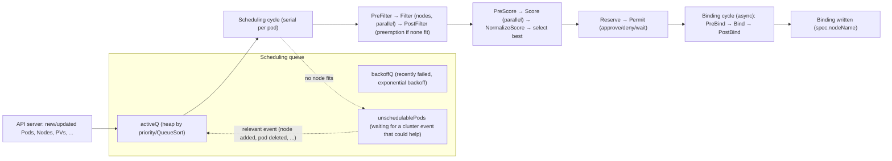

# 5.18 Scheduling in depth: kube-scheduler, affinity, taints, priority and preemption

| | |
|---|---|
| Level | Advanced |
| Priority tier | 0 |
| Lab venue | kind/kubeadm with 4+ nodes; labels/taints; Kueue, Volcano or scheduler-plugins for gang/queueing; `kwok` for simulated nodes at scale |
| Part | Part 5: Kubernetes |
| Status | Drafted, labs **untested** |

## Why this matters for AI infrastructure

Picture eight 8-GPU training pods waiting to be placed. The default scheduler handles them one at a time, and it can start seven and leave the eighth with nowhere to go. Those seven pods then hold their GPUs and wait, and nothing finishes. GPUs are scarce, expensive and tied to hardware topology, so each placement decision costs real money.

Other failures are just as costly. The default scheduler can put a latency-sensitive inference service onto the same failing node. It can fragment the cluster so that no node has 8 free GPUs, even though 40 are free. It can let background jobs hold GPUs that production inference needs. It can also put two GPUs of one pod across NUMA nodes, which halves their bandwidth.

Doing this well means understanding the built-in scheduler first: filters, scores, affinity, taints, priority and preemption. You also need to know where it falls short for batch and gang workloads. Queueing systems such as Kueue and Volcano, and device allocation through device plugins and DRA, complete the picture.

## Prerequisites and outcomes

Read 5.3, 5.7 and 5.9 first. When you finish this chapter, you should be able to do the following.

- Describe the scheduling cycle (queues, PreFilter, Filter, PostFilter, Score, Reserve, Permit and Bind), and say what the scheduler does and does not know.
- Use `nodeSelector`, node affinity, pod affinity and anti-affinity, `topologySpreadConstraints`, taints and tolerations, and `nodeName`. Choose the right one and write correct manifests. Understand required versus preferred rules, `IgnoredDuringExecution`, and AND and OR semantics.
- Use PriorityClasses, preemption policies and PodDisruptionBudgets. Explain victim selection and why preemption can cascade. Design priority tiers for training, inference, interactive and system work.
- Explain resource accounting (requests, extended resources, overhead, allocatable), choose between bin-packing and spreading (`NodeResourcesFit` scoring strategies), and recognize fragmentation.
- Describe gang scheduling and queueing. Explain why pod-by-pod scheduling fails for distributed jobs. Cover Kueue (admission control, ResourceFlavors, ClusterQueues, LocalQueues, cohorts, preemption and fair sharing), Volcano (PodGroup, queues, actions and plugins), the coscheduling plugin, JobSet, and Slurm integration notions.
- Reason about topology: NUMA and the Topology Manager, NodeResourceTopology (NFD) scheduling, rack, rail and NVLink-domain awareness through labels, and DRA with structured parameters.
- Tune and scale the scheduler (parallelism, `percentageOfNodesToScore`, profiles, plugins and multiple schedulers), and debug Pending pods and unexpected placements.

## 1. The scheduler's job and model

The scheduler has one job. It finds a node for every pod that has no `spec.nodeName` yet, then writes that choice back as a binding. It reasons over the API server's view of the cluster. That view includes each Node's `allocatable` resources, the requests of pods already placed, labels, taints, volumes and policies.

It does not see actual utilisation, unless a plugin adds that view. If you assume it does, the placements will surprise you. Its sight of network proximity stops at what labels say. Its sight of GPU health stops at what device plugins, labels and taints expose.

The scheduler works on **one pod at a time**, using a snapshot of the cluster. It has no notion of a job made of many pods unless a plugin supplies one. Every placement decision is therefore made for a single pod, so the scheduler never sees the whole job at once.



Read the diagram from left to right, and follow one pod through it. The queue feeds the scheduling cycle, and each stage narrows the list of candidate nodes until one is chosen. As you read the details below, notice where each stage hands the pod on.

The queue sorts pods by `QueueSort`, which by default means priority first and arrival time second. A pod that fails goes to the unschedulable pool, together with the plugins that rejected it. That pod is retried when an event those plugins care about happens, such as a node being added or changed, a pod being deleted, or a PVC being bound. It is also retried after `podMaxInUnschedulablePodsDuration` of 5 min passes. Backoff grows up to a maximum, which is 10 s by default.

Filter removes the nodes that cannot run the pod. Its checks include `NodeResourcesFit`, which compares requests with allocatable minus assigned; `NodePorts`; `NodeAffinity` and `NodeSelector`; `TaintToleration`; `InterPodAffinity` for hard rules; and `PodTopologySpread` for hard constraints. They also include the volume plugins `VolumeBinding`, `VolumeZone`, `VolumeRestrictions` and `NodeVolumeLimits`, then `NodeUnschedulable` for cordoned nodes, `NodeName`, `DynamicResources` for DRA, and any custom plugins. In a big cluster, only a fraction of nodes may be examined. That fraction is set by `percentageOfNodesToScore`.

PostFilter runs when no node passes Filter. Its default plugin, `DefaultPreemption`, tries to free room by evicting lower-priority pods. See section 5 for how that works.

Score ranks the feasible nodes from 0 to 100, using weights. The plugins involved are `NodeResourcesFit`, whose strategy is `LeastAllocated` by default, `MostAllocated` for bin-packing, or `RequestedToCapacityRatio` for custom curves. The others are `NodeResourcesBalancedAllocation`, `ImageLocality`, which favours nodes that already have the image, and `InterPodAffinity` and `NodeAffinity` for preferred rules. `TaintToleration` prefers fewer intolerable `PreferNoSchedule` taints, `PodTopologySpread` handles soft rules, and `VolumeBinding` completes the list. The highest total wins, and ties are broken randomly.

Reserve records the placement in the scheduler cache, so the next pod sees it. Permit can hold the pod in a waiting state. Coscheduling and gang plugins wait here until the whole group can be placed, then release it. Bind writes the Binding, or lets a plugin write it, asynchronously. If something fails, `Unreserve` rolls the placement back.

Scheduler behaviour is set in `KubeSchedulerConfiguration`. It defines profiles, which are named schedulers, each with its own plugin sets, weights and arguments. A pod selects its profile through `pod.spec.schedulerName`. You choose the plugin sets, weights and arguments for each profile. The same configuration also sets `percentageOfNodesToScore`, `parallelism`, leader election and extenders. Extenders are webhooks, and they are deprecated in favour of plugins. The example below has a `gpu-binpack` profile that uses `MostAllocated` to fill nodes before opening new ones, and a `default-scheduler` profile that spreads pods.

```yaml
apiVersion: kubescheduler.config.k8s.io/v1
kind: KubeSchedulerConfiguration
percentageOfNodesToScore: 50
parallelism: 16
profiles:
  - schedulerName: default-scheduler
  - schedulerName: gpu-binpack
    pluginConfig:
      - name: NodeResourcesFit
        args:
          scoringStrategy:
            type: MostAllocated
            resources:
              - { name: nvidia.com/gpu, weight: 5 }
              - { name: cpu, weight: 1 }
              - { name: memory, weight: 1 }
    plugins:
      score:
        disabled: [ { name: NodeResourcesBalancedAllocation } ]
```

Pods pick a profile with `schedulerName: gpu-binpack`. Running several schedulers that manage overlapping nodes without coordination causes races. Profiles inside one scheduler share its cache, so they avoid that race. Before you deploy a second scheduler, check whether a profile inside the existing one can do the job.

## 2. Resource fit and accounting

Most surprising placements start with resource fit. The scheduler does not look at what a pod is using right now. It adds up the `requests` of pods already assigned to a node, including pods that are still starting. It then compares that sum with the node's `allocatable` capacity, which Chapter 5.9 covers.

Limits are ignored for fit, except when requests default to limits. A pod with no requests, a BestEffort pod, counts as 0 for fit, so it can overload a node. Use `LimitRange` defaults to avoid that.

Extended resources such as `nvidia.com/gpu`, `rdma/*` and hugepages are integers. Device plugins advertise them in `status.capacity/allocatable`, and you request them in `limits`, where requests equal limits. GPU counting is by number, not identity. The scheduler knows that a node has 8 free GPUs, but not which 8. The kubelet device manager picks the specific devices, using `GetPreferredAllocation` hints for NVLink-aware choices. Fractional GPUs exist only through MIG, time-slicing or MPS, which advertise separate resource names such as `nvidia.com/mig-1g.10gb`, or through DRA.

Init containers and sidecars change the request math. The effective pod request is max(largest init container, sum of app containers) (+ sidecar contributions), plus RuntimeClass overhead. Pod overhead, ephemeral storage and PVC attach limits per node are also filters.

Fragmentation is the subtle one. Take a cluster with 64 GPUs free, spread as 4 per node. No single node can run an 8-GPU pod, even though 64 GPUs are free in total. Several fixes help. You can use a bin-packing profile (`MostAllocated`) for GPU nodes and keep node pools homogeneous in size. You can schedule large jobs first with priority, and reserve whole nodes for multi-GPU jobs using taints or labels. Descheduling by preemption or consolidation can defragment the cluster, and gang or queue systems can admit big jobs once capacity exists. Size GPU pools so that your largest job fits on one node.

## 3. Placement constraints

Placement rules tell the scheduler which nodes your pods may use. Start with the simplest tool. The comments in the YAML below tell you what each rule does. `nodeSelector` is a set of equality checks, and the pod must match all of them. Node affinity is more expressive, and it comes in a hard form and a soft form.

### nodeSelector and node affinity

```yaml
spec:
  nodeSelector:
    nvidia.com/gpu.product: NVIDIA-H100-80GB-HBM3        # simple equality (AND of all pairs)
  affinity:
    nodeAffinity:
      requiredDuringSchedulingIgnoredDuringExecution:      # hard rule (filter)
        nodeSelectorTerms:                                  # terms are OR'd
          - matchExpressions:                               # expressions within a term are AND'd
              - { key: topology.kubernetes.io/zone, operator: In, values: [us-central1-a, us-central1-b] }
              - { key: node.kubernetes.io/instance-type, operator: NotIn, values: [a3-edgegpu-8g] }
      preferredDuringSchedulingIgnoredDuringExecution:     # soft rule (score)
        - weight: 80
          preference:
            matchExpressions: [ { key: example.com/nvlink-domain, operator: In, values: [domain-3] } ]
```

The operators are `In`, `NotIn`, `Exists`, `DoesNotExist`, `Gt` and `Lt`. `IgnoredDuringExecution` means that a running pod is not evicted when node labels change. Labels come from several sources. The kubelet supplies zone, region, hostname, os, arch and instance-type. Cloud providers add their own, and NFD adds CPU flags and PCI devices. GPU Feature Discovery supplies `nvidia.com/gpu.product`, `.count`, `.memory` and `nvidia.com/mig.capable`. Your own platform labels cover rack, rail, NVLink domain or clique, pool, tenant and lifecycle.

### Pod affinity and anti-affinity

Pod affinity attracts or repels pods relative to the topology domains of other pods. The `topologyKey` is a node label that defines the domain. `kubernetes.io/hostname` makes the domain a single node, `topology.kubernetes.io/zone` makes it a zone, and a rack label makes it a rack.

```yaml
affinity:
  podAntiAffinity:
    requiredDuringSchedulingIgnoredDuringExecution:
      - labelSelector: { matchLabels: { app: vllm } }
        topologyKey: kubernetes.io/hostname              # at most one vllm pod per node
  podAffinity:
    preferredDuringSchedulingIgnoredDuringExecution:
      - weight: 50
        podAffinityTerm:
          labelSelector: { matchLabels: { app: embedding-cache } }
          topologyKey: topology.example.com/rack         # prefer same rack as the cache
```

Pod affinity is expensive. It costs O(pods × nodes) per cycle. Avoid cluster-wide `required` anti-affinity at thousands of nodes, because it is slow and brittle. Prefer `topologySpreadConstraints` when you want spreading. The `namespaceSelector` field and the newer `matchLabelKeys` and `mismatchLabelKeys` fields refine the target set.

### Topology spread constraints

```yaml
topologySpreadConstraints:
  - maxSkew: 1
    topologyKey: topology.kubernetes.io/zone
    whenUnsatisfiable: DoNotSchedule                     # or ScheduleAnyway (soft)
    labelSelector: { matchLabels: { app: vllm } }
    matchLabelKeys: [pod-template-hash]                  # skew computed per ReplicaSet revision
    minDomains: 3
```

`maxSkew` bounds the difference in matching-pod counts between the most and least populated domains. Use it for HA spreading across zones, nodes or racks, and combine hostname and zone constraints. With `maxSkew: 1`, the counts in any two domains may differ by at most 1. The fields `nodeAffinityPolicy` and `nodeTaintsPolicy` control whether non-matching nodes count as domains.

### Taints and tolerations

A taint on a node has the form `key=value:effect`. It repels any pod that does not tolerate it. `NoSchedule` stops new pods from being scheduled onto the node. `PreferNoSchedule` is only a soft preference. `NoExecute` also evicts running pods that do not tolerate it, and `tolerationSeconds` can limit how long they stay.

```bash
kubectl taint nodes gpu-node-1 nvidia.com/gpu=present:NoSchedule
kubectl taint nodes gpu-node-1 nvidia.com/gpu=present:NoSchedule-            # remove
kubectl taint nodes gpu-node-2 maintenance=true:NoExecute
```

```yaml
tolerations:
  - { key: nvidia.com/gpu, operator: Exists, effect: NoSchedule }
  - { key: node.kubernetes.io/unreachable, operator: Exists, effect: NoExecute, tolerationSeconds: 60 }   # faster failover than default 300
```

The system adds some taints on its own. They are `node.kubernetes.io/not-ready`, `unreachable`, `memory-pressure`, `disk-pressure`, `pid-pressure`, `network-unavailable`, and `unschedulable` for a cordoned node. Clouds add an `uninitialized` taint.

Taints support a few common patterns. A dedicated GPU pool combines a taint with a node label. Its workloads need the toleration and also a `nodeSelector` or affinity, because a toleration only permits placement. A per-tenant pool uses a taint such as `tenant=a`. A spot or preemptible pool is tainted, and only workloads that checkpoint should tolerate it. Reserved system nodes complete the list.

Admission plugins such as `ExtendedResourceToleration` can add tolerations automatically for pods that request `nvidia.com/gpu`, when nodes are tainted by that key. Users then need not add tolerations themselves.

### Other fields

Several other fields change placement. `nodeName` bypasses the scheduler and its checks. `schedulerName` selects a scheduler, `priorityClassName` sets priority, and `runtimeClassName` selects a runtime class. The scheduler also checks `hostPort` conflicts, and `resourceClaims`, `schedulingGates`, `readinessGates`, `topologySpreadConstraints` and `affinity` apply too. A scheduling gate holds a pod back until a controller removes the gate. Kueue and capacity controllers use gates this way.

Cordoning works through `kubectl cordon`, which sets `spec.unschedulable` and taints the node `unschedulable`. `drain` cordons the node and evicts its pods, while respecting PDBs.

Dedicated pools need both a taint and a node selector. For spreading, prefer `topologySpreadConstraints` over required pod anti-affinity.

### Spreading replicas across failure domains

Running several replicas helps only when they do not share a failure. Say a web server has three replicas, and all three land in one zone. A zone outage takes every replica down together. Placement rules are how you keep replicas apart, so one bad zone cannot remove the whole service.

Pod anti-affinity is the first tool. It tells the scheduler to avoid nodes that already run a replica of the same workload. The rule below prefers to spread the `my-web-server` Pods across zones, using the `zone` label on each node:

```yaml
affinity:
  podAntiAffinity:
    preferredDuringSchedulingIgnoredDuringExecution:
    - labelSelector:
        matchExpressions:
        - key: "app"
          operator: In
          values:
          - my-web-server
      topologyKey: "zone"
```

Anti-affinity has a limit. It can prefer a spread, or it can require one replica per domain. It cannot promise an even split. Topology spread constraints fill that gap. They tell the scheduler to spread the workload across the topology. The example below uses `maxSkew: 1` across zones, based on the `zone` label of nodes:

```yaml
spec:
  topologySpreadConstraints:
  - maxSkew: 1
    topologyKey: zone
    whenUnsatisfiable: DoNotSchedule
    labelSelector:
      matchLabels:
        foo: bar
```

With `whenUnsatisfiable: DoNotSchedule`, a Pod that would break the rule stays pending. Both mechanisms apply only to Pods that are being scheduled now. They do not move Pods that are already running. If your app runs several instances, use one of these placement features. Otherwise the scheduler may place your workload in a way that gives you no real failure tolerance.

## 4. Priority, preemption and disruption

### PriorityClass

Priority decides which pods matter most when the cluster is full. You set it with a `PriorityClass`, which gives a name to an integer. The two classes below show both extremes. One may preempt running pods, while the other waits in the queue and never evicts anyone.

```yaml
apiVersion: scheduling.k8s.io/v1
kind: PriorityClass
metadata: { name: inference-critical }
value: 1000000
globalDefault: false
preemptionPolicy: PreemptLowerPriority            # or Never
description: "Production serving; may preempt training"
---
apiVersion: scheduling.k8s.io/v1
kind: PriorityClass
metadata: { name: training-low }
value: 1000
preemptionPolicy: Never                            # waits in queue; never evicts others
```

Priority is an integer, and a larger value means more important. The system classes `system-cluster-critical` (2000000000) and `system-node-critical` (2000001000) are reserved for core components. User values should stay well below them. A class with `globalDefault: true` sets the default priority for pods that name no class. At most one class may do this. If none exists, the default is 0.

Priority does three jobs. It orders the scheduling queue, it decides which pods become preemption victims, and it influences the order of node-pressure eviction. Node-pressure eviction comes after QoS and over-request, which 5.9 covers.

Preemption happens in PostFilter, when a high-priority pod fits on no node. The scheduler simulates removing lower-priority pods on candidate nodes. It respects PodDisruptionBudgets on a best-effort basis, and it allows for graceful termination.

The scheduler then picks the candidate node that needs the fewest victims. The ranking considers the fewest PDB violations, the lowest highest-victim priority, the fewest victims and the latest start time. It sets `status.nominatedNodeName` and deletes the victims, which finish their grace periods. The preemptor schedules once resources free up, though other pods may take the room in the meantime. You will see the victims terminate before the preemptor runs. A pod with `preemptionPolicy: Never` moves ahead in the queue, but it never evicts anyone.

Watch out for a few pitfalls. Preemption can cascade, because a victim gets rescheduled and may preempt other pods in turn.

Killing one pod of a multi-pod training job wastes the progress of the whole job. The other pods sit idle until the operator restarts them all. Give training pods non-preemptible, higher or equal priority within their tier, or use queue-level preemption. Kueue preempts whole workloads and stays checkpoint-aware. Make sure workloads handle SIGTERM by checkpointing.

Priority inversion happens when low-priority pods hold resources that high-priority pods need, and the high-priority pods cannot preempt them because of PDBs or affinity. Abuse of the `system-*` classes is another risk, and ResourceQuota scopes `PriorityClass` restricts it. Finally, high-priority pods can starve others forever.

A PodDisruptionBudget protects availability from voluntary disruption, such as drains, the autoscaler and, on a best-effort basis, preemption. You set it with `minAvailable` or `maxUnavailable`, plus `unhealthyPodEvictionPolicy`. For a single-replica job, `maxUnavailable: 0` blocks node drains (5.19), so prefer Job-level resilience.

For AI platforms, you can use a common tier set like this. `system-*` covers infrastructure. `inference-prod` is high. `training-high/normal` tiers do not preempt each other, and quota controls them. `interactive-notebook` is medium, with time limits. `training-best-effort/spot` is low, preemptible, and should checkpoint often. Pair these tiers with Kueue preemption policies (section 6), so the queue system, rather than raw Kubernetes preemption, settles contention among batch jobs.

## 5. Why default scheduling fails for distributed jobs

Suppose you run a distributed training job with N pods, and it needs all N running before it can make progress. The default scheduler places pods independently. If only N−1 fit, then N−1 pods start and hold their GPUs idle while they wait for the last one. Another job may do the same thing, and both stall in deadlock, a hold-and-wait on resources. Partial placement also ignores locality, so pods can end up spread across racks or IB leaf domains.

A system that handles this needs several capabilities. It needs all-or-nothing admission, which is called gang scheduling. It needs queueing with fairness and quotas across teams, and preemption at job granularity. It needs topology awareness, so pods share a rack, an NVLink domain or a leaf. It needs backfilling, so small jobs fill the gaps. It also needs elasticity and checkpoint-aware disruption. Kubernetes provides building blocks, and add-ons supply the policy.

### Kueue

Kueue, from SIG Scheduling, is a job queueing and quota controller that sits in front of kube-scheduler. It controls when a workload's pods may be created and run. kube-scheduler still decides where each pod goes. You meet these objects in Kueue:

| Object | Purpose |
|---|---|
| `ResourceFlavor` | A variant of resources (GPU model/pool/spot vs on-demand), mapped to node labels/taints/tolerations injected into admitted workloads |
| `ClusterQueue` | Cluster-scoped quota per flavor (`nominalQuota`, `borrowingLimit`, `lendingLimit`), queueing strategy (`StrictFIFO`/`BestEffortFIFO`), cohort membership, preemption policy, namespace selector, admission checks |
| `LocalQueue` | Namespaced entry point that points to a ClusterQueue; users label jobs `kueue.x-k8s.io/queue-name` |
| `Cohort` | Group of ClusterQueues that can borrow unused quota from each other (fair sharing, hierarchical cohorts) |
| `Workload` | Kueue's internal representation of a job (resource requests, priority); admitted/evicted by Kueue |
| `WorkloadPriorityClass` | Priority for queueing decisions independent of pod priority |
| `AdmissionCheck` | Gate admission on external conditions (e.g., ProvisioningRequest to a cluster autoscaler for atomic capacity, MultiKueue for multi-cluster dispatch) |

Kueue supports many job types. These include batch/v1 Job, JobSet, MPIJob, PyTorchJob and TFJob from the Kubeflow Training Operator, RayJob and RayCluster, plain Pods and groups, Deployments and StatefulSets (newer), and AppWrapper. Each framework integrates by suspending the job, which sets `spec.suspend: true`, until the job is admitted. Kueue then unsuspends it and injects node selectors from the flavor. Pods of a job are created only after quota is reserved, which avoids partial starts. For all-or-nothing readiness, `waitForPodsReady` can evict workloads whose pods do not become ready in time.

```yaml
apiVersion: kueue.x-k8s.io/v1beta2
kind: ResourceFlavor
metadata: { name: h100-ondemand }
spec:
  nodeLabels: { nvidia.com/gpu.product: NVIDIA-H100-80GB-HBM3, pool: h100-ondemand }
  tolerations: [ { key: nvidia.com/gpu, operator: Exists, effect: NoSchedule } ]
---
apiVersion: kueue.x-k8s.io/v1beta2
kind: ClusterQueue
metadata: { name: research }
spec:
  cohortName: gpu-fleet
  namespaceSelector: { matchLabels: { team: research } }
  queueingStrategy: BestEffortFIFO
  preemption:
    reclaimWithinCohort: Any                 # take back lent quota from borrowers
    borrowWithinCohort: { policy: LowerPriority, maxPriorityThreshold: 100 }
    withinClusterQueue: LowerPriority
  resourceGroups:
    - coveredResources: [cpu, memory, nvidia.com/gpu]
      flavors:
        - name: h100-ondemand
          resources:
            - { name: cpu,            nominalQuota: 1024 }
            - { name: memory,         nominalQuota: 8Ti }
            - { name: nvidia.com/gpu, nominalQuota: 128, borrowingLimit: 64, lendingLimit: 32 }
---
apiVersion: kueue.x-k8s.io/v1beta2
kind: LocalQueue
metadata: { name: research-gpu, namespace: research-ns }
spec: { clusterQueue: research }
---
apiVersion: batch/v1
kind: Job
metadata:
  name: pretrain-llama
  namespace: research-ns
  labels: { kueue.x-k8s.io/queue-name: research-gpu, kueue.x-k8s.io/priority-class: training-normal }
spec:
  suspend: true
  parallelism: 8
  completions: 8
  # template with 8-GPU pods ...
```

Kueue also offers topology-aware scheduling (TAS). TAS places a workload's pods in the best-fitting topology level, such as a block or rack, using node labels. Kueue additionally offers fair sharing with weights, partial admission, elastic jobs, dynamic resource requests, and MultiKueue for federation (5.35).

### Volcano

Volcano is a batch scheduler from CNCF. It runs its own scheduler binary and uses its own CRDs. These are `Queue`, with weight, capability and reclaimable; `PodGroup`, with minMember and minResources, which give gang behaviour; and `Job`, a vcjob with tasks and lifecycle policies. Its actions are `enqueue`, `allocate`, `preempt`, `reclaim` and `backfill`. Its plugins include `gang`, `priority`, `drf` for fairness, `proportion`, `binpack`, `nodeorder`, `predicates`, `task-topology` and `numa-aware`. Network-topology awareness comes through HyperNode.

Pods set `schedulerName: volcano` and reference a PodGroup. Compared with Kueue, Volcano replaces kube-scheduler for batch pods. It puts richer batch-specific policy in one place, but it is more intrusive. Kueue complements the default scheduler, with a lighter integration with standard Jobs and operators. Teams often choose Kueue for new platform builds, and Volcano where its HPC-style policies or existing deployments are already established.

### Other gang mechanisms

The coscheduling plugin comes from the scheduler-plugins project. It adds a `PodGroup` CRD and a Permit plugin that holds pods until `minMember` can be placed. It runs in the same scheduler and brings more plugins with it. These include `CapacityScheduling` for elastic quotas, `NodeResourceTopologyMatch`, `Trimaran` for load-aware scoring, and `NetworkAware` scheduling.

JobSet is an API from Kubernetes SIG Apps/Batch for groups of Jobs. It provides success and failure policies, startup order, and DNS through a headless Service. It is the base for multi-slice and multi-host training, and it integrates with Kueue.

The Kubeflow Training Operator, MPI Operator v2 and KubeRay use PodGroup or Kueue integration to get gang semantics.

Native gang scheduling work in Kubernetes is emerging. It includes the Workload API and PodGroup concepts in recent releases. Check the release notes before you adopt an external solution.

Slurm can also run on Kubernetes. SchedMD/Slinky, SUNK on CoreWeave and Soperator on Nebius all run Slurm as the batch scheduler, while Kubernetes manages the nodes. This suits HPC teams (Part 6).

Choose Kueue or Volcano for batch jobs depending on whether you want to add to the default scheduler or replace it.

## 6. Topology-aware and device-aware scheduling

GPU-to-GPU bandwidth depends on the NVLink domain. GPU-to-NIC bandwidth depends on PCIe and NUMA proximity. Node-to-node bandwidth depends on rail, leaf and spine hops. A mis-placed job therefore loses NCCL bandwidth substantially. See Part 12 for the details.

The kubelet's Topology Manager aligns CPU, memory and devices on one NUMA node at admission (5.9). The scheduler is not aware of this, so a pod can be scheduled and then rejected with `TopologyAffinityError`. The fix is NodeResourceTopology. The NFD topology updater exports per-NUMA allocatable through `NodeResourceTopology` CRDs, and you pair them with the scheduler-plugins `NodeResourceTopologyMatch` plugin. DRA is the other route.

Fabric awareness starts with labels. Label nodes with `topology.example.com/block`, `/rack`, `/leaf` and `/nvlink-domain`. Or use the cloud-provided `topology.kubernetes.io/*` labels and `cloud.google.com/gce-topology-block/subblock/host` labels. Job pods then use required node affinity, or topology spread and pod affinity, with those keys. Kueue TAS and the Volcano network-topology plugin automate fitting a job into the lowest topology level that has capacity.

For multi-node NVLink systems such as NVL72, the domain is a rack-scale unit. Schedule whole-domain jobs onto one domain, and respect IMEX and NVLink partition boundaries (Part 9, 12).

DRA describes devices in `ResourceSlice`s, which drivers publish. These slices carry attributes such as product, memory, MIG profile, PCI root and NVLink domain. Pods reference `ResourceClaim` or `ResourceClaimTemplate` objects with CEL selectors and constraints. Examples are "4 GPUs on the same PCIe root" and "GPU and NIC aligned". The scheduler's `DynamicResources` plugin allocates during scheduling. Placement is therefore topology-aware, without kubelet rejections later. DRA also supports sharing claims, admin access, prioritized alternatives, partitionable devices (MIG) and, in newer features, consumable capacity. NVIDIA's DRA driver provides the `gpu.nvidia.com` device class and, for multi-node NVLink, the `compute-domain` device class.

Device plugins and DRA can coexist for each resource, so you can migrate gradually. Verify your Kubernetes and driver versions (Part 11).

```yaml
apiVersion: resource.k8s.io/v1
kind: ResourceClaimTemplate
metadata: { name: four-gpus-same-root }
spec:
  spec:
    devices:
      requests:
        - name: gpu
          exactly:
            deviceClassName: gpu.nvidia.com
            count: 4
            selectors:
              - cel: { expression: "device.attributes['gpu.nvidia.com'].productName == 'NVIDIA H100 80GB HBM3'" }
      constraints:
        - requests: [gpu]
          matchAttribute: "resource.kubernetes.io/pcieRoot"
```

Attribute names and API versions differ by driver and Kubernetes release, so verify them. For a job that must stay within one domain, choose the topology key first, then apply it with node affinity, Kueue TAS or a DRA claim.

## 7. Descheduling, autoscaling and scheduler tuning

The descheduler periodically evicts pods to improve placement. It can remove duplicates, balance utilisation, fix pods that violate affinity, clean up node taints, and consolidate nodes with low utilisation. Run it with PDBs, and only on non-training pods.

Cluster Autoscaler and Karpenter react to Pending pods by adding nodes, and they remove underused nodes. GPU node scale-up takes minutes, and capacity is not guaranteed. Combine them with a Kueue ProvisioningRequest for atomic multi-node provisioning (5.23).

Scale tuning matters once you reach 1,000 nodes or more. `percentageOfNodesToScore` defaults to an adaptive 50%, and it can drop to 5%. Lowering it speeds up large clusters, but leaves fewer candidates. Other knobs include `parallelism`, minimising expensive plugins such as inter-pod affinity, scheduler QPS and burst for the client, and high availability with leader election. You also want to avoid webhook latency on pod creation, and to understand how the `unschedulable` queue behaves.

Watch these metrics: `scheduler_pending_pods{queue}`, `scheduler_schedule_attempts_total{result}`, `scheduler_e2e_scheduling_duration_seconds`, `scheduler_scheduling_attempt_duration_seconds`, `scheduler_plugin_execution_duration_seconds`, `scheduler_preemption_attempts_total` and `scheduler_queue_incoming_pods_total`.

Throughput depends on how constrained the pods are. Typical default throughput is hundreds of pods/second in small clusters, and tens to ~100 pods/s with complex constraints. A 10,000-pod job creation burst takes minutes. That is why gang jobs should be created suspended and admitted by Kueue, so pods arrive in controlled bursts.

Image locality scoring helps large GPU images, because pods prefer nodes that already have the image. Pre-pull DaemonSets reduce the skew between nodes.

Node pools, defined by labels and taints, simplify scheduling rules and autoscaling. Avoid gigantic heterogeneous pools.

### Extending the scheduler

The scheduler is a core part of Kubernetes. A large part of Kubernetes' value is the abstraction of pools of machines into places to run workloads. The scheduler decides where each Pod runs. Together with the kubelet, it forms the heart of the system, and everything else is built around it. For your platform, the scheduler is a cornerstone platform service.

It helps to compare the scheduler with your custom operators. Both are Kubernetes controllers that manage Kubernetes resources. Your operators bring new custom controllers and new custom resources. The scheduler is a core controller that every cluster ships with, and it manages the built-in Pod resource.

Teams rarely need to extend the scheduler. Still, it matters enough that you should understand how it decides and how to change those decisions if needed. Kubernetes is built to be extended and modular. If the scheduler does not meet your needs, you can modify it, augment it or replace it.

Scheduling policies configure the predicates and priorities the scheduler uses. You can write a policy file on the control plane nodes and pass it with `--policy-config-file`. The preferred method is a ConfigMap. Pass the scheduler `--policy-configmap`, and then you can update the policy through the API server. With a ConfigMap, you will likely need to update the `system:kube-scheduler` ClusterRole so it can get ConfigMaps.

**Warning:** At the time of writing, both `--policy-config-file` and `--policy-configmap` still work. The official docs mark them as deprecated, though. For new custom scheduling behavior, use the scheduling profiles described earlier in this chapter instead of policies.

The ConfigMap below makes a Node eligible for a Pod's `nodeSelector` only if it has the `selectable` label key.

```yaml
apiVersion: v1
kind: ConfigMap
metadata:
  name: scheduler-policy-config
  namespace: kube-system
data:
  policy.cfg: |+
    apiVersion: v1
    kind: Policy
    predicates:
    - name: "PodMatchNodeSelector"
      argument:
        labelsPresence:
          labels:
          - "selectable"
          presence: true
```

The file name `policy.cfg` is the name the scheduler expects for policies. The predicate `PodMatchNodeSelector` implements `nodeSelector`. The `selectable` label key adds the constraint. With `presence: true`, a Node without the `selectable: ""` label is not eligible. If you set `presence: false`, the label would have to be absent instead.

With this policy in place, the Pod below schedules only to a Node that has both `device: gpu` and `selectable: ""`.

```yaml
apiVersion: v1
kind: Pod
metadata:
  name: terminator
spec:
  containers:
  - image: registry.acme.com/skynet/t1000:v1
    name: terminator
  nodeSelector:
    device: gpu
```

Scheduling profiles enable or disable plug-ins compiled into the scheduler. You pass a file name to the `--config` flag when you run the scheduler. The plug-ins implement extension points, including the filter and scoring steps covered earlier. Teams rarely need this. The official Kubernetes docs explain how to do it.

You are not limited to one scheduler. You can deploy any number of them, either Kubernetes schedulers with different policies and profiles or fully custom schedulers. A Pod's `schedulerName` field decides which scheduler places it. Multiple schedulers add complexity, so consider dedicated clusters for workloads with specialized scheduling needs.

In the unlikely event that you cannot use the Kubernetes scheduler, even with policies and profiles, you can write your own. That means a controller that watches Pods. When a new Pod appears, it decides where the Pod should run and sets the `nodeName` field. The scope is narrow, but it is not a simple exercise. The core scheduler weighs many complex factors when it decides. A custom scheduler will take real engineering effort to refine. Go this route only after you have exhausted the existing options, and only with deep Kubernetes expertise on the team.

## 8. Debugging scheduling

When a pod sits in Pending, start with its events. The `FailedScheduling` message gives the count of nodes rejected for each reason. The commands below show the state behind those counts.

```bash
kubectl get pod p -o wide; kubectl describe pod p | sed -n '/Events/,$p'
# FailedScheduling: 0/20 nodes are available: 8 Insufficient nvidia.com/gpu, 6 node(s) had untolerated taint {nvidia.com/gpu: present}, 6 node(s) didn't match Pod's node affinity/selector. preemption: 0/20 nodes are available: ...
kubectl get nodes -L nvidia.com/gpu.product,topology.kubernetes.io/zone
kubectl describe node n | sed -n '/Allocated resources/,/Events/p'               # requests vs allocatable
kubectl get pods -A -o wide --field-selector spec.nodeName=n                       # what is on the node
kubectl get events -A --field-selector reason=FailedScheduling --sort-by=.lastTimestamp
kubectl logs -n kube-system -l component=kube-scheduler --tail=200                 # -v=4 for filter/score traces
kubectl get --raw /metrics | grep -E '^scheduler_(pending_pods|schedule_attempts_total|preemption)'
kubectl get workloads -A; kubectl describe workload <w> -n ns                       # Kueue admission state & reasons
kubectl get clusterqueue research -o yaml | yq '.status'                            # usage, pending, admitted
kubectl get resourceclaims,resourceslices -A                                         # DRA
kubectl get priorityclass; kubectl get pdb -A
kubectl get --raw "/api/v1/nodes/n/proxy/configz" | jq '.kubeletconfig.topologyManagerPolicy'
```

Match the event text against this table. In each row, you find the symptom, its likely cause and a fix.

| Symptom | Likely cause | Fix |
|---|---|---|
| `Insufficient nvidia.com/gpu` but GPUs free | GPUs used by non-listed pods (e.g., terminating, in other namespaces), device plugin not updated, fragmentation, node cordoned | `describe node` allocated; check plugin; defrag; uncordon |
| `didn't match Pod's node affinity/selector` | Labels missing (GFD not running), typos | Check labels, NFD/GFD DaemonSets |
| `untolerated taint` | Missing toleration | Add toleration/enable ExtendedResourceToleration |
| `didn't satisfy existing pods anti-affinity rules` / `topology spread constraints` | Too strict required rules | Relax to preferred, add capacity/domains, adjust `maxSkew` |
| `volume node affinity conflict` | PV zone differs from schedulable nodes | `WaitForFirstConsumer`, same-zone capacity (5.17) |
| `pod has unbound immediate PersistentVolumeClaims` | PVC pending | Fix storage class/provisioner |
| Pending forever with Kueue | Not admitted: quota, flavor mismatch, wrong queue label, `suspend` | `describe workload`, ClusterQueue status |
| Pods scheduled then `TopologyAffinityError` | Kubelet topology policy rejects | Align policy/NUMA-aware scheduling/DRA |
| Training job partially running | No gang control | Use Kueue/Volcano/PodGroup |
| Preempted unexpectedly | Higher-priority pod needed room | Review PriorityClasses, `preemptionPolicy`, PDB; use Kueue to decide |
| Hot node, empty neighbours | `LeastAllocated` vs requests not reflecting usage; node affinity pull | Scoring strategy, spread constraints, descheduler, load-aware scoring |
| Scheduling slow at scale | Heavy plugins (inter-pod affinity), API latency, single scheduler throughput | Reduce affinity, tune percentage, check API (5.5), batch admission |
| DRA claim pending | No matching ResourceSlice/device attributes, driver not running | `get resourceslices`, driver pods, CEL expression |

For a Kueue pod stuck in Pending, start with `kubectl describe workload`, because the admission state usually explains it.

## 9. Reference patterns for a GPU platform

1. Start with the pools, because queues, quotas and placement rules all refer to them. You can lay out `gpu-h100-training` as a tainted, labeled pool of homogeneous 8-GPU nodes. Add a `gpu-l4-inference` pool, a `cpu-system` pool and a `spot-experimental` pool. Workloads select these through labels and Kueue ResourceFlavors, so users do not write node selectors themselves.

2. Admission goes through Kueue. All batch jobs go through Kueue LocalQueues. Give each team a ClusterQueue with nominal quotas, cohort borrowing and preemption policies. Run inference as Deployments with a high PriorityClass and a reserved pool of its own, or a ClusterQueue with reservation.

3. Placement favours whole nodes. Use `MostAllocated` (bin-pack) for GPU pools, so whole nodes stay free for large jobs. Use topology constraints for training, and `topologySpreadConstraints` across zones or racks for inference replicas.

4. Resilience covers failures. Use PDBs for inference. Make training checkpoint-aware, with SIGTERM handling and `terminationGracePeriodSeconds`. Node health taints from NPD or DCGM-based remediation (Part 17) keep unhealthy GPUs out of scheduling automatically.

5. Visibility tells you what is waiting and why. Build dashboards for pending reasons, queue wait time, GPU allocation versus utilisation (DCGM), fragmentation (the largest placeable GPU block), preemption counts, admission latency, and per-team usage versus quota.

6. Governance keeps the platform fair. Set ResourceQuota for objects and storage, and LimitRange defaults. Use an admission policy to require queue labels and priority classes from an allow-list. Map namespaces to teams through GitOps (4.26).

## 10. Lab

Start with the self-checking Python lab, `code/part05/gpu_scheduler_simulator_lab.py`, which you can run locally. It checks three things. First, the `NodeResourcesFit` `LeastAllocated` versus `MostAllocated` bin-packing and GPU fragmentation simulator (`simulate_gpu_placement_and_fragmentation`). Second, the Kueue `ClusterQueue` cohort borrowing and gang admission evaluator (`evaluate_kueue_cohort_gang_admission`). Third, the DRA `ResourceClaimTemplate` same-`pcieRoot` device allocator (`allocate_dra_same_pcie_root`).

```bash
python3 code/part05/gpu_scheduler_simulator_lab.py
```

Next, you run the exercises on a 4-node `kind` or `KWOK` cluster. All interactive shell steps below are `untested here`.

1. Predict placement. Create a 4-node kind cluster with labels (zone, rack, GPU type) and taints. Write pods with various constraints, predict where each one lands, and check the result. Then read the scheduler logs at `-v=4`.
2. Required versus preferred. Give node affinity a required term that cannot be met, and watch the pod stay Pending with an event. Then make the same term preferred and see the pod placed. Finally, show OR-of-terms versus AND-of-expressions with a truth table of manifests.
3. Taints. Dedicate a pool with `NoSchedule`. Show that a toleration does not force placement, then add a `nodeSelector`. Use `NoExecute` with `tolerationSeconds`, and watch the eviction happen. Finally, enable `ExtendedResourceToleration` and observe its behaviour.
4. Spread versus anti-affinity. Deploy 6 replicas with `topologySpreadConstraints` on hostname and zone. Compare them with required pod anti-affinity, which hits its capacity limit. Measure the scheduling latency of both on a 500-node KWOK cluster.
5. Bin-packing versus spreading. Configure a second profile with `MostAllocated`. Schedule 40 small GPU-like pods under each profile, using a fake extended resource, `example.com/gpu`. Compare per-node utilisation and the largest remaining free block.
6. Fragmentation incident. Fill nodes with 1-GPU pods under spreading. Submit an 8-GPU pod, which stays Pending even though many GPUs are free. Fix it by bin-packing, preemption or the descheduler, and record your steps.
7. Priority and preemption. Create low and high PriorityClasses. Saturate the cluster with low-priority pods, then create a high-priority pod. Observe the victim selection, `nominatedNodeName` and the events. Test `preemptionPolicy: Never` and the PDB interaction.
8. Gang deadlock. Submit two 4-pod jobs, each needing 4 of 6 available slots, with default scheduling, to reproduce the deadlock. Fix it with Kueue (suspended Jobs and a ClusterQueue quota) or a coscheduling PodGroup. Verify that all-or-nothing admission holds.
9. Kueue fair sharing. Create two teams with ClusterQueues in one cohort. Team A borrows idle quota. Team B submits a job and reclaims its quota through preemption. Observe the `Workload` conditions and metrics, then add a WorkloadPriorityClass.
10. Volcano (optional). Install Volcano and run a vcjob with `minAvailable`. Compare its behaviour and policies with Kueue.
11. Topology. Label nodes by rack, and implement required-affinity placement for a job. Try Kueue TAS if it is available. Measure a synthetic network benchmark (iperf) within a rack and across racks, to quantify the difference.
12. DRA, if your cluster supports it. Install the example DRA driver or NVIDIA's. Create a ResourceClaimTemplate with CEL and constraints, then observe the allocation and scheduling decisions in the events.
13. Scale. Use KWOK to simulate 2,000 nodes, and create 20,000 pods. Capture the scheduler metrics, tune `percentageOfNodesToScore` and `parallelism`, and identify the bottlenecks.
14. Dashboard. Build panels for pending pods by reason, queue wait time, GPU fragmentation and preemptions. Define alerts.
15. Clean up.

## 11. Common mistakes

A toleration only permits a pod to land on a tainted node. It does not attract the pod there. Dedicated pools fail when the node selectors or affinity are missing. Required pod anti-affinity at large scale is slow and brittle, and `topologyKey` is easy to misuse.

Running distributed jobs without gang or queue control leads to partial starts that hold GPUs. Priority inflation, where everything is "critical", makes preemption worse. Preempting single pods of multi-pod jobs wastes their work, and preemptible work without checkpoints loses everything on eviction.

PDBs that block all evictions cause trouble, and so do PDBs on single-replica workloads. Relying on `nodeName` or manual scheduling hacks bypasses the checks that protect you.

Ignoring fragmentation is common when you use a spreading policy on GPU pools. Mixing heterogeneous GPU types in one pool, without labels or resource names, gives the scheduler no way to tell them apart.

Assuming the scheduler sees GPU utilisation or health is another trap. Leaving unhealthy GPUs schedulable lets the scheduler place work on hardware that cannot run it. Running multiple schedulers or profiles over the same nodes without coordination causes races.

A kubelet topology policy stricter than the scheduler's awareness leads to pods that are rejected after binding. Misreading `FailedScheduling` messages is the last trap, because the counts are per reason and may overlap.

## 12. Interview angles

These are the questions an interviewer is likely to ask about this chapter. Each one tests whether you can explain the mechanism, not just name the feature.

- "How does kube-scheduler pick a node? Explain filters, scores, and the binding cycle."
- "Taints vs node affinity; why do GPU pools need both?"
- "Pod anti-affinity vs topology spread constraints."
- "Explain priority and preemption; what can go wrong with training jobs?"
- "Why is the default scheduler unsuitable for distributed training? How do Kueue and Volcano solve it?"
- "How do you avoid GPU fragmentation?"
- "How do you make scheduling topology-aware (NUMA, NVLink, rack)? What is DRA?"
- "A pod is Pending with 'Insufficient nvidia.com/gpu' but monitoring shows idle GPUs. Why?"

Work through the last question end to end, using the debugging steps in section 8.

## Exercises

1. You trace the three queues inside `kube-scheduler` (`activeQ`, `backoffQ`, `unschedulablePods`) and the Scheduling Framework (`PreFilter -> Filter -> PostFilter -> Score -> Reserve -> Permit -> Bind`). Use `simulate_gpu_placement_and_fragmentation()` in `code/part05/gpu_scheduler_simulator.py` to see why default `LeastAllocated` scoring fragments two 8-GPU nodes when two 4-GPU inference pods are scheduled. That fragmentation leaves a later 8-GPU training pod stuck `Pending`. Then show the `gpu-binpack` profile in `KubeSchedulerConfiguration`, with `MostAllocated` and an `nvidia.com/gpu` weight of `5`.
2. You work through placement constraints (`nodeSelector`, `nodeAffinity`, `podAffinity`/`podAntiAffinity`, `topologySpreadConstraints`, and `Taints`/`Tolerations`). Explain why a dedicated GPU node pool needs both a taint (`nvidia.com/gpu=present:NoSchedule` plus Pod `tolerations`) and a `nodeSelector` or `nodeAffinity`. State the OR-of-`nodeSelectorTerms` versus AND-of-`matchExpressions` rule. Then explain why `topologySpreadConstraints` scales better than `required` `podAntiAffinity`.
3. You trace how `PostFilter` `DefaultPreemption` chooses victim pods (`nominatedNodeName`). Explain why preempting one pod of a 64-pod synchronous training job wastes the work of all 64 pods. Then design a 5-tier `PriorityClass` hierarchy: `system-*`, `inference-critical`, `training-normal` with `preemptionPolicy: Never`, `interactive-notebook`, and `training-spot`.
4. Using `evaluate_kueue_cohort_gang_admission()` in `code/part05/gpu_scheduler_simulator.py`, you trace how two 4-pod jobs deadlock on a 6-node cluster under default pod-by-pod scheduling. Then show how Kueue's `suspend: true`, a `ClusterQueue` with `nominalQuota: 128, borrowingLimit: 64, lendingLimit: 32`, and a `Cohort` prevent partial starts and enable fair-share borrowing and reclaiming. Finally, compare Kueue (`ResourceFlavor`, `ClusterQueue`, `LocalQueue`, `Cohort`) with Volcano (`PodGroup`) and coscheduling.
5. Using `allocate_dra_same_pcie_root()` in `code/part05/gpu_scheduler_simulator.py`, you trace the `four-gpus-same-root` `ResourceClaimTemplate` from section 6. Follow its `cel` selector and its `matchAttribute: "resource.kubernetes.io/pcieRoot"` constraint. Explain how DRA and `NodeResourceTopologyMatch` prevent post-scheduling `TopologyAffinityError` rejections on the node. This exercise also covers topology with rack, rail and NVLink labels, Kueue `TAS` and `DRA`.
6. This exercise covers diagnosing `FailedScheduling` events and scaling the scheduler to 2,000+ nodes. You parse the multi-reason `FailedScheduling` message in section 8: `0/20 nodes are available: 8 Insufficient nvidia.com/gpu, 6 node(s) had untolerated taint, 6 node(s) didn't match Pod's node affinity`. Then explain why monitoring can show 0% GPU utilization (`DCGM_FI_DEV_GPU_UTIL`) while `kube-scheduler` reports `Insufficient nvidia.com/gpu`.

> **dcgm-exporter 4.9.0 version note.** dcgm-exporter 4.9.0 (2026-11-06) renamed many default metrics and changed some units. For example `DCGM_FI_DEV_GPU_UTIL` (percent) became `DCGM_FI_DEV_GPU_UTIL_RATIO` (0 to 1), and `DCGM_FI_DEV_FB_USED` (MiB) became `DCGM_FI_DEV_FB_USED_BYTES`. The metric names in this chapter are the 4.8.x names. On a 4.9.0 exporter use the [full mapping in 17.4](../part-17-operations/04-dcgm-exporter-and-interpreting-gpu-metrics.md#14-what-dcgm-exporter-490-renamed), and change thresholds together with the unit.

Work through exercise 6 last, since it draws on everything earlier in the chapter.

## Checkpoint questions (20)

<details>
<summary>1. What are the three internal queues inside `kube-scheduler` (`activeQ`, `backoffQ`, `unschedulablePods`), and how do Pods move between them?</summary>

Three queues hold pending pods, and knowing them helps you see where a stuck Pod waits. The first is `activeQ`, a priority heap sorted by `QueueSort`. The highest `PriorityClass` comes first, then the earliest timestamp. The scheduler's main loop pops the next Pod to schedule from here.

When a Pod fails `Filter`, and then `PostFilter` preemption, because no node currently fits, it moves into `unschedulablePods`. It is tagged with the exact plugin events that could make it schedulable, such as `NodeAdd`, `PodDelete`, `PvAdd` or `NodeLabelChange`. It waits there without using CPU cycles, until a matching cluster event occurs or the 5-minute `podMaxInUnschedulablePodsDuration` safety timer fires.

A Pod in `backoffQ` has been woken by a cluster event, or it failed with a transient error. It waits there for an exponential backoff interval, from `1s` up to `10s`, before it moves into `activeQ`. This stops one unschedulable Pod from monopolizing the scheduling loop.
</details>

<details>
<summary>2. Walk through the extension points of the Kubernetes Scheduling Framework in execution order, and distinguish the Scheduling Cycle from the Binding Cycle.</summary>

The Scheduling Cycle runs serially, one Pod at a time, against an in-memory snapshot of the cluster cache. Its steps run in this order.

1. `PreFilter` precomputes pod-level state and checks basic invariants.
2. `Filter` runs in parallel across candidate nodes. It eliminates nodes that cannot run the Pod, using `NodeResourcesFit`, `NodeAffinity`, `TaintToleration`, `VolumeBinding` and `PodTopologySpread`.
3. `PostFilter` runs only if zero nodes passed `Filter`. `DefaultPreemption` simulates evicting lower-priority pods to find a feasible node, which it records as `nominatedNodeName`.
4. `PreScore`, `Score` and `NormalizeScore` run in parallel across the feasible nodes. They rank the surviving nodes from `0` to `100`, multiplied by plugin weights. The highest total score wins.
5. `Reserve` optimistically updates the scheduler's in-memory cache. The very next Pod's serial cycle then sees those resources as taken.
6. `Permit` approves, denies or holds the Pod in a `Wait` state. The `Coscheduling` gang plugins use that state until all `minMember` pods in a `PodGroup` reach `Permit`.

The Binding Cycle runs asynchronously, in goroutines, so slow API writes do not block the next Pod. Its step is 7. `PreBind`, `Bind` and `PostBind` write the `Binding` (`spec.nodeName`) to `kube-apiserver`. If binding fails, `Unreserve` is called instead.
</details>

<details>
<summary>3. Why can `kubectl describe pod` report `0/20 nodes are available: 20 Insufficient nvidia.com/gpu` even when Grafana (`DCGM_FI_DEV_GPU_UTIL`) shows that 12 of those nodes have 0% GPU utilization?</summary>

`kube-scheduler` schedules strictly from `resources.requests`, and from `limits` for extended resources, compared with `Node.status.allocatable`. It never looks at real-time GPU or CPU utilization from `DCGM` or `metrics-server`.

Suppose you find interactive Jupyter notebooks, hung zombie Jobs or un-terminated Pods that have requested `nvidia.com/gpu: 8` on those 12 nodes. The scheduler then counts all 8 GPUs as 100% allocated, even if the processes inside those Pods are completely idle. Two other causes are possible. The `nvidia-device-plugin` DaemonSet may have crashed or marked GPUs unhealthy, so `allocatable["nvidia.com/gpu"]` dropped to 0. Or GPU fragmentation may have left 4 free GPUs per node when the new Pod requests 8.
</details>

<details>
<summary>4. How does `LeastAllocated` (the default `NodeResourcesFit` scoring strategy) cause GPU Fragmentation, and how does a `MostAllocated` (`gpu-binpack`) scheduler profile prevent it?</summary>

Take four 8-GPU nodes, which give 32 GPUs in total. Users submit eight 1-GPU inference Pods, followed by three 8-GPU training Pods.

With `LeastAllocated`, the default spread, `kube-scheduler` prefers the nodes with the most free resources. It places two 1-GPU pods on each of the four nodes. Every node now has only 6 free GPUs, which is 4 x 6 = 24 free GPUs in total. As a result, all three 8-GPU training Pods sit stuck in `Pending` with `Insufficient nvidia.com/gpu`.

With `MostAllocated`, through the `gpu-binpack` profile that weights `nvidia.com/gpu: 5`, `kube-scheduler` packs all eight 1-GPU pods onto Node 0. Node 0 then has 0 free GPUs. Nodes 1, 2 and 3 stay completely empty, with 8 free GPUs each, so all three 8-GPU training Pods schedule immediately.
</details>

<details>
<summary>5. Why do you need BOTH a Taint + Toleration AND a `nodeSelector` / `nodeAffinity` to dedicate a GPU node pool to GPU workloads?</summary>

The taint `nvidia.com/gpu=present:NoSchedule` repels Pods that lack a matching toleration. That keeps CPU-only Pods off the expensive GPU nodes. However, a toleration only permits a Pod to land on a tainted node. It does not stop a GPU Pod from being scheduled onto an untainted, CPU-only node. That can happen if you match on a non-GPU resource, or before the device plugin registers.

The `nodeSelector` or `nodeAffinity` on `nvidia.com/gpu.product: NVIDIA-H100-80GB-HBM3` attracts the Pod and restricts it to nodes that carry that label. Using both guarantees that CPU Pods never land on GPU nodes, and that GPU Pods land only on the intended GPU SKU pool.
</details>

<details>
<summary>6. In `nodeAffinity.requiredDuringSchedulingIgnoredDuringExecution`, how are multiple `nodeSelectorTerms` combined versus multiple `matchExpressions` inside a single term?</summary>

Multiple items under `nodeSelectorTerms` are OR'd. The Pod can schedule onto a node that satisfies at least one `nodeSelectorTerm`.

Multiple items under `matchExpressions` inside a single `nodeSelectorTerm` are AND'd. The node must satisfy every `matchExpression` in that term.
</details>

<details>
<summary>7. Why should you prefer `topologySpreadConstraints` over `requiredDuringScheduling` `podAntiAffinity` for spreading inference replicas across zones or nodes?</summary>

There are three reasons. First, a `required` `podAntiAffinity` with `topologyKey: kubernetes.io/hostname` caps the replica count at the number of nodes. If you have 8 GPU nodes and scale a `Deployment` from 8 to 10 replicas during a traffic spike, or during a `maxSurge: 1` rolling update, replicas 9 and 10 stay `Pending` for good.

Second, `topologySpreadConstraints` with `maxSkew: 1` balances replicas evenly across domains. That means 1 per node across 8 nodes, then 2 per node when you scale to 16 replicas. It does not deadlock when `replicas > domains`. Its `matchLabelKeys: [pod-template-hash]` option lets a rolling update spread the new ReplicaSet revision independently of the old one.

Third, cluster-wide `required` `podAntiAffinity` is one of the slowest plugins in `kube-scheduler`, at `O(Pods * Nodes)`.
</details>

<details>
<summary>8. What does `preemptionPolicy: Never` on a `PriorityClass` do, and why is it ideal for batch GPU training queues?</summary>

By default, `preemptionPolicy: PreemptLowerPriority` applies. A higher-priority Pod that cannot fit evicts running lower-priority Pods. On a multi-node training cluster, that can kill one rank of a 32-node job that is 90% done.

Setting `preemptionPolicy: Never` on a `PriorityClass` gives the Pod high priority in the scheduling queue, `activeQ`. It jumps ahead of lower-priority pending Pods, so it can claim the next GPUs that become free naturally. It never evicts Pods that are already running.
</details>

<details>
<summary>9. When `DefaultPreemption` runs during `PostFilter`, what is `status.nominatedNodeName`, and is the preempting Pod guaranteed to get that node?</summary>

Suppose `DefaultPreemption` selects `gpu-node-03`. It sends graceful `DELETE` requests to the lower-priority victim Pods on that node. The victims take `terminationGracePeriodSeconds`, for example 30–120s, to exit. During that wait, `kube-scheduler` sets `pod.status.nominatedNodeName = "gpu-node-03"` on the high-priority preemptor Pod. Other scheduler cycles then know that `gpu-node-03` is reserved for it.

The reservation is not an absolute lock, though. An even higher-priority Pod can arrive while the victims are still terminating, and it can claim `gpu-node-03`. Or another node may free up first, and the preemptor can bind there instead.
</details>

<details>
<summary>10. Explain the \"Gang-Scheduling Resource Hold-and-Wait Deadlock\" when two 4-Pod distributed training jobs are submitted to a cluster with 6 free GPU nodes.</summary>

Suppose Job A needs 4 nodes, because all 4 ranks must start before the `torchrun` collective rendezvous can proceed. Job B also needs 4 nodes. The cluster has 6 free nodes.

With the default pod-by-pod `kube-scheduler`, 3 Pods of Job A and 3 Pods of Job B land on those 6 nodes. Job A's 3 Pods sit at 0% GPU utilization, waiting for rank 3, which is `Pending`. Job B's 3 Pods do the same thing.

Neither job can ever finish to free its nodes, and neither can start its 4th Pod. That leaves 100% of the cluster's GPUs deadlocked forever.
</details>

<details>
<summary>11. How does `Kueue` prevent gang-scheduling deadlocks without replacing `kube-scheduler`?</summary>

Kueue operates at the Workload Admission layer, above `kube-scheduler`. It works in four steps.

1. Every submitted `Job`, `JobSet`, `PyTorchJob`, `MPIJob` or `RayJob` starts with `suspend: true`, or with `schedulingGates` on its Pods. As a result, zero Pods are created when the job is submitted.
2. Kueue creates an internal `Workload` object. It sums the total resources the whole job needs, which is 4 x 8 = 32 GPUs in this example.
3. Kueue admits the `Workload` only when the `ClusterQueue`, and its `Cohort`, have enough quota for all of the job's pods at once. Admission sets `suspend: false` and injects the `ResourceFlavor` nodeSelectors and tolerations.
4. Once unsuspended, all 4 Pods are created and scheduled by the standard `kube-scheduler`, without competing against jobs that have not been admitted. If any pod fails to become Ready in time, `waitForPodsReady` evicts and re-queues the whole workload.
</details>

<details>
<summary>12. In `Kueue`, explain how `ResourceFlavor`, `LocalQueue`, `ClusterQueue`, and `Cohort` (`nominalQuota`, `borrowingLimit`, `lendingLimit`) work together.</summary>

A `ResourceFlavor`, such as `h100-ondemand`, `h100-spot` or `l4-infer`, defines a hardware tier by its node labels and taints.

A `LocalQueue` is namespaced, for example `research-ns/research-gpu`. It is the queue name that developers put in their job labels, as in `kueue.x-k8s.io/queue-name: research-gpu`, and it points to a `ClusterQueue`.

A `ClusterQueue` is cluster-scoped, for example `research`. It holds the actual quotas for each `ResourceFlavor`.
- `nominalQuota: 128` is the team's guaranteed baseline GPU quota.
- `borrowingLimit: 64` is the most extra GPUs this team can borrow from idle peers in the same `Cohort`. That allows up to $128 + 64 = 192$ GPUs in total.
- `lendingLimit: 32` is the most idle GPUs from this team's `nominalQuota` that other teams in the `Cohort` may borrow.

The `Cohort`, here `gpu-fleet`, links several `ClusterQueue`s, so team A can burst onto team B's idle GPUs. When team B submits a job, Kueue, with `reclaimWithinCohort: Any`, preempts team A's borrowed workload at whole-job granularity. Team B then immediately reclaims its guaranteed `nominalQuota`.
</details>

<details>
<summary>13. Compare `Kueue` and `Volcano` for batch GPU scheduling.</summary>

Kueue, from SIG Scheduling, is a Kubernetes-native queueing and quota controller. It works with the standard `kube-scheduler`, the Cluster Autoscaler (`ProvisioningRequest`), `Job`, `JobSet`, the Kubeflow Training Operator and KubeRay. It is lightweight and non-intrusive, and it supports Topology-Aware Scheduling (`TAS`) and multi-cluster dispatch (`MultiKueue`).

Volcano, from CNCF, is a full replacement batch scheduler binary. It is selected with `schedulerName: volcano`, and it has its own `PodGroup`, `Queue` and `vcjob` CRDs. Its action pipeline runs `enqueue -> allocate -> preempt -> reclaim -> backfill`. It supports DRF (Dominant Resource Fairness), gang scheduling, and network-topology awareness through `HyperNode`.
</details>

<details>
<summary>14. Why does `kubelet`'s `Topology Manager` (`single-numa-node`) sometimes reject Pods *after* `kube-scheduler` binds them, and what two mechanisms make `kube-scheduler` NUMA-aware?</summary>

Standard `Node.status.allocatable` reports only node-wide totals, such as 64 CPUs, 512Gi RAM and 8 GPUs across 2 NUMA sockets. Suppose NUMA 0 has 4 free CPUs and 0 free GPUs, while NUMA 1 has 0 free CPUs and 4 free GPUs. `kube-scheduler` then sees 4 CPUs and 4 GPUs free on the node, so it binds the Pod. `kubelet` rejects it with `TopologyAffinityError`.

Two solutions give `kube-scheduler` per-NUMA visibility.
1. The `NodeResourceTopology` (`NRT`) CRD and the `NodeResourceTopologyMatch` scheduler plugin. The Node Feature Discovery (`NFD`) Topology Updater publishes per-NUMA-zone free CPU, memory and device counts in `NodeResourceTopology` CRs. The scheduler plugin filters on those during the `Filter` phase.
2. Dynamic Resource Allocation (`DRA`, `resource.k8s.io`).
</details>

<details>
<summary>15. How does Dynamic Resource Allocation (`DRA`: `ResourceSlice`, `DeviceClass`, `ResourceClaim`, `ResourceClaimTemplate`) work in `kube-scheduler`?</summary>

The node's DRA driver, `nvidia-dra-driver-gpu`, publishes `ResourceSlice` objects to the API server. They describe every physical GPU, MIG slice and NIC on the node, along with rich attributes such as `productName`, `memory`, `pcieRoot`, `numaNode` and `nvlinkDomain`.

A workload references a `ResourceClaimTemplate`. That template uses CEL expressions, such as `device.attributes['gpu.nvidia.com'].productName == 'NVIDIA H100 80GB HBM3'`, and `constraints`, such as `matchAttribute: "resource.kubernetes.io/pcieRoot"`.

During the scheduling cycle, the built-in `DynamicResources` plugin in `kube-scheduler` evaluates the CEL selectors and topology constraints against the cluster's `ResourceSlice`s. It selects both the node and the exact hardware devices before binding the Pod.
</details>

<details>
<summary>16. How does `Kueue` Topology-Aware Scheduling (`TAS`) or rack/block node labeling keep multi-node training jobs within a single InfiniBand leaf switch or NVLink domain?</summary>

Nodes are labeled with their physical fabric hierarchy, such as `cloud.google.com/gce-topology-block`, `topology.example.com/ib-leaf: leaf-03`, `topology.example.com/rack: rack-07` and `nvidia.com/nvlink-CliqueId`. When Kueue admits a 16-node `JobSet` or `PyTorchJob` that requests `TAS`, using `kueue.x-k8s.io/podset-required-topology: "topology.example.com/ib-leaf"`, it checks free capacity grouped by topology domain. It then pins all 16 Pods to one InfiniBand leaf switch, or to the smallest set of racks. NCCL all-reduce traffic therefore stays 1 hop inside a single leaf switch, rather than traversing spine links.
</details>

<details>
<summary>17. What does `percentageOfNodesToScore` in `KubeSchedulerConfiguration` do on a 5,000-node cluster?</summary>

On a 5,000-node cluster, running `Filter` and `Score` plugins across all 5,000 nodes for every single Pod would limit scheduling throughput. When `percentageOfNodesToScore` is set, for example to `50`, or to an adaptive value that drops to `5`–`10%` on huge clusters, `kube-scheduler` iterates through nodes in round-robin zones. It stops filtering as soon as it finds `percentageOfNodesToScore` feasible nodes, with a minimum of 100 nodes, and then scores only that subset. On the next Pod, it resumes the scan where it left off, so every node is covered fairly.
</details>

<details>
<summary>18. Why is running two separate scheduler binaries (e.g., `kube-scheduler` and a second custom scheduler) over the SAME set of nodes dangerous, and how do Scheduler Profiles avoid it?</summary>

`kube-scheduler` uses an in-memory optimistic cache, updated by `Reserve`, during its serial scheduling cycle, and it writes `Binding`s asynchronously. Two separate scheduler processes working on the same nodes do not share that cache. Both can therefore assign two 8-GPU Pods to the same 8-GPU node at the same time. This is a scheduling race conflict, and `kubelet` rejects one Pod with `OutOfnvidia.com/gpu`.

Multiple Scheduler Profiles, such as `default-scheduler` and `gpu-binpack`, avoid this. They are defined inside a single `KubeSchedulerConfiguration` process. Different workloads can use different scoring strategies, `LeastAllocated` or `MostAllocated`, while they share one unified in-memory node cache with zero races.
</details>

<details>
<summary>19. How do you read a multi-reason `FailedScheduling` event message (`0/20 nodes are available: 8 Insufficient nvidia.com/gpu, 6 node(s) had untolerated taint, 10 node(s) didn't match Pod's node affinity`)?</summary>

When you read the message, each plugin that rejects a node during `Filter` increments its own counter. A single node can be rejected by several plugins at once, which is why $8 + 6 + 10 = 24 > 20$ nodes.

1. First, check `nodeAffinity` or `nodeSelector` (`10 node(s) didn't match`) and `untolerated taint` (`6 node(s)`). They show which node pool your Pod was actually targeting. Here, that is an 8-node GPU pool, while 12 other nodes belong to CPU or other pools.
2. Within the 8 nodes of the target GPU pool, all 8 failed with `Insufficient nvidia.com/gpu`. That means the target pool is full or fragmented.
</details>

<details>
<summary>20. When should you run the Kubernetes `Descheduler` on an AI cluster, and which workloads must be excluded from it?</summary>

The Descheduler runs as a periodic Job or Deployment. It evicts running Pods whose placement has drifted from optimal. For example, it can consolidate fragmented nodes using `LowNodeUtilization`, `RemovePodsHavingTooManyRestarts`, `RemovePodsViolatingNodeTaints` or `RemovePodsViolatingTopologySpreadConstraint`.

You can enable it for stateless microservices, web gateways, and multi-replica inference `Deployment`s that are protected by a `PodDisruptionBudget` (`PDB`).

Strictly exclude all batch and distributed GPU training Pods. Use `descheduler.alpha.kubernetes.io/evict: "false"` or a priority or namespace exclusion. Evicting a single running Pod restarts an entire multi-node training step.
</details>

## Sources and review notes

- **Sources read in full:**
  - `kubernetes-up-and-running-3rd-edition` — Brendan Burns, Joe Beda, Kelsey Hightower & Lachlan Evenson, *Kubernetes: Up and Running*, 3rd ed. (Pods, labels, affinity, taints/tolerations, and cluster operations).
  - `nvidia-devops` (`volume-03/01-k8s-control-plane-scheduling-masterclass.md`, `volume-03/02-k8s-node-storage-masterclass.md`, and `volume-03/03-k8s-networking-security-ops-masterclass.md`): scheduling framework, preemption and priority classes, topology and NUMA alignment, gang scheduling with Kueue and Volcano, and Dynamic Resource Allocation (`DRA`).
- `production-kubernetes` — Josh Rosso, Rich Lander, Alexander Brand & John Harris, *Production Kubernetes*, **Chapter 14: Application Considerations** (read in full: Pod anti-affinity and Pod Topology Spread Constraints across failure domains).
- `production-kubernetes` — Josh Rosso, Rich Lander, Alexander Brand & John Harris, *Production Kubernetes*, **Chapter 11: Building Platform Services** (read in full: the scheduler's filter and score steps, scheduling policies and ConfigMaps, scheduling profiles, multiple schedulers and custom schedulers).
- **Run here:** `python3 code/part05/gpu_scheduler_simulator_lab.py` (3 passed, 0 failed).
- **Explicitly labelled inferences:** The `simulate_gpu_placement_and_fragmentation`, `evaluate_kueue_cohort_gang_admission`, and `allocate_dra_same_pcie_root` models in `code/part05/gpu_scheduler_simulator.py` and the `KubeSchedulerConfiguration` (`gpu-binpack`), `PriorityClass`, Kueue `ResourceFlavor`/`ClusterQueue`/`LocalQueue`, and DRA `ResourceClaimTemplate` manifests are the author's constructions synthesizing Kubernetes: Up and Running and `volume-03` (plus original study items 21, 22, 23, 24, 25, 26, 27, 28, 29, 30, 31, 32, 33, 34, 35, 36, 37, 38, 39, and 40).
- **Not verified on live hardware:** Live `kube-scheduler`, `Kueue`, `Volcano`, `DRA`, and `KWOK` executions (`5 min` unschedulable duration, `10 s` backoff, `percentageOfNodesToScore: 50`, `parallelism: 16`, `weight: 80` / `50`, `maxSkew: 1, minDomains: 3`, `tolerationSeconds: 60` / `300`, PriorityClass `1000000` / `1000` / `2000000000` / `2000001000`, `nominalQuota: 128, borrowingLimit: 64, lendingLimit: 32`, `2,000` nodes / `20,000` pods) are marked (`untested here`) where not executed by `gpu_scheduler_simulator_lab.py`.
- Manifest checked against upstream CRDs on 2026-11-11 (versions: Kueue v0.20.5, API kueue.x-k8s.io/v1beta2).
