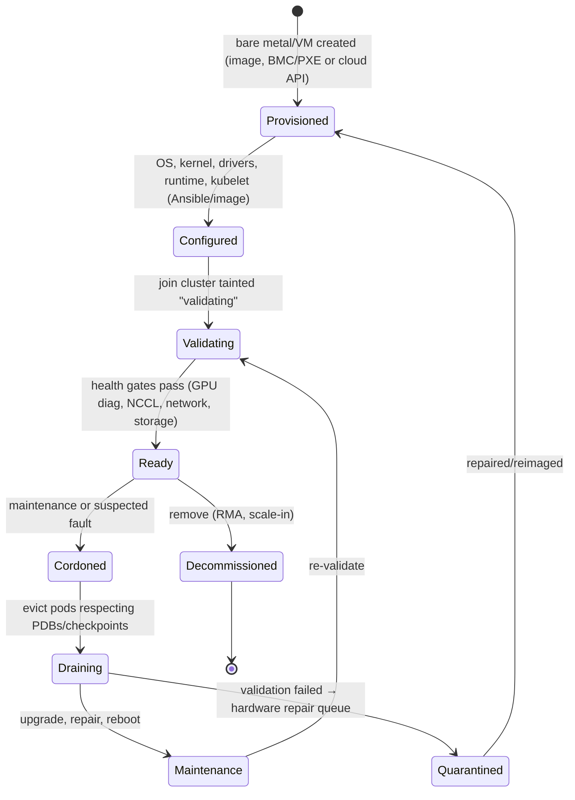

# 5.19 Cluster deployment models and day-2 operations

| | |
|---|---|
| Level | Intermediate |
| Priority tier | 1 |
| Lab venue | kubeadm or kind multi-node; Prometheus/Alertmanager; Argo CD/Flux; Velero; optional Cluster API with a Docker or cloud provider |
| Part | Part 5: Kubernetes |
| Status | Drafted, labs **untested** |

## Why this matters for AI infrastructure

Standing up a cluster is a day; running it for years is the job. GPU fleets fail constantly (a thousand GPUs fail on a scale of weeks), need driver, kernel and Kubernetes upgrades, grow in waves as capacity is purchased, and serve teams with conflicting demands. Choices made early (managed or self-managed control plane, one big cluster or many, how nodes are provisioned and replaced, how add-ons are versioned) determine how painful every later change is. This chapter provides the decision frame and the operational runbooks: node lifecycle, maintenance, capacity management, add-on lifecycle, drift control, and the observability and on-call practices that keep a GPU platform healthy. Upgrades and disaster recovery have their own chapter (5.20).

## Prerequisites and outcomes

Needs 5.3, 5.4, 5.9, 5.18 and Part 4 (automation, GitOps). After this chapter you can:

- Compare deployment models (managed Kubernetes, self-managed kubeadm/Kubespray/RKE2/Talos/Cluster API, OpenShift, vendor distributions like NVIDIA BCM-integrated, GPU-cloud managed offerings) and decide for a given context.
- Choose a cluster topology (single large, per-environment, per-region, per-team, per-workload-class, multi-cluster) with explicit trade-offs.
- Run the node lifecycle: provisioning, joining, labelling/tainting, validation gates, cordon/drain, maintenance, replacement, decommissioning; handle failing GPU nodes.
- Manage capacity (requests vs utilisation, quotas, overcommit, headroom, reservation) and cost for GPU fleets.
- Manage add-on and configuration lifecycle with GitOps, version matrices and drift detection.
- Establish day-2 practices: SLOs, alerting, runbooks, change management, access, audit and compliance.

## 1. Deployment models

| Model | Control plane | Nodes | Pros | Cons | Fits |
|---|---|---|---|---|---|
| **Managed (GKE, EKS, AKS, OKE)** | Provider operates API server/etcd/upgrades | You or provider (node pools, autopilot) | Fast start, HA control plane, integrated IAM/LB/storage, SLAs | Less control (flags, admission, etcd tuning), limits on cluster size/features, provider cadence, egress/cost, GPU capacity tied to provider | Cloud-first teams; elastic GPU in hyperscalers |
| **Managed on GPU clouds (CoreWeave CKS, Nebius Managed K8s, Lambda, Crusoe, etc.)** | Provider | Bare-metal-like GPU nodes with InfiniBand fabrics | Direct access to GPU/IB hardware with Kubernetes API; capacity focused on AI | Provider-specific features; fewer surrounding services; verify networking/storage integrations | AI-first workloads needing large GPU clusters |
| **Self-managed kubeadm / Kubespray** | You | You | Full control, runs anywhere (on-prem, colocation), standard Kubernetes | You own HA, etcd, certs, upgrades, security patches | On-prem DGX/HGX clusters, regulated environments |
| **Distributions (RKE2/K3s, Talos, OpenShift, Charmed K8s, Tanzu)** | You (opinionated) | You | Secure defaults, simpler upgrades, integrated tooling | Distribution conventions, licensing, upgrade lag | Teams wanting opinionated operations |
| **Cluster API (CAPI)** | Management cluster provisions workload clusters declaratively | Providers: AWS, GCP, Azure, vSphere, metal3 (bare metal), Docker | Cluster lifecycle as Kubernetes objects; consistent fleet ops, rolling node replacement | Learning curve; management cluster is critical | Many clusters; bare-metal fleets with metal3 |
| **Vendor-integrated (NVIDIA BCM, DeepOps, Run:ai, DGX Cloud/Base Command)** | Varies | Bare metal with provisioning (PXE, BMC) | Hardware-aware provisioning, Slurm+K8s options, validated stacks | Vendor lock-in, upgrade coupling | NVIDIA-centric on-prem AI factories (Part 8) |

Decision factors: where GPUs physically are; who patches control planes; team skills; compliance; required Kubernetes features (DRA, alpha gates, custom admission); networking (InfiniBand/RoCE integration, 5.13); storage proximity (parallel FS); multi-tenancy needs; cost model (managed control plane fee vs staff); lock-in; time to value. A common pattern: **managed Kubernetes in the cloud for elastic/secondary capacity** plus **self-managed or provider-managed bare-metal clusters for the main training fleet**, unified by GitOps, a common platform layer (operators, Kueue, observability) and multi-cluster dispatch (5.35).

## 2. Cluster topology choices

| Topology | Description | Pros | Cons |
|---|---|---|---|
| One large shared cluster | All teams/workloads, namespaces for isolation | Best utilisation; one platform to operate; easy sharing/quotas | Blast radius; noisy neighbours; upgrade coordination; 5k node limit |
| Cluster per environment | prod / staging / dev | Safe changes | Duplicated capacity; small dev clusters may lack GPUs |
| Cluster per workload class | Training vs inference vs interactive | Tuned configs (kubelet, networking, security); independent upgrades; SLO isolation | Fragmented capacity; borrow/lend harder |
| Cluster per region/site | Data locality, latency, DR | Resilience; compliance | More clusters to manage; data movement |
| Cluster per tenant/team | Strong isolation | Clear ownership, strict security | Poor utilisation; duplicated ops |
| Multi-cluster fleet | Many clusters under common management (CAPI, Argo, Karmada, MultiKueue, Rancher) | Scale beyond 5k nodes, isolate failure domains, regional | Complex networking/identity/observability |

Guidance for AI platforms: separate **production inference** from **training/research** (different SLOs and security) when stakes warrant; keep training in as large a pool as possible to allow big jobs and fair sharing; use namespaces + quotas + Kueue for tenancy inside; keep a small **management cluster** (Cluster API, Argo CD hub, observability backend) separate from workload clusters; plan for **blue/green clusters** as the safest big-upgrade and migration strategy where capacity allows.

### Dedicated versus colocated etcd and node pool sizing ratios

When you run a self-managed control plane, you must decide whether etcd shares the control-plane machines (colocated) or runs on its own machines (dedicated). In the book's (*Production Kubernetes*, Chapter 2) cluster-sizing guidance, colocated etcd (managed as static pods by `kubeadm`) is appropriate for smaller clusters to save management overhead and infrastructure cost, whereas anything above `50` worker nodes should prompt you to consider separating etcd onto dedicated machines to eliminate resource contention with `kube-apiserver`, `kube-scheduler`, and `kube-controller-manager`. If you plan for clusters with over `200` worker nodes, the book recommends planning for dedicated etcd clusters from the start, with fast local disks dedicated to etcd and low-latency intra-region links (and never placing a load balancer between `kube-apiserver` and etcd, because the API server's etcd client handles member connections directly).

Similarly, worker node pools can be organized as **characteristic-based** pools (grouped by hardware attributes such as GPUs, NICs, or CPU-to-memory ratios) or **role-based** pools (sliced off to isolate a specific platform function such as cluster ingress). In the book's AWS EC2 example, matching node pool shapes to workload consumption ratios avoids stranded resources:

- **General-purpose worker nodes** (`M5` instance types in the book's example): `1CPU:4GiB` ratio.
- **Memory-optimized nodes** (`R5` instance types in the book's example): `1CPU:8GiB` ratio, preventing memory-heavy workloads from leaving half of a general-purpose node's CPUs unused.
- **Compute-optimized nodes** (`C5` instance types in the book's example): `1CPU:2GiB` ratio for CPU-intensive workloads.

## 3. Node lifecycle



### Joining nodes safely

1. Build nodes from a **golden image** or configuration-managed baseline (4.17): kernel, NVIDIA driver, container toolkit, OFED, sysctls, kubelet config, node-level agents.
2. Join with a **bootstrap taint** (e.g., `node.example.com/validating=true:NoSchedule`) and labels (pool, rack, NVLink domain, GPU model, firmware versions, owner).
3. Run **health gates** as a Job/DaemonSet or external tooling: `dcgmi diag`, NCCL all-reduce on the node (and rack), `ib_write_bw` between peers, disk/network checks (4.17, Part 17); only on success remove the taint (automated by an operator/controller, 5.32).
4. Record node metadata (asset tag, serial, BMC address) in labels/annotations or an inventory (NetBox) so operators can map nodes to hardware (Part 7).
5. Prefer **immutable nodes**: replace rather than patch in place (re-image through BMC/PXE or recreate VMs); in-place changes drift.

### Draining and maintenance

```bash
kubectl cordon gpu-node-17                          # stop new pods
kubectl drain gpu-node-17 --ignore-daemonsets --delete-emptydir-data --grace-period=600 --timeout=30m --pod-selector='!batch-critical'   # evict respecting PDBs
kubectl get pods -A -o wide --field-selector spec.nodeName=gpu-node-17      # what's left
# ... maintenance (OS update, driver update, hardware swap) ...
kubectl uncordon gpu-node-17                        # after validation
```

Drain semantics: uses the Eviction API (respects PDBs; blocks if budget disallows), honours `terminationGracePeriodSeconds`, skips DaemonSet pods (with the flag), refuses unmanaged pods (no controller) unless `--force`, refuses pods with local storage unless `--delete-emptydir-data`. For training jobs: the platform should (a) ask the job to checkpoint (signal/annotation), (b) drain after checkpoint, (c) let the operator restart the job elsewhere. Use **maintenance windows** with draining sequenced by rack/failure domain and respecting capacity headroom ("never drain more than N% of a pool"); automate with node maintenance operators, cluster-autoscaler hooks, or CAPI rolling updates. Handle `NoExecute` taint-based maintenance (`node.example.com/maintenance:NoExecute`) when you want evictions to follow toleration seconds.

Failure cases: PDB blocking drain (adjust budgets or scale up); pods with finalizers; `Terminating` pods stuck on unmount (5.8); StatefulSet pods needing volume detach (5.17); long checkpoints exceeding timeouts; DaemonSet-only nodes.

### Replacing and decommissioning

Nodes with hardware faults (GPU falls off the bus, Xid 79, ECC errors, NVLink down, IB link flap, SSD failure) should be **automatically cordoned and drained**, labelled with the fault, and routed to repair (5.32, Part 17). Decommission: drain, delete the Node object (`kubectl delete node`) after power-off or removal from cloud, clean PV attachments, remove from monitoring/inventory/DNS, update BCM/Slurm if shared. Re-provision from images; do not reuse disks with old kubelet state without cleaning.

### Bulk node operations at scale

Roll out kernel/driver/OS changes by **pool, rack and percentage**: canary a few nodes, validate, expand; limit concurrency (`maxUnavailable`), pause on failures; use Cluster API `MachineDeployment` rolling updates (create-before-delete), Ansible with `serial` (4.8, 4.14), or node-image upgrade features of managed services (surge/blue-green node pools). Protect long-running jobs with maintenance reservations and checkpoint coordination.

## 4. Capacity and quota management

- **Measure** allocatable vs requested vs used: `kube_node_status_allocatable`, `kube_pod_container_resource_requests`, DCGM utilisation (`DCGM_FI_DEV_GPU_UTIL`, SM activity, memory), node-exporter CPU/memory; compute **GPU allocation efficiency** (requested GPU-hours / available) and **GPU utilisation** (busy fraction). Low utilisation with high allocation means idle reservations (notebooks, stuck jobs); high pending with idle GPUs means fragmentation or quota misconfiguration.
- **Quota layers**: ResourceQuota per namespace (`requests.nvidia.com/gpu`, objects count), Kueue ClusterQueue quotas and cohorts (borrowing), LimitRanges for defaults, PriorityClass-scoped quotas, per-user concurrency limits; align with budgets and chargeback (labels `team`, `project`, `cost-center`; tools: OpenCost/Kubecost, cloud billing exports).
- **Headroom**: reserve capacity for inference scaling, node failures (N+k), and maintenance drains; plan GPU capacity in failure-domain units (a rack's worth) and keep a **spare pool** of validated nodes.
- **Fragmentation management**: bin-packing, node pool shapes, defrag via descheduler for non-training, scheduling big jobs first (5.18).
- **Autoscaling** of GPU pools: slow and capacity-constrained; prefer pre-provisioned fixed pools for training and autoscaled pools for inference/CPU (5.23). Reservations and committed use must be tracked as first-class resources (4.24).
- **Idle detection and reclamation**: culling idle notebooks, TTL for jobs, time-limited interactive allocations, alerts on GPUs allocated but 0% utilised for >N hours; show owners their waste.
- **Forecasting**: use queue wait-time and utilisation trends to justify capacity purchases; maintain a capacity model (nodes → GPUs → expected job mix).

## 5. Add-on and configuration lifecycle

Platform components (CNI, CSI, CoreDNS, ingress/gateway, cert-manager, GPU Operator, Network Operator, Kueue, monitoring, policy engines, Argo CD) form a **versioned dependency graph**:

- Maintain a **compatibility matrix**: Kubernetes version × CNI × CSI × GPU Operator/driver × container toolkit × kernel × OFED × CUDA containers × Kueue/operators. Vendors publish support matrices (NVIDIA GPU Operator vs OS/kernel/Kubernetes versions); upgrades follow the matrix, not whatever is latest.
- Everything in **Git** (4.26): Helm values, CRs, policies, kubelet configs (via node config management), with environment overlays and pinned chart/image versions; changes via PR, validated in staging clusters, promoted to production progressively (ring deployments by cluster, then by node pool).
- **Upgrade order** (typical): control plane → CNI/CSI/CoreDNS compat → node pools (drain/replace) → add-ons; operators with CRD changes need care (CRD upgrade before controller, 4.25).
- **Drift detection**: GitOps controllers compare cluster to Git; node-level drift detection by Ansible `--check` or image attestation; kubelet/containerd config comparison against baseline; periodic conformance checks (Sonobuoy), CIS benchmarks (kube-bench), configuration scanners (kubescape, Polaris).
- **Policy as code** (Kyverno, Gatekeeper, ValidatingAdmissionPolicy; 5.21): enforce required labels, limits, probes, image provenance, prohibited host namespaces, GPU quotas; start in audit mode.
- **Secrets and credentials rotation**: certificates (kubeadm certs renew, 5.21), service account keys, registry credentials, cloud credentials (workload identity), cluster CA rotation plan.
- **Documentation as code**: runbooks, architecture decision records, diagrams in the repo (4.1).

## 6. Observability, SLOs and on-call

### What to monitor (minimum viable)

| Layer | Signals |
|---|---|
| Control plane | API availability/latency/error rate, etcd health (fsync, DB size, leader changes), scheduler pending pods and latency, controller queue depth, admission webhook latency |
| Nodes | Ready status, pressure conditions, kubelet/containerd health, PLEG, disk/inode/PID usage, CPU/memory, network errors, kernel logs (Xid, ECC, OOM), time sync |
| GPUs | DCGM metrics (utilisation, memory, power, temperature, clocks, throttle reasons, ECC, XID, NVLink errors, PCIe replay), health checks results, per-pod attribution |
| Network | CNI health, DNS latency/errors, conntrack, IB/RoCE link state, congestion (PFC/ECN) counters (Part 12) |
| Storage | PVC usage, CSI errors, attach/mount latency, filesystem throughput/latency (Part 13) |
| Workloads | Job success/failure/restart rates, time in queue, startup latency, checkpoint age, training throughput (tokens/s), inference latency/error/SLO burn |
| Platform | Pending reasons, quota usage, GitOps sync status, certificate expiry, backup success, upgrade progress |

Stack: Prometheus (kube-prometheus-stack) + Alertmanager + Grafana, Loki/Elastic for logs, OpenTelemetry for traces, DCGM exporter, node problem detector, kube-state-metrics, blackbox probes; long-term storage (Thanos/Mimir/VictoriaMetrics). Details in 5.24 and Part 17.

### SLOs

Define user-facing objectives: *job start latency* (p95 time from admission to running), *inference availability and latency*, *platform API availability*, *node repair time*, *checkpoint success*, *GPU health fraction*; set error budgets; page only on symptoms that threaten SLOs (API down, many nodes NotReady, queue stalled, inference SLO burn), ticket for the rest.

### Runbooks (examples to write and test)

1. Node NotReady / GPU fell off bus: cordon, collect `nvidia-bug-report`, `dmesg`, DCGM diag, drain, reboot/reset, escalate hardware.
2. API server latency high: check APF, etcd fsync, noisy clients, webhooks (5.5).
3. etcd quorum loss / restore (5.20).
4. Pending GPU pods: pending-reason decision tree (5.18).
5. Training job stuck/hung: collective timeouts, NCCL debug, node health, rank isolation (Part 14).
6. DNS failure (5.11), CNI IPAM exhaustion (5.13), certificate expiry (5.21), image registry outage (5.1).
7. Rolling upgrade failures and rollback (5.20).
8. Security incident: compromised pod/credential isolation procedures (Part 18).

### Change management

Classify changes (standard/pre-approved, normal, emergency); use progressive delivery for cluster changes (canary clusters/pools); freeze windows around key training runs; maintain a change calendar visible to users; communicate drains; post-incident reviews feeding automation and alert tuning.

## 7. Multi-tenancy and platform operations basics

(Details in 5.22.) Operating principles: namespace per team/project with quotas; default-deny NetworkPolicy; Pod Security baseline/restricted; separation of platform vs tenant RBAC; self-service via GitOps PRs or portals; per-tenant observability dashboards; chargeback/showback; clear support model and documentation; guardrails on image registries and privileged features; secure interactive access (notebooks) with time limits.

## 8. Cluster API and fleet operations (brief)

**Cluster API** models clusters as objects: `Cluster`, `KubeadmControlPlane` (control-plane nodes with rolling upgrades), `MachineDeployment`/`MachineSet`/`Machine` (workers), infrastructure templates per provider (`AWSMachineTemplate`, `Metal3MachineTemplate` for bare metal via Ironic/BMC), `MachineHealthCheck` (auto-remediate unhealthy nodes by deleting/reprovisioning), `ClusterClass` (templates for many clusters), `ClusterResourceSet`/add-on providers (Helm, Argo). Management cluster runs controllers; workload clusters are cattle. For GPU bare metal, CAPI + Metal3 (or Tinkerbell, MAAS) automate provisioning end to end, while Ansible/image pipelines (4.2, 4.17) define node contents. Benefits: uniform lifecycle, rolling node image upgrades, health-based remediation; costs: operating the management plane, GPU-specific readiness gates not built in (add via hooks/operators).

A subtle failure mode in a pure hub-and-spoke Cluster API layout appears when a workload cluster runs the **Cluster Autoscaler**: the autoscaler runs inside the workload cluster watching for unschedulable pods, but if the `Cluster` and `MachineDeployment` objects live only in an external management cluster, the workload cluster depends on the management cluster's availability just to scale out during peak load. As *Production Kubernetes* (Chapter 2) notes, you can remove this external runtime dependency by running the Cluster API controllers and the workload cluster's own `Cluster` and `Machine` resources inside the workload cluster itself in a self-contained (pivoted/autonomous) manner. A central management cluster can still initiate cluster creation and deletion, while day-to-day autoscaling and local controller lookups against the `Cluster` custom resource happen entirely against the local API server.

## 9. Lab (untested)

1. **Node lifecycle drill**: on a lab cluster, join a worker with a validating taint, run a validation Job, remove the taint; then cordon/drain/uncordon while a Deployment with a PDB and a StatefulSet run; observe PDB blocking and fix; time a full cycle.
2. **Drain with checkpointing**: run a training stub that checkpoints on SIGTERM; drain its node; verify checkpoint written and job resumes on another node; test grace period too short and observe loss.
3. **Failure injection**: stop kubelet / unplug network / kill container runtime / fill disk; document symptoms, timings (NotReady, taints, evictions) and recovery; compare with graceful shutdown (5.9).
4. **Capacity report**: write PromQL (or scripts) for allocatable vs requested vs used GPUs per namespace/pool, idle-allocated GPUs, queue wait time, and a fragmentation metric (largest free block per node pool); build a dashboard.
5. **Quota design**: create namespaces for three teams with ResourceQuota GPU limits and Kueue ClusterQueues in a cohort; simulate bursts and verify enforcement and borrowing; document the policy.
6. **Add-on matrix**: pick your Kubernetes/GPU Operator/driver versions, build a compatibility table from vendor docs, and encode it as CI checks (e.g., a script that fails if chart versions diverge from the table).
7. **GitOps promotion**: put cluster add-ons in a repo with overlays; promote a CoreDNS or ingress controller version through staging then production-like clusters; roll back by revert.
8. **Cluster API (optional)**: create a Docker-provider workload cluster with CAPI; perform a rolling upgrade of a MachineDeployment; enable a `MachineHealthCheck` and kill a node to watch auto-remediation.
9. **Runbook writing and game day**: write the NotReady/GPU-fault runbook; run a game day injecting a GPU fault (simulated via a failing DCGM health check/fake Xid event), practise cordon/drain/escalation, record time-to-recovery and gaps.
10. **SLO and alerts**: define two SLOs (job start latency, inference availability); implement recording rules and burn-rate alerts; test with a synthetic failure.
11. **Audit and compliance**: run kube-bench and kubescape; triage findings; encode accepted exceptions; schedule recurring scans.
12. **Clean up**.

Mark tested only after execution.

## 10. Common mistakes

- Choosing self-managed Kubernetes without staffing for upgrades, etcd, certificates and security patching (or choosing managed when you need features the provider doesn't expose).
- One giant cluster with no isolation, or dozens of tiny clusters with no fleet management.
- Patching nodes in place and letting them drift; no validation gate before nodes receive workloads.
- Draining everything at once; PDBs absent or blocking; no checkpoint coordination.
- Treating add-on versions casually; upgrading Kubernetes without checking driver/CNI/operator compatibility.
- No capacity model: discovering shortages from user complaints; unmeasured idle GPUs.
- Alert fatigue (paging on node-level noise) and missing alerts on user-facing SLOs.
- No tested runbooks; relying on tribal knowledge.
- Treating the management cluster casually; no backups of GitOps/CAPI state.
- Ignoring hardware reality: no spare nodes, no automation for repair workflows.

## 11. Interview angles

- "Managed vs self-managed Kubernetes for a GPU training platform: how do you decide?" 
- "One cluster or many? How do you decide cluster boundaries?" 
- "Walk me through safely maintaining 500 GPU nodes: patching, drains, validation." 
- "How do you manage capacity and prevent idle GPU waste?" 
- "How do you keep add-ons and the GPU stack consistent across clusters?" 
- "What do you monitor in a GPU Kubernetes platform? What do you page on?" 
- "What is Cluster API and when is it useful?" 
- "How do you handle a node with a failing GPU automatically?" 

## 12. Checkpoint questions (30)

1. Managed control plane pros? **A:** Operated HA, faster start, SLAs.
2. Managed cons? **A:** Less control, provider limits.
3. kubeadm is? **A:** Cluster bootstrapper.
4. Kubespray is? **A:** Ansible-based installer.
5. Cluster API is? **A:** Declarative cluster lifecycle via Kubernetes objects.
6. `MachineHealthCheck` does? **A:** Auto-remediates unhealthy nodes.
7. Why blue/green clusters? **A:** Safest large upgrades/migrations.
8. Why a management cluster? **A:** Host CAPI/GitOps/observability separate from workloads.
9. Node validation gate purpose? **A:** Keep unhealthy nodes from receiving jobs.
10. Join taint use? **A:** Hold workloads until validated.
11. `cordon` does? **A:** Marks unschedulable.
12. `drain` does? **A:** Cordons and evicts pods.
13. Drain respects? **A:** PDBs and grace periods.
14. Drain flags for DaemonSets/emptyDir? **A:** `--ignore-daemonsets`, `--delete-emptydir-data`.
15. Why immutable nodes? **A:** Avoid drift.
16. Capacity vs usage? **A:** Allocation (requests) vs utilisation (busy).
17. Fragmentation metric? **A:** Largest free GPU block per node/pool.
18. Quota tools? **A:** ResourceQuota, Kueue ClusterQueue.
19. Chargeback labels? **A:** team/project/cost-center.
20. Idle GPU detection? **A:** Allocated but ~0% DCGM util.
21. Compatibility matrix includes? **A:** K8s, CNI, CSI, driver, toolkit, kernel, operators.
22. Upgrade order typical? **A:** Control plane then nodes then add-ons.
23. Drift detection tools? **A:** GitOps controller, Ansible check, scanners.
24. kube-bench is? **A:** CIS benchmark checker.
25. Sonobuoy is? **A:** Conformance test runner.
26. SLO example? **A:** Job start latency p95.
27. Page on? **A:** Symptoms threatening SLOs.
28. Runbook content? **A:** Detect, diagnose, mitigate, escalate steps.
29. At what worker-node counts does *Production Kubernetes* recommend considering or planning for a dedicated etcd cluster? **A:** Consider separating etcd above `50` worker nodes; plan for a dedicated etcd cluster above `200` worker nodes.
30. Why checkpoint before drain? **A:** Avoid lost training progress.

## 13. Sources and review notes

**Written in original words.** Principal sources:

- Josh Rosso, Rich Lander, Alex Brand and John Harris, *Production Kubernetes* (`production-kubernetes`, Chapter 2: `2. Deployment Models` — read in full for dedicated vs colocated etcd worker thresholds, `M5`/`R5`/`C5` CPU:memory ratios, and self-contained Cluster API autoscaling topology).
- Brendan Burns et al., *Kubernetes: Up and Running* (3rd edition; chapter 3 on deploying a Kubernetes cluster and ongoing operations).
- Kubernetes, Cluster API, kubeadm, Kueue and NVIDIA GPU Operator documentation; vendor support matrices.
- Examples are the author's constructions.

**Flagged for verification before publishing:** managed GPU-cloud offering names and capabilities, CAPI/Metal3 resource names and versions, drain flag semantics for your kubectl version, and compatibility matrices (must be taken from current vendor docs); all labs are **untested**.
