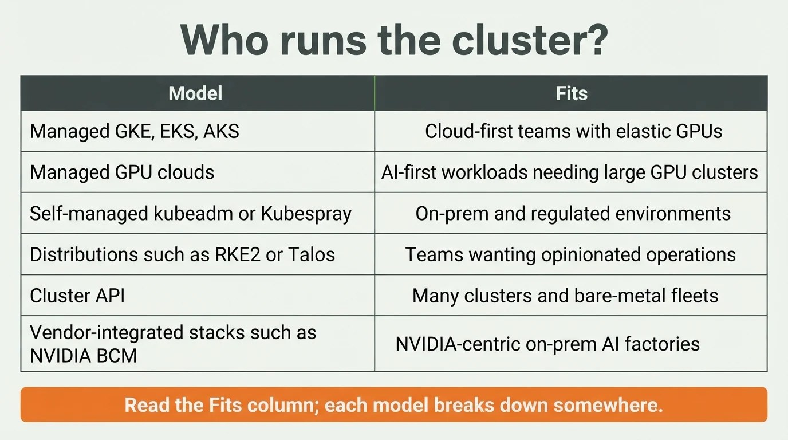
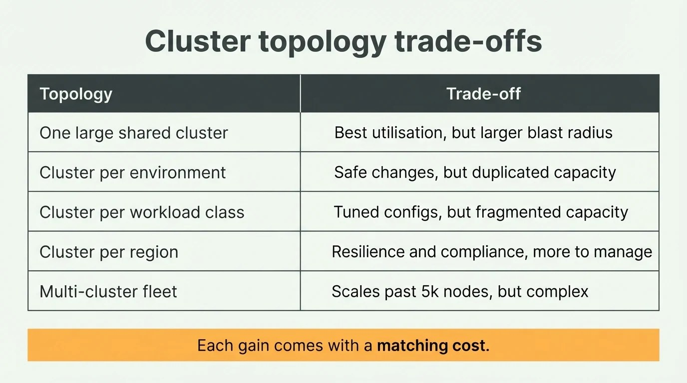
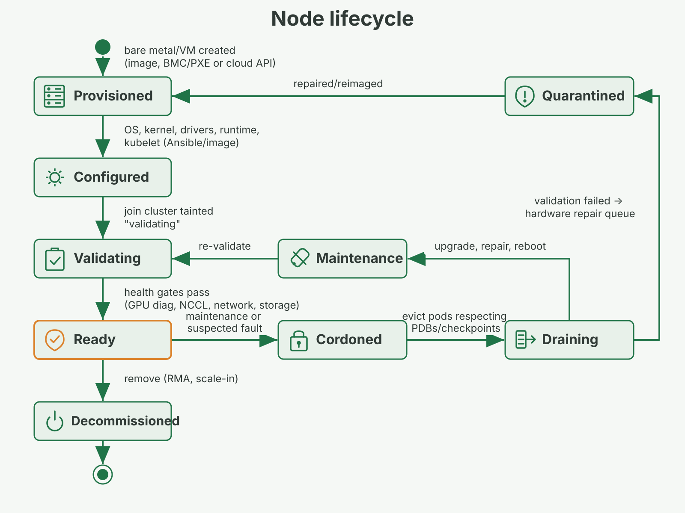
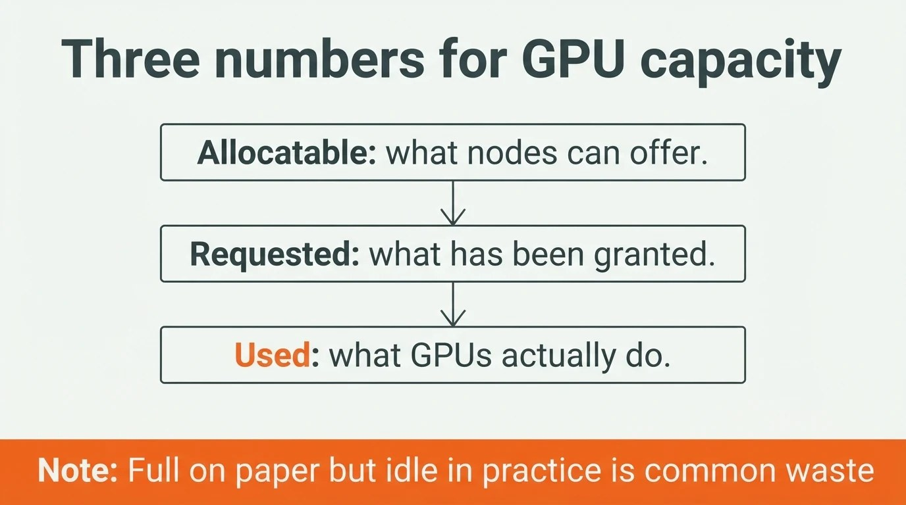
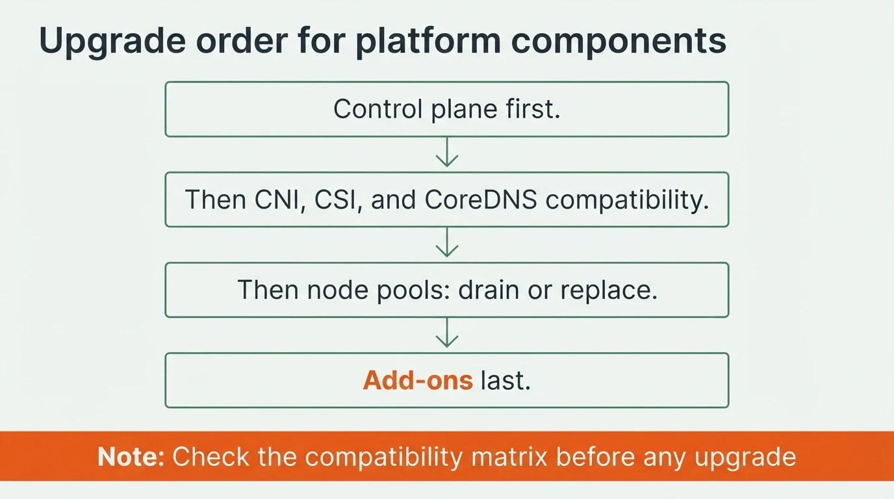
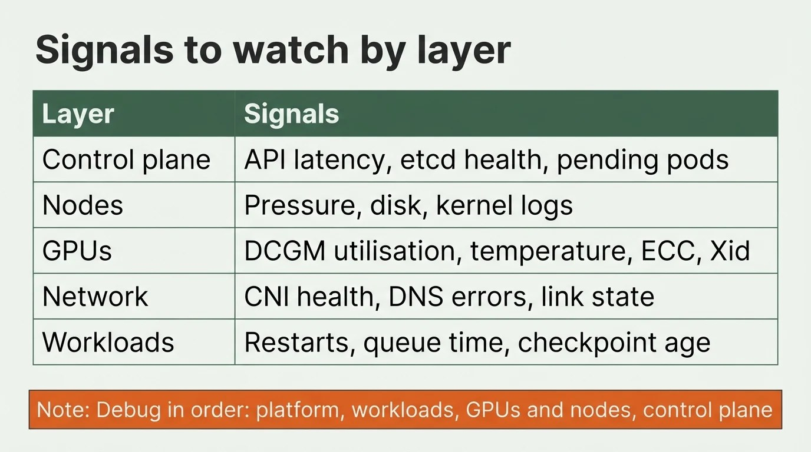
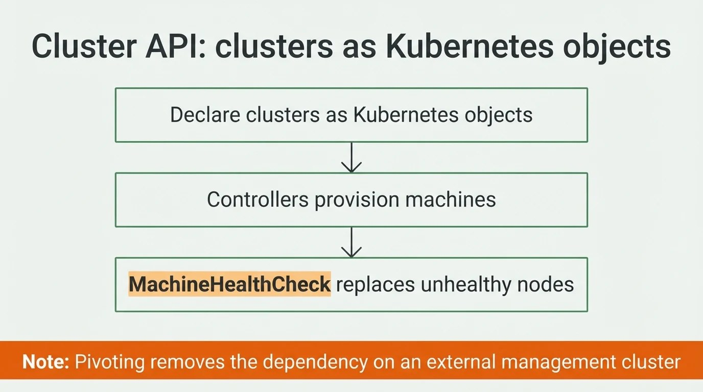

# 5.19 Cluster deployment models and day-2 operations

| | |
|---|---|
| Level | Intermediate |
| Priority tier | 1 |
| Lab venue | kubeadm or kind multi-node; Prometheus/Alertmanager; Argo CD/Flux; Velero; optional Cluster API with a Docker or cloud provider |
| Part | Part 5: Kubernetes |
| Status | Drafted, labs **untested** |

## Why this matters for AI infrastructure

Building a cluster takes a day. Running that cluster for years is the real job. Picture a GPU fleet where one GPU fails every few weeks. Someone has to pull that node out of service, check the hardware, put the node back and write down what happened. While that work goes on, the same team is planning the next driver upgrade, the next kernel and the next Kubernetes release. GPU fleets also grow in waves, as capacity is bought and racked, and they serve several teams whose demands often conflict.

The early choices decide how painful each later change will be. Think about the control plane first. Is it managed by a provider, or does your team run it? Then think about one big cluster or many. After that, ask how nodes are provisioned and replaced, and how add-ons are versioned. Each answer sets the cost of the next change.

This chapter walks through those choices in the order you will meet them. It starts with the deployment model, then the cluster topology, and then the daily work on nodes. After that come capacity, add-ons, observability and the fleet tools that tie it together. Upgrades and disaster recovery have their own chapter (5.20).

## Prerequisites and outcomes

This chapter builds on 5.3, 5.4, 5.9, 5.18 and Part 4 (automation, GitOps). Before you read on, check whether you can answer the questions below. After the chapter, each one should feel familiar.

- Which deployment model fits your situation, and what does each model cost you? The options are managed Kubernetes, self-managed tools (kubeadm, Kubespray, RKE2, Talos, Cluster API), OpenShift, vendor distributions such as NVIDIA BCM-integrated stacks, and GPU-cloud managed offerings.
- Which cluster topology do you choose? The options are a single large cluster, one cluster per environment, region, team or workload class, or a multi-cluster setup. Each choice has trade-offs you should state out loud.
- How does a node move through provisioning, joining, labelling and tainting, validation, cordon and drain, maintenance, replacement and decommissioning? You also need to know what to do with a failing GPU node.
- How do you manage capacity and cost for a GPU fleet? That covers requests versus utilisation, quotas, overcommit, headroom and reservations.
- How do you keep add-ons and configuration in step, using GitOps, version matrices and drift detection?
- Which day-2 practices does your platform need, such as SLOs, alerting, runbooks, change management, access control, audit and compliance?

## 1. Deployment models

The first decision is who runs the cluster. Suppose your manager asks for a GPU cluster by the end of the month. The tool you install matters less than who will run the control plane and who will answer the pager when it fails. The table below lists the common models, what each one gives you and the price you pay for it. Read the Cons and Fits columns closely, because they tell you where each model starts to break down.


*Figure 5.19.V. Pick the deployment model by who runs the control plane and who answers the pager.*


| Model | Control plane | Nodes | Pros | Cons | Fits |
|---|---|---|---|---|---|
| **Managed (GKE, EKS, AKS, OKE)** | Provider operates API server/etcd/upgrades | You or provider (node pools, autopilot) | Fast start, HA control plane, integrated IAM/LB/storage, SLAs | Less control (flags, admission, etcd tuning), limits on cluster size/features, provider cadence, egress/cost, GPU capacity tied to provider | Cloud-first teams; elastic GPU in hyperscalers |
| **Managed on GPU clouds (CoreWeave CKS, Nebius Managed K8s, Lambda, Crusoe, etc.)** | Provider | Bare-metal-like GPU nodes with InfiniBand fabrics | Direct access to GPU/IB hardware with Kubernetes API; capacity focused on AI | Provider-specific features; fewer surrounding services; verify networking/storage integrations | AI-first workloads needing large GPU clusters |
| **Self-managed kubeadm / Kubespray** | You | You | Full control, runs anywhere (on-prem, colocation), standard Kubernetes | You own HA, etcd, certs, upgrades, security patches | On-prem DGX/HGX clusters, regulated environments |
| **Distributions (RKE2/K3s, Talos, OpenShift, Charmed K8s, Tanzu)** | You (opinionated) | You | Secure defaults, simpler upgrades, integrated tooling | Distribution conventions, licensing, upgrade lag | Teams wanting opinionated operations |
| **Cluster API (CAPI)** | Management cluster provisions workload clusters declaratively | Providers: AWS, GCP, Azure, vSphere, metal3 (bare metal), Docker | Cluster lifecycle as Kubernetes objects; consistent fleet ops, rolling node replacement | Learning curve; management cluster is critical | Many clusters; bare-metal fleets with metal3 |
| **Vendor-integrated (NVIDIA BCM, DeepOps, Run:ai, DGX Cloud/Base Command)** | Varies | Bare metal with provisioning (PXE, BMC) | Hardware-aware provisioning, Slurm+K8s options, validated stacks | Vendor lock-in, upgrade coupling | NVIDIA-centric on-prem AI factories (Part 8) |

Several factors decide between these rows. Start with where your GPUs physically sit, and who patches the control planes. Then look at your team's skills and your compliance obligations. Check which Kubernetes features you need, such as DRA, alpha feature gates or custom admission. Networking matters too. InfiniBand or RoCE integration (5.13) and storage close to a parallel file system can rule a model out on their own. Finally, weigh multi-tenancy needs, the cost model, lock-in and how quickly you need value from the platform.

To see how these factors combine, take a team that trains large models on rented GPUs and serves a small internal chatbot. Their training needs are bursty and large, so a GPU cloud with InfiniBand fits. Their chatbot is small and needs a stable API, so a managed control plane in the same cloud fits too. The two choices do not conflict. The team picks each model for the job it does best, and the GitOps layer keeps the two consistent.

The cost model deserves a closer look. A managed control plane has a fee, but it saves staff time that you would otherwise spend on etcd backups and certificate renewals. Self-managed control planes cost less in fees, but they cost more in people. Neither answer is right in general. It depends on how many people you have and how much time they can give to the platform.

A common pattern combines two approaches. Managed Kubernetes in the cloud handles elastic or secondary capacity. Self-managed or provider-managed bare-metal clusters run the main training fleet. GitOps, a shared platform layer (operators, Kueue, observability) and multi-cluster dispatch (5.35) tie the two together.

### Matching the approach to your needs

Each option trades engineering effort against production readiness. Plain Kubernetes clusters need the least engineering effort, especially when a managed service such as EKS runs the control plane. They are also the least production-ready, because most organizations must add more work on top of Kubernetes before the platform is safe for daily use. A team that runs dedicated clusters for its own workloads may still be satisfied with plain Kubernetes.

Established platforms sit at the other end. Cloud Foundry gives you an end-to-end developer experience out of the box, but you have to fit your work into its opinions. OpenShift is far more production-ready than plain Kubernetes for most teams, and it also asks you to make more decisions during setup. Is that flexibility a benefit or a nuisance for your team? That is the key question for you to answer.

A platform built on Kubernetes takes the most engineering effort, at least from the platform side. It can line up with your developer, infrastructure and business needs, because Kubernetes is extensible. You pay for that alignment in the time your team spends building and maintaining it.

Alignment with your requirements is a third axis. Building your own platform is almost always the most aligned option, or at least the one most able to align. You can build almost anything. Rebuilding Heroku in-house on top of Kubernetes, with minor changes, is technically possible. The cost and the reward still need weighing against the other two axes. Consider needs such as these for a next-generation platform:

- Regulations require you to run most workloads on-premises.
- You must support a bare-metal fleet along with a vSphere-enabled data center.
- Developers want to package applications as containers.
- You need self-service APIs that move you away from ticket-based infrastructure provisioning.
- APIs must stay vendor-agnostic, because lock-in has cost millions in past migrations.
- You are open to paying for enterprise support across the stack, but you will not license the whole stack per node, core or application instance.

Before you commit, be honest about your engineering maturity, your appetite for building and empowering teams, and the resources you have. Those answers show whether building an application platform is a sensible effort. A team that is honest here avoids a platform that nobody can maintain.

Here is a small example of how this plays out. Imagine a team of four engineers who have run one cluster on a managed service for a year. They want to move to self-managed clusters so they can tune the GPU networking. Before they agree, they list the work that the managed service did for them. Someone now has to rotate certificates, back up etcd, patch the control plane and watch the API server at night. If the list makes the team nervous, the honest answer is to stay managed a while longer. Moving later is always possible, and a rushed move usually costs more than the wait.

### Managed service or roll your own

Before you design anything, decide whether you should run the whole Kubernetes stack yourself. A managed service takes most of the deployment work off your plate. The provider runs the control plane, and you attach worker nodes whenever you need them. You still want reliable, declarative ways to provision those clusters, but you can skip most of the bring-up details. If you already rely on a cloud provider for compute, identity and monitoring, the managed route gives you a head start, because those pieces already fit together.

The savings come with a price. You give up some flexibility and freedom. The biggest risk is vendor lock-in. Suppose you design around one provider's services, and that provider raises prices or lets quality slip. You may then have few ways out. Spreading across several providers helps a little. Each one still exposes Kubernetes features in its own way, and those differences become awkward to manage.

Rolling your own gives you every knob. You choose the Kubernetes version, you can reach every flag on the control plane components, and you can work directly with the machines and the static Pod manifests written to disk. That power can hurt you if you do not learn the tool well. Developers care about the features of the platform, not about who runs the infrastructure underneath it. If you control those features, you can deliver a consistent experience across providers.

Lean toward a managed service if:

- Understanding Kubernetes sounds too arduous for your team right now.
- Running a distributed system that your business depends on sounds dangerous.
- The limits set by the vendor seem manageable.
- You trust the vendor to respond to your needs and act as a good business partner.

Lean toward rolling your own if:

- Vendor-imposed restrictions make you uneasy.
- You have little faith in the large cloud providers.
- You are excited by the platform you can build around Kubernetes.
- You want to give your developers a great experience with this container orchestrator.

If you choose a managed service, you can skip most of the rest of this chapter. Add-ons and triggering mechanisms still apply to you.

### Prebuilt installer or custom automation

Whichever path you choose, automation is the guiding principle. Removing human toil cuts cost and improves stability. An engineer who runs the same routine steps by hand every week is not spending that time on new work. People also make mistakes, and one wrong step can break a cluster. Spending engineering time up front to automate deployments pays back in saved toil and less troubleshooting later.

If you run your own clusters, you must choose between a prebuilt installer and custom automation built from the ground up. The choice is similar to managed service versus roll your own. More control means more engineering effort.

Prebuilt installers are plentiful. The CNCF website lists 180 Kubernetes Certified Service Providers. Some cost money and come with field engineers and support staff you can call. Others need research and experimentation before they work for you. The paid installers can take you from zero to Kubernetes with the push of a button. If your needs fit the installer's options and your budget allows it, this is a strong fit. When this was written, prebuilt installers were the most common approach in the field.

Some custom automation is still needed even with a prebuilt installer. It usually means integrating with your team's existing systems, such as your ticketing tool, your identity provider and your monitoring. Building a custom installer is a different job. Homegrown automation makes sense only when all of these are true:

- You have more than just one or two engineers to devote to the effort.
- You have engineers on staff with deep Kubernetes experience.
- You have specialized requirements that no managed service or prebuilt installer satisfies well.

Start from your platform requirements. Those should come mostly from your app development teams, especially the earliest adopters. Do not build a platform in a vacuum. Give dev teams early prerelease versions to test, and keep a tight feedback loop for fixing bugs and adding features. A platform that nobody tried during the build is a platform that nobody adopts later. Adoption depends on that loop.

## 2. Cluster topology choices

Once you know who runs the cluster, you still have to decide how many clusters to run and where. Picture a platform team asked to host training, inference and research workloads. Should they share one big cluster, or split it up? The table below shows the trade-offs. Notice that each gain, such as better utilisation, comes with a matching cost, such as a larger blast radius.


*Figure 5.19.V. Every gain in utilisation or isolation has a matching cost, so choose the cost you can live with.*


| Topology | Description | Pros | Cons |
|---|---|---|---|
| One large shared cluster | All teams/workloads, namespaces for isolation | Best utilisation; one platform to operate; easy sharing/quotas | Blast radius; noisy neighbours; upgrade coordination; 5k node limit |
| Cluster per environment | prod / staging / dev | Safe changes | Duplicated capacity; small dev clusters may lack GPUs |
| Cluster per workload class | Training vs inference vs interactive | Tuned configs (kubelet, networking, security); independent upgrades; SLO isolation | Fragmented capacity; borrow/lend harder |
| Cluster per region/site | Data locality, latency, DR | Resilience; compliance | More clusters to manage; data movement |
| Cluster per tenant/team | Strong isolation | Clear ownership, strict security | Poor utilisation; duplicated ops |
| Multi-cluster fleet | Many clusters under common management (CAPI, Argo, Karmada, MultiKueue, Rancher) | Scale beyond 5k nodes, isolate failure domains, regional | Complex networking/identity/observability |

Think of the table as a set of trades. A big shared cluster is like one large office building. Every team shares the lifts, the power and the security desk, so the building runs efficiently. The same building also has one fire alarm for everyone. Splitting the work into several buildings makes each one easier to manage and safer to change, but each building now needs its own lifts, power and security desk. The table asks you to make that same trade for clusters.

For AI platforms, a few rules of thumb follow from this table. Separate production inference from training and research when the stakes justify it, because the two have different SLOs and security needs. Keep training in as large a pool as possible, so that big jobs fit and capacity is shared fairly. Inside a cluster, use namespaces, quotas and Kueue for tenancy. Keep a small management cluster apart from the workload clusters. That management cluster hosts Cluster API, an Argo CD hub and the observability backend. When capacity allows, plan for blue/green clusters, which are the safest strategy for a large upgrade or migration.

Consider how this looks in a real week. Training jobs for a research team arrive in bursts on Monday, while the inference traffic for a product rises every afternoon. In one shared cluster, the two patterns can borrow each other's spare GPUs, which is the point of sharing. In separate clusters, each pattern gets a predictable budget, but the spare GPUs stay locked away in the other cluster. Neither design is free. Pick the one whose pain you can live with, and write that choice down so the next person knows why.

### Cluster tiers

Teams need a clear path for a change to travel from an idea to production. Calling every cluster an "environment" gets confusing, so this book uses the word tier for clusters. A tier is defined by its purpose, its SLOs and SLAs, and where it sits on the path to production. Tiers vary between organizations, but four show up often. Use the same deployment and life cycle systems in all four. Heavy use in the lower tiers shows those systems work before they touch a critical production cluster.

- **Testing:** Single-tenant, ephemeral clusters, often with a time-to-live (TTL) that destroys them after a set time, usually less than a week. Platform engineers spin them up to test a component or feature. They have no SLO or SLA, and they usually run the latest platform version, or perhaps a pre-alpha release.
- **Development:** Permanent clusters with no TTL. They are multitenant where that makes sense, and they have all the features of production. They run the first round of integration tests and check compatibility with alpha versions. They carry an SLO without a formal agreement. Availability should be near production level during business hours, because outages slow developers down. The applications on them have no SLO or SLA. They run the officially released alpha and/or beta platform version.
- **Staging:** Permanent clusters, commonly shared by several tenants, used for final integration testing and sign-off before live production. Project managers, product owners and executives use them, and sometimes customers who need prerelease software. They have an SLO similar to development. They gain a formal SLA when external stakeholders or paying customers use them. They run the officially released beta version if the platform team keeps strict backward compatibility. If it cannot, staging should run the same stable release as production.
- **Production:** The money-makers. These clusters serve customer-facing, revenue-producing applications and websites. Only approved, production-ready, stable software runs here, on the fully tested and approved stable platform release. Detailed SLOs are defined and tracked, and legally binding SLAs often apply.

### Node pools or separate clusters

A node pool groups nodes of one type inside a single cluster. The grouping can follow a unique characteristic of the machines or the role they play. Before you create pools, weigh them against separate clusters. Pools keep the cluster count down, but they add work. Workloads need node selectors to land in the right pool. Taints keep other workloads off nodes where they do not belong. Scaling gets harder too, because the system must watch each pool and scale it on its own. Separate clusters move that complexity into cluster management and federation, and you need more of them.

The table below summarizes these pros and cons of using node pools.

| Pros | Cons |
|---|---|
| Reduced number of clusters under management | Node selectors for workloads will often be needed |
| Smaller number of target clusters for workloads | Node taints will need to be applied and managed |
| | More complicated cluster scaling operations |

A **characteristic-based** node pool holds nodes that have a component or attribute some workloads require. A GPU is the classic example. The network interface type and the ratio of memory to CPU also count. Those characteristics suit different workloads, so when they share one cluster, you group the nodes into pools to control where Pods land.

A **role-based** node pool serves a function and is kept apart from resource contention. Its nodes may look like the rest. A common example is a pool dedicated to the ingress layer. That insulates other workloads from ingress traffic. It matters because resource requests and limits do not yet cover network usage. A dedicated pool also simplifies the networking model, since you know exactly which nodes face outside traffic. Role-based pools rarely move into separate clusters, because their machines play a real part in that cluster's job.

Create pools only for a good reason. Do not split nodes into pools indiscriminately, because a Kubernetes cluster is complex enough already. You will probably need multicluster management whether or not you use pools. Many enterprises end up with a large number of distinct clusters. If you are tempted by characteristic-based pools, investing in multicluster management may pay off more, because you can then use separate clusters for each machine type you need.

### Cluster sizing

Cluster size shapes both the deployment model and the infrastructure plan. People often ask how many worker nodes a production cluster should have. That question differs from asking how many worker nodes your workloads need. If you run one production cluster for everything, the two answers match. Few teams ever get there. Kubernetes lets you treat clusters like cattle, not pets, and most enterprises that use it own a whole herd.

A useful habit is to ask what each cluster is for, in one sentence. If you cannot write that sentence, the cluster probably should not exist yet. If two clusters have the same sentence, they are probably one cluster that someone split by accident.

Larger clusters offer these benefits:

- **Better resource utilization:** Each cluster carries control plane overhead, including etcd and the API server. Platform services such as ingress controller proxies add more. A larger cluster repeats those services less often.
- **Fewer cluster deployments:** If you run your own bare metal, you cannot spin clusters up and down on demand the way you can with a cloud provider. When you deploy rarely, the deployment can be less automated. Full automation may cost more engineering effort than it saves.
- **Simpler cluster and workload management:** Fewer production clusters need less streamlined tools to allocate, federate and manage them. Federated management across many clusters is complex. Large enterprises have built bespoke systems for it, with limited success so far.

Smaller clusters offer these benefits:

- **Smaller blast radius:** A cluster failure touches fewer workloads.
- **Tenancy flexibility:** Kubernetes has the mechanisms to build a multitenant platform. Sometimes a new cluster for one tenant saves more engineering effort. For example, one tenant may need a cluster-wide resource such as Custom Resource Definitions, while another needs strict isolation for security or compliance. Dedicated clusters suit that case, especially when those workloads need a lot of compute.
- **Less tuning for scale:** Clusters that grow into several hundred workers often hit control plane bottlenecks. Troubleshooting and tuning take real effort, and smaller clusters cut that effort considerably.
- **Upgrade options:** Smaller clusters make it easier to replace a cluster in order to upgrade it. Replacement has its own challenges, covered in the upgrades chapter (5.20). Small clusters make that strategy more attractive.
- **Node pool alternative:** If you need GPUs or memory-optimized nodes, and you can run many small clusters, dedicated clusters for those needs are simple. That avoids managing several node pools inside one cluster.

### Dedicated versus colocated etcd and node pool sizing ratios

When you run a self-managed control plane, you must decide whether etcd shares the control-plane machines (colocated) or runs on its own machines (dedicated). Take a small cluster first. The book *Production Kubernetes*, in its Chapter 2 cluster-sizing guidance, says colocated etcd is fine there. `kubeadm` manages it as static pods, which saves management overhead and infrastructure cost.

The picture changes as the cluster grows. Once a cluster passes `50` worker nodes, the same guidance says to consider moving etcd onto dedicated machines. Otherwise etcd competes for resources with `kube-apiserver`, `kube-scheduler` and `kube-controller-manager`. Think of etcd as the cluster's memory. If the other control plane processes use up the machine, the memory slows down at the worst moment. Past `200` worker nodes, the same guidance recommends planning for dedicated etcd clusters from the start. Give etcd fast local disks of its own and low-latency links within the region. Never put a load balancer between `kube-apiserver` and etcd, because the API server's etcd client connects to each member directly.

Worker node pools raise a similar choice. You can organize them as **characteristic-based** pools, grouped by hardware attributes such as GPUs, NICs or CPU-to-memory ratios. Or you can organize them as **role-based** pools, sliced off to isolate a specific platform function such as cluster ingress. In an AWS EC2 example, matching each pool's shape to the ratio its workloads consume avoids stranded resources. A stranded resource is one you pay for but cannot use, because the workload running next to it needs a different shape. Consider a general-purpose node, which uses the `M5` instance types, at a `1CPU:4GiB` ratio. A memory-optimized node, which uses the `R5` types, runs at `1CPU:8GiB`. That stops memory-heavy workloads from leaving half of a general-purpose node's CPUs idle. Compute-optimized nodes, the `C5` types, run at `1CPU:2GiB` for CPU-intensive work.

## 3. Node lifecycle

A node that will not join the cluster, or one that a GPU fault has just taken offline, is where the lifecycle matters most. The diagram below shows every state a node moves through, from creation to decommissioning. Notice that a failed validation sends the node to repair instead of into service.



*Figure 5.19.1. Node lifecycle, as a diagram.*

Read the diagram as a path with a side exit. A node moves forward from a bare machine to a Ready node that takes work. It can leave the path for maintenance or repair, but it must come back through validation before it takes work again. The side exit to quarantine is the one that protects your jobs. A node that fails its checks never reaches the state where a job can land on it.

### Joining nodes safely

Joining a node is a short routine you should follow every time. The steps below keep a half-configured node away from your workloads.

1. Build the node from a **golden image** or a configuration-managed baseline (4.17). The baseline covers the kernel, NVIDIA driver, container toolkit, OFED, sysctls, kubelet config and node-level agents. A golden image is a known-good disk image that every node starts from, so that no two nodes drift apart from the first boot.
2. Join the node with a **bootstrap taint**, such as `node.example.com/validating=true:NoSchedule`, so nothing lands on it yet. Then add labels for the pool, rack, NVLink domain, GPU model, firmware versions and owner. The labels let you find the node later, when something goes wrong in the middle of the night
3. Run the **health gates** with a Job, a DaemonSet or external tooling. The gates include `dcgmi diag`, an NCCL all-reduce on the node and across its rack, `ib_write_bw` between peers, and disk and network checks (4.17, Part 17). Remove the taint only when every gate passes. An operator or controller can do this automatically (5.32).
4. Record the asset tag, serial number and BMC address in labels, annotations or an inventory such as NetBox. Then an operator can trace a node back to its hardware (Part 7).
5. Prefer **immutable nodes**. Replace a node rather than patching it in place, by re-imaging through BMC or PXE or by recreating the VM. In-place changes drift over time, and a drifted node is hard to trust.

### Draining and maintenance

Taking a node out of service follows a fixed order. Cordon the node so no new pods arrive. Drain it to evict the pods already there. Check what remains, do the work, and then uncordon the node once validation passes. The order matters. If you skip the cordon, the scheduler can place a new pod on the node while you are draining it.

```bash
kubectl cordon gpu-node-17                          # stop new pods
kubectl drain gpu-node-17 --ignore-daemonsets --delete-emptydir-data --grace-period=600 --timeout=30m --pod-selector='!batch-critical'   # evict respecting PDBs
kubectl get pods -A -o wide --field-selector spec.nodeName=gpu-node-17      # what's left
# ... maintenance (OS update, driver update, hardware swap) ...
kubectl uncordon gpu-node-17                        # after validation
```

The drain is careful by design. It uses the Eviction API, so it respects PDBs and blocks when a budget does not allow the eviction. A PDB, or PodDisruptionBudget, is a rule that says how many replicas of an app may be down at the same time. The drain also honours `terminationGracePeriodSeconds`, which is how long a pod gets to shut down cleanly. It skips DaemonSet pods when you pass the flag. It refuses unmanaged pods, which have no controller, unless you add `--force`. It also refuses pods that use local storage, unless you add `--delete-emptydir-data`. Each refusal protects you from a surprise. The drain stops and tells you why, instead of quietly deleting data or a workload nobody will restart.

Training jobs need more care than web workloads. A web pod can be killed and a new one started a second later, but a training job may have run for days. The platform should first ask the job to checkpoint, using a signal or an annotation. A checkpoint is a saved copy of the model and its training state, so the job can restart from that point. Only after the checkpoint completes should it drain the node, and then the operator restarts the job elsewhere. Sequence the drains by rack or failure domain, and keep capacity headroom. Never drain more than N% of a pool at once. Node maintenance operators, cluster-autoscaler hooks or CAPI rolling updates can automate this. If you want evictions to follow toleration seconds, use `NoExecute` taint-based maintenance (`node.example.com/maintenance:NoExecute`).

You can picture the difference with two kinds of work. A web server is like a cashier in a shop. If the cashier leaves, the next cashier takes over the till, and customers barely notice. A training job is more like a long chemistry experiment. If someone stops it halfway through, the result is lost unless the experiment has been recorded at each step. Draining the node is the same act in both cases, but the cost of the interruption is very different.

Here is the sequence in plain steps, for a training job on a node that must go down for a driver update. First, the platform marks the job as needing a checkpoint. Second, the job writes its state to shared storage and says it is done. Third, the platform drains the node, so the job's pods stop and release the hardware. Fourth, the job scheduler starts the job again on a healthy node, and the job loads the checkpoint it just wrote. The job loses only the work done since its last checkpoint, which is why checkpoint frequency is a business decision as well as a technical one.

Drains fail in predictable ways. A PDB can block the drain, so adjust the budget or scale up first. Pods with finalizers can hold the process up. `Terminating` pods can get stuck on an unmount (5.8). StatefulSet pods may need their volumes detached (5.17). Long checkpoints can run past their timeouts, and nodes that run only DaemonSet pods still need attention. When a drain hangs, look at the blocker first. Then decide whether to fix it or to wait.

Work through a stuck drain the same way each time. Read the output of the drain command, which names the pod or budget that is blocking it. Check whether the blocker is a PDB, a finalizer, a stuck volume or a bare pod. Fix the cause, and then run the drain again. Resist the urge to add `--force` or to delete the pod by hand before you know why it is stuck, because the pod may be holding a lock or a checkpoint that you need.

### Replacing and decommissioning

Some faults mean the node is finished. A GPU that falls off the bus, Xid 79, ECC errors, NVLink down, an IB link flap, or an SSD failure all fall into this group. Such a node should be **automatically cordoned and drained**, labelled with the fault, and routed to repair (5.32, Part 17). Automation matters here because a person may be asleep when the fault appears.

To decommission a node, drain it first. After power-off, or after removal from the cloud, delete the Node object with `kubectl delete node`. Then clean up the PV attachments and remove the node from monitoring, inventory and DNS. If BCM or Slurm shares the node, update them too. Re-provision from images rather than reusing disks that still hold old kubelet state. Old state can make a reused disk look healthy while it still carries the wrong configuration.

### Bulk node operations at scale

Roll out kernel, driver and OS changes by pool, by rack and by percentage. Start with a canary of a few nodes, which is a small group that tests the change first. Validate the canary, then expand. Limit concurrency with `maxUnavailable`, and pause on failures. The tools for this are Cluster API `MachineDeployment` rolling updates, which create before they delete, Ansible with `serial` (4.8, 4.14), or the node-image upgrade features of managed services, such as surge or blue-green node pools. Protect long-running jobs with maintenance reservations and checkpoint coordination.

## 4. Capacity and quota management

Picture a queue of jobs waiting for GPUs while some GPUs sit idle. That usually means the capacity exists but is poorly allocated. A useful way to see it is to compare three numbers. The first is what the nodes can offer. The second is what has been requested. The third is what is actually used. Each pair of numbers tells you a different story.


*Figure 5.19.V. Compare allocatable, requested, and used GPUs together, because each pair tells a different story.*


Compare allocatable capacity, requested capacity and used capacity, using `kube_node_status_allocatable`, `kube_pod_container_resource_requests`, DCGM utilisation (`DCGM_FI_DEV_GPU_UTIL`, SM activity and memory), and node-exporter CPU and memory. Compute **GPU allocation efficiency** (requested GPU-hours against available GPU-hours) and **GPU utilisation** (the busy fraction). Low utilisation with high allocation means idle reservations, such as notebooks or stuck jobs. High pending work alongside idle GPUs points to fragmentation or a quota misconfiguration.

Read the three numbers together. Suppose the nodes can offer a large number of GPUs, the scheduler has granted most of them, but the GPUs are barely busy. Then the cluster is full on paper and empty in practice. The reverse case is a cluster where the GPUs are busy but a long queue waits for them. That usually means the work is fine, and the capacity model is the thing to fix. Each pair of numbers points you to a different action.

> **dcgm-exporter 4.9.0 version note.** dcgm-exporter 4.9.0 (2026-11-06) renamed many default metrics and changed some units. For example `DCGM_FI_DEV_GPU_UTIL` (percent) became `DCGM_FI_DEV_GPU_UTIL_RATIO` (0 to 1), and `DCGM_FI_DEV_FB_USED` (MiB) became `DCGM_FI_DEV_FB_USED_BYTES`. The metric names in this chapter are the 4.8.x names. On a 4.9.0 exporter use the [full mapping in 17.4](../part-17-operations/04-dcgm-exporter-and-interpreting-gpu-metrics.md#14-what-dcgm-exporter-490-renamed), and change thresholds together with the unit.

Quotas work in layers. A ResourceQuota per namespace caps `requests.nvidia.com/gpu` and the object count. Kueue ClusterQueue quotas and cohorts handle borrowing between teams. A cohort lets one team's idle quota be lent to another team for a while. LimitRanges set defaults, and PriorityClass-scoped quotas and per-user concurrency limits add more control. Align these with budgets and chargeback, using labels such as `team`, `project` and `cost-center`. OpenCost, Kubecost or cloud billing exports can show the cost.

Headroom is capacity you hold back on purpose. Reserve it for inference scaling, for node failures (N+k), and for maintenance drains. Plan GPU capacity in failure-domain units, such as a rack's worth, and keep a **spare pool** of validated nodes. A spare pool is the group of nodes that are already validated and idle, so a failed node can be replaced in minutes rather than in weeks.

Fragmentation wastes capacity even when the total looks fine. Imagine a room with empty seats scattered in single spots across every row. The room has plenty of empty chairs, but no group of four can sit together. Bin-packing, sensible node pool shapes, and a descheduler for non-training work help. Schedule big jobs first (5.18).

Autoscaling GPU pools is slow and limited by available capacity. Prefer pre-provisioned, fixed pools for training, and autoscaled pools for inference and CPU work (5.23). Track reservations and committed use as first-class resources (4.24).

Think about why autoscaling works well for web servers and poorly for GPUs. A web server can be started in seconds on a cloud VM that is always available. A GPU server may need a purchase order, a rack slot, a power circuit and a validation run before it can take work. An autoscaler that waits on that chain is useful for planning, but it cannot save a job that is waiting right now.

Reclaim idle capacity actively. Cull idle notebooks, set a TTL on jobs, and time-limit interactive allocations. Alert when a GPU stays allocated but at 0% utilisation for more than N hours, and show owners their own waste. People change their habits quickly when they can see the numbers for their own team.

Use queue wait times and utilisation trends to justify the next purchase. Look at the queue as well as the nodes, because you need both to see why a job waits. Keep a capacity model that links nodes to GPUs and then to the expected job mix.

## 5. Add-on and configuration lifecycle

Platform components such as the CNI, CSI, CoreDNS, ingress or gateway, cert-manager, the GPU Operator, the Network Operator, Kueue, monitoring, policy engines and Argo CD form a **versioned dependency graph**. A change to one piece can break another, so you manage the whole graph together. Think of it like a sports team. One player changing position affects the others, so the coach plans the whole lineup rather than one player at a time.


*Figure 5.19.V. Upgrade the control plane first, then the components that depend on it, then nodes, then add-ons.*


Before you change any component, write down what depends on it. Ask which other pieces read its objects, which pieces call its API and which pieces run on the same nodes. That short list tells you which tests to run in staging, and it tells you what to check first when a change goes wrong in production.

Here is a concrete case. Suppose you upgrade the kernel on a GPU node to pick up a security fix. The NVIDIA driver is built against the old kernel headers, so the driver module must be rebuilt for the new kernel. If the new kernel is not on the compatibility matrix, the driver may fail to load after the reboot. The node then looks healthy to Kubernetes, because the kubelet is up, but no GPU is visible to the device plugin. The matrix exists to stop that surprise before it reaches a job.

Start with a **compatibility matrix**. It lists the Kubernetes version against the CNI, CSI, GPU Operator and driver, container toolkit, kernel, OFED, CUDA containers, and Kueue or other operators. Vendors publish support matrices, such as NVIDIA GPU Operator against OS, kernel and Kubernetes versions. Upgrades should follow that matrix, not whatever release is newest.

Keep everything in **Git** (4.26). That includes Helm values, custom resources, policies, and kubelet configs delivered through node config management. Use environment overlays and pinned chart and image versions. An overlay is a small set of changes laid over a shared base, so staging and production differ only where they must. Every change goes through a pull request, gets validated in staging clusters, and then reaches production in rings, first one cluster at a time and then one node pool at a time.

The usual **upgrade order** runs from the control plane, to CNI, CSI and CoreDNS compatibility, to node pools (drain or replace), and finally to add-ons. Operators that change CRDs need extra care, because the CRD upgrade must come before the controller upgrade (4.25). A CRD, or CustomResourceDefinition, teaches the API server a new kind of object. The controller that reads those objects expects the new shape, so the shape must arrive first.

**Drift detection** catches a cluster that no longer matches what Git says. GitOps controllers compare the cluster with Git. Node-level drift shows up through Ansible `--check` or image attestation. You can compare kubelet and containerd config against the baseline. Periodic conformance checks run with Sonobuoy, CIS benchmarks with kube-bench, and configuration scanners such as kubescape and Polaris.

Enforce rules with **policy as code**, using Kyverno, Gatekeeper or ValidatingAdmissionPolicy (5.21). Require labels, limits, probes, and image provenance. Block host namespaces you do not want, and enforce GPU quotas. Start in audit mode, so you see what would be blocked before you block it. Audit mode lets you learn the impact on real traffic before a rule can stop a deployment.

Rotate secrets and credentials on a schedule. That covers certificates (kubeadm certs renew, 5.21), service account keys, registry credentials, cloud credentials through workload identity, and a plan for rotating the cluster CA. A certificate that expires on a Sunday night is the kind of surprise a schedule prevents.

Keep the documentation in the repository as well: runbooks, architecture decision records and diagrams (4.1). Documentation that lives next to the configuration is far more likely to be right when someone needs it.

## 6. Observability, SLOs and on-call

Your on-call engineer gets paged at night because training jobs have stopped starting. Good observability tells them, in minutes, whether the fault is in the control plane, a node, the GPUs or the network. The table below lists the minimum signals to watch at each layer. Scan it by layer, and check that each layer has at least one signal you can alert on.


*Figure 5.19.V. Each layer needs at least one alertable signal, so an on-call engineer can find the failing layer fast.*


### What to monitor (minimum viable)

| Layer | Signals |
|---|---|
| Control plane | API availability/latency/error rate, etcd health (fsync, DB size, leader changes), scheduler pending pods and latency, controller queue depth, admission webhook latency |
| Nodes | Ready status, pressure conditions, kubelet/containerd health, PLEG, disk/inode/PID usage, CPU/memory, network errors, kernel logs (Xid, ECC, OOM), time sync |
| GPUs | DCGM metrics (utilisation, memory, power, temperature, clocks, throttle reasons, ECC, XID, NVLink errors, PCIe replay), health checks results, per-pod attribution |
| Network | CNI health, DNS latency/errors, conntrack, IB/RoCE link state, congestion (PFC/ECN) counters (Part 12) |
| Storage | PVC usage, CSI errors, attach/mount latency, filesystem throughput/latency (Part 13) |
| Workloads | Job success/failure/restart rates, time in queue, startup latency, checkpoint age, training throughput (tokens/s), inference latency/error/SLO burn |
| Platform | Pending reasons, quota usage, GitOps sync status, certificate expiry, backup success, upgrade progress |

Read the table from the bottom up when you are debugging. Platform signals tell you whether a change went wrong. Workload signals tell you what users feel. The lower layers, such as nodes, GPUs and network, tell you where the fault sits.

Here is a worked walkthrough of a night page. The alert says that training jobs are not starting. First, check the platform row, to see whether a change went out in the last hour. Next, check the workload row, to see whether the queue is stalled or the jobs start and then fail. Then check the GPU and node rows, to see whether the pods have anywhere to run. Last, check the control plane row, because a slow API server can stop everything before any pod is created. Working in that order keeps you from chasing a GPU problem when the real fault is a bad rollout.

The usual stack is Prometheus (kube-prometheus-stack) with Alertmanager and Grafana. Loki or Elastic handles logs, and OpenTelemetry handles traces. The DCGM exporter, node problem detector, kube-state-metrics and blackbox probes feed the stack. For long-term storage, choose Thanos, Mimir or VictoriaMetrics. Details are in 5.24 and Part 17.

### SLOs

An SLO, or service level objective, is a target for something a user actually feels. Define them as user-facing objectives: *job start latency* (p95 time from admission to running), *inference availability and latency*, *platform API availability*, *node repair time*, *checkpoint success*, and *GPU health fraction*. Set an error budget for each. The error budget is the amount of failure the target still allows, so a team knows how much risk it can take this month.

A simple way to choose an SLO is to ask what a user would notice. A data scientist does not care whether one GPU is hot. They do care that their job sat in the queue for an hour. Build your SLOs from the second kind of question, and let the node and GPU signals serve as the evidence when an SLO is at risk.

Page someone only for symptoms that threaten an SLO, such as the API being down, many nodes NotReady, a stalled queue, or inference SLO burn. Send everything else to a ticket. A single failed fan on one node is a ticket. A stalled queue for every team is a page.

### Runbooks (examples to write and test)

Write a runbook for each failure you expect, and test it before you need it. A runbook is a step-by-step page that tells the on-call engineer what to check first, what to change and when to call for help. These eight are the starting set.

A good runbook reads like a checklist written for someone who is tired and under pressure. Each step should name one command or one check. Each step should say what a good result looks like and what to do if the result is bad. A runbook that depends on the author being present is not finished.

1. For a node that is NotReady or a GPU that fell off the bus, cordon the node, collect `nvidia-bug-report`, `dmesg` and a DCGM diag, drain it, reboot or reset it, and escalate to hardware if the fault stays.
2. For high API server latency, check APF, etcd fsync, noisy clients and webhooks (5.5).
3. For etcd quorum loss or a restore, follow 5.20.
4. For pending GPU pods, work through the pending-reason decision tree (5.18).
5. For a training job that is stuck or hung, look at collective timeouts, NCCL debug output, node health, and rank isolation (Part 14).
6. For a DNS failure, CNI IPAM exhaustion, certificate expiry or an image registry outage, use 5.11, 5.13, 5.21 and 5.1.
7. For a failed rolling upgrade, roll back as described in 5.20.
8. For a security incident, follow the isolation procedures for a compromised pod or credential (Part 18).

### Change management

Sort every change into one of three classes: standard (pre-approved), normal, or emergency. A standard change is one you have done many times and that carries little risk. A normal change needs a review before it happens. An emergency change skips the wait, but it still gets written up afterwards. Use progressive delivery for cluster changes, starting with canary clusters or pools. Freeze changes around key training runs, and keep a change calendar that users can see. Announce node drains in advance. Feed each post-incident review back into automation and alert tuning, so the same outage does not come back in a new form.

## 7. Multi-tenancy and platform operations basics

(Details in 5.22.) When many teams share one platform, you need a few common rules. Give each team a namespace with quotas, and apply a default-deny NetworkPolicy. A default-deny policy blocks all traffic until someone allows it on purpose. Use the Pod Security baseline or restricted profile, and keep platform RBAC separate from tenant RBAC. Let tenants self-serve through GitOps pull requests or portals, and provide per-tenant dashboards. Run chargeback or showback, put guardrails on image registries, and give notebook access with time limits.

Think of a namespace as a separate room inside one building. Each team gets its own room, with its own door and its own budget. Shared hallways, such as the cluster network and the GPU device plugin, serve every room. The rules in this section decide who can walk into which room and how much of the building each room may use.

## 8. Cluster API and fleet operations (brief)

Once you run many clusters, you need a way to create, upgrade and repair them the same way every time. **Cluster API** does this by modeling clusters as Kubernetes objects. The main ones are `Cluster`, `KubeadmControlPlane` (control-plane nodes, with rolling upgrades), and `MachineDeployment`, `MachineSet` and `Machine` for the workers. Each provider has its own infrastructure templates, such as `AWSMachineTemplate`, or `Metal3MachineTemplate` for bare metal through Ironic and BMC. A `MachineHealthCheck` remediates unhealthy nodes by deleting and reprovisioning them. A `ClusterClass` gives you templates for many clusters, and `ClusterResourceSet` and add-on providers (Helm, Argo) install what each cluster needs. A management cluster runs the controllers, and the workload clusters are treated as cattle.


*Figure 5.19.V. Cluster API treats clusters as Kubernetes objects, so fleet upgrades and repairs follow one repeatable pattern.*


For GPU bare metal, CAPI with Metal3 (or Tinkerbell or MAAS) automates provisioning from start to finish. Ansible and image pipelines (4.2, 4.17) still define what sits on each node. The benefits are a uniform lifecycle, rolling node image upgrades, and health-based remediation. The costs are that you must run the management plane yourself, and GPU-specific readiness gates are not built in. You add those through hooks or operators.

A subtle failure appears in a pure hub-and-spoke layout. Suppose a workload cluster runs the **Cluster Autoscaler**. The autoscaler runs inside the workload cluster and watches for unschedulable pods. But if the `Cluster` and `MachineDeployment` objects live only in an external management cluster, the workload cluster depends on that management cluster just to scale out during peak load. Picture a fire crew that needs a dispatcher on the other side of the city before it can leave the station. *Production Kubernetes* (Chapter 2) notes that you can remove this external runtime dependency. You run the Cluster API controllers and the workload cluster's own `Cluster` and `Machine` resources inside the workload cluster, in a self-contained, or pivoted, setup. A central management cluster can still start cluster creation and deletion. Day-to-day autoscaling and local controller lookups against the `Cluster` custom resource then happen entirely on the local API server.

### Infrastructure automation with tools and operators

Infrastructure tools such as Terraform, and CloudFormation for AWS, let you declare the state you want for compute and networking. You write that state in text files, and the tool works to make reality match it. These tools are easy to adopt. They simplify fairly complex provisioning, and they suit a fixed set of infrastructure that you stamp out again and again. Repeatable results support immutable infrastructure, where you replace machines instead of changing them.

These tools lose value when requirements become complex, dynamic and dependent on conditions. Designing a Kubernetes deployment across several cloud providers is one example. Data formats such as JSON and configuration languages handle conditionals and loops poorly, while general-purpose programming languages handle them well. Teams do run these tools in production, but over time they often build technical debt that is very hard to pay down. For this job, strongly consider Kubernetes operators.

Operators use custom resources and custom-built controllers. When you create an instance of a resource, the controller for that kind learns about it through the API server's watch mechanism. It then reads the desired state in the spec and works to fulfill it. Extending the Kubernetes API with resource kinds that represent infrastructure, and writing operators to manage them, is a powerful pattern. The book covers operators in more depth in its Chapter 11.

Cluster API follows exactly this idea. It is a collection of Kubernetes operators that manage the infrastructure for clusters. Look at that project before you start a similar one. If it does not meet your requirements, your team can help add features or support for the infrastructure providers you need. Kubernetes gives you strong automation for software deployments, and operators extend that to infrastructure. You can succeed with infrastructure management tools too, but you will get less flexibility and more workarounds, because configuration languages are limited compared with full programming languages.

### Triggering mechanisms

Whatever model you choose, something must fire the automation that installs, scales and upgrades clusters. That trigger matters. Managed services, prebuilt installers and custom automation all need one. Installers usually come with a CLI that starts an install. Using that CLI alone leaves you without a single source of truth or a cluster inventory. Without a list of your clusters, managing them gets hard.

GitOps is a popular answer. The source of truth is a code repository that holds the configuration for every cluster. Committing configuration for a new cluster triggers its provisioning. Changing an existing configuration triggers an update, such as scaling worker nodes or upgrading Kubernetes and the cluster add-ons.

A more Kubernetes-native approach represents clusters and their dependencies as custom resources. Operators then respond to that declared state by provisioning clusters, and Cluster API follows this pattern. The source of truth becomes the Kubernetes resources stored in etcd on the management cluster. Multiple management clusters, for different regions or tiers, are common. You can combine the two approaches. Keep cluster manifests in source control, and let a pipeline submit them to the right management cluster. That gives you the best of both worlds.

## 9. Lab

Start with the self-checking Python lab. Run it on your own machine. It checks the GPU node validation gate (`dcgmi_diag`, `nccl_allreduce`, `ib_write_bw`), the `kubectl drain` eviction simulator (`evaluate_node_validation_and_drain`), the etcd topology advisor from *Production Kubernetes*, Chapter 2 (the `50` and `200` worker thresholds), and the GPU fleet allocation-versus-utilization analyzer (`analyze_gpu_fleet_and_etcd_sizing`). Because it runs on your own machine, you can rerun it after every change to the model.

```bash
python3 code/part05/day2_node_lifecycle_sim_lab.py
```

Next, move to a multi-node `kind` or `kubeadm` cluster. The interactive shell steps below were not run on live hardware. Work through these exercises in order, and keep a notes file as you go.

1. Run a node lifecycle drill. Join a worker with a validating taint. Run a validation Job. Then remove the taint. While a Deployment with a PDB and a StatefulSet keep running, cordon, drain and uncordon the node. Watch the PDB block a drain. Fix the problem, and time the full cycle.
2. Test a drain with checkpointing. Run a training stub that checkpoints on SIGTERM. Drain its node. Confirm that the checkpoint is written. Confirm that the job resumes on another node. Then set the grace period too short, and see what you lose.
3. Inject failures. Stop the kubelet, unplug the network, kill the container runtime, or fill the disk. Document the symptoms. Record the timings for NotReady, taints and evictions, and record the recovery. Compare the results with a graceful shutdown (5.9).
4. Build a capacity report. Write PromQL queries, or scripts, for allocatable, requested and used GPUs per namespace and pool. Add idle-allocated GPUs and queue wait time. Add a fragmentation metric, which is the largest free block per node pool. Then turn them into a dashboard.
5. Design quotas. Create namespaces for three teams. Give each team a ResourceQuota on GPUs. Put their Kueue ClusterQueues in a cohort. Simulate bursts, and check that the limits hold. Check that borrowing works. Document the policy.
6. Build an add-on matrix. Pick your Kubernetes, GPU Operator and driver versions. Build a compatibility table from the vendor docs. Encode it as a CI check. For example, write a script that fails when chart versions diverge from the table.
7. Practise GitOps promotion. Put the cluster add-ons in a repository with overlays. Promote a CoreDNS or ingress controller version through staging. Then promote it through a production-like cluster. Roll back by reverting the commit.
8. Try Cluster API, if you want to. Create a Docker-provider workload cluster with CAPI. Perform a rolling upgrade of a MachineDeployment. Enable a `MachineHealthCheck`, kill a node, and watch the auto-remediation.
9. Write a runbook and run a game day. Write the NotReady and GPU-fault runbook. Inject a GPU fault, which you can simulate through a failing DCGM health check or a fake Xid event. Practise cordon, drain and escalation. Record the time to recovery, and record the gaps you find.
10. Define SLOs and alerts. Set two SLOs, one for job start latency and one for inference availability. Implement recording rules and burn-rate alerts. Test them with a synthetic failure.
11. Check audit and compliance. Run kube-bench and kubescape. Triage the findings. Record any accepted exceptions. Schedule recurring scans.
12. Clean up.

## 10. Common mistakes

Watch for these as you plan, because most of them show up later as outages.

- Choosing self-managed Kubernetes without staff for upgrades, etcd, certificates and security patching. The opposite mistake is choosing a managed service when you need features the provider does not expose.
- Running one giant cluster with no isolation, or dozens of tiny clusters with no fleet management.
- Patching nodes in place and letting them drift, or sending workloads to nodes that have not passed a validation gate.
- Draining everything at once, with no PDBs or no checkpoint coordination.
- Treating add-on versions casually, and upgrading Kubernetes without checking driver, CNI and operator compatibility.
- Running without a capacity model. Teams then learn about shortages from user complaints, and idle GPUs go unmeasured.
- Suffering alert fatigue from paging on node-level noise, while missing alerts on the user-facing SLOs.
- Having no tested runbooks and relying on tribal knowledge.
- Treating the management cluster casually, with no backups of its GitOps or CAPI state.
- Ignoring hardware reality. Spare nodes are missing, and repair workflows are not automated.

## 11. Interview angles

Expect questions like these in a design interview. Each one can be answered with the material above. Practise saying the answer out loud, because the interviewer wants to hear your reasoning as much as the result.

A strong answer in an interview names the trade-off first, then gives your reasoning, and then says what you would measure to check the decision later. Interviewers rarely expect one perfect answer. They want to see that you can weigh the options with care.

- Managed or self-managed Kubernetes for a GPU training platform: how do you decide?
- One cluster or many? How do you decide where the cluster boundaries go?
- Walk me through safely maintaining 500 GPU nodes, covering patching, drains and validation.
- How do you manage capacity and prevent idle GPU waste?
- How do you keep add-ons and the GPU stack consistent across clusters?
- What do you monitor in a GPU Kubernetes platform, and what do you page on?
- What is Cluster API, and when is it useful?
- How do you handle a node with a failing GPU automatically?

## Summary

Start by looking at the managed services and existing installers you could use, whether free or licensed, before you build anything. Keep automation as the guiding principle for every system you build. Work through the architecture and topology questions, especially the uncommon requirements. Map the infrastructure dependencies and fold them into your deployment process. Decide how you will manage the machines that make up your clusters, and understand the containerized components that form the control plane. Build consistent patterns for installing add-ons. Version your platform, and set up day-2 management and upgrade paths before production workloads arrive.

## Exercises

Work through these with the chapter open beside you, since each one builds on the sections above. Each exercise names a situation first, then asks one question.

1. Compare the deployment models and cluster topologies. Look at the six deployment models in Section 1. They are hyperscaler managed, GPU-cloud managed, self-managed `kubeadm` or `Kubespray`, packaged distributions, `Cluster API` with `Metal3`, and vendor-integrated `NVIDIA BCM`. Then look at the six cluster topologies in Section 2. Why is separating production inference clusters from large shared training clusters a common AI platform pattern? The sources here are *Production Kubernetes* Chapters 1 and 2 and *Kubernetes: Up and Running* Chapter 3.
2. Work through the `etcd` thresholds and node pool ratios. Use `analyze_gpu_fleet_and_etcd_sizing()` in `code/part05/day2_node_lifecycle_sim.py`. Why does *Production Kubernetes* Chapter 2 recommend considering dedicated `etcd` hosts above `50` workers? Why does it recommend planning for dedicated `etcd` above `200` workers? Why should you never place a load balancer between `kube-apiserver` and `etcd`? Then show how characteristic-based and role-based node pools prevent stranded resources. Use the `M5` at `1:4`, `R5` at `1:8`, `C5` at `1:2` and GPU pools as your examples.
3. Trace the 9-state GPU node lifecycle. Use `evaluate_node_validation_and_drain()` in `code/part05/day2_node_lifecycle_sim.py`. Follow the Section 3 state diagram from `Provisioned` and `Configured` through `Validating`, `Ready`, `Cordoned` and `Draining`. Then follow it to `Maintenance`, `Quarantined` or `Decommissioned`. Which hardware checks must pass before the `validating` taint comes off? How does `kubectl drain` treat DaemonSets, `emptyDir` volumes, unmanaged pods and `PodDisruptionBudget`s?
4. Compare GPU allocation efficiency and utilization efficiency. Using `analyze_gpu_fleet_and_etcd_sizing()`, define **GPU Allocation Efficiency** as `requested / allocatable`. Define **GPU Utilization Efficiency** as `DCGM busy / allocatable`. Then contrast the two. How do you find and reclaim zombie or idle-allocated GPUs, meaning a GPU that is 100% requested and 0% DCGM utilization? Finally, size N+k spare headroom by failure domain, using the rack as the unit.
5. Explain the add-on compatibility matrix and drift detection. Why can upgrading Kubernetes, or a host Linux kernel, on a GPU cluster break `nvidia.ko`, `mlx5_core` or CNI eBPF datapaths? The matrix to check is `Kubernetes x CNI x CSI x GPU Operator x Driver x Kernel x OFED`. Then show how GitOps, `Sonobuoy`, `kube-bench` and `kubescape` keep the clusters consistent with one another.
6. Cover Cluster API, self-contained autoscaling and on-call runbooks. Explain how `Cluster`, `KubeadmControlPlane`, `MachineDeployment` and `MachineHealthCheck` automate bare-metal node replacement. Why does *Production Kubernetes* Chapter 2 recommend pivoting CAPI objects into the workload cluster when you run `Cluster Autoscaler`? Then write the six-step runbook for a GPU node that reports `Xid 79 (GPU has fallen off the bus)`.

## Checkpoint questions (20)

<details>
<summary>1. In *Production Kubernetes* Chapter 2, at what worker-node counts should you move from colocated (stacked) `etcd` to dedicated `etcd` machines, and why shouldn't you put a load balancer between `kube-apiserver` and `etcd`?</summary>

- **Worker-node thresholds (*Production Kubernetes* Chapter 2):**
  - **$\le 50$ worker nodes:** Colocated (stacked) `etcd` on the control-plane nodes is generally enough.
  - **$> 50$ worker nodes:** Strongly consider moving `etcd` onto dedicated hosts. That way, CPU and memory bursts from `kube-apiserver` and `kube-controller-manager` cannot starve `etcd`.
  - **$> 200$ worker nodes:** Plan for a **dedicated 3- or 5-node `etcd` cluster**, with dedicated local NVMe storage from Day 1.
- **Why no load balancer between `kube-apiserver` and `etcd`:** The `etcd` Go client library is embedded inside `kube-apiserver`, and it knows the cluster's topology and Raft leadership. You give it the full list of member URLs (`--etcd-servers=https://etcd1:2379,https://etcd2:2379,https://etcd3:2379`). It then keeps health-checked gRPC streams open to every member and routes writes to the leader. If the leader fails, it fails over at once. An intermediate TCP load balancer would add latency and a single point of failure.
</details>

<details>
<summary>2. In *Production Kubernetes* Chapter 2, what is the \"Characteristic-Based\" node pool vs. \"Role-Based\" node pool difference, and what are the CPU:Memory ratios of `C5`, `M5`, and `R5` shapes?</summary>

- **Characteristic-based node pool:** Nodes are grouped by hardware profile. Workloads with specific resource ratios or accelerators then bin-pack cleanly, without stranding resources.
  - **Compute-optimized (`C5`):** **`1 vCPU : 2 GiB RAM`**
  - **General-purpose (`M5`):** **`1 vCPU : 4 GiB RAM`**
  - **Memory-optimized (`R5`):** **`1 vCPU : 8 GiB RAM`**
  - **GPU-accelerated (`P4d`/`P5`, `A3`, `HGX`):** 8 GPUs plus high-bandwidth RDMA NICs.
- **Role-based node pool:** The pool is dedicated to one operational tier, marked with taints and `nodeSelector`s. This isolates the blast radius and keeps noisy neighbors apart. Examples are a `system` pool for CoreDNS, monitoring and operators, and a dedicated `ingress` or `edge` pool.
</details>

<details>
<summary>3. Compare \"One Large Shared Cluster\" vs. \"Cluster-per-Workload-Class (Training vs. Inference)\" for a 1,000-GPU AI platform.</summary>

- **One Large Shared Cluster:** This maximizes GPU pooling and borrowing. Inference can burst into training GPUs during peak daytime traffic, and batch training can use those GPUs overnight through Kueue cohorts. You also have only one control plane to upgrade. The drawback is that a bad CRD or webhook, or a control-plane upgrade, hits training and live production inference at the same time.
- **Cluster-per-Workload-Class (a dedicated production inference cluster plus a large shared training cluster):** Inference gets its own SLOs, security boundaries and `KubeletConfiguration`. Inference runs with `single-numa-node` and strict `PDB`s, while training runs with `best-effort` and gang scheduling. A 2,000-pod training burst therefore never affects production inference tail latency.
</details>

<details>
<summary>4. Why must a newly provisioned or repaired GPU node join the cluster with a `validating` taint (`node.example.com/validating=true:NoSchedule`), and what five checks must pass before the taint is removed?</summary>

A new or repaired GPU node that joins untainted is a problem. `kube-scheduler` can place production training Pods on it **within milliseconds of `Ready=True`**. That can happen before the GPU device plugin has finished initializing, or while the node has a degraded PCIe link, a bad InfiniBand cable, or a missing NVMe mount. The job then crashes straight away, which is why such a node is called a "blackhole node."

The bootstrap `validating` taint keeps workloads away until the node is proven. An automated validation Job, which tolerates `validating=true`, runs five gates. A controller removes the taint only after all five pass.

1. **GPU presence and driver or Fabric Manager health (`nvidia-smi` plus `dcgmi diag -r 2/3`).**
2. **Intra-node NVLink bandwidth (`nccl-tests` `all_reduce_perf` across all 8 GPUs).**
3. **Inter-node RDMA or InfiniBand link speed, using `ib_write_bw` or `all_reduce_perf` against a reference peer.**
4. **End-to-end jumbo MTU (`ping -M do -s 8868`).**
5. **Shared storage mount and local NVMe `fio` IOPS and throughput.**
</details>

<details>
<summary>5. What is the exact difference between `kubectl cordon <node>` and `kubectl drain <node>`, and what flags are typically required when draining a worker node?</summary>

- **`kubectl cordon <node>`:** This sets `node.spec.unschedulable = true`, which adds the taint `node.kubernetes.io/unschedulable:NoSchedule`. Existing Pods on the node **keep running undisturbed**. Only new Pods are kept off the node.
- **`kubectl drain <node>`:** This cordons the node first. Then it calls the **Kubernetes Eviction API** (`POST /api/v1/namespaces/.../pods/<name>/eviction`) on every Pod on the node. It respects `PodDisruptionBudget`s and `terminationGracePeriodSeconds`.
- **Standard drain flags:**
  `kubectl drain <node> --ignore-daemonsets --delete-emptydir-data --grace-period=600 --timeout=30m`
  `--ignore-daemonsets` skips node agents such as CNI, CSI and device plugins. Without it, those agents would be rescheduled straight back onto the same node. `--delete-emptydir-data` confirms that scratch `emptyDir` data on the node will be lost.
</details>

<details>
<summary>6. What four conditions will cause `kubectl drain` to fail or hang, and how do you handle each?</summary>

1. **A `PodDisruptionBudget` (`PDB`) has `disruptionsAllowed == 0`.** This happens when `minAvailable` equals the current `Ready` replicas, or when replacement Pods are stuck `Pending` for lack of spare capacity. Scale up the capacity, or fix the overly strict PDB.
2. **DaemonSet Pods or `emptyDir` Pods** block the drain when `--ignore-daemonsets` or `--delete-emptydir-data` was left out.
3. **Standalone ("bare") Pods with no controller** (no `ReplicaSet`, `StatefulSet`, `Job` or `DaemonSet`). `drain` refuses to delete them, because nothing will recreate them. Either add `--force` or move them under a controller.
4. **Pods stuck in `Terminating`**, caused by hung NFS or Lustre I/O (`D` state) or unfulfilled finalizers.
</details>

<details>
<summary>7. How should a platform drain a GPU node that is currently running a multi-day distributed training job?</summary>

1. **Cordon the node immediately** with `kubectl cordon <node>`, so no new jobs land on it.
2. **Trigger an on-demand checkpoint.** Send the training framework's checkpoint signal, such as `SIGUSR1`, or send `SIGTERM` with `terminationGracePeriodSeconds: 600` set in the Pod spec. You can also set a Kueue or JobSet drain annotation. Every rank then writes a consistent checkpoint to shared storage before it exits.
3. **Evict and drain once the checkpoint completes.** Kueue, `JobSet` or `PyTorchJob` then reschedules the replacement Pod onto a healthy spare node, starting from the latest checkpoint.
</details>

<details>
<summary>8. What is the difference between \"GPU Allocation Efficiency\" and \"GPU Utilization Efficiency\", and what does a large gap between them mean?</summary>

- **GPU Allocation Efficiency:**
  `sum(Pod GPU Requests) / sum(Node Allocatable GPUs)`
  This measures the fraction of the cluster's GPUs that scheduled Pods have *reserved*.
- **GPU Utilization Efficiency:**
  `Active GPU Compute Duty Cycle (DCGM_FI_DEV_GPU_UTIL / SM_ACTIVE) / sum(Node Allocatable GPUs)`
  This measures the fraction of the cluster's GPUs that are actually *executing CUDA kernels*.
- **What a large gap means:** Take 95% allocated against 18% utilized. Developers are holding GPUs in idle interactive Jupyter notebooks, in `sleep infinity` debug pods, in CPU-bottlenecked data loaders, or in hung NCCL jobs. Fix it with automated idle-notebook culling, TTLs, and per-team utilization showback dashboards.
</details>

<details>
<summary>9. Why should you prefer \"Immutable Node Replacement\" (re-imaging or recreating nodes) over in-place `apt-get upgrade` / manual SSH patching on a 500-node GPU cluster?</summary>

In-place package upgrades across 500 nodes inevitably drift. DKMS builds fail on 3 nodes, `nvidia-fabricmanager` versions no longer match, config files are left behind, and restarts only partly finish. The result is "snowflake" nodes, where distributed training fails mysteriously whenever a job lands on node #147.

Build a versioned, tested **golden OS image** with Packer and Ansible (Chapter 4.17). It should contain the exact matched Linux kernel, NVIDIA driver, OFED, `containerd`, and `kubelet` binaries. Then roll the nodes out through CAPI `MachineDeployment`, or re-image them over PXE, and pass each one through the `Validating` taint gate. Every node in a pool is then byte-for-byte identical.
</details>

<details>
<summary>10. What components belong in a GPU Kubernetes Platform \"Compatibility Matrix\", and why can't you upgrade them independently at random?</summary>

Every production release of your platform must lock and test a matrix of **8 coupled versions**:
1. **Host Linux kernel version** (`uname -r`)
2. **NVIDIA GPU driver and Fabric Manager version** (`550.x` / `560.x`)
3. **Mellanox OFED or DOCA-Host RDMA driver version**, plus **NIC and switch firmware**
4. **`containerd`, `runc` and NVIDIA Container Toolkit version**
5. **Kubernetes (`kube-apiserver` and `kubelet`) minor version** (`1.30` / `1.31`)
6. **CNI (`Cilium` / `Calico`) and CSI driver versions**
7. **NVIDIA GPU Operator and Network Operator chart versions**
8. **The CUDA runtime in your users' base containers** (`nvcr.io/nvidia/pytorch:24.xx`)

The pieces depend on one another, so you cannot change them at random. Upgrading the host kernel without testing it against the NVIDIA driver and the MOFED DKMS matrix can break `nvidia-peermem.ko`, which GPUDirect RDMA uses. Upgrading Kubernetes past what your CNI or GPU Operator supports can break CRD API versions.
</details>

<details>
<summary>11. What is `Cluster API` (`CAPI`), and what are its core Custom Resources?</summary>

**Cluster API (`CAPI`)** is a Kubernetes subproject. It uses declarative CRDs and operators, running in a **management cluster**, to provision, upgrade, scale and heal **workload clusters** across cloud and bare-metal infrastructure providers.
- **`Cluster`:** The top-level cluster definition, covering network CIDRs, the control-plane endpoint and the infrastructure reference.
- **`KubeadmControlPlane` (`KCP`):** Manages the lifecycle, certificates and rolling upgrades of the control-plane nodes.
- **`MachineDeployment` -> `MachineSet` -> `Machine`:** This works just like `Deployment` -> `ReplicaSet` -> `Pod`, but for **physical or virtual worker nodes**. Updating the OS image or Kubernetes version on a `MachineDeployment` triggers a rolling node replacement, governed by `maxSurge` and `maxUnavailable`.
- **`Metal3MachineTemplate` / `AWSMachineTemplate` / `GCPMachineTemplate`:** These hold the provider-specific hardware or VM spec. Metal3 uses **Ironic** over IPMI or Redfish to PXE-boot and image bare-metal GPU servers.
</details>

<details>
<summary>12. How does a Cluster API `MachineHealthCheck` (`MHC`) automate dead-node replacement?</summary>

A `MachineHealthCheck` watches the `Node` status conditions. These include `Ready: Unknown` or `Ready: False`, and custom Node Problem Detector conditions such as `GPUXidFatal: True`. If a node stays in that state past a configured `timeout`, such as `5m`, the check goes past the unhealthy threshold. It then marks the matching CAPI **`Machine`** for remediation. The node is drained, the infrastructure provider (a cloud API, or Metal3 through the Ironic BMC) terminates or re-images the machine, and a fresh replacement node is provisioned.

Always set **`maxUnhealthy` (for example `"10%"` or `2`)** on `MachineHealthCheck`. Without it, a network partition or a power blip could trigger a mass deletion of the whole cluster.
</details>

<details>
<summary>13. In *Production Kubernetes* Chapter 2, what is the \"Self-Contained (Pivoted) Cluster API\" pattern (`clusterctl move`), and why does it help when running `Cluster Autoscaler`?</summary>

Suppose a workload cluster runs `Cluster Autoscaler`, which scales `MachineDeployment` replicas when Pods are `Pending`. If the `Cluster` and `MachineDeployment` objects live **only on an external central management cluster**, then any outage or network maintenance on that management cluster breaks autoscaling on every workload cluster. It also requires cross-cluster admin credentials.

Run **`clusterctl move`** to **pivot** the workload cluster's own CAPI controllers and its `Cluster` and `MachineDeployment` CRs into the workload cluster itself, after bootstrap. Each cluster then becomes **self-contained and autonomous**, handling day-to-day autoscaling and node healing on its own.
</details>

<details>
<summary>14. What are `Sonobuoy` and `kube-bench`, and when do you run them in Day-2 operations?</summary>

- **`Sonobuoy`:** A CNCF conformance and diagnostic test runner. It launches the official Kubernetes end-to-end (`e2e`) conformance tests inside your cluster, to check that the cluster, including its CNI, CSI and DNS, behaves like upstream Kubernetes. Run it after the initial build, and again after every minor Kubernetes or CNI upgrade in staging.
- **`kube-bench`:** This runs automated **CIS (Center for Internet Security) Kubernetes Benchmark** checks. It inspects `/etc/kubernetes/manifests`, `/var/lib/kubelet/config.yaml`, file permissions on `/etc/kubernetes/pki`, and the TLS flags on control-plane and worker nodes.
</details>

<details>
<summary>15. What are the five most actionable user-facing SLOs (`Service Level Objectives`) for an internal GPU Kubernetes Platform?</summary>

1. **Control-plane API availability and latency:** For example, `99.95%` of non-watch API calls succeed, with p99 latency `< 1s`.
2. **Good GPU fleet availability ("goodput readiness"):** The percentage of contracted GPUs that are in a `Ready`, validated and un-quarantined state (`>= 97%`).
3. **Admitted job startup latency (SLI):** The p95 time from Kueue `Admitted=True` to `ContainersReady=True`, excluding bugs in user code, is `< 90s` with cached images.
4. **Inference gateway availability and TTFT/ITL latency:** `99.9%` of responses are non-5xx, and the p95 time to first token stays within target.
5. **Checkpoint storage write availability and bandwidth:** `99.99%` of checkpoint commits succeed, at the target GB/s.
</details>

<details>
<summary>16. Why should on-call engineers be paged on \"Symptom / SLO Burn-Rate Alerts\" rather than raw single-node hardware alerts?</summary>

In a 2,000-GPU cluster, individual GPUs, optical transceivers and NVMe drives fail several times a week. Imagine PagerDuty waking an on-call engineer at 3 a.m. every time one node throws an XID error. Even when automated remediation has already cordoned the node, drained its job to a spare node, and opened a hardware ticket, the team still suffers **alert fatigue** and misses the real outages.

- **Ticket (automated remediation and a daytime hardware queue):** Use this for a single-node GPU fault while the spare pool still has headroom.
- **Page immediately:** Use this for a high SLO error-budget burn rate. Examples are an API server that is down, a degraded `etcd` quorum, more than 5% of a GPU pool `NotReady`, a spare pool that has run out (`0` spare nodes left), or a spike in inference gateway 5xx errors.
</details>

<details>
<summary>17. Walk through the Day-2 Runbook when a GPU node triggers `Xid 79 (GPU has fallen off the bus)` or `Xid 48/74 (DBE ECC / NVLink Error)`.</summary>

1. **Detect and tag.** `node-problem-detector` or `dcgm-exporter` spots the fatal XID in `dmesg` or NVML. It then sets the Node condition `GPUHealth=False`, or applies the taint `nvidia.com/gpu-fault=Xid79:NoSchedule`.
2. **Cordon, within the concurrency budget.** The node health controller runs `kubectl cordon`, so no new jobs land on the node.
3. **Collect forensics.** Before you reboot, capture `nvidia-bug-report.sh`, `dmesg -T`, `lspci -vvv`, and DCGM telemetry to object storage.
4. **Checkpoint and drain.** Signal the running training Pods to checkpoint, then drain the node with `kubectl drain --ignore-daemonsets --delete-emptydir-data`. Kueue or JobSet reschedules the job onto a spare node.
5. **Remediate and re-validate.** Apply the `validating` taint, then perform a cold power cycle through BMC or Redfish (`ipmitool chassis power cycle`). A warm `reboot` often cannot recover a GPU that fell off the PCIe bus in `Xid 79`. Then run the full `dcgmi diag -r 3` and NCCL validation suite.
6. **Uncordon or quarantine for RMA.** If validation passes, remove the `validating` taint and uncordon the node. If it fails again, move the node to `Quarantined` and file an automated hardware RMA ticket with the node's serial number and asset tag.
</details>

<details>
<summary>18. How do you prevent \"Snowflake Add-On Sprawl\" across 10 Kubernetes clusters in a multi-cluster AI fleet?</summary>

1. Manage every cluster add-on (`cilium`, `coredns`, `cert-manager`, `gpu-operator`, `network-operator`, `kueue`, `kube-prometheus-stack`, `kyverno`) from **one GitOps repository**. Use Argo CD `ApplicationSet`s, or Flux Kustomize overlays, organized into **deployment rings (`lab -> staging -> prod-canary -> prod-fleet`)**.
2. Encode the **compatibility matrix** in CI. A pull request that bumps `gpu-operator` or `cilium` is then tested in `lab` and `staging` automatically, before it touches `prod`.
3. Turn on automated drift detection, with `selfHeal: true` or drift alerts. Manual `helm upgrade` or `kubectl edit` changes are then rejected or reverted.
</details>

<details>
<summary>19. How do you size N+k \"Spare Node Headroom\" for a 128-node (1,024-GPU) training cluster?</summary>

Track two numbers: your node Mean Time Between Failures (**`MTBF`**), and your hardware Mean Time To Repair or RMA (**`MTTR`**). On-prem RMA replacements often take 3 to 7 days. Suppose a 128-node cluster averages 1.5 node hardware failures per week, and RMA turnaround is 1 week. Keeping **4 to 8 pre-validated spare nodes** gives you 3% to 6% headroom, or one spare node per rack or rail domain. With that spare pool, jobs reschedule and resume from checkpoints within 2 minutes of a node failure. Without it, you would wait days for a technician to swap the hardware.
</details>

<details>
<summary>20. How do `OpenCost` / `Kubecost` and DCGM metrics work together for GPU Chargeback and Showback?</summary>

- **`OpenCost` / `Kubecost`:** These track Pod resource requests (`requests.nvidia.com/gpu`, CPU, RAM and PVC storage) and runtime duration. They group the results by namespace and labels such as `team`, `project` and `cost-center`. Each total is multiplied by your amortized hardware or cloud SKU cost per GPU-hour, which gives the **Allocated Cost**.
- Combining `OpenCost` with **`DCGM_FI_DEV_GPU_UTIL` / `DCGM_FI_PROF_GR_ENGINE_ACTIVE`** produces an **efficiency and idle-waste report for each team**. It shows each team lead a line like this: *"Your team was billed for 10,000 H100 GPU-hours this month, of which 3,200 GPU-hours (32%) sat at 0% compute utilization in idle notebooks."*
</details>

## Sources and review notes

- **Sources read in full:**
  - `production-kubernetes` — Josh Rosso, Rich Lander, Alexander Brand & John Harris, *Production Kubernetes*, **Chapter 1: Path to Production** and **Chapter 2: Deployment Models** (read in full: Managed Services vs Prebuilt Installers vs Roll Your Own, bare metal vs virtualization, colocated vs dedicated `etcd` at `50` and `200` worker nodes, characteristic-based vs role-based node pools `M5`/`R5`/`C5`, Dev/Testing/Staging/Prod cluster tiers, and self-contained Cluster API autoscaling topology).
  - `kubernetes-up-and-running-3rd-edition` — Brendan Burns, Joe Beda, Kelsey Hightower & Lachlan Evenson, *Kubernetes: Up and Running*, 3rd ed., **Chapter 3: Deploying a Kubernetes Cluster** (cluster deployment and day-2 inspection).
- **Run here:** `python3 code/part05/day2_node_lifecycle_sim_lab.py` (2 passed, 0 failed).
- **Explicitly labelled inferences:** The `evaluate_node_validation_and_drain` and `analyze_gpu_fleet_and_etcd_sizing` models in `code/part05/day2_node_lifecycle_sim.py` and the 9-state GPU node lifecycle state diagram (Section 3) are the author's constructions synthesizing *Production Kubernetes* Chapters 1–2 and *Kubernetes: Up and Running* Chapter 3 (plus original study items 21, 22, 23, 24, 25, 26, 27, 28, 29, and 30).
- **Not verified on live hardware:** Live `kubectl cordon/drain/uncordon`, Cluster API, Metal3, `Sonobuoy`, and `kube-bench` executions (`5k` node limit, `50` and `200` worker `etcd` thresholds, `1CPU:4GiB` / `1CPU:8GiB` / `1CPU:2GiB`, `--grace-period=600 --timeout=30m`, `Xid 79`, `500` GPU nodes) are marked (`untested here`) where not executed by `day2_node_lifecycle_sim_lab.py`.
