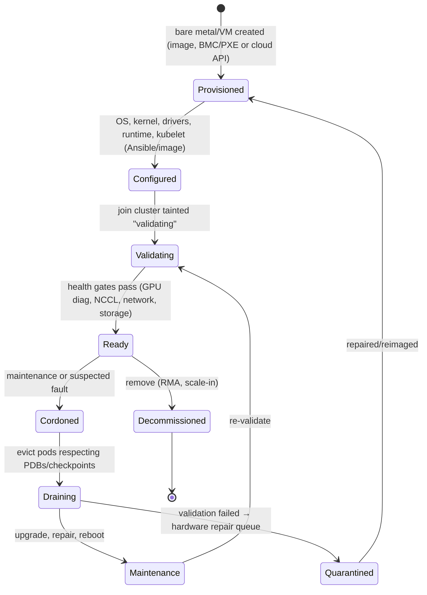

# 5.19 Cluster deployment models and day-2 operations

| | |
|---|---|
| Level | Intermediate |
| Priority tier | 1 |
| Lab venue | kubeadm or kind multi-node; Prometheus/Alertmanager; Argo CD/Flux; Velero; optional Cluster API with a Docker or cloud provider |
| Part | Part 5: Kubernetes |
| Status | Drafted, labs **untested** |

## Why this matters for AI infrastructure

Standing up a cluster is a day; running it for years is the job. GPU fleets fail constantly (a thousand GPUs fail on a scale of weeks), need driver, kernel and Kubernetes upgrades, grow in waves as capacity is purchased, and serve teams with conflicting demands. Choices made early (managed or self-managed control plane, one big cluster or many, how nodes are provisioned and replaced, how add-ons are versioned) determine how painful every later change is. This chapter provides the decision frame and the operational runbooks: node lifecycle, maintenance, capacity management, add-on lifecycle, drift control, and the observability and on-call practices that keep a GPU platform healthy. Upgrades and disaster recovery have their own chapter (5.20).

## Prerequisites and outcomes

Needs 5.3, 5.4, 5.9, 5.18 and Part 4 (automation, GitOps). After this chapter you can:

- Compare deployment models (managed Kubernetes, self-managed kubeadm/Kubespray/RKE2/Talos/Cluster API, OpenShift, vendor distributions like NVIDIA BCM-integrated, GPU-cloud managed offerings) and decide for a given context.
- Choose a cluster topology (single large, per-environment, per-region, per-team, per-workload-class, multi-cluster) with explicit trade-offs.
- Run the node lifecycle: provisioning, joining, labelling/tainting, validation gates, cordon/drain, maintenance, replacement, decommissioning; handle failing GPU nodes.
- Manage capacity (requests vs utilisation, quotas, overcommit, headroom, reservation) and cost for GPU fleets.
- Manage add-on and configuration lifecycle with GitOps, version matrices and drift detection.
- Establish day-2 practices: SLOs, alerting, runbooks, change management, access, audit and compliance.

## 1. Deployment models

| Model | Control plane | Nodes | Pros | Cons | Fits |
|---|---|---|---|---|---|
| **Managed (GKE, EKS, AKS, OKE)** | Provider operates API server/etcd/upgrades | You or provider (node pools, autopilot) | Fast start, HA control plane, integrated IAM/LB/storage, SLAs | Less control (flags, admission, etcd tuning), limits on cluster size/features, provider cadence, egress/cost, GPU capacity tied to provider | Cloud-first teams; elastic GPU in hyperscalers |
| **Managed on GPU clouds (CoreWeave CKS, Nebius Managed K8s, Lambda, Crusoe, etc.)** | Provider | Bare-metal-like GPU nodes with InfiniBand fabrics | Direct access to GPU/IB hardware with Kubernetes API; capacity focused on AI | Provider-specific features; fewer surrounding services; verify networking/storage integrations | AI-first workloads needing large GPU clusters |
| **Self-managed kubeadm / Kubespray** | You | You | Full control, runs anywhere (on-prem, colocation), standard Kubernetes | You own HA, etcd, certs, upgrades, security patches | On-prem DGX/HGX clusters, regulated environments |
| **Distributions (RKE2/K3s, Talos, OpenShift, Charmed K8s, Tanzu)** | You (opinionated) | You | Secure defaults, simpler upgrades, integrated tooling | Distribution conventions, licensing, upgrade lag | Teams wanting opinionated operations |
| **Cluster API (CAPI)** | Management cluster provisions workload clusters declaratively | Providers: AWS, GCP, Azure, vSphere, metal3 (bare metal), Docker | Cluster lifecycle as Kubernetes objects; consistent fleet ops, rolling node replacement | Learning curve; management cluster is critical | Many clusters; bare-metal fleets with metal3 |
| **Vendor-integrated (NVIDIA BCM, DeepOps, Run:ai, DGX Cloud/Base Command)** | Varies | Bare metal with provisioning (PXE, BMC) | Hardware-aware provisioning, Slurm+K8s options, validated stacks | Vendor lock-in, upgrade coupling | NVIDIA-centric on-prem AI factories (Part 8) |

Decision factors: where GPUs physically are; who patches control planes; team skills; compliance; required Kubernetes features (DRA, alpha gates, custom admission); networking (InfiniBand/RoCE integration, 5.13); storage proximity (parallel FS); multi-tenancy needs; cost model (managed control plane fee vs staff); lock-in; time to value. A common pattern: **managed Kubernetes in the cloud for elastic/secondary capacity** plus **self-managed or provider-managed bare-metal clusters for the main training fleet**, unified by GitOps, a common platform layer (operators, Kueue, observability) and multi-cluster dispatch (5.35).

### Matching the approach to your needs

Each option trades engineering effort against production readiness. Plain Kubernetes clusters need the least engineering effort. That is especially true when a managed service such as EKS runs the control plane. These clusters are lower on production readiness, because most organizations need more work on top of Kubernetes. Still, a team that uses dedicated clusters for its workloads may be satisfied with plain Kubernetes.

Established platforms sit at the other end. Cloud Foundry gives an end-to-end developer experience out of the box. Running software there means fitting its opinions. OpenShift is far more production-ready than plain Kubernetes for most teams. It also has more decisions to make during setup. Is that flexibility a benefit or a nuisance? That is a key question for you.

A platform built on Kubernetes takes the most engineering effort, at least from the platform side. It can line up with your developer, infrastructure, and business needs. Kubernetes' extensibility makes that possible.

Alignment with your requirements is a third axis. Building your own platform is almost always the most aligned option, or at least the most able to align. You can build almost anything. Rebuilding Heroku in-house on top of Kubernetes, with minor changes, is technically possible. The cost and reward still need weighing against the other two axes. Consider needs such as these for a next-generation platform:

- Regulations require you to run most workloads on-premises.
- You must support a bare-metal fleet along with a vSphere-enabled data center.
- Developers want to package applications as containers.
- You need self-service APIs that move you away from ticket-based infrastructure provisioning.
- APIs must stay vendor-agnostic, because lock-in has cost millions in past migrations.
- You are open to paying for enterprise support across the stack, but you will not license the whole stack per node, core, or application instance.

Before you commit, be honest about your engineering maturity, your appetite for building and empowering teams, and the resources you have. Those answers show whether building an application platform is a sensible effort.

## 2. Cluster topology choices

| Topology | Description | Pros | Cons |
|---|---|---|---|
| One large shared cluster | All teams/workloads, namespaces for isolation | Best utilisation; one platform to operate; easy sharing/quotas | Blast radius; noisy neighbours; upgrade coordination; 5k node limit |
| Cluster per environment | prod / staging / dev | Safe changes | Duplicated capacity; small dev clusters may lack GPUs |
| Cluster per workload class | Training vs inference vs interactive | Tuned configs (kubelet, networking, security); independent upgrades; SLO isolation | Fragmented capacity; borrow/lend harder |
| Cluster per region/site | Data locality, latency, DR | Resilience; compliance | More clusters to manage; data movement |
| Cluster per tenant/team | Strong isolation | Clear ownership, strict security | Poor utilisation; duplicated ops |
| Multi-cluster fleet | Many clusters under common management (CAPI, Argo, Karmada, MultiKueue, Rancher) | Scale beyond 5k nodes, isolate failure domains, regional | Complex networking/identity/observability |

Guidance for AI platforms: separate **production inference** from **training/research** (different SLOs and security) when stakes warrant; keep training in as large a pool as possible to allow big jobs and fair sharing; use namespaces + quotas + Kueue for tenancy inside; keep a small **management cluster** (Cluster API, Argo CD hub, observability backend) separate from workload clusters; plan for **blue/green clusters** as the safest big-upgrade and migration strategy where capacity allows.

### Dedicated versus colocated etcd and node pool sizing ratios

When you run a self-managed control plane, you must decide whether etcd shares the control-plane machines (colocated) or runs on its own machines (dedicated). In the book's (*Production Kubernetes*, Chapter 2) cluster-sizing guidance, colocated etcd (managed as static pods by `kubeadm`) is appropriate for smaller clusters to save management overhead and infrastructure cost, whereas anything above `50` worker nodes should prompt you to consider separating etcd onto dedicated machines to eliminate resource contention with `kube-apiserver`, `kube-scheduler`, and `kube-controller-manager`. If you plan for clusters with over `200` worker nodes, the book recommends planning for dedicated etcd clusters from the start, with fast local disks dedicated to etcd and low-latency intra-region links (and never placing a load balancer between `kube-apiserver` and etcd, because the API server's etcd client handles member connections directly).

Similarly, worker node pools can be organized as **characteristic-based** pools (grouped by hardware attributes such as GPUs, NICs, or CPU-to-memory ratios) or **role-based** pools (sliced off to isolate a specific platform function such as cluster ingress). In the book's AWS EC2 example, matching node pool shapes to workload consumption ratios avoids stranded resources:

- **General-purpose worker nodes** (`M5` instance types in the book's example): `1CPU:4GiB` ratio.
- **Memory-optimized nodes** (`R5` instance types in the book's example): `1CPU:8GiB` ratio, preventing memory-heavy workloads from leaving half of a general-purpose node's CPUs unused.
- **Compute-optimized nodes** (`C5` instance types in the book's example): `1CPU:2GiB` ratio for CPU-intensive workloads.

## 3. Node lifecycle



### Joining nodes safely

1. Build nodes from a **golden image** or configuration-managed baseline (4.17): kernel, NVIDIA driver, container toolkit, OFED, sysctls, kubelet config, node-level agents.
2. Join with a **bootstrap taint** (e.g., `node.example.com/validating=true:NoSchedule`) and labels (pool, rack, NVLink domain, GPU model, firmware versions, owner).
3. Run **health gates** as a Job/DaemonSet or external tooling: `dcgmi diag`, NCCL all-reduce on the node (and rack), `ib_write_bw` between peers, disk/network checks (4.17, Part 17); only on success remove the taint (automated by an operator/controller, 5.32).
4. Record node metadata (asset tag, serial, BMC address) in labels/annotations or an inventory (NetBox) so operators can map nodes to hardware (Part 7).
5. Prefer **immutable nodes**: replace rather than patch in place (re-image through BMC/PXE or recreate VMs); in-place changes drift.

### Draining and maintenance

```bash
kubectl cordon gpu-node-17                          # stop new pods
kubectl drain gpu-node-17 --ignore-daemonsets --delete-emptydir-data --grace-period=600 --timeout=30m --pod-selector='!batch-critical'   # evict respecting PDBs
kubectl get pods -A -o wide --field-selector spec.nodeName=gpu-node-17      # what's left
# ... maintenance (OS update, driver update, hardware swap) ...
kubectl uncordon gpu-node-17                        # after validation
```

Drain semantics: uses the Eviction API (respects PDBs; blocks if budget disallows), honours `terminationGracePeriodSeconds`, skips DaemonSet pods (with the flag), refuses unmanaged pods (no controller) unless `--force`, refuses pods with local storage unless `--delete-emptydir-data`. For training jobs: the platform should (a) ask the job to checkpoint (signal/annotation), (b) drain after checkpoint, (c) let the operator restart the job elsewhere. Use **maintenance windows** with draining sequenced by rack/failure domain and respecting capacity headroom ("never drain more than N% of a pool"); automate with node maintenance operators, cluster-autoscaler hooks, or CAPI rolling updates. Handle `NoExecute` taint-based maintenance (`node.example.com/maintenance:NoExecute`) when you want evictions to follow toleration seconds.

Failure cases: PDB blocking drain (adjust budgets or scale up); pods with finalizers; `Terminating` pods stuck on unmount (5.8); StatefulSet pods needing volume detach (5.17); long checkpoints exceeding timeouts; DaemonSet-only nodes.

### Replacing and decommissioning

Nodes with hardware faults (GPU falls off the bus, Xid 79, ECC errors, NVLink down, IB link flap, SSD failure) should be **automatically cordoned and drained**, labelled with the fault, and routed to repair (5.32, Part 17). Decommission: drain, delete the Node object (`kubectl delete node`) after power-off or removal from cloud, clean PV attachments, remove from monitoring/inventory/DNS, update BCM/Slurm if shared. Re-provision from images; do not reuse disks with old kubelet state without cleaning.

### Bulk node operations at scale

Roll out kernel/driver/OS changes by **pool, rack and percentage**: canary a few nodes, validate, expand; limit concurrency (`maxUnavailable`), pause on failures; use Cluster API `MachineDeployment` rolling updates (create-before-delete), Ansible with `serial` (4.8, 4.14), or node-image upgrade features of managed services (surge/blue-green node pools). Protect long-running jobs with maintenance reservations and checkpoint coordination.

## 4. Capacity and quota management

- **Measure** allocatable vs requested vs used: `kube_node_status_allocatable`, `kube_pod_container_resource_requests`, DCGM utilisation (`DCGM_FI_DEV_GPU_UTIL`, SM activity, memory), node-exporter CPU/memory; compute **GPU allocation efficiency** (requested GPU-hours / available) and **GPU utilisation** (busy fraction). Low utilisation with high allocation means idle reservations (notebooks, stuck jobs); high pending with idle GPUs means fragmentation or quota misconfiguration.
- **Quota layers**: ResourceQuota per namespace (`requests.nvidia.com/gpu`, objects count), Kueue ClusterQueue quotas and cohorts (borrowing), LimitRanges for defaults, PriorityClass-scoped quotas, per-user concurrency limits; align with budgets and chargeback (labels `team`, `project`, `cost-center`; tools: OpenCost/Kubecost, cloud billing exports).
- **Headroom**: reserve capacity for inference scaling, node failures (N+k), and maintenance drains; plan GPU capacity in failure-domain units (a rack's worth) and keep a **spare pool** of validated nodes.
- **Fragmentation management**: bin-packing, node pool shapes, defrag via descheduler for non-training, scheduling big jobs first (5.18).
- **Autoscaling** of GPU pools: slow and capacity-constrained; prefer pre-provisioned fixed pools for training and autoscaled pools for inference/CPU (5.23). Reservations and committed use must be tracked as first-class resources (4.24).
- **Idle detection and reclamation**: culling idle notebooks, TTL for jobs, time-limited interactive allocations, alerts on GPUs allocated but 0% utilised for >N hours; show owners their waste.
- **Forecasting**: use queue wait-time and utilisation trends to justify capacity purchases; maintain a capacity model (nodes → GPUs → expected job mix).

## 5. Add-on and configuration lifecycle

Platform components (CNI, CSI, CoreDNS, ingress/gateway, cert-manager, GPU Operator, Network Operator, Kueue, monitoring, policy engines, Argo CD) form a **versioned dependency graph**:

- Maintain a **compatibility matrix**: Kubernetes version × CNI × CSI × GPU Operator/driver × container toolkit × kernel × OFED × CUDA containers × Kueue/operators. Vendors publish support matrices (NVIDIA GPU Operator vs OS/kernel/Kubernetes versions); upgrades follow the matrix, not whatever is latest.
- Everything in **Git** (4.26): Helm values, CRs, policies, kubelet configs (via node config management), with environment overlays and pinned chart/image versions; changes via PR, validated in staging clusters, promoted to production progressively (ring deployments by cluster, then by node pool).
- **Upgrade order** (typical): control plane → CNI/CSI/CoreDNS compat → node pools (drain/replace) → add-ons; operators with CRD changes need care (CRD upgrade before controller, 4.25).
- **Drift detection**: GitOps controllers compare cluster to Git; node-level drift detection by Ansible `--check` or image attestation; kubelet/containerd config comparison against baseline; periodic conformance checks (Sonobuoy), CIS benchmarks (kube-bench), configuration scanners (kubescape, Polaris).
- **Policy as code** (Kyverno, Gatekeeper, ValidatingAdmissionPolicy; 5.21): enforce required labels, limits, probes, image provenance, prohibited host namespaces, GPU quotas; start in audit mode.
- **Secrets and credentials rotation**: certificates (kubeadm certs renew, 5.21), service account keys, registry credentials, cloud credentials (workload identity), cluster CA rotation plan.
- **Documentation as code**: runbooks, architecture decision records, diagrams in the repo (4.1).

## 6. Observability, SLOs and on-call

### What to monitor (minimum viable)

| Layer | Signals |
|---|---|
| Control plane | API availability/latency/error rate, etcd health (fsync, DB size, leader changes), scheduler pending pods and latency, controller queue depth, admission webhook latency |
| Nodes | Ready status, pressure conditions, kubelet/containerd health, PLEG, disk/inode/PID usage, CPU/memory, network errors, kernel logs (Xid, ECC, OOM), time sync |
| GPUs | DCGM metrics (utilisation, memory, power, temperature, clocks, throttle reasons, ECC, XID, NVLink errors, PCIe replay), health checks results, per-pod attribution |
| Network | CNI health, DNS latency/errors, conntrack, IB/RoCE link state, congestion (PFC/ECN) counters (Part 12) |
| Storage | PVC usage, CSI errors, attach/mount latency, filesystem throughput/latency (Part 13) |
| Workloads | Job success/failure/restart rates, time in queue, startup latency, checkpoint age, training throughput (tokens/s), inference latency/error/SLO burn |
| Platform | Pending reasons, quota usage, GitOps sync status, certificate expiry, backup success, upgrade progress |

Stack: Prometheus (kube-prometheus-stack) + Alertmanager + Grafana, Loki/Elastic for logs, OpenTelemetry for traces, DCGM exporter, node problem detector, kube-state-metrics, blackbox probes; long-term storage (Thanos/Mimir/VictoriaMetrics). Details in 5.24 and Part 17.

### SLOs

Define user-facing objectives: *job start latency* (p95 time from admission to running), *inference availability and latency*, *platform API availability*, *node repair time*, *checkpoint success*, *GPU health fraction*; set error budgets; page only on symptoms that threaten SLOs (API down, many nodes NotReady, queue stalled, inference SLO burn), ticket for the rest.

### Runbooks (examples to write and test)

1. Node NotReady / GPU fell off bus: cordon, collect `nvidia-bug-report`, `dmesg`, DCGM diag, drain, reboot/reset, escalate hardware.
2. API server latency high: check APF, etcd fsync, noisy clients, webhooks (5.5).
3. etcd quorum loss / restore (5.20).
4. Pending GPU pods: pending-reason decision tree (5.18).
5. Training job stuck/hung: collective timeouts, NCCL debug, node health, rank isolation (Part 14).
6. DNS failure (5.11), CNI IPAM exhaustion (5.13), certificate expiry (5.21), image registry outage (5.1).
7. Rolling upgrade failures and rollback (5.20).
8. Security incident: compromised pod/credential isolation procedures (Part 18).

### Change management

Classify changes (standard/pre-approved, normal, emergency); use progressive delivery for cluster changes (canary clusters/pools); freeze windows around key training runs; maintain a change calendar visible to users; communicate drains; post-incident reviews feeding automation and alert tuning.

## 7. Multi-tenancy and platform operations basics

(Details in 5.22.) Operating principles: namespace per team/project with quotas; default-deny NetworkPolicy; Pod Security baseline/restricted; separation of platform vs tenant RBAC; self-service via GitOps PRs or portals; per-tenant observability dashboards; chargeback/showback; clear support model and documentation; guardrails on image registries and privileged features; secure interactive access (notebooks) with time limits.

## 8. Cluster API and fleet operations (brief)

**Cluster API** models clusters as objects: `Cluster`, `KubeadmControlPlane` (control-plane nodes with rolling upgrades), `MachineDeployment`/`MachineSet`/`Machine` (workers), infrastructure templates per provider (`AWSMachineTemplate`, `Metal3MachineTemplate` for bare metal via Ironic/BMC), `MachineHealthCheck` (auto-remediate unhealthy nodes by deleting/reprovisioning), `ClusterClass` (templates for many clusters), `ClusterResourceSet`/add-on providers (Helm, Argo). Management cluster runs controllers; workload clusters are cattle. For GPU bare metal, CAPI + Metal3 (or Tinkerbell, MAAS) automate provisioning end to end, while Ansible/image pipelines (4.2, 4.17) define node contents. Benefits: uniform lifecycle, rolling node image upgrades, health-based remediation; costs: operating the management plane, GPU-specific readiness gates not built in (add via hooks/operators).

A subtle failure mode in a pure hub-and-spoke Cluster API layout appears when a workload cluster runs the **Cluster Autoscaler**: the autoscaler runs inside the workload cluster watching for unschedulable pods, but if the `Cluster` and `MachineDeployment` objects live only in an external management cluster, the workload cluster depends on the management cluster's availability just to scale out during peak load. As *Production Kubernetes* (Chapter 2) notes, you can remove this external runtime dependency by running the Cluster API controllers and the workload cluster's own `Cluster` and `Machine` resources inside the workload cluster itself in a self-contained (pivoted/autonomous) manner. A central management cluster can still initiate cluster creation and deletion, while day-to-day autoscaling and local controller lookups against the `Cluster` custom resource happen entirely against the local API server.

## 9. Lab

First, run the self-checking Python lab (`code/part05/day2_node_lifecycle_sim_lab.py`) locally. It verifies the GPU node validation gate (`dcgmi_diag`, `nccl_allreduce`, `ib_write_bw`) and `kubectl drain` eviction simulator (`evaluate_node_validation_and_drain`) and the `PK` Chapter 2 `etcd` topology advisor (`50` / `200` worker thresholds) and GPU fleet allocation-vs-utilization analyzer (`analyze_gpu_fleet_and_etcd_sizing`).

```bash
python3 code/part05/day2_node_lifecycle_sim_lab.py
```

Next, on a multi-node `kind` or `kubeadm` cluster (all interactive shell steps below are `untested here`), work through these exercises:

1. **Node lifecycle drill**: on a lab cluster, join a worker with a validating taint, run a validation Job, remove the taint; then cordon/drain/uncordon while a Deployment with a PDB and a StatefulSet run; observe PDB blocking and fix; time a full cycle.
2. **Drain with checkpointing**: run a training stub that checkpoints on SIGTERM; drain its node; verify checkpoint written and job resumes on another node; test grace period too short and observe loss.
3. **Failure injection**: stop kubelet / unplug network / kill container runtime / fill disk; document symptoms, timings (NotReady, taints, evictions) and recovery; compare with graceful shutdown (5.9).
4. **Capacity report**: write PromQL (or scripts) for allocatable vs requested vs used GPUs per namespace/pool, idle-allocated GPUs, queue wait time, and a fragmentation metric (largest free block per node pool); build a dashboard.
5. **Quota design**: create namespaces for three teams with ResourceQuota GPU limits and Kueue ClusterQueues in a cohort; simulate bursts and verify enforcement and borrowing; document the policy.
6. **Add-on matrix**: pick your Kubernetes/GPU Operator/driver versions, build a compatibility table from vendor docs, and encode it as CI checks (e.g., a script that fails if chart versions diverge from the table).
7. **GitOps promotion**: put cluster add-ons in a repo with overlays; promote a CoreDNS or ingress controller version through staging then production-like clusters; roll back by revert.
8. **Cluster API (optional)**: create a Docker-provider workload cluster with CAPI; perform a rolling upgrade of a MachineDeployment; enable a `MachineHealthCheck` and kill a node to watch auto-remediation.
9. **Runbook writing and game day**: write the NotReady/GPU-fault runbook; run a game day injecting a GPU fault (simulated via a failing DCGM health check/fake Xid event), practise cordon/drain/escalation, record time-to-recovery and gaps.
10. **SLO and alerts**: define two SLOs (job start latency, inference availability); implement recording rules and burn-rate alerts; test with a synthetic failure.
11. **Audit and compliance**: run kube-bench and kubescape; triage findings; encode accepted exceptions; schedule recurring scans.
12. **Clean up**.

## 10. Common mistakes

- Choosing self-managed Kubernetes without staffing for upgrades, etcd, certificates and security patching (or choosing managed when you need features the provider doesn't expose).
- One giant cluster with no isolation, or dozens of tiny clusters with no fleet management.
- Patching nodes in place and letting them drift; no validation gate before nodes receive workloads.
- Draining everything at once; PDBs absent or blocking; no checkpoint coordination.
- Treating add-on versions casually; upgrading Kubernetes without checking driver/CNI/operator compatibility.
- No capacity model: discovering shortages from user complaints; unmeasured idle GPUs.
- Alert fatigue (paging on node-level noise) and missing alerts on user-facing SLOs.
- No tested runbooks; relying on tribal knowledge.
- Treating the management cluster casually; no backups of GitOps/CAPI state.
- Ignoring hardware reality: no spare nodes, no automation for repair workflows.

## 11. Interview angles

- "Managed vs self-managed Kubernetes for a GPU training platform: how do you decide?"
- "One cluster or many? How do you decide cluster boundaries?"
- "Walk me through safely maintaining 500 GPU nodes: patching, drains, validation."
- "How do you manage capacity and prevent idle GPU waste?"
- "How do you keep add-ons and the GPU stack consistent across clusters?"
- "What do you monitor in a GPU Kubernetes platform? What do you page on?"
- "What is Cluster API and when is it useful?"
- "How do you handle a node with a failing GPU automatically?"

## Exercises

1. **Comparing Kubernetes Deployment Models and Cluster Topologies (`PK` Chapters 1–2 & `KUR` Chapter 3):** Compare the 6 deployment models in Section 1 (Hyperscaler Managed, GPU-Cloud Managed, Self-Managed `kubeadm`/`Kubespray`, Packaged Distributions, `Cluster API` + `Metal3`, and Vendor-Integrated `NVIDIA BCM`) and the 6 cluster topologies in Section 2, and explain why separating production inference clusters from large shared training clusters is a common AI platform pattern.
2. **Colocated vs. Dedicated `etcd` Thresholds (`50` and `200` Worker Nodes) and Node Pool Sizing Ratios (`PK` Chapter 2):** Using `analyze_gpu_fleet_and_etcd_sizing()` in `code/part05/day2_node_lifecycle_sim.py`, explain why `PK` Chapter 2 recommends considering dedicated `etcd` hosts above `50` workers and planning for dedicated `etcd` above `200` workers, why you should never place a load balancer between `kube-apiserver` and `etcd`, and how characteristic-based vs role-based node pools (`M5` `1:4`, `R5` `1:8`, `C5` `1:2`, and GPU pools) prevent stranded resources.
3. **The 9-State GPU Node Lifecycle, Join Validation Gates (`validating` Taint), and PDB-Aware `kubectl drain`:** Using `evaluate_node_validation_and_drain()` in `code/part05/day2_node_lifecycle_sim.py`, trace the Section 3 state diagram (`Provisioned -> Configured -> Validating -> Ready -> Cordoned -> Draining -> Maintenance/Quarantined/Decommissioned`), list the hardware checks required before removing the `validating` taint, and explain how `kubectl drain` interacts with DaemonSets, `emptyDir`, unmanaged pods, and `PodDisruptionBudget`s.
4. **GPU Capacity Management: Allocation Efficiency vs. Utilization Efficiency, Idle Reclamation, and Fragmentation:** Using `analyze_gpu_fleet_and_etcd_sizing()`, define and contrast **GPU Allocation Efficiency** (`requested / allocatable`) and **GPU Utilization Efficiency** (`DCGM busy / allocatable`), explain how to detect and reclaim "zombie/idle-allocated" GPUs (100% requested, 0% DCGM utilization), and size N+k spare headroom by failure domain (rack).
5. **The Add-On Compatibility Matrix (`Kubernetes x CNI x CSI x GPU Operator x Driver x Kernel x OFED`) and Drift Detection:** Explain why upgrading Kubernetes or a host Linux kernel on a GPU cluster without checking the full compatibility matrix breaks `nvidia.ko`/`mlx5_core` or CNI eBPF datapaths, and show how GitOps, `Sonobuoy`, `kube-bench`, and `kubescape` enforce consistency across clusters.
6. **Cluster API (`CAPI` + `Metal3` + `MachineHealthCheck`), Pivoted Self-Contained Autoscaling (`PK` Chapter 2), and On-Call SLOs/Runbooks:** Explain how `Cluster`, `KubeadmControlPlane`, `MachineDeployment`, and `MachineHealthCheck` automate bare-metal node replacement, why `PK` Chapter 2 recommends pivoting CAPI objects into the workload cluster when running `Cluster Autoscaler`, and write the 6-step runbook for a GPU node reporting `Xid 79 (GPU has fallen off the bus)`.

## Checkpoint questions (20)

<details>
<summary>1. In *Production Kubernetes* Chapter 2, at what worker-node counts should you move from colocated (stacked) `etcd` to dedicated `etcd` machines, and why shouldn't you put a load balancer between `kube-apiserver` and `etcd`?</summary>

- **Worker-node thresholds (`PK` Chapter 2):**
  - **$\le 50$ worker nodes:** Colocated (stacked) `etcd` running on the control-plane nodes is generally sufficient.
  - **$> 50$ worker nodes:** Strongly consider separating `etcd` onto dedicated hosts so `kube-apiserver` / `kube-controller-manager` CPU and memory bursts cannot starve `etcd`.
  - **$> 200$ worker nodes:** Plan for a **dedicated 3- or 5-node `etcd` cluster** with dedicated local NVMe storage from Day 1.
- **Why no load balancer between `kube-apiserver` and `etcd`:** `etcd`'s Go client library (embedded inside `kube-apiserver`) is topology- and Raft-aware: when given the full list of `etcd` member URLs (`--etcd-servers=https://etcd1:2379,https://etcd2:2379,https://etcd3:2379`), it maintains health-checked gRPC streams to all members, automatically routes writes to the leader, and fails over instantly without an intermediate TCP load balancer adding latency or a single point of failure.
</details>

<details>
<summary>2. In `PK` Chapter 2, what is the difference between a \"Characteristic-Based\" node pool and a \"Role-Based\" node pool, and what are the CPU:Memory ratios of `C5`, `M5`, and `R5` shapes?</summary>

- **Characteristic-based node pool:** Grouped by hardware profile so workloads with specific resource ratios or accelerators bin-pack cleanly without stranding resources:
  - **Compute-optimized (`C5`):** **`1 vCPU : 2 GiB RAM`**
  - **General-purpose (`M5`):** **`1 vCPU : 4 GiB RAM`**
  - **Memory-optimized (`R5`):** **`1 vCPU : 8 GiB RAM`**
  - **GPU-accelerated (`P4d`/`P5`, `A3`, `HGX`):** 8 GPUs + high-bandwidth RDMA NICs.
- **Role-based node pool:** Dedicated to a specific operational tier (annotated with taints and `nodeSelector`s) to isolate blast radius and noisy neighbors—such as a dedicated `system` pool (CoreDNS, monitoring, operators) and a dedicated `ingress`/`edge` pool.
</details>

<details>
<summary>3. Compare \"One Large Shared Cluster\" vs. \"Cluster-per-Workload-Class (Training vs. Inference)\" for a 1,000-GPU AI platform.</summary>

- **One Large Shared Cluster:** Maximizes GPU pooling and borrowing (inference can burst into training GPUs during peak daytime traffic, and batch training can use those GPUs overnight via Kueue cohorts), with only one control plane to upgrade. *Drawbacks:* a bad CRD/webhook or control-plane upgrade affects both training and live production inference simultaneously.
- **Cluster-per-Workload-Class (Dedicated Production Inference Cluster + Large Shared Training Cluster):** Isolates customer-facing inference SLOs, security boundaries, and `KubeletConfiguration` (`single-numa-node` + strict `PDB`s on inference vs `best-effort` + gang scheduling on training) so a 2,000-pod training burst never impacts production inference tail latency.
</details>

<details>
<summary>4. Why must a newly provisioned or repaired GPU node join the cluster with a `validating` taint (`node.example.com/validating=true:NoSchedule`), and what five checks must pass before the taint is removed?</summary>

If a new or repaired GPU node joins the cluster untainted, `kube-scheduler` will assign production training Pods to it **within milliseconds of `Ready=True`**—often before the GPU device plugin finishes initializing or while the node has a degraded PCIe link, a bad InfiniBand cable, or a missing NVMe mount, causing the job to crash immediately ("blackhole node").
With a bootstrap `validating` taint, an automated validation Job ( tolerating `validating=true`) runs five gates before a controller removes the taint:
1. **GPU presence & driver/fabricmanager health (`nvidia-smi` + `dcgmi diag -r 2/3`).**
2. **Intra-node NVLink bandwidth (`nccl-tests` `all_reduce_perf` across all 8 GPUs).**
3. **Inter-node RDMA / InfiniBand link speed and `ib_write_bw` / `all_reduce_perf` against a reference peer.**
4. **End-to-end Jumbo MTU (`ping -M do -s 8868`).**
5. **Shared storage mount & local NVMe `fio` IOPS/throughput.**
</details>

<details>
<summary>5. What is the exact difference between `kubectl cordon <node>` and `kubectl drain <node>`, and what flags are typically required when draining a worker node?</summary>

- **`kubectl cordon <node>`:** Sets `node.spec.unschedulable = true` (which adds the taint `node.kubernetes.io/unschedulable:NoSchedule`). Existing Pods on the node **keep running undisturbed**, while new Pods are prevented from scheduling onto the node.
- **`kubectl drain <node>`:** Cordons the node first, and then calls the **Kubernetes Eviction API** (`POST /api/v1/namespaces/.../pods/<name>/eviction`) on every Pod on the node, respecting `PodDisruptionBudget`s and `terminationGracePeriodSeconds`.
- **Standard drain flags:**
  `kubectl drain <node> --ignore-daemonsets --delete-emptydir-data --grace-period=600 --timeout=30m`
  (`--ignore-daemonsets` skips node agents like CNI/CSI/device-plugin that would immediately reschedule onto the same node; `--delete-emptydir-data` acknowledges that scratch `emptyDir` data on the node will be lost).
</details>

<details>
<summary>6. What four conditions will cause `kubectl drain` to fail or hang, and how do you handle each?</summary>

1. **A `PodDisruptionBudget` (`PDB`) has `disruptionsAllowed == 0`** (e.g., `minAvailable` equals current `Ready` replicas, or replacement pods are stuck `Pending` for lack of spare capacity): scale up capacity or fix the overly strict PDB.
2. **DaemonSet pods or `emptyDir` pods** when `--ignore-daemonsets` or `--delete-emptydir-data` was omitted.
3. **Standalone ("bare") Pods not managed by any controller** (`ReplicaSet`, `StatefulSet`, `Job`, `DaemonSet`): `drain` refuses to delete them because nothing will recreate them (requires `--force` or migrating them to a controller).
4. **Pods stuck in `Terminating`** due to hung NFS/Lustre I/O (`D` state) or unfulfilled finalizers.
</details>

<details>
<summary>7. How should a platform drain a GPU node that is currently running a multi-day distributed training job?</summary>

1. **Cordon the node immediately** (`kubectl cordon <node>`) so no new jobs land on it.
2. **Trigger an on-demand checkpoint:** Send the training framework's checkpoint signal (e.g., `SIGUSR1` or `SIGTERM` with `terminationGracePeriodSeconds: 600` configured in the Pod spec, or set a Kueue/JobSet drain annotation) so all ranks write a consistent checkpoint to shared storage before exiting.
3. **Evict/drain once the checkpoint completes** and let Kueue / `JobSet` / `PyTorchJob` reschedule the replacement pod onto a healthy spare node from the latest checkpoint.
</details>

<details>
<summary>8. What is the difference between \"GPU Allocation Efficiency\" and \"GPU Utilization Efficiency\", and what does a large gap between them mean?</summary>

- **GPU Allocation Efficiency:**
  `sum(Pod GPU Requests) / sum(Node Allocatable GPUs)`
  Measures what fraction of the cluster's GPUs are *reserved* by scheduled Pods.
- **GPU Utilization Efficiency:**
  `Active GPU Compute Duty Cycle (DCGM_FI_DEV_GPU_UTIL / SM_ACTIVE) / sum(Node Allocatable GPUs)`
  Measures what fraction of the cluster's GPUs are actually *executing CUDA kernels*.
- **Diagnostic meaning of a large gap (e.g., 95% Allocated, 18% Utilized):** Developers are hoarding GPUs in idle interactive Jupyter notebooks, `sleep infinity` debug pods, CPU-bottlenecked data loaders, or hung NCCL jobs. Fix with automated idle-notebook culling, TTLs, and per-team utilization showback dashboards.
</details>

<details>
<summary>9. Why should you prefer \"Immutable Node Replacement\" (re-imaging or recreating nodes) over in-place `apt-get upgrade` / manual SSH patching on a 500-node GPU cluster?</summary>

In-place package upgrades across 500 nodes inevitably drift (failed DKMS builds on 3 nodes, mismatched `nvidia-fabricmanager` versions, leftover config files, partial restarts), creating "snowflake" nodes where distributed training fails mysteriously whenever a job lands on node #147.
Building a versioned, tested **golden OS image** (Packer + Ansible, Chapter 4.17) containing the exact matched Linux kernel, NVIDIA driver, OFED, `containerd`, and `kubelet` binaries—and rolling nodes via CAPI `MachineDeployment` / PXE re-image through the `Validating` taint gate—guarantees every node in a pool is byte-for-byte identical.
</details>

<details>
<summary>10. What components belong in a GPU Kubernetes Platform \"Compatibility Matrix\", and why can't you upgrade them independently at random?</summary>

Every production release of your platform must lock and test a matrix of **8 coupled versions**:
1. **Host Linux Kernel version** (`uname -r`)
2. **NVIDIA GPU Driver + Fabric Manager version** (`550.x` / `560.x`)
3. **Mellanox OFED / DOCA-Host RDMA driver version** + **NIC/Switch Firmware**
4. **`containerd` + `runc` + NVIDIA Container Toolkit version**
5. **Kubernetes (`kube-apiserver` / `kubelet`) minor version** (`1.30` / `1.31`)
6. **CNI (`Cilium` / `Calico`) and CSI driver versions**
7. **NVIDIA GPU Operator & Network Operator chart versions**
8. **User base container CUDA runtime (`nvcr.io/nvidia/pytorch:24.xx`)**.
Upgrading the host kernel without testing against the NVIDIA driver and MOFED DKMS matrix can break `nvidia-peermem.ko` (`GPUDirect RDMA`), and upgrading Kubernetes past what your CNI or GPU Operator supports can break CRD API versions.
</details>

<details>
<summary>11. What is `Cluster API` (`CAPI`), and what are its core Custom Resources?</summary>

**Cluster API (`CAPI`)** is a Kubernetes subproject that uses declarative Kubernetes CRDs and operators (running in a **management cluster**) to provision, upgrade, scale, and heal **workload clusters** across cloud and bare-metal infrastructure providers:
- **`Cluster`:** Top-level cluster definition (network CIDRs, control-plane endpoint, infrastructure ref).
- **`KubeadmControlPlane` (`KCP`):** Manages the lifecycle, certificates, and rolling upgrades of the control-plane nodes.
- **`MachineDeployment` -> `MachineSet` -> `Machine`:** Works just like `Deployment -> ReplicaSet -> Pod`, but for **physical/virtual worker nodes**. Updating the OS image or Kubernetes version on a `MachineDeployment` triggers a rolling node replacement (`maxSurge` / `maxUnavailable`).
- **`Metal3MachineTemplate` / `AWSMachineTemplate` / `GCPMachineTemplate`:** Provider-specific hardware/VM spec (Metal3 uses **Ironic** over IPMI/Redfish to PXE-boot and image bare-metal GPU servers).
</details>

<details>
<summary>12. How does a Cluster API `MachineHealthCheck` (`MHC`) automate dead-node replacement?</summary>

A `MachineHealthCheck` watches `Node` status conditions (`Ready: Unknown` or `Ready: False`, or custom Node Problem Detector conditions like `GPUXidFatal: True`) for a configured `timeout` (e.g., `5m`). When a node exceeds the unhealthy threshold, `MachineHealthCheck` automatically marks the corresponding CAPI **`Machine`** for remediation—draining the node, instructing the infrastructure provider (cloud API or Metal3/Ironic BMC) to terminate/re-image the machine, and provisioning a fresh replacement node. Always configure **`maxUnhealthy` (e.g., `"10%"` or `2`)** on `MachineHealthCheck` so a network partition or power blip never triggers a mass deletion of the entire cluster.
</details>

<details>
<summary>13. In *Production Kubernetes* Chapter 2, what is the \"Self-Contained (Pivoted) Cluster API\" pattern (`clusterctl move`), and why does it help when running `Cluster Autoscaler`?</summary>

If a workload cluster runs `Cluster Autoscaler` (scaling `MachineDeployment` replicas when Pods are `Pending`), and the `Cluster`/`MachineDeployment` objects live **only on an external central management cluster**, then any outage or network maintenance on the management cluster breaks autoscaling on all workload clusters (and requires cross-cluster admin credentials).
By running **`clusterctl move`** to **pivot** the workload cluster's own CAPI controllers and `Cluster`/`MachineDeployment` CRs into the workload cluster itself after bootstrap, each cluster becomes **self-contained and autonomous** for day-to-day autoscaling and node healing.
</details>

<details>
<summary>14. What are `Sonobuoy` and `kube-bench`, and when do you run them in Day-2 operations?</summary>

- **`Sonobuoy`:** CNCF conformance and diagnostic test runner that launches official Kubernetes end-to-end (`e2e`) conformance tests inside your cluster to verify that the cluster (and its CNI, CSI, and DNS) behaves identically to upstream Kubernetes standards. Run after initial cluster build and after every minor Kubernetes/CNI upgrade in staging.
- **`kube-bench`:** Runs automated **CIS (Center for Internet Security) Kubernetes Benchmark** checks against `/etc/kubernetes/manifests`, `/var/lib/kubelet/config.yaml`, file permissions (`/etc/kubernetes/pki`), and TLS flags on control-plane and worker nodes.
</details>

<details>
<summary>15. What are the five most actionable user-facing SLOs (`Service Level Objectives`) for an internal GPU Kubernetes Platform?</summary>

1. **Control-Plane API Availability & Latency:** e.g., `99.95%` of non-watch API calls succeed with p99 latency `< 1s`.
2. **Good GPU Fleet Availability ("Goodput Readiness"):** Percentage of contracted GPUs in `Ready`, validated, un-quarantined state (`>= 97%`).
3. **Admitted Job Startup Latency (SLI):** p95 time from Kueue `Admitted=True` to `ContainersReady=True` (excluding user code bugs) `< 90s` (with cached images).
4. **Inference Gateway Availability & TTFT/ITL Latency:** $99.9\%$ non-5xx responses and p95 Time-To-First-Token within target.
5. **Checkpoint Storage Write Availability & Bandwidth:** $99.99\%$ successful checkpoint commits at target GB/s.
</details>

<details>
<summary>16. Why should on-call engineers be paged on \"Symptom / SLO Burn-Rate Alerts\" rather than raw single-node hardware alerts?</summary>

In a 2,000-GPU cluster, individual GPUs, optical transceivers, or NVMe drives fail several times a week. If PagerDuty wakes an on-call engineer at 3 a.m. every time 1 single node experiences an XID error (even when automated remediation already cordoned the node, drained the job to a spare node, and opened a hardware ticket), the team suffers **alert fatigue** and misses real outages.
- **Ticket (automated remediation + daytime hardware queue):** Single-node GPU fault when spare pool headroom is healthy.
- **Page immediately:** High SLO error-budget burn rate—such as API server down, `etcd` quorum degraded, $> 5\%$ of a GPU pool `NotReady`, spare pool exhausted (`0` spare nodes left), or inference gateway 5xx spike.
</details>

<details>
<summary>17. Walk through the Day-2 Runbook when a GPU node triggers `Xid 79 (GPU has fallen off the bus)` or `Xid 48/74 (DBE ECC / NVLink Error)`.</summary>

1. **Detect & Tag:** `node-problem-detector` / `dcgm-exporter` detects the fatal XID in `dmesg`/NVML and sets Node condition `GPUHealth=False` (or taint `nvidia.com/gpu-fault=Xid79:NoSchedule`).
2. **Cordon (within concurrency budget):** The node health controller cordons the node (`kubectl cordon`) so no new jobs land on it.
3. **Collect Forensics:** Capture `nvidia-bug-report.sh`, `dmesg -T`, `lspci -vvv`, and DCGM telemetry to object storage before rebooting.
4. **Checkpoint & Drain:** Signal running training pods to checkpoint, drain the node (`kubectl drain --ignore-daemonsets --delete-emptydir-data`), and let Kueue/JobSet reschedule the job onto a spare node.
5. **Remediate & Re-Validate:** Apply the `validating` taint, perform a cold power cycle via BMC/Redfish (`ipmitool chassis power cycle`—a warm `reboot` often cannot recover a GPU that fell off the PCIe bus in `Xid 79`), and run the full `dcgmi diag -r 3` + NCCL validation suite.
6. **Uncordon or Quarantine for RMA:** If validation passes, remove the `validating` taint and uncordon; if it fails again, move the node to `Quarantined` and file an automated hardware RMA ticket with the node's serial/asset tag.
</details>

<details>
<summary>18. How do you prevent \"Snowflake Add-On Sprawl\" across 10 Kubernetes clusters in a multi-cluster AI fleet?</summary>

1. Manage all cluster add-ons (`cilium`, `coredns`, `cert-manager`, `gpu-operator`, `network-operator`, `kueue`, `kube-prometheus-stack`, `kyverno`) from a **single GitOps repository** using Argo CD `ApplicationSet`s (or Flux Kustomize overlays) organized by **deployment rings (`lab -> staging -> prod-canary -> prod-fleet`)**.
2. Encode the **Compatibility Matrix** in CI so a PR bumping `gpu-operator` or `cilium` is automatically tested in `lab`/`staging` before touching `prod`.
3. Enable automated drift detection (`selfHeal: true` or drift alerts) so manual `helm upgrade` or `kubectl edit` changes are rejected or reverted.
</details>

<details>
<summary>19. How do you size N+k \"Spare Node Headroom\" for a 128-node (1,024-GPU) training cluster?</summary>

Track your historical node Mean Time Between Failures (**`MTBF`**) and hardware Mean Time To Repair/RMA (**`MTTR`**, e.g., 3–7 days for on-prem RMA replacements). If a 128-node cluster averages 1.5 node hardware failures per week and RMA turnaround is 1 week, keeping **4 to 8 pre-validated spare nodes (3%–6% headroom, or 1 spare node per rack/rail domain)** allows jobs to reschedule and resume from checkpoints within 2 minutes of a node failure instead of waiting days for a physical technician swap.
</details>

<details>
<summary>20. How do `OpenCost` / `Kubecost` and DCGM metrics work together for GPU Chargeback and Showback?</summary>

- **`OpenCost` / `Kubecost`** tracks Pod resource requests (`requests.nvidia.com/gpu`, CPU, RAM, PVC storage) and runtime duration grouped by namespace and labels (`team`, `project`, `cost-center`), multiplying by your amortized hardware or cloud SKU cost per GPU-hour to compute **Allocated Cost**.
- Combining `OpenCost` with **`DCGM_FI_DEV_GPU_UTIL` / `DCGM_FI_PROF_GR_ENGINE_ACTIVE`** produces an **Efficiency / Idle-Waste Report per team**—showing each team Lead: *"Your team was billed for 10,000 H100 GPU-hours this month, of which 3,200 GPU-hours (32%) sat at 0% compute utilization in idle notebooks."*
</details>

## Sources and review notes

- **Sources read in full:**
  - `production-kubernetes` — Josh Rosso, Rich Lander, Alexander Brand & John Harris, *Production Kubernetes*, **Chapter 1: Path to Production** and **Chapter 2: Deployment Models** (read in full: Managed Services vs Prebuilt Installers vs Roll Your Own, bare metal vs virtualization, colocated vs dedicated `etcd` at `50` and `200` worker nodes, characteristic-based vs role-based node pools `M5`/`R5`/`C5`, Dev/Testing/Staging/Prod cluster tiers, and self-contained Cluster API autoscaling topology).
  - `kubernetes-up-and-running-3rd-edition` — Brendan Burns, Joe Beda, Kelsey Hightower & Lachlan Evenson, *Kubernetes: Up and Running*, 3rd ed., **Chapter 3: Deploying a Kubernetes Cluster** (cluster deployment and day-2 inspection).
- **Run here:** `python3 code/part05/day2_node_lifecycle_sim_lab.py` (2 passed, 0 failed).
- **Explicitly labelled inferences:** The `evaluate_node_validation_and_drain` and `analyze_gpu_fleet_and_etcd_sizing` models in `code/part05/day2_node_lifecycle_sim.py` and the 9-state GPU node lifecycle state diagram (Section 3) are the author's constructions synthesizing `PK` Chapters 1–2 and `KUR` Chapter 3 (plus original study items 21, 22, 23, 24, 25, 26, 27, 28, 29, and 30).
- **Not verified on live hardware:** Live `kubectl cordon/drain/uncordon`, Cluster API, Metal3, `Sonobuoy`, and `kube-bench` executions (`5k` node limit, `50` and `200` worker `etcd` thresholds, `1CPU:4GiB` / `1CPU:8GiB` / `1CPU:2GiB`, `--grace-period=600 --timeout=30m`, `Xid 79`, `500` GPU nodes) are marked (`untested here`) where not executed by `day2_node_lifecycle_sim_lab.py`.
