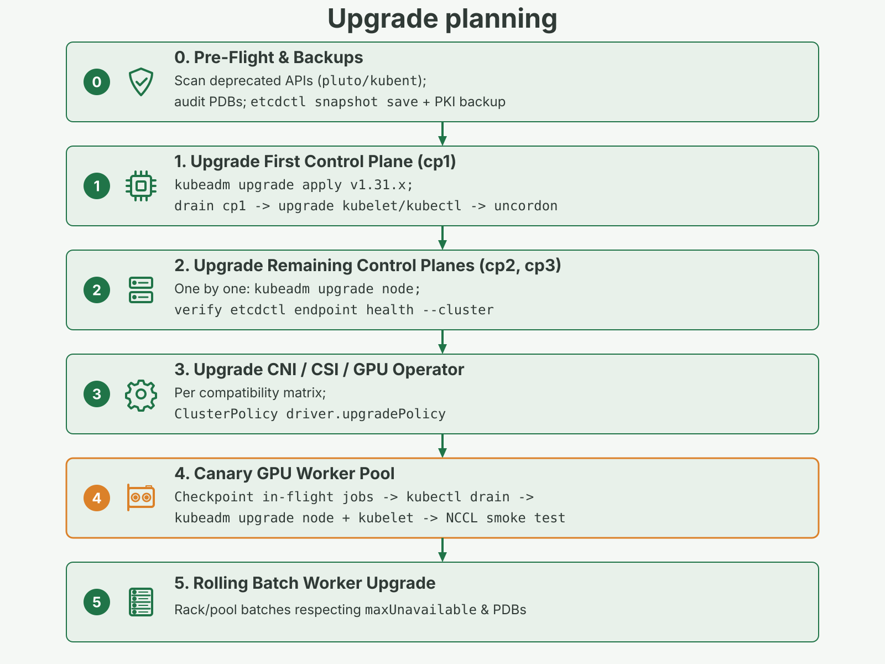
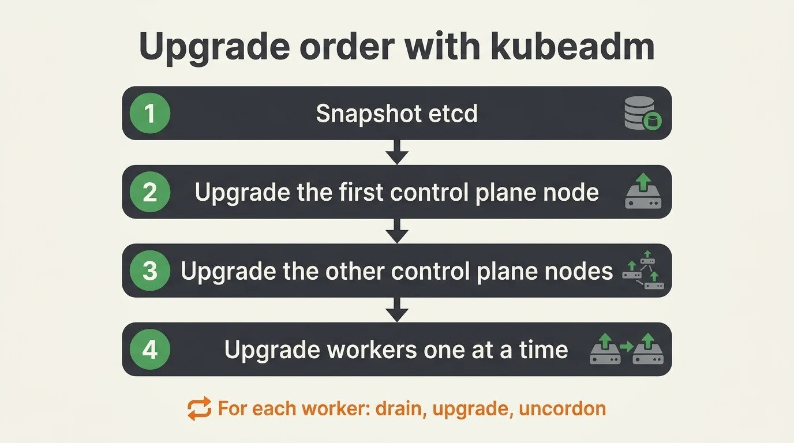
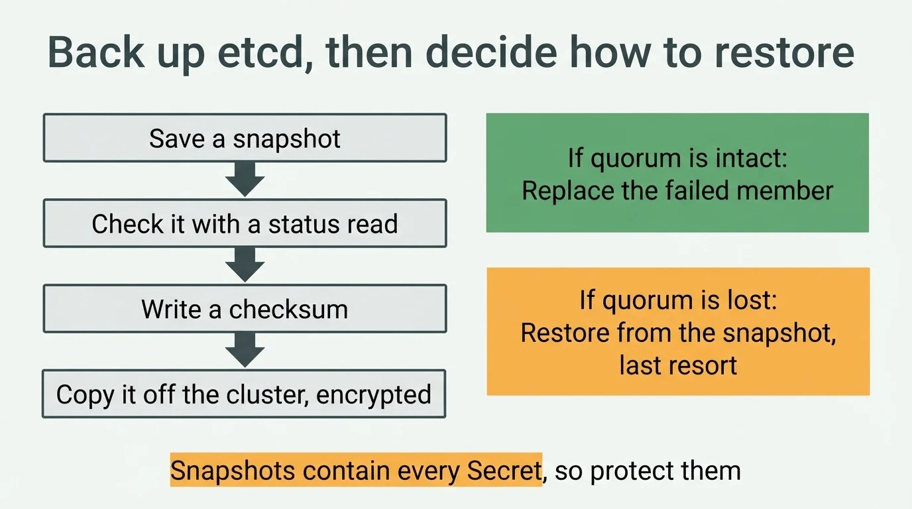

# 5.20 Upgrades, etcd backup and restore, and disaster recovery

| | |
|---|---|
| Level | Advanced |
| Priority tier | 1 |
| Lab venue | kubeadm cluster (3 CP + 2 workers), etcdctl/etcdutl, Velero + MinIO, a second empty cluster/VMs for restore |
| Part | Part 5: Kubernetes |
| Status | Drafted, labs **untested** |

## Why this matters for AI infrastructure

Picture an upgrade that stalls halfway through. The API server is down, and a training run is waiting on cluster state that nobody can read. Your phone is ringing, and the team is standing around a terminal waiting for someone to decide what to do next. Kubernetes releases a minor version about three times a year, and it supports each one for roughly a year. So a GPU platform is always one or two upgrades away from running a version that no longer gets fixes. Falling behind is not a single event. It is a slow slide that ends with an emergency upgrade you did not plan.

Every upgrade touches the control plane, the container runtime, CNI and CSI, the GPU Operator and driver stack, kernels, and sometimes API versions that your operators still use. At the same time, training clusters hold state you cannot easily replace. That includes etcd, which holds all object state. It also includes PersistentVolumes, which hold datasets, checkpoints, registries and metadata DBs. Secrets, keys and the knowledge stored in your GitOps repos belong on that list too. If any one of those is gone, the cluster may still run, but nobody can tell you what it is supposed to look like.

A botched upgrade or a lost etcd can strand thousand-GPU jobs. A regional outage can idle the whole fleet. Mature teams practise upgrades routinely, test their restores, and know their recovery objectives. They treat an upgrade as a rehearsed change, not as a leap of faith.

## Prerequisites and outcomes

You should have read chapters 5.4, 5.5 and 5.19 first. Before you move on, check whether you can answer the questions below. After this chapter, each one should feel familiar.

- How do Kubernetes versions, support windows and the skew policy fit together, and what upgrade path does that imply for your cluster?
- How do you run a `kubeadm` upgrade, control plane first and then nodes, and what is the equivalent on a managed service? Which pre-flight checks come first (API deprecations, add-on compatibility and backups), and how do canaries, drains and rollback fit in?
- How do you upgrade the GPU stack (drivers, toolkit and operators) safely, in step with Kubernetes?
- How do you back up and restore etcd (snapshots, certificates and multi-member restore), and how do you rebuild a failed control plane?
- How do you design backup and DR for workloads and data? Use GitOps as the source of truth, and use Velero, CSI snapshots, volume replication and object-storage durability as the other layers. For each tier, define the recovery point objective (RPO, how much data you can lose) and the recovery time objective (RTO, how long recovery may take).
- Can you run a DR drill for a lost etcd quorum, corrupted data, expired certificates, an accidental namespace deletion and a regional loss?

## 1. Versioning and skew

A cluster whose components have drifted out of step fails in quiet ways. A controller may call an API field that the server does not know yet. A kubelet may report a state that the new API server reads differently. Before you upgrade anything, know which version each part runs and which versions it is allowed to mix. That knowledge is the difference between a routine upgrade and a surprise.

Versions follow the form `v1.<minor>.<patch>`. A new minor release arrives roughly every 4 months, and a patch release roughly every month. The project supports the three most recent minor releases, which gives you about 14 months of patches. Think of the minor number as the big version, which can change behaviour, and the patch number as the small fix that should not.

Skew is the version gap between components that talk to each other, and the skew policy sets the limits (verify the current doc). HA `kube-apiserver` instances may differ by one minor during a rolling upgrade, with the newest at `n` and the oldest at `n-1`. The `kube-controller-manager`, `kube-scheduler` and `cloud-controller-manager` must not be newer than the API server, and they may be up to one minor older. The `kubelet` may be up to three minors older than the API server, but never newer, in recent releases (two before 1.28). `kube-proxy` follows the same rule as the `kubelet`. `kubectl` may sit one minor version away from the API server in either direction.

Here is a way to read those rules. Every component may lag the API server a little, but none of them may run ahead of it. The API server is the one that understands the newest objects, so it must move first. A kubelet that lags behind is safe, because the API server still speaks its language for the fields it knows. A kubelet that gets ahead of the API server may send fields the server has never heard of.

These limits set the order of work. Upgrade the control plane first, then the nodes, one minor at a time. You cannot skip minors for the control plane. Upgrade clients and operators last, or in step with the cluster. A common mistake is to upgrade the workers first because the drains feel safer. That breaks the rule that nodes never run ahead of the control plane.

Features move through three stages. Alpha features are off by default. Beta features are on by default for many APIs, but beta APIs have been off by default since 1.24. GA means generally available, which is the stage that carries the strongest promise. Deprecated APIs are removed after at least 9 months or 3 releases, while GA APIs are not removed within v1. Removed APIs break the manifests, Helm charts and operators that still use them. Two examples are `policy/v1beta1` PodSecurityPolicy and `batch/v1beta1` CronJob, both removed in 1.25. Also watch `flowcontrol.apiserver.k8s.io/v1beta2` and others. Always read the changelog's "Urgent upgrade notes" and "Deprecation" sections.

Components beyond Kubernetes itself need checking too. That list includes the container runtime (containerd versions per Kubernetes), CNI (the Calico or Cilium support matrix), CSI drivers and sidecars, ingress controllers, cert-manager, the Prometheus operator, and the GPU Operator, driver, toolkit, device plugin and DCGM. It also covers Kueue, the training operators, service meshes, Argo CD or Flux, and the CoreDNS and etcd versions that kubeadm ships. Build a compatibility matrix for each target version (5.19).

### Platform versioning

Write down the version of every piece of software in your platform. That covers the operating system on the machines, every installed package (the container runtime included), the Kubernetes version, and the version of each add-on that makes up your application platform. Some teams adopt the Kubernetes version as the platform version. Under that scheme, platform 1.18 runs Kubernetes 1.18, and nobody needs a lookup. That convenience matters less than the habit itself. Use whatever system your team prefers, document it, and follow it every time.

Tying the platform version to one component can cause confusion, though. Suppose a security vulnerability forces an update to your container runtime. The platform version should reflect that change, probably as a bugfix bump under semantic versioning. Someone might read that bump as a Kubernetes patch change, such as `v1.18.5` to `1.18.6`. That reader would then assume the Kubernetes API did not move, which is not true. Consider giving the platform its own independent version numbers. Most software already has its own version, with dependencies on other software and their versions, so engineers will recognize the convention right away.

### Plan to fail

Assume that something will go wrong during an upgrade. Picture yourself recovering from a catastrophic failure, and let that fear push you to prepare. Build automation that takes and restores backups of your Kubernetes resources. Do it two ways: with direct etcd snapshots, and with Velero backups taken through the API. Do the same for the persistent data your applications use. Two copies taken two different ways protect you from a bug in either one.

Give your critical applications, and everything they depend on, a disaster recovery plan of their own. Stateful, distributed applications are harder. Restoring their data and Kubernetes objects is not enough, because restore order and dependencies matter. A database must be up before the application that writes to it, and a feature store must be restored before the training job that reads from it. Brainstorm every failure mode you can think of, build automated recovery for each one, and test it. For the most critical workloads and their dependencies, consider standby clusters ready to fail over to. Automate and test those failovers where possible.

Think carefully about rollback paths. If an upgrade causes errors or outages that you cannot diagnose right away, a rollback option is good insurance. Complex distributed systems take time to troubleshoot, and the stress of a production outage slows that down. Predetermined playbooks and automation matter even more on Kubernetes-based platforms.

Be practical, though. Rollbacks are not always the right answer. Deep into an upgrade, undoing every earlier change can do more harm than good. Work that out before the upgrade starts. Mark your points of no return in advance, and plan each move before it touches live systems. A point of no return is a step after which going back means restoring from a backup, not reversing a command. Knowing where those points sit is part of the plan.

### Integration testing

Keeping a versioning system that lists every component is one thing. Managing those versions is another. Kubernetes-based platforms are complex, so making everything integrate correctly every time is a real challenge. Compatibility between all the components of the platform is critical, and so is compatibility between your workloads and the platform itself.

Lean toward platform agnosticism for your applications to reduce compatibility problems. Still, some application workloads gain tremendous value from platform features. The trick is to know which workloads take that value, and to keep the rest portable.

Unit tests for every platform component matter, as they do for any sound software practice. Integration testing matters just as much, even though it is harder. Sonobuoy is an excellent conformance test utility for this. It most often runs the upstream Kubernetes end-to-end tests to confirm the cluster is healthy and all of its components work together.

Many teams run a Sonobuoy scan after a new cluster is provisioned. That automates a check that would otherwise be manual, such as examining control plane Pods and deploying test workloads. Take it further. Develop your own plug-ins that test the specific features of your platform and the operations critical to your organization. Run those scans routinely.

A Kubernetes CronJob can run at least a subset of your plug-ins, or the full suite. This is not available out of the box, but it is achievable with some engineering. Expose the scan results as metrics, so dashboards can display them and alerts can fire on them. Scans like these test that the distributed parts work together to produce the features you expect, which makes a strong, automated integration test.

Integration testing must extend to the applications that run on the platform. App dev teams employ different strategies, and that may be largely out of the platform team's hands. Advocate for it strongly anyway. Run integration tests on a cluster that closely resembles production, especially for workloads that use platform features. Operators are a compelling example. They extend the Kubernetes API and integrate deeply with the platform. If you use an operator to deploy and manage the life cycle of your organization's software, test it across versions of your platform, especially when Kubernetes upgrades are involved.

## 2. Upgrade planning

Before you touch anything, you need a clear picture of what the upgrade must achieve and what could break. Think of it as the pre-flight check for an aircraft. The pilot does not skip the checklist because the weather looks fine. Work through this checklist first.

1. **Objective and window.** Name the target version, which is usually the latest patch of the next minor. Say who is affected, which freeze period protects critical training runs, and what rollback criteria would stop the work. Writing the stop criteria down before the work starts keeps the decision calm later.
2. **Release notes.** Read the urgent notes, deprecations, changed defaults, and the kubelet, containerd, CNI and CSI notes. Review the KEPs that affect your features, such as DRA, sidecars, and the cgroup v1 deprecation. A KEP, or Kubernetes Enhancement Proposal, is the design document behind a feature, and it often explains why a default changed.
3. **Deprecated and removed APIs.** Detect any use of them with `kubectl get --raw /metrics | grep apiserver_requested_deprecated_apis`, the audit logs, and tools such as `pluto detect-helm`/`detect-files`, `kubent`, `kubectl-convert`, and `helm template | kubeconform -kubernetes-version 1.xx`. Upgrade charts, operators and CRDs to versions that support both the old and the new Kubernetes where possible, *before* the cluster upgrade. The point is to remove old API calls while the old cluster can still answer them.
4. **Compatibility matrix.** Check the add-ons and the GPU stack against the target version. Stage the upgrades of add-ons that support both versions first.
5. **Backups.** Take an etcd snapshot and keep a copy off the node. Export PV snapshots or Velero backups of critical namespaces, and export the cluster-scoped configuration, such as CRDs, RBAC and webhooks. The GitOps repo is the source for the rest. Verify that the backup can be restored, and run a restore drill at least before the first production upgrade. A backup that has never been restored is still a guess.
6. **Health baseline.** All nodes should be Ready, no system pods should be crashlooping, and the API and etcd metrics should look normal. Audit the PDBs with `kubectl get pdb -A`, and look for any with 0 allowed disruptions. Confirm there is enough capacity headroom for rolling node drains. A baseline is a snapshot of healthy, so that you can tell later whether the upgrade made things worse.
7. **Staging rehearsal.** Upgrade a representative non-production cluster that has the same CNI, CSI and GPU stack, ideally with a few GPU nodes. Then run conformance and workload smoke tests (5.25). A rehearsal finds the surprises while they are cheap.
8. **Communication and runbook.** Publish the schedule, name the escalation path, and write down the abort and rollback steps and the success checks. When the upgrade is underway, nobody should have to invent these in the moment.

Four strategies cover most platform upgrades, and each one trades cost against risk differently. The table compares them.

| Strategy | How | Pros | Cons |
|---|---|---|---|
| **In-place rolling** | Upgrade control plane nodes sequentially, then drain/upgrade workers pool by pool | No extra capacity (beyond headroom); standard | Risk of partial failure; rollback means restoring from backup or downgrading components (not supported for etcd/API) |
| **Surge node pools** (managed) | Add new nodes on the new version, drain old | Continuous capacity | Needs spare GPU quota/capacity (rare for GPUs); use `maxUnavailable` instead |
| **Blue/green cluster** | Build new cluster on new version, shift workloads gradually (GitOps, MultiKueue, DNS) | Easy rollback; test fully before cutover; clean state | Double capacity (hard for GPUs), data migration, identity/networking duplication |
| **Cluster API rolling** | Declarative upgrade of `KubeadmControlPlane` and `MachineDeployment` | Automates replace-not-patch | Needs CAPI maturity |

Read the table as a set of bets. In-place rolling costs the least, but a failure in the middle leaves you with a half-upgraded fleet. Blue/green costs the most, because you pay for two clusters while you move, but it gives you the cleanest way back. Surge pools and Cluster API sit in between. Pick the one whose failure you can recover from fastest, given the team you have.

For GPU clusters, in-place rolling with canary pools and strict drain choreography is typical. Blue/green is attractive for major platform shifts, such as a CNI change or a major GPU stack change, if you can borrow capacity.



*Figure 5.20.1. Upgrade planning, as a diagram.*

Read the diagram from top to bottom. Each box waits for the one above it to finish and to pass its check. The arrow from the canary to the fleet is the important one. You do not roll the whole GPU fleet until one pool has already run the new version under a real job.

In *Production Kubernetes*, Chapter 2 (*Deployment Models*), the authors describe a subtle quorum trap. It appears when you upgrade **dedicated `etcd` nodes** through immutable node replacement.

- **Why subtractive `3 -> 2 -> 3` replacement is dangerous on dedicated `etcd`** (*Production Kubernetes*, Chapter 2). Suppose you upgrade a 3-node dedicated `etcd` cluster by removing one member first with `etcdctl member remove` and terminating its host. The cluster's voting size drops to `2`, with a required quorum of `2`. During the 10–15 minutes it takes the replacement machine to boot and sync, the cluster has zero fault tolerance. If either of the 2 remaining `etcd` nodes hits a disk stall or a network blip, the whole Kubernetes control plane loses quorum at once. Quorum is the number of members that must agree before etcd accepts a write, so losing it stops every write to the cluster.
- **Safer alternatives.** You can perform in-place binary upgrades of `etcd` one node at a time. That is fast, because the data directory is already warm. Or you can use additive learner replacement (`3 -> 4 learner -> promote -> remove old -> 3`), which keeps 3 healthy voting members active throughout the replacement. A learner is a new member that receives data but does not vote until it has caught up. That behaviour is modeled in `evaluate_etcd_upgrade_quorum_safety()` in `code/part05/k8s_upgrade_dr_planner.py`.
- **Air-gapped cluster upgrades (`bcm11-containerization` Appendix C).** On air-gapped DGX/HGX SuperPOD clusters, such as NVIDIA Base Command Manager, pre-stage every target container image into the local Harbor or mirror registry. List the images with `kubeadm config images list --kubernetes-version v1.31.x`. Also pre-populate the local OS `apt`/`yum` repository mirror, before you start `kubeadm upgrade apply` or the `cm-kubernetes-setup` upgrade workflow. An air-gapped cluster cannot fetch anything on the day of the upgrade, so everything must be waiting locally.

### Upgrade strategies in detail

Three strategies cover most platform upgrades: cluster replacement, node replacement and in-place upgrades. They range from the highest cost with the lowest risk to the lowest cost with the highest risk. No single strategy fits everyone. Costs, benefits, budget and risk tolerance decide the trade-off. Within each strategy, the degree of automation and testing depends on engineering budget, risk tolerance and how often you upgrade.

The strategies do not exclude each other. You could upgrade a dedicated etcd cluster in place and replace the nodes in the rest of the cluster. Different tiers can use different strategies where their risk tolerance differs. Still, it helps to use the same strategy everywhere, so the method you run in production has been tested thoroughly in development and staging first. Whatever you choose, test thoroughly and automate as much as is practical. Automation that you test in development and staging makes production upgrades far less likely to affect end users, and far less stressful for the platform operations team.

**Cluster replacement** carries the highest cost and the lowest risk. It applies immutable infrastructure principles to the whole cluster. You deploy an entirely new cluster next to the old one, then migrate workloads to it. The new cluster scales out as workloads arrive, and the old cluster scales in as workloads leave. That keeps the cost of a second cluster in check.

Picture a production cluster of 300 nodes that needs an upgrade. You do not have to build 300 new nodes on day one. You might begin with 20. When the first few workloads have moved, you scale in the old cluster, which has less usage, and scale out the new one for incoming work. Cluster autoscaling and cluster overprovisioning can make this seamless, but upgrades alone rarely justify those technologies. Think of it like moving house in stages. You move the kitchen first, live with two kitchens for a while, and empty the old one only when the new one works.

Two challenges come up often. The first is ingress traffic. As workloads move, traffic must be rerouted to the new cluster. Public DNS for exposed workloads should resolve to a global service load balancer (GSLB) or a reverse proxy, not directly to a cluster ingress. That proxy routes traffic to the cluster ingress, and it gives you one point for managing routing across clusters. Changing one proxy rule is far safer than changing DNS records during an incident.

The second challenge is persistent storage. If a storage service or appliance holds your data, both clusters must reach the same storage. If you use a managed database service from a public cloud provider, that service must be available from both clusters. In a private datacenter, this can be a networking and firewalling question. In the public cloud, it is a question of networking and availability zones. AWS EBS volumes, for example, are available from specific availability zones. Managed services in AWS often have specific Virtual Private Clouds (VPCs) associated with them, so you may want a single VPC for multiple clusters. Kubernetes installers often assume a VPC per cluster, but that is not always the best model.

Next comes workload migration. Mostly, you are moving the Kubernetes resources themselves, such as Deployments, Services and ConfigMaps. There are two ways to do it: redeploy from a declared source of truth, or copy the existing resources over from the old cluster.

The first option points your deployment pipeline at the new cluster, so it redeploys the same resources there. That assumes the source of truth in version control is reliable and nothing changed in place. In reality, that is uncommon, because humans, controllers and other systems often make in-place changes and adjustments. When that happens, copy the existing resources to the new cluster instead. Velero earns its keep here. People usually call it a backup tool, yet it can be just as useful for migrations. Velero can snapshot all resources in your cluster or a subset. If you migrate workloads one Namespace at a time, snapshot each Namespace at migration time and restore it into the new cluster. Velero takes these snapshots through the Kubernetes API rather than directly from the etcd data store. As long as Velero can reach the API server of both clusters, this method is reliable.

**Node replacement** is a middle ground for cost and risk. It is a common approach, and Cluster API supports it. It suits larger clusters when you understand the compatibility concerns, and compatibility is the main danger with this method. From the point of view of your services and workloads, the control plane changes in place. If an API version that your workload relies on disappears during an in-place Kubernetes upgrade, that workload can go down. You can reduce the risk in several ways:

- **Read the release notes.** Before you roll out a platform version that includes a Kubernetes upgrade, read the CHANGELOG thoroughly. API deprecations and removals are documented there, so you get plenty of advance notice.
- **Test before production.** Run new platform versions extensively in development and staging before production. Get the latest Kubernetes running in dev shortly after it is released. That way you can test thoroughly and still run recent releases in production.
- **Avoid tight coupling with the API.** This does not apply to platform services, which need to integrate closely with Kubernetes. Keep your end-user production workloads as platform-agnostic as possible, and do not make the Kubernetes API a dependency. Your application should know nothing about Kubernetes Secrets. It should read an environment variable or a file exposed to it. Then the workload keeps running regardless of API changes, as long as the manifests that deploy the app are upgraded. If you want Kubernetes features in your workloads, consider a Kubernetes operator. An operator outage is an urgent problem to fix, but it should not affect the availability of your application, and your customers and end users should not see it.

Node replacement works very well when you build machine images ahead of time and verify them. You can bring up new machines quickly, because the updated operating system and packages are already installed. The deployment process for those machines can look much like the original deployment.

When replacing nodes, begin with the control plane. If etcd runs on dedicated machines, begin there, because cluster data lives in etcd and needs extra care. If you hit a problem while upgrading your first etcd node, and you prepared properly, aborting is fairly easy. If you upgrade all the worker nodes and the control plane first, then run into trouble with etcd, rolling back the whole upgrade is not practical. You lose the chance to abort, regroup, retest and resume later. You must solve the live problem, or at least leave the existing versions safe for a while. The order of the work is a safety decision. The first node you touch should be the one that is easiest to undo.

For a dedicated etcd cluster, consider replacing nodes subtractively. Remove a node, then add the upgraded replacement. Adding a new member first changes the member list for every etcd node. Adding a fourth member to a three-node etcd cluster, for example, requires an update to all etcd nodes' member lists, which requires a restart. Dropping one member and replacing it with a new one that has the same IP address, if possible, is much less disruptive. The trade-off is the one from the quorum trap above, so you must do this carefully and keep the remaining members healthy during the swap.

The etcd upgrade documentation is excellent, and it may lead you toward in-place upgrades for etcd. That means in-place upgrades to the OS and packages on the machine as well, which is often quite palatable and perfectly safe.

Control plane nodes can be replaced additively. Join each new machine with `kubeadm join` plus `--control-plane`. Those machines must already carry the upgraded `kubeadm`, `kubectl` and `kubelet` binaries. As each new control plane node comes online and checks out, drain and delete one old node. If etcd is colocated on the control plane nodes, include etcd checks when you confirm operational health, and use `etcdctl` to manage the cluster members as needed. Check the health of the new node before you remove the old one, so that you always keep a healthy member.

Then replace the worker nodes. You can do this additively or subtractively, one at a time or several at a time. A key concern is cluster utilization. If the cluster is highly utilized, add new worker nodes before you drain and remove the existing ones, so there is enough compute for the displaced Pods. A good pattern is to bring up machines built from images that already contain the updated software, and join them with `kubeadm join`. Much of the same machinery used for cluster deployment applies here.

**In-place upgrades** suit resource-constrained environments where replacing nodes is not practical. The rollback path is harder, so the risk is higher, and comprehensive testing reduces that risk. Kubernetes in production configurations is a highly available system, so if you upgrade one node at a time, the risk drops. If you use a tool such as Ansible to run the steps, resist the temptation to hit all the nodes at once in production. Speed is the enemy here, because a fleet-wide mistake is much harder to undo than a single-node mistake.

For etcd nodes, follow that project's documentation. Take each node offline, one at a time. Upgrade the OS, etcd and other packages, then bring the node back online. If etcd runs in a container, consider pre-pulling the image before you take the member offline, because that minimizes downtime. Pulling the image while the member is still up means the restart needs no network download.

For Kubernetes control plane and worker nodes, if `kubeadm` initialized the cluster, use `kubeadm` for upgrades too. The upstream docs have detailed instructions for each minor version upgrade from 1.13 forward. As always, plan for failure, automate as much as possible, and test extensively.

## 3. kubeadm upgrade procedure

The block below walks through a single minor-version upgrade, from 1.30 → 1.31. Treat it as a template, and verify every command and flag against the docs for your versions. The first control-plane node gets `kubeadm upgrade apply`, and every other node gets `kubeadm upgrade node`. Read the block in order. Each numbered comment is a stage, and you should finish one stage and check it before you start the next.



*Figure 5.20.2. Upgrade the control plane first, then each worker. Drain, upgrade, uncordon.*

```bash
# 0. Pre-flight (on a control-plane node)
kubeadm version; kubectl version; kubectl get nodes -o wide
sudo kubeadm upgrade plan                         # shows available versions, component versions, needed manual actions
sudo ETCDCTL_API=3 etcdctl snapshot save /backup/pre-upgrade-$(date +%F-%H%M).db \
  --endpoints=https://127.0.0.1:2379 --cacert=/etc/kubernetes/pki/etcd/ca.crt --cert=/etc/kubernetes/pki/etcd/server.crt --key=/etc/kubernetes/pki/etcd/server.key

# 1. First control-plane node
sudo apt-mark unhold kubeadm && sudo apt-get update && sudo apt-get install -y kubeadm=1.31.x-* && sudo apt-mark hold kubeadm
sudo kubeadm upgrade plan
sudo kubeadm upgrade apply v1.31.x                # upgrades static pod manifests (apiserver, controller-manager, scheduler, etcd), certs renewed, kube-proxy/CoreDNS addons, then waits for health
# 2. Drain, upgrade kubelet/kubectl on that node, uncordon
kubectl drain cp1 --ignore-daemonsets
sudo apt-mark unhold kubelet kubectl && sudo apt-get install -y kubelet=1.31.x-* kubectl=1.31.x-* && sudo apt-mark hold kubelet kubectl
sudo systemctl daemon-reload && sudo systemctl restart kubelet
kubectl uncordon cp1

# 3. Other control-plane nodes (one at a time)
sudo apt-get install -y kubeadm=1.31.x-*    # then:
sudo kubeadm upgrade node                         # NOT `apply`: upgrades local static pods using the stored config
# drain, upgrade kubelet/kubectl, restart kubelet, uncordon

# 4. Workers (batches; canary first)
kubectl drain w1 --ignore-daemonsets --delete-emptydir-data --grace-period=600 --timeout=30m
# on w1:
sudo apt-get install -y kubeadm=1.31.x-* && sudo kubeadm upgrade node
sudo apt-get install -y kubelet=1.31.x-* && sudo systemctl daemon-reload && sudo systemctl restart kubelet
kubectl uncordon w1
kubectl get nodes   # VERSION column updates
```

Several notes apply as you run this block. The pre-flight stage is the one people skip, and it is the one that saves you. The snapshot is your way back if the first control-plane node goes wrong. etcd is upgraded by `kubeadm upgrade` to the version bundled for the target, which may change minor versions. Stacked etcd members upgrade as their control-plane node does, so do one node at a time, and confirm `etcdctl endpoint health --cluster` between nodes. Do not move on to the next node while the health check is still failing.

Certificates are renewed during `kubeadm upgrade`, unless you pass `--certificate-renewal=false`. That is a useful annual side effect (5.21). Config is stored in `kube-system/kubeadm-config`, where kubeadm keeps `ClusterConfiguration`. If you change flags, edit it and pass `kubeadm upgrade apply --config`. Hand edits made under `/etc/kubernetes/manifests` are lost on upgrade, unless you express them in the kubeadm config through `extraArgs`, `extraVolumes`, or the patches directory `--patches`. Keeping the config as the single source of truth means the upgrade cannot quietly erase your changes.

The kubelet config (`/var/lib/kubelet/config.yaml`) is regenerated from the cluster-wide `kubelet-config` ConfigMap on `upgrade node`. Per-node overrides need patches. Addons follow a narrower rule. `kubeadm upgrade` updates CoreDNS and kube-proxy only. CNI, CSI, ingress, the GPU Operator, monitoring and everything else are your responsibility.

While control plane nodes run mixed versions, controllers use the older API behaviours. Keep that window short, and do not create or update new fields until every node is upgraded. Timing is predictable: each control-plane node takes about 5 to 10 minutes, while on workers the drains dominate. Plan your window around the drains, because they are the part that depends on how much work is running.

Kubernetes does not support downgrading the control plane in place, because etcd data and API storage versions may have advanced. Rollback therefore means restoring the pre-upgrade etcd snapshot, along with the old binaries and manifests, on all control-plane nodes. That is a disruptive procedure. The other option is to fall back to a blue/green cluster, which is why rehearsal and canaries are critical. Workers can be rolled back individually, by re-imaging or reinstalling the previous kubelet, because older kubelets within skew are fine. Think of the control plane as a one-way door and the workers as doors you can close again.

Rehearse this block on a staging cluster before you run it on production control-plane nodes.

A rehearsal is most useful when you write down what you expected at each stage, and then compare it with what you saw. Before you start, write the expected output of each check. Then, after each stage, note any gap between the expectation and the result. The gaps are the lessons. A stage that took much longer than expected tells you where your production window will be tight. A warning you did not expect tells you which release note you skimmed too fast.

### Managed services

On GKE, EKS and AKS, you upgrade the control plane through the API, the console or Terraform, and the provider handles the HA rollout. Then you upgrade node pools by surge or by blue/green node-pool replacement. Use maintenance windows, exclusions and release channels (rapid, regular or stable) to control the timing. For GPU node pools, set `maxUnavailable` and surge according to spare capacity. Disable auto-upgrade for pools with reservations, and pin node image versions until the driver stack is validated.

Test the GPU driver version that is bundled with each node image. GKE installs drivers per node image or version, and EKS-optimised GPU AMIs bundle a driver version. Provider auto-upgrades can break custom stacks, so use maintenance exclusions during critical runs (4.24). A managed service takes away the control plane work, but it does not take away the driver question. You still own the GPU stack.

## 4. Upgrading the GPU and platform stack

Before you touch the GPU stack, fix the order of the layers. The typical order is below, and you should check each step against the vendor docs. Each step depends on the one before it, so do not skip ahead.

1. Review the compatibility of the NVIDIA GPU Operator, driver, toolkit, device plugin, DCGM and MIG manager with the target Kubernetes version, the OS and the kernel.
2. Upgrade the operators and CRDs that work with both the old and the new Kubernetes first. Use Helm chart upgrades through GitOps, and handle CRDs as described in 4.25.
3. Upgrade the control plane, then the node pools.
4. For driver upgrades, use the operator's upgrade controller when the operator manages the drivers. The `ClusterPolicy.spec.driver.upgradePolicy` settings include `autoUpgrade`, `maxParallelUpgrades`, `drain` options, `waitForCompletion`, and the pod deletion or eviction policy. The controller cordons each node, drains its GPU pods, reloads the driver and validates the result, then uncordons the node, one node at a time. If you install drivers on the host, use Ansible `serial` flows (4.17) instead. Coordinate with training. Plan checkpoint-and-drain windows and quotas for in-flight jobs, and set a fail-safe for failed validation that keeps the node cordoned. A cordoned node that fails validation stays out of service until a person looks at it, which is the behaviour you want.
5. Kernel and OS upgrades require a reboot and a DKMS or precompiled driver rebuild. Pin and test the combinations, and roll them out by rack.
6. Validate after each batch. Check that each node is Ready, that `nvidia.com/gpu` allocatable is correct, and that the DCGM exporter is up. Run an `nvidia-smi` pod test and an NCCL smoke test across the upgraded batch (4.17). Confirm that the secondary networks from the network operator are present. A batch that passes these checks is safe to use as the proof for the next batch.
7. Afterwards, upgrade `kubectl`, the CI/CD tools, client libraries, and any controllers built with an older client-go. Operators compiled against removed APIs need new versions. This step is easy to forget, and it is the one that breaks a pipeline on the next deploy.

## 5. Backing up and restoring etcd

Suppose the data behind your control plane is gone. Every object the cluster knows about lives in etcd, so the snapshot you saved earlier decides how fast you can recover. A snapshot is a single file that captures the whole database at one moment. It is the closest thing you have to a save button for the cluster.



*Figure 5.20.3. Snapshot, verify, checksum and ship off the cluster. Restore from a snapshot only when quorum is lost.*

### Backup

Start with a snapshot. Save it, check it, copy it off the node, and protect it. The block below shows each step.

```bash
export ETCDCTL_API=3
EP="--endpoints=https://127.0.0.1:2379 --cacert=/etc/kubernetes/pki/etcd/ca.crt --cert=/etc/kubernetes/pki/etcd/server.crt --key=/etc/kubernetes/pki/etcd/server.key"
etcdctl $EP snapshot save /backup/etcd-$(hostname)-$(date -u +%FT%H%M%SZ).db
etcdutl snapshot status /backup/etcd-....db -w table       # hash, revision, total keys, size (integrity check)
sha256sum /backup/etcd-....db > /backup/etcd-....db.sha256
# Ship off-cluster, encrypted, versioned, immutable (object lock); retain per policy
aws s3 cp /backup/etcd-....db s3://dr-bucket/etcd/ --sse aws:kms
# Also back up: /etc/kubernetes/pki (CA keys!), /etc/kubernetes/*.conf, /etc/kubernetes/manifests, kubeadm config, encryption config + KMS keys
```

Each line in that block does one job. The first saves the file. The second reads the file back and proves it is a valid snapshot. The third writes a checksum, so you can later prove that the copy has not changed. The fourth copies the file off the node, with encryption and object lock. A copy that sits on the same disk as the cluster is no backup when that disk fails.

The `etcdutl snapshot status` line checks the integrity of the file. Its table shows the hash, revision, total keys and size. Also back up `/etc/kubernetes/pki` (the CA keys), `/etc/kubernetes/*.conf`, `/etc/kubernetes/manifests`, the kubeadm config, and the encryption config with its KMS keys. The snapshot alone does not hold everything a rebuild needs. The certificates and the config files sit outside etcd.

Automate the snapshot with a CronJob on a control-plane node (hostNetwork, hostPath mounts of PKI and backup dir), or with a systemd timer that runs every 15 to 60 minutes. Several tools can help. Velero doesn't back up etcd directly. Other options include etcd-operator-style backup through `etcd-backup-restore` from Gardener, Kubernetes-native CronJobs, and cloud snapshots of etcd volumes, which carry consistency caveats. A cloud disk snapshot is taken at the disk level, not at the database level, so it may capture etcd in the middle of a write. Use it as a secondary copy, not the only one.

Snapshots contain every Secret. They are encrypted only if encryption at rest was enabled, and with KMS you also need the KMS key. Treat backups as top-secret. Store the cluster CA private keys securely, because without them, restoring or rebuilding the PKI is far harder. Monitor backup age and size, and alert when a backup fails or is older than the RPO. An alert on a stale backup is the cheapest insurance you will buy.

Hot backups are consistent point-in-time snapshots (MVCC), so taking one from a single healthy member is sufficient. MVCC, or multi-version concurrency control, means etcd keeps a history of revisions, so a snapshot reads one consistent moment from that history. A snapshot is roughly the size of the database, which runs from hundreds of MB to a few GB.

### Restore scenarios

Restoring from a snapshot is the last resort. Start by asking whether quorum is intact, because that answer decides between replacing a member and restoring from a snapshot. If the majority of members still answers, the data is safe and you replace the broken member. If the majority is gone, the only way back is the snapshot.

**A. One etcd member failed, and quorum is intact.** Replace the member instead of restoring. The commands below remove the dead member first.

```bash
etcdctl $EP member list -w table
etcdctl $EP member remove <failed-member-id>          # remove the dead one FIRST
# rebuild the node; for kubeadm stacked etcd: on a new control-plane node run `kubeadm join --control-plane ...` (adds a learner, promotes)
etcdctl $EP member list -w table; etcdctl $EP endpoint health --cluster
```

Read the first command's output before you run the second. You are looking for the ID of the dead member, and you must be sure you have the right one. Removing a healthy member by mistake is the kind of error that turns a repair into an outage.

**B. Quorum lost or data corrupted.** A majority of members is gone, or the data is damaged, so you restore from a snapshot. The restore creates a **new cluster** from the snapshot, with a new cluster ID. Every member must be restored from the same snapshot. Think of it as starting a second copy of the cluster from one photograph. Every member has to start from the same photograph, or the copies will disagree.

```bash
# 1. Stop API servers and etcd on ALL control-plane nodes (kubeadm: move static pod manifests away)
sudo mkdir -p /etc/kubernetes/manifests.disabled && sudo mv /etc/kubernetes/manifests/{kube-apiserver,etcd}.yaml /etc/kubernetes/manifests.disabled/
sudo crictl ps | grep -E 'etcd|apiserver'   # wait until gone
# 2. On each control-plane node restore the snapshot into a fresh data dir with its own name/peer URL
sudo mv /var/lib/etcd /var/lib/etcd.bak-$(date +%s)
sudo etcdutl snapshot restore /backup/etcd-snap.db \
  --name cp1 --data-dir /var/lib/etcd \
  --initial-cluster cp1=https://10.0.0.11:2380,cp2=https://10.0.0.12:2380,cp3=https://10.0.0.13:2380 \
  --initial-advertise-peer-urls https://10.0.0.11:2380 --initial-cluster-token etcd-restore-$(date +%s)
# (repeat on cp2, cp3 with their names/URLs; ensure the manifest's --initial-cluster flags match, kubeadm manifests use these defaults)
# 3. Restore manifests (etcd first, wait healthy; then kube-apiserver)
sudo mv /etc/kubernetes/manifests.disabled/etcd.yaml /etc/kubernetes/manifests/
etcdctl $EP endpoint health --cluster
sudo mv /etc/kubernetes/manifests.disabled/kube-apiserver.yaml /etc/kubernetes/manifests/
kubectl get nodes; kubectl get pods -A
```

The order in that block is deliberate. You stop the things that write to etcd first, so nothing changes the data while you are replacing it. You bring etcd back before the API server, because the API server needs etcd to answer. You keep the old data directory under a backup name, so you can return to it if the restore is wrong. Each step is reversible until the API server starts writing again.

A lab can use a single-member shortcut. Restore one member with `--initial-cluster cp1=...` only, which gives you a one-node cluster. Then `member add` the others, which must have empty data dirs. For disaster scenarios with total loss, rebuild the nodes with the same hostnames, IPs and certs from backups, restore the snapshot, and then rejoin the nodes.

Expect the cluster state to rewind to the snapshot time. Objects created after the snapshot are gone. Their pods keep running on the nodes until the kubelets reconcile, and then orphaned containers are removed or restarted. Objects deleted after the snapshot come back. PV and PVC bindings may point at volumes that no longer match, because cloud disks created after the snapshot still exist, but the cluster no longer knows about them. Your restore therefore gives you a past version of the cluster, and you must reconcile the gap between that past and the present.

Here is a small story to make the rewind concrete. Suppose a snapshot is taken at noon. At two in the afternoon, a team scales its training Deployment from two replicas to eight, and it creates a new ConfigMap for a learning-rate schedule. Then a bad change corrupts etcd, and you restore the noon snapshot. After the restore, the ConfigMap is gone, and the Deployment is back at its noon replica count. The eight GPU pods that were running may keep running for a while, because the kubelets do not stop them at once. The controllers then reconcile the cluster toward the noon picture, and the extra pods are removed. The team must recreate the ConfigMap from Git and scale the Deployment again, by hand or through the pipeline. The restore did its job. It also showed that any change made after the snapshot must be recorded somewhere else, such as Git, so that it can be replayed.

Node leases and status refresh quickly. Controllers reconcile everything back to the restored desired state, including scaling replicas back. For example, a Deployment that was scaled up after the snapshot returns to the older replica count. Jobs may run again, and operator status can be stale.

Certificates and tokens issued after the snapshot are invalid, and service account tokens are bound to objects that may no longer exist. Plan to restart controllers and operators, and reconcile external state such as cloud resources, DNS and load balancers. Resource versions reset relative to clients, so informers relist. An informer is the client-side cache that watches the API server. When its version numbers reset, it must download the full list again, which causes a short burst of load.

**C. The control plane is lost, but the etcd data is intact on disk.** Rebuild the nodes and copy the etcd data directory and PKI, or restore from the latest snapshot. Copying the data directory keeps the exact state, including the newest writes, so it is the better choice when you have the disk.

**D. Certificates have expired.** This is a common outage after one year. Run `kubeadm certs check-expiration` to see what has expired. Then run `kubeadm certs renew all` on each control-plane node, and restart the static pods by moving the manifests out and back, or by restarting the kubelet. If rotation failed, renew the kubelet client and serving certificates as well. Finally, update the `admin.conf` copies (5.21). Set expiry alerts well before the date, so that this scenario stays a planned renewal and never becomes an outage.

**E. A namespace or critical object was deleted by accident.** Restore it from GitOps by re-syncing, or from a Velero backup. You can also restore an etcd snapshot into a *scratch* cluster, extract the objects with `kubectl get -o yaml`, and re-apply them into production. That is safer than rewinding production. Rewinding production undoes every good change made since the snapshot, while the scratch cluster lets you copy out only the one object you need.

Match the scenario to your failure before you touch any manifest. The wrong runbook applied to the right symptom can make the outage longer.

Consider a night when three alerts arrive together. The API is slow, one control-plane node has stopped answering, and a certificate expiry warning has fired for an hour. A tired engineer might start restoring a snapshot, because the word restore sounds like the cure for everything. The better order is to read the three alerts against the table in Section 8. A dead control-plane node with quorum intact is a member replacement. A slow API with healthy etcd points to clients and webhooks, which is a different runbook. The expiry warning is a planned renewal that should happen now, before the certificates lapse. Sorting the alerts first keeps you from solving the wrong problem fast.

### Test restores

A backup you never restored is a hope. Schedule quarterly restore drills into an isolated VM cluster, and measure the RTO. Verify that the restored cluster boots, that the objects exist, and that a sample workload runs. Disable external side effects while you test. Scale the controllers down, block egress, and remove cloud credentials, so the restored cluster does not act on real resources. A restored cluster thinks it owns your load balancers and disks. Without those guards, a drill can delete live resources that belong to production.

Remove cloud credentials from every restore drill cluster before you start it.

A useful check is to list what the restored cluster could touch before you start it. Look at the cloud credentials mounted into its pods, the load balancers it could reconcile, the DNS zones it could edit and the buckets it could write to. If any of those reach production, change the drill cluster before you power it on. Writing that list down takes a few minutes, and it prevents the kind of drill that becomes a second incident.

## 6. Application and data backup

Suppose a team deletes a namespace that holds the model registry and its volumes. Whether you can recover depends on which layers of protection were in place. The table lists the layers. Each row covers a different kind of loss, so a gap in one row is not fixed by another.

| Layer | What | Tools |
|---|---|---|
| **Declarative config** | Manifests, Helm values, policies, CRDs | Git + GitOps (4.26); the primary way to recreate cluster state |
| **Cluster objects** | Namespaces, CRs created at runtime (not in Git), Secrets | Velero, Kasten K10, Trilio; periodic `kubectl get` exports for cluster-scoped objects |
| **Persistent data** | PV contents | CSI snapshots (`VolumeSnapshot`), Velero with CSI/restic/Kopia file-system backup, storage-native replication (Ceph RBD mirroring, cloud disk snapshots, FSx backups, Lustre HSM/archive), application-level backups (database dumps, WAL archiving) |
| **Object storage data** | Datasets, checkpoints, model artefacts | Bucket versioning + object lock, cross-region replication, lifecycle rules (4.24), checksum manifests |
| **Registries and artefacts** | Images, charts, models | Replicated registries, immutable tags, mirrors; keep golden base images offline |
| **Identity and secrets** | CA keys, KMS keys, Vault, OIDC provider config | Escrowed offline backups; HSM/KMS multi-region keys |
| **Observability data** | Metrics/logs | Often best-effort; keep dashboards/rules in Git |

Git recreates only what you declared, so runtime objects and data need the other layers. Each layer covers a gap the others leave open. A Git repo can rebuild a deployment, but it cannot rebuild the rows in a database that the deployment wrote to. That data needs a volume snapshot or an application-level dump.

Velero is a CNCF project with a server-side controller and a CLI. It backs up Kubernetes resources to object storage, and it backs up volumes through CSI snapshots or file-system backup with Kopia. It supports schedules, TTLs, and hooks (pre and post backup commands for DB quiescing). Quiescing means pausing a database's writes briefly, so the backup captures a consistent state. It can restore to the same or a different cluster, and it supports namespace mapping and resource filters.

The commands below install Velero, run a backup and a schedule, and restore into a mapped namespace.

```bash
velero install --provider aws --plugins velero/velero-plugin-for-aws:v1.10.0 --bucket dr-velero --backup-location-config region=us-east-1 \
  --snapshot-location-config region=us-east-1 --use-node-agent --features=EnableCSI
velero backup create ml-platform --include-namespaces mlflow,vector-db --snapshot-volumes --ttl 720h
velero schedule create nightly --schedule="0 2 * * *" --include-namespaces '*' --exclude-namespaces kube-system,kube-public --ttl 168h
velero backup describe ml-platform --details; velero restore create --from-backup ml-platform --namespace-mappings mlflow:mlflow-restore
```

Read the four lines as a story. The first line installs Velero and tells it where the backups live. The second takes one backup of two namespaces, and it keeps the backup for the length given by its TTL, which is the time-to-live. The third sets up a nightly schedule for everything except the system namespaces. The fourth checks what the backup holds, and then restores it into a new namespace.

Use the namespace mapping to restore into a separate namespace first, so the restored copy never collides with live data. Once you trust the copy, you can decide what to move back. That habit turns a risky restore into a careful comparison.

AI data needs its own thinking. Multi-terabyte checkpoints are better protected by storage-layer replication and tiering than by Velero file-system backup. Datasets can be recreated from the source, so store the recipes and hashes. Prioritise the irreplaceable artefacts: trained models, fine-tuning data, evaluation sets, experiment metadata and feature stores. Define retention per class, for example by keeping the last N checkpoints plus milestones. A milestone is a checkpoint you chose to keep on purpose, such as the one that passed an evaluation gate.

Decide which artefacts are irreplaceable first, and give those the strongest protection. Everything else can be protected with a lighter touch.

## 7. Disaster recovery strategies

Picture a regional outage that takes the whole training fleet offline. How quickly you recover depends on the strategy you chose before the outage. Start by setting an objective for each tier.

The RPO is the maximum tolerable data loss, and the RTO is the maximum tolerable downtime. An inference gateway has an RTO of 15 min and an RPO of 0. It is stateless, so you redeploy it from Git. A metadata DB, backed by replicated Postgres, has an RTO of 1 h and an RPO of 5 min. Training in progress has an RTO measured in hours, and its RPO is the last checkpoint, so the checkpoint cadence sets the RPO in GPU time. Datasets have an RTO of days and an RPO of 0, because their objects are replicated. Read these as a pair. The RPO asks how much work you can afford to redo, and the RTO asks how long the service can be dark.

The table compares four common strategies by recovery time and cost.

| Strategy | Description | RTO | Cost | Notes |
|---|---|---|---|---|
| **Backup and restore** | Restore etcd/Velero into rebuilt cluster | Hours | Low | Rebuild infrastructure from Terraform/Ansible (4.17, 4.24) |
| **Rebuild from Git** | Recreate cluster via IaC + GitOps; restore data stores only | Hours | Low | Cleanest for stateless platforms; requires immutable infrastructure discipline |
| **Pilot light / warm standby** | Small standby cluster in another region/zone with replicated data and GitOps in sync | Minutes to an hour | Medium | GPU capacity at the standby is the expensive part; keep minimal inference footprint, scale up on failover |
| **Active-active multi-cluster** | Multiple clusters serving traffic (global LB/DNS, MultiKueue for batch) | Seconds to minutes | High | Needs data replication and conflict handling (5.35) |

Notice how the RTO and the cost move in opposite directions in this table. The faster the recovery, the more you pay to keep spare capacity running while nothing is broken. Choosing a strategy is a business decision dressed up as a technical one. Ask how long the business can stop, and how much it will pay to avoid that stop.

AI workloads add some specific points to these strategies. Training jobs recover from checkpoints, not from cluster snapshots. Checkpoint frequency is a trade-off against cost, and async multi-tier checkpointing, redundant shards and integrity validation all help. Make the checkpoint storage durable and place it in another failure domain. Test a restart from the latest checkpoint on a different cluster or region, and account for bandwidth while you do. A checkpoint that restores slowly may take longer than the RTO allows.

Inference is mostly stateless. Its weights come from a registry or an object store, so DR means standing up replicas elsewhere and shifting traffic to them. Pre-stage the model artefacts in the standby region. GPU capacity is the DR bottleneck, though. A standby region with no GPUs cannot take over. Negotiate reservations or priority access, or accept degraded service, such as smaller models and queueing. Degraded service that you planned is far better than an outage you did not expect.

Control-plane single points of failure each need their own DR plan. These include the management cluster, the GitOps hub, CI, the registry, DNS, the identity provider (OIDC), the secret manager and KMS. A restored or standby cluster must also avoid split-brain, which means it must not manage the same external resources as the live one. Split-brain is the disaster inside the disaster. Two clusters both believe they own the same load balancer or the same database, and they fight over it.

Runbook the order: networking/DNS → identity/secrets → storage → control plane → platform add-ons → workloads → traffic cutover. Write that order down before an outage, not during one. The order follows dependencies. DNS and identity come first, because almost everything else needs them to reach the rest.

## 8. Failure scenarios and responses

When something breaks, start with the impact and the first response. The table pairs each scenario with both, so you can find the row that matches your symptom before you change anything. Read the impact column first. It tells you whether users are already affected, which decides how fast you need to move.

| Scenario | Impact | Response |
|---|---|---|
| One control-plane node dies | HA continues; etcd 2/3 | Replace member (remove then add), rejoin control plane |
| Two of three etcd members die | API read-only/unavailable; workloads keep running | Restore quorum: bring back a member or restore from snapshot; avoid adding members before removing dead ones |
| etcd DB full (NOSPACE) | Writes fail | Compact, defrag, disarm alarm; find churn source (5.5) |
| All control-plane nodes lost | No API; workloads run until nodes churn | Rebuild from snapshot + PKI backup, rejoin nodes |
| Certificates expired | API/kubelets reject TLS; nodes NotReady | Renew certs, restart components; set up expiry alerts and annual renewal/upgrade cadence |
| Failed minor upgrade (control plane) | Component crashloop, API errors | Check static pod logs; fix config; if irrecoverable restore pre-upgrade snapshot and old manifests |
| Bad CNI/CSI/operator upgrade | Network/storage broken for new pods | Roll back via GitOps; node-by-node revert; keep old DaemonSet versions available |
| Accidental `kubectl delete ns` | Namespace content destroyed (PVs may survive with `Retain`) | Re-sync from Git, Velero restore, PV `Retain` rebinding; RBAC to prevent |
| Corrupted/poisoned admission webhook blocks everything | Writes rejected | Delete/patch the webhook configuration (emergency), fix failurePolicy, scope exclusions |
| Region/zone outage | Cluster or capacity gone | Failover per DR tier: traffic shift, standby cluster, restore data in other region |
| Ransomware / credential compromise | Data and cluster at risk | Immutable backups, break-glass rebuild, rotate CA and secrets, forensic isolation (Part 18) |

Notice how many of these responses depend on a snapshot, a Velero backup or a GitOps repo. Those are the assets to confirm before you need them. The row about a failed etcd member is a good example. The fix is quick only when the quorum is still intact and a recent snapshot exists. Without the snapshot, a bad afternoon becomes a bad week.

## 9. Lab

Start with the self-checking Python lab, which you can run locally to check three things. It verifies the Kubernetes Version Skew Policy validator (`validate_k8s_version_skew`). It also checks the etcd upgrade quorum-safety evaluator from Production Kubernetes, Chapter 2 (`evaluate_etcd_upgrade_quorum_safety`). That evaluator contrasts the risky subtractive `3 -> 2 -> 3` replacement with additive learner or in-place upgrades. Finally, it checks the AI training and inference Disaster Recovery `RPO`/`RTO` evaluator (`evaluate_dr_rpo_rto`).

```bash
python3 code/part05/k8s_upgrade_dr_planner_lab.py
```

Next, build a 3-control-plane and 2-worker `kubeadm` cluster. The shell steps below have not been run against live hardware. Work through these exercises in order, and keep a notes file so that you can compare what you expected with what happened.

1. Rehearse the upgrade. Build a 1.N cluster with `kubeadm`. Use 3 control-plane nodes and 2 workers. Run workloads on it. Include a StatefulSet, a PDB-protected Deployment and a GPU-like fake extended resource DaemonSet. Take an etcd snapshot. Then upgrade to 1.N+1 by following section 3. Record the timings and any issues. Run `kubectl get nodes` and smoke tests at each stage.
2. Scan for deprecated APIs. Before the upgrade, apply a manifest that uses an API removed in the target version. Detect it with `pluto` or `kubent`, and check the API server metric. Then migrate the manifest with `kubectl-convert`.
3. Test version skew. Run a worker one minor behind the control plane, which is supported. Then try a worker one minor newer than the API server, and observe the failure. Finally, try `kubectl` two minors apart.
4. Trap a PDB. Create a PDB with zero allowed disruptions. Attempt a drain during the upgrade. Fix the problem, and document the checklist.
5. Automate etcd backups. Create the snapshot CronJob or systemd timer. Add a checksum and an offsite copy. Alert when the backup goes stale. Verify the result with `snapshot status`.
6. Replace a member. Kill an etcd member by stopping it and deleting its data. Replace it with remove-then-add. Then compare that with adding first (lab-only), to see the risk.
7. Run a full restore drill. Use a 3-control-plane cluster. Take a snapshot. Create and delete objects. Wipe etcd on all nodes, restore on all members, and bring up the API server. Compare the restored state with the expected state. List the side effects, such as replica counts, missing objects and stale leases.
8. Test certificate expiry. Set the certificates to expire soon, or move the clock forward in a throwaway VM. Observe the failure modes. Then renew with `kubeadm certs renew all`, restart the components, and fix the kubeconfigs.
9. Test Velero. Back up a namespace with a PVC, using CSI snapshots or Kopia. Delete the namespace. Restore it into the same cluster, and then into a different one. Test the hooks for database quiescing, and verify data integrity with checksums.
10. Rebuild from GitOps. Destroy a lab workload cluster. Rebuild it from Terraform or CAPI with GitOps bootstrap (4.25, 4.26). Measure the time to a healthy platform, list the manual steps, and automate them.
11. Upgrade the GPU stack. Upgrade the GPU Operator and driver on a canary pool, using the operator's upgrade policy. Do this while a checkpointing job runs. Validate the result, then roll the change out to the rest.
12. Run a DR game day. Simulate the loss of a zone or region by blocking the network between clusters. Execute the DR runbook for inference and for training. Include a restart from a checkpoint in another cluster. Record the RTO and RPO you achieve, and list the gaps.
13. Break an admission webhook so that it blocks all pod creation. Then practise emergency recovery.
14. Clean up.

When you finish, run the clean-up step, so the lab leaves nothing behind. A lab that leaves a restored cluster running can keep spending money, and it can also keep old credentials alive.

## 10. Common mistakes

These mistakes turn a routine upgrade or restore into an outage. Check your plan against each one.

- Skipping minor versions, or upgrading nodes before the control plane, and ignoring the skew policy.
- Running an upgrade with no pre-upgrade etcd snapshot, or relying on backups that were never restored, or keeping backups on the same nodes or disks.
- Not scanning for deprecated APIs, or upgrading operators after the cluster when they are incompatible.
- Losing hand-edited static pod manifests during an upgrade, or not tracking the kubeadm config.
- Draining GPU nodes without checkpoint coordination, or using PDBs that deadlock drains.
- Upgrading the kernel, driver and Kubernetes at the same time, with no way to bisect failures. When everything changes at once, you cannot tell which change broke the cluster.
- Adding an etcd member before removing the dead one, or running two-member etcd clusters.
- Forgetting the CA private key and the encryption or KMS keys in DR plans, or leaving Secrets in unencrypted snapshots.
- Restoring a cluster that then competes with the live one for cloud resources.
- Treating snapshots as backups, and ignoring object storage versioning and immutability.
- Writing DR plans that assume GPUs will be available in the standby region.
- Running no game days, and leaving runbooks untested.

Review this list before you start each upgrade and each DR drill.

## 11. Interview angles

- "Walk through upgrading a production Kubernetes cluster. What order? What do you check first? How do you roll back?"
- "What is the version skew policy?"
- "How do you find deprecated API usage before an upgrade?"
- "How do you back up and restore etcd? What happens to the cluster when you restore?"
- "A control-plane node died permanently. How do you replace its etcd member?"
- "How would you design DR for a GPU training platform? What are RPO and RTO for training vs inference?"
- "How do you upgrade GPU drivers across hundreds of nodes without killing training jobs?"
- "What's in a complete Kubernetes backup strategy?"

Each question maps to a section above, so use the section to check your answer. Answer out loud first, and then check the section. You will remember more of the reasoning that way.

## Exercises

Each exercise is one maintenance or recovery task. The helper functions live in `code/part05/k8s_upgrade_dr_planner.py`. Read the task, then run the helper if one is named, and then answer the question.

1. Run `validate_k8s_version_skew()`. How far apart may the API servers, kubelets and `kubectl` be? Why can a control plane not skip a minor version?
2. Before an upgrade, you need to find removed APIs. How does `apiserver_requested_deprecated_apis` help? How do `pluto` and `kubent` help?
3. Walk through a three-node `kubeadm` upgrade using the commands in Section 3. What is the order of steps from `kubeadm upgrade plan` to the worker drains? *Production Kubernetes*, Chapter 2, explains the static pod pitfalls.
4. Why are hand edits to `/etc/kubernetes/manifests/*.yaml` lost during an upgrade, and where should they go instead? Then run `evaluate_etcd_upgrade_quorum_safety()`. Why is replacing etcd members by going from 3 to 2 and back to 3 risky?
5. Upgrade the GPU Operator driver without killing training jobs. Follow the seven steps in Section 4. How do `maxParallelUpgrades` and the drain settings meet job checkpointing? Which checks do you run afterwards?
6. One etcd member of three is dead. Describe the repair. It uses `etcdctl member remove` and `kubeadm join --control-plane`, and it needs no snapshot restore.
7. Two or three etcd members are dead. The quorum is gone, so you must restore from a snapshot. Describe the restore with `etcdutl snapshot restore`. Then name what else you must have backed up besides the snapshot.
8. Read the `nightly-platform` Velero `Schedule` in Section 6. Explain how backup hooks quiesce a database. Then explain why a restore into a test cluster can hijack production load balancers and DNS records.
9. Run `evaluate_dr_rpo_rto()`. Explain why disaster recovery for inference differs from recovery for a 1,000-GPU training run. Then write the emergency steps for the eight scenarios in Section 8.

## Checkpoint questions (20)

<details>
<summary>1. What is the Kubernetes Version Skew Policy across `kube-apiserver`, `kube-controller-manager`, `kube-scheduler`, `kubelet`, `kube-proxy`, and `kubectl`, and why does it dictate the upgrade order?</summary>

- **HA `kube-apiserver` instances:** May skew by at most **1 minor version** (`1.30` and `1.31` during a rolling control-plane upgrade).
- **`kube-controller-manager`, `kube-scheduler`, and `cloud-controller-manager`:** Must **never be newer** than the `kube-apiserver` instances they talk to. They may be up to **1 minor version older**.
- **`kubelet` and `kube-proxy`:** Must **never be newer** than `kube-apiserver`. They may be up to **3 minor versions older** (`n-3` in Kubernetes 1.28 and later, `n-2` before that).
- **`kubectl`:** May be **1 minor version newer or older** (`n+1` to `n-1`) than `kube-apiserver`.

No component except `kubectl` may be newer than `kube-apiserver`. That is why you upgrade `kube-apiserver` (the control plane) first, and then the worker node `kubelet`s, one minor version at a time.
</details>

<details>
<summary>2. How do you detect whether any workload, Helm chart, or Operator in your cluster is still calling a deprecated Kubernetes API that will be removed in the next minor version?</summary>

Run three checks before you upgrade.

1. **Live API server Prometheus metric:** Run `kubectl get --raw /metrics | grep apiserver_requested_deprecated_apis`. It shows every deprecated `(group, version, resource, removed_release)` that has actually been requested against the live API server.
2. **Audit log query:** Filter the `kube-apiserver` audit logs for the annotation **`k8s.io/deprecated: "true"`**, along with `k8s.io/removed-release: "1.xx"`. That shows the exact `user.username` or ServiceAccount making the deprecated call.
3. **Static and Helm release scanners:** Run `kubent` (Kube No Trouble) against the live cluster. It scans `helm.sh/release.v1` Secrets and `kubectl.kubernetes.io/last-applied-configuration` annotations. Run `pluto detect-files` in your GitOps CI.
</details>

<details>
<summary>3. During a 3-node HA `kubeadm` control-plane upgrade (`cp1`, `cp2`, `cp3`), what is the difference between `kubeadm upgrade apply` and `kubeadm upgrade node`?</summary>

- **`sudo kubeadm upgrade apply v1.31.x`** runs only on the first control-plane node, `cp1`. It runs cluster-wide preflight checks and updates the cluster-wide `kubeadm-config` and `kubelet-config` ConfigMaps in `kube-system`. It renews the PKI certificates on `cp1` and rewrites the static pod manifests (`/etc/kubernetes/manifests/*.yaml`) on `cp1` to `v1.31.x`. It also upgrades the cluster-wide **`coredns`** Deployment and the **`kube-proxy`** DaemonSet.
- **`sudo kubeadm upgrade node`** runs on `cp2`, `cp3`, and every worker node `w1..wN`. It downloads the updated `ClusterConfiguration` and `KubeletConfiguration` from `kube-system`. It renews the local certificates, rewrites the local static pod manifests on `cp2` and `cp3`, and updates `/var/lib/kubelet/config.yaml` on that node.
</details>

<details>
<summary>4. Why are manual edits made directly to `/etc/kubernetes/manifests/kube-apiserver.yaml` wiped out during `kubeadm upgrade`, and how should custom flags or mounts be configured instead?</summary>

Edits made by hand are overwritten because `kubeadm` regenerates `/etc/kubernetes/manifests/{kube-apiserver,kube-controller-manager,kube-scheduler,etcd}.yaml` from scratch. It does this during both `kubeadm upgrade apply` and `kubeadm upgrade node`. It builds the files from the `ClusterConfiguration` stored in the `kube-system/kubeadm-config` ConfigMap, so any flag or volume you edited by hand in `/etc/kubernetes/manifests/*.yaml` is lost.

To keep custom flags (`--audit-policy-file`, `--encryption-provider-config`) or volume mounts across upgrades, declare them in **`ClusterConfiguration`**. Use `apiServer.extraArgs`, `apiServer.extraVolumes`, or Kustomize `--patches`, and pass `kubeadm upgrade apply --config kubeadm-config.yaml`.
</details>

<details>
<summary>5. Can you downgrade a Kubernetes control plane (`1.31 -> 1.30`) in place by installing the older `kubeadm` binary, and how do you actually roll back a failed control-plane upgrade?</summary>

No. In-place control-plane downgrades are unsupported and unsafe. The newer `kube-apiserver` and `etcd` may already have written objects in newer internal storage schemas or WAL formats, and the older `1.30` binary cannot parse them.

The only supported way to roll back a failed in-place control-plane upgrade is to restore the pre-upgrade `etcd` snapshot with `etcdutl snapshot restore`. You also restore the backed-up `1.30` `/etc/kubernetes/manifests/` and binaries on all control-plane nodes. That is why a verified `etcd` snapshot taken right before `kubeadm upgrade apply` is mandatory. A worker node's `kubelet` is different. You can roll it back by re-imaging the node to `1.30`, because a `1.30` `kubelet` is within the supported skew of a `1.31` `kube-apiserver`.
</details>

<details>
<summary>6. In *Production Kubernetes* Chapter 2, why is a subtractive `3 -> 2 -> 3` node replacement dangerous when upgrading a 3-node dedicated `etcd` cluster, and what are the two safe patterns?</summary>

The danger is quorum. If you remove and terminate one node first, you drop to 2 voting members. The required quorum for a 2-node cluster is still $\lfloor 2/2 \rfloor + 1 = 2$. That leaves fault tolerance at zero, `2 - 2 = 0`, for as long as the replacement node takes to boot and sync. If either of the 2 remaining nodes has a brief disk or network hiccup in that window, the cluster loses quorum completely.

**Two safe patterns (Production Kubernetes, chapter 2):**

1. **Additive learner replacement (`3 -> 4 (learner) -> promote -> remove old -> 3`):** Add the new upgraded node as a non-voting `--learner` first, and let it catch up. Then promote it. That gives you `4` members, with `3` needed for quorum and `1` fault tolerated. Immediately remove the old node.
2. **In-place rolling upgrade (one member at a time):** Upgrade the `etcd` binary or static pod in place, which restarts in about 5 seconds, while the other 2 members stay online.
</details>

<details>
<summary>7. How does the NVIDIA GPU Operator's `ClusterPolicy.spec.driver.upgradePolicy` automate rolling GPU driver upgrades across worker nodes?</summary>

When you change the NVIDIA driver version in `ClusterPolicy` with `driver.upgradePolicy.autoUpgrade: true`, the GPU Operator's upgrade controller works through a safe state machine. It upgrades at most `maxParallelUpgrades` nodes at a time, such as 1 or 2 nodes.

1. `UpgradeRequired`: The controller cordons the node with `kubectl cordon`.
2. `WaitingForJobsCompletion` or `PodDeletion`: The controller waits for running GPU Jobs to finish. Or it drains the GPU pods, according to `drain.enable: true` and `timeoutSeconds`.
3. The controller stops the device plugin and DCGM pods, so no process holds `/dev/nvidia*` open. It unloads the old kernel module, starts the new driver container, and verifies `nvidia-smi` in the `Validation` step.
4. The controller uncordons the node (`UpgradeDone`) and moves on to the next batch. If validation fails, the node stays cordoned in `UpgradeFailed`.
</details>

<details>
<summary>8. What files and keys MUST be backed up alongside an `etcd` snapshot (`etcdctl snapshot save`) to guarantee you can actually restore the cluster onto fresh VMs?</summary>

An `etcd` `.db` snapshot is not enough on fresh machines if you lose the cryptographic keys that `kube-apiserver`, the `kubelet`s and `etcd` rely on. Back up these items as well.

1. **`/etc/kubernetes/pki/`**, especially `ca.crt`, `ca.key`, `sa.key`, `sa.pub`, `front-proxy-ca.crt`, `front-proxy-ca.key`, `etcd/ca.crt` and `etcd/ca.key`. Without `ca.key`, restored control-plane nodes cannot issue certificates that existing worker `kubelet`s trust. Without `sa.key` and `sa.pub`, every existing ServiceAccount token in the cluster becomes invalid.
2. **The `EncryptionConfiguration` file (`/etc/kubernetes/enc/enc.yaml`) and the external KMS key** (`aws:kms` or the Vault transit key). Without the encryption key, `kube-apiserver` cannot decrypt any `Secret` stored in the restored `etcd` snapshot.
3. **`/etc/kubernetes/manifests/` and `kubeadm-config.yaml`.**
</details>

<details>
<summary>9. When 1 of 3 control-plane nodes (`cp2`) in a stacked-etcd cluster suffers a permanent hardware failure (while `cp1` and `cp3` are still healthy), should you run `etcdutl snapshot restore`?</summary>

No. Two of the three `etcd` members, `cp1` and `cp3`, are still alive, so quorum (`2/3`) is intact and the cluster has lost no data. A snapshot restore would take down the whole cluster for no reason, and it would rewind the state to an older backup. Replace the member online instead.

1. Remove the dead member from the live Raft cluster with `etcdctl member remove <cp2-member-id>`, then run `kubectl delete node cp2`.
2. Provision a replacement `cp2` host and run `kubeadm join ... --control-plane --certificate-key <key>`. This joins the live `etcd` cluster and copies the current state from `cp1` and `cp3` automatically.
</details>

<details>
<summary>10. Walk through the exact steps to restore a 3-node stacked-etcd cluster when ALL 3 `etcd` members are lost or corrupted (Quorum Lost).</summary>

1. Stop `kube-apiserver` and `etcd` on all three control-plane nodes (`cp1`, `cp2`, `cp3`). Move `/etc/kubernetes/manifests/{kube-apiserver,etcd}.yaml` to `/root/`, and move `/var/lib/etcd` to `/var/lib/etcd.bak` on all three nodes.
2. Copy the same `.db` snapshot file to all three control-plane nodes.
3. Run `etcdutl snapshot restore` on each node. Each node needs its own `--name` (`cp1`, `cp2` or `cp3`) and its own `--initial-advertise-peer-urls=https://<that-node-ip>:2380`. All three nodes need the exact same `--initial-cluster="cp1=https://10.0.0.11:2380,cp2=https://10.0.0.12:2380,cp3=https://10.0.0.13:2380"` and the same `--initial-cluster-token=etcd-cluster-restored-1`.
4. Move `/var/lib/etcd-restored` to `/var/lib/etcd`, then run `chown -R root:root /var/lib/etcd`.
5. Move `etcd.yaml` and `kube-apiserver.yaml` back into `/etc/kubernetes/manifests/`. Verify the cluster with `etcdctl endpoint health --cluster`. Then restart the `kube-controller-manager`, `kube-scheduler`, CNI and operator pods to clear their stale informer caches.
</details>

<details>
<summary>11. Why did `etcd` split `etcdctl` and `etcdutl` in `etcd` 3.5+, and which tool runs `snapshot save` vs. `snapshot restore`?</summary>

- **`etcdctl`** is the network client CLI. It connects over gRPC (`:2379`) to a live, running `etcd` server. You use it for `etcdctl snapshot save`, `etcdctl endpoint health`, `etcdctl member list/remove`, `etcdctl compact` and `etcdctl defrag`.
- **`etcdutl`** is the offline database administration utility. It works directly on local `.db` files on disk, without connecting to a running `etcd` server. You use it for `etcdutl snapshot status` and `etcdutl snapshot restore`.
</details>

<details>
<summary>12. What happens if all 1-year leaf certificates on a `kubeadm` cluster expire simultaneously because the cluster was not upgraded for 13 months, and how do you recover?</summary>

When `/etc/kubernetes/pki/{apiserver,apiserver-kubelet-client,front-proxy-client,etcd/server,etcd/peer}.crt` expire, `kubectl` commands fail with `x509: certificate has expired or is not yet valid`. The `kubelet` and `kube-apiserver` can no longer authenticate to each other. Running containers keep running, though.

Recover on each control-plane node.

1. Check the expiration with `sudo kubeadm certs check-expiration`.
2. Renew all leaf certificates using the 10-year local CA (`ca.key`), with `sudo kubeadm certs renew all`.
3. Restart the control-plane static pods with `crictl stopp $(crictl pods --name 'kube-apiserver|kube-controller-manager|kube-scheduler|etcd' -q)`.
4. Copy the renewed `/etc/kubernetes/admin.conf` to `$HOME/.kube/config`. If the worker node `/etc/kubernetes/kubelet.conf` certificates also expired without rotation, regenerate them with `kubeadm kubeconfig user --org system:nodes --client-name system:node:<node>`, and restart `kubelet`.
</details>

<details>
<summary>13. What does `Velero` back up that an `etcd` snapshot does NOT, and what are its two volume backup modes?</summary>

An `etcd` snapshot is an all-or-nothing image of the cluster's whole `etcd` store. You cannot easily pull one accidentally deleted namespace, such as `team-a`, out of an `etcd` `.db` file and restore it into a live cluster without rewinding every other namespace. Also, `etcd` does not contain the actual file data inside `PersistentVolume`s.

**Velero** queries the Kubernetes API and exports structured JSON or YAML per namespace or label into S3 or GCS object storage. It also backs up PVC data in two modes.

1. **Native CSI `VolumeSnapshot`s**, which are fast array or cloud block snapshots coordinated through the CSI snapshotter API.
2. **File-system backup with `Kopia` or `Restic`.** A node daemon reads the mounted file system and uploads deduplicated, encrypted chunks straight to S3 or GCS. This works with **any** storage type, including NFS, `emptyDir` or on-prem volumes without CSI snapshot support, and it enables cross-provider restores.
</details>

<details>
<summary>14. Why do database or checkpoint PVCs backed up while the application is actively writing need Velero `pre` and `post` Backup Hooks?</summary>

A block or file-system snapshot taken while PostgreSQL, MySQL, Qdrant or a metadata database is still flushing dirty memory buffers gives you a crash-consistent backup, or even a corrupted one. It does not give you an application-consistent backup.

Configure the `pre` hook (`pre.hooks.backup.velero.io/command`, for example running `CHECKPOINT` or `pg_backup_start`, or `fsfreeze --freeze /data`). It flushes and freezes writes for the 1–2 seconds the snapshot takes. Then configure the `post` hook (`post.hooks.backup.velero.io/command`, running `fsfreeze --unfreeze /data`), which resumes writes straight away.
</details>

<details>
<summary>15. What dangerous side effect can happen if you restore a production Velero backup (or `etcd` snapshot) into a DR test cluster that has network/cloud access to production?</summary>

If the restored DR test cluster runs **`external-dns`**, **`cloud-controller-manager`**, **`aws-load-balancer-controller`**, or CronJobs and operators with production cloud credentials, several things can go wrong.

- `external-dns` in the test cluster can overwrite production Route53 or Cloud DNS records so that they point at the test cluster.
- `cloud-controller-manager` in the test cluster can modify or delete production cloud LoadBalancers, or detach RWO disks.
- Restored CronJobs or webhooks can send duplicate billing emails, or mutate external production databases.

Always run DR test restores in an isolated VPC or account. Strip the `LoadBalancer` IPs and `external-dns` annotations with Velero restore modifiers, or restore with `restoreStatus: false` and paused controllers.
</details>

<details>
<summary>16. Define `RPO` (Recovery Point Objective) and `RTO` (Recovery Time Objective), and explain why their targets and mechanisms differ between (a) LLM Inference, (b) 1,000-GPU Training, and (c) Platform Metadata DBs.</summary>

- **`RPO` (Recovery Point Objective)** is the maximum acceptable age of the data you lose, measured backward from the outage. For example, `RPO = 30 min` means at most 30 minutes of writes or progress are lost.
- **`RTO` (Recovery Time Objective)** is the maximum acceptable downtime, measured forward from the start of the disaster until the service is restored and serving. For example, `RTO = 15 min`.

The targets and mechanisms differ by workload.

1. **Stateless LLM Inference (`RPO = 0, RTO = 1–5 min`)** has no mutable runtime state. Run it active-active, or as a warm standby across 2 zones or clusters, with model weights pre-replicated in object storage or NVMe. Shift traffic with DNS or the Gateway API.
2. **1,000-GPU Distributed Training (`RPO = 1 checkpoint interval (~15–30 min), RTO = hours`)** cannot afford 1,000 idle standby GPUs in a second region, which would cost $2M+/month. Instead, asynchronously replicate checkpoints (`RPO <= 30 min`) to cross-region object storage. On regional loss, resume training from the latest replicated checkpoint on surviving or reallocated GPU capacity (`MultiKueue`).
3. **Platform Metadata DBs (`MLflow`, `Harbor`, `Keycloak`, `Airflow`: `RPO <= 5 min, RTO <= 30 min`)** use streaming WAL replication (`CloudNativePG` or `Patroni` to S3), together with cross-region object storage replication.
</details>

<details>
<summary>17. Why must `etcd` backups and `Velero` object-store buckets be configured with **Object Lock (`WORM` Immutability)** in your ransomware / compromise DR plan?</summary>

If an attacker compromises `cluster-admin` credentials, or a CI/CD runner with write access to the backup S3 or MinIO bucket, the attacker's first move before encrypting or wiping the cluster is `aws s3 rm --recursive s3://dr-bucket/`. Configure S3 Object Lock in Compliance or Governance mode, with WORM retention of 14–30 days, in a separate cloud account or IAM boundary. Then even root or admin credentials in the production cluster cannot delete or overwrite the historical `etcd` and Velero backups.
</details>

<details>
<summary>18. What is the emergency recovery procedure if a broken `MutatingAdmissionWebhook` or `ValidatingAdmissionWebhook` (`failurePolicy: Fail`) locks up the cluster so NO Pods (including the webhook's own fix) can be created?</summary>

`DELETE` and `PATCH` on the `ValidatingWebhookConfiguration` or `MutatingWebhookConfiguration` objects themselves are not intercepted by pod webhooks. So use your admin kubeconfig to bypass or remove the broken webhook right away.

```bash
kubectl get validatingwebhookconfigurations,mutatingwebhookconfigurations
# Either patch failurePolicy to Ignore:
kubectl patch validatingwebhookconfiguration <broken-webhook> --type='json' \
  -p='[{"op": "replace", "path": "/webhooks/0/failurePolicy", "value": "Ignore"}]'
# Or delete the webhook configuration in an emergency:
kubectl delete validatingwebhookconfiguration <broken-webhook>
```

Once the webhook pod is repaired and running, re-apply the webhook configuration. Exclude `kube-system` and the webhook's own namespace with a `namespaceSelector`.
</details>

<details>
<summary>19. On an air-gapped bare-metal GPU cluster (such as NVIDIA Base Command Manager, `bcm11-containerization` Appendix C), what extra preparation is required before running a Kubernetes minor upgrade?</summary>

The nodes on an air-gapped cluster cannot reach `registry.k8s.io`, `nvcr.io`, or the public Ubuntu or RHEL package mirrors, so the preparation has to happen first.

1. Run `kubeadm config images list --kubernetes-version v1.31.x` to get the exact list of image tags you need. The list covers `kube-apiserver`, `kube-controller-manager`, `kube-scheduler`, `kube-proxy`, `etcd`, `coredns` and `pause`.
2. Pull the images, verify their signatures, and push them into the cluster's local air-gapped registry, along with the target CNI and GPU Operator images. That registry is Harbor or the local BCM registry. Then configure `imageRepository` in `ClusterConfiguration`, or set up `containerd` `hosts.toml` mirrors.
3. Stage the target `kubeadm`, `kubelet` and `kubectl` `.deb` or `.rpm` packages in the local OS repository mirror on the head node. Do this before you start `cm-kubernetes-setup` or `kubeadm upgrade`.
</details>

<details>
<summary>20. What should a quarterly "Disaster Recovery Game Day" test on an AI Kubernetes platform, and what metrics prove it succeeded?</summary>

Your quarterly DR Game Day must run the written runbooks hands-on. An on-call engineer who did *not* write the runbook should lead it. It covers three drills.

1. **Control-plane and namespace restore drill:** Restore the latest automated `etcd` snapshot and `Velero` backup into an isolated sandbox cluster. Then verify API health, Secret decryption and database checksums.
2. **Inference failover drill:** Simulate a zone or cluster outage, and shift live synthetic traffic to the secondary cluster or zone. Measure the achieved `RTO` (target $< 5$ min) and the number of dropped requests.
3. **Training checkpoint resume drill:** Kill a multi-node training job, and restore its latest cross-region or object-store checkpoint on a second cluster or pool. Verify that training resumes cleanly from the expected global step. The achieved `RPO` must be $\le$ 1 checkpoint interval, and the loss curve must match.
</details>

## Sources and review notes

- **Sources read in full:**
  - `production-kubernetes` — Josh Rosso, Rich Lander, Alexander Brand & John Harris, *Production Kubernetes*, **Chapter 2: Deployment Models** (in-place vs subtractive vs additive dedicated `etcd` node upgrade trade-offs, HA topologies, and blue-green cluster upgrades).
  - `kubernetes-up-and-running-3rd-edition` — Brendan Burns, Joe Beda, Kelsey Hightower & Lachlan Evenson, *Kubernetes: Up and Running*, 3rd ed., **Chapter 3: Deploying a Kubernetes Cluster** (version skew and cluster lifecycle).
  - `bcm11-containerization` — *NVIDIA Base Command Manager 11 Containerization Manual*, **Chapter 4: Kubernetes** and **Appendix C: Kubernetes Upgrade On An Air-gapped BCM Cluster** (air-gapped image and package mirror preparation and upgrade sequence).
  - `nvidia-devops` (`volume-03/01-k8s-control-plane-scheduling-masterclass.md` and `volume-03/03-k8s-networking-security-ops-masterclass.md`): `etcd` backup/restore and control-plane operations.
- **Run here:** `python3 code/part05/k8s_upgrade_dr_planner_lab.py` (3 passed, 0 failed).\n- **Explicitly labelled inferences:** The `validate_k8s_version_skew`, `evaluate_etcd_upgrade_quorum_safety`, and `evaluate_dr_rpo_rto` models in `code/part05/k8s_upgrade_dr_planner.py` and the `kubeadm upgrade`, `etcdutl snapshot restore`, and `Velero` `Schedule`/`Restore` runbooks are the author's constructions synthesizing Production Kubernetes chapter 2, Kubernetes: Up and Running chapter 3, `bcm11-containerization` Appendix C, and upstream Kubernetes/`etcd`/`Velero` documentation (plus original study items 21, 22, 23, 24, 25, 26, 27, 28, 29, 30, 31, 32, 33, 34, and 35).
- **Not verified on live hardware:** Live `kubeadm upgrade`, `etcdctl snapshot save`, `etcdutl snapshot restore`, and `velero` executions (~4 months release cadence, 14 months support, 9 months / 3 releases deprecation, `v1.30 -> v1.31`, 5 to 10 min per node, 15 to 60 minutes snapshot interval, `10.0.0.11..13:2380`, `ttl: 720h`, 15-30 min RPO) are marked (not run against live hardware here) where not executed by `k8s_upgrade_dr_planner_lab.py`.
