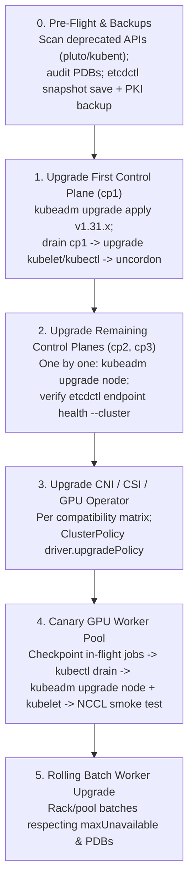

# 5.20 Upgrades, etcd backup and restore, and disaster recovery

| | |
|---|---|
| Level | Advanced |
| Priority tier | 1 |
| Lab venue | kubeadm cluster (3 CP + 2 workers), etcdctl/etcdutl, Velero + MinIO, a second empty cluster/VMs for restore |
| Part | Part 5: Kubernetes |
| Status | Drafted, labs **untested** |

## Why this matters for AI infrastructure

Kubernetes releases a minor version about three times a year and supports each for roughly a year, so a GPU platform is always one or two upgrades away from running an unsupported version; every upgrade touches the control plane, the container runtime, CNI/CSI, the GPU Operator and driver stack, kernels, and sometimes API versions that your operators still use. At the same time training clusters hold irreplaceable state: etcd (all object state), PersistentVolumes (datasets, checkpoints, registries, metadata DBs), secrets and keys, and the knowledge in GitOps repos. A botched upgrade or lost etcd can strand thousand-GPU jobs; a regional outage can idle the whole fleet. Mature teams practise upgrades routinely, test restores, and know their recovery objectives.

## Prerequisites and outcomes

Needs 5.4, 5.5, 5.19. After this chapter you can:

- Explain Kubernetes versioning, support windows, and skew policy among control-plane components, kubelet, kubectl and clients; plan an upgrade path.
- Execute a kubeadm upgrade (control plane then nodes) and the equivalent for managed services, with pre-flight checks (API deprecations, add-on compatibility, backups), canaries, drains and rollback strategy.
- Upgrade the GPU stack (drivers, toolkit, operators) safely in step with Kubernetes.
- Back up and restore etcd (snapshots, certificates, multi-member restore), and rebuild failed control planes.
- Design backup/DR for workloads and data: GitOps as source of truth, Velero/CSI snapshots, volume replication, object-storage durability; define RPO/RTO per tier.
- Run DR drills and handle realistic failure scenarios (lost etcd quorum, corrupted data, expired certificates, accidental namespace deletion, regional loss).

## 1. Versioning and skew

- Versions are `v1.<minor>.<patch>`. Minor releases roughly every 4 months; patch releases roughly monthly. The project supports **the three most recent minor releases** (about 14 months of patches).
- **Skew policy** (verify the current doc): `kube-apiserver` instances in an HA control plane may differ by one minor during rolling upgrade (newest `n`, oldest `n-1`); `kube-controller-manager`, `kube-scheduler`, `cloud-controller-manager` must not be newer than the API server and may be up to one minor older; **`kubelet` may be up to three minors older** than the API server (never newer) in recent releases (two before 1.28); `kube-proxy` same as kubelet; `kubectl` ±1 minor of the API server. Therefore the standard order is **upgrade control plane first, then nodes**, one minor at a time (no skipping minors for the control plane), and clients/operators last or in step.
- **Feature gates and API lifecycle**: alpha (off by default), beta (on by default for many APIs, but beta APIs are off by default since 1.24), GA; deprecated APIs are removed after at least 9 months or 3 releases (GA APIs are not removed within v1). Removed APIs break manifests, Helm charts and operators that still use them (e.g., `policy/v1beta1` PodSecurityPolicy removal in 1.25, `batch/v1beta1` CronJob in 1.25, `flowcontrol.apiserver.k8s.io/v1beta2` etc.). Always read the changelog "Urgent upgrade notes" and "Deprecation" sections.
- **Component compatibility** beyond Kubernetes itself: container runtime (containerd versions per Kubernetes), CNI (Calico/Cilium support matrix), CSI drivers and sidecars, ingress controllers, cert-manager, Prometheus operator, GPU Operator/driver/toolkit/device plugin/DCGM, Kueue and training operators, service meshes, Argo CD/Flux, CoreDNS/etcd versions shipped by kubeadm. Build a compatibility matrix per target version (5.19).

## 2. Upgrade planning

**Checklist before touching anything:**

1. **Objective and window**: target version (usually latest patch of next minor), who is affected, freeze period for critical training runs, rollback criteria.
2. **Read release notes** (urgent notes, deprecations, changed defaults, kubelet/containerd changes, CNI/CSI notes). Review KEPs affecting your features (DRA, sidecars, cgroup v1 deprecation, etc.).
3. **Detect deprecated/removed API usage**: `kubectl get --raw /metrics | grep apiserver_requested_deprecated_apis`, audit logs, tools `pluto detect-helm`/`detect-files`, `kubent`, `kubectl-convert`, Helm chart `helm template | kubeconform -kubernetes-version 1.xx`. Upgrade charts/operators/CRDs to versions that support both old and new Kubernetes where possible *before* the cluster upgrade.
4. **Compatibility matrix check** for add-ons and the GPU stack; stage upgrades of add-ons that support both versions first.
5. **Backups**: etcd snapshot (and copies off the node), PV snapshots/Velero backups of critical namespaces, export of cluster-scoped config (CRDs, RBAC, webhooks), GitOps repo is the source for the rest. Verify the backup is restorable (do a restore drill at least before the first production upgrade).
6. **Health baseline**: all nodes Ready, no crashlooping system pods, API/etcd metrics normal, PDB audit (`kubectl get pdb -A`: any with 0 allowed disruptions?), capacity headroom for rolling node drains.
7. **Staging rehearsal**: upgrade a representative non-production cluster (same CNI/CSI/GPU stack, ideally a few GPU nodes) and run conformance + workload smoke tests (5.25).
8. **Communication and runbook**: published schedule; escalation path; abort and rollback steps; success checks.

**Strategies:**

| Strategy | How | Pros | Cons |
|---|---|---|---|
| **In-place rolling** | Upgrade control plane nodes sequentially, then drain/upgrade workers pool by pool | No extra capacity (beyond headroom); standard | Risk of partial failure; rollback means restoring from backup or downgrading components (not supported for etcd/API) |
| **Surge node pools** (managed) | Add new nodes on the new version, drain old | Continuous capacity | Needs spare GPU quota/capacity (rare for GPUs); use `maxUnavailable` instead |
| **Blue/green cluster** | Build new cluster on new version, shift workloads gradually (GitOps, MultiKueue, DNS) | Easy rollback; test fully before cutover; clean state | Double capacity (hard for GPUs), data migration, identity/networking duplication |
| **Cluster API rolling** | Declarative upgrade of `KubeadmControlPlane` and `MachineDeployment` | Automates replace-not-patch | Needs CAPI maturity |

For GPU clusters, in-place rolling with canary pools and strict drain choreography is typical; blue/green is attractive for major platform shifts (CNI change, major GPU stack change) if you can borrow capacity.



In *Production Kubernetes* Chapter 2 (*Deployment Models*), Josh Rosso et al. analyze a subtle quorum trap when upgrading **dedicated `etcd` nodes** via immutable node replacement:
- **Why Subtractive `3 -> 2 -> 3` Replacement Is Dangerous on Dedicated `etcd` (`PK` Chapter 2):** If you upgrade a 3-node dedicated `etcd` cluster by *first* removing 1 member (`etcdctl member remove`) and terminating its host to replace it (`3 -> 2` members), the cluster's voting size drops to `2` with a required quorum of `2`. During the 10–15 minutes it takes the replacement machine to boot and sync, **the cluster has zero fault tolerance**—if either of the 2 remaining `etcd` nodes experiences a disk stall or network blip, the entire Kubernetes control plane loses quorum immediately.
- **Safer Alternatives (`PK` Chapter 2):** Either perform **in-place binary upgrades** of `etcd` one node at a time (fast restart, data directory already warm), or use **additive learner replacement (`3 -> 4 learner -> promote -> remove old -> 3`)** so 3 healthy voting members remain active throughout the replacement (modeled in `evaluate_etcd_upgrade_quorum_safety()` in `code/part05/k8s_upgrade_dr_planner.py`).
- **Air-Gapped Cluster Upgrades (`bcm11-containerization` Appendix C):** On air-gapped DGX/HGX SuperPOD clusters (such as NVIDIA Base Command Manager), pre-stage all target container images (`kubeadm config images list --kubernetes-version v1.31.x`) into the local Harbor/mirror registry and pre-populate the local OS `apt`/`yum` repository mirror before starting `kubeadm upgrade apply` or `cm-kubernetes-setup` upgrade workflows.

## 3. kubeadm upgrade procedure

On a single minor-version upgrade (example 1.30 → 1.31); commands and flags must be verified against the docs for your versions.

```bash
# 0. Pre-flight (on a control-plane node)
kubeadm version; kubectl version; kubectl get nodes -o wide
sudo kubeadm upgrade plan                         # shows available versions, component versions, needed manual actions
sudo ETCDCTL_API=3 etcdctl snapshot save /backup/pre-upgrade-$(date +%F-%H%M).db \
  --endpoints=https://127.0.0.1:2379 --cacert=/etc/kubernetes/pki/etcd/ca.crt --cert=/etc/kubernetes/pki/etcd/server.crt --key=/etc/kubernetes/pki/etcd/server.key

# 1. First control-plane node
sudo apt-mark unhold kubeadm && sudo apt-get update && sudo apt-get install -y kubeadm=1.31.x-* && sudo apt-mark hold kubeadm
sudo kubeadm upgrade plan
sudo kubeadm upgrade apply v1.31.x                # upgrades static pod manifests (apiserver, controller-manager, scheduler, etcd), certs renewed, kube-proxy/CoreDNS addons, then waits for health
# 2. Drain, upgrade kubelet/kubectl on that node, uncordon
kubectl drain cp1 --ignore-daemonsets
sudo apt-mark unhold kubelet kubectl && sudo apt-get install -y kubelet=1.31.x-* kubectl=1.31.x-* && sudo apt-mark hold kubelet kubectl
sudo systemctl daemon-reload && sudo systemctl restart kubelet
kubectl uncordon cp1

# 3. Other control-plane nodes (one at a time)
sudo apt-get install -y kubeadm=1.31.x-*    # then:
sudo kubeadm upgrade node                         # NOT `apply`: upgrades local static pods using the stored config
# drain, upgrade kubelet/kubectl, restart kubelet, uncordon

# 4. Workers (batches; canary first)
kubectl drain w1 --ignore-daemonsets --delete-emptydir-data --grace-period=600 --timeout=30m
# on w1:
sudo apt-get install -y kubeadm=1.31.x-* && sudo kubeadm upgrade node
sudo apt-get install -y kubelet=1.31.x-* && sudo systemctl daemon-reload && sudo systemctl restart kubelet
kubectl uncordon w1
kubectl get nodes   # VERSION column updates
```

Notes and gotchas:

- **etcd** is upgraded by `kubeadm upgrade` to the version bundled for the target (may change minor versions); stacked etcd members upgrade as their control-plane node does; do one node at a time and confirm `etcdctl endpoint health --cluster` between nodes.
- **Certificates** are renewed during `kubeadm upgrade` (unless `--certificate-renewal=false`), a useful annual side effect (5.21).
- **Config**: kubeadm stores `ClusterConfiguration` in `kube-system/kubeadm-config`; edit with `kubeadm upgrade apply --config` if you change flags. Custom manifest edits made by hand under `/etc/kubernetes/manifests` are lost on upgrade unless expressed in the kubeadm config (use `extraArgs`, `extraVolumes`, or patches directory `--patches`).
- **kubelet config** (`/var/lib/kubelet/config.yaml`) is regenerated from the cluster-wide `kubelet-config` ConfigMap on `upgrade node`; per-node overrides need patches.
- **Addons**: `kubeadm upgrade` updates CoreDNS and kube-proxy only; CNI, CSI, ingress, GPU Operator, monitoring and everything else are your responsibility.
- **API server rolling**: while control plane nodes are at mixed versions, controllers use the older API behaviours; keep the window short; don't run create/update of new fields until all are upgraded.
- **Time**: control plane ~5 to 10 min per node; workers dominated by drains.
- **Rollback**: Kubernetes does not support downgrading the control plane in place (etcd data and API storage versions may have advanced). Rollback = restore the pre-upgrade etcd snapshot and old binaries/manifests on all control-plane nodes (a disruptive procedure) or fall back to a blue/green cluster. Therefore rehearsal and canaries are critical, and workers can be rolled back individually (re-image/reinstall previous kubelet) since older kubelets within skew are fine.

### Managed services

GKE/EKS/AKS: upgrade control plane via API/console/Terraform (the provider handles HA rollout), then node pools by surge or blue/green node-pool replacement with maintenance windows/exclusions and release channels (rapid/regular/stable). GPU node pools: set `maxUnavailable`/surge according to spare capacity, disable auto-upgrade for pools with reservations and pin node image versions until the driver stack is validated, and test GPU driver version bundled with node images (GKE installs drivers per node image/version; EKS-optimised GPU AMIs bundle a driver version). Provider auto-upgrades can break custom stacks; use maintenance exclusions during critical runs (4.24).

## 4. Upgrading the GPU and platform stack

Order of operations (typical, verify per vendor docs):

1. Review the NVIDIA GPU Operator/driver/toolkit/device plugin/DCGM/MIG manager compatibility with the target Kubernetes and OS/kernel.
2. Upgrade **operators and CRDs** compatible with both old and new Kubernetes first (Helm chart upgrades via GitOps, CRD handling per 4.25).
3. Upgrade the control plane, then node pools.
4. For **driver upgrades**: with operator-managed drivers, use the operator's upgrade controller (`ClusterPolicy.spec.driver.upgradePolicy`: `autoUpgrade`, `maxParallelUpgrades`, `drain` options, `waitForCompletion`, pod deletion/ eviction policy) to cordon, drain GPU pods, reload the driver, validate, uncordon node by node; with host-installed drivers, use Ansible `serial` flows (4.17). Coordinate with training: checkpoint-and-drain windows, quotas for in-flight jobs, and fail-safe if validation fails (keep node cordoned).
5. **Kernel/OS** upgrades require reboot and DKMS/precompiled driver rebuild; pin and test combos; roll by rack.
6. Validate after each batch: node Ready, `nvidia.com/gpu` allocatable correct, DCGM exporter up, `nvidia-smi` pod test, NCCL smoke test across the upgraded batch (4.17), network operator secondary networks present.
7. Upgrade **kubectl, CI/CD tools, client libraries, controllers built with older client-go** thereafter; operators compiled against removed APIs need new versions.

## 5. Backing up and restoring etcd

### Backup

```bash
export ETCDCTL_API=3
EP="--endpoints=https://127.0.0.1:2379 --cacert=/etc/kubernetes/pki/etcd/ca.crt --cert=/etc/kubernetes/pki/etcd/server.crt --key=/etc/kubernetes/pki/etcd/server.key"
etcdctl $EP snapshot save /backup/etcd-$(hostname)-$(date -u +%FT%H%M%SZ).db
etcdutl snapshot status /backup/etcd-....db -w table       # hash, revision, total keys, size (integrity check)
sha256sum /backup/etcd-....db > /backup/etcd-....db.sha256
# Ship off-cluster, encrypted, versioned, immutable (object lock); retain per policy
aws s3 cp /backup/etcd-....db s3://dr-bucket/etcd/ --sse aws:kms
# Also back up: /etc/kubernetes/pki (CA keys!), /etc/kubernetes/*.conf, /etc/kubernetes/manifests, kubeadm config, encryption config + KMS keys
```

Automation: a CronJob on a control-plane node (hostNetwork, hostPath mounts of PKI and backup dir) or systemd timer running every 15 to 60 minutes; managed tools (Velero doesn't back up etcd directly; etcd-operator-style backup via `etcd-backup-restore` from Gardener, Kubernetes-native CronJobs, cloud snapshots of etcd volumes with consistency caveats). **Secrets in snapshots**: contain all Secrets (encrypted only if encryption at rest was enabled; with KMS you also need the KMS key) — treat backups as top-secret. Store the **cluster CA private keys** securely; without them, restoring/rebuilding the PKI is far harder. Monitor backup age and size; alert when a backup fails or is older than the RPO.

Hot backups are consistent point-in-time snapshots (MVCC); taking them from one healthy member is sufficient. Snapshot size ≈ DB size (hundreds of MB to a few GB).

### Restore scenarios

**A. One etcd member failed (quorum intact)** — replace, don't restore:

```bash
etcdctl $EP member list -w table
etcdctl $EP member remove <failed-member-id>          # remove the dead one FIRST
# rebuild the node; for kubeadm stacked etcd: on a new control-plane node run `kubeadm join --control-plane ...` (adds a learner, promotes)
etcdctl $EP member list -w table; etcdctl $EP endpoint health --cluster
```

**B. Quorum lost (majority of members gone) or data corrupted** — restore from snapshot. The restore creates a **new cluster** from the snapshot (new cluster ID); all members must be restored from the same snapshot.

```bash
# 1. Stop API servers and etcd on ALL control-plane nodes (kubeadm: move static pod manifests away)
sudo mkdir -p /etc/kubernetes/manifests.disabled && sudo mv /etc/kubernetes/manifests/{kube-apiserver,etcd}.yaml /etc/kubernetes/manifests.disabled/
sudo crictl ps | grep -E 'etcd|apiserver'   # wait until gone
# 2. On each control-plane node restore the snapshot into a fresh data dir with its own name/peer URL
sudo mv /var/lib/etcd /var/lib/etcd.bak-$(date +%s)
sudo etcdutl snapshot restore /backup/etcd-snap.db \
  --name cp1 --data-dir /var/lib/etcd \
  --initial-cluster cp1=https://10.0.0.11:2380,cp2=https://10.0.0.12:2380,cp3=https://10.0.0.13:2380 \
  --initial-advertise-peer-urls https://10.0.0.11:2380 --initial-cluster-token etcd-restore-$(date +%s)
# (repeat on cp2, cp3 with their names/URLs; ensure the manifest's --initial-cluster flags match, kubeadm manifests use these defaults)
# 3. Restore manifests (etcd first, wait healthy; then kube-apiserver)
sudo mv /etc/kubernetes/manifests.disabled/etcd.yaml /etc/kubernetes/manifests/
etcdctl $EP endpoint health --cluster
sudo mv /etc/kubernetes/manifests.disabled/kube-apiserver.yaml /etc/kubernetes/manifests/
kubectl get nodes; kubectl get pods -A
```

Single-member shortcut for a lab: restore one member with `--initial-cluster cp1=...` only (a one-node cluster), then `member add` the others (they must have empty data dirs). For disaster scenarios with total loss: rebuild nodes with the same hostnames/IPs/certs from backups, restore the snapshot, then re-join.

**Expected effects of restore**: the cluster state rewinds to the snapshot time. Objects created after are gone (their pods remain running on nodes until kubelets reconcile, and then orphaned containers are removed or restarted); objects deleted after are resurrected; PV/PVC bindings may reference volumes that no longer match (cloud disks created after the snapshot exist but aren't known); node leases/status refresh quickly; controllers re-reconcile everything to the restored desired state (including scaling replicas back), e.g., a Deployment scaled up after the snapshot returns to the older replica count; Jobs may rerun; operator status can be stale; certificates/tokens issued after the snapshot are invalid (service account tokens are bound to objects that may not exist). Plan to restart controllers/operators and reconcile external state (cloud resources, DNS, load balancers). Resource versions reset relative to clients; informers relist.

**C. Lost control plane but etcd data intact on disk**: rebuild nodes, copy the etcd data dir/PKI, or restore from the latest snapshot.

**D. Expired certificates** (a common outage after one year): `kubeadm certs check-expiration`; renew with `kubeadm certs renew all` on each control-plane node and restart static pods (move manifests out and back, or restart kubelet); also renew kubelet client/serving certs if rotation failed; update `admin.conf` copies (5.21).

**E. Accidental deletion of a namespace/critical object**: restore from GitOps (re-sync), Velero backup, or etcd snapshot restored to a *scratch* cluster to extract the objects (`kubectl get -o yaml`) and re-apply into production (safer than rewinding production).

### Test restores

A backup you never restored is a hope. Schedule quarterly restore drills into an isolated VM cluster; measure RTO; verify the restored cluster boots, objects exist, and a sample workload runs (disable external side effects: scale controllers down, block egress, remove cloud credentials to avoid the restored cluster acting on real resources — a restored cluster thinks it owns your load balancers and disks).

## 6. Application and data backup

Layers of protection:

| Layer | What | Tools |
|---|---|---|
| **Declarative config** | Manifests, Helm values, policies, CRDs | Git + GitOps (4.26); the primary way to recreate cluster state |
| **Cluster objects** | Namespaces, CRs created at runtime (not in Git), Secrets | Velero, Kasten K10, Trilio; periodic `kubectl get` exports for cluster-scoped objects |
| **Persistent data** | PV contents | CSI snapshots (`VolumeSnapshot`), Velero with CSI/restic/Kopia file-system backup, storage-native replication (Ceph RBD mirroring, cloud disk snapshots, FSx backups, Lustre HSM/archive), application-level backups (database dumps, WAL archiving) |
| **Object storage data** | Datasets, checkpoints, model artefacts | Bucket versioning + object lock, cross-region replication, lifecycle rules (4.24), checksum manifests |
| **Registries and artefacts** | Images, charts, models | Replicated registries, immutable tags, mirrors; keep golden base images offline |
| **Identity and secrets** | CA keys, KMS keys, Vault, OIDC provider config | Escrowed offline backups; HSM/KMS multi-region keys |
| **Observability data** | Metrics/logs | Often best-effort; keep dashboards/rules in Git |

**Velero** (CNCF project): server-side controller + CLI; backs up Kubernetes resources to object storage and volumes via CSI snapshots or file-system backup (Kopia); supports schedules, TTLs, hooks (pre/post backup commands for DB quiescing), restore to the same or a different cluster, namespace mapping, and resource filters.

```bash
velero install --provider aws --plugins velero/velero-plugin-for-aws:v1.10.0 --bucket dr-velero --backup-location-config region=us-east-1 \
  --snapshot-location-config region=us-east-1 --use-node-agent --features=EnableCSI
velero backup create ml-platform --include-namespaces mlflow,vector-db --snapshot-volumes --ttl 720h
velero schedule create nightly --schedule="0 2 * * *" --include-namespaces '*' --exclude-namespaces kube-system,kube-public --ttl 168h
velero backup describe ml-platform --details; velero restore create --from-backup ml-platform --namespace-mappings mlflow:mlflow-restore
```

Considerations for AI data: multi-terabyte checkpoints are better protected by storage-layer replication and tiering than by Velero file-system backup; datasets are re-creatable from source (store recipes and hashes); prioritise irreplaceable artefacts (trained models, fine-tuning data, evaluation sets, experiment metadata, feature stores). Define retention per class (e.g., keep last N checkpoints plus milestones).

## 7. Disaster recovery strategies

**Define objectives per tier**: RPO (maximum tolerable data loss) and RTO (maximum tolerable downtime). Example: inference gateway RTO 15 min/RPO 0 (stateless, redeploy from Git); metadata DB RTO 1 h/RPO 5 min (replicated Postgres); training in progress RTO hours/RPO last checkpoint (checkpoint cadence = RPO in GPU-time); datasets RTO days/RPO 0 (replicated objects).

| Strategy | Description | RTO | Cost | Notes |
|---|---|---|---|---|
| **Backup and restore** | Restore etcd/Velero into rebuilt cluster | Hours | Low | Rebuild infrastructure from Terraform/Ansible (4.17, 4.24) |
| **Rebuild from Git** | Recreate cluster via IaC + GitOps; restore data stores only | Hours | Low | Cleanest for stateless platforms; requires immutable infrastructure discipline |
| **Pilot light / warm standby** | Small standby cluster in another region/zone with replicated data and GitOps in sync | Minutes to an hour | Medium | GPU capacity at the standby is the expensive part; keep minimal inference footprint, scale up on failover |
| **Active-active multi-cluster** | Multiple clusters serving traffic (global LB/DNS, MultiKueue for batch) | Seconds to minutes | High | Needs data replication and conflict handling (5.35) |

AI-specific DR notes:

- **Training jobs** recover from **checkpoints** (frequency vs cost; async multi-tier checkpointing, redundant shards, validation of checkpoint integrity) not from cluster snapshots; make checkpoint storage durable and in another failure domain; test restart from the latest checkpoint on a different cluster/region (accounting for bandwidth).
- **Inference** is mostly stateless: weights from a registry/object store; DR = stand up replicas elsewhere and shift traffic; pre-stage model artefacts in the standby region.
- **GPU capacity is the DR bottleneck**: a standby region with no GPUs cannot take over; negotiate reservations/priority access or accept degraded service (smaller models, queueing).
- **Control-plane SPOFs**: management cluster, GitOps hub, CI, registry, DNS, identity provider (OIDC), secret manager, KMS: each needs its own DR plan.
- **Split-brain avoidance**: a restored/standby cluster must not manage the same external resources as the live one.
- **Runbook the order**: networking/DNS → identity/secrets → storage → control plane → platform add-ons → workloads → traffic cutover.

## 8. Failure scenarios and responses

| Scenario | Impact | Response |
|---|---|---|
| One control-plane node dies | HA continues; etcd 2/3 | Replace member (remove then add), rejoin control plane |
| Two of three etcd members die | API read-only/unavailable; workloads keep running | Restore quorum: bring back a member or restore from snapshot; avoid adding members before removing dead ones |
| etcd DB full (NOSPACE) | Writes fail | Compact, defrag, disarm alarm; find churn source (5.5) |
| All control-plane nodes lost | No API; workloads run until nodes churn | Rebuild from snapshot + PKI backup, rejoin nodes |
| Certificates expired | API/kubelets reject TLS; nodes NotReady | Renew certs, restart components; set up expiry alerts and annual renewal/upgrade cadence |
| Failed minor upgrade (control plane) | Component crashloop, API errors | Check static pod logs; fix config; if irrecoverable restore pre-upgrade snapshot and old manifests |
| Bad CNI/CSI/operator upgrade | Network/storage broken for new pods | Roll back via GitOps; node-by-node revert; keep old DaemonSet versions available |
| Accidental `kubectl delete ns` | Namespace content destroyed (PVs may survive with `Retain`) | Re-sync from Git, Velero restore, PV `Retain` rebinding; RBAC to prevent |
| Corrupted/poisoned admission webhook blocks everything | Writes rejected | Delete/patch the webhook configuration (emergency), fix failurePolicy, scope exclusions |
| Region/zone outage | Cluster or capacity gone | Failover per DR tier: traffic shift, standby cluster, restore data in other region |
| Ransomware / credential compromise | Data and cluster at risk | Immutable backups, break-glass rebuild, rotate CA and secrets, forensic isolation (Part 18) |

## 9. Lab

First, run the self-checking Python lab (`code/part05/k8s_upgrade_dr_planner_lab.py`) locally. It verifies the Kubernetes Version Skew Policy validator (`validate_k8s_version_skew`), the `PK` Chapter 2 `etcd` upgrade quorum-safety evaluator (`evaluate_etcd_upgrade_quorum_safety`: contrasting risky subtractive `3 -> 2 -> 3` replacement against additive learner / in-place upgrades), and the AI training/inference Disaster Recovery `RPO`/`RTO` evaluator (`evaluate_dr_rpo_rto`).

```bash
python3 code/part05/k8s_upgrade_dr_planner_lab.py
```

Next, on a 3-control-plane + 2-worker `kubeadm` cluster (all interactive shell steps below are `untested here`), work through these exercises:

1. **Upgrade rehearsal**: build a 1.N cluster with kubeadm (3 CP, 2 workers); run workloads including a StatefulSet, a PDB-protected Deployment, a GPU-like fake extended resource DaemonSet; take an etcd snapshot; upgrade to 1.N+1 following section 3; record timings and issues; run `kubectl get nodes` and smoke tests at each stage.
2. **Deprecated API scan**: before upgrading, apply a manifest using an API removed in the target version; detect it with `pluto`/`kubent` and the API server metric; migrate with `kubectl-convert`.
3. **Skew experiment**: run a worker one minor behind the control plane (supported); try one newer than the API server (observe failure); try kubectl two minors apart.
4. **PDB trap**: create a PDB with zero allowed disruptions and attempt drain during upgrade; fix; document the checklist.
5. **etcd backup automation**: create the snapshot CronJob/systemd timer with checksum and offsite copy; alert on staleness; verify `snapshot status`.
6. **Member replacement**: kill an etcd member (stop and delete data); replace using remove-then-add; compare with adding first (lab-only) to see risk.
7. **Full restore drill**: with a 3-CP cluster, snapshot, create and delete objects, wipe etcd on all nodes, restore on all members, bring up the API server; compare restored vs expected state; list side effects (replica counts, missing objects, stale leases).
8. **Certificate expiry**: set certificates to expire soon (or manually move the clock in a throwaway VM), observe failure modes, renew with `kubeadm certs renew all`, restart components, fix kubeconfigs.
9. **Velero**: back up a namespace with a PVC (CSI snapshots or Kopia), delete it, restore into the same and a different cluster; test hooks for database quiescing; verify data integrity with checksums.
10. **GitOps rebuild**: destroy a workload cluster (lab) and rebuild from Terraform/CAPI + GitOps bootstrap (4.25, 4.26); measure time to healthy platform; list manual steps and automate them.
11. **GPU stack upgrade**: upgrade the GPU Operator/driver on a canary pool using the operator's upgrade policy with a checkpointing job running; validate; roll to the rest.
12. **DR game day**: simulate loss of a zone or region (block network between clusters); execute the DR runbook for inference and training (restart from checkpoint in another cluster); record RTO/RPO achieved and gaps.
13. **Webhook outage**: break an admission webhook to block all pod creation; practise emergency recovery.
14. **Clean up**.

## 10. Common mistakes

- Skipping minor versions or upgrading nodes before the control plane; ignoring skew policy.
- No pre-upgrade etcd snapshot, or backups that were never restored; backups stored on the same nodes/disks.
- Not scanning for deprecated APIs; upgrading operators after the cluster rather than before when they're incompatible.
- Hand-edited static pod manifests lost during upgrade; kubeadm config not tracked.
- Draining GPU nodes without checkpoint coordination; PDBs that deadlock drains.
- Upgrading kernel/driver/Kubernetes simultaneously with no ability to bisect failures.
- Adding an etcd member before removing the dead one; running two-member etcd clusters.
- Forgetting the CA private key and encryption/KMS keys in DR plans; Secrets in unencrypted snapshots.
- Restoring a cluster that then competes with the live one for cloud resources.
- Treating snapshots as backups; ignoring object storage versioning/immutability.
- DR plans that assume GPUs will be available in the standby region.
- No game days; runbooks untested.

## 11. Interview angles

- "Walk through upgrading a production Kubernetes cluster. What order? What do you check first? How do you roll back?"
- "What is the version skew policy?"
- "How do you find deprecated API usage before an upgrade?"
- "How do you back up and restore etcd? What happens to the cluster when you restore?"
- "A control-plane node died permanently. How do you replace its etcd member?"
- "How would you design DR for a GPU training platform? What are RPO and RTO for training vs inference?"
- "How do you upgrade GPU drivers across hundreds of nodes without killing training jobs?"
- "What's in a complete Kubernetes backup strategy?"

## Exercises

1. **Kubernetes Release Cadence, Version Skew Policy, and Detecting Deprecated APIs:** Using `validate_k8s_version_skew()` in `code/part05/k8s_upgrade_dr_planner.py`, state the exact version skew rules across HA `kube-apiserver`s, `kube-controller-manager`, `kube-scheduler`, `kubelet`, `kube-proxy`, and `kubectl`, explain why you cannot skip minor versions when upgrading the control plane, and show how `apiserver_requested_deprecated_apis`, `pluto`, and `kubent` catch removed APIs before an upgrade.
2. **Executing a Zero-Downtime 3-Control-Plane `kubeadm` Upgrade and Avoiding Static-Pod / `etcd` Pitfalls (`PK` Chapter 2 & `bcm11-containerization` Appendix C):** Trace the exact `kubeadm` commands in Section 3 (`kubeadm upgrade plan` -> `etcdctl snapshot save` -> `kubeadm upgrade apply` on `cp1` -> `kubeadm upgrade node` on `cp2`/`cp3` -> rolling worker drains), explain why manual edits to `/etc/kubernetes/manifests/*.yaml` are wiped during upgrade unless stored in `ClusterConfiguration` (`extraArgs` / `--patches`), and use `evaluate_etcd_upgrade_quorum_safety()` to explain `PK` Chapter 2's warning against subtractive `3 -> 2 -> 3` dedicated `etcd` replacement.
3. **Upgrading the NVIDIA GPU Operator and Driver Stack (`ClusterPolicy.spec.driver.upgradePolicy`) Without Killing Training Jobs:** Trace the 7-step GPU stack upgrade order in Section 4, explaining how the GPU Operator's driver upgrade controller (`maxParallelUpgrades`, `drain`, pod eviction/completion policy) coordinates with training job checkpointing and post-upgrade `nvidia-smi` / `dcgmi` / `nccl-tests` validation.
4. **`etcd` Backup Automation, Single-Member Replacement (Quorum Intact), and Full Multi-Member Snapshot Restore (Quorum Lost):** Contrast Scenario A (1 of 3 `etcd` members dead -> `etcdctl member remove` then `kubeadm join --control-plane`, **no snapshot restore**) with Scenario B (2 or 3 members dead -> stop `kube-apiserver` and `etcd` on all 3 nodes, run `etcdutl snapshot restore` on all 3 nodes with the **same snapshot** and `--initial-cluster-token=etcd-cluster-restored-1`, move into `/var/lib/etcd`, and restart), and explain what artifacts must be backed up alongside the `etcd` `.db` file (`/etc/kubernetes/pki` CA keys, KMS keys).
5. **Workload and Volume Backups with `Velero` (`Backup`, `Schedule`, `Restore`, CSI `VolumeSnapshot`s vs. `Kopia`/`Restic`):** Trace the `nightly-platform` `Schedule` and `Restore` manifests in Section 6, explain how `pre` and `post` backup hooks quiesce stateful databases (`pg_Start_backup` / `fsfreeze`), and explain why restoring into a test cluster without isolating cloud controllers/ExternalDNS can hijack production LoadBalancers and DNS records.
6. **Designing Disaster Recovery Tiers (`RPO` / `RTO`) and Game-Day Runbooks for AI Training, Inference, and Platform State:** Using `evaluate_dr_rpo_rto()` in `code/part05/k8s_upgrade_dr_planner.py`, explain why DR for LLM inference (stateless replicas + replicated weights + multi-region Gateway) differs fundamentally from DR for 1,000-GPU training (async cross-region checkpoint replication + MultiKueue / checkpoint resume), and write the emergency recovery steps for the 8 disaster scenarios in Section 8.

## Checkpoint questions (20)

<details>
<summary>1. What is the Kubernetes Version Skew Policy across `kube-apiserver`, `kube-controller-manager`, `kube-scheduler`, `kubelet`, `kube-proxy`, and `kubectl`, and why does it dictate the upgrade order?</summary>

- **HA `kube-apiserver` instances:** May skew by at most **1 minor version** (`1.30` and `1.31` during a rolling control-plane upgrade).
- **`kube-controller-manager`, `kube-scheduler`, and `cloud-controller-manager`:** Must **never be newer** than the `kube-apiserver` instances they talk to; may be up to **1 minor version older**.
- **`kubelet` and `kube-proxy`:** Must **never be newer** than `kube-apiserver`; may be up to **3 minor versions older** (`n-3` in Kubernetes 1.28+; `n-2` previously).
- **`kubectl`:** May be **1 minor version newer or older** (`n+1` to `n-1`) than `kube-apiserver`.
Because no component (except `kubectl`) is allowed to be newer than `kube-apiserver`, you must **always upgrade `kube-apiserver` (the control plane) FIRST, and worker node `kubelet`s AFTER**, one minor version at a time.
</details>

<details>
<summary>2. How do you detect whether any workload, Helm chart, or Operator in your cluster is still calling a deprecated Kubernetes API that will be removed in the next minor version?</summary>

Use three complementary checks before upgrading:
1. **Live API server Prometheus metric:**
   `kubectl get --raw /metrics | grep apiserver_requested_deprecated_apis`
   This shows every deprecated `(group, version, resource, removed_release)` that has actually been requested against the live API server.
2. **Audit log query:** Filter `kube-apiserver` audit logs for the annotation **`k8s.io/deprecated: "true"`** (`k8s.io/removed-release: "1.xx"`), which identifies the exact `user.username` / ServiceAccount making the deprecated call.
3. **Static & Helm release scanners (`pluto` and `kubent`):** Run `kubent` (Kube No Trouble) against the live cluster (scanning `helm.sh/release.v1` Secrets and `kubectl.kubernetes.io/last-applied-configuration` annotations) and `pluto detect-files` in GitOps CI.
</details>

<details>
<summary>3. During a 3-node HA `kubeadm` control-plane upgrade (`cp1`, `cp2`, `cp3`), what is the difference between `kubeadm upgrade apply` and `kubeadm upgrade node`?</summary>

- **`sudo kubeadm upgrade apply v1.31.x` (run ONLY on the FIRST control-plane node `cp1`):** Runs cluster-wide preflight checks, updates the cluster-wide `kubeadm-config` and `kubelet-config` ConfigMaps in `kube-system`, renews PKI certificates on `cp1`, rewrites the Static Pod manifests (`/etc/kubernetes/manifests/*.yaml`) on `cp1` to `v1.31.x`, and upgrades the cluster-wide **`coredns`** Deployment and **`kube-proxy`** DaemonSet.
- **`sudo kubeadm upgrade node` (run on `cp2`, `cp3`, and every worker node `w1..wN`):** Downloads the updated `ClusterConfiguration`/`KubeletConfiguration` from `kube-system`, renews local certificates and rewrites local static pod manifests (on `cp2`/`cp3`), and updates `/var/lib/kubelet/config.yaml` on that node.
</details>

<details>
<summary>4. Why are manual edits made directly to `/etc/kubernetes/manifests/kube-apiserver.yaml` wiped out during `kubeadm upgrade`, and how should custom flags or mounts be configured instead?</summary>

During `kubeadm upgrade apply` and `kubeadm upgrade node`, `kubeadm` **regenerates `/etc/kubernetes/manifests/{kube-apiserver,kube-controller-manager,kube-scheduler,etcd}.yaml` from scratch** using the `ClusterConfiguration` stored in the `kube-system/kubeadm-config` ConfigMap. Any flag or volume edited by hand in `/etc/kubernetes/manifests/*.yaml` is overwritten.
To make custom flags (`--audit-policy-file`, `--encryption-provider-config`) or volume mounts persist across upgrades, declare them in **`ClusterConfiguration` (`apiServer.extraArgs`, `apiServer.extraVolumes`, or Kustomize `--patches`)** and pass `kubeadm upgrade apply --config kubeadm-config.yaml`.
</details>

<details>
<summary>5. Can you downgrade a Kubernetes control plane (`1.31 -> 1.30`) in place by installing the older `kubeadm` binary, and how do you actually roll back a failed control-plane upgrade?</summary>

**No—in-place control-plane downgrades are unsupported and unsafe** because the newer `kube-apiserver` and `etcd` may have already written objects using newer internal storage schemas or WAL formats that the older `1.30` binary cannot parse.
The only supported way to roll back a failed in-place control-plane upgrade is to **restore the pre-upgrade `etcd` snapshot** (`etcdutl snapshot restore`) and restore the backed-up `1.30` `/etc/kubernetes/manifests/` and binaries across all control-plane nodes (which is why taking a verified `etcd` snapshot immediately before `kubeadm upgrade apply` is mandatory). By contrast, an individual worker node's `kubelet` *can* be rolled back by re-imaging the node to `1.30`, since a `1.30` `kubelet` is within the supported skew of a `1.31` `kube-apiserver`.
</details>

<details>
<summary>6. In *Production Kubernetes* Chapter 2, why is a subtractive `3 -> 2 -> 3` node replacement dangerous when upgrading a 3-node dedicated `etcd` cluster, and what are the two safe patterns?</summary>

In a 3-node `etcd` cluster, if you remove and terminate 1 node first (`3 -> 2` voting members), the required quorum for a 2-node cluster is still **$\lfloor 2/2 \rfloor + 1 = 2$**—meaning **fault tolerance drops to ZERO (`2 - 2 = 0`)** for the entire time the replacement node is provisioning and syncing. If either of the 2 remaining nodes suffers a brief disk/network hiccup during that window, the cluster loses quorum completely.
**Two safe patterns (`PK` Chapter 2):**
1. **Additive Learner Replacement (`3 -> 4 (learner) -> promote -> remove old -> 3`):** Add the new upgraded node as a non-voting `--learner` first, let it catch up, promote it (`4` members, `3` needed for quorum, `1` fault tolerated), and immediately remove the old node.
2. **In-Place Rolling Upgrade (one member at a time):** Upgrade the `etcd` binary/static pod in place (~5 seconds restart) while the other 2 members remain online.
</details>

<details>
<summary>7. How does the NVIDIA GPU Operator's `ClusterPolicy.spec.driver.upgradePolicy` automate rolling GPU driver upgrades across worker nodes?</summary>

When you update the NVIDIA driver version in `ClusterPolicy` with `driver.upgradePolicy.autoUpgrade: true`, the GPU Operator's upgrade controller orchestrates a safe state machine across at most **`maxParallelUpgrades`** nodes at a time (e.g., `1` or `2` nodes):
1. `UpgradeRequired` -> **Cordons** the node (`kubectl cordon`).
2. `WaitingForJobsCompletion` / `PodDeletion` -> Waits for running GPU Jobs to finish (or drains GPU pods according to `drain.enable: true` and `timeoutSeconds`).
3. Stops the device plugin/DCGM pods so no process holds `/dev/nvidia*` open, unloads the old kernel module, starts the new driver container, and verifies `nvidia-smi` (`Validation`).
4. **Uncordons** the node (`UpgradeDone`) and moves to the next batch (or leaves the node cordoned in `UpgradeFailed` if validation fails).
</details>

<details>
<summary>8. What files and keys MUST be backed up alongside an `etcd` snapshot (`etcdctl snapshot save`) to guarantee you can actually restore the cluster onto fresh VMs?</summary>

An `etcd` `.db` snapshot alone is useless on fresh machines if you lose the cryptographic keys that `kube-apiserver`, `kubelet`s, and `etcd` rely on. You must back up:
1. **`/etc/kubernetes/pki/` (especially `ca.crt`, `ca.key`, `sa.key`, `sa.pub`, `front-proxy-ca.crt`, `front-proxy-ca.key`, and `etcd/ca.crt`, `etcd/ca.key`):** Without `ca.key`, restored control-plane nodes cannot issue certs trusted by existing worker `kubelet`s, and without `sa.key`/`sa.pub`, every existing ServiceAccount token in the cluster becomes invalid.
2. **The `EncryptionConfiguration` file (`/etc/kubernetes/enc/enc.yaml`) AND the external KMS key (`aws:kms` / Vault transit key):** Without the encryption key, `kube-apiserver` cannot decrypt any `Secret` stored inside the restored `etcd` snapshot.
3. **`/etc/kubernetes/manifests/` and `kubeadm-config.yaml`.**
</details>

<details>
<summary>9. When 1 of 3 control-plane nodes (`cp2`) in a stacked-etcd cluster suffers a permanent hardware failure (while `cp1` and `cp3` are still healthy), should you run `etcdutl snapshot restore`?</summary>

**No.** Because 2 of the 3 `etcd` members (`cp1` and `cp3`) are still alive, **quorum (`2/3`) is intact and the cluster has lost zero data**. Running `snapshot restore` would needlessly take down the entire cluster and rewind state to an older backup.
Instead, perform **online member replacement**:
1. Remove the dead member from the live Raft cluster: `etcdctl member remove <cp2-member-id>` and `kubectl delete node cp2`.
2. Provision a replacement `cp2` host and run `kubeadm join ... --control-plane --certificate-key <key>` (which joins the live `etcd` cluster and replicates current state from `cp1`/`cp3` automatically).
</details>

<details>
<summary>10. Walk through the exact steps to restore a 3-node stacked-etcd cluster when ALL 3 `etcd` members are lost or corrupted (Quorum Lost).</summary>

1. **Stop `kube-apiserver` and `etcd` on all 3 control-plane nodes (`cp1`, `cp2`, `cp3`):** Move `/etc/kubernetes/manifests/{kube-apiserver,etcd}.yaml` to `/root/` and move `/var/lib/etcd` to `/var/lib/etcd.bak` on all 3 nodes.
2. **Copy the SAME `.db` snapshot file to all 3 control-plane nodes.**
3. **Run `etcdutl snapshot restore` on each node (`cp1`, `cp2`, `cp3`)** specifying:
   - That node's own `--name` (`cp1`, `cp2`, `cp3`) and `--initial-advertise-peer-urls=https://<that-node-ip>:2380`.
   - The **exact same** `--initial-cluster="cp1=https://10.0.0.11:2380,cp2=https://10.0.0.12:2380,cp3=https://10.0.0.13:2380"` and **`--initial-cluster-token=etcd-cluster-restored-1`** across all 3 nodes.
4. Move `/var/lib/etcd-restored` to `/var/lib/etcd` (`chown -R root:root /var/lib/etcd`).
5. Move `etcd.yaml` and `kube-apiserver.yaml` back into `/etc/kubernetes/manifests/`, verify `etcdctl endpoint health --cluster`, and restart `kube-controller-manager`, `kube-scheduler`, CNI, and operator pods to clear stale informer caches.
</details>

<details>
<summary>11. Why did `etcd` split `etcdctl` and `etcdutl` in `etcd` 3.5+, and which tool runs `snapshot save` vs. `snapshot restore`?</summary>

- **`etcdctl` (Network client CLI):** Connects over gRPC (`:2379`) to a **live running `etcd` server**—used for `etcdctl snapshot save`, `etcdctl endpoint health`, `etcdctl member list/remove`, `etcdctl compact`, and `etcdctl defrag`.
- **`etcdutl` (Offline database administration utility):** Operates directly on **local `.db` files on disk without connecting to a running `etcd` server**—used for **`etcdutl snapshot status`** and **`etcdutl snapshot restore`**.
</details>

<details>
<summary>12. What happens if all 1-year leaf certificates on a `kubeadm` cluster expire simultaneously because the cluster was not upgraded for 13 months, and how do you recover?</summary>

When `/etc/kubernetes/pki/{apiserver,apiserver-kubelet-client,front-proxy-client,etcd/server,etcd/peer}.crt` expire, `kubectl` commands fail with `x509: certificate has expired or is not yet valid` and `kubelet`/`kube-apiserver` cannot authenticate to each other (though existing running containers keep running).
**Recovery on each control-plane node:**
1. Check expiration: `sudo kubeadm certs check-expiration`.
2. Renew all leaf certs using the 10-year local CA (`ca.key`): **`sudo kubeadm certs renew all`**.
3. Restart the control-plane static pods (`crictl stopp $(crictl pods --name 'kube-apiserver|kube-controller-manager|kube-scheduler|etcd' -q)`).
4. Copy the renewed `/etc/kubernetes/admin.conf` to `$HOME/.kube/config` (and if worker node `/etc/kubernetes/kubelet.conf` certs also expired without rotation, regenerate `kubeadm kubeconfig user --org system:nodes --client-name system:node:<node>` and restart `kubelet`).
</details>

<details>
<summary>13. What does `Velero` back up that an `etcd` snapshot does NOT, and what are its two volume backup modes?</summary>

An `etcd` snapshot is an all-or-nothing binary image of the entire cluster's `etcd` store—you cannot easily extract and restore a single accidentally deleted namespace (`team-a`) from an `etcd` `.db` file into a live cluster without rewinding every other namespace, and `etcd` does not contain the actual file data inside `PersistentVolume`s.
**Velero** queries the Kubernetes API to export structured JSON/YAML per namespace/label into S3/GCS object storage **AND** backs up PVC data via two modes:
1. **Native CSI `VolumeSnapshot`s:** Fast array/cloud block snapshots coordinated via the CSI snapshotter API.
2. **File-System Backup (`Kopia` / `Restic`):** Reads the mounted filesystem inside a node daemon and uploads deduplicated, encrypted chunks directly to S3/GCS—working across **any** storage type (including NFS, `emptyDir`, or on-prem volumes without CSI snapshot support) and enabling cross-provider restores.
</details>

<details>
<summary>14. Why do database or checkpoint PVCs backed up while the application is actively writing need Velero `pre` and `post` Backup Hooks?</summary>

A block or filesystem snapshot taken while PostgreSQL, MySQL, Qdrant, or a metadata database is in the middle of flushing dirty memory buffers produces a **crash-consistent (or corrupted)** backup rather than an **application-consistent** backup. Configuring `pre.hooks.backup.velero.io/command` (e.g., running `CHECKPOINT` / `pg_backup_start` or `fsfreeze --freeze /data`) flushes and freezes writes for the 1–2 seconds while the snapshot is taken, and `post.hooks.backup.velero.io/command` (`fsfreeze --unfreeze /data`) immediately resumes writes.
</details>

<details>
<summary>15. What dangerous side effect can happen if you restore a production Velero backup (or `etcd` snapshot) into a DR test cluster that has network/cloud access to production?</summary>

If the restored DR test cluster runs **`external-dns`**, **`cloud-controller-manager`**, **`aws-load-balancer-controller`**, or **CronJobs/Operators** with production cloud credentials:
- `external-dns` in the test cluster will **overwrite production Route53/Cloud DNS records** to point to the test cluster.
- `cloud-controller-manager` in the test cluster may **modify or delete production cloud LoadBalancers or detach RWO disks**.
- Restored CronJobs or webhooks may send duplicate billing/emails or mutate external production databases.
Always run DR test restores in an **isolated VPC/account**, strip `LoadBalancer` IPs / `external-dns` annotations via Velero restore modifiers, or restore with `restoreStatus: false` and paused controllers.
</details>

<details>
<summary>16. Define `RPO` (Recovery Point Objective) and `RTO` (Recovery Time Objective), and explain why their targets and mechanisms differ between (a) LLM Inference, (b) 1,000-GPU Training, and (c) Platform Metadata DBs.</summary>

- **`RPO` (Recovery Point Objective):** Maximum acceptable age of data lost (measured backward in time from the outage: e.g., `RPO = 30 min` means at most 30 minutes of writes/progress lost).
- **`RTO` (Recovery Time Objective):** Maximum acceptable downtime from the start of the disaster until the service is restored and serving (measured forward in time: e.g., `RTO = 15 min`).
- **By AI workload tier:**
  1. **Stateless LLM Inference (`RPO = 0, RTO = 1–5 min`):** No mutable runtime state; run active/active or warm-standby across 2 zones/clusters with model weights pre-replicated in object storage/NVMe and shift traffic via DNS/Gateway API.
  2. **1,000-GPU Distributed Training (`RPO = 1 checkpoint interval (~15–30 min), RTO = hours`):** Holding 1,000 idle standby GPUs in a second region is prohibitively expensive ($2M+/month). Instead, asynchronously replicate checkpoints (`RPO <= 30 min`) to cross-region object storage, and on regional loss, resume training from the latest replicated checkpoint on surviving or reallocated GPU capacity (`MultiKueue`).
  3. **Platform Metadata DBs (`MLflow`, `Harbor`, `Keycloak`, `Airflow`: `RPO <= 5 min, RTO <= 30 min`):** Streaming WAL replication (`CloudNativePG` / `Patroni` to S3) + cross-region object storage replication.
</details>

<details>
<summary>17. Why must `etcd` backups and `Velero` object-store buckets be configured with **Object Lock (`WORM` Immutability)** in your ransomware / compromise DR plan?</summary>

If an attacker compromises `cluster-admin` credentials or a CI/CD runner that has write access to the backup S3/MinIO bucket, the attacker's first move before encrypting or wiping the cluster is **`aws s3 rm --recursive s3://dr-bucket/`**. Configuring **S3 Object Lock in Compliance/Governance mode** (Write-Once-Read-Many `WORM` retention for e.g., 14–30 days) in a **separate cloud account/IAM boundary** guarantees that even root/admin credentials in the production cluster cannot delete or overwrite historical `etcd` and Velero backups.
</details>

<details>
<summary>18. What is the emergency recovery procedure if a broken `MutatingAdmissionWebhook` or `ValidatingAdmissionWebhook` (`failurePolicy: Fail`) locks up the cluster so NO Pods (including the webhook's own fix) can be created?</summary>

Because `DELETE` and `PATCH` on `ValidatingWebhookConfiguration` / `MutatingWebhookConfiguration` itself are not intercepted by pod webhooks, use your admin kubeconfig to immediately bypass or remove the broken webhook:
```bash
kubectl get validatingwebhookconfigurations,mutatingwebhookconfigurations
# Either patch failurePolicy to Ignore:
kubectl patch validatingwebhookconfiguration <broken-webhook> --type='json' \
  -p='[{"op": "replace", "path": "/webhooks/0/failurePolicy", "value": "Ignore"}]'
# Or delete the webhook configuration in an emergency:
kubectl delete validatingwebhookconfiguration <broken-webhook>
```
Once the webhook pod is repaired and running, re-apply the webhook configuration (with `kube-system` and its own namespace excluded via `namespaceSelector`).
</details>

<details>
<summary>19. On an air-gapped bare-metal GPU cluster (such as NVIDIA Base Command Manager, `bcm11-containerization` Appendix C), what extra preparation is required before running a Kubernetes minor upgrade?</summary>

Because nodes on an air-gapped cluster cannot reach `registry.k8s.io`, `nvcr.io`, or public Ubuntu/RHEL package mirrors:
1. Run `kubeadm config images list --kubernetes-version v1.31.x` to get the exact list of required `kube-apiserver`, `kube-controller-manager`, `kube-scheduler`, `kube-proxy`, `etcd`, `coredns`, and `pause` image tags.
2. Pull, verify signatures, and push those images (plus the target CNI and GPU Operator images) into the cluster's local air-gapped registry (`Harbor` / local BCM registry) and configure `imageRepository` in `ClusterConfiguration` (or `containerd` `hosts.toml` mirrors).
3. Stage the target `kubeadm`, `kubelet`, and `kubectl` `.deb`/`.rpm` packages in the local OS repository mirror on the head node before starting `cm-kubernetes-setup` or `kubeadm upgrade`.
</details>

<details>
<summary>20. What should a quarterly "Disaster Recovery Game Day" test on an AI Kubernetes platform, and what metrics prove it succeeded?</summary>

A quarterly DR Game Day must execute the written runbooks hands-on (led by an on-call engineer who did *not* write the runbook) across three drills:
1. **Control-Plane / Namespace Restore Drill:** Restore the latest automated `etcd` snapshot and `Velero` backup into an isolated sandbox cluster and verify API health, Secret decryption, and database checksums.
2. **Inference Failover Drill:** Simulate a zone/cluster outage and shift live synthetic traffic to the secondary cluster/zone, measuring **achieved `RTO` (target $< 5$ min)** and dropped request count.
3. **Training Checkpoint Resume Drill:** Kill a multi-node training job, restore its latest cross-region/object-store checkpoint on a second cluster/pool, and verify that training resumes cleanly from the expected global step with **achieved `RPO` $\le$ 1 checkpoint interval** and matching loss curve.
</details>

## Sources and review notes

- **Sources read in full:**
  - `production-kubernetes` — Josh Rosso, Rich Lander, Alexander Brand & John Harris, *Production Kubernetes*, **Chapter 2: Deployment Models** (in-place vs subtractive vs additive dedicated `etcd` node upgrade trade-offs, HA topologies, and blue-green cluster upgrades).
  - `kubernetes-up-and-running-3rd-edition` — Brendan Burns, Joe Beda, Kelsey Hightower & Lachlan Evenson, *Kubernetes: Up and Running*, 3rd ed., **Chapter 3: Deploying a Kubernetes Cluster** (version skew and cluster lifecycle).
  - `bcm11-containerization` — *NVIDIA Base Command Manager 11 Containerization Manual*, **Chapter 4: Kubernetes** and **Appendix C: Kubernetes Upgrade On An Air-gapped BCM Cluster** (air-gapped image and package mirror preparation and upgrade sequence).
  - `nvidia-devops` (`volume-03/01-k8s-control-plane-scheduling-masterclass.md` and `volume-03/03-k8s-networking-security-ops-masterclass.md`): `etcd` backup/restore and control-plane operations.
- **Run here:** `python3 code/part05/k8s_upgrade_dr_planner_lab.py` (3 passed, 0 failed).\n- **Explicitly labelled inferences:** The `validate_k8s_version_skew`, `evaluate_etcd_upgrade_quorum_safety`, and `evaluate_dr_rpo_rto` models in `code/part05/k8s_upgrade_dr_planner.py` and the `kubeadm upgrade`, `etcdutl snapshot restore`, and `Velero` `Schedule`/`Restore` runbooks are the author's constructions synthesizing `PK` Chapter 2, `KUR` Chapter 3, `bcm11-containerization` Appendix C, and upstream Kubernetes/`etcd`/`Velero` documentation (plus original study items 21, 22, 23, 24, 25, 26, 27, 28, 29, 30, 31, 32, 33, 34, and 35).
- **Not verified on live hardware:** Live `kubeadm upgrade`, `etcdctl snapshot save`, `etcdutl snapshot restore`, and `velero` executions (`~4 months` release cadence, `14 months` support, `9 months` / `3 releases` deprecation, `v1.30 -> v1.31`, `5 to 10 min` per node, `15 to 60 minutes` snapshot interval, `10.0.0.11..13:2380`, `ttl: 720h`, `15-30 min` RPO) are marked (`untested here`) where not executed by `k8s_upgrade_dr_planner_lab.py`.
