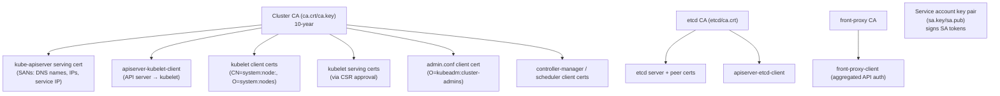

# 5.21 Certificates, identity, admission control and policy

| | |
|---|---|
| Level | Advanced |
| Priority tier | 1 |
| Lab venue | kubeadm lab; `openssl`, `kubeadm certs`, `kubectl get csr`; Kyverno/Gatekeeper/ValidatingAdmissionPolicy; Dex or Keycloak for OIDC |
| Part | Part 5: Kubernetes |
| Status | Drafted, labs **untested** |

## Why this matters for AI infrastructure

A shared GPU cluster is attractive to attackers and error-prone for users: privileged containers can read the host, hostPath mounts can expose model weights and credentials, unbounded GPU requests can starve a team, unsigned images can inject malware into training pipelines, and expired certificates can silently take down an entire control plane on a Monday morning. Three mechanisms keep this under control: the **PKI and identity** layer (who is speaking and can they be trusted), **admission control** (what is allowed to enter the API), and **policy as code** (organisation rules encoded and enforced). This chapter explains certificate management in Kubernetes (including rotation and failure modes), identity federation, the admission chain, Pod Security, and practical policies for AI platforms.

## Prerequisites and outcomes

Needs 5.5, 5.9, 5.16. After this chapter you can:

- Map the cluster PKI (CAs, leaf certificates, who uses which), inspect and renew certificates, rotate kubelet and etcd certificates, and plan CA rotation.
- Use the CertificateSigningRequest API, kubelet TLS bootstrapping, approvers, and cert-manager for workload certificates.
- Configure OIDC authentication and understand token-based identities and impersonation.
- Describe the admission pipeline and use built-in plugins, webhooks (mutating/validating), and `ValidatingAdmissionPolicy` (CEL); design safe webhooks.
- Apply Pod Security Standards (privileged/baseline/restricted) via Pod Security Admission and adopt policy engines (Kyverno, OPA Gatekeeper) for custom rules, mutation, generation and verification (image signatures).
- Build a layered guardrail set for multi-tenant AI clusters (GPU limits, queues, host access, registries, labels, network).
- Troubleshoot certificate and admission failures.

## 1. The Kubernetes PKI

kubeadm clusters have a small PKI in `/etc/kubernetes/pki`, all issued by self-managed CAs:



- **Root CAs**: cluster CA, etcd CA, front-proxy CA (separate trust domains); CA private keys live on control-plane nodes (and should be backed up offline, 5.20). Leaf certificates are valid **1 year** by default; CAs 10 years.
- **Service account signing key** (`sa.key`) signs tokens (JWT); public key verifies; rotating it invalidates existing tokens unless multiple keys are accepted.
- **Kubelet certificates**: client cert (to the API server, auto-rotated with `rotateCertificates`) and serving cert (for the kubelet API on 10250; self-signed by default unless `serverTLSBootstrap` + approval).
- **Aggregated API servers and webhooks** use CA bundles in `APIService.spec.caBundle` and webhook configurations' `caBundle` (cert-manager's CA injector keeps them current).
- Managed services hide the control-plane PKI but you still manage: workload certificates, webhook certs, ingress certs, mTLS between services, and OIDC.

### Inspecting and renewing

```bash
sudo kubeadm certs check-expiration                       # lists leaf certs, expiry, residual time, CA
sudo openssl x509 -in /etc/kubernetes/pki/apiserver.crt -noout -subject -issuer -dates -ext subjectAltName
sudo kubeadm certs renew all                              # renews kubeadm-managed leafs (not CAs); on each control-plane node
# restart the static pods to load new certs:
sudo mv /etc/kubernetes/manifests/kube-apiserver.yaml /tmp/ && sleep 20 && sudo mv /tmp/kube-apiserver.yaml /etc/kubernetes/manifests/
# (or restart kubelet; same for controller-manager, scheduler, etcd)
sudo cp /etc/kubernetes/admin.conf ~/.kube/config         # admin.conf embeds a client cert that was renewed
kubectl get csr                                           # kubelet serving CSRs pending approval?
```

`kubeadm upgrade` renews certificates automatically (a reason to upgrade at least yearly). Failure to renew leads to: `x509: certificate has expired or is not yet valid` in kubectl, kubelet, API server logs; control-plane components crash-loop; nodes NotReady. Alert on expiry: Prometheus `apiserver_client_certificate_expiration_seconds_bucket`, `kubelet_certificate_manager_client_ttl_seconds`, cert-manager's `certmanager_certificate_expiration_timestamp_seconds`, `x509-certificate-exporter`, or blackbox probes of the API endpoint's cert.

### Rotating CAs

Rare, delicate, disruptive: introduce a new CA alongside the old (CA bundles containing both), re-issue all leafs from the new CA, update kubeconfigs and bundles everywhere (kubelets, controllers, aggregated APIs, webhooks, CI), then remove the old CA. Kubernetes doesn't automate it end to end (cluster API, cloud providers, and tools like `kubeadm` + manual steps or Cluster API MachineHealth rotate by replacing nodes). Plan for it after a compromise; limit CA lifetime exposure by protecting CA keys (offline backup, HSM/KMS-backed signers, short-lived leafs).

### Kubelet TLS bootstrapping and CSRs

Workers join with a **bootstrap token** (group `system:bootstrappers`) that can only create CSRs; the **CSR approver** in kube-controller-manager auto-approves kubelet client-cert requests (`csrapproving`), and the signer issues certs (`kubernetes.io/kube-apiserver-client-kubelet`). Serving certificates (`kubernetes.io/kubelet-serving`) are not auto-approved for security (SAN validation): approve manually (`kubectl certificate approve`), via `kubelet-csr-approver` (checks hostname/IP matches), or cert-manager's CSR support. The generic **CertificateSigningRequest API** (`certificates.k8s.io/v1`) lets users/workloads request certs from signers: `kubernetes.io/kube-apiserver-client` (user client certs), `kubernetes.io/legacy-unknown`, or custom signers (`example.com/internal-ca`) implemented by controllers (cert-manager `Issuer` as signer, SPIFFE/SPIRE integrations, Vault PKI).

```bash
# Issue a client cert for a user via the CSR API
openssl genrsa -out jane.key 2048
openssl req -new -key jane.key -subj "/CN=jane/O=team-a-researchers" -out jane.csr
kubectl create -f - <<EOF
apiVersion: certificates.k8s.io/v1
kind: CertificateSigningRequest
metadata: { name: jane }
spec:
  request: $(base64 -w0 < jane.csr)
  signerName: kubernetes.io/kube-apiserver-client
  expirationSeconds: 86400            # short-lived
  usages: [client auth]
EOF
kubectl certificate approve jane
kubectl get csr jane -o jsonpath='{.status.certificate}' | base64 -d > jane.crt
kubectl config set-credentials jane --client-certificate=jane.crt --client-key=jane.key --embed-certs
```

Note: Kubernetes cannot revoke client certificates (no CRL/OCSP support in the API server); compromise response = remove RBAC bindings for that identity/group, or rotate the CA. Prefer OIDC tokens (expiring, revocable at IdP) for humans.

### Workload certificates and mTLS

**cert-manager** (5.12) issues certs for ingress, webhooks, and service-to-service mTLS (`Certificate` → Secret; issuers: CA, ACME, Vault, Venafi, AWS PCA, step-ca; `csi-driver` for per-pod certs). Service meshes (Istio/Linkerd/Cilium) issue short-lived workload identities (SPIFFE IDs) with automatic rotation (5.28). **trust-manager** distributes CA bundles. Keep webhook serving certs auto-renewed (a classic outage: expired webhook cert → all matching API requests fail).

## 2. Identity and authentication federation

(Authentication methods in 5.16.) Production practice:

- **OIDC for humans** (Keycloak, Dex, Okta, Entra ID, Google): configure API server `--oidc-issuer-url`, `--oidc-client-id`, `--oidc-username-claim`, `--oidc-groups-claim`, `--oidc-username-prefix=oidc:`, `--oidc-groups-prefix=oidc:` or use the structured `AuthenticationConfiguration` file (supports multiple issuers, claim validation rules with CEL, user validation rules). kubectl uses an exec plugin (`kubelogin`/`oidc-login`) to obtain/refresh tokens. Map IdP groups to RBAC bindings; enforce MFA and short token lifetimes at the IdP. The API server must trust the IdP's CA and fetch JWKS.
- **Machine identities**: bound ServiceAccount tokens, workload identity federation (cloud IAM/Vault trust the cluster's OIDC issuer), SPIFFE/SPIRE for cross-platform workload identity.
- **Impersonation** (`--as`, `--as-group`): admins and automation can act as others (audited); restrict `impersonate` verb tightly; useful for testing RBAC and for gateways/dashboards acting on behalf of users.
- **Webhook token authentication** (cloud IAM authenticators), **authenticating proxy** (front proxy for dashboards; trust headers only from the proxy CA), **anonymous auth** disabled in production (`--anonymous-auth=false`; some health endpoints require care).
- **Audit identity**: user.username, groups, impersonatedUser in audit events; ensure usernames are unique and not spoofable (prefixing avoids collisions between IdP names and system users).

### Before you build workload identity

Workload identity is an advanced topic. Before you build it, write down what your workloads actually need. Many organizations do not need workload-to-workload identity at first. Shared secrets are the simplest model, and teams understand them well. They also work across platforms. But a shared secret needs a fixed life span and rotation, and it must be redistributed to both the client and the server. Vault can help with the re-syncing. It still has the secure introduction problem: how do you seed the first secret safely, before any identity exists? An attacker who compromises that first step breaks the guarantee of unique identity.

### Platform-mediated identity on AWS

Sometimes the platform can decide who a workload is, without the workload asserting anything. If every workload runs on one homogeneous platform, the platform reads metadata about each workload and issues it a credential. On AWS, an EC2 instance asks the EC2 metadata API for credentials. AWS inspects the instance's properties and returns role-specific credentials. The instance then uses them to reach a service such as an S3 bucket. The platform must still authorize the request. Authentication alone does not grant permissions.

The book focuses on AWS because it is the vendor it most often sees in the field. The node-level model works well for one workload per node. It breaks down when many containers and multitenant applications share a node. That gap is why the tools below exist. The book strongly advises against `kube2iam`. It covers `kube2iam` because teams keep running into it, and it wants you to know its limits before you adopt it.

### Cloud metadata proxies (`kube2iam` / `kiam`) versus `IRSA`

Before projected ServiceAccount tokens (`PSAT`s) and cloud OIDC federation were available, clusters on AWS used node-level metadata proxies such as `kube2iam` and `kiam` to map `iam.amazonaws.com/role: <role-arn>` Pod annotations to IAM roles. As *Production Kubernetes* (Chapter 10) explains, both proxy approaches have architectural security flaws compared with **IAM Roles for Service Accounts (`IRSA`)**:

- **`kube2iam`** runs as a `DaemonSet` on every worker node and inserts an `iptables` rule redirecting traffic destined for the EC2 metadata API to the local `kube2iam` proxy. Every worker node's IAM instance profile must be allowed to assume the superset of all IAM roles needed by any Pod in the cluster, so a container breakout on any worker compromises every role.
- **`kiam`** splits the proxy into a node `DaemonSet` agent and a `kiam` server placed on dedicated control-plane or server nodes so that only the server nodes hold IAM role-assumption permissions. However, if a user can submit a Pod with `spec.nodeName` already populated (bypassing the scheduler and landing directly on a server node, or starting and reaching the metadata endpoint before the proxy's IP-to-Pod cache/guards prevent it), the Pod can gain unrestricted access to the EC2 metadata API unless an admission webhook blocks pre-populated `spec.nodeName` fields.
- **`IRSA`** eliminates metadata proxying entirely: a mutating webhook injects a projected ServiceAccount token (`audience: sts.amazonaws.com`, `expirationSeconds: 86400` mounted at `/var/run/secrets/eks.amazonaws.com/serviceaccount/token` in the book's example) along with `AWS_ROLE_ARN` and `AWS_WEB_IDENTITY_TOKEN_FILE` environment variables. The AWS SDK calls `sts:AssumeRoleWithWebIdentity` directly with that short-lived JWT, which AWS IAM verifies against the cluster's public OIDC `.well-known` discovery endpoint and JWKS keys.

### IRSA in practice

`IRSA` keeps the same experience as `kiam` and `kube2iam`. A user annotates a pod with the IAM role it should assume. The implementation is very different, and it removes the security concerns of the earlier tools. AWS IAM can federate identity to a third-party OIDC provider, here the Kubernetes API server. Kubernetes can already create and sign short-lived tokens for each pod, as the PSAT section showed. The AWS SDK's credential provider calls `sts:AssumeRoleWithWebIdentity` and passes that PSAT. A webhook injects the role and token path as environment variables, based on `serviceAccountName`:

```yaml
apiVersion: apps/v1
kind: Pod
metadata:
  name: myapp
spec:
  serviceAccountName: my-serviceaccount
  containers:
  - name: myapp
    image: myapp:1.2
    env:
    - name: AWS_ROLE_ARN
      value: "arn:aws:iam::123456789012:role/\
eksctl-irptest-addon-iamsa-default-my-\
serviceaccount-Role1-UCGG6NDYZ3UE"
    - name: AWS_WEB_IDENTITY_TOKEN_FILE
      value: /var/run/secrets/eks.amazonaws.com/serviceaccount/token
    volumeMounts:
    - mountPath: /var/run/secrets/eks.amazonaws.com/serviceaccount
      name: aws-iam-token
      readOnly: true
  volumes:
  - name: aws-iam-token
    projected:
      defaultMode: 420
      sources:
      - serviceAccountToken:
          audience: sts.amazonaws.com
          expirationSeconds: 86400
          path: token
```

Kubernetes does not expose a `.well-known` OIDC endpoint natively. You must publish the cluster's discovery information at a public location, such as a static S3 bucket. Then AWS IAM can verify the token with Kubernetes' public service account signing key. Once verified, IAM exchanges the PSAT for the role's credentials. The setup is clunky, but its security model is the best of the pod-role approaches. Mapping service accounts to IAM roles is also easy to understand. The main downside is that IRSA is harder to deploy outside Amazon Elastic Kubernetes Service (EKS). Newer Kubernetes features, such as exposing the cluster itself as an OIDC provider, reduce that work.

### Cross-platform workload identity with `SPIFFE` and `SPIRE`

When workloads span multiple clouds, bare-metal GPU clusters, and virtual machines, **SPIFFE** (Secure Production Identity Framework for Everyone) and its reference implementation **SPIRE** (SPIFFE Runtime Environment) issue portable cryptographic identities (`spiffe://trust-domain/hierarchical/workload`) encoded as short-lived X.509 certificates (**X.509-SVIDs**) or JWT tokens (**JWT-SVIDs**). As *Production Kubernetes* (Chapter 10) describes, the attestation flow has two stages:

1. **Node attestation (`spire-server` and `spire-agent`)**: `spire-server` runs as the central signing authority and registration store, while `spire-agent` runs as a `DaemonSet` on every node. When an agent starts, it proves its node identity to `spire-server` using platform evidence (such as a Kubernetes Projected ServiceAccount Token via the `k8s_psat` attestor or cloud instance metadata) and receives an X.509-SVID for the node. In the book's example (untested here), the administrator registers the node group with:

```bash
/opt/spire/bin/spire-server entry create \
  -spiffeID spiffe://production-trust-domain/nodes \
  -selector k8s_psat:cluster:production-cluster \
  -selector k8s_psat:agent_ns:spire \
  -selector k8s_psat:agent_sa:spire-agent \
  -node
```

2. **Workload attestation (Workload API Unix domain socket)**: workloads connect to the node-local `spire-agent` over a Unix domain socket (`unix:///run/spire/sockets/agent.sock` in the book's example) without presenting any initial secret (solving the "secure introduction" problem). The `spire-agent` inspects kernel and `kubelet` metadata for the calling process (Pod namespace, ServiceAccount, Pod labels, container image) and matches them against registration entries created on `spire-server`, such as the book's example (untested here):

```bash
/opt/spire/bin/spire-server entry create \
  -spiffeID spiffe://production-trust-domain/service-a \
  -parentID spiffe://production-trust-domain/nodes \
  -selector k8s:ns:default \
  -selector k8s:sa:service-a \
  -selector k8s:pod-label:app:frontend \
  -selector k8s:container-image:docker.io/johnharris85/service-a:v0.0.1
```

Once matched, `spire-agent` returns the workload's X.509-SVID or JWT-SVID (or streams certificates directly to an Envoy sidecar over Envoy's Secret Discovery Service, `SDS`, API). Note that because the Kubernetes workload attestor queries the `kubelet` (which validates tokens via `TokenReview`), API server downtime can interrupt attestation of newly started Pods; the `--authentication-token-webhook-cache-ttl` `kubelet` flag controls how long `TokenReview` responses are cached.

### SPIRE integration points and trade-offs

Once SPIRE issues identities, applications still need a way to use them. The right route depends on how tightly you accept coupling to the platform, and how much control users have over the environment.

**Direct application access.** SPIRE provides SDKs for Go, C and Java. They wrap existing HTTP libraries and obtain and verify identities natively. This Go example calls a `service-b` Kubernetes Service and expects a specific SPIFFE ID in its x509-SVID:

```go
err := os.Setenv("SPIFFE_ENDPOINT_SOCKET",
    "unix:///run/spire/sockets/agent.sock")
conn, err := spiffe.DialTLS(ctx, "tcp", "service-b",
    spiffe.ExpectPeer("spiffe://production-trust-domain/service-b"))
if err != nil {
    log.Fatalf("Unable to create TLS connection: %v", err)
}
```

The SPIRE agent also exposes a gRPC API for languages without an SDK. The book does not recommend direct integration for end-user applications. It ties the app to the platform, requires mounting the agent's Unix socket into the pod, and is hard to extend. Direct use fits platform teams building tooling that wraps or extends SPIRE.

**Sidecar proxy.** SPIRE supports the Envoy SDS API, so it can publish certificates to an Envoy proxy. Envoy uses the SVID for TLS and the trust bundle to verify incoming connections. You can restrict which SPIFFE IDs may connect in two ways. You can list `verify_subject_alt_name` values in the Envoy configuration. Or you can use Envoy's External Authorization API to delegate the decision to Open Policy Agent (OPA). This Rego policy allows a `GET` on `/api` only from the frontend's SPIFFE ID:

```rego
package envoy.authz
import input.attributes.request.http as http_request
import input.attributes.source.address as source_address
default allow = false
allow {
  http_request.path == "/api"
  http_request.method == "GET"
  svc_spiffe_id == "spiffe://production-trust-domain/frontend"
}
svc_spiffe_id = client_id {
  [_, _, uri_type_san] := split(
    http_request.headers["x-forwarded-client-cert"], ";")
  [_, client_id] := split(uri_type_san, "=")
}
```

Envoy checks the caller's certificate against the SPIRE trust bundle, then asks OPA. The policy reads the SVID and allows the request only if its ID matches. OPA then sits in the critical request path, so account for that in the design.

**Service mesh.** Istio's CA creates SVIDs for all service accounts. The format is `spiffe://cluster.local/ns/<namespace>/sa/<service_account>`, so mesh services can use SPIFFE-aware endpoints. Service meshes are outside this chapter's scope. Most of them build on the methods and tools covered here.

**Other integrations.** SPIRE can write SVIDs and trust bundles to a filesystem, so applications can reload when files change. That keeps applications fairly agnostic of SPIRE, but certificates on disk can be stolen. An Nginx module can stream certificates from SPIRE, and custom Nginx modules can limit which SPIFFE IDs connect. For secrets, SPIRE can solve the secure introduction problem for HashiCorp Vault. Vault can federate OIDC with SPIRE, and Vault roles can bind to SPIFFE IDs. A workload then trades its JWT SVID for a Vault role. The same federation idea works with AWS. The downside there is that SPIRE must be publicly reachable, so AWS can fetch the JSON Web Key Set (JWKS) it needs to validate tokens.

SPIFFE and SPIRE have real strengths. They rely on widely supported x509 and JWT standards. They also scope identity down to a single pod, by combining PSATs with SPIRE selectors. That helps when sidecar containers in one pod need different levels of access. The approach is also the most labor-intensive. It takes expertise and one more component to run. Each workload may need registering, which can be automated. Keep in mind that the kubelet's TokenReview cache affects permission changes. The `--authentication-token-webhook-cache-ttl` flag controls that cache. A large value slows down permission revocation, so do not set it high.

### Choosing an identity model

User identity usually comes from an SSO provider, so OIDC is the natural path. Kubernetes can sit outside the main identity strategy, but integrating it directly gives better visibility and control. That matters most across several clusters. Workload identity is often an afterthought beyond default ServiceAccounts. That can be fine early on. Robust in-cluster and cross-platform workload identity is complex, though, and needs deeper knowledge of external tools. Once your platform is mature, these patterns add defense in depth if a breach happens.

## 3. Admission control

Admission runs after authn/authz and before persistence (5.5). Types:

| Phase | Mechanism | Examples |
|---|---|---|
| **Built-in mutating** | Compiled into the API server (enable/disable via `--enable-admission-plugins`) | `NamespaceLifecycle`, `LimitRanger`, `ServiceAccount`, `DefaultStorageClass`, `DefaultTolerationSeconds`, `MutatingAdmissionWebhook`, `Priority`, `RuntimeClass`, `StorageObjectInUseProtection`, `TaintNodesByCondition`, `ExtendedResourceToleration` (opt-in) |
| **Mutating webhooks** | External HTTPS service called with `AdmissionReview`; returns JSON patches | Istio sidecar injector, Kyverno mutate, cert-manager CA injector, custom GPU defaults |
| **Validating built-in** | | `ResourceQuota`, `PodSecurity`, `NodeRestriction`, `Priority`, `ValidatingAdmissionPolicy`, `ValidatingAdmissionWebhook`, `CertificateApproval/Signing/SubjectRestriction` |
| **Validating webhooks** | External services return allow/deny with message | OPA Gatekeeper, Kyverno validate, image policy webhooks, custom checks |
| **ValidatingAdmissionPolicy (VAP)** | In-process, declarative **CEL** expressions; `ValidatingAdmissionPolicy` + `ValidatingAdmissionPolicyBinding` (with params) | Cheap, no webhook latency/availability risk; GA in recent releases; `MutatingAdmissionPolicy` (CEL mutations) arriving |

Registration objects: `MutatingWebhookConfiguration` / `ValidatingWebhookConfiguration` with `rules` (operations, apiGroups/versions/resources), `clientConfig` (service or URL + `caBundle`), `failurePolicy` (`Fail`/`Ignore`), `timeoutSeconds` (≤30; keep ≤10), `matchPolicy`, `namespaceSelector`, `objectSelector`, `matchConditions` (CEL pre-filters), `sideEffects` (`None`/`NoneOnDryRun`), `admissionReviewVersions`, `reinvocationPolicy` (mutating).

```yaml
apiVersion: admissionregistration.k8s.io/v1
kind: ValidatingAdmissionPolicy
metadata: { name: gpu-request-limits }
spec:
  failurePolicy: Fail
  matchConstraints:
    resourceRules:
      - apiGroups: [""]
        apiVersions: ["v1"]
        operations: ["CREATE", "UPDATE"]
        resources: ["pods"]
  variables:
    - name: gpus
      expression: "object.spec.containers.map(c, has(c.resources.limits) && 'nvidia.com/gpu' in c.resources.limits ? int(c.resources.limits['nvidia.com/gpu']) : 0).sum()"
  validations:
    - expression: "variables.gpus <= 8"
      message: "A single pod may request at most 8 GPUs."
    - expression: "variables.gpus == 0 || has(object.spec.priorityClassName)"
      message: "GPU pods must set a priorityClassName."
      reason: Invalid
---
apiVersion: admissionregistration.k8s.io/v1
kind: ValidatingAdmissionPolicyBinding
metadata: { name: gpu-request-limits-prod }
spec:
  policyName: gpu-request-limits
  validationActions: [Deny, Audit]                # Warn | Audit | Deny
  matchResources:
    namespaceSelector: { matchLabels: { env: prod } }
```

Webhook design rules (they are production-critical, 5.5): high availability (≥2-3 replicas, PDB, anti-affinity), fast (under 100 ms typical), idempotent, no external dependencies in the request path, `failurePolicy: Ignore` for non-security-critical mutations (and `Fail` only where the risk of bypass is worse than outage), exclude `kube-system` and the webhook's own namespace to avoid bootstrap deadlocks (a webhook that blocks creation of its own pods), selectors to limit scope, certificate auto-renewal, metrics and alerts (`apiserver_admission_webhook_admission_duration_seconds`, rejection counters), dry-run safe (`sideEffects: None`), test with `kubectl --dry-run=server`, and a break-glass procedure (delete the webhook configuration) documented.

In *Production Kubernetes* Chapter 8 (*Admission Control*), Josh Rosso et al. contrast built-in ("in-tree") controllers like **`NamespaceLifecycle`** (which rejects any `CREATE` request inside a Namespace whose `status.phase == Terminating`, while automatically creating the `default`, `kube-system`, and `kube-public` namespaces) against custom Go webhooks built with **`controller-runtime`** and **`Kubebuilder`**:
- **`controller-runtime` `Handle` and `PatchResponseFromRaw`:** Instead of manually constructing RFC 6902 `JSONPatch` arrays by hand, a `controller-runtime` mutating webhook implements `func (w *Webhook) Handle(ctx context.Context, req admission.Request) admission.Response`, decodes `req.Object.Raw` into a typed Go struct (such as a Cluster API `VSphereMachine` checking for `vm.Annotations["infoblox"]`), mutates the struct fields (allocating an IP from Infoblox), marshals the modified struct to `marshaledVM`, and returns **`admission.PatchResponseFromRaw(req.Object.Raw, marshaledVM)`**—which automatically computes the JSONPatch diff between the original raw request and the mutated struct.
- **Kubebuilder webhook code-generation markers:** Adding a single comment marker above the Go handler generates the `MutatingWebhookConfiguration` YAML automatically:
  `// +kubebuilder:webhook:path=/infoblox-ipam,mutating=true,failurePolicy=fail,groups="infrastructure.cluster.x-k8s.io",resources=vspheremachines,verbs=create;update,versions=v1alpha3,name=infoblox.mutations.io`

### Serving certificates for an admission webhook

The API server calls a webhook over HTTPS only. That protects the traffic, but it means the webhook needs a certificate. The easiest source is the cluster's own certificate authority (CA), which can sign a certificate for the webhook on request. The steps are: make a private key and a certificate signing request (CSR), submit it to the cluster, approve it, and download the result.

First, generate the key and the CSR. The book uses a short Go program for this. It creates a 1024-bit RSA key and writes the CSR with the webhook URL in its URI field:

```go
package main
import (
"crypto/rand"
"crypto/rsa"
"crypto/x509"
"crypto/x509/pkix"
"encoding/asn1"
"encoding/pem"
"net/url"
"os"
)
func main() {
host := os.Args[1]
name := "server"
key, err := rsa.GenerateKey(rand.Reader, 1024)
if err != nil {
panic(err)
}
keyDer := x509.MarshalPKCS1PrivateKey(key)
keyBlock := pem.Block{
Type: "RSA PRIVATE KEY",
Bytes: keyDer,
}
keyFile, err := os.Create(name + ".key")
if err != nil {
panic(err)
}
pem.Encode(keyFile, &keyBlock)
keyFile.Close()
commonName := "myuser"
emailAddress := "someone@myco.com"
org := "My Co, Inc."
orgUnit := "Widget Farmers"
city := "Seattle"
state := "WA"
country := "US"
subject := pkix.Name{
CommonName: commonName,
Country: []string{country},
Locality: []string{city},
Organization: []string{org},
OrganizationalUnit: []string{orgUnit},
Province: []string{state},
}
uri, err := url.ParseRequestURI(host)
if err != nil {
panic(err)
}
asn1, err := asn1.Marshal(subject.ToRDNSequence())
if err != nil {
panic(err)
}
csr := x509.CertificateRequest{
RawSubject: asn1,
EmailAddresses: []string{emailAddress},
SignatureAlgorithm: x509.SHA256WithRSA,
URIs: []*url.URL{uri},
}
bytes, err := x509.CreateCertificateRequest(rand.Reader, &csr, key)
if err != nil {
panic(err)
}
csrFile, err := os.Create(name + ".csr")
if err != nil {
panic(err)
}
pem.Encode(csrFile, &pem.Block{Type: "CERTIFICATE REQUEST", Bytes: bytes})
csrFile.Close()
}
```

Run the program with the webhook URL as its argument:

```
$ go run csr-gen.go <URL-for-webhook>
```

The book says this writes `server.csr` and `server-key.pem`. The code above names the key file `server.key`, so check which name you get before you go on.

Next, wrap the CSR in a Kubernetes CertificateSigningRequest. The `request` field must hold the base64-encoded CSR, so the book fills in the `REPLACEME` placeholder with a one-line `perl` command:

```
apiVersion: certificates.k8s.io/v1beta1
kind: CertificateSigningRequest
metadata:
name: validating-controller.default
spec:
groups:
- system:authenticated
request: REPLACEME
usages:
usages:
- digital signature
- key encipherment
- key agreement
- server auth
```

```
$ perl -pi -e s/REPLACEME/$(base64 server.csr | tr -d '\n')/ \
admission-controller-csr.yaml
```

Submit the request, approve it, and then download the signed certificate:

```
$ kubectl create -f admission-controller-csr.yaml
$ kubectl certificate approve validating-controller.default
$ kubectl get csr validating-controller.default -o json | \
jq -r .status.certificate | base64 -d > server.crt
```

You now have `server.crt` and the key for the webhook's HTTPS server. Serve them from the admission controller, and the API server can trust the endpoint.

## 4. Pod Security Standards and Admission

The **Pod Security Standards** define three cumulative profiles:

| Profile | Meaning | Blocks (selection) |
|---|---|---|
| **Privileged** | Unrestricted | Nothing |
| **Baseline** | Prevents known privilege escalations; minimal friction | hostNetwork/hostPID/hostIPC, privileged containers, hostPath volumes, host ports, most added capabilities (allows default set), unsafe sysctls, `procMount` unmasked, AppArmor/SELinux overrides, windows HostProcess |
| **Restricted** | Hardened best practice | Baseline + must run as non-root, `allowPrivilegeEscalation: false`, drop `ALL` capabilities (add only `NET_BIND_SERVICE`), `seccompProfile: RuntimeDefault/Localhost`, restricted volume types (configMap, csi, downwardAPI, emptyDir, ephemeral, persistentVolumeClaim, projected, secret) |

**Pod Security Admission** (built-in, replaces PodSecurityPolicy removed in 1.25) is configured per namespace via labels:

```bash
kubectl label ns team-a pod-security.kubernetes.io/enforce=baseline pod-security.kubernetes.io/enforce-version=latest \
  pod-security.kubernetes.io/warn=restricted pod-security.kubernetes.io/audit=restricted
```

Modes: `enforce` (reject), `audit` (record in audit log), `warn` (client warning). Cluster-wide defaults and exemptions (usernames, runtimeClasses, namespaces) in the `AdmissionConfiguration`. Rollout: start with `warn`/`audit` at `restricted`, fix workloads, then `enforce`.

In *Kubernetes: Up and Running* Chapter 19 (*Securing Applications in Kubernetes*), Brendan Burns et al. demonstrate four practical tools for auditing and hardening Pod security:
1. **Inspecting inside-container security posture with `amicontained` (`r.j3ss.co/amicontained:v0.4.9`):** Running `amicontained` inside a Pod prints the active container runtime, enabled namespaces (`pid: true, user: false`), AppArmor profile (`docker-default (enforce)` or `unconfined`), bounding Linux capabilities (`chown`, `dac_override`, `net_raw`, `setuid`, etc.), seccomp status (`disabled` vs `filtering`), and the exact count of blocked syscalls.
2. **Cluster-wide Pod Security dry-run preview (`--dry-run=server`):** Before enforcing `baseline` or `restricted` on existing namespaces, run a server-side dry-run label across all namespaces to get an instant report of every existing Pod in the cluster that would violate the standard without actually modifying any namespace:
   `kubectl label --dry-run=server --overwrite ns --all pod-security.kubernetes.io/enforce=baseline`
3. **Stronger workload isolation with `RuntimeClass` (`gvisor`, `firecracker` / `kata`):** Setting `spec.runtimeClassName: firecracker` (or `gvisor` / `kata`) routes the Pod through a sandboxed/VM-isolated CRI runtime handler rather than standard shared-kernel `runc`.
4. **Benchmarking node and control-plane configurations with `kube-bench`:** Running Aqua Security's `kube-bench` Job checks the live cluster against the **CIS Kubernetes Benchmark** (such as `4.2.1 Ensure that the --anonymous-auth argument is set to false`, `4.2.4 Ensure that the --read-only-port argument is set to 0`, `4.2.6 Ensure that the --protect-kernel-defaults argument is set to true`, and `4.2.12 Verify that the RotateKubeletServerCertificate argument is set to true`) and outputs `[PASS]`/`[WARN]`/`[FAIL]` with exact remediation steps.

GPU/HPC realities: many GPU stacks need exceptions: the **GPU Operator, device plugin, DCGM exporter, NVIDIA driver containers, Network Operator, CNI agents, CSI node plugins, node-problem-detector** require privileged/hostPath/hostNetwork and live in dedicated system namespaces labelled `privileged`. Tenant training pods can usually meet `baseline` (no hostPath/privileged; GPUs via device plugin) and often `restricted` with `runAsNonRoot` images; RDMA workloads need `IPC_LOCK` (baseline allows only a default capability set; `IPC_LOCK` is not in it, so requires a policy exception or a profile-level allowance via policy engine/namespace label). Document exceptions per namespace instead of weakening the cluster default.

## 5. Policy engines

### Kyverno

Kubernetes-native policy engine (policies are CRDs in YAML, no new language). Capabilities: **validate** (patterns, CEL, deny conditions), **mutate** (patchStrategicMerge, JSON6902, foreach), **generate** (create resources when something happens, e.g., default NetworkPolicy/Quota/RBAC per new namespace), **verifyImages** (cosign/Notary signatures and attestations, SBOM/provenance checks), **cleanup** policies (TTL-based deletion), policy exceptions (`PolicyException`), background scanning and reports (`PolicyReport`), CLI for CI testing (`kyverno test`/`apply`).

```yaml
apiVersion: kyverno.io/v1
kind: ClusterPolicy
metadata: { name: require-queue-and-limits }
spec:
  background: true
  rules:
    - name: gpu-jobs-need-queue-label
      match:
        any:
          - resources: { kinds: [Job, "kubeflow.org/v1/PyTorchJob"], namespaceSelector: { matchLabels: { tier: training } } }
      validate:
        failureAction: Enforce
        message: "Training jobs must carry a kueue.x-k8s.io/queue-name label."
        pattern:
          metadata:
            labels:
              kueue.x-k8s.io/queue-name: "?*"
    - name: default-seccomp
      match: { any: [ { resources: { kinds: [Pod] } } ] }
      mutate:
        patchStrategicMerge:
          spec:
            securityContext:
              +(seccompProfile): { type: RuntimeDefault }        # add if absent
---
apiVersion: kyverno.io/v1
kind: ClusterPolicy
metadata: { name: default-namespace-guardrails }
spec:
  rules:
    - name: generate-default-deny
      match: { any: [ { resources: { kinds: [Namespace], selector: { matchLabels: { managed-tenant: "true" } } } } ] }
      generate:
        apiVersion: networking.k8s.io/v1
        kind: NetworkPolicy
        name: default-deny
        namespace: "{{request.object.metadata.name}}"
        synchronize: true
        data: { spec: { podSelector: {}, policyTypes: [Ingress, Egress] } }
    - name: verify-signed-images
      match: { any: [ { resources: { kinds: [Pod] } } ] }
      verifyImages:
        - imageReferences: ["registry.example.com/ml/*"]
          mutateDigest: true
          attestors:
            - entries:
                - keyless: { issuer: "https://token.actions.githubusercontent.com", subject: "https://github.com/acme/*" }
```

### OPA Gatekeeper

Admission controller using **Rego** in `ConstraintTemplate`s (policy logic) and `Constraint` CRs (parameters/matching); audit of existing resources; external data providers; mutation support (`Assign`, `AssignMetadata`); Gatekeeper library of templates. Powerful but requires Rego skill; choose Kyverno for Kubernetes-centric YAML simplicity or Gatekeeper where OPA is already the standard across systems (also Conftest for CI, 4.2).

As shown in *Production Kubernetes* (Chapter 8) and *Kubernetes: Up and Running* (3rd edition, Chapter 20), Gatekeeper runs in the `gatekeeper-system` namespace (`gatekeeper-controller-manager` and `gatekeeper-audit` deployments) and registers `gatekeeper-validating-webhook-configuration` (which defaults to `failurePolicy: Ignore` and skips namespaces carrying the `admission.gatekeeper.sh/ignore` label). Four concrete Gatekeeper building blocks cover validation, cross-resource inventory checks, dry-run auditing, and mutation:

1. **Inventory replication (`Config` resource in `config.gatekeeper.sh/v1alpha1`)**: by default, OPA only sees the incoming `input.review` object. Policies that compare an incoming resource against existing objects in the cluster (such as checking that an `Ingress` host is unique across all namespaces, or reading an allowed host regex annotation from the target `Namespace`) require syncing those kinds into Gatekeeper's `data.inventory` cache. In the books' examples (untested here), a `Config` resource caches `Namespace`, `Pod`, and `Ingress` objects:

```yaml
apiVersion: config.gatekeeper.sh/v1alpha1
kind: Config
metadata:
  name: config
  namespace: "gatekeeper-system"
spec:
  sync:
    syncOnly:
      - group: ""
        version: "v1"
        kind: "Namespace"
      - group: ""
        version: "v1"
        kind: "Pod"
      - group: "extensions"
        version: "v1beta1"
        kind: "Ingress"
      - group: "networking.k8s.io"
        version: "v1beta1"
        kind: "Ingress"
```

2. **`ConstraintTemplate` and `Constraint` (with `enforcementAction: deny | dryrun | warn`)**: a `ConstraintTemplate` defines both the OpenAPI v3 parameter schema for a new constraint CRD (such as `K8sAllowedRepos`, `K8sRequiredLabels` / `k8srequiredlabels`, `K8sUniqueIngressHost`, or `LimitNamespaceIngress`) and the Rego `violation[{"msg": msg}]` rule evaluated by target `admission.k8s.gatekeeper.sh`. When rolling out a new `Constraint` on an existing cluster, setting `enforcementAction: dryrun` (or `warn`) lets the `gatekeeper-audit` controller record existing non-compliant objects in the constraint's `status.totalViolations` and `status.violations` list (along with `status.auditTimestamp`) without blocking workloads until teams remediate them. In the books' examples (untested here):

```yaml
apiVersion: templates.gatekeeper.sh/v1beta1
kind: ConstraintTemplate
metadata:
  name: k8sallowedrepos
spec:
  crd:
    spec:
      names:
        kind: K8sAllowedRepos
      validation:
        openAPIV3Schema:
          properties:
            repos:
              type: array
              items:
                type: string
  targets:
    - target: admission.k8s.gatekeeper.sh
      rego: |
        package k8sallowedrepos
        violation[{"msg": msg}] {
          container := input.review.object.spec.containers[_]
          satisfied := [good | repo = input.parameters.repos[_] ; good = startswith(container.image, repo)]
          not any(satisfied)
          msg := sprintf("container <%v> has an invalid image repo <%v>, allowed repos are %v", [container.name, container.image, input.parameters.repos])
        }
---
apiVersion: constraints.gatekeeper.sh/v1beta1
kind: K8sAllowedRepos
metadata:
  name: repo-is-kuar-demo
spec:
  enforcementAction: dryrun
  match:
    kinds:
      - apiGroups: [""]
        kinds: ["Pod"]
    namespaces:
      - "default"
  parameters:
    repos:
      - "gcr.io/kuar-demo/"
```

Similarly, a `ConstraintTemplate` that queries `data.inventory` can enforce cross-object uniqueness (such as `k8suniqueingresshost` checking `data.inventory.namespace[ns][otherapiversion]["Ingress"][name]`) or match an `Ingress` host against a regex stored on its parent `Namespace` (`limitnamespaceingress` reading `data.inventory.cluster.v1.Namespace[input.review.object.metadata.namespace]`).

3. **Gatekeeper `Assign` mutation (`mutations.gatekeeper.sh/v1alpha1`)**: when Gatekeeper's mutating webhook is enabled, an `Assign` resource can set default or enforced field values before validating constraints run. In the book's (*Kubernetes: Up and Running*, Chapter 20) example (untested here), an `Assign` object sets `imagePullPolicy: Always` on every container in all Pods outside the `system` namespace:

```yaml
apiVersion: mutations.gatekeeper.sh/v1alpha1
kind: Assign
metadata:
  name: demo-image-pull-policy
spec:
  applyTo:
    - groups: [""]
      kinds: ["Pod"]
      versions: ["v1"]
  match:
    scope: Namespaced
    kinds:
      - apiGroups: ["*"]
        kinds: ["Pod"]
    excludedNamespaces: ["system"]
  location: "spec.containers[name:*].imagePullPolicy"
  parameters:
    assign:
      value: Always
```

4. **Gatekeeper Prometheus metrics**: Gatekeeper exports Prometheus metrics for continuous compliance monitoring and alerting, including the total number of audit violations (`gatekeeper_violations`), the number of constraints by `enforcementAction` (`gatekeeper_constraints`), constraint templates, request latency, and audit duration.

### Others

**ValidatingAdmissionPolicy** (CEL, built-in) for simple rules without extra controllers; **Kubewarden** (WASM policies), **jsPolicy**, **Polaris/kubescape** (audit/lint), **Cloud-provider policy** (Azure Policy for AKS, GKE Policy Controller), **Falco/Tetragon** for runtime detection (complement to admission). Layer them: PSA for baseline security; VAP/Kyverno/Gatekeeper for organisation rules; admission for supply chain; runtime security for detection.

### Image and supply-chain admission

Controls: allow-list registries (only `registry.example.com/*`), require digests (`mutateDigest`), verify cosign signatures and attestations (SLSA provenance, SBOM, vulnerability scan results), block `latest`, require `imagePullPolicy`, forbid images with critical CVEs via scan attestations; see 5.27 for the full chain. Beware admission latency pulling registry metadata (cache) and outage coupling to the registry (decide `failurePolicy`).

## 6. A guardrail set for multi-tenant GPU clusters

| Guardrail | Mechanism | Example rule |
|---|---|---|
| No privileged/host access for tenants | PSA `baseline`/`restricted` per tenant namespace | Deny `hostNetwork`, `hostPath`, `privileged`, hostPID; allow exceptions in system namespaces only |
| Non-root, drop capabilities, seccomp | PSA restricted + Kyverno mutate defaults | Default `RuntimeDefault` seccomp, require `runAsNonRoot` |
| GPU request bounds | VAP/Kyverno | Max GPUs per pod/namespace; require priorityClass/queue label |
| Only approved registries and signed images | Kyverno verifyImages / Gatekeeper | `registry.example.com/*` or NGC allow-list; cosign verification |
| Required metadata | Validate labels | `team`, `project`, `cost-center`, `owner` on namespaces and workloads |
| Resource requests/limits present | LimitRange + validate | Deny pods lacking memory limits; default ephemeral-storage |
| Network defaults | Kyverno generate | Default-deny NetworkPolicy and DNS allow per namespace |
| Quota defaults | Generate ResourceQuota/Kueue LocalQueue | New tenant namespace gets quota and queue |
| Storage classes | Validate PVC | Only approved StorageClasses; size caps; deny hostPath |
| Ingress hygiene | Validate Ingress/Gateway | TLS required, hostnames within team domain, no wildcard hosts |
| Service exposure | Validate Service | Deny `LoadBalancer` and `NodePort` in tenant namespaces unless approved |
| Node targeting | Validate/mutate | Deny `nodeName`; restrict nodeSelector/affinity to approved pools; inject tolerations for GPU pods |
| Time-boxed interactive resources | Kyverno cleanup / TTL | Delete notebooks after N hours idle (with notification) |
| Admin access to nodes | RBAC + policy | Deny `nodes/proxy`, `pods/exec` into system namespaces for tenants |
| Policy exceptions | `PolicyException` CRs with expiry via GitOps PR | Auditable, time-limited |

Rollout approach: policy-as-code in Git with tests (4.13, 4.26), `Audit`/`warn` mode first, report review, enforce per namespace/ring, communication to users with clear messages and docs links in rejection messages, break-glass procedures.

## 7. Troubleshooting

| Symptom | Likely cause | Fix |
|---|---|---|
| `x509: certificate has expired` (kubectl/kubelet/API) | Leaf cert expiry | `kubeadm certs renew`, restart components; add expiry alerts |
| Nodes NotReady after year; kubelet logs TLS errors | Kubelet client cert rotation failed or CA mismatch | Re-bootstrap kubelet, check CSR approvals, `rotateCertificates` |
| `kubectl logs` fails: certificate signed by unknown authority / no SAN | Kubelet serving cert self-signed or CSR unapproved | Enable `serverTLSBootstrap`, approve CSRs, install approver |
| Webhook `failed calling webhook ... x509` / `context deadline exceeded` | Expired/mismatched `caBundle`, webhook down/slow | Fix cert/CA injection, scale webhook, adjust timeout/failurePolicy |
| All pod creations rejected | Broken validating webhook with `Fail` | Delete/patch the webhook configuration, restore service, add exclusions |
| Pod rejected by PSA | Profile violation | Read message; fix securityContext or label namespace appropriately |
| Policy not applied | Wrong match, `background`/audit mode only, engine pods down, namespace excluded | Check policy reports, engine logs, `kubectl get cpol -o yaml` status |
| Kyverno/Gatekeeper slow API | Heavy policies, many resources, external lookups | Optimise rules, scope with selectors, scale replicas |
| OIDC login fails | Clock skew, wrong issuer/audience, CA trust, groups claim missing | API server logs, token claims (`jwt.io`/`jq`), `kubectl auth whoami` |
| Impersonation denied | Missing `impersonate` permission | RBAC for impersonate verbs on users/groups/serviceaccounts |
| CSR stuck Pending | No approver | Approve manually or deploy approver |
| ServiceAccount tokens invalid after maintenance | `sa.key` rotated without keeping old public key | Keep old key in `--service-account-key-file` list during rotation |

## 8. Lab

First, run the self-checking Python lab (`code/part05/pki_admission_policy_eval_lab.py`) locally. It verifies the Pod Security Standards evaluator (`evaluate_pod_security_standard`: testing `privileged`, `baseline`, and `restricted`, `KUR` Ch. 19), the `ValidatingAdmissionPolicy` + OPA Gatekeeper `K8sAllowedRepos` evaluator (`evaluate_vap_and_gatekeeper_policies`, `KUR` Ch. 20 & `PK` Ch. 8), and the `SPIFFE`/`SPIRE` workload attestation selector matcher (`match_spire_workload_entry`, `PK` Ch. 10).

```bash
python3 code/part05/pki_admission_policy_eval_lab.py
```

Next, on a `kubeadm` or `kind` cluster (all interactive shell steps below are `untested here`), work through these exercises:

1. **PKI tour**: list `/etc/kubernetes/pki`; decode each cert with `openssl x509`; draw who signs whom and which components present which certs; check SANs on the API server cert.
2. **Expiry drill**: in a throwaway cluster, shorten cert validity (or use `faketime`/clock jump on a lab VM), watch failures; renew with `kubeadm certs renew all`, restart static pods, restore kubeconfigs; add Prometheus alerts for expiry.
3. **CSR API**: issue a short-lived client cert for a user via CSR; bind RBAC; test; discuss revocation limits; compare with an OIDC login via Dex.
4. **Kubelet serving certs**: enable `serverTLSBootstrap`, observe pending CSRs and `kubectl logs` failures; install `kubelet-csr-approver`; verify.
5. **cert-manager + webhook certs**: deploy a sample webhook with cert-manager-managed certs and CA injection; let the cert expire (short duration) and observe renewal; break CA injection and see API failures; fix.
6. **OIDC**: configure Dex/Keycloak OIDC for the API server (or structured authentication config), map groups to RBAC, log in with `kubelogin`, inspect token claims, test token expiry.
7. **Admission chain**: write a mutating webhook (adds labels) and validating webhook (denies `:latest`); observe ordering; test `failurePolicy` Fail vs Ignore with the webhook down; add `namespaceSelector` exclusions; use `matchConditions`.
8. **ValidatingAdmissionPolicy**: implement the GPU limits policy with binding and params; test Warn/Audit/Deny; compare latency and operations with a webhook.
9. **PSA rollout**: label namespaces in warn/audit at restricted; deploy typical workloads and observe warnings; fix securityContexts; switch to enforce; handle GPU Operator namespace exception.
10. **Kyverno/Gatekeeper**: implement the guardrail table's key rules (queue label required, approved registries, default NetworkPolicy generation, seccomp default); use `kyverno test` in CI with fixtures; produce a policy report; handle a `PolicyException`.
11. **Image verification**: sign an image with cosign (keyless or key), enforce verification with Kyverno `verifyImages`, test a tampered/unsigned image; add digest mutation.
12. **Break-glass drill**: block the cluster with a bad webhook; recover via deleting the webhook configuration; write the runbook.
13. **Clean up**.

## 9. Common mistakes

- Ignoring certificate expiry until the cluster dies; not monitoring; not renewing kubelet serving certs; losing CA keys.
- Treating client certificates as revocable; issuing long-lived admin certs to humans.
- Webhooks with `Fail` policy and no exclusions; single replica; slow external calls; expired webhook certs.
- Enforcing PSA/policies cluster-wide without audit rollout; blocking system namespaces; no documented exceptions.
- Using Kyverno/Gatekeeper to compensate for missing RBAC (and vice versa).
- Policies that depend on mutable tags or unverifiable data; admission latency impacting API performance.
- No tests for policies; policies edited in-cluster by hand rather than via GitOps.
- Overly permissive exceptions (e.g., privileged everywhere because GPU pods need something).
- Mixing identity prefixes so IdP users collide with system identities.
- Forgetting sa.key rotation implications.

## 10. Interview angles

- "What certificates exist in a kubeadm cluster? What expires and when? How do you renew?"
- "How do kubelets get certificates? What is TLS bootstrapping and why aren't serving CSRs auto-approved?"
- "Why can't Kubernetes revoke client certificates? What do you do after a leak?"
- "Explain admission control: mutating vs validating, webhooks vs ValidatingAdmissionPolicy. What can go wrong with webhooks?"
- "What are the Pod Security Standards? How do you roll them out in a cluster with GPU operators?"
- "Kyverno vs OPA Gatekeeper vs VAP: how do you choose?"
- "How would you enforce that only signed images from your registry run in training namespaces?"
- "Describe a guardrail set for a multi-tenant GPU cluster."

## Exercises

1. **The Kubernetes PKI Hierarchy (`/etc/kubernetes/pki`), Certificate Renewal, and the `certificates.k8s.io/v1` CSR API (`PK` Chapter 10):** Map the three CAs (`ca.crt`, `etcd/ca.crt`, `front-proxy-ca.crt`), the ServiceAccount keypair (`sa.key`/`sa.pub`), and every leaf certificate in Section 1, explain how `kubelet` client vs serving TLS bootstrapping works (`serverTLSBootstrap`), and explain why X.509 client certificates cannot be revoked individually in Kubernetes.
2. **Identity Federation: OIDC, `kube2iam`/`kiam` vs. `IRSA`, and Cross-Platform `SPIFFE`/`SPIRE` Attestation (`PK` Chapter 10):** Using `match_spire_workload_entry()` in `code/part05/pki_admission_policy_eval.py`, explain the architectural security flaws of `kube2iam` and `kiam` (`spec.nodeName` scheduler bypass) compared to OIDC-based `IRSA` (`sts:AssumeRoleWithWebIdentity`), and trace the two-stage `SPIFFE`/`SPIRE` node (`k8s_psat`) and workload (`unix:///run/spire/sockets/agent.sock`) attestation flow.
3. **Admission Control Pipeline: Built-In Controllers (`NamespaceLifecycle`), Custom `controller-runtime` Webhooks (`PatchResponseFromRaw`), and `ValidatingAdmissionPolicy` (`CEL`, `PK` Chapter 8):** Using `evaluate_vap_and_gatekeeper_policies()` in `code/part05/pki_admission_policy_eval.py`, trace `ValidatingAdmissionPolicy/gpu-request-limits` and `ValidatingAdmissionPolicyBinding/gpu-request-limits-prod` in Section 3, and compare custom `controller-runtime` webhooks (`Handle(ctx, req)`, `PatchResponseFromRaw`, `+kubebuilder:webhook`) with in-process CEL policies.
4. **Pod Security Standards (`privileged`, `baseline`, `restricted`), `amicontained`, `RuntimeClass`, and `kube-bench` (`KUR` Chapter 19):** Using `evaluate_pod_security_standard()` in `code/part05/pki_admission_policy_eval.py`, compare the three Pod Security profiles, show how `kubectl label --dry-run=server --overwrite ns --all pod-security.kubernetes.io/enforce=baseline` previews violations across a live cluster, and explain how to handle `privileged` exceptions for the `gpu-operator` namespace and `IPC_LOCK` for RDMA training pods.
5. **Policy Engines: `Kyverno` (`validate`, `mutate`, `generate`, `verifyImages`) vs. `OPA Gatekeeper` (`Config` `data.inventory`, `ConstraintTemplate`, `Constraint`, `Assign`, `KUR` Ch. 20 & `PK` Ch. 8):** Compare the Kyverno `ClusterPolicy` manifests (`require-queue-and-limits`, `default-namespace-guardrails` with Cosign keyless `verifyImages`) and the OPA Gatekeeper manifests (`Config` syncing `Namespace`/`Pod`/`Ingress` into `data.inventory`, `K8sAllowedRepos` with `enforcementAction: dryrun`, and `Assign` mutating `imagePullPolicy: Always`).
6. **Designing a 15-Point Multi-Tenant GPU Cluster Guardrail Set and Troubleshooting PKI/Admission Outages:** Combine PSA, VAP, Kyverno/Gatekeeper, and RBAC to enforce the 15 guardrails in Section 6, and diagnose three classic incidents from Section 7: (a) expired webhook `caBundle`, (b) `kubectl logs` failing after enabling `serverTLSBootstrap`, and (c) invalid ServiceAccount tokens after rotating `sa.key`.

## Checkpoint questions (20)

<details>
<summary>1. What are the three Root Certificate Authorities (`CA`s) and the non-CA keypair created by `kubeadm` in `/etc/kubernetes/pki`, and why are they separated into three trust domains?</summary>

1. **Cluster CA (`ca.crt` / `ca.key`, 10-year validity):** Signs `kube-apiserver` serving certs, `apiserver-kubelet-client`, `kubelet` client/serving certs, `controller-manager`/`scheduler` client certs, and `admin.conf`.
2. **etcd CA (`etcd/ca.crt` / `etcd/ca.key`, 10-year validity):** Dedicated strictly to mutual TLS between `etcd` peers (`etcd/peer.crt`), `etcd` server (`etcd/server.crt`), and `kube-apiserver`'s etcd client (`apiserver-etcd-client.crt`). Separating `etcd` into its own CA ensures that a valid Kubernetes user/kubelet client certificate signed by the Cluster CA **cannot connect directly to `etcd:2379`**.
3. **Front-Proxy CA (`front-proxy-ca.crt` / `front-proxy-ca.key`, 10-year validity):** Dedicated to mutual TLS between `kube-apiserver` (`front-proxy-client.crt`) and aggregated API servers (`metrics-server`, custom `APIService`s) so normal user client certs cannot spoof `X-Remote-User` identity headers to aggregated APIs.
4. **ServiceAccount signing keypair (`sa.key` / `sa.pub`):** RSA/ECDSA keypair (not an X.509 CA) used by `kube-controller-manager` / `kube-apiserver` to sign and verify ServiceAccount JWT tokens.
</details>

<details>
<summary>2. How do you rotate the ServiceAccount signing key (`sa.key` / `sa.pub`) without invalidating all currently running Pods' tokens?</summary>

`kube-apiserver` accepts **`--service-account-key-file` multiple times** (for public-key verification), while `--service-account-signing-key-file` (and `kube-controller-manager`'s `--service-account-private-key-file`) specifies the single private key used to sign *new* tokens:
1. Generate `sa-new.key` and `sa-new.pub`.
2. Add `--service-account-key-file=/etc/kubernetes/pki/sa-new.pub` **alongside** the existing `sa.pub` on all `kube-apiserver` instances and restart them (so all API servers trust both old and new signatures).
3. Switch `--service-account-signing-key-file` to `sa-new.key` (and `sa-new.pub` as first verifier).
4. Wait until all bound tokens signed by the old key have rotated (e.g., > 24 hours; delete any legacy token Secrets if present), then remove the old `sa.pub`.
</details>

<details>
<summary>3. Why does `kube-controller-manager` automatically approve `kubelet` CLIENT certificate CSRs (`kubernetes.io/kube-apiserver-client-kubelet`), but does NOT auto-approve `kubelet` SERVING certificate CSRs (`kubernetes.io/kubelet-serving`)?</summary>

- **Client CSR (`kube-apiserver-client-kubelet`):** Only allows the node to authenticate *as a client* (`system:node:<name>`), restricted by the `Node` authorizer and `NodeRestriction` admission plugin.
- **Serving CSR (`kubelet-serving`, requested when `serverTLSBootstrap: true` is set):** Contains **IP addresses and DNS Subject Alternative Names (`SAN`s)** that `kube-apiserver` will trust when connecting to `:10250/exec` and `/logs`. If `kube-controller-manager` blindly auto-approved any serving CSR without verifying that the requesting node actually owns the IP addresses and DNS names listed in the CSR's SANs, a compromised worker node could request a serving cert with another node's (or an internal service's) IP/DNS SAN and perform a Man-in-the-Middle attack. Use **`kubelet-csr-approver`** to validate node IP/hostname ownership before approving serving CSRs.
</details>

<details>
<summary>4. When issuing a user X.509 client certificate via the `certificates.k8s.io/v1` `CertificateSigningRequest` API (`PK` Chapter 10), how are the Kubernetes `Username` and `Groups` encoded in the certificate?</summary>

In Kubernetes X.509 client certificate authentication:
- The certificate Subject's **Common Name (`CN`)** becomes the Kubernetes **Username** (e.g., `/CN=jane` -> user `jane`).
- Each **Organization (`O`)** field in the Subject becomes a Kubernetes **Group** membership (e.g., `/CN=jane/O=team-a-researchers/O=ml-platform` -> groups `team-a-researchers` and `ml-platform`). Never set `O=system:masters` on a user certificate, as `system:masters` bypasses RBAC completely.
</details>

<details>
<summary>5. Why should you configure `--oidc-username-prefix=oidc:` and `--oidc-groups-prefix=oidc:` on `kube-apiserver` (or in `AuthenticationConfiguration`)?</summary>

Without a prefix, if an OIDC Identity Provider allows a user or group claim with a name like `system:admin`, `system:node:w1`, or `system:masters` (or collides with a local certificate identity), the OIDC user could impersonate a privileged Kubernetes system identity or group. Prefixing all OIDC usernames and groups with **`oidc:`** (`oidc:jane@example.com`, `oidc:team-a`) guarantees complete namespace separation between external IdP claims and internal `system:*` identities.
</details>

<details>
<summary>6. In *Production Kubernetes* Chapter 10, what are the security vulnerabilities of `kube2iam` and `kiam`, and how does `IRSA` (`IAM Roles for Service Accounts`) fix them?</summary>

- **`kube2iam` flaw:** Runs on every worker node and requires the worker node's EC2 IAM instance profile to have permission to assume **every IAM role used by any Pod on the cluster**; a container breakout or proxy bypass on one node compromises all roles.
- **`kiam` flaw:** Concentrates IAM role assumption on dedicated `kiam-server` nodes, **but if a user submits a Pod with `spec.nodeName` set to a server node** (bypassing `kube-scheduler`) or races the agent's IP-to-Pod cache at container startup, the Pod can hit `169.254.169.254` and assume unauthorized roles.
- **`IRSA` fix:** Eliminates metadata proxying entirely. A mutating webhook injects a short-lived, audience-bound **Projected ServiceAccount Token (`PSAT`)** (`audience: sts.amazonaws.com`) and sets `AWS_ROLE_ARN` + `AWS_WEB_IDENTITY_TOKEN_FILE`. The AWS SDK calls **`sts:AssumeRoleWithWebIdentity`** directly, and AWS IAM cryptographically verifies the JWT signature against the cluster's OIDC `.well-known/openid-configuration` and `JWKS` keys.
</details>

<details>
<summary>7. In `PK` Chapter 10, how does `SPIFFE`/`SPIRE` solve the "Secure Introduction" problem across bare-metal, VM, and Kubernetes clusters without storing initial secrets in containers?</summary>

1. **Node Attestation (`spire-agent` -> `spire-server`):** Each node's `spire-agent` proves its identity to `spire-server` using platform-verifiable hardware/control-plane evidence (such as a Kubernetes Projected ServiceAccount Token via `k8s_psat`, AWS/GCP instance identity documents, or TPM hardware quotes).
2. **Workload Attestation (over `unix:///run/spire/sockets/agent.sock`):** A container connects to the local Unix socket **with zero pre-shared secrets**. `spire-agent` inspects the caller's kernel PID (`SO_PEERCRED`), queries `kubelet` and `containerd` to verify the process's `k8s:ns`, `k8s:sa`, `k8s:pod-label`, and `k8s:container-image` (or binary SHA-256 hash), matches them against `spire-server` registration entries, and returns a short-lived **X.509-SVID** or **JWT-SVID** (`spiffe://production-trust-domain/service-a`).
</details>

<details>
<summary>8. In `PK` Chapter 8, what does the built-in `NamespaceLifecycle` admission controller do?</summary>

`NamespaceLifecycle` is a built-in ("in-tree") admission controller that enforces three critical invariants:
1. **Rejects any `CREATE` request in a Namespace that is currently `Terminating`** (preventing new objects from being created while `kube-controller-manager` is trying to empty and delete the namespace).
2. **Rejects any request for a Namespace that does not exist.**
3. **Prevents deletion of the three system namespaces (`default`, `kube-system`, `kube-public`)** and ensures they exist.
</details>

<details>
<summary>9. In `PK` Chapter 8, how does `controller-runtime`'s `admission.PatchResponseFromRaw(req.Object.Raw, marshaledObj)` simplify writing a Mutating Admission Webhook in Go?</summary>

When writing a raw HTTP mutating webhook, you must manually construct and base64-encode an array of RFC 6902 `JSONPatch` operations (`[{"op": "add", "path": "/spec/...", "value": ...}]`), which is brittle and error-prone on nested structs or nil slices.
With `controller-runtime`, your `Handle(ctx, req)` method simply unmarshals `req.Object.Raw` into a standard Go struct (`vm := &VSphereMachine{}`), modifies the Go struct fields normally (`vm.Spec.IPAddr = ip`), marshals `vm` back to JSON (`marshaledVM`), and calls **`admission.PatchResponseFromRaw(req.Object.Raw, marshaledVM)`**—which automatically diffs the two JSON byte slices and builds the exact `JSONPatch` `AdmissionResponse` for you.
</details>

<details>
<summary>10. What are the advantages of `ValidatingAdmissionPolicy` (and `MutatingAdmissionPolicy`) using `CEL` over external Admission Webhooks?</summary>

1. **Zero network hops & sub-millisecond latency:** CEL expressions are compiled and evaluated **in-process inside `kube-apiserver`**—no HTTPS serialization or round-trip to an external Pod.
2. **Zero webhook availability / bootstrap deadlock risk:** Because there is no external webhook Deployment, a node drain, CNI blip, or expired webhook TLS certificate can never take down cluster API writes.
3. **Parameterized reuse:** A single `ValidatingAdmissionPolicy` can be bound to different namespaces with different `ValidatingAdmissionPolicyBinding` parameter CRs and `validationActions` (`Warn`, `Audit`, `Deny`).
</details>

<details>
<summary>11. What is `reinvocationPolicy: IfNeeded` on a `MutatingWebhookConfiguration`, and why is it needed?</summary>

During the mutating admission phase, multiple mutating plugins/webhooks run in sequence. Suppose Mutator A (which adds a default `securityContext` or sidecar proxy to every container) runs **before** Mutator B (which injects a new monitoring sidecar container into `spec.containers`). Unless Mutator A runs a second time, the container injected by Mutator B will miss Mutator A's security defaults.
Setting **`reinvocationPolicy: IfNeeded`** tells `kube-apiserver` to **re-invoke the mutating webhook one additional time** if any subsequent mutating plugin modified the object after its first run (which is why every mutating webhook **must be strictly idempotent**).
</details>

<details>
<summary>12. Compare the three Pod Security Standards profiles (`privileged`, `baseline`, `restricted`), and explain how `Pod Security Admission` (`PSA`) is configured on a Namespace (`KUR` Chapter 19).</summary>

- **Three cumulative profiles:**
  1. **`privileged`:** Unrestricted (for trusted system DaemonSets like `gpu-operator`, `cilium`, `csi`).
  2. **`baseline`:** Blocks known host escapes (`hostNetwork`, `hostPID`, `hostIPC`, `privileged: true`, `hostPath` volumes, unsafe `sysctls`, arbitrary `capabilities.add`) with minimal changes to standard app images.
  3. **`restricted`:** Everything in `baseline` **plus** mandatory `runAsNonRoot: true`, `allowPrivilegeEscalation: false`, `capabilities.drop: ["ALL"]` (allowing only `NET_BIND_SERVICE`), `seccompProfile: RuntimeDefault`/`Localhost`, and restricted volume types.
- **Namespace configuration via labels across 3 modes (`enforce`, `audit`, `warn`):**
  ```yaml
  pod-security.kubernetes.io/enforce: baseline
  pod-security.kubernetes.io/enforce-version: latest
  pod-security.kubernetes.io/audit: restricted
  pod-security.kubernetes.io/warn: restricted
  ```
</details>

<details>
<summary>13. In *Kubernetes: Up and Running* Chapter 19, what single `kubectl` command previews which existing Pods across all namespaces would fail the `baseline` Pod Security Standard without actually enforcing it?</summary>

Run a server-side dry-run label command across all namespaces:
```bash
kubectl label --dry-run=server --overwrite ns --all \
  pod-security.kubernetes.io/enforce=baseline
```
`kube-apiserver`'s Pod Security Admission plugin evaluates every existing Pod in every namespace against `baseline` and prints a `Warning:` line listing the exact Pod names and violation reasons (`host namespaces, hostPath volumes`) while making zero changes to `etcd`.
</details>

<details>
<summary>14. Why do GPU RDMA training Pods (`NCCL` over InfiniBand / RoCEv2) conflict with the `restricted` (and strict `baseline`) Pod Security Standard, and what is the clean way to handle it?</summary>

GPUDirect RDMA requires pinning memory pages via **`capabilities.add: ["IPC_LOCK"]`**. However:
- `restricted` forbids adding any capability other than `NET_BIND_SERVICE`.
- `baseline` allows only the standard OCI default capability list (which does *not* include `IPC_LOCK`).
Rather than setting the entire tenant training namespace to `privileged` (which would dangerously allow `hostPath: /` and `privileged: true`), keep `hostNetwork: false`, `privileged: false`, and `hostPath` forbidden via **Kyverno / Gatekeeper / `ValidatingAdmissionPolicy`** (or use a custom policy profile that permits `IPC_LOCK` while enforcing all other `baseline`/`restricted` controls).
</details>

<details>
<summary>15. Compare `Kyverno` and `OPA Gatekeeper` across policy language, capabilities (`validate`, `mutate`, `generate`, `verifyImages`), and operational fit.</summary>

| Dimension | Kyverno | OPA Gatekeeper |
|---|---|---|
| **Policy Language** | Native Kubernetes YAML patterns, JMESPath, and CEL (`ClusterPolicy` / `Policy`) | **Rego** inside `ConstraintTemplate` CRDs + parameterized `Constraint` CRDs |
| **Validation & Audit** | Yes (`Enforce` / `Audit` + standard `PolicyReport` CRs) | Yes (`deny` / `dryrun` / `warn` + violations in `Constraint.status`) |
| **Mutation** | Rich strategic-merge and JSONPatch (`mutate`) | Dedicated `Assign` / `AssignMetadata` CRDs (`mutations.gatekeeper.sh`) |
| **Resource Generation** | **Yes (`generate`):** automatically creates default `NetworkPolicy`, `ResourceQuota`, `LimitRange`, or `RoleBinding` when a new `Namespace` is created | No native resource generator |
| **Supply-Chain Image Verification** | **Built-in `verifyImages`** (Cosign keyless/keyed signatures, SLSA attestations, digest mutation) | Requires external data provider (`Ratify` / `Connaisseur`) |
</details>

<details>
<summary>16. In *Production Kubernetes* Chapter 8 and *Kubernetes: Up and Running* Chapter 20, why does OPA Gatekeeper need a `Config` resource (`config.gatekeeper.sh/v1alpha1`) for policies like `K8sUniqueIngressHost` or `LimitNamespaceIngress`?</summary>

By default, when `kube-apiserver` sends an `AdmissionReview` request to Gatekeeper, OPA only receives **`input.review.object`** (the single incoming object being created or updated). It has no visibility into other objects already in the cluster.
Creating the `gatekeeper-system/config` `Config` resource with `spec.sync.syncOnly` (listing `Namespace`, `Pod`, `Ingress`) tells Gatekeeper to replicate those cluster resources into OPA's in-memory **`data.inventory`** cache—so a Rego policy can check whether another `Ingress` in `data.inventory.namespace` already uses the same hostname, or read an `allowed-ingress-pattern` annotation from `data.inventory.cluster.v1.Namespace`.
</details>

<details>
<summary>17. In `KUR` Chapter 20, how do you safely roll out a new OPA Gatekeeper `Constraint` (`K8sAllowedRepos`) on a live production cluster without breaking existing deployments?</summary>

1. Create the `ConstraintTemplate` (`k8sallowedrepos`) and apply the `Constraint` (`repo-is-kuar-demo`) with **`spec.enforcementAction: dryrun`** (or `warn`).
2. Wait for the `gatekeeper-audit` controller to scan all existing resources in the cluster and populate **`status.totalViolations`** and **`status.violations`** on the `Constraint` (and export the `gatekeeper_violations` Prometheus metric).
3. Work with application teams to remediate every violation listed in `status.violations` until `totalViolations: 0`.
4. Switch `spec.enforcementAction` to **`deny`**.
</details>

<details>
<summary>18. How does Kyverno's `verifyImages` rule with `mutateDigest: true` prevent the "Mutable Tag Time-of-Check to Time-of-Use (`TOCTOU`)" attack?</summary>

If an admission controller verifies that the image tag `registry.example.com/ml/trainer:v1` has a valid Cosign signature at admission time, and leaves `image: registry.example.com/ml/trainer:v1` as a tag in the Pod spec, an attacker who compromises the registry 10 seconds later (or when the Pod reschedules onto another node tomorrow) can overwrite `:v1` with an unsigned malicious image that `kubelet` will pull.
Setting **`mutateDigest: true`** in Kyverno's `verifyImages` rule **mutates `spec.containers[].image` during admission to pin the exact verified immutable SHA-256 digest** (`registry.example.com/ml/trainer:v1@sha256:4a8c...`), guaranteeing `kubelet` can only ever pull the exact signed bytes.
</details>

<details>
<summary>19. How does `cert-manager`'s `cainjector` prevent `x509: certificate signed by unknown authority` errors on Admission Webhooks and `APIService`s?</summary>

Every `ValidatingWebhookConfiguration`, `MutatingWebhookConfiguration`, and `APIService` contains a **`clientConfig.caBundle`** field holding the base64-encoded CA certificate that `kube-apiserver` must use to verify the webhook server's TLS certificate. When you annotate the webhook configuration with **`cert-manager.io/inject-ca-from: <namespace>/<certificate-name>`**, `cert-manager`'s `cainjector` controller automatically watches the generated TLS `Secret` and patches `caBundle` whenever the CA or self-signed certificate rotates.
</details>

<details>
<summary>20. Why must every multi-tenant GPU cluster enforce an admission rule denying `spec.nodeName` on tenant-submitted Pods (`PK` Chapter 10)?</summary>

When a Pod is created with **`spec.nodeName` already populated**, **`kube-apiserver` completely skips `kube-scheduler`** and binds the Pod directly to that node. A tenant who sets `spec.nodeName: gpu-node-01` bypasses:
- All **Taints and Tolerations** (landing on dedicated control-plane, system, or other teams' reserved nodes, or `kiam` server nodes as shown in `PK` Chapter 10).
- **Node Affinity / NodeSelector** rules.
- **Kueue / Volcano** queue admission and `NodeResourcesFit` checks.
Always deny user-specified `spec.nodeName` via a `ValidatingAdmissionPolicy`, Kyverno, or Gatekeeper rule.
</details>

## Sources and review notes

- **Sources read in full:**
  - `production-kubernetes` — Josh Rosso, Rich Lander, Alexander Brand & John Harris, *Production Kubernetes*, **Chapter 8: Admission Control** (read in full: in-tree admission controllers `NamespaceLifecycle`, mutating vs validating webhooks, building a custom `controller-runtime` webhook with `Handle`, `PatchResponseFromRaw`, and `+kubebuilder:webhook` markers, and OPA Gatekeeper `Config` `data.inventory` replication, `ConstraintTemplate`, and `Constraint` `limit-namespace-ingress`) and **Chapter 10: Identity** (read in full: `admin.conf` client certs, X.509 `CertificateSigningRequest` flow and lack of CRL/OCSP revocation, OIDC authentication, `kube2iam` and `kiam` `spec.nodeName` vulnerabilities vs `IRSA` `sts:AssumeRoleWithWebIdentity`, Calico `Dikastes`, Cilium identity policies, and `SPIFFE`/`SPIRE` node/workload attestation with `spire-server entry create`).
  - `kubernetes-up-and-running-3rd-edition` — Brendan Burns, Joe Beda, Kelsey Hightower & Lachlan Evenson, *Kubernetes: Up and Running*, 3rd ed., **Chapter 19: Securing Applications in Kubernetes** (read in full: `securityContext`, `amicontained` container capability/seccomp/AppArmor inspection, Pod Security Standards `privileged`/`baseline`/`restricted` and `--dry-run=server` cluster evaluation, `RuntimeClass` `firecracker`/`gvisor`, `automountServiceAccountToken: false`, `kube-bench` CIS benchmarks) and **Chapter 20: Policy and Governance for Kubernetes Clusters** (read in full: OPA Gatekeeper architecture, `K8sAllowedRepos` `ConstraintTemplate` and `Constraint` with `enforcementAction: dryrun`, `Assign` mutation setting `imagePullPolicy: Always`, `data.inventory` `K8sUniqueIngressHost`, and Gatekeeper Prometheus metrics).
  - `nvidia-devops` (`volume-03/03-k8s-networking-security-ops-masterclass.md`): multi-tenant RBAC, Kyverno guardrails, and mutating GPU tolerations.
- **Run here:** `python3 code/part05/pki_admission_policy_eval_lab.py` (3 passed, 0 failed).
- **Explicitly labelled inferences:** The `evaluate_pod_security_standard`, `evaluate_vap_and_gatekeeper_policies`, and `match_spire_workload_entry` models in `code/part05/pki_admission_policy_eval.py` and the `gpu-request-limits` `ValidatingAdmissionPolicy`, `require-queue-and-limits` / `default-namespace-guardrails` Kyverno `ClusterPolicy`, and 15-point GPU guardrail table are the author's constructions synthesizing `PK` Chapters 8 & 10, `KUR` Chapters 19 & 20, and `volume-03/03` (plus original study items 21, 22, 23, 24, 25, 26, 27, 28, 29, 30, 31, 32, 33, 34, 35, 36, 37, 38, 39, and 40).
- **Not verified on live hardware:** Live `kubeadm certs`, `openssl`, `spire-server`, `kyverno`, `gatekeeper`, and `kube-bench` executions (`1`-year leaf certs, `10`-year CAs, `:10250`, `2048`-bit RSA, `expirationSeconds: 86400`, `timeoutSeconds <= 30` / `<= 10`, `100 ms` webhook latency, `variables.gpus <= 8`, `amicontained:v0.4.9`) are marked (`untested here`) where not executed by `pki_admission_policy_eval_lab.py`.
