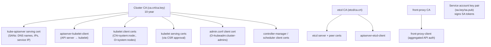

# 5.21 Certificates, identity, admission control and policy

| | |
|---|---|
| Level | Advanced |
| Priority tier | 1 |
| Lab venue | kubeadm lab; `openssl`, `kubeadm certs`, `kubectl get csr`; Kyverno/Gatekeeper/ValidatingAdmissionPolicy; Dex or Keycloak for OIDC |
| Part | Part 5: Kubernetes |
| Status | Drafted, labs **untested** |

## Why this matters for AI infrastructure

Picture a Monday morning when a shared GPU cluster suddenly stops working. An expired certificate has silently taken down the entire control plane.

A shared GPU cluster is also easy for users to misconfigure and attractive to attackers. A privileged container can read the host. A `hostPath` mount can expose model weights and credentials. Unbounded GPU requests can starve a team, and unsigned images can inject malware into training pipelines. Three mechanisms keep this under control.

The PKI and identity layer decides who is speaking and whether they can be trusted. Admission control decides what is allowed to enter the API. Policy as code writes the organisation's rules down and enforces them.

This chapter explains certificate management in Kubernetes, including rotation and failure modes. It also covers identity federation, the admission chain, Pod Security, and practical policies for AI platforms.

## Prerequisites and outcomes

This chapter builds on 5.5, 5.9 and 5.16, so read those first. When you finish, you should be able to do the following:

- Map the cluster PKI: which CAs exist, which leaf certificates each one signs, and who uses each certificate. Inspect and renew certificates, rotate the kubelet and etcd certificates, and plan a CA rotation.
- Use the CertificateSigningRequest API, kubelet TLS bootstrapping, approvers, and cert-manager for workload certificates.
- Configure OIDC authentication, and explain token-based identities and impersonation.
- Describe the admission pipeline. Use the built-in plugins, webhooks (mutating and validating), and `ValidatingAdmissionPolicy` (CEL), and design webhooks that are safe to run.
- Apply Pod Security Standards (privileged, baseline and restricted) through Pod Security Admission. Adopt a policy engine such as Kyverno or OPA Gatekeeper for custom rules, mutation, generation and verification of image signatures.
- Build a layered guardrail set for a multi-tenant AI cluster, covering GPU limits, queues, host access, registries, labels and network.
- Troubleshoot certificate and admission failures.

## 1. The Kubernetes PKI

Suppose an API call fails with a certificate error, and you need to know which certificate caused it. That question is much easier to answer once you know how the cluster's certificates fit together. A kubeadm cluster keeps a small public key infrastructure, or PKI, in `/etc/kubernetes/pki`. Every certificate in it is issued by a self-managed CA, and the diagram below shows who signs whom:



The cluster CA sits at the top of most of this tree. There are three root CAs in total: the cluster CA, the etcd CA and the front-proxy CA. Each one is a separate trust domain. The CA private keys live on control-plane nodes, and you should back them up offline, as chapter 5.20 explains. Leaf certificates are valid for **1 year** by default. The CAs themselves last 10 years.

The service account signing key pair (`sa.key` and `sa.pub`) is different. It signs service account tokens, which are JWTs, and the public key verifies them. If you rotate that key, existing tokens stop working unless the cluster accepts more than one key.

Each kubelet carries two certificates. Its client certificate talks to the API server, and it renews itself when `rotateCertificates` is set. Its serving certificate protects the kubelet API on port 10250. By default that certificate is self-signed, unless `serverTLSBootstrap` is set and the request gets approved.

Aggregated API servers and webhooks also depend on certificates. They trust their callers through CA bundles, stored in `APIService.spec.caBundle` and in the `caBundle` field of each webhook configuration. cert-manager's CA injector keeps those bundles current. Managed services hide the control-plane PKI from you, but you still manage workload certificates, webhook certificates, ingress certificates, mTLS between services, and OIDC.

### Inspecting and renewing

Run these commands when you need to check expiry or renew a certificate. The renewal steps run on every control-plane node.

```bash
sudo kubeadm certs check-expiration                       # lists leaf certs, expiry, residual time, CA
sudo openssl x509 -in /etc/kubernetes/pki/apiserver.crt -noout -subject -issuer -dates -ext subjectAltName
sudo kubeadm certs renew all                              # renews kubeadm-managed leafs (not CAs); on each control-plane node
# restart the static pods to load new certs:
sudo mv /etc/kubernetes/manifests/kube-apiserver.yaml /tmp/ && sleep 20 && sudo mv /tmp/kube-apiserver.yaml /etc/kubernetes/manifests/
# (or restart kubelet; same for controller-manager, scheduler, etcd)
sudo cp /etc/kubernetes/admin.conf ~/.kube/config         # admin.conf embeds a client cert that was renewed
kubectl get csr                                           # kubelet serving CSRs pending approval?
```

The first command lists each leaf certificate with its expiry date and CA. The renewal command covers leaf certificates only, not CAs. Then restart the static pods so they load the new certificates, or restart the kubelet, which works the same way for the controller-manager, the scheduler and etcd. Copy `admin.conf` into your kubeconfig as well, because it embeds a client certificate that was renewed.

`kubeadm upgrade` renews certificates automatically, which is one more reason to upgrade at least yearly. If renewal fails, the message `x509: certificate has expired or is not yet valid` shows up in kubectl, kubelet and API server logs. Control-plane components then crash-loop, and nodes go NotReady. Set up alerts so you learn about expiry before it breaks anything. Useful signals include Prometheus `apiserver_client_certificate_expiration_seconds_bucket`, `kubelet_certificate_manager_client_ttl_seconds`, cert-manager's `certmanager_certificate_expiration_timestamp_seconds`, the `x509-certificate-exporter`, and blackbox probes of the API endpoint's certificate.

### Rotating CAs

Rotating a CA is rare, delicate and disruptive. You start by introducing a new CA alongside the old one, using CA bundles that contain both. Then you re-issue every leaf certificate from the new CA. Next, you update kubeconfigs and bundles everywhere: kubelets, controllers, aggregated APIs, webhooks and CI. Only after all of that do you remove the old CA. Kubernetes does not automate the whole process end to end. Cluster API, cloud providers, and tools such as kubeadm with manual steps, or Cluster API MachineHealth, rotate by replacing nodes instead. Plan for a CA rotation in case of compromise. Limit how long a CA key stays exposed by protecting it with an offline backup, an HSM or KMS-backed signer, and short-lived leaf certificates.

### Kubelet TLS bootstrapping and CSRs

A new worker node joins the cluster with nothing but a bootstrap token. So how does it end up with a real certificate? The token belongs to the group `system:bootstrappers`, and it can only create certificate signing requests, or CSRs. The CSR approver inside kube-controller-manager approves the kubelet's client certificate requests automatically (`csrapproving`). The signer then issues the certificate for `kubernetes.io/kube-apiserver-client-kubelet`.

Serving certificates (`kubernetes.io/kubelet-serving`) follow a different path. They are not auto-approved, because the SAN values in the request need checking first. You approve them by hand with `kubectl certificate approve`, or with kubelet-csr-approver, which checks that the hostname and IP match. cert-manager's CSR support is a third option.

The generic CertificateSigningRequest API (`certificates.k8s.io/v1`) lets users and workloads ask a signer for a certificate. The signers include `kubernetes.io/kube-apiserver-client` for user client certificates, `kubernetes.io/legacy-unknown`, and custom signers such as `example.com/internal-ca`. Controllers implement the custom signers. Examples include a cert-manager Issuer used as a signer, SPIFFE and SPIRE integrations, and Vault PKI.
```bash
# Issue a client cert for a user via the CSR API
openssl genrsa -out jane.key 2048
openssl req -new -key jane.key -subj "/CN=jane/O=team-a-researchers" -out jane.csr
kubectl create -f - <<EOF
apiVersion: certificates.k8s.io/v1
kind: CertificateSigningRequest
metadata: { name: jane }
spec:
  request: $(base64 -w0 < jane.csr)
  signerName: kubernetes.io/kube-apiserver-client
  expirationSeconds: 86400            # short-lived
  usages: [client auth]
EOF
kubectl certificate approve jane
kubectl get csr jane -o jsonpath='{.status.certificate}' | base64 -d > jane.crt
kubectl config set-credentials jane --client-certificate=jane.crt --client-key=jane.key --embed-certs
```

The key and the request stay on your machine, and the cluster signs only the request. The `expirationSeconds` line keeps the certificate short-lived.

Kubernetes cannot revoke client certificates, because the API server has no CRL or OCSP support. After a compromise, you remove the RBAC bindings for that identity or group, or you rotate the CA. For humans, prefer OIDC tokens, which expire and can be revoked at the identity provider.

### Workload certificates and mTLS

cert-manager (see 5.12) issues certificates for ingress, webhooks and service-to-service mTLS. It turns each `Certificate` into a Secret. Its issuers include CA, ACME, Vault, Venafi, AWS PCA and step-ca, and its `csi-driver` gives each pod its own certificate. Service meshes such as Istio, Linkerd and Cilium issue short-lived workload identities (SPIFFE IDs) and rotate them automatically; see 5.28. trust-manager distributes CA bundles. Keep webhook serving certificates renewed automatically, because an expired webhook certificate is a classic outage. Every matching API request then fails.

## 2. Identity and authentication federation

Suppose a new engineer asks for cluster access on the first day. Who vouches for that person, and how do you revoke access when they leave? Authentication methods are covered in 5.16. In production, identity usually follows the patterns below.

**OIDC for humans** works with Keycloak, Dex, Okta, Entra ID or Google. You configure the API server with `--oidc-issuer-url`, `--oidc-client-id`, `--oidc-username-claim`, `--oidc-groups-claim`, `--oidc-username-prefix=oidc:` and `--oidc-groups-prefix=oidc:`. You can also use the structured `AuthenticationConfiguration` file instead. That file supports multiple issuers, claim validation rules written in CEL, and user validation rules. kubectl obtains and refreshes tokens through an exec plugin, such as kubelogin or oidc-login. Map IdP groups to RBAC bindings, and enforce MFA and short token lifetimes at the IdP. The API server must trust the IdP's CA and fetch its JWKS.

**Machine identities** cover bound ServiceAccount tokens, workload identity federation, and SPIFFE/SPIRE for cross-platform workload identity. With federation, cloud IAM or Vault trusts the cluster's OIDC issuer.

**Impersonation** (`--as`, `--as-group`) lets admins and automation act as someone else, and every such action is audited. Restrict the `impersonate` verb tightly. Impersonation is also useful for testing RBAC, and for gateways or dashboards that act on behalf of users.

**Webhook token authentication** works with cloud IAM authenticators. An **authenticating proxy**, such as a front proxy for dashboards, should trust headers only from the proxy CA. Disable **anonymous auth** in production with `--anonymous-auth=false`, but take care with health endpoints that depend on it.

**Audit identity** matters because the audit events record `user.username`, groups and `impersonatedUser`. Make usernames unique and hard to spoof. Prefixing them avoids collisions between IdP names and system users.

### Before you build workload identity

Workload identity is an advanced topic, so start by writing down what your workloads actually need. Many organisations do not need workload-to-workload identity at first. Shared secrets are the simplest model, and teams understand them well. They also work across platforms. A shared secret needs a fixed life span and rotation, though, and it must be redistributed to both the client and the server. Vault can help with that re-syncing. Shared secrets still raise the secure introduction problem: how do you seed the first secret safely, before any identity exists? An attacker who compromises that first step breaks the guarantee of unique identity.

### Platform-mediated identity on AWS

Sometimes the platform can decide who a workload is, without the workload asserting anything. Suppose every workload runs on one homogeneous platform. The platform reads metadata about each workload and issues it a credential. On AWS, an EC2 instance asks the EC2 metadata API for credentials. AWS inspects the instance's properties and returns role-specific credentials. The instance then uses them to reach a service such as an S3 bucket. The platform must still authorize the request, because authentication alone does not grant permissions.

*Production Kubernetes* focuses on AWS because the authors most often see it in the field. The node-level model works well for one workload per node. It breaks down when many containers and multitenant applications share a node, and that gap is why the tools below exist. *Production Kubernetes* strongly advises against kube2iam, but it covers the tool anyway. Teams keep running into it, so you should know its limits before you adopt it.

### Cloud metadata proxies (`kube2iam` / `kiam`) versus `IRSA`

Before projected ServiceAccount tokens (PSATs) and cloud OIDC federation were available, clusters on AWS used node-level metadata proxies. Both kube2iam and kiam mapped the `iam.amazonaws.com/role: <role-arn>` Pod annotation to IAM roles. As *Production Kubernetes* (Chapter 10) explains, both proxy approaches have architectural security flaws, compared with IAM Roles for Service Accounts (IRSA):

- **kube2iam** runs as a `DaemonSet` on every worker node. It inserts an `iptables` rule that redirects traffic for the EC2 metadata API to the local kube2iam proxy. Every worker node's IAM instance profile must be allowed to assume the superset of all IAM roles that any Pod in the cluster needs. As a result, a container breakout on any worker compromises every role.
- **kiam** splits the proxy into a node `DaemonSet` agent and a kiam server. The server runs on dedicated control-plane or server nodes, so only those nodes hold role-assumption permissions. The weakness is that a user can submit a Pod with `spec.nodeName` already populated. That bypasses the scheduler and lands the Pod directly on a server node. The Pod can also start and reach the metadata endpoint before the proxy's IP-to-Pod cache and guards stop it. Either way, the Pod can gain unrestricted access to the EC2 metadata API, unless an admission webhook blocks pre-populated `spec.nodeName` fields.
- **IRSA** removes metadata proxying entirely. A mutating webhook injects a projected ServiceAccount token with `audience: sts.amazonaws.com` and `expirationSeconds: 86400`. In *Production Kubernetes*, the token is mounted at `/var/run/secrets/eks.amazonaws.com/serviceaccount/token`. The webhook also sets the `AWS_ROLE_ARN` and `AWS_WEB_IDENTITY_TOKEN_FILE` environment variables. The AWS SDK then calls `sts:AssumeRoleWithWebIdentity` directly with that short-lived JWT. AWS IAM verifies the JWT against the cluster's public OIDC `.well-known` discovery endpoint and its JWKS keys.

### IRSA in practice

IRSA keeps the same experience as kiam and kube2iam. You annotate a Pod with the IAM role it should assume. The implementation is very different, though, and it removes the security concerns of the earlier tools. AWS IAM can federate identity to a third-party OIDC provider, and here that provider is the Kubernetes API server. Kubernetes can already create and sign short-lived tokens for each Pod, as the PSAT section showed. The AWS SDK's credential provider calls `sts:AssumeRoleWithWebIdentity` and passes that PSAT. A webhook injects the role and token path as environment variables, based on `serviceAccountName`:

```yaml
apiVersion: apps/v1
kind: Pod
metadata:
  name: myapp
spec:
  serviceAccountName: my-serviceaccount
  containers:
  - name: myapp
    image: myapp:1.2
    env:
    - name: AWS_ROLE_ARN
      value: "arn:aws:iam::123456789012:role/\
eksctl-irptest-addon-iamsa-default-my-\
serviceaccount-Role1-UCGG6NDYZ3UE"
    - name: AWS_WEB_IDENTITY_TOKEN_FILE
      value: /var/run/secrets/eks.amazonaws.com/serviceaccount/token
    volumeMounts:
    - mountPath: /var/run/secrets/eks.amazonaws.com/serviceaccount
      name: aws-iam-token
      readOnly: true
  volumes:
  - name: aws-iam-token
    projected:
      defaultMode: 420
      sources:
      - serviceAccountToken:
          audience: sts.amazonaws.com
          expirationSeconds: 86400
          path: token
```

The Kubernetes API server can serve its own OIDC discovery document at `/.well-known/openid-configuration` and its signing keys at `/openid/v1/jwks`. Service account issuer discovery has been stable since Kubernetes 1.21. The catch is reachability. AWS IAM must fetch those documents over a public HTTPS URL, and most API servers are not public. So the usual setup copies the two documents to a public location, such as a static S3 bucket, and sets that address as the cluster's issuer. AWS IAM can then verify the token against the service account signing key. Once verified, IAM exchanges the PSAT for the role's credentials. The setup is clunky, but its security model is the best of the pod-role approaches, and mapping service accounts to IAM roles is easy to understand. The main downside is that IRSA is harder to deploy outside Amazon Elastic Kubernetes Service (EKS). Managed offerings and newer features that make the issuer publicly reachable reduce that work.

### Cross-platform workload identity with `SPIFFE` and `SPIRE`

Suppose your workloads span several clouds, bare-metal GPU clusters and virtual machines. That is where SPIFFE and its reference implementation, SPIRE, help. SPIFFE stands for Secure Production Identity Framework for Everyone, and SPIRE stands for SPIFFE Runtime Environment. Together they issue portable cryptographic identities, written as `spiffe://trust-domain/hierarchical/workload`. Those identities are encoded as short-lived X.509 certificates (**X.509-SVIDs**) or JWT tokens (**JWT-SVIDs**). *Production Kubernetes* (Chapter 10) describes the attestation flow in two stages.

1. **Node attestation (`spire-server` and `spire-agent`)**: `spire-server` runs as the central signing authority and registration store, while `spire-agent` runs as a `DaemonSet` on every node. When an agent starts, it proves its node identity to `spire-server` using platform evidence, such as a Kubernetes Projected ServiceAccount Token via the `k8s_psat` attestor or cloud instance metadata. In return, it receives an X.509-SVID for the node. The administrator registers the node group with:

```bash
/opt/spire/bin/spire-server entry create \
  -spiffeID spiffe://production-trust-domain/nodes \
  -selector k8s_psat:cluster:production-cluster \
  -selector k8s_psat:agent_ns:spire \
  -selector k8s_psat:agent_sa:spire-agent \
  -node
```

2. **Workload attestation (Workload API Unix domain socket)**: workloads connect to the node-local `spire-agent` over a Unix domain socket (`unix:///run/spire/sockets/agent.sock` in the *Production Kubernetes* example). They present no initial secret, which solves the "secure introduction" problem. The `spire-agent` inspects kernel and kubelet metadata for the calling process, such as the Pod namespace, ServiceAccount, Pod labels and container image. It matches that metadata against registration entries created on `spire-server`. A registration entry looks like this:

```bash
/opt/spire/bin/spire-server entry create \
  -spiffeID spiffe://production-trust-domain/service-a \
  -parentID spiffe://production-trust-domain/nodes \
  -selector k8s:ns:default \
  -selector k8s:sa:service-a \
  -selector k8s:pod-label:app:frontend \
  -selector k8s:container-image:docker.io/johnharris85/service-a:v0.0.1
```

Once a match is found, `spire-agent` returns the workload's X.509-SVID or JWT-SVID. It can also stream certificates straight to an Envoy sidecar over Envoy's Secret Discovery Service (`SDS`) API. The Kubernetes workload attestor queries the kubelet, which validates tokens through `TokenReview`. That means API server downtime can interrupt attestation of newly started Pods. The `--authentication-token-webhook-cache-ttl` kubelet flag controls how long `TokenReview` responses are cached.

### SPIRE integration points and trade-offs

Once SPIRE issues identities, applications still need a way to use them. The right route depends on how tightly you accept coupling to the platform, and how much control users have over the environment.

**Direct application access.** SPIRE provides SDKs for Go, C and Java. They wrap existing HTTP libraries, and they obtain and verify identities natively. The Go example below calls a `service-b` Kubernetes Service and expects a specific SPIFFE ID in its x509-SVID:

```go
err := os.Setenv("SPIFFE_ENDPOINT_SOCKET",
    "unix:///run/spire/sockets/agent.sock")
conn, err := spiffe.DialTLS(ctx, "tcp", "service-b",
    spiffe.ExpectPeer("spiffe://production-trust-domain/service-b"))
if err != nil {
    log.Fatalf("Unable to create TLS connection: %v", err)
}
```

The SPIRE agent also exposes a gRPC API for languages without an SDK. *Production Kubernetes* does not recommend direct integration for end-user applications. It ties the app to the platform, requires mounting the agent's Unix socket into the pod, and is hard to extend. Direct use fits platform teams that build tooling wrapping or extending SPIRE.

**Sidecar proxy.** SPIRE supports the Envoy SDS API, so it can publish certificates to an Envoy proxy. Envoy uses the SVID for TLS and the trust bundle to verify incoming connections. You can restrict which SPIFFE IDs may connect in two ways. One is to list `verify_subject_alt_name` values in the Envoy configuration. The other is to use Envoy's External Authorization API, which delegates the decision to Open Policy Agent (OPA). The Rego policy below allows a `GET` on `/api` only from the frontend's SPIFFE ID:

```rego
package envoy.authz
import input.attributes.request.http as http_request
import input.attributes.source.address as source_address
default allow = false
allow {
  http_request.path == "/api"
  http_request.method == "GET"
  svc_spiffe_id == "spiffe://production-trust-domain/frontend"
}
svc_spiffe_id = client_id {
  [_, _, uri_type_san] := split(
    http_request.headers["x-forwarded-client-cert"], ";")
  [_, client_id] := split(uri_type_san, "=")
}
```

Envoy checks the caller's certificate against the SPIRE trust bundle, then asks OPA. The policy reads the SVID and allows the request only when its ID matches. OPA sits in the critical request path, so account for that in the design.

**Service mesh.** Istio's CA creates SVIDs for all service accounts, in the format `spiffe://cluster.local/ns/<namespace>/sa/<service_account>`. Mesh services can therefore use SPIFFE-aware endpoints. Service meshes are outside this chapter's scope, and most of them build on the methods and tools covered here.

**Other integrations.** SPIRE can write SVIDs and trust bundles to a filesystem, so applications can reload when the files change. That keeps applications fairly agnostic of SPIRE, but certificates on disk can be stolen. An Nginx module can stream certificates from SPIRE, and custom Nginx modules can limit which SPIFFE IDs connect. For secrets, SPIRE can solve the secure introduction problem for HashiCorp Vault. Vault can federate OIDC with SPIRE, and Vault roles can bind to SPIFFE IDs. A workload then trades its JWT SVID for a Vault role. The same federation idea works with AWS. The downside there is that SPIRE must be publicly reachable, so AWS can fetch the JSON Web Key Set (JWKS) it needs to validate tokens.

SPIFFE and SPIRE have real strengths. They rely on widely supported x509 and JWT standards. They also scope identity down to a single pod, by combining PSATs with SPIRE selectors, which helps when sidecar containers in one pod need different levels of access. The approach is also the most labor-intensive, because it takes expertise and one more component to run. Each workload may need registering, which can be automated. Keep in mind that the kubelet's TokenReview cache affects permission changes. The `--authentication-token-webhook-cache-ttl` flag controls that cache. A large value slows down permission revocation, so do not set it high.

### Choosing an identity model

User identity usually comes from an SSO provider, so OIDC is the natural path. Kubernetes can sit outside the main identity strategy, but integrating it directly gives better visibility and control. That matters most across several clusters. Workload identity is often an afterthought beyond default ServiceAccounts, and that can be fine early on. Robust in-cluster and cross-platform workload identity is complex, though, and it needs deeper knowledge of external tools. Once your platform is mature, these patterns add defense in depth if a breach happens. Start with OIDC for users, and add workload identity once the platform is ready for it.

## 3. Admission control

Suppose a developer applies a Pod that requests more GPUs than the policy allows. Something has to stop that request before it reaches etcd. Admission runs after authentication and authorization, and before the object is persisted (5.5). There are several kinds of admission, and the table below lists them by phase:

| Phase | Mechanism | Examples |
|---|---|---|
| **Built-in mutating** | Compiled into the API server (enable/disable via `--enable-admission-plugins`) | `NamespaceLifecycle`, `LimitRanger`, `ServiceAccount`, `DefaultStorageClass`, `DefaultTolerationSeconds`, `MutatingAdmissionWebhook`, `Priority`, `RuntimeClass`, `StorageObjectInUseProtection`, `TaintNodesByCondition`, `ExtendedResourceToleration` (opt-in) |
| **Mutating webhooks** | External HTTPS service called with `AdmissionReview`; returns JSON patches | Istio sidecar injector, Kyverno mutate, cert-manager CA injector, custom GPU defaults |
| **Validating built-in** | | `ResourceQuota`, `PodSecurity`, `NodeRestriction`, `Priority`, `ValidatingAdmissionPolicy`, `ValidatingAdmissionWebhook`, `CertificateApproval/Signing/SubjectRestriction` |
| **Validating webhooks** | External services return allow/deny with message | OPA Gatekeeper, Kyverno validate, image policy webhooks, custom checks |
| **ValidatingAdmissionPolicy (VAP)** | In-process, declarative **CEL** expressions; `ValidatingAdmissionPolicy` + `ValidatingAdmissionPolicyBinding` (with params) | Cheap, no webhook latency/availability risk; GA in recent releases; `MutatingAdmissionPolicy` (CEL mutations) arriving |

Every registration object is either a `MutatingWebhookConfiguration` or a `ValidatingWebhookConfiguration`. Its `rules` set the operations and the apiGroups, versions and resources it matches. Its `clientConfig` names a service or a URL, together with a `caBundle`. The `failurePolicy` is `Fail` or `Ignore`, and `timeoutSeconds` should stay at 30 or below, ideally 10 or less. Other fields narrow the scope further: `matchPolicy`, `namespaceSelector`, `objectSelector`, and `matchConditions`, which are CEL pre-filters. `sideEffects` takes `None` or `NoneOnDryRun`. `admissionReviewVersions` lists the supported versions, and a mutating webhook also sets `reinvocationPolicy`.

The VAP example below shows how a declarative policy works without any webhook server:

```yaml
apiVersion: admissionregistration.k8s.io/v1
kind: ValidatingAdmissionPolicy
metadata: { name: gpu-request-limits }
spec:
  failurePolicy: Fail
  matchConstraints:
    resourceRules:
      - apiGroups: [""]
        apiVersions: ["v1"]
        operations: ["CREATE", "UPDATE"]
        resources: ["pods"]
  variables:
    - name: gpus
      expression: "object.spec.containers.map(c, has(c.resources.limits) && 'nvidia.com/gpu' in c.resources.limits ? int(c.resources.limits['nvidia.com/gpu']) : 0).sum()"
  validations:
    - expression: "variables.gpus <= 8"
      message: "A single pod may request at most 8 GPUs."
    - expression: "variables.gpus == 0 || has(object.spec.priorityClassName)"
      message: "GPU pods must set a priorityClassName."
      reason: Invalid
---
apiVersion: admissionregistration.k8s.io/v1
kind: ValidatingAdmissionPolicyBinding
metadata: { name: gpu-request-limits-prod }
spec:
  policyName: gpu-request-limits
  validationActions: [Deny, Audit]                # Warn | Audit | Deny
  matchResources:
    namespaceSelector: { matchLabels: { env: prod } }
```

The policy counts the GPUs requested by each Pod. Its first rule caps the total at 8, and its second rule requires a `priorityClassName` on any Pod that asks for GPUs. The binding applies the policy to namespaces labelled `env: prod`, and it takes the actions `Deny` and `Audit`.

Webhooks are production-critical, so design them with care (5.5). Run at least 2-3 replicas, behind a PodDisruptionBudget and anti-affinity, for high availability. Keep each webhook fast, typically under 100 ms. Make it idempotent, and keep external dependencies out of the request path. Use `failurePolicy: Ignore` for non-security-critical mutations, and reserve `Fail` for cases where a bypass is worse than an outage. Exclude `kube-system` and the webhook's own namespace, so a webhook cannot block the creation of its own pods. Scope it with selectors, renew its certificate automatically, and expose metrics such as `apiserver_admission_webhook_admission_duration_seconds` and the rejection counters. Mark it dry-run safe with `sideEffects: None`, test it with `kubectl --dry-run=server`, and document a break-glass procedure that deletes the webhook configuration.

In *Production Kubernetes*, Chapter 8 (*Admission Control*), Josh Rosso et al. contrast built-in, or in-tree, controllers with custom Go webhooks. The built-in `NamespaceLifecycle` controller rejects any `CREATE` request inside a Namespace whose `status.phase == Terminating`. It also creates the `default`, `kube-system` and `kube-public` namespaces automatically. Custom webhooks are usually built with controller-runtime and Kubebuilder instead:

- **controller-runtime `Handle` and `PatchResponseFromRaw`:** Writing RFC 6902 `JSONPatch` arrays by hand is tedious. With controller-runtime, you implement `func (w *Webhook) Handle(ctx context.Context, req admission.Request) admission.Response`. The handler decodes `req.Object.Raw` into a typed Go struct, such as a Cluster API `VSphereMachine` that checks `vm.Annotations["infoblox"]`. It then mutates the struct fields, for example by allocating an IP from Infoblox. Next, it marshals the modified struct to `marshaledVM` and returns **`admission.PatchResponseFromRaw(req.Object.Raw, marshaledVM)`**. That call computes the JSONPatch diff between the original raw request and the mutated struct for you.
- **Kubebuilder webhook code-generation markers:** A single comment marker above the Go handler generates the `MutatingWebhookConfiguration` YAML for you: `// +kubebuilder:webhook:path=/infoblox-ipam,mutating=true,failurePolicy=fail,groups="infrastructure.cluster.x-k8s.io",resources=vspheremachines,verbs=create;update,versions=v1alpha3,name=infoblox.mutations.io`

### How a request moves through admission

Consider a request to create a Pod. Admission control sits between authorization and storage, and every request follows the same path. First the server authenticates the client and checks RBAC, to confirm the caller may perform the action, such as creating a Pod in one Namespace. Only then does admission begin. Think of it as a row of checkpoints. Each checkpoint can adjust the request or turn it away, and the order never changes.

Mutating controllers run first, so they can change the resource before later steps see it. The built-in Service Account controller is a good example, and it is on by default. When a Pod arrives without a `serviceAccount` field, the controller sets it to the `default` ServiceAccount for the Namespace. It also adds `ImagePullSecrets` and a volume, so the Pod can reach its ServiceAccount token.

Next comes schema validation. It checks that the object matches the defined schema, including required fields. Because mutation runs first, validation sees the finished object. That ordering lets mutating controllers fill in fields that the schema would otherwise reject as missing.

The last stop before etcd is the set of validating controllers. They cannot change the object. They can only admit or reject it. Their job is operational logic, such as "is this Namespace still accepting new objects?", not checking the shape of the data. The `NamespaceLifecycle` controller is a clear case. For a `CREATE` request, it checks the Namespace phase:

```go
// ensure that we're not trying to create objects in terminating Namespaces
if a.GetOperation() == admission.Create {
	if namespace.Status.Phase != v1.NamespaceTerminating {
		return nil
	}
	err := admission.NewForbidden(a, fmt.Errorf("unable to create new content in namespace %s because it is being terminated", a.GetNamespace()))
	if apierr, ok := err.(*errors.StatusError); ok {
		apierr.ErrStatus.Details.Causes = append(apierr.ErrStatus.Details.Causes,
			metav1.StatusCause{
				Type:    v1.NamespaceTerminatingCause,
				Message: fmt.Sprintf("namespace %s is being terminated", a.GetNamespace()),
				Field:   "metadata.namespace",
			})
	}
	return err
}
```

If the Namespace is not terminating, the controller returns nothing, and the request passes. If it is terminating, the controller returns an API error saying the Namespace is being terminated, and the request is denied. Put simply, a Namespace that is shutting down stops accepting new objects.

> **Note:** A request must pass every validating admission controller before it is stored. One rejection is enough to deny it.

### In-tree controllers and the flags that control them

Admission controllers were built into the core Kubernetes code for a long time. People call this the in-tree model. Many of them can be switched on or off with API server flags. That works well if you run your own control plane. It is a problem for users of cloud-managed Kubernetes, who often cannot change those flags. PodSecurityPolicy is an example. It adds strong security controls, but it is not enabled by default, so many users never benefit from it.

The trend is to move this code out of the API server. *Production Kubernetes* notes that the built-in PodSecurityPolicy controller had an announced deprecation. Kubernetes has since removed it in version 1.25, and Pod Security Admission or an external policy engine took its place. More built-in controllers are expected to move out of tree over time. Mutating and validating webhooks are the first step in that direction.

Most built-in controllers run by default as a set of sane defaults, so check that the ones you need are on. To enable a controller that is off by default, pass `--enable-admission-plugins` to the API server. To disable a default controller, pass `--disable-admission-plugins`. Read both flags carefully, because it is easy to reach for the wrong one. Use the official Kubernetes documentation for the full list of built-in controllers. The real flexibility comes from webhooks, which the next subsections cover.

### What the API server sends a webhook

Webhooks are a special kind of admission controller. The API server sends an HTTPS request to an endpoint you run, and that endpoint returns a decision: allow, deny or change the request. Because the endpoint only needs to speak HTTPS, you can write it in any language. You can run it inside the cluster or as a serverless function outside it. It can also call outside systems, such as a central service that tracks approved images.

Webhooks sit on the critical path of every matching request. They live outside the API server and must be called over HTTPS, so they add latency. Keep each webhook fast, and return as early as you can.

The API server calls webhooks over TLS only, so the webhook must present a certificate the API server trusts. Inside a cluster, cert-manager is a common way to issue those certificates automatically. A webhook that runs outside the cluster needs a certificate from a public root CA or from an internal CA that the API server knows about.

Both sides of the call follow a fixed schema called `AdmissionReview`. The request carries the API version, group and kind of the object, the name and Namespace, and a unique ID that matches the response to the request. It also carries the operation, such as `CREATE`, the user who made the request with their group membership, whether the request is a dry run, which matters for side effects, and the resource itself. The response carries the same unique ID, an allow or deny decision, and an optional customized error status and message. A mutating webhook can also return a patch. That patch is a base64-encoded JSONPatch document that describes the changes to apply before the object is stored.

Validating webhooks cannot change the request. They can only admit or reject the original object. That limit suits checks such as "this user ID is allowed," "no host mounts," or "every object carries a team label." Mutating webhooks suit adding metadata, such as team or workload labels on Pods or Deployments. A more common example is sidecar injection. Istio, for instance, runs a mutating webhook that adds a proxy container to Pod specs. Injection happens by default, and annotations on the Namespace or the Pod can override it.

Mutation makes the platform easier to use, but it hides complexity. The user sees a different object from the one they applied. That can confuse people who do not know a mutating controller is running, so tell your users which webhooks change their objects.

A `MutatingWebhookConfiguration` tells the API server when to call a mutating webhook. Here is the annotated example from *Production Kubernetes*:

```yaml
apiVersion: admissionregistration.k8s.io/v1
kind: MutatingWebhookConfiguration
metadata:
  name: "test-mutating-hook"
webhooks:
- name: "test-mutating-hook"
  rules:
  - apiGroups: [""]
    apiVersions: ["v1"]
    operations: ["CREATE"]
    resources: ["pods"]
    scope: "Namespaced"
  clientConfig:
    service:
      namespace: test-ns
      name: test-service
      path: /test-path
      port: 8443
    caBundle: "Ci0tLS0tQk...tLS0K"
  admissionReviewVersions: ["v1", "v1beta1"]
  sideEffects: "None"
  timeoutSeconds: "5"
  reinvocationPolicy: "IfNeeded"
  failurePolicy: "Fail"
```

| Field | What it controls |
|---|---|
| `rules` | Which API version, kind and operations send a call to the webhook |
| `operations` | The operations, such as `CREATE`, that trigger a call |
| `resources` | The kind to target |
| `scope` | Whether Namespace-scoped or cluster-scoped resources are targeted |
| `clientConfig` | How the API server reaches the webhook. This example points at a Service in the cluster |
| `caBundle` | A PEM-encoded CA bundle that validates the webhook's server certificate |
| `admissionReviewVersions` | The `AdmissionReview` versions the webhook supports |
| `sideEffects` | Whether the webhook changes external systems |
| `timeoutSeconds` | How long to wait before the `failurePolicy` applies |
| `reinvocationPolicy` | Whether the webhook can be called again after other webhooks run |
| `failurePolicy` | Whether the webhook fails open (`Ignore`) or closed (`Fail`) |

You can narrow the rules a lot. To intercept only requests that create Secrets, use this rule:

```yaml
rules:
- apiGroups: [""]
  apiVersions: ["v1"]
  operations: ["CREATE"]
  resources: ["secrets"]
  scope: "Namespaced"
```

You can also add a `namespaceSelector` or an `objectSelector`. The next snippet picks only Secrets in Namespaces that carry the label `webhook: enabled`:

```yaml
namespaceSelector:
  matchExpressions:
  - key: webhook
    operator: In
    values: ["enabled"]
```

Scope down as far as you can, because a webhook that never sees irrelevant objects costs far less.

### Webhook failure modes, ordering and performance

**Failure modes.** A webhook that is unreachable, or that returns an unknown response, counts as failing. You choose the result with `failurePolicy`. `Ignore` lets the request through, which is fail open. `Fail` rejects the request, which is fail closed. For security or other critical webhooks, `Fail` is the safer choice. For noncritical hooks, `Ignore` can be safe, especially when a reconciling controller backs it up. Weigh these choices together with the performance concerns below.

**Ordering.** All mutating webhooks run before any validating webhook, so a validating webhook always sees the final version of the object before it is stored. Mutating webhooks do not run in a guaranteed order, though. A mutation by one hook can cause another to run again, and the `reinvocationPolicy` field controls that behavior. Still, design every webhook to be idempotent, so that running it twice gives the same result as running it once.

**Performance.** A webhook sits on the request path. If a critical webhook fails closed, any timeout denies the request, so build it for high availability. Admission control can become a bottleneck for the whole cluster if you are careless. A resource-heavy webhook, or one with external dependencies, needs extra thought. Ask how often it runs and what each call costs. In those cases, a controller that reconciles objects inside the cluster may be a better fit.

**Side effects.** Some webhooks change things outside the cluster, such as a resource in a cloud provider. These webhooks must respect `dryRun`. When a request is a dry run, they should skip the external change. Each webhook declares this with its `sideEffects` field, so the API server knows whether a dry run is safe to send.

### Serving certificates for an admission webhook

The API server calls a webhook over HTTPS only. That protects the traffic, but it means the webhook needs a certificate. The easiest source is the cluster's own certificate authority (CA), which can sign a certificate for the webhook on request. The steps are: make a private key and a certificate signing request (CSR), submit it to the cluster, approve it, and download the result.

First, generate the key and the CSR. *Production Kubernetes* uses a short Go program for this. It creates a 1024-bit RSA key and writes the CSR with the webhook URL in its URI field:

```go
package main
import (
"crypto/rand"
"crypto/rsa"
"crypto/x509"
"crypto/x509/pkix"
"encoding/asn1"
"encoding/pem"
"net/url"
"os"
)
func main() {
host := os.Args[1]
name := "server"
key, err := rsa.GenerateKey(rand.Reader, 1024)
if err != nil {
panic(err)
}
keyDer := x509.MarshalPKCS1PrivateKey(key)
keyBlock := pem.Block{
Type: "RSA PRIVATE KEY",
Bytes: keyDer,
}
keyFile, err := os.Create(name + ".key")
if err != nil {
panic(err)
}
pem.Encode(keyFile, &keyBlock)
keyFile.Close()
commonName := "myuser"
emailAddress := "someone@myco.com"
org := "My Co, Inc."
orgUnit := "Widget Farmers"
city := "Seattle"
state := "WA"
country := "US"
subject := pkix.Name{
CommonName: commonName,
Country: []string{country},
Locality: []string{city},
Organization: []string{org},
OrganizationalUnit: []string{orgUnit},
Province: []string{state},
}
uri, err := url.ParseRequestURI(host)
if err != nil {
panic(err)
}
asn1, err := asn1.Marshal(subject.ToRDNSequence())
if err != nil {
panic(err)
}
csr := x509.CertificateRequest{
RawSubject: asn1,
EmailAddresses: []string{emailAddress},
SignatureAlgorithm: x509.SHA256WithRSA,
URIs: []*url.URL{uri},
}
bytes, err := x509.CreateCertificateRequest(rand.Reader, &csr, key)
if err != nil {
panic(err)
}
csrFile, err := os.Create(name + ".csr")
if err != nil {
panic(err)
}
pem.Encode(csrFile, &pem.Block{Type: "CERTIFICATE REQUEST", Bytes: bytes})
csrFile.Close()
}
```

Run the program with the webhook URL as its argument:

```
$ go run csr-gen.go <URL-for-webhook>
```

*Production Kubernetes* says this writes `server.csr` and `server-key.pem`. The code above names the key file `server.key`, so check which name you get before you go on.

Next, wrap the CSR in a Kubernetes CertificateSigningRequest. The `request` field must hold the base64-encoded CSR, so *Production Kubernetes* fills in the `REPLACEME` placeholder with a one-line `perl` command:

```
apiVersion: certificates.k8s.io/v1beta1
kind: CertificateSigningRequest
metadata:
name: validating-controller.default
spec:
groups:
- system:authenticated
request: REPLACEME
usages:
usages:
- digital signature
- key encipherment
- key agreement
- server auth
```

```
$ perl -pi -e s/REPLACEME/$(base64 server.csr | tr -d '\n')/ \
admission-controller-csr.yaml
```

Submit the request, approve it, and then download the signed certificate:

```
$ kubectl create -f admission-controller-csr.yaml
$ kubectl certificate approve validating-controller.default
$ kubectl get csr validating-controller.default -o json | \
jq -r .status.certificate | base64 -d > server.crt
```

You now have `server.crt` and the key for the webhook's HTTPS server. Serve them from the admission controller, and the API server can trust the endpoint.

## 4. Pod Security Standards and Admission

Suppose a training Pod runs in a namespace with no security settings at all. What can that Pod do to the node it lands on? The Pod Security Standards answer that question with three profiles. Each profile is cumulative, so every level includes the rules of the one before it.

| Profile | Meaning | Blocks (selection) |
|---|---|---|
| **Privileged** | Unrestricted | Nothing |
| **Baseline** | Prevents known privilege escalations; minimal friction | hostNetwork/hostPID/hostIPC, privileged containers, hostPath volumes, host ports, most added capabilities (allows default set), unsafe sysctls, `procMount` unmasked, AppArmor/SELinux overrides, windows HostProcess |
| **Restricted** | Hardened best practice | Baseline + must run as non-root, `allowPrivilegeEscalation: false`, drop `ALL` capabilities (add only `NET_BIND_SERVICE`), `seccompProfile: RuntimeDefault/Localhost`, restricted volume types (configMap, csi, downwardAPI, emptyDir, ephemeral, persistentVolumeClaim, projected, secret) |

Pod Security Admission is built in, and it replaces the PodSecurityPolicy that was removed in 1.25. You configure it per namespace with labels, as shown below:

```bash
kubectl label ns team-a pod-security.kubernetes.io/enforce=baseline pod-security.kubernetes.io/enforce-version=latest \
  pod-security.kubernetes.io/warn=restricted pod-security.kubernetes.io/audit=restricted
```

Each mode does something different. `enforce` rejects a violating Pod, `audit` records the violation in the audit log, and `warn` shows a warning to the client. Cluster-wide defaults and exemptions, such as usernames, runtime classes and namespaces, live in the `AdmissionConfiguration`. A safe rollout starts with `warn` and `audit` at `restricted`. You fix the workloads that appear in those warnings, and only then switch to `enforce`.

In *Kubernetes: Up and Running*, Chapter 19 (*Securing Applications in Kubernetes*), Brendan Burns et al. demonstrate four practical tools for auditing and hardening Pod security. Each tool answers a different question.

1. **Inspecting inside-container security posture with amicontained (`r.j3ss.co/amicontained:v0.4.9`):** Running amicontained inside a Pod prints the active container runtime, the enabled namespaces (`pid: true, user: false`), the AppArmor profile (`docker-default (enforce)` or `unconfined`), the bounding Linux capabilities (`chown`, `dac_override`, `net_raw`, `setuid`, and so on), the seccomp status (`disabled` vs `filtering`), and the exact count of blocked syscalls.
2. **Cluster-wide Pod Security dry-run preview (`--dry-run=server`):** Before you enforce `baseline` or `restricted` on existing namespaces, run a server-side dry-run label across all namespaces. It reports every existing Pod that would violate the standard, and it changes no namespace: `kubectl label --dry-run=server --overwrite ns --all pod-security.kubernetes.io/enforce=baseline`
3. **Stronger workload isolation with RuntimeClass (`gvisor`, `firecracker` / `kata`):** Setting `spec.runtimeClassName: firecracker` (or `gvisor` / `kata`) routes the Pod through a sandboxed or VM-isolated CRI runtime handler, instead of the standard shared-kernel `runc`.
4. **Benchmarking node and control-plane configurations with kube-bench:** Running kube-bench as a Job checks the live cluster against the **CIS Kubernetes Benchmark**. Checks include `4.2.1 Ensure that the --anonymous-auth argument is set to false`, `4.2.4 Ensure that the --read-only-port argument is set to 0`, `4.2.6 Ensure that the --protect-kernel-defaults argument is set to true`, and `4.2.12 Verify that the RotateKubeletServerCertificate argument is set to true`. Each check prints `[PASS]`, `[WARN]` or `[FAIL]`, together with exact remediation steps.

GPU clusters need some exceptions. The GPU Operator, device plugin, DCGM exporter, NVIDIA driver containers, Network Operator, CNI agents, CSI node plugins and node-problem-detector all need privileged, hostPath or hostNetwork access. They usually live in dedicated system namespaces labelled `privileged`. Tenant training Pods can usually meet `baseline`, since they need no hostPath or privileged access and get their GPUs through the device plugin. Many can also meet `restricted`, if their images run as non-root. RDMA workloads are harder. They need `IPC_LOCK`, which `baseline` does not allow, because `IPC_LOCK` is not in its default capability set. That calls for a policy exception, or a profile-level allowance through a policy engine or a namespace label. Document each exception per namespace, rather than weakening the cluster default.

### Measuring a container's security with amicontained

A manifest tells you what you asked for. It does not tell you what the container really gets. The amicontained tool, written by Jess Frazelle, answers the question "Am I contained?" It reports the container runtime, the namespaces, the AppArmor profile, the Linux capabilities, the seccomp status and the blocked syscalls. Suppose you want a baseline first. Start with a Pod that has no SecurityContext. Save this manifest as `amicontained-pod.yaml`.

```yaml
apiVersion: v1
kind: Pod
metadata:
  name: amicontained
spec:
  containers:
  - image: r.j3ss.co/amicontained:v0.4.9
    name: amicontained
    command: [ "/bin/sh", "-c", "--" ]
    args: [ "amicontained" ]
```

Create the Pod and read its logs:

```bash
$ kubectl apply -f amicontained-pod.yaml
pod/amicontained created
$ kubectl logs amicontained
Container Runtime: kube
Has Namespaces:
	pid: true
	user: false
AppArmor Profile: docker-default (enforce)
Capabilities:
	BOUNDING -> chown dac_override fowner fsetid kill setgid setuid setpcap net_bind_service net_raw sys_chroot mknod audit_write setfcap
Seccomp: disabled
Blocked Syscalls (21):
	SYSLOG SETPGID SETSID VHANGUP PIVOT_ROOT ACCT SETTIMEOFDAY UMOUNT2
	SWAPON SWAPOFF REBOOT SETHOSTNAME SETDOMAINNAME INIT_MODULE
	DELETE_MODULE LOOKUP_DCOOKIE KEXEC_LOAD FANOTIFY_INIT
	OPEN_BY_HANDLE_AT FINIT_MODULE KEXEC_FILE_LOAD
Looking for Docker.sock
```

The output shows that the AppArmor runtime default is applied. It also lists the capabilities allowed by default, and seccomp is disabled. A total of 21 syscalls are blocked. Your output may look different, because Kubernetes distributions and managed services set different defaults.

Now add seccomp, AppArmor and capabilities to the Pod. Save this manifest as `amicontained-pod-securitycontext.yaml`. It asks for the runtime default AppArmor and seccomp profiles, and it adds one capability and drops another.

```yaml
apiVersion: v1
kind: Pod
metadata:
  name: amicontained
  annotations:
    container.apparmor.security.beta.kubernetes.io/amicontained: "runtime/default"
spec:
  securityContext:
    runAsNonRoot: true
    runAsUser: 1000
    runAsGroup: 3000
    fsGroup: 2000
    seccompProfile:
      type: RuntimeDefault
  containers:
  - image: r.j3ss.co/amicontained:v0.4.9
    name: amicontained
    command: [ "/bin/sh", "-c", "--" ]
    args: [ "amicontained" ]
    securityContext:
      capabilities:
        add: ["SYS_TIME"]
        drop: ["NET_BIND_SERVICE"]
      allowPrivilegeEscalation: false
      readOnlyRootFilesystem: true
      privileged: false
```

Delete the old Pod first, then apply the new manifest and read the logs:

```bash
$ kubectl delete pod amicontained
pod "amicontained" deleted
$ kubectl apply -f amicontained-pod-securitycontext.yaml
pod/amicontained created
$ kubectl logs amicontained
Container Runtime: kube
Has Namespaces:
	pid: true
	user: false
AppArmor Profile: docker-default (enforce)
Capabilities:
	BOUNDING -> chown dac_override fowner fsetid kill setgid setuid setpcap net_raw sys_chroot sys_time mknod audit_write setfcap
Seccomp: filtering
Blocked Syscalls (67):
	SYSLOG SETUID SETGID SETPGID SETSID SETREUID SETREGID SETGROUPS
	SETRESUID SETRESGID USELIB USTAT SYSFS VHANGUP PIVOT_ROOT_SYSCTL ACCT
	SETTIMEOFDAY MOUNT UMOUNT2 SWAPON SWAPOFF REBOOT SETHOSTNAME
	SETDOMAINNAME IOPL IOPERM CREATE_MODULE INIT_MODULE DELETE_MODULE
	GET_KERNEL_SYMS QUERY_MODULE QUOTACTL NFSSERVCTL GETPMSG PUTPMSG
	AFS_SYSCALL TUXCALL SECURITY LOOKUP_DCOOKIE VSERVER MBIND SET_MEMPOLICY
	GET_MEMPOLICY KEXEC_LOAD ADD_KEY REQUEST_KEY KEYCTL MIGRATE_PAGES
	FUTIMESAT UNSHARE MOVE_PAGES PERF_EVENT_OPEN FANOTIFY_INIT
	NAME_TO_HANDLE_AT OPEN_BY_HANDLE_AT SETNS PROCESS_VM_READV
	PROCESS_VM_WRITEV KCMP FINIT_MODULE KEXEC_FILE_LOAD BPF USERFAULTFD
	PKEY_MPROTECT PKEY_ALLOC PKEY_FREE
Looking for Docker.sock
```

Seccomp moves from `disabled` to `filtering`, and the blocked syscalls rise from 21 to 67. The `sys_time` capability now appears in the list, and `net_bind_service` no longer does.

Applying these controls by hand is hard. Every field must be right for every Pod, and a wrong AppArmor, seccomp or SELinux profile can break the application. Tools such as the Security Profiles Operator can generate and manage seccomp profiles for you.

### Pod Security Standards in a namespace: a worked example

Labels on a namespace apply a Pod Security Standard to every Pod in it. Before you enforce a standard on a busy namespace, check what would fail. A single server-side dry run reports every existing Pod that violates a level, without changing anything:

```bash
$ kubectl label --dry-run=server --overwrite ns \
--all pod-security.kubernetes.io/enforce=baseline
Warning: kuard: privileged
namespace/default labeled
namespace/kube-node-lease labeled
namespace/kube-public labeled
Warning: kube-proxy-vxjwb: host namespaces, hostPath volumes, privileged
Warning: kube-proxy-zxqzz: host namespaces, hostPath volumes, privileged
Warning: kube-apiserver-kind-control-plane: host namespaces, hostPath volumes
Warning: etcd-kind-control-plane: host namespaces, hostPath volumes
Warning: kube-controller-manager-kind-control-plane: host namespaces, ...
Warning: kube-scheduler-kind-control-plane: host namespaces, hostPath volumes
namespace/kube-system labeled
namespace/local-path-storage labeled
```

This command checks all Pods in the cluster against the `baseline` standard, and it prints each violation as a warning. Next, try a namespace that enforces `baseline` and only warns and audits `restricted`. Pin every mode to `v1.22`, so the rules do not change when the cluster upgrades. Save this as `baseline-ns.yaml`:

```yaml
apiVersion: v1
kind: Namespace
metadata:
  name: baseline-ns
  labels:
    pod-security.kubernetes.io/enforce: baseline
    pod-security.kubernetes.io/enforce-version: v1.22
    pod-security.kubernetes.io/audit: restricted
    pod-security.kubernetes.io/audit-version: v1.22
    pod-security.kubernetes.io/warn: restricted
    pod-security.kubernetes.io/warn-version: v1.22
```

```bash
$ kubectl apply -f baseline-ns.yaml
namespace/baseline-ns created
```

This setup lets you run a lower posture today and see which workloads would fail the stricter standard. You fix those workloads first, and then you enforce `restricted`. Next, apply a plain Pod with no security settings. Save this as `kuard-pod.yaml`:

```yaml
apiVersion: v1
kind: Pod
metadata:
  name: kuard
  labels:
    app: kuard
spec:
  containers:
  - image: gcr.io/kuar-demo/kuard-amd64:blue
    name: kuard
    ports:
    - containerPort: 8080
      name: http
      protocol: TCP
```

```bash
$ kubectl apply -f kuard-pod.yaml --namespace baseline-ns
Warning: would violate "v1.22" version of "restricted" PodSecurity profile:
allowPrivilegeEscalation != false (container "kuard" must set
securityContext.allowPrivilegeEscalation=false), unrestricted capabilities
(container "kuard" must set securityContext.capabilities.drop=["ALL"]),
runAsNonRoot != true (pod or container "kuard" must set securityContext.
runAsNonRoot=true), seccompProfile (pod or container "kuard" must set
securityContext.seccompProfile.type to "RuntimeDefault" or "Localhost")
pod/kuard created
```

The Pod is created, even though it breaks the `restricted` standard. The warning lists each violation, so you know what to fix. The API server audit log also records the event, because `audit` mode is set:

```json
{"kind":"Event","apiVersion":"audit.k8s.io/v1","level":"Metadata","auditID":"...
```

Pod Security gives you one place to set the security posture of a namespace. It offers ready-made levels from permissive to restricted, and it lets you roll out a change without breaking workloads at the first step.

### Benchmarking the cluster with kube-bench

A cluster can drift away from a security baseline, one flag at a time, and nobody notices. kube-bench runs the CIS Kubernetes Benchmark checks against the cluster. It is not only about Pods, but it can expose misconfigurations in the cluster and point to the fix. Run it as a Job:

```bash
$ kubectl apply -f https://raw.githubusercontent.com/aquasecurity/kube-bench...
job.batch/kube-bench created
```

Read the results and the remediations from the Pod logs:

```bash
$ kubectl logs job/kube-bench
[INFO] 4 Worker Node Security Configuration
[INFO] 4.1 Worker Node Configuration Files
[PASS] 4.1.1 Ensure that the kubelet service file permissions are set to 644...
[PASS] 4.1.2 Ensure that the kubelet service file ownership is set to root ...
[PASS] 4.1.3 If proxy kubeconfig file exists ensure permissions are set to ...
[PASS] 4.1.4 Ensure that the proxy kubeconfig file ownership is set to root ...
[PASS] 4.1.5 Ensure that the --kubeconfig kubelet.conf file permissions are ...
[PASS] 4.1.6 Ensure that the --kubeconfig kubelet.conf file ownership is set...
[PASS] 4.1.7 Ensure that the certificate authorities file permissions are ...
[PASS] 4.1.8 Ensure that the client certificate authorities file ownership ...
[PASS] 4.1.9 Ensure that the kubelet --config configuration file has permiss...
[PASS] 4.1.10 Ensure that the kubelet --config configuration file ownership ...
[INFO] 4.2 Kubelet
[PASS] 4.2.1 Ensure that the anonymous-auth argument is set to false (Automated)
[PASS] 4.2.2 Ensure that the --authorization-mode argument is not set to ...
[PASS] 4.2.3 Ensure that the --client-ca-file argument is set as appropriate...
[PASS] 4.2.4 Ensure that the --read-only-port argument is set to 0 (Manual)
[PASS] 4.2.5 Ensure that the --streaming-connection-idle-timeout argument is...
[FAIL] 4.2.6 Ensure that the --protect-kernel-defaults argument is set to ...
[PASS] 4.2.7 Ensure that the --make-iptables-util-chains argument is set to ...
[PASS] 4.2.8 Ensure that the --hostname-override argument is not set (Manual)
[WARN] 4.2.9 Ensure that the --event-qps argument is set to 0 or a level ...
[WARN] 4.2.10 Ensure that the --tls-cert-file and --tls-private-key-file arg...
[PASS] 4.2.11 Ensure that the --rotate-certificates argument is not set to ...
[PASS] 4.2.12 Verify that the RotateKubeletServerCertificate argument is set...
[WARN] 4.2.13 Ensure that the Kubelet only makes use of Strong Cryptographic...
== Remediations node ==
4.2.6 If using a Kubelet config file, edit the file to set protectKernel...
If using command line arguments, edit the kubelet service file
/etc/systemd/system/kubelet.service.d/10-kubeadm.conf on each worker node and
set the below parameter in KUBELET_SYSTEM_PODS_ARGS variable.
--protect-kernel-defaults=true
Based on your system, restart the kubelet service. For example:
systemctl daemon-reload
systemctl restart kubelet.service
4.2.9 If using a Kubelet config file, edit the file to set eventRecordQPS...
If using command line arguments, edit the kubelet service file
/etc/systemd/system/kubelet.service.d/10-kubeadm.conf on each worker node and
set the below parameter in KUBELET_SYSTEM_PODS_ARGS variable.
Based on your system, restart the kubelet service. For example:
systemctl daemon-reload
systemctl restart kubelet.service
...
```

Each check shows `PASS`, `WARN` or `FAIL`. The remediation section tells you what to change and how to restart the service. Here, check `4.2.6` fails. The fix in *Kubernetes: Up and Running* is to set `--protect-kernel-defaults=true` on each worker node, and then restart the kubelet. Roll out a Pod Security level in `warn` and `audit` first, and enforce it only after the workloads pass.

## 5. Policy engines

Suppose a training Job starts without the queue label your platform expects, or two teams try to claim the same Ingress host. Policy engines catch these problems at admission time, before the object is stored. Kyverno and OPA Gatekeeper are the two engines this section compares, and the rest of the section looks at the alternatives.

### Kyverno

Kyverno is a Kubernetes-native policy engine. Its policies are CRDs written in YAML, so you do not have to learn a new language. It can **validate** resources with patterns, CEL and deny conditions. It can **mutate** them with patchStrategicMerge, JSON6902 and foreach. It can **generate** resources when something happens, for example a default NetworkPolicy, quota or RBAC for each new namespace. It can **verifyImages** using cosign or Notary signatures and attestations, including SBOM and provenance checks. Cleanup policies delete resources by TTL. Policy exceptions are written as `PolicyException` objects, background scanning produces `PolicyReport` results, and you can test policies in CI with `kyverno test` and `kyverno apply`.

```yaml
apiVersion: kyverno.io/v1
kind: ClusterPolicy
metadata: { name: require-queue-and-limits }
spec:
  background: true
  rules:
    - name: gpu-jobs-need-queue-label
      match:
        any:
          - resources: { kinds: [Job, "kubeflow.org/v1/PyTorchJob"], namespaceSelector: { matchLabels: { tier: training } } }
      validate:
        failureAction: Enforce
        message: "Training jobs must carry a kueue.x-k8s.io/queue-name label."
        pattern:
          metadata:
            labels:
              kueue.x-k8s.io/queue-name: "?*"
    - name: default-seccomp
      match: { any: [ { resources: { kinds: [Pod] } } ] }
      mutate:
        patchStrategicMerge:
          spec:
            securityContext:
              +(seccompProfile): { type: RuntimeDefault }        # add if absent
---
apiVersion: kyverno.io/v1
kind: ClusterPolicy
metadata: { name: default-namespace-guardrails }
spec:
  rules:
    - name: generate-default-deny
      match: { any: [ { resources: { kinds: [Namespace], selector: { matchLabels: { managed-tenant: "true" } } } } ] }
      generate:
        apiVersion: networking.k8s.io/v1
        kind: NetworkPolicy
        name: default-deny
        namespace: "{{request.object.metadata.name}}"
        synchronize: true
        data: { spec: { podSelector: {}, policyTypes: [Ingress, Egress] } }
    - name: verify-signed-images
      match: { any: [ { resources: { kinds: [Pod] } } ] }
      verifyImages:
        - imageReferences: ["registry.example.com/ml/*"]
          mutateDigest: true
          attestors:
            - entries:
                - keyless: { issuer: "https://token.actions.githubusercontent.com", subject: "https://github.com/acme/*" }
```

The first policy file has two rules. The first one enforces a Kueue queue label on training Jobs and PyTorchJobs in namespaces labelled `tier: training`. The second adds a default seccomp profile to Pods, but only when none is set. The second policy generates a default-deny NetworkPolicy in each tenant namespace. It also verifies keyless signatures for images under `registry.example.com/ml/*`, signed through GitHub Actions for `https://github.com/acme/*`.

### OPA Gatekeeper

OPA Gatekeeper is an admission controller. It uses **Rego** in `ConstraintTemplate`s for policy logic, and `Constraint` CRs for parameters and matching. It also audits existing resources, supports external data providers, and handles mutation through `Assign` and `AssignMetadata`. Its library of templates saves you from writing common policies from scratch. Gatekeeper is powerful, but it requires Rego skill. Choose Kyverno for YAML-first simplicity in a Kubernetes-centric setup. Choose Gatekeeper where OPA is already the standard across your systems. Conftest covers CI, as section 4.2 notes.

As *Production Kubernetes* (Chapter 8) and *Kubernetes: Up and Running* (3rd edition, Chapter 20) show, Gatekeeper runs in the `gatekeeper-system` namespace. Its `gatekeeper-controller-manager` and `gatekeeper-audit` deployments run there, and it registers `gatekeeper-validating-webhook-configuration`. That configuration defaults to `failurePolicy: Ignore`, and it skips namespaces that carry the `admission.gatekeeper.sh/ignore` label. Four building blocks cover validation, cross-resource checks, dry-run auditing, and mutation.

1. **Inventory replication (`Config` resource in `config.gatekeeper.sh/v1alpha1`)**: By default, OPA sees only the incoming `input.review` object. A policy that compares that object with existing objects needs more data. For example, checking that an `Ingress` host is unique across all namespaces requires those kinds to be synced into Gatekeeper's `data.inventory` cache. Another policy might read an allowed host regex from the target `Namespace`. A `Config` resource caches `Namespace`, `Pod` and `Ingress` objects:

```yaml
apiVersion: config.gatekeeper.sh/v1alpha1
kind: Config
metadata:
  name: config
  namespace: "gatekeeper-system"
spec:
  sync:
    syncOnly:
      - group: ""
        version: "v1"
        kind: "Namespace"
      - group: ""
        version: "v1"
        kind: "Pod"
      - group: "extensions"
        version: "v1beta1"
        kind: "Ingress"
      - group: "networking.k8s.io"
        version: "v1beta1"
        kind: "Ingress"
```

2. **`ConstraintTemplate` and `Constraint` (with `enforcementAction: deny | dryrun | warn`)**: A `ConstraintTemplate` defines two things. The first is the OpenAPI v3 parameter schema for a new constraint CRD, such as `K8sAllowedRepos`, `K8sRequiredLabels` / `k8srequiredlabels`, `K8sUniqueIngressHost` or `LimitNamespaceIngress`. The second is the Rego `violation[{"msg": msg}]` rule, which the target `admission.k8s.gatekeeper.sh` evaluates. When you roll out a new `Constraint` on an existing cluster, set `enforcementAction: dryrun` or `warn`. The `gatekeeper-audit` controller then records existing non-compliant objects in the constraint's `status.totalViolations` and `status.violations` list, along with `status.auditTimestamp`. Workloads are not blocked while teams remediate. The template and constraint look like this:

```yaml
apiVersion: templates.gatekeeper.sh/v1beta1
kind: ConstraintTemplate
metadata:
  name: k8sallowedrepos
spec:
  crd:
    spec:
      names:
        kind: K8sAllowedRepos
      validation:
        openAPIV3Schema:
          properties:
            repos:
              type: array
              items:
                type: string
  targets:
    - target: admission.k8s.gatekeeper.sh
      rego: |
        package k8sallowedrepos
        violation[{"msg": msg}] {
          container := input.review.object.spec.containers[_]
          satisfied := [good | repo = input.parameters.repos[_] ; good = startswith(container.image, repo)]
          not any(satisfied)
          msg := sprintf("container <%v> has an invalid image repo <%v>, allowed repos are %v", [container.name, container.image, input.parameters.repos])
        }
---
apiVersion: constraints.gatekeeper.sh/v1beta1
kind: K8sAllowedRepos
metadata:
  name: repo-is-kuar-demo
spec:
  enforcementAction: dryrun
  match:
    kinds:
      - apiGroups: [""]
        kinds: ["Pod"]
    namespaces:
      - "default"
  parameters:
    repos:
      - "gcr.io/kuar-demo/"
```

A `ConstraintTemplate` that queries `data.inventory` can enforce cross-object rules too. For example, `k8suniqueingresshost` checks `data.inventory.namespace[ns][otherapiversion]["Ingress"][name]` for duplicate hosts. The `limitnamespaceingress` template matches an `Ingress` host against a regex stored on its parent `Namespace`, by reading `data.inventory.cluster.v1.Namespace[input.review.object.metadata.namespace]`.

3. **Gatekeeper `Assign` mutation (`mutations.gatekeeper.sh/v1alpha1`)**: When Gatekeeper's mutating webhook is enabled, an `Assign` resource can set default or enforced field values before the validating constraints run. In the example in *Kubernetes: Up and Running*, Chapter 20, which has not been run here, an `Assign` object sets `imagePullPolicy: Always` on every container in all Pods outside the `system` namespace:

```yaml
apiVersion: mutations.gatekeeper.sh/v1alpha1
kind: Assign
metadata:
  name: demo-image-pull-policy
spec:
  applyTo:
    - groups: [""]
      kinds: ["Pod"]
      versions: ["v1"]
  match:
    scope: Namespaced
    kinds:
      - apiGroups: ["*"]
        kinds: ["Pod"]
    excludedNamespaces: ["system"]
  location: "spec.containers[name:*].imagePullPolicy"
  parameters:
    assign:
      value: Always
```

4. **Gatekeeper Prometheus metrics**: Gatekeeper exports Prometheus metrics for continuous compliance monitoring and alerting. They include the total number of audit violations (`gatekeeper_violations`), the number of constraints by `enforcementAction` (`gatekeeper_constraints`), constraint templates, request latency, and audit duration.

### Rego and where Gatekeeper fits

Rego is the declarative language that Open Policy Agent (OPA) uses for policy. Its creators designed it to query and reason over structured data. It is not meant to be a general-purpose programming language. The syntax is lean, which makes it a little hard to read at first. This chapter does not teach Rego syntax, and *Kubernetes: Up and Running* points readers to a free online training portal for that.

OPA works on plain JSON, and it knows nothing about Kubernetes. Something has to pass Kubernetes requests to OPA and act on the answers. Gatekeeper fills that role. It runs in the cluster as an admission controller, turns Kubernetes admission requests into OPA decisions, and adds Kubernetes-native pieces, such as templates, that make policies easier to write and apply.

Gatekeeper lets a cluster operator publish policy templates as `ConstraintTemplate` resources. Each template creates a new CRD for a constraint. A constraint takes input parameters, much like the arguments to a function. End users then create their own constraint with their own values, and Gatekeeper enforces it during admission.

> **Caution:** Gatekeeper fails open by default. That can have serious security consequences. Read the trade-offs in the official documentation before you run it in production.

### Worked example: one Ingress host pattern per Namespace

Suppose one team's Ingress overwrites another team's. A common rule is that teams must not overwrite each other's Ingress resources. Some Ingress controllers, such as Contour, protect against this out of the box. If your controller does not, Gatekeeper can enforce the rule. The official Gatekeeper documentation keeps a library of common policies, and this scenario is one of them.

This rule needs data beyond the object being applied. Gatekeeper must look up the Ingress resources that already exist, and read the metadata of the Namespace. Here the Namespace carries a regex in an annotation, and each Ingress host must match that regex. The example below has not been run here, and the Ingress manifests in *Kubernetes: Up and Running* use an older API version. Check the version your cluster serves before you apply them.

Step 1 is the sync config. Gatekeeper only knows about the objects you tell it to cache. The `sync` section lists the kinds it should copy into its cache, so that policies can query them:

```yaml
apiVersion: config.gatekeeper.sh/v1alpha1
kind: Config
metadata:
  name: config
  namespace: "gatekeeper-system"
spec:
  sync:
    syncOnly:
    - group: "extensions"
      version: "v1beta1"
      kind: "Ingress"
    - group: "networking.k8s.io"
      version: "v1beta1"
      kind: "Ingress"
    - group: ""
      version: "v1"
      kind: "Namespace"
```

The cache saves Gatekeeper from calling the Kubernetes API for every decision. The cost is that a decision can use stale data. To catch what slips through, Gatekeeper runs an audit. The audit runs policies against existing resources on a schedule, and it records violations in the `status` field of each constraint. Monitor those fields, so that a violation caused by a stale read does not go unnoticed.

Step 2 is the `ConstraintTemplate`. It defines the policy logic and the parameters the policy accepts:

```yaml
apiVersion: templates.gatekeeper.sh/v1beta1
kind: ConstraintTemplate
metadata:
  name: limitnamespaceingress
spec:
  crd:
    spec:
      names:
        kind: LimitNamespaceIngress
      validation:
        # Schema for the `parameters` field in the constraint
        openAPIV3Schema:
          properties:
            annotation:
              type: string
  targets:
  - target: admission.k8s.gatekeeper.sh
    rego: |
      package limitnamespaceingress
      violation[{"msg": msg}] {
        cluster := data.inventory.cluster.v1
        namespace := cluster.Namespace[input.review.object.metadata.namespace]
        regex := namespace.metadata.annotations[input.parameters.annotation]
        hosts := input.review.object.spec.rules[_].host
        not re_match(regex, hosts)
        msg := sprintf("Only ingresses matching %v in namespace %v allowed",
          [regex, input.review.object.metadata.namespace])
      }
```

The `properties` section defines the input parameters that each rule instance can set. The `targets` section holds the Rego rules. The policy reads a parameter as `input.parameters.<parameter_name>`. Here that parameter is `annotation`, the name of the annotation that holds the regex.

Rego raises a violation when a statement is true. The rule checks that the hosts match the regex, so a match should not raise a violation. The `not` keyword inverts the `re_match()` result, so a positive match lets the request through.

Step 3 creates an instance of the policy. This `LimitNamespaceIngress` object applies the rule to Ingress objects in both API groups. It also names `allowed-ingress-pattern` as the annotation to read:

```yaml
apiVersion: constraints.gatekeeper.sh/v1beta1
kind: LimitNamespaceIngress
metadata:
  name: limit-namespace-ingress
spec:
  match:
    kinds:
    - apiGroups: ["extensions", "networking.k8s.io"]
      kinds: ["Ingress"]
  parameters:
    annotation: allowed-ingress-pattern
```

Step 4 annotates the Namespace with the pattern. Note the escaped regex special character:

```yaml
apiVersion: v1
kind: Namespace
metadata:
  annotations:
    # Note regex special character escaping
    allowed-ingress-pattern: \w\.my-namespace\.com
  name: ingress-test
```

Step 5 tests the rule with two Ingress objects in that Namespace. The first host does not match the pattern, so it fails. The second host matches, so it succeeds. The denied request returns an error like this one:

```
Error from server ([denied by limit-namespace-ingress] Only ingresses with
host matching \w\.my-namespace\.com are allowed in namespace ingress-test):
error when creating "ingress.yaml": admission webhook "validation.gatekeeper.sh"
denied the request: [denied by limit-namespace-ingress] Only ingresses with host
matching \w\.my-namespace\.com are allowed in namespace ingress-test
```

Read the error message closely. It names the constraint that denied the request and the pattern it expected, which tells the team exactly what to fix.

### Gatekeeper strengths, weaknesses and blast radius

Gatekeeper has several strengths:

- The `ConstraintTemplate` model lets admins define common policies and share them across the organisation as libraries.
- Policies are written in Rego, so no general-purpose programming language is needed.
- OPA is a mature engine with strong community support. Gatekeeper is a newer layer, but it has seen strong early adoption.
- All policy enforcement runs through one admission controller. That gives you one central audit log, which matters in regulated environments.

Its weaknesses matter too. The chapter says Gatekeeper cannot mutate requests, and that its support for external data is cumbersome to set up. The `Assign` example above shows a mutation resource, so check which mutation features your Gatekeeper version provides. If you need strong mutation or easy external data, plan a custom webhook from the earlier subsections.

The broad reach that makes Gatekeeper useful also carries risk. A general-purpose admission controller sees many kinds of requests, and its permissions must cover all of them. Keep these points in mind:

- The controller sits on the critical path. A bug or a bad configuration can cause a wide outage.
- Because it intercepts control plane requests, administrators can be locked out of their own fixes. This is most painful for networking and other resources the cluster depends on.
- It needs broad RBAC. If the policy server has a vulnerability, an attacker could take destructive actions.

> **Caution:** Avoid configuring admission webhooks that intercept resources in the `kube-system` Namespace. Those objects keep the cluster running. An accidental mutation or rejection there can cause serious problems.

### Others

**ValidatingAdmissionPolicy** (CEL, built-in) handles simple rules without extra controllers. **Kubewarden** (WASM policies), **jsPolicy**, **Polaris** and **kubescape** audit or lint your manifests. **Cloud-provider policy** covers Azure Policy for AKS and the GKE Policy Controller. **Falco** and **Tetragon** detect threats at runtime, which complements admission. Layer them. Use PSA for baseline security, VAP, Kyverno or Gatekeeper for organisation rules, admission for the supply chain, and runtime security for detection.

### Image and supply-chain admission

Controls include allow-listing registries (only `registry.example.com/*`), requiring digests (`mutateDigest`), and verifying cosign signatures and attestations, such as SLSA provenance, SBOM and vulnerability scan results. You can also block `latest`, require `imagePullPolicy`, and forbid images with critical CVEs through scan attestations. See 5.27 for the full chain. Watch admission latency when it pulls registry metadata, and cache that data where you can. A registry outage can also block admission, so decide `failurePolicy` with that in mind.

Pick Kyverno or Gatekeeper for your organisation's rules, and set `failurePolicy` deliberately for each one.

## 6. A guardrail set for multi-tenant GPU clusters

A guardrail set is the list of rules that every tenant works under. Each row below names one guardrail, the mechanism that enforces it, and an example rule.
| Guardrail | Mechanism | Example rule |
|---|---|---|
| No privileged/host access for tenants | PSA `baseline`/`restricted` per tenant namespace | Deny `hostNetwork`, `hostPath`, `privileged`, hostPID; allow exceptions in system namespaces only |
| Non-root, drop capabilities, seccomp | PSA restricted + Kyverno mutate defaults | Default `RuntimeDefault` seccomp, require `runAsNonRoot` |
| GPU request bounds | VAP/Kyverno | Max GPUs per pod/namespace; require priorityClass/queue label |
| Only approved registries and signed images | Kyverno verifyImages / Gatekeeper | `registry.example.com/*` or NGC allow-list; cosign verification |
| Required metadata | Validate labels | `team`, `project`, `cost-center`, `owner` on namespaces and workloads |
| Resource requests/limits present | LimitRange + validate | Deny pods lacking memory limits; default ephemeral-storage |
| Network defaults | Kyverno generate | Default-deny NetworkPolicy and DNS allow per namespace |
| Quota defaults | Generate ResourceQuota/Kueue LocalQueue | New tenant namespace gets quota and queue |
| Storage classes | Validate PVC | Only approved StorageClasses; size caps; deny hostPath |
| Ingress hygiene | Validate Ingress/Gateway | TLS required, hostnames within team domain, no wildcard hosts |
| Service exposure | Validate Service | Deny `LoadBalancer` and `NodePort` in tenant namespaces unless approved |
| Node targeting | Validate/mutate | Deny `nodeName`; restrict nodeSelector/affinity to approved pools; inject tolerations for GPU pods |
| Time-boxed interactive resources | Kyverno cleanup / TTL | Delete notebooks after N hours idle (with notification) |
| Admin access to nodes | RBAC + policy | Deny `nodes/proxy`, `pods/exec` into system namespaces for tenants |
| Policy exceptions | `PolicyException` CRs with expiry via GitOps PR | Auditable, time-limited |

Roll the set out in stages. Keep the policies in Git with tests (4.13, 4.26), and start in audit or warn mode, so you can review the reports before anything is blocked. Then enforce one namespace or one ring at a time. Tell your users what is changing, and put docs links in the rejection messages. Have break-glass procedures ready before you start enforcing.

## 7. Troubleshooting

When you see certificate or admission failures, they often look like general cluster trouble. The symptom in the first column usually points to a specific cause, and the table below pairs each symptom with its likely cause and fix.

| Symptom | Likely cause | Fix |
|---|---|---|
| `x509: certificate has expired` (kubectl/kubelet/API) | Leaf cert expiry | `kubeadm certs renew`, restart components; add expiry alerts |
| Nodes NotReady after year; kubelet logs TLS errors | Kubelet client cert rotation failed or CA mismatch | Re-bootstrap kubelet, check CSR approvals, `rotateCertificates` |
| `kubectl logs` fails: certificate signed by unknown authority / no SAN | Kubelet serving cert self-signed or CSR unapproved | Enable `serverTLSBootstrap`, approve CSRs, install approver |
| Webhook `failed calling webhook ... x509` / `context deadline exceeded` | Expired/mismatched `caBundle`, webhook down/slow | Fix cert/CA injection, scale webhook, adjust timeout/failurePolicy |
| All pod creations rejected | Broken validating webhook with `Fail` | Delete/patch the webhook configuration, restore service, add exclusions |
| Pod rejected by PSA | Profile violation | Read message; fix securityContext or label namespace appropriately |
| Policy not applied | Wrong match, `background`/audit mode only, engine pods down, namespace excluded | Check policy reports, engine logs, `kubectl get cpol -o yaml` status |
| Kyverno/Gatekeeper slow API | Heavy policies, many resources, external lookups | Optimise rules, scope with selectors, scale replicas |
| OIDC login fails | Clock skew, wrong issuer/audience, CA trust, groups claim missing | API server logs, token claims (`jwt.io`/`jq`), `kubectl auth whoami` |
| Impersonation denied | Missing `impersonate` permission | RBAC for impersonate verbs on users/groups/serviceaccounts |
| CSR stuck Pending | No approver | Approve manually or deploy approver |
| ServiceAccount tokens invalid after maintenance | `sa.key` rotated without keeping old public key | Keep old key in `--service-account-key-file` list during rotation |

When you hit a failure, read the symptom first and work through its row. The lab exercises return to three of these failures, so you can practise them: an expired webhook caBundle, kubectl logs failing after serverTLSBootstrap is enabled, and invalid ServiceAccount tokens after sa.key is rotated.

## 8. Lab

Start with the self-checking Python lab, `code/part05/pki_admission_policy_eval_lab.py`, and run it on your own machine. It covers three evaluators. The first is the Pod Security Standards evaluator, `evaluate_pod_security_standard`, which tests `privileged`, `baseline` and `restricted` (*Kubernetes: Up and Running*, Chapter 19). The second is the `ValidatingAdmissionPolicy` and OPA Gatekeeper `K8sAllowedRepos` evaluator, `evaluate_vap_and_gatekeeper_policies` (*Kubernetes: Up and Running*, Chapter 20, and *Production Kubernetes*, Chapter 8). The third is the SPIFFE/SPIRE workload attestation selector matcher, `match_spire_workload_entry` (*Production Kubernetes*, Chapter 10).

```bash
python3 code/part05/pki_admission_policy_eval_lab.py
```

Next, you need a kubeadm or kind cluster for these exercises. Work through them in order. The shell steps below have not been run against live hardware.

1. Take a tour of the PKI so you know what each file does. List `/etc/kubernetes/pki`, decode each certificate with `openssl x509`, and draw who signs whom. Note which components present which certificates, and check the SANs on the API server certificate.
2. Run an expiry drill in a throwaway cluster. Shorten the certificate validity, or use `faketime` or a clock jump on a lab VM, and watch the failures. Renew with `kubeadm certs renew all`, restart the static pods, and restore the kubeconfigs. Then add Prometheus alerts for expiry.
3. Issue a short-lived client certificate for a user through the CSR API, and bind RBAC to it. Test the result, then discuss the revocation limits. Compare the approach with an OIDC login through Dex.
4. Enable `serverTLSBootstrap`, and observe the pending CSRs and the `kubectl logs` failures that follow. Install kubelet-csr-approver, and verify that it approves the right requests.
5. Deploy a sample webhook with cert-manager-managed certificates and CA injection. Let the certificate expire by using a short duration, and observe the renewal. Then break CA injection, see the API failures, and fix them.
6. Configure Dex or Keycloak as the OIDC provider for the API server, or use a structured authentication config. Map groups to RBAC, log in with kubelogin, inspect the token claims, and test token expiry.
7. Write a mutating webhook that adds labels, and a validating webhook that denies `:latest`. Observe the ordering. Test `failurePolicy` as `Fail` and as `Ignore` with the webhook down, add `namespaceSelector` exclusions, and use `matchConditions`.
8. Implement the GPU limits policy with a binding and parameters. Test the `Warn`, `Audit` and `Deny` actions, and compare the latency and operations with a webhook.
9. Label namespaces in `warn` and `audit` mode at `restricted`. Deploy typical workloads and observe the warnings. Fix the securityContexts, switch to `enforce`, and handle the GPU Operator namespace exception.
10. Implement the key rules from the guardrail table: a required queue label, approved registries, default NetworkPolicy generation, and a seccomp default. Run `kyverno test` in CI with fixtures, produce a policy report, and handle a `PolicyException`.
11. Sign an image with cosign, either keyless or with a key. Enforce verification with Kyverno `verifyImages`, then test a tampered or unsigned image. Add digest mutation.
12. Block the cluster with a bad webhook, recover by deleting the webhook configuration, and write the runbook for that recovery.
13. Clean up the lab environment when you finish.

## 9. Common mistakes

The common mistakes fall into three groups. The first group is about certificates. Watch for teams that ignore certificate expiry until the cluster dies, or that do not monitor it, renew kubelet serving certificates, or protect their CA keys. Others treat client certificates as revocable, or they issue long-lived admin certificates to humans.

The second group is about admission. Webhooks run with `Fail` and no exclusions, run as a single replica, make slow external calls, or let their certificates expire. Policies roll out cluster-wide without an audit phase, block the system namespaces, or leave exceptions undocumented. Overly permissive exceptions are another trap, such as privileged access everywhere because GPU pods need something.

The third group is about tooling and identity. Teams use Kyverno or Gatekeeper to compensate for missing RBAC, or the reverse. They write policies that depend on mutable tags or unverifiable data, and they let admission latency affect API performance. Policies you edit by hand in the cluster, or write without tests, are hard to trust. Mixing identity prefixes lets IdP users collide with system identities.

Finally, remember that rotation has side effects. If you rotate `sa.key` without keeping the old public key, existing tokens break.

## 10. Interview angles

These are the interview questions this chapter prepares you for. Each one draws on the sections above.

- "What certificates exist in a kubeadm cluster? What expires and when? How do you renew?"
- "How do kubelets get certificates? What is TLS bootstrapping and why aren't serving CSRs auto-approved?"
- "Why can't Kubernetes revoke client certificates? What do you do after a leak?"
- "Explain admission control: mutating vs validating, webhooks vs ValidatingAdmissionPolicy. What can go wrong with webhooks?"
- "What are the Pod Security Standards? How do you roll them out in a cluster with GPU operators?"
- "Kyverno vs OPA Gatekeeper vs VAP: how do you choose?"
- "How would you enforce that only signed images from your registry run in training namespaces?"
- "Describe a guardrail set for a multi-tenant GPU cluster."

## Exercises

Each exercise is one security task. The helper functions live in `code/part05/pki_admission_policy_eval.py`.

1. List the files under `/etc/kubernetes/pki`. Name the three certificate authorities, the ServiceAccount key pair and the leaf certificates from Section 1.
2. Explain how a kubelet gets its client certificate and its serving certificate. Then explain why an X.509 client certificate cannot be revoked one by one. Production Kubernetes, Chapter 10, has the details.
3. Run `match_spire_workload_entry()` to see how SPIRE matches a workload to an identity. Then trace the two attestation stages, node and workload.
4. Explain what is wrong with kube2iam and kiam, including the `spec.nodeName` scheduler bypass. Compare them with IRSA, which uses `sts:AssumeRoleWithWebIdentity`.
5. Run `evaluate_vap_and_gatekeeper_policies()` on the `gpu-request-limits` policy and binding from Section 3. Compare an in-process CEL policy with a custom controller-runtime webhook. Production Kubernetes, Chapter 8, covers the webhook side.
6. Run `evaluate_pod_security_standard()` against the `privileged`, `baseline` and `restricted` profiles. Then preview violations across a live cluster with a server-side dry run of the enforce label.
7. Decide how the `gpu-operator` namespace gets its privileged exception. Then decide how RDMA training pods get `IPC_LOCK` without loosening every namespace. Kubernetes: Up and Running, Chapter 19, helps here.
8. Compare Kyverno and OPA Gatekeeper on the same guardrail. Say what each one's validate, mutate and image-verification features look like. Kubernetes: Up and Running, Chapter 20, and Production Kubernetes, Chapter 8, cover both.
9. Use Section 7 to diagnose three incidents. The first is an expired webhook `caBundle`. The second is `kubectl logs` failing after `serverTLSBootstrap` is turned on. The third is invalid ServiceAccount tokens after rotating `sa.key`.

## Checkpoint questions (20)

<details>
<summary>1. What are the three Root Certificate Authorities (CAs) and the non-CA keypair created by kubeadm in `/etc/kubernetes/pki`, and why are they separated into three trust domains?</summary>

1. **Cluster CA (`ca.crt` / `ca.key`, 10-year validity):** It signs the `kube-apiserver` serving certificates, `apiserver-kubelet-client`, the kubelet client and serving certificates, the `controller-manager` and `scheduler` client certificates, and `admin.conf`.
2. **etcd CA (`etcd/ca.crt` / `etcd/ca.key`, 10-year validity):** It is used strictly for mutual TLS between etcd peers (`etcd/peer.crt`), the etcd server (`etcd/server.crt`), and the `kube-apiserver` etcd client (`apiserver-etcd-client.crt`). Keeping etcd in its own CA means a valid Kubernetes user or kubelet client certificate, signed by the cluster CA, cannot connect directly to `etcd:2379`.
3. **Front-proxy CA (`front-proxy-ca.crt` / `front-proxy-ca.key`, 10-year validity):** It covers mutual TLS between `kube-apiserver` (`front-proxy-client.crt`) and aggregated API servers, such as `metrics-server` and custom `APIService`s. That stops normal user client certificates from spoofing `X-Remote-User` identity headers to aggregated APIs.
4. **ServiceAccount signing keypair (`sa.key` / `sa.pub`):** This is an RSA or ECDSA keypair, not an X.509 CA. `kube-controller-manager` and `kube-apiserver` use it to sign and verify ServiceAccount JWT tokens.
</details>

<details>
<summary>2. How do you rotate the ServiceAccount signing key (`sa.key` / `sa.pub`) without invalidating all currently running Pods' tokens?</summary>

`kube-apiserver` accepts `--service-account-key-file` more than once, for public-key verification. The `--service-account-signing-key-file` flag, along with `kube-controller-manager`'s `--service-account-private-key-file`, names the single private key that signs new tokens. Rotate the key in four steps:
1. Generate `sa-new.key` and `sa-new.pub`.
2. Add `--service-account-key-file=/etc/kubernetes/pki/sa-new.pub` alongside the existing `sa.pub` on all `kube-apiserver` instances, and restart them. Then every API server trusts both the old and the new signatures.
3. Switch `--service-account-signing-key-file` to `sa-new.key`, with `sa-new.pub` as the first verifier.
4. Wait until all bound tokens signed by the old key have rotated, for example more than 24 hours. Delete any legacy token Secrets if present, and then remove the old `sa.pub`.
</details>

<details>
<summary>3. Why does `kube-controller-manager` automatically approve kubelet CLIENT certificate CSRs (`kubernetes.io/kube-apiserver-client-kubelet`), but does NOT auto-approve kubelet SERVING certificate CSRs (`kubernetes.io/kubelet-serving`)?</summary>

- **Client CSR (`kube-apiserver-client-kubelet`):** It lets the node authenticate only as a client (`system:node:<name>`). The `Node` authorizer and the `NodeRestriction` admission plugin restrict it further.
- **Serving CSR (`kubelet-serving`, requested when `serverTLSBootstrap: true` is set):** It carries IP addresses and DNS Subject Alternative Names (SANs) that `kube-apiserver` trusts when it connects to `:10250/exec` and `/logs`. If `kube-controller-manager` auto-approved every serving CSR without checking that the requesting node owns those IPs and DNS names, a compromised worker could request a serving certificate with another node's or an internal service's name. It could then carry out a man-in-the-middle attack. Use **kubelet-csr-approver** to validate node IP and hostname ownership before approving serving CSRs.
</details>

<details>
<summary>4. When issuing a user X.509 client certificate via the `certificates.k8s.io/v1` `CertificateSigningRequest` API (*Production Kubernetes*, Chapter 10), how are the Kubernetes `Username` and `Groups` encoded in the certificate?</summary>

In Kubernetes X.509 client certificate authentication, the certificate Subject's Common Name (`CN`) becomes the Kubernetes username. For example, `/CN=jane` gives the user `jane`. Each Organization (`O`) field becomes a group. For example, `/CN=jane/O=team-a-researchers/O=ml-platform` gives the groups `team-a-researchers` and `ml-platform`. Never set `O=system:masters` on a user certificate, because `system:masters` bypasses RBAC completely.
</details>

<details>
<summary>5. Why should you configure `--oidc-username-prefix=oidc:` and `--oidc-groups-prefix=oidc:` on `kube-apiserver` (or in `AuthenticationConfiguration`)?</summary>

Without a prefix, an OIDC identity provider could issue a user or group claim named `system:admin`, `system:node:w1` or `system:masters`, or one that collides with a local certificate identity. The OIDC user could then impersonate a privileged Kubernetes system identity or group. Prefixing every OIDC username and group with **`oidc:`** (for example `oidc:jane@example.com` or `oidc:team-a`) keeps external IdP claims completely separate from internal `system:*` identities.
</details>

<details>
<summary>6. In *Production Kubernetes* Chapter 10, what are the security vulnerabilities of kube2iam and kiam, and how does IRSA (`IAM Roles for Service Accounts`) fix them?</summary>

- **kube2iam flaw:** It runs on every worker node and needs the worker's EC2 instance profile to assume every IAM role that any Pod on the cluster uses. A container breakout or proxy bypass on one node therefore compromises all of those roles.
- **kiam flaw:** It concentrates role assumption on dedicated `kiam-server` nodes. But if a user submits a Pod with `spec.nodeName` set to a server node, the Pod bypasses `kube-scheduler`. Racing the agent's IP-to-Pod cache at container startup has a similar effect. Either way, the Pod can reach `169.254.169.254` and assume unauthorized roles.
- **IRSA fix:** It removes metadata proxying entirely. A mutating webhook injects a short-lived, audience-bound Projected ServiceAccount Token (`PSAT`, with `audience: sts.amazonaws.com`) and sets `AWS_ROLE_ARN` and `AWS_WEB_IDENTITY_TOKEN_FILE`. The AWS SDK calls `sts:AssumeRoleWithWebIdentity` directly, and AWS IAM verifies the JWT signature against the cluster's OIDC `.well-known/openid-configuration` and `JWKS` keys.
</details>

<details>
<summary>7. In *Production Kubernetes* Chapter 10, how does `SPIFFE`/`SPIRE` solve the "Secure Introduction" problem across bare-metal, VM, and Kubernetes clusters without storing initial secrets in containers?</summary>

1. **Node attestation (`spire-agent` -> `spire-server`):** Each node's `spire-agent` proves its identity to `spire-server` with platform evidence that can be verified. Examples include a Kubernetes Projected ServiceAccount Token through `k8s_psat`, AWS or GCP instance identity documents, or TPM hardware quotes.
2. **Workload attestation (over `unix:///run/spire/sockets/agent.sock`):** A container connects to the local Unix socket without any pre-shared secret. `spire-agent` checks the caller's kernel PID (`SO_PEERCRED`). It then asks kubelet and `containerd` to verify `k8s:ns`, `k8s:sa`, `k8s:pod-label` and `k8s:container-image` (or the binary's SHA-256 hash). It matches these against `spire-server` registration entries, and it returns a short-lived **X.509-SVID** or **JWT-SVID**, such as `spiffe://production-trust-domain/service-a`.
</details>

<details>
<summary>8. In *Production Kubernetes*, Chapter 8, what does the built-in `NamespaceLifecycle` admission controller do?</summary>

`NamespaceLifecycle` is a built-in ("in-tree") admission controller with three main jobs:
1. It rejects any `CREATE` request in a Namespace that is `Terminating`. This stops new objects from appearing while kube-controller-manager is emptying and deleting the Namespace.
2. It rejects any request that targets a Namespace that does not exist.
3. It prevents deletion of the three system namespaces (`default`, `kube-system`, `kube-public`), and it makes sure they exist.
</details>

<details>
<summary>9. In *Production Kubernetes*, Chapter 8, how does controller-runtime's `admission.PatchResponseFromRaw(req.Object.Raw, marshaledObj)` simplify writing a Mutating Admission Webhook in Go?</summary>

When you write a raw HTTP mutating webhook, you must build an array of RFC 6902 `JSONPatch` operations by hand and base64-encode it. That is brittle, especially with nested structs or nil slices. With controller-runtime, your `Handle(ctx, req)` method unmarshals `req.Object.Raw` into an ordinary Go struct (`vm := &VSphereMachine{}`). You change the struct fields as usual (`vm.Spec.IPAddr = ip`), marshal `vm` back to JSON as `marshaledVM`, and call **`admission.PatchResponseFromRaw(req.Object.Raw, marshaledVM)`**. That call diffs the two JSON byte slices and builds the exact `JSONPatch` `AdmissionResponse` for you.
</details>

<details>
<summary>10. What are the advantages of `ValidatingAdmissionPolicy` (and `MutatingAdmissionPolicy`) using `CEL` over external Admission Webhooks?</summary>

1. **Zero network hops and sub-millisecond latency:** CEL expressions are compiled and evaluated in-process inside `kube-apiserver`. Nothing is serialized over HTTPS or sent to an external Pod.
2. **No webhook availability or bootstrap deadlock risk:** Without an external webhook Deployment, a node drain, a CNI blip or an expired webhook TLS certificate cannot stop cluster API writes.
3. **Parameterized reuse:** One `ValidatingAdmissionPolicy` can bind to different namespaces, with different `ValidatingAdmissionPolicyBinding` parameter CRs and `validationActions` (`Warn`, `Audit`, `Deny`).
</details>

<details>
<summary>11. What is `reinvocationPolicy: IfNeeded` on a `MutatingWebhookConfiguration`, and why is it needed?</summary>

During the mutating admission phase, several mutating plugins or webhooks run in sequence. Suppose Mutator A adds a default `securityContext` or a sidecar proxy to every container, and it runs before Mutator B. Mutator B then injects a new monitoring sidecar into `spec.containers`. Unless Mutator A runs again, the injected container misses Mutator A's security defaults. Setting **`reinvocationPolicy: IfNeeded`** tells `kube-apiserver` to call the mutating webhook one more time if a later mutating plugin changed the object. That is why every mutating webhook must be strictly idempotent.
</details>

<details>
<summary>12. Compare the three Pod Security Standards profiles (`privileged`, `baseline`, `restricted`), and explain how `Pod Security Admission` (`PSA`) is configured on a Namespace (*Kubernetes: Up and Running*, Chapter 19).</summary>

- **Three cumulative profiles:**
  1. **`privileged`:** Unrestricted, for trusted system DaemonSets such as `gpu-operator`, `cilium` and `csi`.
  2. **`baseline`:** Blocks known host escapes (`hostNetwork`, `hostPID`, `hostIPC`, `privileged: true`, `hostPath` volumes, unsafe `sysctls`, arbitrary `capabilities.add`), with minimal changes to standard app images.
  3. **`restricted`:** Everything in `baseline`, plus mandatory `runAsNonRoot: true`, `allowPrivilegeEscalation: false`, `capabilities.drop: ["ALL"]` (allowing only `NET_BIND_SERVICE`), `seccompProfile: RuntimeDefault` or `Localhost`, and restricted volume types.
- **Namespace configuration via labels across 3 modes (`enforce`, `audit`, `warn`):**
  ```yaml
  pod-security.kubernetes.io/enforce: baseline
  pod-security.kubernetes.io/enforce-version: latest
  pod-security.kubernetes.io/audit: restricted
  pod-security.kubernetes.io/warn: restricted
  ```
</details>

<details>
<summary>13. In *Kubernetes: Up and Running* Chapter 19, what single `kubectl` command previews which existing Pods across all namespaces would fail the `baseline` Pod Security Standard without actually enforcing it?</summary>

Run a server-side dry-run label command across all namespaces:
```bash
kubectl label --dry-run=server --overwrite ns --all \
  pod-security.kubernetes.io/enforce=baseline
```
The `kube-apiserver` Pod Security Admission plugin checks every existing Pod in every namespace against `baseline`. It prints a `Warning:` line for each violation, with the exact Pod names and reasons (`host namespaces, hostPath volumes`), and it makes no changes to `etcd`.
</details>

<details>
<summary>14. Why do GPU RDMA training Pods (`NCCL` over InfiniBand / RoCEv2) conflict with the `restricted` (and strict `baseline`) Pod Security Standard, and what is the clean way to handle it?</summary>

GPUDirect RDMA needs `capabilities.add: ["IPC_LOCK"]` to pin memory pages. However:
- `restricted` forbids adding any capability other than `NET_BIND_SERVICE`.
- `baseline` allows only the standard OCI default capability list, which does not include `IPC_LOCK`.

If you set the whole tenant training namespace to `privileged`, you dangerously allow `hostPath: /` and `privileged: true`. Instead, keep `hostNetwork: false`, `privileged: false`, and forbid `hostPath` with Kyverno, Gatekeeper or `ValidatingAdmissionPolicy`. Alternatively, write a custom policy profile that permits `IPC_LOCK` while keeping all the other `baseline` and `restricted` controls.
</details>

<details>
<summary>15. Compare `Kyverno` and `OPA Gatekeeper` across policy language, capabilities (`validate`, `mutate`, `generate`, `verifyImages`), and operational fit.</summary>

The table compares the two engines on each dimension.

| Dimension | Kyverno | OPA Gatekeeper |
|---|---|---|
| **Policy Language** | Native Kubernetes YAML patterns, JMESPath, and CEL (`ClusterPolicy` / `Policy`) | **Rego** inside `ConstraintTemplate` CRDs + parameterized `Constraint` CRDs |
| **Validation & Audit** | Yes (`Enforce` / `Audit` + standard `PolicyReport` CRs) | Yes (`deny` / `dryrun` / `warn` + violations in `Constraint.status`) |
| **Mutation** | Rich strategic-merge and JSONPatch (`mutate`) | Dedicated `Assign` / `AssignMetadata` CRDs (`mutations.gatekeeper.sh`) |
| **Resource Generation** | **Yes (`generate`):** automatically creates default `NetworkPolicy`, `ResourceQuota`, `LimitRange`, or `RoleBinding` when a new Namespace is created | No native resource generator |
| **Supply-Chain Image Verification** | **Built-in `verifyImages`** (Cosign keyless/keyed signatures, SLSA attestations, digest mutation) | Requires external data provider (`Ratify` / `Connaisseur`) |
</details>

<details>
<summary>16. In *Production Kubernetes* Chapter 8 and *Kubernetes: Up and Running* Chapter 20, why does OPA Gatekeeper need a `Config` resource (`config.gatekeeper.sh/v1alpha1`) for policies like `K8sUniqueIngressHost` or `LimitNamespaceIngress`?</summary>

By default, when `kube-apiserver` sends an `AdmissionReview` request to Gatekeeper, OPA receives only **`input.review.object`**, the single object being created or updated. It cannot see other objects already in the cluster. The `gatekeeper-system/config` `Config` resource, with `spec.sync.syncOnly` listing Namespace, Pod and Ingress, copies those objects into OPA's in-memory **`data.inventory`** cache. You can then write a Rego policy that checks whether another Ingress in `data.inventory.namespace` already uses the same hostname, or read an `allowed-ingress-pattern` annotation from `data.inventory.cluster.v1.Namespace`.
</details>

<details>
<summary>17. In *Kubernetes: Up and Running*, Chapter 20, how do you safely roll out a new OPA Gatekeeper `Constraint` (`K8sAllowedRepos`) on a live production cluster without breaking existing deployments?</summary>

1. Create the `ConstraintTemplate` (`k8sallowedrepos`), and apply the `Constraint` (`repo-is-kuar-demo`) with **`spec.enforcementAction: dryrun`** (or `warn`).
2. Wait for the `gatekeeper-audit` controller to scan all existing resources. It fills in **`status.totalViolations`** and **`status.violations`** on the `Constraint`, and it exports the `gatekeeper_violations` Prometheus metric.
3. You work with application teams to fix every violation listed in `status.violations`, until `totalViolations: 0`.
4. Change `spec.enforcementAction` to **`deny`**.
</details>

<details>
<summary>18. How does Kyverno's `verifyImages` rule with `mutateDigest: true` prevent the "Mutable Tag Time-of-Check to Time-of-Use (`TOCTOU`)" attack?</summary>

If an admission controller verifies that `registry.example.com/ml/trainer:v1` has a valid Cosign signature, but the Pod spec keeps the tag, an attacker can overwrite `:v1` later. That can happen 10 seconds later, or when the Pod reschedules onto another node tomorrow, after the attacker compromises the registry. kubelet would then pull an unsigned malicious image. When you set **`mutateDigest: true`** in Kyverno's `verifyImages` rule, it rewrites `spec.containers[].image` during admission. It pins the exact verified, immutable SHA-256 digest (`registry.example.com/ml/trainer:v1@sha256:4a8c...`), so kubelet can pull only the exact signed bytes.
</details>

<details>
<summary>19. How does `cert-manager`'s `cainjector` prevent `x509: certificate signed by unknown authority` errors on Admission Webhooks and `APIService`s?</summary>

Every `ValidatingWebhookConfiguration`, `MutatingWebhookConfiguration` and `APIService` has a `clientConfig.caBundle` field. It holds the base64-encoded CA certificate that `kube-apiserver` uses to verify the webhook server's TLS certificate. Annotate the configuration with **`cert-manager.io/inject-ca-from: <namespace>/<certificate-name>`**. The `cainjector` controller then watches the generated TLS Secret and patches `caBundle` whenever the CA or self-signed certificate rotates.
</details>

<details>
<summary>20. Why must every multi-tenant GPU cluster enforce an admission rule denying `spec.nodeName` on tenant-submitted Pods (*Production Kubernetes*, Chapter 10)?</summary>

When a Pod is created with **`spec.nodeName` already set**, `kube-apiserver` skips `kube-scheduler` entirely and binds the Pod directly to that node. A tenant who sets `spec.nodeName: gpu-node-01` bypasses:
- Taints and tolerations, so the Pod can land on dedicated control-plane or system nodes, on other teams' reserved nodes, or on kiam server nodes, as *Production Kubernetes*, Chapter 10 shows.
- Node affinity and nodeSelector rules.
- Kueue or Volcano queue admission and `NodeResourcesFit` checks.

Make sure you always deny user-specified `spec.nodeName` with a `ValidatingAdmissionPolicy`, Kyverno or Gatekeeper rule.
</details>

## Sources and review notes

- **Sources read in full:**
  - `production-kubernetes` — Josh Rosso, Rich Lander, Alexander Brand & John Harris, *Production Kubernetes*, **Chapter 8: Admission Control** (read in full: in-tree admission controllers `NamespaceLifecycle`, mutating vs validating webhooks, building a custom controller-runtime webhook with `Handle`, `PatchResponseFromRaw`, and `+kubebuilder:webhook` markers, and OPA Gatekeeper `Config` `data.inventory` replication, `ConstraintTemplate`, and `Constraint` `limit-namespace-ingress`) and **Chapter 10: Identity** (read in full: `admin.conf` client certs, X.509 `CertificateSigningRequest` flow and lack of CRL/OCSP revocation, OIDC authentication, kube2iam and kiam `spec.nodeName` vulnerabilities vs IRSA `sts:AssumeRoleWithWebIdentity`, Calico `Dikastes`, Cilium identity policies, and `SPIFFE`/`SPIRE` node/workload attestation with `spire-server entry create`).
  - `kubernetes-up-and-running-3rd-edition` — Brendan Burns, Joe Beda, Kelsey Hightower & Lachlan Evenson, *Kubernetes: Up and Running*, 3rd ed., **Chapter 19: Securing Applications in Kubernetes** (read in full: `securityContext`, `amicontained` container capability/seccomp/AppArmor inspection, Pod Security Standards `privileged`/`baseline`/`restricted` and `--dry-run=server` cluster evaluation, `RuntimeClass` `firecracker`/`gvisor`, `automountServiceAccountToken: false`, kube-bench CIS benchmarks) and **Chapter 20: Policy and Governance for Kubernetes Clusters** (read in full: OPA Gatekeeper architecture, `K8sAllowedRepos` `ConstraintTemplate` and `Constraint` with `enforcementAction: dryrun`, `Assign` mutation setting `imagePullPolicy: Always`, `data.inventory` `K8sUniqueIngressHost`, and Gatekeeper Prometheus metrics).
  - `nvidia-devops` (`volume-03/03-k8s-networking-security-ops-masterclass.md`): multi-tenant RBAC, Kyverno guardrails, and mutating GPU tolerations.
- **Run here:** `python3 code/part05/pki_admission_policy_eval_lab.py` (3 passed, 0 failed).
- **Explicitly labelled inferences:** The `evaluate_pod_security_standard`, `evaluate_vap_and_gatekeeper_policies`, and `match_spire_workload_entry` models in `code/part05/pki_admission_policy_eval.py` and the `gpu-request-limits` `ValidatingAdmissionPolicy`, `require-queue-and-limits` / `default-namespace-guardrails` Kyverno `ClusterPolicy`, and 15-point GPU guardrail table are the author's constructions synthesizing *Production Kubernetes* Chapters 8 & 10, *Kubernetes: Up and Running* Chapters 19 & 20, and `volume-03/03` (plus original study items 21, 22, 23, 24, 25, 26, 27, 28, 29, 30, 31, 32, 33, 34, 35, 36, 37, 38, 39, and 40).
- **Not verified on live hardware:** Live `kubeadm certs`, `openssl`, `spire-server`, `kyverno`, `gatekeeper`, and `kube-bench` executions (`1`-year leaf certs, `10`-year CAs, `:10250`, `2048`-bit RSA, `expirationSeconds: 86400`, `timeoutSeconds <= 30` / `<= 10`, `100 ms` webhook latency, `variables.gpus <= 8`, `amicontained:v0.4.9`) are marked (not run against live hardware here) where not executed by `pki_admission_policy_eval_lab.py`.

corrected 2026-11-11: PodSecurityPolicy was deprecated in Kubernetes v1.21 and removed in v1.25; use Pod Security Admission (or a policy engine); source Kubernetes docs, Concepts > Security > Pod Security Policies (Removed feature).
- **Checked against current documentation:** The Kubernetes documentation page on service accounts states that service account issuer discovery has been stable since Kubernetes 1.21. The API server publishes the OpenID Provider Configuration at `/.well-known/openid-configuration` and the key set at `/openid/v1/jwks`. The IRSA section above says so, and notes that AWS still needs those documents at a publicly reachable address.
