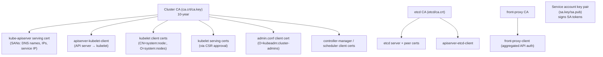

# 5.21 Certificates, identity, admission control and policy

| | |
|---|---|
| Level | Advanced |
| Priority tier | 1 |
| Lab venue | kubeadm lab; `openssl`, `kubeadm certs`, `kubectl get csr`; Kyverno/Gatekeeper/ValidatingAdmissionPolicy; Dex or Keycloak for OIDC |
| Part | Part 5: Kubernetes |
| Status | Drafted, labs **untested** |

## Why this matters for AI infrastructure

A shared GPU cluster is attractive to attackers and error-prone for users: privileged containers can read the host, hostPath mounts can expose model weights and credentials, unbounded GPU requests can starve a team, unsigned images can inject malware into training pipelines, and expired certificates can silently take down an entire control plane on a Monday morning. Three mechanisms keep this under control: the **PKI and identity** layer (who is speaking and can they be trusted), **admission control** (what is allowed to enter the API), and **policy as code** (organisation rules encoded and enforced). This chapter explains certificate management in Kubernetes (including rotation and failure modes), identity federation, the admission chain, Pod Security, and practical policies for AI platforms.

## Prerequisites and outcomes

Needs 5.5, 5.9, 5.16. After this chapter you can:

- Map the cluster PKI (CAs, leaf certificates, who uses which), inspect and renew certificates, rotate kubelet and etcd certificates, and plan CA rotation.
- Use the CertificateSigningRequest API, kubelet TLS bootstrapping, approvers, and cert-manager for workload certificates.
- Configure OIDC authentication and understand token-based identities and impersonation.
- Describe the admission pipeline and use built-in plugins, webhooks (mutating/validating), and `ValidatingAdmissionPolicy` (CEL); design safe webhooks.
- Apply Pod Security Standards (privileged/baseline/restricted) via Pod Security Admission and adopt policy engines (Kyverno, OPA Gatekeeper) for custom rules, mutation, generation and verification (image signatures).
- Build a layered guardrail set for multi-tenant AI clusters (GPU limits, queues, host access, registries, labels, network).
- Troubleshoot certificate and admission failures.

## 1. The Kubernetes PKI

kubeadm clusters have a small PKI in `/etc/kubernetes/pki`, all issued by self-managed CAs:



- **Root CAs**: cluster CA, etcd CA, front-proxy CA (separate trust domains); CA private keys live on control-plane nodes (and should be backed up offline, 5.20). Leaf certificates are valid **1 year** by default; CAs 10 years.
- **Service account signing key** (`sa.key`) signs tokens (JWT); public key verifies; rotating it invalidates existing tokens unless multiple keys are accepted.
- **Kubelet certificates**: client cert (to the API server, auto-rotated with `rotateCertificates`) and serving cert (for the kubelet API on 10250; self-signed by default unless `serverTLSBootstrap` + approval).
- **Aggregated API servers and webhooks** use CA bundles in `APIService.spec.caBundle` and webhook configurations' `caBundle` (cert-manager's CA injector keeps them current).
- Managed services hide the control-plane PKI but you still manage: workload certificates, webhook certs, ingress certs, mTLS between services, and OIDC.

### Inspecting and renewing

```bash
sudo kubeadm certs check-expiration                       # lists leaf certs, expiry, residual time, CA
sudo openssl x509 -in /etc/kubernetes/pki/apiserver.crt -noout -subject -issuer -dates -ext subjectAltName
sudo kubeadm certs renew all                              # renews kubeadm-managed leafs (not CAs); on each control-plane node
# restart the static pods to load new certs:
sudo mv /etc/kubernetes/manifests/kube-apiserver.yaml /tmp/ && sleep 20 && sudo mv /tmp/kube-apiserver.yaml /etc/kubernetes/manifests/
# (or restart kubelet; same for controller-manager, scheduler, etcd)
sudo cp /etc/kubernetes/admin.conf ~/.kube/config         # admin.conf embeds a client cert that was renewed
kubectl get csr                                           # kubelet serving CSRs pending approval?
```

`kubeadm upgrade` renews certificates automatically (a reason to upgrade at least yearly). Failure to renew leads to: `x509: certificate has expired or is not yet valid` in kubectl, kubelet, API server logs; control-plane components crash-loop; nodes NotReady. Alert on expiry: Prometheus `apiserver_client_certificate_expiration_seconds_bucket`, `kubelet_certificate_manager_client_ttl_seconds`, cert-manager's `certmanager_certificate_expiration_timestamp_seconds`, `x509-certificate-exporter`, or blackbox probes of the API endpoint's cert.

### Rotating CAs

Rare, delicate, disruptive: introduce a new CA alongside the old (CA bundles containing both), re-issue all leafs from the new CA, update kubeconfigs and bundles everywhere (kubelets, controllers, aggregated APIs, webhooks, CI), then remove the old CA. Kubernetes doesn't automate it end to end (cluster API, cloud providers, and tools like `kubeadm` + manual steps or Cluster API MachineHealth rotate by replacing nodes). Plan for it after a compromise; limit CA lifetime exposure by protecting CA keys (offline backup, HSM/KMS-backed signers, short-lived leafs).

### Kubelet TLS bootstrapping and CSRs

Workers join with a **bootstrap token** (group `system:bootstrappers`) that can only create CSRs; the **CSR approver** in kube-controller-manager auto-approves kubelet client-cert requests (`csrapproving`), and the signer issues certs (`kubernetes.io/kube-apiserver-client-kubelet`). Serving certificates (`kubernetes.io/kubelet-serving`) are not auto-approved for security (SAN validation): approve manually (`kubectl certificate approve`), via `kubelet-csr-approver` (checks hostname/IP matches), or cert-manager's CSR support. The generic **CertificateSigningRequest API** (`certificates.k8s.io/v1`) lets users/workloads request certs from signers: `kubernetes.io/kube-apiserver-client` (user client certs), `kubernetes.io/legacy-unknown`, or custom signers (`example.com/internal-ca`) implemented by controllers (cert-manager `Issuer` as signer, SPIFFE/SPIRE integrations, Vault PKI).

```bash
# Issue a client cert for a user via the CSR API
openssl genrsa -out jane.key 2048
openssl req -new -key jane.key -subj "/CN=jane/O=team-a-researchers" -out jane.csr
kubectl create -f - <<EOF
apiVersion: certificates.k8s.io/v1
kind: CertificateSigningRequest
metadata: { name: jane }
spec:
  request: $(base64 -w0 < jane.csr)
  signerName: kubernetes.io/kube-apiserver-client
  expirationSeconds: 86400            # short-lived
  usages: [client auth]
EOF
kubectl certificate approve jane
kubectl get csr jane -o jsonpath='{.status.certificate}' | base64 -d > jane.crt
kubectl config set-credentials jane --client-certificate=jane.crt --client-key=jane.key --embed-certs
```

Note: Kubernetes cannot revoke client certificates (no CRL/OCSP support in the API server); compromise response = remove RBAC bindings for that identity/group, or rotate the CA. Prefer OIDC tokens (expiring, revocable at IdP) for humans.

### Workload certificates and mTLS

**cert-manager** (5.12) issues certs for ingress, webhooks, and service-to-service mTLS (`Certificate` → Secret; issuers: CA, ACME, Vault, Venafi, AWS PCA, step-ca; `csi-driver` for per-pod certs). Service meshes (Istio/Linkerd/Cilium) issue short-lived workload identities (SPIFFE IDs) with automatic rotation (5.28). **trust-manager** distributes CA bundles. Keep webhook serving certs auto-renewed (a classic outage: expired webhook cert → all matching API requests fail).

## 2. Identity and authentication federation

(Authentication methods in 5.16.) Production practice:

- **OIDC for humans** (Keycloak, Dex, Okta, Entra ID, Google): configure API server `--oidc-issuer-url`, `--oidc-client-id`, `--oidc-username-claim`, `--oidc-groups-claim`, `--oidc-username-prefix=oidc:`, `--oidc-groups-prefix=oidc:` or use the structured `AuthenticationConfiguration` file (supports multiple issuers, claim validation rules with CEL, user validation rules). kubectl uses an exec plugin (`kubelogin`/`oidc-login`) to obtain/refresh tokens. Map IdP groups to RBAC bindings; enforce MFA and short token lifetimes at the IdP. The API server must trust the IdP's CA and fetch JWKS.
- **Machine identities**: bound ServiceAccount tokens, workload identity federation (cloud IAM/Vault trust the cluster's OIDC issuer), SPIFFE/SPIRE for cross-platform workload identity.
- **Impersonation** (`--as`, `--as-group`): admins and automation can act as others (audited); restrict `impersonate` verb tightly; useful for testing RBAC and for gateways/dashboards acting on behalf of users.
- **Webhook token authentication** (cloud IAM authenticators), **authenticating proxy** (front proxy for dashboards; trust headers only from the proxy CA), **anonymous auth** disabled in production (`--anonymous-auth=false`; some health endpoints require care).
- **Audit identity**: user.username, groups, impersonatedUser in audit events; ensure usernames are unique and not spoofable (prefixing avoids collisions between IdP names and system users).

### Cloud metadata proxies (`kube2iam` / `kiam`) versus `IRSA`

Before projected ServiceAccount tokens (`PSAT`s) and cloud OIDC federation were available, clusters on AWS used node-level metadata proxies such as `kube2iam` and `kiam` to map `iam.amazonaws.com/role: <role-arn>` Pod annotations to IAM roles. As *Production Kubernetes* (Chapter 10) explains, both proxy approaches have architectural security flaws compared with **IAM Roles for Service Accounts (`IRSA`)**:

- **`kube2iam`** runs as a `DaemonSet` on every worker node and inserts an `iptables` rule redirecting traffic destined for the EC2 metadata API to the local `kube2iam` proxy. Every worker node's IAM instance profile must be allowed to assume the superset of all IAM roles needed by any Pod in the cluster, so a container breakout on any worker compromises every role.
- **`kiam`** splits the proxy into a node `DaemonSet` agent and a `kiam` server placed on dedicated control-plane or server nodes so that only the server nodes hold IAM role-assumption permissions. However, if a user can submit a Pod with `spec.nodeName` already populated (bypassing the scheduler and landing directly on a server node, or starting and reaching the metadata endpoint before the proxy's IP-to-Pod cache/guards prevent it), the Pod can gain unrestricted access to the EC2 metadata API unless an admission webhook blocks pre-populated `spec.nodeName` fields.
- **`IRSA`** eliminates metadata proxying entirely: a mutating webhook injects a projected ServiceAccount token (`audience: sts.amazonaws.com`, `expirationSeconds: 86400` mounted at `/var/run/secrets/eks.amazonaws.com/serviceaccount/token` in the book's example) along with `AWS_ROLE_ARN` and `AWS_WEB_IDENTITY_TOKEN_FILE` environment variables. The AWS SDK calls `sts:AssumeRoleWithWebIdentity` directly with that short-lived JWT, which AWS IAM verifies against the cluster's public OIDC `.well-known` discovery endpoint and JWKS keys.

### Cross-platform workload identity with `SPIFFE` and `SPIRE`

When workloads span multiple clouds, bare-metal GPU clusters, and virtual machines, **SPIFFE** (Secure Production Identity Framework for Everyone) and its reference implementation **SPIRE** (SPIFFE Runtime Environment) issue portable cryptographic identities (`spiffe://trust-domain/hierarchical/workload`) encoded as short-lived X.509 certificates (**X.509-SVIDs**) or JWT tokens (**JWT-SVIDs**). As *Production Kubernetes* (Chapter 10) describes, the attestation flow has two stages:

1. **Node attestation (`spire-server` and `spire-agent`)**: `spire-server` runs as the central signing authority and registration store, while `spire-agent` runs as a `DaemonSet` on every node. When an agent starts, it proves its node identity to `spire-server` using platform evidence (such as a Kubernetes Projected ServiceAccount Token via the `k8s_psat` attestor or cloud instance metadata) and receives an X.509-SVID for the node. In the book's example (untested here), the administrator registers the node group with:

```bash
/opt/spire/bin/spire-server entry create \
  -spiffeID spiffe://production-trust-domain/nodes \
  -selector k8s_psat:cluster:production-cluster \
  -selector k8s_psat:agent_ns:spire \
  -selector k8s_psat:agent_sa:spire-agent \
  -node
```

2. **Workload attestation (Workload API Unix domain socket)**: workloads connect to the node-local `spire-agent` over a Unix domain socket (`unix:///run/spire/sockets/agent.sock` in the book's example) without presenting any initial secret (solving the "secure introduction" problem). The `spire-agent` inspects kernel and `kubelet` metadata for the calling process (Pod namespace, ServiceAccount, Pod labels, container image) and matches them against registration entries created on `spire-server`, such as the book's example (untested here):

```bash
/opt/spire/bin/spire-server entry create \
  -spiffeID spiffe://production-trust-domain/service-a \
  -parentID spiffe://production-trust-domain/nodes \
  -selector k8s:ns:default \
  -selector k8s:sa:service-a \
  -selector k8s:pod-label:app:frontend \
  -selector k8s:container-image:docker.io/johnharris85/service-a:v0.0.1
```

Once matched, `spire-agent` returns the workload's X.509-SVID or JWT-SVID (or streams certificates directly to an Envoy sidecar over Envoy's Secret Discovery Service, `SDS`, API). Note that because the Kubernetes workload attestor queries the `kubelet` (which validates tokens via `TokenReview`), API server downtime can interrupt attestation of newly started Pods; the `--authentication-token-webhook-cache-ttl` `kubelet` flag controls how long `TokenReview` responses are cached.

## 3. Admission control

Admission runs after authn/authz and before persistence (5.5). Types:

| Phase | Mechanism | Examples |
|---|---|---|
| **Built-in mutating** | Compiled into the API server (enable/disable via `--enable-admission-plugins`) | `NamespaceLifecycle`, `LimitRanger`, `ServiceAccount`, `DefaultStorageClass`, `DefaultTolerationSeconds`, `MutatingAdmissionWebhook`, `Priority`, `RuntimeClass`, `StorageObjectInUseProtection`, `TaintNodesByCondition`, `ExtendedResourceToleration` (opt-in) |
| **Mutating webhooks** | External HTTPS service called with `AdmissionReview`; returns JSON patches | Istio sidecar injector, Kyverno mutate, cert-manager CA injector, custom GPU defaults |
| **Validating built-in** | | `ResourceQuota`, `PodSecurity`, `NodeRestriction`, `Priority`, `ValidatingAdmissionPolicy`, `ValidatingAdmissionWebhook`, `CertificateApproval/Signing/SubjectRestriction` |
| **Validating webhooks** | External services return allow/deny with message | OPA Gatekeeper, Kyverno validate, image policy webhooks, custom checks |
| **ValidatingAdmissionPolicy (VAP)** | In-process, declarative **CEL** expressions; `ValidatingAdmissionPolicy` + `ValidatingAdmissionPolicyBinding` (with params) | Cheap, no webhook latency/availability risk; GA in recent releases; `MutatingAdmissionPolicy` (CEL mutations) arriving |

Registration objects: `MutatingWebhookConfiguration` / `ValidatingWebhookConfiguration` with `rules` (operations, apiGroups/versions/resources), `clientConfig` (service or URL + `caBundle`), `failurePolicy` (`Fail`/`Ignore`), `timeoutSeconds` (≤30; keep ≤10), `matchPolicy`, `namespaceSelector`, `objectSelector`, `matchConditions` (CEL pre-filters), `sideEffects` (`None`/`NoneOnDryRun`), `admissionReviewVersions`, `reinvocationPolicy` (mutating).

```yaml
apiVersion: admissionregistration.k8s.io/v1
kind: ValidatingAdmissionPolicy
metadata: { name: gpu-request-limits }
spec:
  failurePolicy: Fail
  matchConstraints:
    resourceRules:
      - apiGroups: [""]
        apiVersions: ["v1"]
        operations: ["CREATE", "UPDATE"]
        resources: ["pods"]
  variables:
    - name: gpus
      expression: "object.spec.containers.map(c, has(c.resources.limits) && 'nvidia.com/gpu' in c.resources.limits ? int(c.resources.limits['nvidia.com/gpu']) : 0).sum()"
  validations:
    - expression: "variables.gpus <= 8"
      message: "A single pod may request at most 8 GPUs."
    - expression: "variables.gpus == 0 || has(object.spec.priorityClassName)"
      message: "GPU pods must set a priorityClassName."
      reason: Invalid
---
apiVersion: admissionregistration.k8s.io/v1
kind: ValidatingAdmissionPolicyBinding
metadata: { name: gpu-request-limits-prod }
spec:
  policyName: gpu-request-limits
  validationActions: [Deny, Audit]                # Warn | Audit | Deny
  matchResources:
    namespaceSelector: { matchLabels: { env: prod } }
```

Webhook design rules (they are production-critical, 5.5): high availability (≥2-3 replicas, PDB, anti-affinity), fast (under 100 ms typical), idempotent, no external dependencies in the request path, `failurePolicy: Ignore` for non-security-critical mutations (and `Fail` only where the risk of bypass is worse than outage), exclude `kube-system` and the webhook's own namespace to avoid bootstrap deadlocks (a webhook that blocks creation of its own pods), selectors to limit scope, certificate auto-renewal, metrics and alerts (`apiserver_admission_webhook_admission_duration_seconds`, rejection counters), dry-run safe (`sideEffects: None`), test with `kubectl --dry-run=server`, and a break-glass procedure (delete the webhook configuration) documented.

## 4. Pod Security Standards and Admission

The **Pod Security Standards** define three cumulative profiles:

| Profile | Meaning | Blocks (selection) |
|---|---|---|
| **Privileged** | Unrestricted | Nothing |
| **Baseline** | Prevents known privilege escalations; minimal friction | hostNetwork/hostPID/hostIPC, privileged containers, hostPath volumes, host ports, most added capabilities (allows default set), unsafe sysctls, `procMount` unmasked, AppArmor/SELinux overrides, windows HostProcess |
| **Restricted** | Hardened best practice | Baseline + must run as non-root, `allowPrivilegeEscalation: false`, drop `ALL` capabilities (add only `NET_BIND_SERVICE`), `seccompProfile: RuntimeDefault/Localhost`, restricted volume types (configMap, csi, downwardAPI, emptyDir, ephemeral, persistentVolumeClaim, projected, secret) |

**Pod Security Admission** (built-in, replaces PodSecurityPolicy removed in 1.25) is configured per namespace via labels:

```bash
kubectl label ns team-a pod-security.kubernetes.io/enforce=baseline pod-security.kubernetes.io/enforce-version=latest \
  pod-security.kubernetes.io/warn=restricted pod-security.kubernetes.io/audit=restricted
```

Modes: `enforce` (reject), `audit` (record in audit log), `warn` (client warning). Cluster-wide defaults and exemptions (usernames, runtimeClasses, namespaces) in the `AdmissionConfiguration`. Rollout: start with `warn`/`audit` at `restricted`, fix workloads, then `enforce`.

GPU/HPC realities: many GPU stacks need exceptions: the **GPU Operator, device plugin, DCGM exporter, NVIDIA driver containers, Network Operator, CNI agents, CSI node plugins, node-problem-detector** require privileged/hostPath/hostNetwork and live in dedicated system namespaces labelled `privileged`. Tenant training pods can usually meet `baseline` (no hostPath/privileged; GPUs via device plugin) and often `restricted` with `runAsNonRoot` images; RDMA workloads need `IPC_LOCK` (baseline allows only a default capability set; `IPC_LOCK` is not in it, so requires a policy exception or a profile-level allowance via policy engine/namespace label). Document exceptions per namespace instead of weakening the cluster default.

## 5. Policy engines

### Kyverno

Kubernetes-native policy engine (policies are CRDs in YAML, no new language). Capabilities: **validate** (patterns, CEL, deny conditions), **mutate** (patchStrategicMerge, JSON6902, foreach), **generate** (create resources when something happens, e.g., default NetworkPolicy/Quota/RBAC per new namespace), **verifyImages** (cosign/Notary signatures and attestations, SBOM/provenance checks), **cleanup** policies (TTL-based deletion), policy exceptions (`PolicyException`), background scanning and reports (`PolicyReport`), CLI for CI testing (`kyverno test`/`apply`).

```yaml
apiVersion: kyverno.io/v1
kind: ClusterPolicy
metadata: { name: require-queue-and-limits }
spec:
  background: true
  rules:
    - name: gpu-jobs-need-queue-label
      match:
        any:
          - resources: { kinds: [Job, "kubeflow.org/v1/PyTorchJob"], namespaceSelector: { matchLabels: { tier: training } } }
      validate:
        failureAction: Enforce
        message: "Training jobs must carry a kueue.x-k8s.io/queue-name label."
        pattern:
          metadata:
            labels:
              kueue.x-k8s.io/queue-name: "?*"
    - name: default-seccomp
      match: { any: [ { resources: { kinds: [Pod] } } ] }
      mutate:
        patchStrategicMerge:
          spec:
            securityContext:
              +(seccompProfile): { type: RuntimeDefault }        # add if absent
---
apiVersion: kyverno.io/v1
kind: ClusterPolicy
metadata: { name: default-namespace-guardrails }
spec:
  rules:
    - name: generate-default-deny
      match: { any: [ { resources: { kinds: [Namespace], selector: { matchLabels: { managed-tenant: "true" } } } } ] }
      generate:
        apiVersion: networking.k8s.io/v1
        kind: NetworkPolicy
        name: default-deny
        namespace: "{{request.object.metadata.name}}"
        synchronize: true
        data: { spec: { podSelector: {}, policyTypes: [Ingress, Egress] } }
    - name: verify-signed-images
      match: { any: [ { resources: { kinds: [Pod] } } ] }
      verifyImages:
        - imageReferences: ["registry.example.com/ml/*"]
          mutateDigest: true
          attestors:
            - entries:
                - keyless: { issuer: "https://token.actions.githubusercontent.com", subject: "https://github.com/acme/*" }
```

### OPA Gatekeeper

Admission controller using **Rego** in `ConstraintTemplate`s (policy logic) and `Constraint` CRs (parameters/matching); audit of existing resources; external data providers; mutation support (`Assign`, `AssignMetadata`); Gatekeeper library of templates. Powerful but requires Rego skill; choose Kyverno for Kubernetes-centric YAML simplicity or Gatekeeper where OPA is already the standard across systems (also Conftest for CI, 4.2).

As shown in *Production Kubernetes* (Chapter 8) and *Kubernetes: Up and Running* (3rd edition, Chapter 20), Gatekeeper runs in the `gatekeeper-system` namespace (`gatekeeper-controller-manager` and `gatekeeper-audit` deployments) and registers `gatekeeper-validating-webhook-configuration` (which defaults to `failurePolicy: Ignore` and skips namespaces carrying the `admission.gatekeeper.sh/ignore` label). Four concrete Gatekeeper building blocks cover validation, cross-resource inventory checks, dry-run auditing, and mutation:

1. **Inventory replication (`Config` resource in `config.gatekeeper.sh/v1alpha1`)**: by default, OPA only sees the incoming `input.review` object. Policies that compare an incoming resource against existing objects in the cluster (such as checking that an `Ingress` host is unique across all namespaces, or reading an allowed host regex annotation from the target `Namespace`) require syncing those kinds into Gatekeeper's `data.inventory` cache. In the books' examples (untested here), a `Config` resource caches `Namespace`, `Pod`, and `Ingress` objects:

```yaml
apiVersion: config.gatekeeper.sh/v1alpha1
kind: Config
metadata:
  name: config
  namespace: "gatekeeper-system"
spec:
  sync:
    syncOnly:
      - group: ""
        version: "v1"
        kind: "Namespace"
      - group: ""
        version: "v1"
        kind: "Pod"
      - group: "extensions"
        version: "v1beta1"
        kind: "Ingress"
      - group: "networking.k8s.io"
        version: "v1beta1"
        kind: "Ingress"
```

2. **`ConstraintTemplate` and `Constraint` (with `enforcementAction: deny | dryrun | warn`)**: a `ConstraintTemplate` defines both the OpenAPI v3 parameter schema for a new constraint CRD (such as `K8sAllowedRepos`, `K8sRequiredLabels` / `k8srequiredlabels`, `K8sUniqueIngressHost`, or `LimitNamespaceIngress`) and the Rego `violation[{"msg": msg}]` rule evaluated by target `admission.k8s.gatekeeper.sh`. When rolling out a new `Constraint` on an existing cluster, setting `enforcementAction: dryrun` (or `warn`) lets the `gatekeeper-audit` controller record existing non-compliant objects in the constraint's `status.totalViolations` and `status.violations` list (along with `status.auditTimestamp`) without blocking workloads until teams remediate them. In the books' examples (untested here):

```yaml
apiVersion: templates.gatekeeper.sh/v1beta1
kind: ConstraintTemplate
metadata:
  name: k8sallowedrepos
spec:
  crd:
    spec:
      names:
        kind: K8sAllowedRepos
      validation:
        openAPIV3Schema:
          properties:
            repos:
              type: array
              items:
                type: string
  targets:
    - target: admission.k8s.gatekeeper.sh
      rego: |
        package k8sallowedrepos
        violation[{"msg": msg}] {
          container := input.review.object.spec.containers[_]
          satisfied := [good | repo = input.parameters.repos[_] ; good = startswith(container.image, repo)]
          not any(satisfied)
          msg := sprintf("container <%v> has an invalid image repo <%v>, allowed repos are %v", [container.name, container.image, input.parameters.repos])
        }
---
apiVersion: constraints.gatekeeper.sh/v1beta1
kind: K8sAllowedRepos
metadata:
  name: repo-is-kuar-demo
spec:
  enforcementAction: dryrun
  match:
    kinds:
      - apiGroups: [""]
        kinds: ["Pod"]
    namespaces:
      - "default"
  parameters:
    repos:
      - "gcr.io/kuar-demo/"
```

Similarly, a `ConstraintTemplate` that queries `data.inventory` can enforce cross-object uniqueness (such as `k8suniqueingresshost` checking `data.inventory.namespace[ns][otherapiversion]["Ingress"][name]`) or match an `Ingress` host against a regex stored on its parent `Namespace` (`limitnamespaceingress` reading `data.inventory.cluster.v1.Namespace[input.review.object.metadata.namespace]`).

3. **Gatekeeper `Assign` mutation (`mutations.gatekeeper.sh/v1alpha1`)**: when Gatekeeper's mutating webhook is enabled, an `Assign` resource can set default or enforced field values before validating constraints run. In the book's (*Kubernetes: Up and Running*, Chapter 20) example (untested here), an `Assign` object sets `imagePullPolicy: Always` on every container in all Pods outside the `system` namespace:

```yaml
apiVersion: mutations.gatekeeper.sh/v1alpha1
kind: Assign
metadata:
  name: demo-image-pull-policy
spec:
  applyTo:
    - groups: [""]
      kinds: ["Pod"]
      versions: ["v1"]
  match:
    scope: Namespaced
    kinds:
      - apiGroups: ["*"]
        kinds: ["Pod"]
    excludedNamespaces: ["system"]
  location: "spec.containers[name:*].imagePullPolicy"
  parameters:
    assign:
      value: Always
```

4. **Gatekeeper Prometheus metrics**: Gatekeeper exports Prometheus metrics for continuous compliance monitoring and alerting, including the total number of audit violations (`gatekeeper_violations`), the number of constraints by `enforcementAction` (`gatekeeper_constraints`), constraint templates, request latency, and audit duration.

### Others

**ValidatingAdmissionPolicy** (CEL, built-in) for simple rules without extra controllers; **Kubewarden** (WASM policies), **jsPolicy**, **Polaris/kubescape** (audit/lint), **Cloud-provider policy** (Azure Policy for AKS, GKE Policy Controller), **Falco/Tetragon** for runtime detection (complement to admission). Layer them: PSA for baseline security; VAP/Kyverno/Gatekeeper for organisation rules; admission for supply chain; runtime security for detection.

### Image and supply-chain admission

Controls: allow-list registries (only `registry.example.com/*`), require digests (`mutateDigest`), verify cosign signatures and attestations (SLSA provenance, SBOM, vulnerability scan results), block `latest`, require `imagePullPolicy`, forbid images with critical CVEs via scan attestations; see 5.27 for the full chain. Beware admission latency pulling registry metadata (cache) and outage coupling to the registry (decide `failurePolicy`).

## 6. A guardrail set for multi-tenant GPU clusters

| Guardrail | Mechanism | Example rule |
|---|---|---|
| No privileged/host access for tenants | PSA `baseline`/`restricted` per tenant namespace | Deny `hostNetwork`, `hostPath`, `privileged`, hostPID; allow exceptions in system namespaces only |
| Non-root, drop capabilities, seccomp | PSA restricted + Kyverno mutate defaults | Default `RuntimeDefault` seccomp, require `runAsNonRoot` |
| GPU request bounds | VAP/Kyverno | Max GPUs per pod/namespace; require priorityClass/queue label |
| Only approved registries and signed images | Kyverno verifyImages / Gatekeeper | `registry.example.com/*` or NGC allow-list; cosign verification |
| Required metadata | Validate labels | `team`, `project`, `cost-center`, `owner` on namespaces and workloads |
| Resource requests/limits present | LimitRange + validate | Deny pods lacking memory limits; default ephemeral-storage |
| Network defaults | Kyverno generate | Default-deny NetworkPolicy and DNS allow per namespace |
| Quota defaults | Generate ResourceQuota/Kueue LocalQueue | New tenant namespace gets quota and queue |
| Storage classes | Validate PVC | Only approved StorageClasses; size caps; deny hostPath |
| Ingress hygiene | Validate Ingress/Gateway | TLS required, hostnames within team domain, no wildcard hosts |
| Service exposure | Validate Service | Deny `LoadBalancer` and `NodePort` in tenant namespaces unless approved |
| Node targeting | Validate/mutate | Deny `nodeName`; restrict nodeSelector/affinity to approved pools; inject tolerations for GPU pods |
| Time-boxed interactive resources | Kyverno cleanup / TTL | Delete notebooks after N hours idle (with notification) |
| Admin access to nodes | RBAC + policy | Deny `nodes/proxy`, `pods/exec` into system namespaces for tenants |
| Policy exceptions | `PolicyException` CRs with expiry via GitOps PR | Auditable, time-limited |

Rollout approach: policy-as-code in Git with tests (4.13, 4.26), `Audit`/`warn` mode first, report review, enforce per namespace/ring, communication to users with clear messages and docs links in rejection messages, break-glass procedures.

## 7. Troubleshooting

| Symptom | Likely cause | Fix |
|---|---|---|
| `x509: certificate has expired` (kubectl/kubelet/API) | Leaf cert expiry | `kubeadm certs renew`, restart components; add expiry alerts |
| Nodes NotReady after year; kubelet logs TLS errors | Kubelet client cert rotation failed or CA mismatch | Re-bootstrap kubelet, check CSR approvals, `rotateCertificates` |
| `kubectl logs` fails: certificate signed by unknown authority / no SAN | Kubelet serving cert self-signed or CSR unapproved | Enable `serverTLSBootstrap`, approve CSRs, install approver |
| Webhook `failed calling webhook ... x509` / `context deadline exceeded` | Expired/mismatched `caBundle`, webhook down/slow | Fix cert/CA injection, scale webhook, adjust timeout/failurePolicy |
| All pod creations rejected | Broken validating webhook with `Fail` | Delete/patch the webhook configuration, restore service, add exclusions |
| Pod rejected by PSA | Profile violation | Read message; fix securityContext or label namespace appropriately |
| Policy not applied | Wrong match, `background`/audit mode only, engine pods down, namespace excluded | Check policy reports, engine logs, `kubectl get cpol -o yaml` status |
| Kyverno/Gatekeeper slow API | Heavy policies, many resources, external lookups | Optimise rules, scope with selectors, scale replicas |
| OIDC login fails | Clock skew, wrong issuer/audience, CA trust, groups claim missing | API server logs, token claims (`jwt.io`/`jq`), `kubectl auth whoami` |
| Impersonation denied | Missing `impersonate` permission | RBAC for impersonate verbs on users/groups/serviceaccounts |
| CSR stuck Pending | No approver | Approve manually or deploy approver |
| ServiceAccount tokens invalid after maintenance | `sa.key` rotated without keeping old public key | Keep old key in `--service-account-key-file` list during rotation |

## 8. Lab (untested)

1. **PKI tour**: list `/etc/kubernetes/pki`; decode each cert with `openssl x509`; draw who signs whom and which components present which certs; check SANs on the API server cert.
2. **Expiry drill**: in a throwaway cluster, shorten cert validity (or use `faketime`/clock jump on a lab VM), watch failures; renew with `kubeadm certs renew all`, restart static pods, restore kubeconfigs; add Prometheus alerts for expiry.
3. **CSR API**: issue a short-lived client cert for a user via CSR; bind RBAC; test; discuss revocation limits; compare with an OIDC login via Dex.
4. **Kubelet serving certs**: enable `serverTLSBootstrap`, observe pending CSRs and `kubectl logs` failures; install `kubelet-csr-approver`; verify.
5. **cert-manager + webhook certs**: deploy a sample webhook with cert-manager-managed certs and CA injection; let the cert expire (short duration) and observe renewal; break CA injection and see API failures; fix.
6. **OIDC**: configure Dex/Keycloak OIDC for the API server (or structured authentication config), map groups to RBAC, log in with `kubelogin`, inspect token claims, test token expiry.
7. **Admission chain**: write a mutating webhook (adds labels) and validating webhook (denies `:latest`); observe ordering; test `failurePolicy` Fail vs Ignore with the webhook down; add `namespaceSelector` exclusions; use `matchConditions`.
8. **ValidatingAdmissionPolicy**: implement the GPU limits policy with binding and params; test Warn/Audit/Deny; compare latency and operations with a webhook.
9. **PSA rollout**: label namespaces in warn/audit at restricted; deploy typical workloads and observe warnings; fix securityContexts; switch to enforce; handle GPU Operator namespace exception.
10. **Kyverno/Gatekeeper**: implement the guardrail table's key rules (queue label required, approved registries, default NetworkPolicy generation, seccomp default); use `kyverno test` in CI with fixtures; produce a policy report; handle a `PolicyException`.
11. **Image verification**: sign an image with cosign (keyless or key), enforce verification with Kyverno `verifyImages`, test a tampered/unsigned image; add digest mutation.
12. **Break-glass drill**: block the cluster with a bad webhook; recover via deleting the webhook configuration; write the runbook.
13. **Clean up**.

Mark tested only after execution.

## 9. Common mistakes

- Ignoring certificate expiry until the cluster dies; not monitoring; not renewing kubelet serving certs; losing CA keys.
- Treating client certificates as revocable; issuing long-lived admin certs to humans.
- Webhooks with `Fail` policy and no exclusions; single replica; slow external calls; expired webhook certs.
- Enforcing PSA/policies cluster-wide without audit rollout; blocking system namespaces; no documented exceptions.
- Using Kyverno/Gatekeeper to compensate for missing RBAC (and vice versa).
- Policies that depend on mutable tags or unverifiable data; admission latency impacting API performance.
- No tests for policies; policies edited in-cluster by hand rather than via GitOps.
- Overly permissive exceptions (e.g., privileged everywhere because GPU pods need something).
- Mixing identity prefixes so IdP users collide with system identities.
- Forgetting sa.key rotation implications.

## 10. Interview angles

- "What certificates exist in a kubeadm cluster? What expires and when? How do you renew?" 
- "How do kubelets get certificates? What is TLS bootstrapping and why aren't serving CSRs auto-approved?" 
- "Why can't Kubernetes revoke client certificates? What do you do after a leak?" 
- "Explain admission control: mutating vs validating, webhooks vs ValidatingAdmissionPolicy. What can go wrong with webhooks?" 
- "What are the Pod Security Standards? How do you roll them out in a cluster with GPU operators?" 
- "Kyverno vs OPA Gatekeeper vs VAP: how do you choose?" 
- "How would you enforce that only signed images from your registry run in training namespaces?" 
- "Describe a guardrail set for a multi-tenant GPU cluster." 

## 11. Checkpoint questions (40)

1. Leaf cert default validity? **A:** 1 year.
2. CA default validity? **A:** 10 years.
3. Check expiry command? **A:** `kubeadm certs check-expiration`.
4. Renew command? **A:** `kubeadm certs renew all`.
5. Does `kubeadm upgrade` renew certs? **A:** Yes (by default).
6. Three CAs in kubeadm? **A:** Cluster, etcd, front-proxy.
7. What signs SA tokens? **A:** `sa.key`.
8. Kubelet client cert CN? **A:** `system:node:<name>`.
9. Which CSR needs manual approval? **A:** Kubelet serving.
10. Bootstrap token group? **A:** `system:bootstrappers`.
11. CSR API group? **A:** `certificates.k8s.io/v1`.
12. Client cert signer name? **A:** `kubernetes.io/kube-apiserver-client`.
13. Revoke certs? **A:** Not supported by API server.
14. cert-manager injects CA where? **A:** Webhook/APIService caBundle.
15. OIDC flags? **A:** `--oidc-issuer-url`, client-id, username/groups claims.
16. Why prefix OIDC names? **A:** Avoid collisions with system identities.
17. Admission phases? **A:** Mutating, schema validation, validating.
18. Built-in quota admission? **A:** ResourceQuota.
19. Webhook `failurePolicy` values? **A:** Fail, Ignore.
20. Webhook timeout max? **A:** 30 s.
21. Why exclude kube-system? **A:** Avoid deadlocks/outages.
22. VAP language? **A:** CEL.
23. VAP actions? **A:** Deny, Warn, Audit.
24. PSP replaced by? **A:** Pod Security Admission.
25. PSA labels modes? **A:** enforce, audit, warn.
26. Profiles? **A:** privileged, baseline, restricted.
27. Restricted requires? **A:** runAsNonRoot, drop ALL caps, seccomp, no privilege escalation.
28. GPU system namespaces profile? **A:** Privileged (exceptions).
29. Kyverno policy languages? **A:** YAML patterns/CEL/JMESPath.
30. Kyverno generate use? **A:** Create default resources per namespace.
31. Kyverno verifyImages does? **A:** Verify signatures/attestations.
32. In OPA Gatekeeper, what resource syncs cluster objects into `data.inventory`, what `enforcementAction` values exist on a `Constraint`, and what CRD mutates fields like `imagePullPolicy: Always`? **A:** `Config` (`config.gatekeeper.sh/v1alpha1`) syncs objects into `data.inventory`; `enforcementAction` accepts `deny`, `dryrun`, and `warn`; `Assign` (`mutations.gatekeeper.sh/v1alpha1`) mutates fields.
33. Policy test tool? **A:** `kyverno test`, Conftest.
34. mutating before validating? **A:** Yes.
35. Reinvocation policy purpose? **A:** Re-run mutators after others change the object.
36. Audit-mode policy reports? **A:** PolicyReport CRs.
37. Break-glass for bad webhook? **A:** Delete its configuration.
38. mTLS rotation tool? **A:** cert-manager/mesh CA.
39. What distributes CA bundles? **A:** trust-manager.
40. Runtime detection tool? **A:** Falco/Tetragon.

## 12. Sources and review notes

**Written in original words.** Principal sources:

- Josh Rosso et al., *Production Kubernetes* (`production-kubernetes`, Chapter 8: `8. Admission Control` and Chapter 10: `10. Identity` — both read in full for Gatekeeper `Config` `data.inventory` sync and `ConstraintTemplate`/`Constraint` examples, `kube2iam`/`kiam` `spec.nodeName` bypass vs `IRSA` `sts:AssumeRoleWithWebIdentity`, and `SPIFFE`/`SPIRE` node/workload attestation with `spire-server entry create`).
- Brendan Burns et al., *Kubernetes: Up and Running* (`kubernetes-up-and-running-3rd-edition`, 3rd edition; Chapter 19 and Chapter 20: `20. Policy and Governance for Kubernetes Clusters` — read in full for Gatekeeper `K8sAllowedRepos`, `enforcementAction: dryrun` audit status, `Assign` `mutations.gatekeeper.sh/v1alpha1` setting `imagePullPolicy: Always`, `K8sUniqueIngressHost` `data.inventory` replication, and Gatekeeper Prometheus metrics).
- The author's `nvidia-devops` repository, volume 03 (networking, security and operations masterclass: multi-tenant RBAC, Kyverno guardrails, mutating GPU tolerations).
- Kubernetes documentation (PKI, TLS bootstrapping, CSR API, admission controllers, ValidatingAdmissionPolicy, Pod Security Admission), Kyverno, OPA Gatekeeper, cert-manager, Sigstore/cosign documentation.
- Examples are the author's constructions.

**Flagged for verification before publishing:** ValidatingAdmissionPolicy/MutatingAdmissionPolicy version and feature status, structured AuthenticationConfiguration schema, Kyverno policy schema (`failureAction` placement changed across releases), kubelet-csr-approver availability, cert default durations, and every manifest/command; all labs are **untested**.
