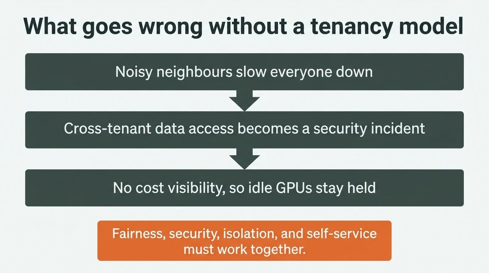
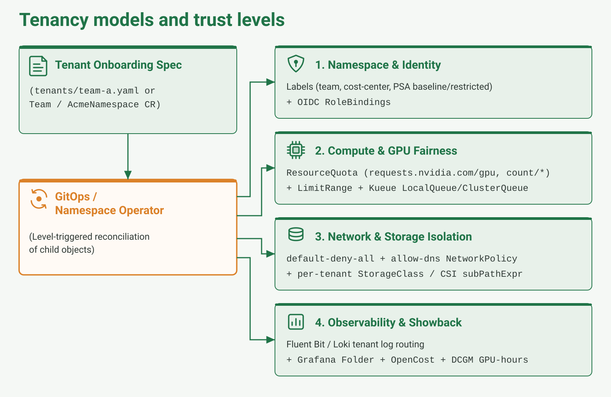
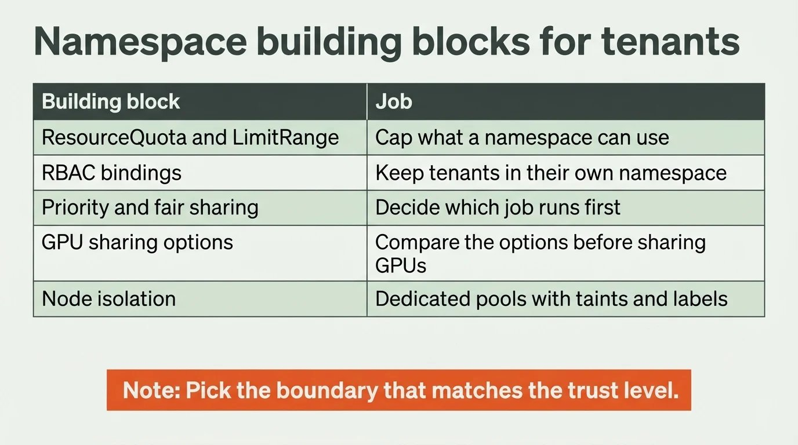
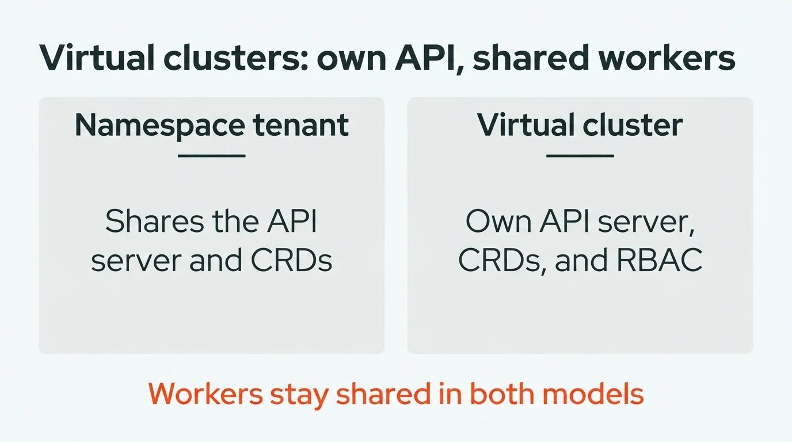
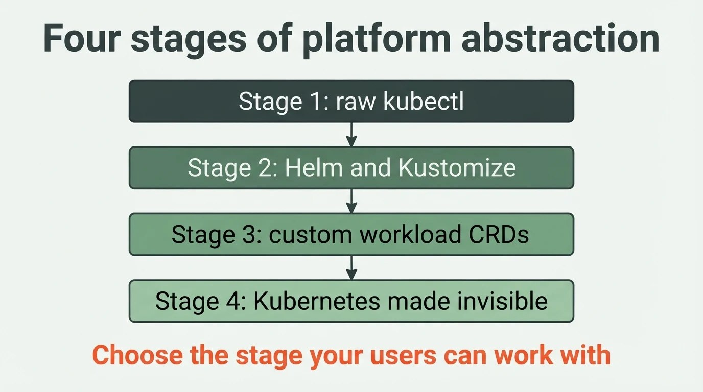
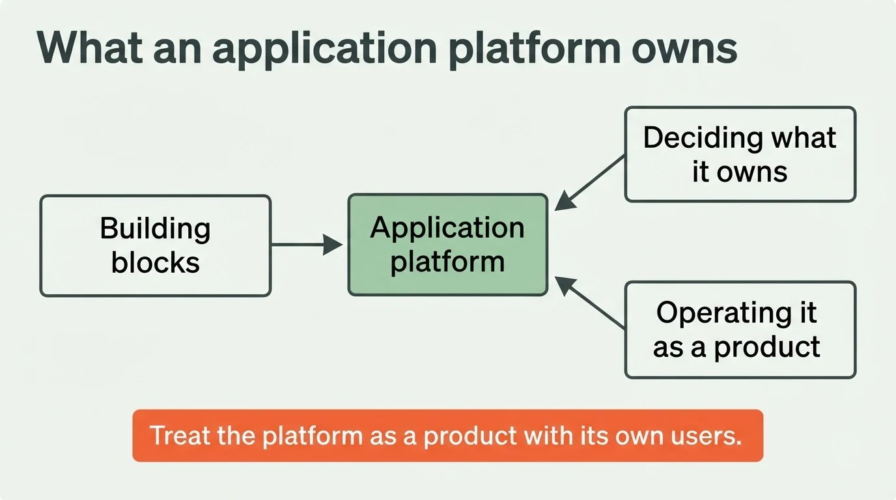
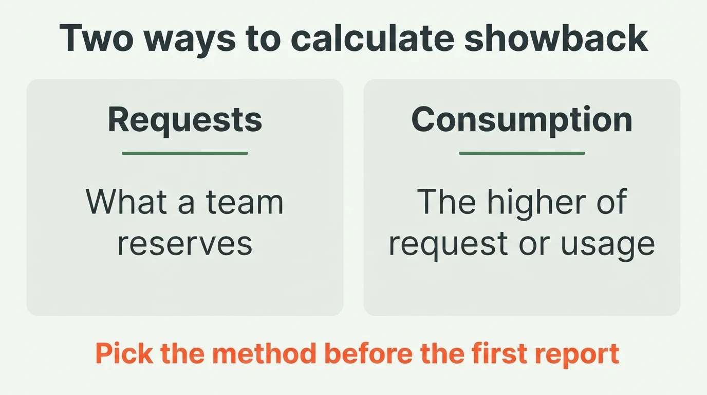
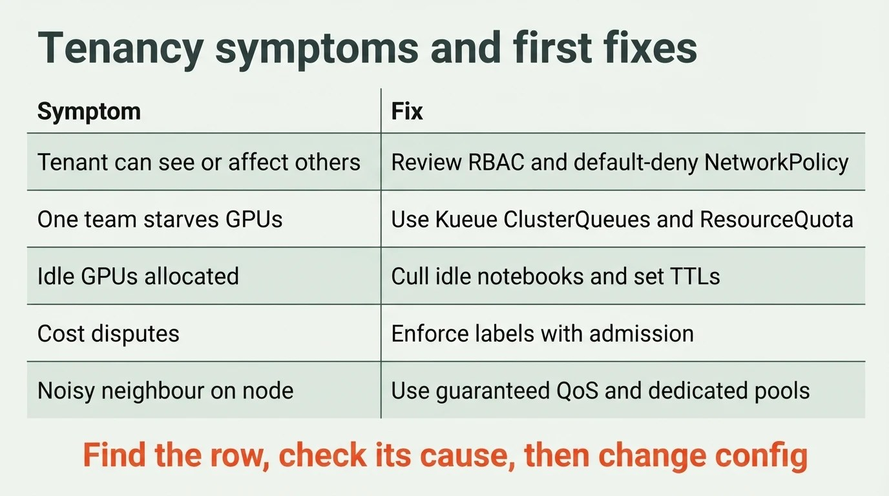

# 5.22 Multitenancy and platform services

| | |
|---|---|
| Level | Advanced |
| Priority tier | 1 |
| Lab venue | kind/kubeadm; Kyverno or VAP; Kueue; optional Capsule, HNC, vCluster, JupyterHub, OpenCost |
| Part | Part 5: Kubernetes |
| Status | Drafted, labs **untested** |

## Why this matters for AI infrastructure

Picture a shared GPU cluster on a busy morning. One team's job floods the API server with object writes, and the storage system slows down for everyone else. The other teams' notebooks stop responding. Nobody can say who is holding which GPUs, and nobody knows what any of it costs. The cluster is not broken. It is simply being shared by people who never agreed on the rules.


*Figure 5.22.V. Without a deliberate tenancy model, fairness, security, and cost control all fail at once.*


A GPU cluster is rarely built for one team. Research groups, product teams, external customers and platform engineers all share the same scarce, expensive hardware. Each of them expects fairness, security, performance isolation and self-service. Those four expectations are easy to state and hard to deliver at the same time.

Without a deliberate tenancy model, the expectations collide. Noisy neighbours appear when one job floods the API or the storage. Cross-tenant data access becomes a security incident, because one team's checkpoints can end up readable by another team. One team squats on GPUs that others need, and the support load grows beyond what you can handle. There is also no cost visibility at all, so nobody has a reason to release idle hardware.

A good model changes that picture. Teams onboard in minutes through a pull request. They get quotas and queues automatically, run in isolated namespaces with default-deny networking, and can see their own usage and cost. This chapter shows how the individual mechanisms fit together into one multi-tenant platform. Those mechanisms are RBAC, quotas, network policy, admission, scheduling and storage. The chapter also describes the platform services that sit around the cluster, because a cluster on its own is not yet a platform.

## Prerequisites and outcomes

Before you start, work through chapters 5.7, 5.15, 5.16, 5.18 and 5.21. This chapter builds on them. If a term such as RBAC or admission feels unfamiliar, the matching chapter is the place to refresh it.

The list below is a self-check, not a test you have to pass in order. Each line names one ability that a platform engineer uses often. If a line feels unfamiliar when you reach the end of the chapter, go back to that section and read it again slowly.

- Compare tenancy models (soft versus hard, namespace per tenant, cluster per tenant and virtual clusters), and match each one to a trust level.
- Isolate a namespace with RBAC, ResourceQuota and LimitRange, NetworkPolicy, Pod Security, storage, secrets, priority, and node isolation through dedicated pools, taints and sandboxed runtimes.
- Share GPUs fairly with Kueue (queues, cohorts, preemption and fair sharing), use MIG, time-slicing or MPS where they fit, and enforce quotas at several layers.
- Use hierarchical namespaces, Capsule or vCluster, or a similar tool, to delegate administration.
- Automate tenant onboarding and offboarding with GitOps, Terraform or generators, and expose self-service interfaces.
- Design platform services (registry, ingress, notebooks, CI/CD, storage, observability, model serving and experiment tracking), and run the platform as a product with SLOs, docs and support.
- Allocate and report cost for each tenant.

## 1. Tenancy models and trust levels

Before you configure anything, decide how much you trust your tenants. A tenant is any group that shares the cluster, whether that is a team, a customer or a single notebook user. The tenancy model you choose sets where the isolation boundary sits. In other words, it decides which walls are real and which walls are only painted on.

Think of the boundary as a fence. A fence between two neighbours who get along is a small, cheap fence. A fence between two parties who do not trust each other needs to be taller, stronger and placed in a different spot. The table pairs each model with the boundary it draws, the trust it assumes and the situations where it is typically used.

| Model | Isolation boundary | Trust assumption | Typical use |
|---|---|---|---|
| **Namespace per team** (soft multi-tenancy) | Namespace + RBAC + quota + network policy + PSA | Tenants are cooperative but may make mistakes; internal teams | Most internal AI platforms |
| **Namespace per team + dedicated node pools** | Adds node-level isolation (taints, labels, separate hardware) | Reduce noisy neighbours, compliance for sensitive data | Regulated data, performance-critical |
| **Namespace + sandboxed runtimes** (gVisor/Kata) | Adds kernel-level isolation for untrusted code | Untrusted code (notebooks, customer containers) | Public/semi-public notebooks, SaaS |
| **Virtual clusters** (vCluster, Kamaji, HyperShift hosted control planes) | Tenant gets their own API server/CRDs/RBAC; shared workers | Tenants need cluster-admin-like autonomy (CRDs, operators) | Platform teams, CI environments, labs |
| **Cluster per tenant** (hard multi-tenancy) | Separate control and data planes | Hostile or contractually separate tenants | External customers, regulated tenants |
| **Multi-cluster fleet with workload placement** | Many clusters, federated scheduling | Scale and failure isolation | Large orgs (5.35) |

Read the trust column first. It tells you which row fits your situation, and the other columns follow from it. A research group of a dozen people who share a budget is a soft-trust case. A customer who uploads their own container images to your GPUs is a hard-trust case, even if the same company runs both. The trust level comes from the people and the code, not from the hardware.

Kubernetes itself gives you **soft multi-tenancy**. Tenants share the control plane, including the API server, the scheduler, etcd, the kernel of every node, DNS, and often storage and networking. A hard guarantee means separating things at the layer you worry about, whether that is the nodes, the kernel or the control plane. So choose a model by your **threat model and compliance** needs, not by habit.

Ask one question for each layer. If one tenant wanted to hurt another through this layer, could it? If the answer is yes, and you cannot accept that answer, that layer needs a stronger boundary. Most teams find that the kernel and the control plane are the layers they cannot fully separate in a shared cluster, so they add sandboxing or a separate cluster there.

The authors of *Production Kubernetes* explain the difference with a housing analogy in Chapter 12, which is titled *Multitenancy*.

- **Soft multitenancy ("a family living together in one house"):** Family members share the kitchen, the living room and the utilities. In Kubernetes those are the control plane, the nodes, the CNI and the storage. Each member also has a private bedroom. In Kubernetes that is a `Namespace` isolated by RBAC, `ResourceQuota`, `LimitRange`, `PodSecurity` and a `default-deny-all` `NetworkPolicy`. Soft multitenancy also calls for planning between namespace per team and namespace per application, and for per-tenant log routing. For example, tag-based Fluent Bit routing with `Match kube.var.log.containers.*_alice-ns_*` ships logs from `alice-ns` only to Alice's Elasticsearch or Loki index.
- **Hard multitenancy ("tenants in an apartment building or hotel", or hostile tenants):** You either dedicate a cluster to each tenant, which costs you multi-cluster fleet management and lower GPU bin-packing efficiency, or you combine virtual control planes such as vCluster or Kamaji with dedicated tainted node pools, sandboxed runtimes such as Kata or gVisor, and fabric-isolated storage and networks.

The housing picture is useful because it shows that the two models are not better or worse. They are answers to different questions. A family does not lock every door in the house, and a hotel does not let guests share a bathroom. Pick the arrangement that fits the people who will live there.



*Figure 5.22.1. Tenancy models and trust levels, as a diagram.*

The diagram follows one onboarding spec as it fans out. Read it as a single form that a platform team fills in once. The form then becomes four groups of objects: identity, compute and GPU fairness, network and storage, and observability. Each group is a separate set of walls, and each one has to be built before the tenant can work safely.

### Isolation layers (what to configure)

Tenants can affect one another at every layer of the stack. The table below names each layer, the mechanisms that close it and the points to watch. You do not have to close every layer on day one. You do have to know which ones are open, so you can decide which ones matter for your tenants.

| Layer | Mechanisms | Notes |
|---|---|---|
| **API/Control plane** | RBAC (namespaced roles), admission policy, API Priority & Fairness per tenant, audit | One tenant's controller can overload the API; give operators their own APF levels (5.5) |
| **Identity** | OIDC groups per team; workload identity per ServiceAccount | Avoid shared credentials |
| **Compute (CPU/memory/GPU)** | ResourceQuota, LimitRange, Kueue ClusterQueues, priority classes, node pools/taints, CPU/Topology Manager | GPUs are the contested resource |
| **Network** | Default-deny NetworkPolicy, per-tenant egress allowlists, separate ingress classes/domains, secondary networks isolated by VLAN/PKey | RDMA fabrics need fabric-level isolation (5.15, Part 12) |
| **Storage** | Per-tenant StorageClasses, quotas per class, per-tenant subdirectories/exports, encryption keys per tenant, snapshots/backups scoped | Shared parallel FS requires quotas and ACLs |
| **Secrets** | Namespaced Secrets, external secret store paths per tenant, workload identity | Never share cloud credentials |
| **Runtime/kernel** | PSA, seccomp/AppArmor, sandboxed RuntimeClass, `hostUsers: false`, no host namespaces | Kernel is shared in runc: kernel exploits cross tenants |
| **Observability** | Per-tenant dashboards/log access (Grafana orgs/folders, Loki tenants), metrics label scoping | Do not expose other tenants' data |
| **Cost** | Labels, namespace attribution, OpenCost/Kubecost, GPU-hour accounting | Chargeback/showback drives behaviour |

The compute and network rows name the resources that tenants fight over most. The runtime row is the one to read twice. In runc, the kernel is shared, so a kernel exploit can cross tenant boundaries. Choose the layers your threat model cannot leave open, and then configure those first.

A useful way to read the table is to imagine one tenant who wants to cause trouble, and to walk through each row as that tenant. The API row asks whether that tenant can flood the control plane. The compute row asks whether it can hold every GPU. The runtime row asks whether it can reach the host kernel. Each yes is a gap, and each gap has a named mechanism in the middle column.

## 2. Namespace-level building blocks

Picture two teams on the same cluster. One team's job reserves every GPU it can reach, and the other team's notebook never starts. Nobody did anything malicious. The first job simply asked for everything it could see. Quotas and RBAC exist to prevent that kind of squatting. The building blocks in this section keep each tenant inside its own namespace.


*Figure 5.22.V. Namespace isolation is built from quotas, RBAC, priority, GPU sharing, and node pools, each with its own job.*


A namespace is a label on a set of objects. It is not a wall by itself. Pods in one namespace can still reach pods in another unless you add a NetworkPolicy. Quotas and RBAC then add the limits and permissions that a namespace alone does not give you.

### ResourceQuota and LimitRange

The two objects below set the limits for a team called `team-a`. The ResourceQuota caps how much the team can request. The LimitRange fills in defaults for containers that do not set their own values. Read the ResourceQuota as the team's total budget, and read the LimitRange as the rules for each single container.

```yaml
apiVersion: v1
kind: ResourceQuota
metadata: { name: team-a-compute, namespace: team-a }
spec:
  hard:
    requests.cpu: "512"
    requests.memory: 4Ti
    requests.nvidia.com/gpu: "32"            # extended resources use the requests. prefix
    limits.memory: 4Ti
    requests.ephemeral-storage: 20Ti
    persistentvolumeclaims: "50"
    requests.storage: 100Ti
    fast-nvme.storageclass.storage.k8s.io/requests.storage: 20Ti
    count/jobs.batch: "500"
    count/pods: "2000"
    services.loadbalancers: "0"
    services.nodeports: "0"
  scopeSelector:                              # optional: quota only for a priority class
    matchExpressions: [ { scopeName: PriorityClass, operator: In, values: [training-normal] } ]
---
apiVersion: v1
kind: LimitRange
metadata: { name: defaults, namespace: team-a }
spec:
  limits:
    - type: Container
      default: { cpu: "2", memory: 8Gi }
      defaultRequest: { cpu: "1", memory: 4Gi }
      max: { cpu: "128", memory: 1Ti }
    - type: PersistentVolumeClaim
      max: { storage: 10Ti }
      min: { storage: 1Gi }
```

The quota is enforced at admission, so a request that breaks it fails at creation with `exceeded quota`. Admission is the checkpoint that every object passes before it is stored. The quota counts the requests of all pods in the namespace, including Pending ones. A Pending pod has already been accepted, so it still holds a place in the budget.

If a quota covers compute resources, every pod must state requests and limits for them. Most people do not want to write those fields on every container. The LimitRange helps here. Its `defaultRequest` and `default` values fill in the missing fields, so a simple pod still gets accepted.

Here is a worked example using the `requests.nvidia.com/gpu: "32"` line. Suppose the team already runs 32 GPUs across its jobs. That uses the whole budget, so there is no room left. A new job that asks for one more GPU, which would be a 33rd, fails at admission, because 33 is more than the 32 allowed. The job does not start, and the error tells the team which quota stopped it.

Quotas on `count/*` work differently. They protect the API server from object floods, such as thousands of Jobs, Pods or ConfigMaps. A runaway script that creates objects in a loop hits the count quota long before it hurts etcd. Quotas are bound to a single namespace, so a per-team quota across many namespaces needs hierarchical tools such as HNC or Capsule, or Kueue cohorts. Those tools are covered later in this chapter.

### RBAC bindings that keep tenants in their own Namespace

Quotas limit how much a tenant can use. RBAC decides which objects a tenant can read or change. Without RBAC, one team could edit another team's Deployments. To authorize a tenant, bind a Role or ClusterRole to the tenant's identity with a RoleBinding. The example below gives the `app1-viewer` group read access to the `app1` Namespace only.

A simple way to hold the pieces in your head is to think of a ClusterRole as a job description that is written once for the whole company. A RoleBinding is the key to one room. The job description says what the holder may do. The key says where they may do it. Reusing the same job description with many keys is normal and good.

```yaml
apiVersion: rbac.authorization.k8s.io/v1
kind: RoleBinding
metadata:
  name: viewers
  namespace: app1
roleRef:
  apiGroup: rbac.authorization.k8s.io
  kind: ClusterRole
  name: view
subjects:
- apiGroup: rbac.authorization.k8s.io
  kind: Group
  name: app1-viewer
```

The binding points at the built-in `view` ClusterRole, which grants read-only access to Namespace-scoped resources. A RoleBinding that uses a ClusterRole still limits the grant to its own Namespace, so the tenant stays in its own room. A ClusterRoleBinding behaves differently. It lets a tenant use the bound role in every Namespace. Avoid ClusterRoleBindings for tenants unless you have a good reason, because one such binding turns a single room key into a master key.

When you check a binding, ask two questions. Which group or account holds the key? Which room does the key open? If the answer to the second question is "all of them," you have probably written a ClusterRoleBinding by accident.

### Priority and fair sharing

Priority decides which pod goes first when the cluster is full. It is a useful tool, and it is also an easy one to abuse. Every team will mark its own jobs as urgent if nothing stops it. If you want to stop priority abuse, use PriorityClasses together with a ResourceQuota `scopeSelector`. The selector caps how many high-priority pods a team can run, so a team cannot claim top priority for everything.

For dynamic GPU sharing, use Kueue. Each team gets a `ClusterQueue` with a `nominalQuota`. That is the number of GPUs the team owns. A team can borrow idle quota from a cohort, and it is preempted when the owners reclaim their share (see 5.18).

A cohort works like a shared car park with reserved bays. Each team owns its bays. When a bay is empty, another team may park there for a while. When the owner arrives, the borrower moves its car out. Preemption is that moment of moving the car. The borrower loses its running work, so the borrowing limit should match what that team can tolerate losing.

Provide a few WorkloadPriorityClasses, such as `production`, `high`, `normal` and `best-effort`. Add fair-share weights so large teams do not starve small ones, and show queue positions and wait times to users. People accept waiting much more easily when they can see where they stand in the line.

### GPU sharing options

Sharing methods do not isolate tenants equally, so compare them before you choose one. The table lists the options from the strongest isolation to the weakest. Some of them are fine between teams that trust each other. Others should never be used between strangers.

| Method | Isolation | Use | Caveats |
|---|---|---|---|
| **Whole GPUs** (`nvidia.com/gpu: N`) | Strong | Training, large inference | Fragmentation risk |
| **MIG** (A100/H100/B200 partition into instances with dedicated SMs/memory/bandwidth) | Hardware-level QoS and fault isolation | Many small inference/dev workloads; multi-tenant | Fixed profiles; reconfiguration needs idle GPU; fewer cross-instance features (no NVLink peer P2P) |
| **Time-slicing** (device plugin oversubscription) | None (context switching) | Dev notebooks, light inference | No memory/fault isolation, unpredictable latency |
| **MPS** (CUDA Multi-Process Service) | Weak/shared (memory limits via `CUDA_MPS_PINNED_DEVICE_MEM_LIMIT`, active thread %) | Concurrent small jobs from one tenant | Single-tenant trust; fault propagation |
| **vGPU** (virtualised GPUs via hypervisor, licence) | Strong | VM-based multi-tenancy | Licensing, hypervisor stack |
| **DRA with partitionable devices** | Depends on partition type | Flexible claims for MIG/shared devices | Maturity varies |

Think of each method as a different way of sharing a kitchen. A whole GPU is a full kitchen with its own door, and one cook owns it for the shift. MIG puts up permanent walls, so each cook has a fixed station with its own stove and fridge. Time-slicing is a single stove that several cooks take turns to use, with a timer on the burner. MPS lets several cooks work the same stove at once, sharing one set of pans. Only the first two give you a real wall between cooks who do not trust each other.

For multi-tenant security, prefer whole GPUs or MIG. Avoid time-slicing and MPS between mutually untrusted tenants, because of side channels and DoS. A side channel is a way to learn a secret by watching timing or resource use, rather than by reading data directly. DoS means denial of service, where one tenant makes the shared resource unusable for everyone else. Dedicated node pools per tenant class simplify driver and configuration differences. Use the MIG strategy `single` or `mixed`, and keep a GPU Operator configuration for each pool.

### Node isolation

Node isolation matters most when you cannot trust what runs next to your workloads. Give each tenant, or each sensitivity level, a dedicated pool of nodes. Mark the pool with taints and labels, and use admission control to inject tolerations and a `nodeSelector` for the namespace's pool. Forbid tenants from overriding them.

Taints and labels work like a bouncer and a wristband. A taint on a node says that only pods with a matching toleration may enter. The toleration is the wristband, and admission control is the rule that hands out the right wristband automatically. If a tenant could write its own wristband, the bouncer would be useless, so the platform must control who can set those fields.

Keep separate nodes for system components, for untrusted notebooks that run under a sandboxed `RuntimeClass`, and for production inference. Avoid pod-level `hostNetwork` and `hostPID`. Those two settings let a pod see the host's network stack or process list, which breaks the walls on that node. For strict cases, also consider node-level encryption and secure or measured boot.

Wiping local NVMe between tenants is harder than it sounds. A simple init container that runs a delete command cannot guarantee that every block is clean, because the drive may keep data in places the command never touches. For strict cases, recycle the node instead. Recycling means throwing the node away and building a fresh one, which is slower but certain.

## 3. Delegated administration and virtual clusters

Picture a team lead who needs a new namespace for a training run that starts on Monday. Without delegation, the request is a ticket to the platform team. The ticket waits in a queue, and the training run waits with it. Delegation gives the team lead a bounded amount of power. Hierarchical Namespace Controller (HNC) and Capsule let you hand that power to the team, and virtual clusters go further by giving each tenant an API of its own.


*Figure 5.22.V. A virtual cluster gives a tenant cluster-admin-like control without giving it its own physical cluster.*


HNC uses the `hnc.x-k8s.io` group to build parent and child namespaces. Children inherit RBAC, NetworkPolicies and quotas, which HNC propagates as objects. Team leads create sub-namespaces through `SubnamespaceAnchor`. The project is in maintenance mode, so evaluate alternatives first.

A parent and child namespace work like a building and its floors. A rule set on the building applies to every floor. A floor can add its own rules, but it cannot remove the building's rules. That is the main benefit, because the platform team sets the rules once at the top.

Capsule adds a `Tenant` CRD. A Tenant groups namespaces, owners and quotas across them. It also restricts networks, storage and ingress classes, node selectors and allowed registries, and it caps the number of namespaces. Owners then create namespaces themselves, and Capsule is lightweight. The kubernetes-sigs/multi-tenancy benchmarks, Kyverno and ValidatingAdmissionPolicy (VAP) policies, and Argo CD AppProjects or Flux tenants codify the same rules (see 4.26).

Capsule is the right fit when the team needs several namespaces but does not need its own API. The team gets self-service inside a fence that the platform team drew. The fence covers quotas, storage classes and registries, which is usually all a team needs to stay productive.

**vCluster** runs a tenant control plane, an API server plus a syncer (often k3s), inside a namespace. Tenant pods are synced to the host as ordinary pods. The host scheduler and nodes stay shared, while tenants get their own API, CRDs, RBAC and namespaces. That suits platform teams and CI environments. **Kamaji**, **HyperShift** (hosted control planes) and **Cluster API** cover full separate clusters at scale.

Consider the first week of a new team. On Monday, the team lead opens a pull request with the tenant spec. The reviewers check the owners, the quotas and the egress list. Once the change merges, the automation creates the objects in order, and the team gets its access. On Tuesday, the first researcher submits a small test job, and it queues behind a cohort borrow limit that the team does not yet understand. The platform team answers the question in the queue view, not in a chat thread. By Friday, the team no longer needs the platform team for routine work. That is the outcome self-service is meant to produce.

Think of a vCluster as renting a private office inside a shared building. The office has its own reception desk, its own directory and its own door list. The building's power, elevators and security guards are still shared with everyone else. The syncer is the person who carries each tenant's pod down to the building's workshop and asks the host to run it.

Virtual clusters cost you extra control-plane overhead and syncing complexity. Isolation still depends on the host's node security, so enforce policies on the synced pods at the host. Decide whether the team needs more namespaces or its own control plane, because that answer picks between the two. A simple rule of thumb is this. If the team only needs its own names and quotas, use namespaces. If the team needs to install its own cluster-wide tools, use a virtual cluster.

## 4. Self-service and onboarding

A common mistake is to build a cluster first and hope developers will come. That approach carries real risk. It often misses the needs of development, security and networking teams, and the result is rework. A cluster that nobody can use is an expensive lesson. Bring those groups in early, so the platform fits its purpose.


*Figure 5.22.V. Each stage hides more of Kubernetes, so match the level of abstraction to what your users can handle.*


Early on, the platform team usually provisions and configures every cluster by hand. Manual work does not scale. It creates repetitive toil for the platform team and leaves developers waiting. Once a team reaches a basic level of maturity, self-service is the next step. A CI/CD tool such as Jenkins or GitLab can offer it, because both allow pipelines with custom inputs at run time.

Tools such as `kubeadm` and Cluster API make cluster creation consistent. A pipeline can expose a few inputs, such as the cluster name and its size. It then calls those tools with sensible defaults and returns access to the requesting team. Automation can go as far as you want. Some pipelines create load balancers and DNS records from the requester's LDAP details, and they tag resources with cost centers. Sizing can be open to users but limited by team, environment or project.

In a multitenant setup, the pipeline creates Namespaces and their related objects, not whole clusters. Each new application then gets soft isolation, and developers choose which cluster or clusters receive it. At a minimum, the pipeline should generate these pieces:

- **Namespace**: the home for the application. It gives logical isolation from other components.
- **RBAC**: makes sure only the authorized groups can reach resources in that Namespace.
- **Network policies**: let the application talk to itself and to shared cluster services, but not to other applications, where that is required.
- **Quotas**: limit how many resources one Namespace may use. That reduces the risk of a noisy neighbor.
- **Limit ranges**: set sensible defaults for objects created in the Namespace.
- **Pod Security Admission labels**: keep workloads on safe defaults, such as not running as the root user. Pod Security Policies, which some older guides still mention, were removed in Kubernetes 1.25.

Not every item is needed in every case. Together, though, they let platform teams onboard a new team without manual steps. Each item answers one question a new team will ask on day one. Where is my home? Who can get in? Who can I talk to? How much can I use? What defaults will I get? Is my workload safe by default?

As the organization grows, the same pipeline can move into the cluster as an operator. The `Team` resource shown later in this section lets a controller read an owner and some quotas. The controller then creates the Namespace, RBAC rules and quotas, and ties them together. Because it works through the Kubernetes API, it can also repair drift, such as a deleted role or a changed quota.

Here is what tenant onboarding looks like as code. The spec is data, and Terraform, Helm, Kustomize or a Kyverno generate rule renders it (see 4.25 and 4.26). The spec is short on purpose. A platform team reviews one file in a pull request, and the automation does the rest.

```yaml
# tenants/team-a.yaml  (data-driven; rendered by Terraform/Helm/Kustomize/Kyverno-generate)
name: team-a
owners: ["oidc:team-a-leads"]
members: ["oidc:team-a-researchers"]
namespaces: [team-a-dev, team-a-train, team-a-serve]
quotas:
  gpu: { nominal: 32, borrowingLimit: 16, flavor: h100 }
  cpu: 512
  memory: 4Ti
  storage: { fast-nvme: 20Ti, shared-rwx: 100Ti }
priority: normal
egress: [object-store, registry, pypi-mirror]
cost: { center: CC-1042, budgetMonthlyUsd: 120000 }
```

From that one spec, automation creates the namespaces, with labels such as `team`, `tier`, `cost-center` and the PSA labels. It creates RoleBindings for the OIDC groups, plus a ResourceQuota and a LimitRange. It sets up Kueue `LocalQueue`s, a `ClusterQueue` and the ResourceFlavor mapping. It adds default-deny and DNS NetworkPolicies, along with the approved egress. It configures StorageClass access, PVC quotas, storage subdirectories and export policies. It creates secret store paths and workload identity bindings, and it allocates ingress and hostname entries. It also sets up a Grafana folder or org with alert routes, a registry project with robot accounts, an ArgoCD AppProject and budget alerts.

Read the spec as a set of answers, and the automation as a set of questions. The `owners` line answers who may approve changes. The `gpu` line answers how many GPUs the team owns and how many it may borrow. The `egress` line answers which outside services the team may reach. Every line in the spec should map to at least one object the automation creates. If a line maps to nothing, the spec is out of date.

Offboarding runs the other way. Archive the data according to the retention policy, revoke access, and delete the namespaces after notice. Then release the quota and reclaim the volumes. For volumes, the order is `Retain`, then backup, then delete. `Retain` keeps the data in place while you copy it out. Only after the backup is confirmed should the volume be deleted. Skipping that order is how valuable checkpoints disappear.

Developers can reach this self-service through several interfaces. The default is a Git pull request workflow. A **developer portal** is another option, such as Backstage with Kubernetes, Argo and Kueue plugins, or Port, or an internal CLI. Notebook portals include JupyterHub, Kubeflow, Run:ai and the DGX Cloud UIs. A **job submission CLI or SDK** hides the YAML behind a command such as `mlctl submit train.yaml --gpus 16`. Templates such as Helm charts, Kustomize bases or Cookiecutter templates cover jobs, services and pipelines. They come with best practices built in, such as resource requests, probes, checkpointing and labels.

Pick the interface that matches your users' habits. Researchers who already live in notebooks may prefer a portal. Engineers who already use Git will prefer the pull request. The interface matters less than the guarantee behind it. Every path should produce the same guarded objects.

### Choosing how much to abstract

Not every developer needs to see Kubernetes, and how much you hide is a real decision. Some people argue that if application developers know they run on Kubernetes, you have failed. That idea suits a product where the orchestrator means nothing to the user. Picture a database system that runs its shards on Kubernetes, Bosh or Mesos. Its users probably do not care which one.

Turning that slogan into a team goal is risky, though. Every layer you add on top of Kubernetes brings choices about what the right abstraction looks like. A layer that fits one team can block another team that needs a rare feature.

Think of the choice as the difference between eating out and cooking at home. A restaurant hides the kitchen completely, which is fast and simple, but you cannot ask the cook to change the stove. A home kitchen shows you every knob, which gives full control, but you must know how to cook. Most teams want something in between. They want a kitchen where the common dishes are ready, and the rare recipes are still possible.

Cloud Foundry shows the fully hidden end. With one `cf push`, an application is built, deployed, and serving production traffic. As Cloud Foundry runs more on Kubernetes, that change should be an implementation detail rather than a change in features.

Some companies run more than one orchestrator. A Mesos footprint may sit beside a Kubernetes one. They then build an abstraction that picks where each workload lands, so developers do not have to choose. This also avoids lock-in, but the cost is effort. You must build on two systems that work differently. Developers then learn a company-specific system instead of a shared one, and many resist learning systems that do not carry over between organizations. Another pitfall is an obsession with abstraction. If you hide everything, you cannot expose key Kubernetes features. Keeping up with the project becomes a cat-and-mouse game, and your abstraction can end up as complex as the system it hides.

At the other end, a platform group can offer self-service clusters to development teams. That can work well. It puts Kubernetes maturity on the teams. They need to understand Deployments, ReplicaSets, Pods, Services and Ingress. They must know how to set CPU in millicpus and how overcommit works. They must also make sure replicas land on different nodes. If they can do that, you avoid over-engineering a platform.

Owning a cluster is less common, though. Even skilled teams rarely want to spend time on cluster lifecycle and upgrades. Expecting every team to become a Kubernetes expert while shipping software is often unrealistic. Abstraction is not all or nothing. Decide where to hide details and where to give developers more control.

### The `Team` custom resource operator pattern and the 4-stage spectrum of platform abstractions

Rendering tenant YAML in CI/CD pipelines is one option. *Production Kubernetes* (Chapter 16) shows a second one. Mature platforms implement self-service tenant onboarding inside the cluster, using a custom **`Team` operator**. A platform engineer or a portal submits a `Team` custom resource that names the owner and the resource quotas. The in-cluster controller then keeps reconciling the tenant's `Namespace`, `RoleBinding`s, `ResourceQuota`, `LimitRange`, `NetworkPolicy`, and even Grafana dashboards or Alertmanager routes. If someone accidentally deletes a role or a quota, the controller restores it. An example:

The difference between the two approaches is the difference between a one-time delivery and a thermostat. A pipeline renders the objects once, when it runs. An operator keeps checking the room and adjusts it whenever it drifts. That constant checking is why operators are the stronger choice for long-lived tenants.

```yaml
apiVersion: examples.namespace-operator.io/v1
kind: Team
metadata:
  name: team-a
spec:
  owner: Alice
  resourceQuotas:
    pods: "50"
    storage: "300Gi"
```

Chapter 11 of *Production Kubernetes*, titled *Building Platform Services*, walks through a custom **`AcmeNamespace` operator** written in Go by Rosso et al. Its `AcmeNamespaceSpec` has a `namespaceName` and an `adminUsername`. The operator is built with **Kubebuilder** on controller-runtime. The chapter highlights two design rules. The rules are modeled in `reconcile_acme_namespace_operator()` in `code/part05/multitenancy_quota_reconciler.py`.

The first rule is never to rely only on `status.phase == "Created"` to skip checking child resources. Consider a naive `Reconcile` loop. It sets `acmeNs.Status.Phase = "CreationInProgress"`, creates the child `Namespace`, `Role` (`namespace-admin`) and `RoleBinding`, and then sets `acmeNs.Status.Phase = "Created"`. After that it does nothing whenever the phase is `Created`. That loop has two critical bugs. First, if the controller crashes while the phase is `CreationInProgress`, it must query the local Informer cache to see which children already exist. Second, if someone later deletes the child `RoleBinding` or `ResourceQuota` by hand, a controller that checks only the phase never notices the gap, so it never heals it.

Here is a walkthrough of the first bug. The controller writes "in progress," creates the Namespace, and then crashes before it writes the RoleBinding. When the controller restarts, the status still says "in progress," and the Role may or may not exist. A controller that trusts the status now has to guess. A controller that looks at the cache sees exactly which children are present and creates only the missing ones.

Instead, `Reconcile` must inspect the Informer cache for every expected child on every pass. Those children are `Namespace`, `Role`, `RoleBinding`, `ResourceQuota` and `NetworkPolicy`. The controller also watches the child resources through **`ownerReferences`**, set with `ctrl.SetControllerReference`. An owner reference is a label on the child that says which parent it belongs to. When a child changes or disappears, the controller receives an event and runs its loop again.

The second rule concerns scope. In Kubernetes, a namespaced object cannot be the `ownerReference` owner of a cluster-scoped object, and a `Namespace` is cluster-scoped. So an operator CRD that creates and owns `Namespace` objects, such as `AcmeNamespace` or `Team`, must be marked cluster-scoped. Use the marker `// +kubebuilder:resource:scope=Cluster`, which sets `spec.scope: Cluster` in the `CustomResourceDefinition`. Chapter 11 also compares three ways to build such an operator. **Kubebuilder** is a Go framework. **Operator SDK** works in Go, Ansible or Helm. **Metacontroller** is language-agnostic and uses webhooks, which the chapter calls "lambda controllers".

After onboarding, you still have to decide how much Kubernetes to expose to application and ML developers. *Production Kubernetes* (Chapter 16) arranges those choices on a **4-stage spectrum of abstraction**. The left end gives the least abstraction, and the right end makes Kubernetes fully invisible. Each stage trades some flexibility for some simplicity, so no stage is simply better than the one before it.

1. **Stage 1, command-line tooling and local UIs (no API abstraction):** Developers use raw `kubectl`, helped by shell tools. `kubectx` switches contexts, `kubens` switches namespaces, and other plug-ins tail logs or handle SSO credentials. Workstation clients such as Octant and Lens render cluster state from the developer's local `kubeconfig`. This stage gives full flexibility. The price is that every developer needs RBAC, admission guardrails and Kubernetes knowledge.
2. **Stage 2, templating with Helm and Kustomize:** Platform engineers package the roughly ten underlying objects a typical service needs (`Deployment`, `StatefulSet`, `Service`, PVC, `ConfigMap`, `Secret`) into a Helm chart. It exposes a small `Values.yaml` interface, which can be piped into Kustomize, or into a web UI generator such as Ambassador's K8s Initializer, to patch fields the chart did not template. Developers still apply native Kubernetes objects. That keeps the upstream community documentation and debugging familiarity.
3. **Stage 3, abstracting Kubernetes primitives with custom workload CRDs (`PinterestService`):** The platform team defines a high-level custom resource and an operator that wraps several native resources and external integrations, such as internal DNS registration. In the Pinterest example (`PinterestService`), a 25-line custom resource replaces more than 350 lines of raw `Deployment`, `Service`, `Ingress`, IAM role and sidecar YAML:

```yaml
apiVersion: pinterest.com/v1
kind: PinterestService
metadata:
  name: exampleservice
  project: exampleproject
  namespace: default
spec:
  iamrole: role1
  loadbalancer:
    port: 8080
  replicas: 3
  sidecarconfig:
    sidecar1:
      deps:
        - example.dep
    sidecar2:
      log_level: info
  template:
    spec:
      initcontainers:
        - name: init
          image: gcr.io/kuar-demo/kuard-amd64:1
      containers:
        - name: init
          image: gcr.io/kuar-demo/kuard-amd64:1
```

   When you build custom workload CRDs, keep a **break-glass** window into the underlying native objects, such as `Pod`s, PVCs and events. That way, engineers can still use standard Kubernetes troubleshooting knowledge when an abstraction leaks. Break-glass means a deliberate, logged way to step past the normal path in an emergency. The normal path stays simple, and the emergency door stays available.
4. **Stage 4, making Kubernetes invisible (full PaaS and developer portals):** Developers push source code or a minimal build, deploy and release file, and never write Kubernetes YAML. The platforms involved are ported to Kubernetes or built on top of it. Examples include Cloud Foundry, Google App Engine, Red Hat OpenShift, Spotify's Backstage developer portal, and HashiCorp Waypoint. Waypoint encapsulates `build` with `pack`, `deploy` to `kubernetes` and `release` in a single HCL file.

### Stage 1 in practice: raw kubectl and its limits

Giving developers raw `kubectl` is the far-left end of the spectrum. Nothing sits between the developer and the Kubernetes API. Some organizations choose this because the platform team cannot offer more support. Others choose it because their developers already know Kubernetes and want to work on it directly. Some automation and guardrails may still run on the cluster.

Picture a developer who has to deploy to three clusters before lunch. Each cluster needs its own login, its own context and its own namespace. A single wrong switch sends a change to the wrong place. That is why raw access works best for experienced people, with strong guardrails around them.

This path has real downsides, even for teams that know Kubernetes well:

- **Access is manual.** Setting up authentication for several clusters is tiresome. Developers must keep switching contexts so they target the right cluster.
- **Output is hard to read.** `kubectl` prints a table by default. The output can be changed and piped to tools such as `jq`, but developers must know those options first.
- **Nothing is hidden.** Raw `kubectl` exposes every knob in Kubernetes. You need strict RBAC rules, plus admission control that vets every request reaching the API server.

Several tools soften these problems. The `kubectl` plug-ins `kubens` and `kubectx` improve visibility into namespaces and contexts. Other plug-ins combine logs from several Pods, or give a terminal view of application health. They remove common pain points, but they still expose the API almost directly.

Some plug-ins connect to external authentication systems. They hide kubeconfigs, certificates and tokens from the user. In noncritical environments, access may rely on key pairs, which must be generated, managed and distributed. In more stable environments, access is usually tied to a Single Sign-On system. The authors of this book built command-line utilities for several clients. Those tools pull credentials from a central cluster registry, using the user's own login.

You might also follow the route Airbnb took. In a QCon talk, Melanie Cebula described Airbnb's toolsets, built as standalone binaries and `kubectl` plug-ins. Those tools hook into image building, deployment and more. The lesson is that a small custom tool can carry a lot of the company's rules without hiding the API.

A last group gives developers a graphical view of the cluster. Octant and Lens are recent popular choices. Unlike the Kubernetes dashboard, which sits in the cluster, these tools run on a workstation and use a `kubeconfig` to reach the cluster. They are a good onramp for developers who are new to the platform. Improving the client side is often the first step toward simpler developer interactions.

### Stage 2 in practice: templating with Helm and Kustomize

A single application can need many Kubernetes objects. Take a simple WordPress site. It may need a `Deployment` for the application and a `StatefulSet` for MySQL. It also needs `Service`s for discovery, a `PersistentVolumeClaim` for its data, and `ConfigMap`s and `Secret`s for settings and admin credentials. That adds up to nearly ten objects for a very small app. Some of them need expert knowledge. A `StatefulSet`, for example, needs a special headless `Service` in front of it.

The goal is to expose a small set of inputs and generate the rest behind the scenes. Developers then do not need to know every field of every object. Templating tools such as Helm and Kustomize make this possible. They still show the underlying objects, so they sit between raw `kubectl` and full abstraction.

Helm has become popular over the past couple of years, and it can do more than templating. The authors of *Production Kubernetes* have found the templating use case more compelling than some of its lifecycle features. A template contains a placeholder, and a value from elsewhere fills it in. Here is part of a `Service` template from the WordPress chart:

```
ports:
  - name: http
    port: {{ .Values.service.port }}
    targetPort: http
```

The value usually comes from a values file rather than from the template itself. A developer can also pass a value on the command line, but a values file is more common. Here is an example:

```
## Kubernetes configuration
## For minikube, set this to NodePort, elsewhere use LoadBalancer or ClusterIP
##
service:
  type: LoadBalancer
  ## HTTP Port
  ##
  port: 80
```

A chart ships with a default `Values.yaml` that has sensible settings. A developer overrides only the settings they need. Helm also supports basic logic, so one change in the values file can modify large sections of the templates.

Think of the chart as a form with blanks. The template is the printed letter with blanks in it. The values file is the filled-in form that the developer hands over. The developer never needs to see the letter's full layout, only the blanks they are allowed to fill.

The `type: LoadBalancer` setting is injected in several places. It also triggers more complex logic through conditionals and built-in functions:

```
spec:
  type: {{ .Values.service.type }}
  {{- if (or (eq .Values.service.type "LoadBalancer")
    (eq .Values.service.type "NodePort")) }}
  externalTrafficPolicy: {{ .Values.service.externalTrafficPolicy | quote }}
  {{- end }}
  {{- if (and (eq .Values.service.type "LoadBalancer")
    .Values.service.loadBalancerSourceRanges) }}
  loadBalancerSourceRanges:
  {{- with .Values.service.loadBalancerSourceRanges }}
    {{ toYaml . | indent 4 }}
  {{- end }}
  {{- end }}
```

Some people dislike inline logic like this. Still, the complexity belongs to the people who write the charts, not to the application teams. The whole YAML structure is driven by one `type` key, which is the only setting the developer edits. A values file can be passed at run time, so each cluster, team or environment can use its own.

Read the conditional block as a set of if-then rules. If the type is LoadBalancer or NodePort, add the traffic policy. If the type is LoadBalancer and source ranges are set, add the allowed ranges. The developer never reads those rules. They only change the type, and the chart decides what else must follow.

Helm still has drawbacks. The interface, `Values.yaml`, is plain YAML. A developer who wants to know what a change will do may have to read the templates. Good documentation helps with that.

Some teams build a user interface over these inputs. The UI can suit its audience, and the workflow can live inside an existing deployment tool such as Jenkins or in a ticketing service. The output is still Kubernetes manifests applied to the cluster. These models can be complex to maintain, and their abstractions can leak over time.

A recent example is the K8s Initializer from Ambassador Labs. In a browser, the user answers questions about the service and the target platform. The site then produces a downloadable package with every customization applied, ready to apply to a cluster.

All templating approaches share strengths and weaknesses. They still produce native Kubernetes objects, so developers need some underlying knowledge. That is also an advantage. If an upstream chart or the Initializer misses something you need, you can change the output before applying it.

Kustomize is a flexible tool. You can use it alone or as part of `kubectl`. It applies additions, deletions and modifications to fields in any Kubernetes YAML object. It is not a templating tool. It is most useful on manifests that Helm has already rendered, to change fields that Helm does not expose.

Many organizations find that Helm piped into Kustomize is a sweet spot. Helm does the templating, and Kustomize patches what the chart does not cover. The result is powerful and fully flexible. It sits near the middle of the spectrum. A small patch file is easier to review than a fork of the whole chart, which is why this pairing lasts.

### Stage 3 in practice: custom workload CRDs

Stage 3 moves further right. The platform team defines a high-level custom resource, plus an operator that manages the native objects behind it. In late 2019, Pinterest described why it built this kind of model. Its native workload types, such as `Deployment`, `Job` and `DaemonSet`, were not enough for its own workloads. Usability was a big blocker. Service developers hit problems with missing or misconfigured `Ingress` settings. Batch users generated hundreds of nearly identical Job specs from templates, which made debugging a nightmare.

Pinterest's team wrote about this in "Building a Kubernetes platform at Pinterest," with Lida Li, June Liu, Rodrigo Menezes, Suli Xu, Harry Zhang and Roberto Rodriguez Alcala.

The `PinterestService` example above is a 25-line object. It replaces the work of more than 350 lines of native YAML. Put plainly, the developer writes 25 lines in place of more than 350, so the developer writes less than a tenth of the YAML. This extends the templating idea from Stage 2. Only useful inputs are exposed, and they are shaped around the application instead of a loose `Values.yaml`. The platform team controls how the underlying resources are created and changed. A controller can run logic written in a general-purpose language, not Helm's built-in functions. The trade-off is that platform teams need programming skills. For more on platform services and operators, see Chapter 11 of *Production Kubernetes*.

Operators can also call external APIs. Take one client with an internal DNS system. Every application had to register there before outside clients could reach it. Developers used a web portal to add the service location and the ports to forward. An operator can cut that manual work in two ways.

The first way keeps the native objects. The operator reads a special annotation on an `Ingress`, such as `company.ingress.required: true`. Using the application name, its Namespace or other metadata, the controller registers DNS records. Depending on the rules, it may also change the `host` field. Developers still write the `Ingress`, so this sits at the Stage 2 level of abstraction.

```
apiVersion: networking.k8s.io/v1
kind: Ingress
metadata:
  name: my-app
  annotations:
    company.ingress.required: true
spec:
  rules:
  - host: "my-app"
    http:
      paths:
      - path: /
        backend:
          service:
            name: my-app
            port:
              number: 8000
```

The second way uses a custom resource such as `PinterestService`. Every needed detail lives in that object. The operator creates the `Ingress` and configures the DNS system itself. No underlying detail leaks to the developer, and the platform keeps full flexibility in how it is built.

The two ways differ in who writes what. In the first way, the developer still owns the Ingress and the platform only reacts to an annotation. In the second way, the developer owns one custom object, and the platform owns everything behind it. The second way is more work to build, but it is also the one that keeps developers from copying the same boilerplate across services.

### Stage 4 in practice: making Kubernetes invisible

At the far right, developers do not even know they use Kubernetes. Their main interface is committing or pushing code. Their focus stays narrow and deep, away from platform details.

SaaS providers such as Heroku, and tools like Cloud Foundry, made this push experience popular more than ten years ago. Once configured, the tooling provided a platform as a service. That platform included the parts an application needs to run, such as observability, routing and software catalogs. Developers pushed code to a source repository. Specialized components set resource limits, provisioned environments and wired the standard parts together.

Docker and Kubernetes did not exist when those platforms were built. They were designed for virtual machines. Many are now being ported to Kubernetes or rewritten for it. Kubernetes gives these platforms strong foundations, API conventions and primitives to build on.

Cloud Foundry is probably the most popular open source PaaS, and it now runs on Kubernetes. Other mature options include Google App Engine, some serverless technologies and parts of Red Hat OpenShift. Backstage, first created by Spotify, is now a CNCF Sandbox project. It helps you build portals with tailored abstractions for developers.

HashiCorp, which builds Vault and Consul, announced Project Waypoint to separate end users from the deployment platform underneath. Mitchell Hashimoto put the idea plainly: developers just want to deploy. Waypoint covers the build, deploy and release stages. Developers still write a short file that describes their process. It is similar to a `Dockerfile`, but it spans all the stages and asks only for the essential inputs.

```
project = "example-nodejs"
app "example-nodejs" {
  labels = {
    "service" = "example-nodejs",
    "env" = "dev"
  }
  build {
    use "pack" {}
    registry {
      use "docker" {
        image = "example-nodejs"
        tag = "1"
        local = true
      }
    }
  }
  deploy {
    use "kubernetes" {
      probe_path = "/"
    }
  }
  release {
    use "kubernetes" {
    }
  }
}
```

Waypoint still asks developers to write that file, so some complexity stays with them. Yet it removes a large number of decisions. Abstraction does not always remove all complexity, and people may still need to learn something new. The aim is a simpler interface at the right level, balancing speed and flexibility. Waypoint can even switch the underlying platform in its deploy and release stages, for example to Nomad. As Kubernetes and these platforms become more stable and boring, the new innovation will move to higher-level platforms.

### Supporting differing levels of abstraction

Before you choose an abstraction level, think about how you will document and support it. Helm, other templating tools and raw objects such as Pods, PVCs and ConfigMaps all draw on a large community. That helps when things break. A PVC can show a status condition that explains why storage could not bind. Helm can print an error about a misconfigured chart template. You can search for both online.

Fully hidden objects are harder to support. Behind pipelines with no raw debugging access, or behind custom resources such as `PinterestService`, developers cannot tap the same community. This is more true when the tool is narrow and used only inside one company. Good documentation becomes essential. A window into the underlying objects is also valuable in break-glass situations.

Break-glass access is the strongest pattern here. Developers get a high level of abstraction by default, which keeps daily friction low. When they need to, they can open a different level of abstraction, based on their skills or knowledge. The authors say this should be the ideal model for platform abstractions. It works like the emergency door in a hotel. Guests use the lobby every day, but the fire door exists for the rare day when the lobby is not enough.

Skills transfer matters too. Upstream Kubernetes skills are becoming common. People with those skills can troubleshoot your platform more easily if its internals are accessible. A more standard platform, or one with visible layers, can also attract talent. Some engineers avoid deep ties to one downstream distribution, because it can narrow their skills.

Even custom resources and operators expose some core mechanics. Developers must write valid Kubernetes metadata, API versions and resource types. They also see YAML, unless a pipeline, wrapper or UI builds it for them. Plan for that in your documentation.

## 5. Platform services around the cluster

Kubernetes alone does not give your AI teams a platform. You also need shared services around the cluster, and those services turn raw GPUs into something people can use. Think of the cluster as the power grid and the platform services as the roads, shops and banks that make a town livable. Each service carries tenancy implications, so the table below names the service, its purpose and the detail you must design for.


*Figure 5.22.V. An application platform needs clear building blocks, clear ownership, and product-style operation.*


| Service | Purpose | Tenancy/ops notes |
|---|---|---|
| **Identity & access** (OIDC, SSO, groups) | Authenticate humans and machines | Group sync from IdP; short tokens; machine identities |
| **Container registry & artifact repos** | Images, Helm charts, models, Python packages | Per-team projects/robot accounts, quotas, scanning, replication, pull-through caches (5.1) |
| **CI/CD & GitOps** | Build, test, deploy | Runners isolated per team (ephemeral, rootless), OIDC to cloud, Argo/Flux projects (4.2, 4.26) |
| **Ingress/Gateway & API gateway** | Expose services, auth, rate limits | Per-tenant hostnames/routes, quotas, WAF (5.12) |
| **Job queueing & scheduling** | Kueue/Volcano/Slurm bridge | Fair-share, preemption, visibility (5.18) |
| **Notebooks & IDEs** | Interactive development | Time-limited, culling idle, sandboxing, egress controls |
| **Pipelines/orchestration** | Airflow, Argo Workflows, Kubeflow Pipelines, Flyte, Metaflow | Per-team namespaces/executors; separate controller privileges |
| **Experiment tracking & registries** | MLflow, W&B, ClearML, model registry | Access control per project; artifact store buckets per team; DB sizing |
| **Feature stores / vector DBs / datastores** | Feast, Redis, Postgres, Qdrant, Milvus | Per-tenant instances vs shared with RBAC; backups |
| **Storage platform** | Parallel FS, object store, NFS | Quotas, ACLs, encryption, lifecycle (5.17, Part 13) |
| **Model serving** | KServe, vLLM/Triton, Ray Serve, gateways | Per-tenant endpoints, autoscaling, GPU pools, tokens/rate limits (Part 15) |
| **Observability** | Metrics, logs, traces, GPU telemetry, cost | Multi-tenant backends (Mimir/Loki/Tempo tenants), RBAC on dashboards (5.24) |
| **Security tooling** | Policy engines, scanners, runtime detection, secret manager, audit | Central policies, tenant exceptions via PR (5.21, 5.27) |
| **Data governance** | Catalog, lineage, retention, PII controls | Dataset access approval workflows |
| **Cost management** | OpenCost/Kubecost, GPU accounting | Showback dashboards, budgets, alerts |
| **Support & docs** | Runbooks, FAQ, office hours, status page | Platform as a product |

Read the table as a checklist. Most rows name a shared resource, such as a registry, a queue, a storage system or a set of GPUs, and the right-hand column says how to keep tenants fair in it. Walk down the table once for each new service you plan to offer. If a row has no answer in its right-hand column, that service is not ready to share.

Notice how often the right-hand column says "per team." A shared registry without per-team projects lets one team overwrite another team's images. A shared experiment tracker without access control lets one team read another team's results. The pattern repeats across most rows, and it is the same idea as the namespace boundary, applied to each service.

### What an application platform is

An application platform is a place where workloads can run well. How you reach that goal depends on your organization, because the outcomes you want vary across the business. Happy developers, lower operating costs and quicker feedback on software are common examples. The platform sits where applications meet infrastructure, which is why developer experience is usually a central concern.

Platforms come in many shapes. Some hide the layers below them, such as the IaaS or the orchestrator. Heroku is a good example. You can take a Java, PHP or Go project and deploy it to production with one command. Metrics collection, data services and continuous delivery run alongside your app. You also get the building blocks for highly available workloads that scale easily. Does Heroku use Kubernetes? Does it run its own data centers or sit on AWS? For a Heroku user, those details do not matter. Red Hat OpenShift follows a similar model. Kubernetes is an implementation detail there, and developers work with abstractions on top.

Why not stop there? Prebuilt platforms such as Cloud Foundry, OpenShift and Heroku already solve many problems. Their main trade-off is that you must accept their view of the world. Giving up ownership of the underlying system takes a big load off your team. Still, if the platform handles service discovery or secret management in a way your organization cannot accept, you may lack the control to work around it. There is also vendor or opinion lock-in. Abstractions bring opinions about how apps are built, packaged and deployed, so moving to another system may not be simple. For example, moving workloads between GKE and EKS is much easier than moving between EKS and Cloud Foundry.

### Building on Kubernetes

Kubernetes is one piece of the path to production. Does that mean it is missing things? The Unix idea of making each program do one thing well fits Kubernetes. Its best features are largely the ones it does not include. That matters after years of one-size-fits-all platforms that promise to solve everything. Kubernetes focuses on being a strong orchestrator, and it defines clear interfaces for building on top.

Think of Kubernetes as a foundation. A good foundation is structurally sound, can be built on, and gives proper interfaces for the utilities that route into the home. A foundation alone is rarely a place to live. Applications need a home on top of it.

Compare a pre-furnished apartment. It is ready to move into, much like a platform as a service such as Heroku. You can customize the inside, but many concerns are already solved. If the rent and the fixed rules suit you, you are set on day one.

Building on Kubernetes is more like building a house. It costs planning, engineering and maintenance. In return, you control every element of the result. The house can be shaped for its future tenants, your applications. The sections below cover the layers and decisions that make this possible.

Some people criticize Kubernetes for adding a lot of complexity, for operations teams and for developers. That criticism lands on top of the shift to containers, which is hard enough alone. It also misses one of the main aims of the project. Joe Beda, one of its cofounders, has often said that Kubernetes is a platform for building platforms.

Complexity will always exist somewhere. Kubernetes lets you hand much of it to platform developers, vendors and the open source community. Those groups can then build smooth development and deployment experiences on top. The complexity does not vanish. It just finds a better owner.

### Building blocks of an application platform

Start at the bottom. Kubernetes expects to run on a technology layer, usually a data center or a cloud provider. That layer offers compute, storage and networking. Once it exists, Kubernetes can be bootstrapped on top, and clusters can live on it within minutes. Bootstrapping methods come later in this part (see 5.4).

Once clusters exist, questions arrive quickly. These are common examples:

- How do I make sure traffic between workloads is fully encrypted?
- How do I make sure egress traffic leaves through a gateway with a consistent source CIDR?
- How do I provide self-service tracing and dashboards to applications?
- How do I let developers onboard without becoming Kubernetes experts?

The list can keep growing. Part of your job is deciding which needs belong in the platform and which belong in each application. Learn how people work today first. If the platform cannot meet an expected feature, think about the effect on development teams. Build with developers who are willing to onboard early, since their quick feedback guides good decisions. Reaching production is not the end. Platform teams should not expect a static environment that developers use for decades. Stay close to them to catch gaps that slow them down.

Each layer has its own building blocks. Work through them from the bottom up, because each layer depends on the one below it.

**Container runtime.** Each host needs a container runtime to manage the life cycle of its workloads. Common choices are CRI-O, containerd and Docker. The Container Runtime Interface (CRI) lets you pick among them. Specialized runtimes also exist for needs such as running a workload in a micro-VM.

**Container networking.** Your networking choice covers IP address management (IPAM) for workloads and the routing protocols that let them communicate. Calico and Cilium are common picks. The Container Networking Interface (CNI) keeps the choice pluggable. Once a networking plug-in is in the cluster, the kubelet can request IP addresses for the workloads it starts. Some plug-ins go further and build service abstractions on top of the Pod network.

**Storage integration.** Storage integration covers what you do when on-host disk will not do. More organizations now run stateful workloads on Kubernetes. Those workloads need state that survives application failure or rescheduling. Systems such as vSAN, EBS and Ceph can supply that storage. The Container Storage Interface (CSI) lets you choose the backend. As with CNI and CRI, you install a plug-in that understands the storage an application requests.

**Service routing.** Service routing moves traffic to and from the workloads you run in Kubernetes. Kubernetes offers a Service API, but that is usually a stepping stone. Richer routing, such as layer 7 routing and traffic patterns, builds on container networking. Teams often add these features with an Ingress controller. Deeper still are service meshes, which bring service-to-service mTLS, observability and application patterns such as circuit breaking.

**Secret management.** Secret management covers distributing the sensitive data that workloads need. Kubernetes has a Secrets API. Out of the box, many clusters lack the secret protection some enterprises demand. This is mostly a defense-in-depth question. At a simple level, you encrypt data before it is stored, which is encryption at rest. At a more advanced level, you integrate a tool such as Vault or CyberArk.

**Identity.** Identity covers authenticating humans and workloads. A common first request is to sign users in against LDAP or a cloud provider's IAM system. Workloads may also need identities. That supports zero-trust models, where impersonating a workload is much harder. An identity provider and mechanisms such as mTLS can verify a workload.

**Authorization and admission control.** Authorization is the step after identity. When users or workloads call the API server, you decide whether to grant or deny access. Kubernetes offers RBAC with resource and verb controls. Your organization may need custom authorization logic as well. Admission control goes further. Validation can be as simple as checking a static list of rules, or it can call other systems to decide the answer. Identity answers "who is this?" Authorization answers "may they do this?" Admission answers "is this specific request acceptable right now?"

**Software supply chain.** The software supply chain covers the whole life cycle from source code to runtime. It includes continuous integration (CI) and continuous delivery (CD). Developers often meet the platform through their pipelines, so getting CI/CD working well with Kubernetes matters a great deal. Beyond pipelines, look at how artifacts are stored, how safe they are from vulnerabilities, and whether the images that run in your cluster are intact.

**Observability.** Observability is the umbrella term for understanding what happens in your clusters, at the system and application layers. It has three main areas: logs, metrics and tracing. Logging forwards data from workloads on the host to a backend, where logs can be aggregated and analyzed. Metrics capture state at a point in time, and are often scraped into an analysis system. Tracing shows how the services in your stack interact. Trace data is gathered and shown with a context or correlation ID, so you can follow one request.

**Developer abstractions.** These are the tools and platform services that help developers succeed on your platform. As covered earlier, they sit on a spectrum. Some organizations hide Kubernetes completely from teams. Others expose many of its knobs and give developers wide flexibility. Most solutions also focus on onboarding, so developers can get access and secure control of an environment they can use.

### Deciding what the platform should own

Not every application concern belongs in the platform. Take mutual TLS (mTLS) as an example. Suppose every Java microservice bundles a library that handles it. That library gives each workload an identity and encrypts its traffic. A platform team needs to understand that usage before deciding whether to offer the feature at the platform level. Many teams look at a service mesh for this.

A service mesh has clear benefits. Java apps no longer need to bundle mTLS libraries. Non-Java apps can join the same encryption system. Application teams have less to solve. The costs are real, too. A mesh is another distributed system with its own operational complexity. Meshes often bring features far beyond identity and encryption. The mesh's identity API may also fail to integrate with the backend your existing applications use.

Weigh these pros and cons before you commit. You do not need to solve every application concern in the platform, and you should not try. The rest of this part gives many recommendations. Judge each one against your business priorities.

### Summary of application platforms

"Application platform" is still a fuzzy term. The platforms discussed here bring a team experience far beyond workload orchestration. Kubernetes can be customized and extended to reach similar outcomes. Move beyond "How do I get a Kubernetes?" and ask about the developer workflow, its pain points, and what developers want. Platform and infrastructure teams that do this build better things. They are more likely to chart a real path to production and win real adoption.

The goal is to meet infrastructure, security and developer requirements. Developers are the customers. Do not hand them a powerful engine and expect each one to build a platform around it. Developers who want a drivable car will not accept an engine with no frame or wheels. Start from the developer workflow, not from the cluster.

### Operating the platform as a product

- **Customers**: researchers, ML engineers and application teams. Gather their requirements, publish a roadmap and a changelog, and define SLAs/SLOs for queue wait, start latency and availability. Publish a deprecation policy too.
- **Golden paths**: documented, supported ways to do common tasks, such as train, fine-tune, serve and batch infer, built from templates. They discourage snowflakes but still allow escape hatches.
- **Guardrails over gates**: use automated policy and quotas instead of manual approvals, and give fast feedback in pull requests.
- **Metrics**: track onboarding time, support tickets per tenant, GPU utilisation and allocation efficiency, job success rate, queue wait p95, incident count, time to resolve and user satisfaction.
- **Fairness and governance**: run a transparent quota allocation process, on an annual or quarterly cycle. Publish burst and borrowing rules, a priority policy, preemption notices, reserved capacity for critical teams and review forums.
- **Capacity planning** with tenants: forecast demand, review utilisation, reclaim idle quotas, and charge or show costs.
- **Communication**: publish maintenance calendars, incident communications, release notes and deprecation notices with migration help.

Run the platform the way you would run a product. Publish the customers' expectations, and measure them. A golden path that nobody uses is a sign that the path is too slow, too narrow or badly documented. Ask the customers why, and treat the answer as the next feature request.

## 6. Cost allocation and showback

Cost tools can only attribute spend if the labels reach the pods. Policy copies labels from namespaces to pods, and then tools do the rest. A label is a small tag such as `team=vision`. Without it, a pod's cost has nowhere to go, and the bill ends up in a shared bucket that nobody owns. **OpenCost** or **Kubecost** break CPU, memory, GPU, storage and network cost down by namespace or label. Cloud billing exports work as well, using resource labels such as GCP labels or AWS tags. For GPUs, DCGM-based accounting gives you GPU-hours per pod, using the pod-resources mapping and joins on `DCGM_FI_DEV_*` metrics.


*Figure 5.22.V. Requests charge for what a team reserves, while consumption charges for the higher of reserved or used.*


Allocation can follow requests (what a team reserved), usage (what it used), or a hybrid that spreads idle cost across tenants. For GPUs, allocating by requested GPU-hours is usually fair, and it encourages teams to release idle resources. Pair it with utilisation reports to coach teams. Share the costs of the control plane, storage, networking and the platform team in proportion to use. Report weekly to team leads and alert when budgets cross their thresholds. Automate idle detection too. A GPU that is allocated but under 5% utilised for hours should trigger a notification, and idle notebooks should be culled automatically.

The following PromQL queries show the core numbers. The first counts GPUs allocated per namespace, the second averages utilisation per namespace, and the third totals CPU-hours per day. Each query answers one question about cost. The first asks how many GPUs a namespace holds. The second asks how busy those GPUs are. The third asks how much CPU time the namespace used in a day.

```promql
sum by (namespace) (kube_pod_container_resource_requests{resource="nvidia_com_gpu"} * on (pod,namespace) group_left() (kube_pod_status_phase{phase="Running"} == 1))   # GPUs allocated per namespace
avg by (namespace) (DCGM_FI_DEV_GPU_UTIL * on (pod,namespace) group_left() kube_pod_info) / 100                                                                      # utilisation per namespace (join via exported pod/namespace labels)
sum by (namespace) (increase(container_cpu_usage_seconds_total[24h])) / 3600                                                                                          # CPU-hours/day
```

> **dcgm-exporter 4.9.0 version note.** dcgm-exporter 4.9.0 (2026-11-06) renamed many default metrics and changed some units. For example `DCGM_FI_DEV_GPU_UTIL` (percent) became `DCGM_FI_DEV_GPU_UTIL_RATIO` (0 to 1), and `DCGM_FI_DEV_FB_USED` (MiB) became `DCGM_FI_DEV_FB_USED_BYTES`. The metric names in this chapter are the 4.8.x names. On a 4.9.0 exporter use the [full mapping in 17.4](../part-17-operations/04-dcgm-exporter-and-interpreting-gpu-metrics.md#14-what-dcgm-exporter-490-renamed), and change thresholds together with the unit.

### Two approaches to showback

Showback shows a team what its workloads use. Chargeback attaches a cost to that use. Before you charge anyone, you must decide how to measure use. Teams are often made accountable this way, because cluster capacity that is easy to get can also be wasted. A team that sees its own numbers tends to start releasing the GPUs it does not need.

Teams need a label such as `team` or `owner` on their workloads, so metrics can be grouped by team. Use admission control to require that label on every Pod that tenants deploy. Namespace is sometimes used too, but labels are the most flexible. A namespace belongs to one team. A label can also mark a project, a model or an environment, so one team can slice its costs more finely.

There are two common ways to calculate showback.

- **Requests:** based on what a team reserves, using the resource requests set on each container in a Pod.
- **Consumption:** based on what a team actually consumes, through requests or real usage, whichever is higher.

The requests method reflects what the scheduler can assign. The scheduler treats requests as reserved capacity on a node. If a workload bursts into spare capacity, it got that capacity for free, and the burst is not charged to it. For example, a Deployment with 10 replicas that each request 1 CPU core counts as 10 cores while it runs. If the replicas average 1.5 cores each, they use 15 cores in total, but only the requested 10 are attributed to the team.

Walk through that example once more. The scheduler set aside 10 cores for the team, and nobody else could use them. The extra five cores were used by the team, but nobody else was blocked by that extra use. Requests-based showback charges for the set-aside, which is the part that really blocked others.

The consumption method charges the higher of request or usage. A team that uses more than it asked for pays for what it actually used. This removes the incentive to set low requests to game the system. It can also lead to contention on overcommitted nodes. The same Deployment in the example above would now be charged for the 15 cores it actually used, because 15 is higher than the 10 it requested.

If you use kube-state-metrics, the request metrics are `kube_pod_container_resource_requests` for CPU and `kube_pod_container_resource_requests_memory_bytes` for memory. Usage comes from `container_cpu_usage_seconds_total` for CPU and `container_memory_usage_bytes` for memory. Calculate each workload's share of cluster CPU and of cluster memory, and use the higher value. A cluster that runs out of either cannot host more workloads. Take a workload that uses 1% of CPU and 3% of memory. The higher share is 3%, so it is effectively using 3% of the cluster.

Here is how the two methods differ in practice. Imagine a team whose pods ask for a modest amount of CPU but run well above that amount most days. Under requests-based showback, that team pays only for its small reservation. Under consumption-based showback, it pays for the higher usage, which is what it really consumed. Now imagine a team that reserves a lot and barely uses it. Both methods charge that team the reservation, because the reservation is the higher number. The difference therefore shows up for teams that burst above their requests. Consumption-based showback is built to price exactly that behaviour, so the choice needs a clear reason before you publish it.

Pick the method before you publish the first report, because requests and consumption produce different bills. Changing the method mid-quarter creates arguments that waste more time than the numbers are worth. Publish the method next to the numbers, so every team reads them the same way.

## 7. Failure modes and troubleshooting

Start from the symptom you see, then work toward the cause. The table maps each symptom to its likely cause and to the fix. Suppose a team reports that its GPUs sit idle while another team waits in the queue. The row for idle GPUs points you to notebooks left running and to jobs stuck in the queue. That is a symptom you can check in about two minutes, which is faster than debating the policy in a meeting.


*Figure 5.22.V. Check the cause before you change a quota or a setting, or the problem comes back worse.*


| Symptom | Likely cause | Fix |
|---|---|---|
| Tenant can see/affect others | Missing default-deny, cluster-wide Role bindings, shared service accounts | Review RBAC, NetworkPolicy, `kubectl auth can-i` as tenant, remove broad bindings |
| One team starves GPUs | No quotas/queues; priority inflation | Kueue ClusterQueues, ResourceQuota, PriorityClass-scoped quotas |
| API server slow due to one tenant | Controller/list loops, object floods | APF level per tenant/controller, `count/*` quotas, rate limits |
| Quota exceeded unexpectedly | Pending pods and failed Jobs counted; terminated pods retained | Clean up completed pods (TTL), inspect `kubectl describe quota`, scope quotas |
| Noisy neighbour on node | No CPU/memory isolation, shared NVMe/NIC | Guaranteed QoS, dedicated pools, I/O limits, bandwidth manager |
| Storage cross-tenant visibility | Shared RWX export without per-tenant paths | Per-tenant subpaths/exports, quotas, ACLs, CSI `subPathExpr` |
| Cannot onboard quickly | Manual steps | Automate tenant objects as code; templates |
| Idle GPUs allocated | Notebooks left running, jobs stuck | Idle culling, TTLs, alerts, quotas/borrow limits |
| Cost disputes | Unlabelled workloads | Enforce labels with admission; allocation reports |
| vCluster pods violate host policy | Syncer creates pods with tenant-chosen specs | Host-level PSA/Kyverno on synced pods, node selectors for tenant pools |
| Operator upgrades break tenants | Cluster-wide CRDs shared | Version per tenant via vCluster or strict CRD upgrade policy and compatibility testing |

Most of the fixes are policy changes: a quota, a queue, a label rule or an isolation setting. Find the row that matches your symptom, check its cause column, and only then change the configuration. Changing a setting before you know the cause often hides the problem for a day and brings it back in a worse form.

Take the idle-GPU row as a worked example. First, find the allocated GPUs that show low utilisation. Then find the owner of each one. A notebook that has sat open all weekend is a culling problem. A job stuck in the queue is a queue-design problem. Only after that do you change a quota or a TTL.

The "quota exceeded unexpectedly" row teaches a different lesson. A team sees a failure, but the namespace looks empty. The first place to look is the list of objects that still exist, not the list of running pods. Completed pods and failed Jobs still count against the quota until something removes them. A TTL on finished Jobs is the usual fix, and it is a fix to the habit, not to the quota. Raising the quota would hide the habit and let the same problem return at a larger size.

Use the same order every time. Start with the symptom the user sees. Find the matching row. Confirm the cause with one command or one dashboard. Only then choose a fix, and write down which row you used. Over a few months, that log becomes a short runbook that your team can read in minutes.

## 8. Lab

Start with the self-checking Python lab. You can run it on your own machine with the command below. The lab checks three things. First, it verifies the `LimitRange` default injector and the `ResourceQuota` admission evaluator (`evaluate_resource_quota_and_limitrange`). Second, it tests the `AcmeNamespace` and `Team` operator's level-triggered reconciler from *Production Kubernetes* Chapters 11 and 16 (`reconcile_acme_namespace_operator`). That reconciler heals deleted child `RoleBinding` and `ResourceQuota` objects, instead of trusting `status.phase` blindly. Third, it checks the multi-tenant GPU cost and idle-waste calculator (`compute_tenant_gpu_cost_and_waste`).

```bash
python3 code/part05/multitenancy_quota_reconciler_lab.py
```

Next, move to a `kind` or `kubeadm` cluster. The interactive shell steps below were not run on live hardware, so treat them as a plan until you run them yourself. Work through these exercises:

1. Build a namespace baseline. Write one tenant template as Helm or Kustomize. The template should cover the namespace and its labels. It should also cover RBAC for an OIDC group, a ResourceQuota and LimitRange, a default-deny and DNS NetworkPolicy, PSA labels and StorageClass access. Instantiate it for two teams. Then check isolation with cross-tenant tests. Test pod-to-pod traffic, secrets and PVCs.
2. Test quota behaviour. Exceed each quota type. Cover pods, GPUs through a fake extended resource, storage and object counts. Read each error you get. Then repeat the test with Pending and completed pods. Last, apply PriorityClass-scoped quotas.
3. Test Kueue sharing. Put two teams in one cohort. Borrow, reclaim and preempt, using WorkloadPriorityClasses. Measure fairness over time with a synthetic workload generator. Expose the queue metrics while the test runs.
4. Compare GPU sharing. On a GPU node, or in a simulation, configure MIG profiles and time-slicing through the GPU Operator. Run the tenants' workloads on each setup. Then compare isolation by latency under interference, memory limits and fault containment.
5. Try delegated administration. Install Capsule or HNC, and create a Tenant with owners and limits. Let an owner create namespaces on their own. Then show the guardrails, such as allowed storage classes and registries. Finally, compare the result with plain namespaces plus Kyverno.
6. Build a virtual cluster. Create a vCluster for one team. Install a CRD or operator inside it that conflicts with the host's version. Show that the isolation holds. Apply host policies to the synced pods, and measure the overhead.
7. Practise node isolation. Dedicate a node pool with taints. Inject tolerations and a nodeSelector automatically through policy. Then try to bypass it as a tenant. Last, add a sandbox RuntimeClass pool for notebooks.
8. Automate onboarding. Build the path from the YAML tenant spec, through the GitOps pipeline, to all the objects. Time the run. Then test offboarding. Include data retention and namespace deletion with finalizers.
9. Build self-service. Provide a CLI or portal template for job submission. It should inject labels, queue, priority, resource defaults and secrets references. Then validate the result with policy.
10. Work on cost allocation. Install OpenCost and label the namespaces. Produce a per-team GPU-hour report and an idle GPU report. Then set budget alerts.
11. Run attack drills from a tenant account. Try privilege escalation by creating a privileged pod. Try hostPath, reading another namespace's secrets, listing nodes, or using `nodes/proxy`. Also try scanning the network and exhausting object counts. Verify that the controls hold, and document any gaps.
12. Review the platform as a product. Define SLOs. Build a dashboard for queue wait p95, job success, utilisation and onboarding time. Then write the tenant guide.
13. Clean up at the end.

Keep notes on each gap you find in the attack drills, because that list is the most useful output you will get from the exercise. A gap that you write down is a gap you can fix. A gap that you only remember is one that comes back in the next audit.

Read the results in a fixed order, so that a quick pass does not hide a serious gap. First, check the isolation results from steps 1 and 11, since they decide whether a tenant can reach another tenant at all. Next, check the quota and queue results from steps 2 and 3. Those tell you whether the fairness promises hold. Then check the cost and onboarding results from steps 8 to 10, which decide whether the platform can be run without a heroic effort each time. Finish with the product review in step 12. A platform that is safe and fair but slow to onboard will still lose its users to a shadow cluster.

A practical habit helps here. Before each step, write down the result you expect. After the step, write down the result you saw. The gap between the two lines is where your understanding is still weak, and it is the part worth studying again.

## 9. Common mistakes

- **Assuming namespaces alone provide isolation.** A namespace is a label, not a wall. Where trust requires it, you also need network policy, quotas, PSA, node isolation or runtime sandboxing.
- **Giving tenants cluster-scoped permissions.** CRDs, webhooks and nodes can affect other tenants. Sharing one ServiceAccount or cloud identity across teams is another way to spread the damage. One compromised key then opens every room.
- **Relying on static ResourceQuotas only.** Without queueing and borrowing, utilisation stays low and waits grow long. With no quotas at all, one team can starve the rest.
- **Time-slicing GPUs between untrusted tenants.** One tenant's memory use or GPU fault can take down every other tenant on the same device.
- **Onboarding by hand.** Snowflake namespaces and unlabelled workloads make onboarding slow and leave cost attribution impossible. Each hand-made exception becomes one more thing nobody remembers.
- **Overusing virtual clusters.** Simple namespaces often suffice. The same goes for cluster-per-tenant without fleet automation. Each extra control plane is another thing to upgrade and monitor.
- **Ignoring API server protection,** such as APF and object-count quotas. One tenant's operator can then overwhelm the control plane for everyone.
- **Treating the platform as infrastructure rather than a product.** Without docs, a support model and SLOs, tenants have nothing to rely on. They will build their own workarounds, and those workarounds will break.
- **Skipping offboarding discipline.** That leaves orphaned volumes and credentials behind. The bills keep arriving long after the project has ended.

Check your setup against this list before you add the next tenant, since each mistake looks harmless until a second team arrives. The first team rarely notices a missing wall. The second team notices it on its first day.

Most of these mistakes share one root cause. The platform was built for the people who built it, who knew the rules by heart. The rules were never written into the objects themselves. A quota that lives only in a spreadsheet, a label that lives only in someone's memory, and a namespace that exists only because a colleague created it by hand are all the same problem. The fix is to make each rule an object that the cluster enforces, so the rule survives when the person who wrote it has left.

## 10. Interview angles

You may hear these questions in an interview about shared AI platforms. Each one maps to a topic in this chapter, so start with the isolation-layers question, since the other answers build on it. A strong answer names the layer, the mechanism and the trade-off, in that order.

Here is one way to shape a full answer to the first question. Start by stating the trust level. Say whether the tenants are internal teams or outside customers. Then walk the isolation layers from the table in Section 1, and say which ones you close first. Name the mechanism for each layer, such as RBAC, quotas, network policy or a sandboxed runtime. Finish with the trade-off you accepted. An answer that ends with the cost you chose to carry sounds much more credible than one that claims everything is solved.

- How do you design multi-tenancy on a shared GPU Kubernetes cluster? What isolation layers?
- Soft vs hard multi-tenancy; when virtual clusters; when a cluster per tenant?
- How do you share GPUs fairly across teams? Kueue, quotas, preemption, MIG, time-slicing: trade-offs.
- How do you stop one tenant from DoSing the API server or the storage?
- How would you onboard a new team in 10 minutes?
- How do you attribute GPU cost to teams?
- What platform services does an AI platform need beyond Kubernetes?
- How do you provide self-service while keeping guardrails?

## Exercises

1. Start with soft and hard multi-tenancy. Ask what each model trusts. Compare the 6 tenancy models in Section 1. Name them: namespace per team, dedicated node pools, sandboxed runtimes (gVisor and Kata), virtual clusters (vCluster and Kamaji), cluster per tenant, and a multi-cluster fleet. Then explain how you would isolate all 9 layers from *Production Kubernetes* Chapter 12. Name them: API and APF, identity, compute and GPU, network, storage, secrets, runtime and kernel, observability (including Fluent Bit log routing), and cost.
2. Use `evaluate_resource_quota_and_limitrange()` in `code/part05/multitenancy_quota_reconciler.py`. Trace the `team-a-compute` `ResourceQuota` and the `defaults` `LimitRange` from Section 2. Ask why each of these is set: `requests.nvidia.com/gpu`, the StorageClass `<storageclass>.storageclass.storage.k8s.io/requests.storage` key, `count/jobs.batch`, and the `scopeSelector` on `PriorityClass`. Then compare MIG, time-slicing, MPS and `vGPU`. Compare them on memory isolation and on fault isolation.
3. Compare delegated administration with virtual clusters. Use Capsule and its `Tenant` CRD as the first example. Use vCluster, a virtual control plane with a pod syncer, as the second. Explain how each one lets a tenant create several namespaces, or install conflicting CRDs and operators, on a shared GPU cluster. Then list the host-level policies you must still enforce on vCluster-synced pods.
4. Use `reconcile_acme_namespace_operator()` in `code/part05/multitenancy_quota_reconciler.py`. Work through three points from *Production Kubernetes* Chapters 11 and 16. First, take an onboarding operator CRD, such as `AcmeNamespace` or `Team`. Explain why it must be **cluster-scoped** to own a `Namespace`. The marker is `+kubebuilder:resource:scope=Cluster`. Second, explain why trusting `status.phase == "Created"` fails to heal a deleted child `RoleBinding`. Third, compare Kubebuilder, Operator SDK and Metacontroller.
5. Compare the 4 stages of developer abstraction in *Production Kubernetes* Chapter 16. Place each stage between raw access and full abstraction. The stages run from `kubectl`, `kubectx`, `kubens` and Lens, through Helm plus Kustomize, then custom workload CRDs such as `PinterestService` or `WebApp` with a break-glass window, to full PaaS and portals such as Backstage and Waypoint. Then list the golden paths and the SLO metrics for an AI platform run as a product.
6. Use `compute_tenant_gpu_cost_and_waste()` in `code/part05/multitenancy_quota_reconciler.py`. Use the PromQL queries in Section 6 as well. Design a weekly team showback report. Attribute the requested GPU-hours first. Then add a proportional share of shared platform overhead. Last, show the GPU dollars wasted on idle allocations.

## Checkpoint questions (20)

<details>
<summary>1. In *Production Kubernetes* Chapter 12, what is the difference between Soft Multi-Tenancy and Hard Multi-Tenancy, and why does vanilla Kubernetes default to Soft Multi-Tenancy?</summary>

- **Soft Multi-Tenancy ("a family sharing a house"):** This assumes cooperative internal teams. They are not trying to exploit each other's kernel, but they still need protection from accidents, noisy neighbors and unauthorized cross-team access. You build it inside one shared cluster with `Namespace`s, RBAC, `ResourceQuota`s, `LimitRange`s, `PodSecurity` and a `default-deny` `NetworkPolicy`.
- **Hard Multi-Tenancy ("strangers in a hotel"):** This assumes mutually untrusted or hostile external tenants. Vanilla Kubernetes shares one kube-apiserver, one etcd and the host Linux kernel under runc containers. Hard multi-tenancy therefore needs separate clusters per tenant, or virtual control planes (vCluster / HyperShift), dedicated hardware node pools, VM-sandboxed runtimes (Kata Containers / gVisor) and fabric-level network and storage isolation.
</details>

<details>
<summary>2. Compare "Namespace-per-Team" vs. "Namespace-per-Application/Environment" (`team-a-dev`, `team-a-train`, `team-a-serve`, *Production Kubernetes* Chapter 12).</summary>

- **Single Namespace per Team (`team-a`):** It is easy to apply one `ResourceQuota` for the whole team. But it mixes dev notebooks, batch training and production inference inside the same security, network and RBAC boundary.
- **Multiple Namespaces per Team (`team-a-dev`, `team-a-train`, `team-a-serve`):** Each environment gets its own `NetworkPolicy`, `ServiceAccount`s and `PodSecurity` profile. Kueue `ClusterQueue` or Capsule `Tenant` quotas then enforce one GPU and storage cap across all of `team-a`'s namespaces.
</details>

<details>
<summary>3. In a `ResourceQuota` manifest, what exact key names restrict (a) GPUs, (b) a specific `StorageClass`'s capacity, (c) total `Job` objects, and (d) external `LoadBalancer` Services?</summary>

1. **GPUs (extended resources):** Use the `requests.` prefix, as in `requests.nvidia.com/gpu: "32"`.
2. **Per-StorageClass capacity:** Use `<storage-class-name>.storageclass.storage.k8s.io/requests.storage: 20Ti`. You can also add `/persistentvolumeclaims: "10"`.
3. **Object counts:** Object count quotas protect etcd and the API server from object floods. Use `count/jobs.batch: "500"`, `count/pods: "2000"` and `count/secrets: "200"`.
4. **Blocking unauthorized external Services:** Set `services.loadbalancers: "0"` and `services.nodeports: "0"`.
</details>

<details>
<summary>4. Why does creating a Pod with NO `resources.requests` or `limits` fail immediately in a namespace that has a CPU/memory `ResourceQuota`, and how does `LimitRange` solve this?</summary>

A `ResourceQuota` that tracks `requests.cpu`, `limits.cpu`, `requests.memory` or `limits.memory` rejects any Pod that leaves those fields out. The error reads `must specify limits.memory`. An unbounded container would bypass the quota, so the rejection is deliberate. A `LimitRange` solves this. Its `default` (default limits) and `defaultRequest` (default requests) settings run in the mutating admission phase, before `ResourceQuota` validation. They inject sensible defaults, such as `cpu: 1..2` and `memory: 4Gi..8Gi`, into any Pod that omitted them.
</details>

<details>
<summary>5. Why can a tenant's new Pod fail with `exceeded quota: count/pods` or `requests.nvidia.com/gpu` even when `kubectl get pods` shows zero `Running` Pods?</summary>

Two different quota rules explain this. The `count/pods` quota counts every Pod object stored in etcd in that namespace. That includes `Completed` (`Succeeded`) and `Failed` Pods left behind by finished `Job`s. The GPU quota (`requests.nvidia.com/gpu`) counts all non-terminal Pods instead. That includes `Pending` Pods that are unschedulable or waiting on volumes or images, and terminating Pods too. Always set `ttlSecondsAfterFinished` on `Job`s, or use a Kyverno cleanup policy, so finished Pods get garbage-collected. Also use **Kueue** with `suspend: true`, so queued jobs do not create `Pending` Pods until quota is available.
</details>

<details>
<summary>6. How do you stop a tenant from marking all of their batch training jobs with `priorityClassName: inference-critical`?</summary>

Attach a `scopeSelector` that matches `scopeName: PriorityClass` to a `ResourceQuota` in the tenant's namespace. Create a quota for `priorityClassName: inference-critical` that sets `requests.nvidia.com/gpu: "0"` in training namespaces. In serving namespaces, use a specific cap instead. Then any developer in a training namespace who submits a Pod with `priorityClassName: inference-critical` is rejected at once by `ResourceQuota` admission, with `exceeded quota`.
</details>

<details>
<summary>7. Compare MIG (Multi-Instance GPU), Time-Slicing, CUDA MPS, and Whole GPUs for sharing GPUs across multiple tenants.</summary>

- **Whole GPUs (`nvidia.com/gpu: 1..8`):** Each GPU is fully isolated from the others. This is the best choice for training and large model serving.
- **MIG (Multi-Instance GPU, on A100, H100 and B200, with profiles such as `1g.10gb`, `2g.20gb` and `3g.40gb`):** The hardware enforces the isolation. Each MIG instance gets its own SMs, HBM memory capacity, L2 cache and memory bandwidth crossbars, along with isolated GPU page tables. A fault or out-of-memory error in one slice does not crash the other slices on the same physical GPU. That makes MIG safe for sharing sub-GPU workloads between tenants.
- **Time-Slicing (Device Plugin `replicas: 4`):** There is no memory isolation and no fault isolation. All 4 containers share the same GPU HBM address space and take turns on the SMs through context switching. If one container allocates all 80 GB of VRAM, or triggers a fatal GPU fault, all 4 tenants crash. Use it only for trusted dev notebooks from the same team.
- **CUDA MPS (Multi-Process Service):** Processes share a single CUDA context. That raises concurrent kernel utilization, which you tune with `CUDA_MPS_ACTIVE_THREAD_PERCENTAGE`. The processes share fault fate, though, so use MPS only within a single tenant or workload.
</details>

<details>
<summary>8. How does vCluster (Virtual Clusters) work, and when should you give a tenant a vCluster instead of a standard `Namespace`?</summary>

A vCluster runs a lightweight virtual Kubernetes control plane inside a single host Namespace. That control plane has a kube-apiserver, a state store and a Syncer controller. It runs as a StatefulSet or Deployment.

- **What stays inside the virtual cluster:** Namespaces, CRDs, operators, RBAC `ClusterRole`s, webhooks, ConfigMaps, and Deployments or StatefulSets. The host cluster's etcd never sees them.
- **What the Syncer copies down:** Only the low-level executable resources, which are `Pod`s, PVCs and `Service`s. It rewrites them into the single host Namespace, so the host's kube-scheduler and GPU nodes can run them.

Use a vCluster when tenants need to install their own CRDs, operators or cluster-scoped webhooks, or test different operator versions, without colliding on the shared host control plane. Always enforce host-level PSA or Kyverno on the host Namespace, so the Syncer cannot create privileged Pods.
</details>

<details>
<summary>9. What problem does Capsule solve on a multi-tenant Kubernetes cluster?</summary>

Picture Team A needing 5 namespaces without Capsule (`team-a-dev`, `team-a-stage`, `team-a-prod`, `team-a-exp1` and `team-a-exp2`). Each one means a ticket to the platform team. Or the team gets cluster-wide `create namespaces` permission, which lets it create unlimited namespaces with no quotas. Capsule adds a cluster-scoped `Tenant` CRD. A Tenant can set `name: team-a`, `owners: [oidc:team-a-leads]` and `namespaceQuota: 10`. It can also set an aggregate `ResourceQuota` across all the namespaces in the Tenant, the allowed `StorageClasses` and `IngressClasses`, and a required `nodeSelector`. Team A's leads can then run `kubectl create namespace team-a-exp3` themselves. Capsule's admission webhook attaches the new namespace to `Tenant/team-a` and enforces the team-wide quota and guardrails.
</details>

<details>
<summary>10. In *Production Kubernetes* Chapter 11, why is it a bug for a custom `AcmeNamespace` / `Team` operator to check `if acmeNs.Status.Phase == "Created" { return }` and skip inspecting child resources?</summary>

A status-only check fails in two ways.

1. **A crash mid-reconcile.** If the operator sets `Status.Phase = "CreationInProgress"`, creates the `Namespace` and `Role`, and crashes before it creates the `RoleBinding` or updates the status, the next pass must query the real cluster state through the local Informer cache. Only that shows which children exist and which are still missing.
2. **Drift or accidental deletion.** Once `Status.Phase` reaches `"Created"`, someone may run `kubectl delete rolebinding namespace-admin -n team-a` or delete the `ResourceQuota`. An operator that blindly trusts `Status.Phase == "Created"` never recreates the deleted child. A level-triggered operator sets **`ownerReferences`** (`ctrl.SetControllerReference`) on all child resources. It watches those child kinds (`Owns(&rbacv1.RoleBinding{})`), and it verifies every child in the Informer cache on every `Reconcile`.
</details>

<details>
<summary>11. In *Production Kubernetes* Chapter 11, why must a CustomResourceDefinition (`AcmeNamespace` or `Team`) that creates and owns `Namespace` objects be **Cluster-Scoped** (`scope: Cluster`)?</summary>

Garbage collection forbids a namespaced resource from being the `ownerReference` owner of a cluster-scoped resource. The kube-apiserver disallows that cross-scope ownership, from namespaced to cluster-scoped. A `Namespace` is cluster-scoped. So the parent CRD, `AcmeNamespace` or `Team`, which sets `ownerReferences` on `Namespace`s (and on the `Role`s and `RoleBinding`s inside them), must itself be cluster-scoped. Mark it with `// +kubebuilder:resource:scope=Cluster`.
</details>

<details>
<summary>12. In *Production Kubernetes* Chapter 11, compare Kubebuilder, Operator SDK, and Metacontroller for building custom platform operators.</summary>

- **Kubebuilder** (and Operator SDK in Go) is the official SIG API-Machinery scaffolding framework. It is written in Go, and it builds on controller-runtime and controller-gen. It gives the best performance, native shared informers, type safety and webhook scaffolding through `+kubebuilder:*` markers.
- **Operator SDK** (Ansible or Helm plugins) lets you package existing Helm charts or Ansible playbooks and roles into a Kubernetes Operator, without writing Go code. It suits Day-1/Day-2 deployment automation well. It is less suited to complex, high-frequency control loops.
- **Metacontroller** (CompositeController / DecoratorController) runs a generic informer and reconcile loop in the cluster. It calls your logic as a simple JSON HTTP webhook, or "lambda controller", written in any language, such as Python, Node.js, Ruby or Starlark. The webhook receives `{parent, children}` JSON and returns `{status, children}` JSON.
</details>

<details>
<summary>13. Summarize the 4-Stage Spectrum of Platform Abstractions from *Production Kubernetes* Chapter 16, and state the trade-off of moving from Stage 1 to Stage 4.</summary>

1. **Stage 1, raw Kubernetes with CLI and UI helpers (`kubectl`, `kubectx`, `kubens`, Octant, Lens):** There is no API abstraction. You get full upstream Kubernetes compatibility and skills that transfer. But every developer must understand Kubernetes primitives, and you need strict RBAC and admission guardrails.
2. **Stage 2, templating (Helm + Kustomize, K8s Initializer):** Developers fill in a small `values.yaml`, or a web wizard, that renders standard `Deployment`/`Service`/`Ingress` objects. This hides the YAML boilerplate, and the standard Kubernetes objects stay visible for debugging.
3. **Stage 3, custom workload CRDs (`PinterestService`, `WebApp`):** A 25-line custom CRD replaces more than 350 lines of multi-object YAML, and it triggers an in-cluster operator. That simplifies onboarding. But you must provide a "break-glass" view into the underlying `Pod`s and events when abstractions leak.
4. **Stage 4, invisible Kubernetes or full PaaS (Cloud Foundry, Backstage, HashiCorp Waypoint):** Developers push code or a 10-line `waypoint.hcl` with build, deploy and release steps, and they never see Kubernetes. It gives the fastest developer onboarding. The cost is the highest platform engineering maintenance burden when you need custom GPU or RDMA features.
</details>

<details>
<summary>14. In *Production Kubernetes* Chapter 12, how do you isolate container logs per tenant using Fluent Bit or Loki so Team A cannot read Team B's application logs?</summary>

On each node, Fluent Bit tails `/var/log/pods/<namespace>_<pod>_<uid>/<container>/0.log`. Its `kubernetes` filter tags each log stream as **`kube.var.log.containers.<pod>_<namespace>_<container>-<id>.log`**. You can isolate logs in two ways.

1. **Tag-based `[OUTPUT]` routing (*Production Kubernetes* Chapter 12):** Configure `[OUTPUT]` stanzas with `Match kube.var.log.containers.*_alice-ns_*`. For example, the `alice-ns` logs go to Alice's own dedicated Elasticsearch index, S3 bucket or Splunk index.
2. **Multi-tenant Loki with `X-Scope-OrgID`:** Extract `$kubernetes['namespace_name']`, or the namespace's `team` label, and set it as the **`X-Scope-OrgID`** HTTP header when you ship logs to Grafana Loki. Pair it with Grafana org and folder RBAC, so each team can query only its own tenant ID.
</details>

<details>
<summary>15. How do you prevent one tenant's buggy custom controller or CLI script from exhausting kube-apiserver concurrency for all other tenants?</summary>

Combine two built-in controls.

1. **API Priority and Fairness (APF, Chapter 5.5):** Create a `FlowSchema` that matches the tenant's ServiceAccounts and OIDC group, using `subjects: [{kind: Group, group: {name: "oidc:team-a"}}, {kind: ServiceAccount, serviceAccount: {namespace: "team-a", name: "*"}}]`. Map it to a tenant-isolated `PriorityLevelConfiguration`. That uses **shuffle sharding (`ByNamespace` / `ByUser`)** and bounded concurrency shares.
2. **Object-count `ResourceQuota`s (`count/pods`, `count/jobs.batch`, `count/configmaps`, `count/secrets`):** These stop a runaway loop in `team-a` from creating 500,000 objects and filling etcd.
</details>

<details>
<summary>16. How do you isolate shared high-performance storage (Lustre, WEKA, VAST, NFS, CephFS) across multiple tenants on a shared GPU cluster?</summary>

Never mount the root `/` export of a shared parallel filesystem straight into several tenants' Pods. Any tenant could then `ls` or overwrite another tenant's checkpoints and datasets. Instead, do three things.

1. **Per-tenant CSI provisioning or subvolumes:** Let the storage system's CSI driver provision an isolated per-PVC subdirectory, fileset or subvolume. Give it a hard storage-array capacity and inode quota.
2. **Network, VLAN or CephX/Kerberos authentication per tenant StorageClass:** Restrict which nodes or tenant credentials can mount a given export.
3. **An admission policy:** Block raw `nfs:` and `hostPath:` volume blocks in Pod specs, using `PodSecurity` `baseline` or `restricted`. That forces all storage use through approved `PersistentVolumeClaim`s and `StorageClass`es.
</details>

<details>
<summary>17. What security controls must be applied to multi-tenant Interactive Jupyter Notebook services (JupyterHub / Kubeflow Notebooks) on a GPU cluster?</summary>

Interactive notebooks run whatever Python and shell commands users type. That makes them the #1 source of both security incidents and wasted GPUs. Apply these controls.

1. **Runtime sandboxing:** Run untrusted notebooks under `PodSecurity: restricted` (`runAsNonRoot: true`, `allowPrivilegeEscalation: false`, `drop: ["ALL"]`). Or use a sandboxed `RuntimeClass`, such as gVisor or Kata.
2. **No default cluster API access:** Set `automountServiceAccountToken: false`, unless the user explicitly needs to submit jobs.
3. **A strict egress `NetworkPolicy`:** Block `169.254.169.254/32`, the cloud metadata address. Restrict egress to approved internal package mirrors such as `pypi-mirror`, `huggingface-cache` and `s3`.
4. **Automated idle culling and time-boxing:** Run `jupyterhub-idle-culler` and a DCGM GPU-idle detector. They stop notebook servers whose kernel or GPU utilization stays below `< 5%` for `> 2 hours`. The server's home directory is saved to a small PVC, and the GPU is freed.
</details>

<details>
<summary>18. When attributing GPU costs across teams in OpenCost / Kubecost, should you charge teams based on **Requested GPU-Hours** or **Actual Utilized GPU-Hours**?</summary>

Charge based on requested (allocated) GPU-hours, and report utilized GPU-hours alongside as an efficiency score. Consider a Pod that requests `nvidia.com/gpu: 8` for 10 hours. That is 80 GPU-hours, since 8 times 10 is 80. No other team can use those 8 GPUs during those 10 hours. That holds even if the data loader is bottlenecked and actual GPU compute utilization is only 15%. Charging for requested GPU-hours, plus a proportional share of unallocated cluster overhead, gives teams a direct financial reason to shut down idle notebooks, right-size their requests and optimize their data loaders.
</details>

<details>
<summary>19. What happens during Tenant Offboarding, and why is a formal offboarding workflow important on an AI platform?</summary>

When a research project ends or a tenant leaves, running `kubectl delete namespace team-a` with no offboarding runbook causes one of two problems. Either it destroys irreplaceable trained model weights and datasets, if the PVCs use `reclaimPolicy: Delete`. Or it leaves terabytes of orphaned `Released` PVs, cloud S3 buckets, Harbor images and Vault secrets, which keep accumulating monthly bills forever. A clean, automated offboarding pipeline does three things.

1. Revokes the OIDC group RBAC bindings and suspends the Kueue `LocalQueue`s.
2. Archives the final model artifacts and checkpoints to cold storage, according to the data-retention policy.
3. Deletes the tenant's GitOps config (`tenants/team-a.yaml`). That triggers a clean teardown of the Namespaces, Kueue queues, Vault paths, Harbor robot accounts and reclaimed PVs.
</details>

<details>
<summary>20. What does "Operating the AI Platform as a Product" mean in practice, and what four KPIs measure its success?</summary>

Operating the platform as a product means you stop treating the cluster as a ticket-driven IT gatekeeper. The platform team treats ML researchers and application engineers as **internal customers**. It provides **self-service golden paths**, such as templates, a CLI or a Backstage portal. It uses **automated policy guardrails** instead of manual change-review meetings, and it publishes documentation, runbooks and transparent SLOs.

**Four core Platform-as-a-Product KPIs:**
1. **Time to Onboard a New Team / Project** (target: $< 10$ minutes via GitOps PR).
2. **Fleet GPU Allocation & Utilization Efficiency** (e.g., $> 85\%$ allocated, $> 65\%$ active compute duty cycle, $< 5\%$ idle-allocated waste).
3. **Job Queue Wait Time & Pod Startup Latency (`p95`)** by priority class.
4. **Developer Satisfaction (CSAT/NPS) & Support Ticket Ratio per Tenant.**
</details>

## Sources and review notes

- **Sources read in full:**
  - `production-kubernetes` — Josh Rosso, Rich Lander, Alexander Brand & John Harris, *Production Kubernetes*, **Chapter 11: Building Platform Services** (read in full: operator history, points of extension, `WebApp` and `AcmeNamespace` CRDs and Kubebuilder controller implementation, why checking `status.phase == "Created"` alone fails on controller crash or deleted children, cluster-scoped `ownerReferences` rule, Kubebuilder vs Operator SDK vs Metacontroller, and scheduler policies), **Chapter 12: Multitenancy** (read in full: soft vs hard multitenancy housing analogy, Namespace-per-application vs Namespace-per-team, RBAC, `default-deny-all` NetworkPolicy, Pod security, CPU CFS quota throttling and QoS classes, and Fluent Bit tag-based per-namespace log routing), and **Chapter 16: Platform Abstractions** (read in full: self-service `Team` operator CRD and the 4-stage spectrum of abstraction from `kubectl`/`kubectx`/`kubens`/`Octant`/`Lens` -> `Helm`+`Kustomize` / `K8s Initializer` -> `PinterestService` custom workload CRDs -> `Cloud Foundry`/`Backstage`/`Waypoint`).
  - `production-kubernetes` — Josh Rosso, Rich Lander, Alexander Brand & John Harris, *Production Kubernetes*, **Chapter 9: Observability** (read in full: showback by requests versus by consumption, and the cluster-share rule for choosing CPU or memory).
  - `kubernetes-up-and-running-3rd-edition` — Brendan Burns, Joe Beda, Kelsey Hightower & Lachlan Evenson, *Kubernetes: Up and Running*, 3rd ed. (namespaces, quotas, and RBAC).
  - `nvidia-devops` (`volume-03/03-k8s-networking-security-ops-masterclass.md`): multi-tenant RBAC, Kyverno guardrails, and platform engineering.
- **Run here:** `python3 code/part05/multitenancy_quota_reconciler_lab.py` (3 passed, 0 failed).
- **Explicitly labelled inferences:** The `evaluate_resource_quota_and_limitrange`, `reconcile_acme_namespace_operator`, and `compute_tenant_gpu_cost_and_waste` models in `code/part05/multitenancy_quota_reconciler.py` and the `team-a-compute` `ResourceQuota`, `defaults` `LimitRange`, and `tenants/team-a.yaml` onboarding spec are the author's constructions synthesizing *Production Kubernetes* Chapters 11, 12, and 16 (plus original study items 21, 22, 23, 24, 25, 26, 27, 28, 29, 30, 31, 32, 33, 34, and 35).
- **Not verified on live hardware:** Live `Capsule`, `HNC`, `vCluster`, `OpenCost`, and `Kueue` executions (`512` CPUs, `4Ti` RAM, `32` GPUs, `20Ti`/`100Ti` storage, `50` PVCs, `500` jobs, `2000` pods, `budgetMonthlyUsd: 120000`, `pods: "50", storage: "300Gi"`, `8080`, `350` lines vs `25` lines) are marked (`untested here`) where not executed by `multitenancy_quota_reconciler_lab.py`.

corrected 2026-11-11: PodSecurityPolicy was deprecated in Kubernetes v1.21 and removed in v1.25; use Pod Security Admission (or a policy engine); source Kubernetes docs, Concepts > Security > Pod Security Policies (Removed feature).
