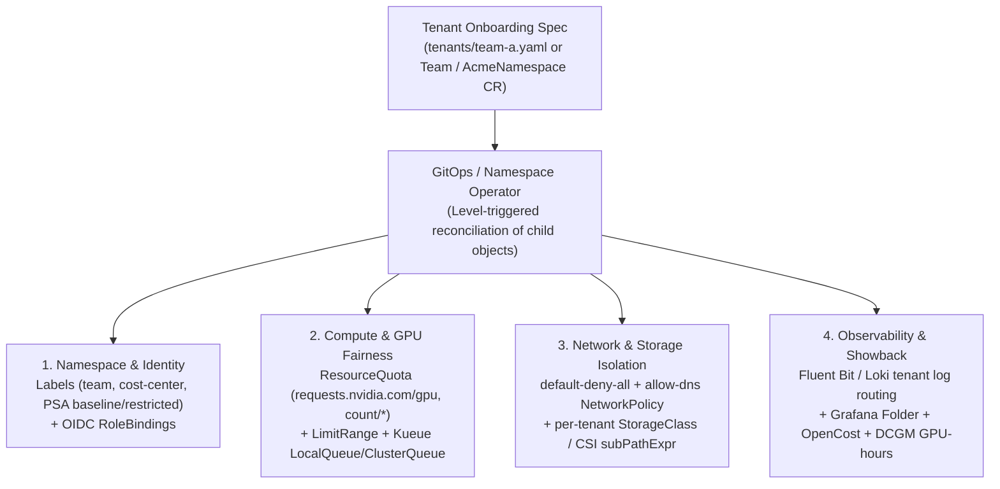

# 5.22 Multitenancy and platform services

| | |
|---|---|
| Level | Advanced |
| Priority tier | 1 |
| Lab venue | kind/kubeadm; Kyverno or VAP; Kueue; optional Capsule, HNC, vCluster, JupyterHub, OpenCost |
| Part | Part 5: Kubernetes |
| Status | Drafted, labs **untested** |

## Why this matters for AI infrastructure

A GPU cluster is rarely built for one team. Research groups, product teams, external customers and platform engineers share the same scarce, expensive hardware, and each expects fairness, security, performance isolation and self-service. Without a deliberate tenancy model you get noisy neighbours (one job floods the API or the storage), security incidents (cross-tenant data access), unfair allocation (one team squats on GPUs), unmanageable support load, and no cost visibility. With a good model, teams onboard in minutes via a pull request, get quotas and queues automatically, run in isolated namespaces with default-deny networking, and see their usage and cost. This chapter turns the individual mechanisms (RBAC, quotas, network policy, admission, scheduling, storage) into a coherent multi-tenant platform and describes the platform services that sit around the cluster.

## Prerequisites and outcomes

Needs 5.7, 5.15, 5.16, 5.18, 5.21. After this chapter you can:

- Compare tenancy models (soft vs hard, namespace-per-tenant, cluster-per-tenant, virtual clusters) and match them to trust levels.
- Implement namespace-level isolation: RBAC, ResourceQuota/LimitRange, NetworkPolicy, Pod Security, storage, secrets, priority, and node isolation (dedicated pools, taints, sandboxed runtimes).
- Provide fair GPU sharing with Kueue (queues, cohorts, preemption, fair sharing), MIG/time-slicing/MPS where appropriate, and enforce quotas at multiple layers.
- Use hierarchical namespaces/Capsule/vCluster or similar to delegate administration.
- Automate tenant onboarding and offboarding (GitOps, Terraform, generators) and expose self-service interfaces.
- Design platform services (registry, ingress, notebooks, CI/CD, storage, observability, model serving, experiment tracking) and operate the platform as a product with SLOs, docs and support.
- Allocate and report cost per tenant.

## 1. Tenancy models and trust levels

| Model | Isolation boundary | Trust assumption | Typical use |
|---|---|---|---|
| **Namespace per team** (soft multi-tenancy) | Namespace + RBAC + quota + network policy + PSA | Tenants are cooperative but may make mistakes; internal teams | Most internal AI platforms |
| **Namespace per team + dedicated node pools** | Adds node-level isolation (taints, labels, separate hardware) | Reduce noisy neighbours, compliance for sensitive data | Regulated data, performance-critical |
| **Namespace + sandboxed runtimes** (gVisor/Kata) | Adds kernel-level isolation for untrusted code | Untrusted code (notebooks, customer containers) | Public/semi-public notebooks, SaaS |
| **Virtual clusters** (vCluster, Kamaji, HyperShift hosted control planes) | Tenant gets their own API server/CRDs/RBAC; shared workers | Tenants need cluster-admin-like autonomy (CRDs, operators) | Platform teams, CI environments, labs |
| **Cluster per tenant** (hard multi-tenancy) | Separate control and data planes | Hostile or contractually separate tenants | External customers, regulated tenants |
| **Multi-cluster fleet with workload placement** | Many clusters, federated scheduling | Scale and failure isolation | Large orgs (5.35) |

Kubernetes itself provides **soft multi-tenancy**: the control plane is shared; tenants share the API server, scheduler, etcd, nodes' kernel, DNS, and often storage and network. Hard guarantees require separation at the layer you worry about (nodes, kernel, control plane). Choose by **threat model and compliance**, not by default.

In *Production Kubernetes* Chapter 12 (*Multitenancy*), Josh Rosso et al. illustrate the difference using a housing analogy:
- **Soft multitenancy ("a family living together in one house"):** Family members share the kitchen, living room, and utilities (the control plane, nodes, CNI, and storage), while each member has their own private bedroom (`Namespace` isolated by RBAC, `ResourceQuota`, `LimitRange`, `PodSecurity`, and `default-deny-all` `NetworkPolicy`). Also requires **Namespace-per-team** vs. **Namespace-per-application** planning and per-tenant log routing (for example, configuring **Fluent Bit** tag-based routing `Match kube.var.log.containers.*_alice-ns_*` so logs from `alice-ns` only ship to Alice's Elasticsearch/Loki index).
- **Hard multitenancy ("tenants in an apartment building or hotel" / hostile tenants):** Either dedicate a **Cluster per tenant** (at the cost of multi-cluster fleet management and lower GPU bin-packing efficiency) or combine **virtual control planes (`vCluster`/`Kamaji`)**, **dedicated tainted node pools**, **sandboxed runtimes (`Kata`/`gVisor`)**, and **fabric-isolated storage/networks**.



### Isolation layers (what to configure)

| Layer | Mechanisms | Notes |
|---|---|---|
| **API/Control plane** | RBAC (namespaced roles), admission policy, API Priority & Fairness per tenant, audit | One tenant's controller can overload the API; give operators their own APF levels (5.5) |
| **Identity** | OIDC groups per team; workload identity per ServiceAccount | Avoid shared credentials |
| **Compute (CPU/memory/GPU)** | ResourceQuota, LimitRange, Kueue ClusterQueues, priority classes, node pools/taints, CPU/Topology Manager | GPUs are the contested resource |
| **Network** | Default-deny NetworkPolicy, per-tenant egress allowlists, separate ingress classes/domains, secondary networks isolated by VLAN/PKey | RDMA fabrics need fabric-level isolation (5.15, Part 12) |
| **Storage** | Per-tenant StorageClasses, quotas per class, per-tenant subdirectories/exports, encryption keys per tenant, snapshots/backups scoped | Shared parallel FS requires quotas and ACLs |
| **Secrets** | Namespaced Secrets, external secret store paths per tenant, workload identity | Never share cloud credentials |
| **Runtime/kernel** | PSA, seccomp/AppArmor, sandboxed RuntimeClass, `hostUsers: false`, no host namespaces | Kernel is shared in runc: kernel exploits cross tenants |
| **Observability** | Per-tenant dashboards/log access (Grafana orgs/folders, Loki tenants), metrics label scoping | Do not expose other tenants' data |
| **Cost** | Labels, namespace attribution, OpenCost/Kubecost, GPU-hour accounting | Chargeback/showback drives behaviour |

## 2. Namespace-level building blocks

### ResourceQuota and LimitRange

```yaml
apiVersion: v1
kind: ResourceQuota
metadata: { name: team-a-compute, namespace: team-a }
spec:
  hard:
    requests.cpu: "512"
    requests.memory: 4Ti
    requests.nvidia.com/gpu: "32"            # extended resources use the requests. prefix
    limits.memory: 4Ti
    requests.ephemeral-storage: 20Ti
    persistentvolumeclaims: "50"
    requests.storage: 100Ti
    fast-nvme.storageclass.storage.k8s.io/requests.storage: 20Ti
    count/jobs.batch: "500"
    count/pods: "2000"
    services.loadbalancers: "0"
    services.nodeports: "0"
  scopeSelector:                              # optional: quota only for a priority class
    matchExpressions: [ { scopeName: PriorityClass, operator: In, values: [training-normal] } ]
---
apiVersion: v1
kind: LimitRange
metadata: { name: defaults, namespace: team-a }
spec:
  limits:
    - type: Container
      default: { cpu: "2", memory: 8Gi }
      defaultRequest: { cpu: "1", memory: 4Gi }
      max: { cpu: "128", memory: 1Ti }
    - type: PersistentVolumeClaim
      max: { storage: 10Ti }
      min: { storage: 1Gi }
```

Behaviour: ResourceQuota is enforced at admission (creation fails with `exceeded quota`), counts requests of *all* pods (including Pending) in the namespace; if a quota covers compute resources, pods must specify requests/limits for those resources (LimitRange defaults help). Quotas on `count/*` protect the API server from object floods (thousands of Jobs/Pods/ConfigMaps). Quotas are namespace-bound; per-team quota across many namespaces needs hierarchical tools (HNC, Capsule) or Kueue cohorts.

### Priority and fair sharing

Combine **PriorityClasses** with **ResourceQuota scopeSelector** to cap how many high-priority pods a team may run (prevents priority abuse), and **Kueue** for dynamic GPU sharing: each team has a `ClusterQueue` with `nominalQuota`, can borrow idle quota from a `cohort`, and is preempted when owners reclaim (5.18). Provide a few **WorkloadPriorityClasses** (`production`, `high`, `normal`, `best-effort`). Provide **fair-share** weights so large teams don't starve small ones; show queue positions and wait times to users.

### GPU sharing options

| Method | Isolation | Use | Caveats |
|---|---|---|---|
| **Whole GPUs** (`nvidia.com/gpu: N`) | Strong | Training, large inference | Fragmentation risk |
| **MIG** (A100/H100/B200 partition into instances with dedicated SMs/memory/bandwidth) | Hardware-level QoS and fault isolation | Many small inference/dev workloads; multi-tenant | Fixed profiles; reconfiguration needs idle GPU; fewer cross-instance features (no NVLink peer P2P) |
| **Time-slicing** (device plugin oversubscription) | None (context switching) | Dev notebooks, light inference | No memory/fault isolation, unpredictable latency |
| **MPS** (CUDA Multi-Process Service) | Weak/shared (memory limits via `CUDA_MPS_PINNED_DEVICE_MEM_LIMIT`, active thread %) | Concurrent small jobs from one tenant | Single-tenant trust; fault propagation |
| **vGPU** (virtualised GPUs via hypervisor, licence) | Strong | VM-based multi-tenancy | Licensing, hypervisor stack |
| **DRA with partitionable devices** | Depends on partition type | Flexible claims for MIG/shared devices | Maturity varies |

For multi-tenant security, prefer whole GPUs or MIG; avoid time-slicing/MPS between mutually untrusted tenants (side channels, DoS). Dedicated node pools per tenant class simplify driver/config differences (MIG strategy `single`/`mixed`, GPU Operator configs per pool).

### Node isolation

Dedicated pools per tenant or sensitivity level via taints/labels + admission (inject tolerations/nodeSelector for the namespace's pool, forbid overrides); separate nodes for system components, for untrusted notebooks (sandboxed RuntimeClass), for production inference. Avoid pod-level `hostNetwork`/`hostPID`. Consider node-level encryption, secure boot/measured boot, and wiping local NVMe between tenants (init containers can't guarantee; use node recycling for strict cases).

## 3. Delegated administration and virtual clusters

- **Hierarchical Namespace Controller (HNC)** (`hnc.x-k8s.io`): parent/child namespaces inherit RBAC, NetworkPolicies, quotas (propagated objects); team leads create sub-namespaces via `SubnamespaceAnchor`. Maintenance mode of the project: evaluate alternatives.
- **Capsule** (Tenant CRD): a `Tenant` groups namespaces, owners, quotas across namespaces, network/storage/ingress class restrictions, node selectors, allowed registries, namespace limits; owners create namespaces self-service; lightweight.
- **Kubernetes multi-tenancy benchmarks** (kubernetes-sigs/multi-tenancy) and **Kyverno/VAP policies** codify rules; Argo CD AppProjects and Flux tenants constrain what each team's GitOps deploys (4.26).
- **Virtual clusters**: **vCluster** runs a tenant control plane (API server + syncer, often k3s) inside a namespace; tenant pods are synced to the host as ordinary pods, so the host scheduler and nodes are shared while tenants get their own API, CRDs, RBAC and namespaces; strong DX for platform teams and CI. **Kamaji**, **HyperShift (hosted control planes)**, **Cluster API** for full separate clusters at scale. Trade-offs: extra control-plane overhead, syncing complexity, isolation still depends on the host's node security and policies on synced pods (enforce policies on the host).

## 4. Self-service and onboarding

Tenant onboarding as code (GitOps/Terraform, 4.25, 4.26):

```yaml
# tenants/team-a.yaml  (data-driven; rendered by Terraform/Helm/Kustomize/Kyverno-generate)
name: team-a
owners: ["oidc:team-a-leads"]
members: ["oidc:team-a-researchers"]
namespaces: [team-a-dev, team-a-train, team-a-serve]
quotas:
  gpu: { nominal: 32, borrowingLimit: 16, flavor: h100 }
  cpu: 512
  memory: 4Ti
  storage: { fast-nvme: 20Ti, shared-rwx: 100Ti }
priority: normal
egress: [object-store, registry, pypi-mirror]
cost: { center: CC-1042, budgetMonthlyUsd: 120000 }
```

Automation creates: namespaces with labels (`team`, `tier`, `cost-center`, PSA labels); RoleBindings for OIDC groups; ResourceQuota/LimitRange; Kueue `LocalQueue`s and `ClusterQueue` (and ResourceFlavor mapping); default-deny and DNS NetworkPolicies plus approved egress; StorageClass access/PVC quotas and storage subdirectories/export policies; secret store paths and workload identity bindings; ingress/hostname allocations; Grafana folder/org and alert routes; registry project/robot accounts; ArgoCD AppProject; budget alerts. **Offboarding**: archive data per retention policy, revoke access, delete namespaces after notice, release quota, reclaim volumes (`Retain` → backup → delete).

Self-service interfaces: Git PR workflow (default), a **developer portal** (Backstage with Kubernetes, Argo, Kueue plugins; Port; internal CLI), notebook portals (JupyterHub/Kubeflow/Run:ai/ DGX Cloud UIs), a **job submission CLI/SDK** hiding YAML (`mlctl submit train.yaml --gpus 16`), templates (Helm charts/Kustomize bases/Cookiecutter) for jobs, services and pipelines with built-in best practices (resource requests, probes, checkpointing, labels).

### Choosing how much to abstract

Not every developer needs to see Kubernetes. How much you hide is a real decision. Some people say that if application developers know they use Kubernetes, you have failed. That idea fits a product where the orchestrator means nothing to the user. Picture a database system that runs its shards on Kubernetes, Bosh, or Mesos. Its users probably do not care which one.

Turning that slogan into a team goal is risky, though. Every layer you add on top of Kubernetes brings choices about what the right abstraction looks like.

Cloud Foundry shows the fully hidden end. With one `cf push`, an application is built, deployed, and serving production traffic. As Cloud Foundry runs more on Kubernetes, that change should be an implementation detail rather than a change in features.

Some companies run more than one orchestrator. A Mesos footprint may sit beside a Kubernetes one. They then build an abstraction that picks where each workload lands, so developers do not have to choose. This also avoids lock-in. The cost is effort. You must build on two systems that work differently. Developers then learn a company-specific system instead of a shared one, and many resist learning systems that do not carry over between organizations. Another pitfall is an obsession with abstraction. If you hide everything, you cannot expose key Kubernetes features. Keeping up with the project becomes a cat-and-mouse game, and your abstraction can end up as complex as the system it hides.

At the other end, a platform group can offer self-service clusters to development teams. That can work well. It puts Kubernetes maturity on the teams. They need to understand Deployments, ReplicaSets, Pods, Services, and Ingress. They must know how to set CPU in millicpus and how overcommit works. They must also make sure replicas land on different nodes. If they can do that, you avoid over-engineering a platform.

Owning a cluster is less common, though. Even skilled teams rarely want to spend time on cluster lifecycle and upgrades. Expecting every team to become a Kubernetes expert while shipping software is often unrealistic. Abstraction is not all or nothing. Decide where to hide details and where to give developers more control.

### The `Team` custom resource operator pattern and the 4-stage spectrum of platform abstractions

Beyond rendering tenant YAML in CI/CD pipelines, *Production Kubernetes* (Chapter 16) shows how mature platforms implement self-service tenant onboarding natively inside the cluster using a custom **`Team` operator**. When a platform engineer or portal submits a `Team` custom resource specifying the owner and resource quotas, the in-cluster controller continuously reconciles the tenant's `Namespace`, `RoleBinding`s, `ResourceQuota`, `LimitRange`, `NetworkPolicy`, and even Grafana dashboards or Alertmanager routes—automatically restoring any role or quota that someone accidentally deletes. In the book's example (untested here):

```yaml
apiVersion: examples.namespace-operator.io/v1
kind: Team
metadata:
  name: team-a
spec:
  owner: Alice
  resourceQuotas:
    pods: "50"
    storage: "300Gi"
```

In *Production Kubernetes* Chapter 11 (*Building Platform Services*), Rosso et al. walk through the Go implementation of a custom **`AcmeNamespace` operator** (`AcmeNamespaceSpec` with `namespaceName` and `adminUsername`) built with **Kubebuilder** (`controller-runtime`) and highlight two essential operator design rules (modeled in `reconcile_acme_namespace_operator()` in `code/part05/multitenancy_quota_reconciler.py`):
1. **Never rely solely on `status.phase == "Created"` to skip checking child resources (`PK` Chapter 11):** A naive `Reconcile` loop that sets `acmeNs.Status.Phase = "CreationInProgress"`, creates the child `Namespace`, `Role` (`namespace-admin`), and `RoleBinding`, sets `acmeNs.Status.Phase = "Created"`, and does nothing whenever `Phase == "Created"` has two critical bugs: (a) if the controller crashes mid-flight while `Phase == "CreationInProgress"`, it must query the local Informer cache to see which children already exist; and (b) if someone later deletes the child `RoleBinding` or `ResourceQuota` by hand, a controller that only checks `Phase == "Created"` will never notice or heal the missing child. Instead, `Reconcile` must inspect the Informer cache for every expected child object (`Namespace`, `Role`, `RoleBinding`, `ResourceQuota`, `NetworkPolicy`) on every pass and watch child resources via **`ownerReferences`** (`ctrl.SetControllerReference`).
2. **Resource scoping rule for `ownerReferences` (`PK` Chapter 11):** In Kubernetes, **a namespaced object CANNOT be the `ownerReference` owner of a cluster-scoped object** (like a `Namespace`). Therefore, an operator CRD that creates and owns `Namespace` objects (`AcmeNamespace` or `Team`) must be annotated with **`// +kubebuilder:resource:scope=Cluster`** (`spec.scope: Cluster` in the `CustomResourceDefinition`). Chapter 11 also compares **Kubebuilder** (Go), **Operator SDK** (Go, Ansible, or Helm), and **Metacontroller** (language-agnostic webhook "lambda controllers").

When deciding how much of Kubernetes to expose to application and ML developers after onboarding, *Production Kubernetes* (Chapter 16) organizes developer interfaces along a **4-stage spectrum of abstraction** (from least abstracted on the left to fully invisible Kubernetes on the right):

1. **Stage 1 — Command-line tooling and local UIs (no API abstraction)**: developers use raw `kubectl` augmented by shell helpers (`kubectx` for switching contexts, `kubens` for switching namespaces, log-tailing plugins, SSO credential plugins) and workstation graphical clients such as `Octant` and `Lens` that render cluster state using the developer's local `kubeconfig`. Full flexibility, but requires RBAC, admission guardrails, and Kubernetes knowledge from every developer.
2. **Stage 2 — Abstraction through templating (`Helm` and `Kustomize`)**: platform engineers package the roughly ten underlying objects a typical service needs (`Deployment`, `StatefulSet`, `Service`, `PVC`, `ConfigMap`, `Secret`) into a `Helm` chart exposing a small `Values.yaml` interface, optionally piped into `Kustomize` (or a web UI generator such as Ambassador's K8s Initializer) to patch fields the chart did not template. Developers still apply native Kubernetes objects, preserving upstream community documentation and debugging familiarity.
3. **Stage 3 — Abstracting Kubernetes primitives with custom workload CRDs (`PinterestService`)**: the platform team defines a high-level Custom Resource and operator that encapsulates multiple native resources and external integrations (such as internal DNS registration). In the book's example from Pinterest (`PinterestService`, untested here), a 25-line custom resource replaces more than 350 lines of raw `Deployment`, `Service`, `Ingress`, IAM role, and sidecar YAML:

```yaml
apiVersion: pinterest.com/v1
kind: PinterestService
metadata:
  name: exampleservice
  project: exampleproject
  namespace: default
spec:
  iamrole: role1
  loadbalancer:
    port: 8080
  replicas: 3
  sidecarconfig:
    sidecar1:
      deps:
        - example.dep
    sidecar2:
      log_level: info
  template:
    spec:
      initcontainers:
        - name: init
          image: gcr.io/kuar-demo/kuard-amd64:1
      containers:
        - name: init
          image: gcr.io/kuar-demo/kuard-amd64:1
```

   When building custom workload CRDs, the book recommends keeping a **break-glass** window into the underlying native objects (`Pod`s, `PVC`s, events) so engineers can still use standard Kubernetes troubleshooting knowledge when an abstraction leaks.
4. **Stage 4 — Making Kubernetes invisible (full PaaS / developer portals)**: developers push source code or a minimal build/deploy/release file without writing Kubernetes YAML at all, using platforms ported to or built atop Kubernetes such as Cloud Foundry, Google App Engine, Red Hat OpenShift, Spotify's `Backstage` developer portal, or HashiCorp `Waypoint` (which encapsulates `build` with `pack`, `deploy` to `kubernetes`, and `release` in a single HCL file).

## 5. Platform services around the cluster

A "platform" is more than Kubernetes: these shared services turn raw GPUs into a usable AI platform. Each has tenancy implications.

| Service | Purpose | Tenancy/ops notes |
|---|---|---|
| **Identity & access** (OIDC, SSO, groups) | Authenticate humans and machines | Group sync from IdP; short tokens; machine identities |
| **Container registry & artifact repos** | Images, Helm charts, models, Python packages | Per-team projects/robot accounts, quotas, scanning, replication, pull-through caches (5.1) |
| **CI/CD & GitOps** | Build, test, deploy | Runners isolated per team (ephemeral, rootless), OIDC to cloud, Argo/Flux projects (4.2, 4.26) |
| **Ingress/Gateway & API gateway** | Expose services, auth, rate limits | Per-tenant hostnames/routes, quotas, WAF (5.12) |
| **Job queueing & scheduling** | Kueue/Volcano/Slurm bridge | Fair-share, preemption, visibility (5.18) |
| **Notebooks & IDEs** | Interactive development | Time-limited, culling idle, sandboxing, egress controls |
| **Pipelines/orchestration** | Airflow, Argo Workflows, Kubeflow Pipelines, Flyte, Metaflow | Per-team namespaces/executors; separate controller privileges |
| **Experiment tracking & registries** | MLflow, W&B, ClearML, model registry | Access control per project; artifact store buckets per team; DB sizing |
| **Feature stores / vector DBs / datastores** | Feast, Redis, Postgres, Qdrant, Milvus | Per-tenant instances vs shared with RBAC; backups |
| **Storage platform** | Parallel FS, object store, NFS | Quotas, ACLs, encryption, lifecycle (5.17, Part 13) |
| **Model serving** | KServe, vLLM/Triton, Ray Serve, gateways | Per-tenant endpoints, autoscaling, GPU pools, tokens/rate limits (Part 15) |
| **Observability** | Metrics, logs, traces, GPU telemetry, cost | Multi-tenant backends (Mimir/Loki/Tempo tenants), RBAC on dashboards (5.24) |
| **Security tooling** | Policy engines, scanners, runtime detection, secret manager, audit | Central policies, tenant exceptions via PR (5.21, 5.27) |
| **Data governance** | Catalog, lineage, retention, PII controls | Dataset access approval workflows |
| **Cost management** | OpenCost/Kubecost, GPU accounting | Showback dashboards, budgets, alerts |
| **Support & docs** | Runbooks, FAQ, office hours, status page | Platform as a product |

### What an application platform is

An application platform is a viable place to run workloads. How you meet that goal depends on the organization. The outcomes you want vary across the business. Happy developers, lower operating costs, and quicker feedback on software are common examples. The platform sits where applications meet infrastructure, and developer experience is usually a central concern.

Platforms come in many shapes. Some hide the layers below them, such as the IaaS or the orchestrator. Heroku is a good example. You can take a Java, PHP, or Go project and deploy it to production with one command. Metrics collection, data services, and continuous delivery run alongside your app. You also get the building blocks for highly available workloads that scale easily. Does Heroku use Kubernetes? Does it run its own data centers or sit on AWS? For a Heroku user, those details do not matter. Red Hat OpenShift follows a similar model. Kubernetes is an implementation detail there, and developers work with abstractions on top.

Why not stop with these? Prebuilt platforms such as Cloud Foundry, OpenShift, and Heroku already solve many problems. Their main trade-off is that you must accept their view of the world. Giving up ownership of the underlying system takes a big load off your team. Still, if the platform handles service discovery or secret management in a way your organization cannot accept, you may lack the control to work around it. There is also vendor or opinion lock-in. Abstractions bring opinions about how apps are built, packaged, and deployed, so moving to another system may not be simple. For example, moving workloads between GKE and EKS is much easier than moving between EKS and Cloud Foundry.

### Building on Kubernetes

Kubernetes is one piece of the path to production. Does that mean it is missing things? The Unix idea of making each program do one thing well fits Kubernetes. Its best features are largely the ones it does not include. That matters after years of one-size-fits-all platforms that promise to solve everything. Kubernetes focuses on being a strong orchestrator, and it defines clear interfaces for building on top.

Think of Kubernetes as a foundation. A good foundation is structurally sound, can be built on, and gives proper interfaces for the utilities that route into the home. A foundation alone is rarely a place to live. Applications need a home on top of it.

Compare a pre-furnished apartment. It is ready to move into, much like a platform as a service such as Heroku. You can customize the inside, but many concerns are already solved. If the rent and the fixed rules suit you, you are set on day one.

Building on Kubernetes is more like building a house. It costs planning, engineering, and maintenance. In return, you control every element of the result. The house can be shaped for its future tenants, your applications. The sections below cover the layers and decisions that make this possible.

### Building blocks of an application platform

Start at the bottom. Kubernetes expects to run on a technology layer, usually a data center or a cloud provider. That layer offers compute, storage, and networking. Once it exists, Kubernetes can be bootstrapped on top, and clusters can live on it within minutes. Bootstrapping methods come later in this part (see 5.4).

Once clusters exist, questions arrive quickly. These are common examples:

- How do I make sure traffic between workloads is fully encrypted?
- How do I make sure egress traffic leaves through a gateway with a consistent source CIDR?
- How do I provide self-service tracing and dashboards to applications?
- How do I let developers onboard without becoming Kubernetes experts?

The list can keep growing. Part of your job is deciding which needs belong in the platform and which belong in each application. Learn how people work today first. If the platform cannot meet an expected feature, think about the effect on development teams. Build with developers who are willing to onboard early, since their quick feedback guides good decisions. Reaching production is not the end. Platform teams should not expect a static environment that developers use for decades. Stay close to them to catch gaps that slow them down.

Each layer has its own building blocks.

**Container runtime.** The container runtime manages the life cycle of workloads on each host. Common choices are CRI-O, containerd, and Docker. The Container Runtime Interface (CRI) lets you pick among them. Specialized runtimes also exist for needs such as running a workload in a micro-VM.

**Container networking.** Your networking choice covers IP address management (IPAM) for workloads and the routing protocols that let them communicate. Calico and Cilium are common picks. The Container Networking Interface (CNI) makes this pluggable. Once a networking plug-in is in the cluster, the kubelet can request IP addresses for the workloads it starts. Some plug-ins go further and build service abstractions on top of the Pod network.

**Storage integration.** Storage integration covers what you do when on-host disk will not do. More organizations now run stateful workloads on Kubernetes. Those workloads need state that survives application failure or rescheduling. Systems such as vSAN, EBS, and Ceph can supply that storage. The Container Storage Interface (CSI) lets you choose the backend. As with CNI and CRI, you install a plug-in that understands the storage an application requests.

**Service routing.** Service routing moves traffic to and from the workloads you run in Kubernetes. Kubernetes offers a Service API, but that is usually a stepping stone. Richer routing, such as layer 7 routing and traffic patterns, builds on container networking. Teams often add these features with an Ingress controller. Deeper still are service meshes, which bring service-to-service mTLS, observability, and application patterns such as circuit breaking.

**Secret management.** Secret management covers distributing the sensitive data that workloads need. Kubernetes has a Secrets API. Out of the box, many clusters lack the secret protection some enterprises demand. This is mostly a defense-in-depth question. At a simple level, you encrypt data before it is stored, which is encryption at rest. At a more advanced level, you integrate a tool such as Vault or CyberArk.

**Identity.** Identity covers authenticating humans and workloads. A common first request is to sign users in against LDAP or a cloud provider's IAM system. Workloads may also need identities. That supports zero-trust models, where impersonating a workload is much harder. An identity provider and mechanisms such as mTLS can verify a workload.

**Authorization and admission control.** Authorization is the step after identity. When users or workloads call the API server, you decide whether to grant or deny access. Kubernetes offers RBAC with resource and verb controls. Your organization may need custom authorization logic as well. Admission control goes further. Validation can be as simple as checking a static list of rules, or it can call other systems to decide the answer.

**Software supply chain.** The software supply chain covers the whole life cycle from source code to runtime. It includes continuous integration (CI) and continuous delivery (CD). Developers often meet the platform through their pipelines, so getting CI/CD working well with Kubernetes matters a great deal. Beyond pipelines, look at how artifacts are stored, how safe they are from vulnerabilities, and whether the images that run in your cluster are intact.

**Observability.** Observability is the umbrella term for understanding what happens in your clusters, at the system and application layers. It has three main areas: logs, metrics, and tracing. Logging forwards data from workloads on the host to a backend, where logs can be aggregated and analyzed. Metrics capture state at a point in time, and are often scraped into an analysis system. Tracing shows how the services in your stack interact. Trace data is gathered and shown with a context or correlation ID, so you can follow one request.

**Developer abstractions.** These are the tools and platform services that help developers succeed on your platform. As covered earlier, they sit on a spectrum. Some organizations hide Kubernetes completely from teams. Others expose many of its knobs and give developers wide flexibility. Most solutions also focus on onboarding, so developers can get access and secure control of an environment they can use.

### Deciding what the platform should own

Not every application concern belongs in the platform. Take mutual TLS (mTLS). Suppose every Java microservice bundles a library that handles it. That gives each workload an identity and encrypts its traffic. A platform team needs to understand that usage before deciding whether to offer the feature at the platform level. Many teams look at a service mesh for this.

A service mesh has clear benefits. Java apps no longer need to bundle mTLS libraries. Non-Java apps can join the same encryption system. Application teams have less to solve. The costs are real, too. A mesh is another distributed system with its own operational complexity. Meshes often bring features far beyond identity and encryption. The mesh's identity API may also fail to integrate with the backend your existing applications use.

Weigh these pros and cons before you commit. You do not need to solve every application concern in the platform, and you should not try. The rest of this part gives many recommendations. Judge each one against your business priorities.

### Summary of application platforms

"Application platform" is still a fuzzy term. The platforms discussed here bring a team experience far beyond workload orchestration. Kubernetes can be customized and extended to reach similar outcomes. Move beyond "How do I get a Kubernetes?" and ask about the developer workflow, its pain points, and what developers want. Platform and infrastructure teams that do this build better things. They are more likely to chart a real path to production and win real adoption.

The goal is to meet infrastructure, security, and developer requirements. Developers are the customers. Do not hand them a powerful engine and expect each one to build a platform around it. Developers who want a drivable car will not accept an engine with no frame or wheels.

### Operating the platform as a product

- **Customers**: researchers, ML engineers, application teams; gather requirements, publish a roadmap, SLAs/SLOs (queue wait, start latency, availability), changelog, deprecation policy.
- **Golden paths**: documented, supported ways to do common tasks (train, fine-tune, serve, batch infer) with templates; discourage snowflakes but allow escape hatches.
- **Guardrails over gates**: automated policy and quotas instead of manual approvals; fast feedback in PRs.
- **Metrics**: onboarding time, support tickets per tenant, GPU utilisation and allocation efficiency, job success rate, queue wait p95, incident count, time to resolve, user satisfaction.
- **Fairness and governance**: transparent quota allocation process (annual/quarterly), burst/borrowing rules, priority policy, preemption notices, reserved capacity for critical teams, review forums.
- **Capacity planning** with tenants: demand forecasting, utilisation reviews, reclaim idle quotas, charge or show costs.
- **Communication**: maintenance calendars, incident comms, release notes, deprecation notices with migration help.

## 6. Cost allocation and showback

Labels propagate from namespaces to pods (via policy) so cost tools can attribute spend: **OpenCost/Kubecost** (CPU/memory/GPU/storage/network by namespace/label), cloud billing exports with resource labels (GCP labels, AWS tags), DCGM-based GPU-hour accounting (per pod via pod-resources mapping and `DCGM_FI_DEV_*` joins). Allocation methods: by requests (what you reserved), by usage (what you used), or hybrid with idle-cost distribution; for GPUs, allocation by requested GPU-hours is usually fair and encourages release of idle resources, with utilisation reports to coach teams. Include shared costs (control plane, storage, networking, platform team) proportionally. Report weekly to team leads; alert on budget thresholds; automate idle detection (GPU allocated but under 5% utilised for hours) with notifications and auto-culling of notebooks.

PromQL examples:

```promql
sum by (namespace) (kube_pod_container_resource_requests{resource="nvidia_com_gpu"} * on (pod,namespace) group_left() (kube_pod_status_phase{phase="Running"} == 1))   # GPUs allocated per namespace
avg by (namespace) (DCGM_FI_DEV_GPU_UTIL * on (pod,namespace) group_left() kube_pod_info) / 100                                                                      # utilisation per namespace (join via exported pod/namespace labels)
sum by (namespace) (increase(container_cpu_usage_seconds_total[24h])) / 3600                                                                                          # CPU-hours/day
```

## 7. Failure modes and troubleshooting

| Symptom | Likely cause | Fix |
|---|---|---|
| Tenant can see/affect others | Missing default-deny, cluster-wide Role bindings, shared service accounts | Review RBAC, NetworkPolicy, `kubectl auth can-i` as tenant, remove broad bindings |
| One team starves GPUs | No quotas/queues; priority inflation | Kueue ClusterQueues, ResourceQuota, PriorityClass-scoped quotas |
| API server slow due to one tenant | Controller/list loops, object floods | APF level per tenant/controller, `count/*` quotas, rate limits |
| Quota exceeded unexpectedly | Pending pods and failed Jobs counted; terminated pods retained | Clean up completed pods (TTL), inspect `kubectl describe quota`, scope quotas |
| Noisy neighbour on node | No CPU/memory isolation, shared NVMe/NIC | Guaranteed QoS, dedicated pools, I/O limits, bandwidth manager |
| Storage cross-tenant visibility | Shared RWX export without per-tenant paths | Per-tenant subpaths/exports, quotas, ACLs, CSI `subPathExpr` |
| Cannot onboard quickly | Manual steps | Automate tenant objects as code; templates |
| Idle GPUs allocated | Notebooks left running, jobs stuck | Idle culling, TTLs, alerts, quotas/borrow limits |
| Cost disputes | Unlabelled workloads | Enforce labels with admission; allocation reports |
| vCluster pods violate host policy | Syncer creates pods with tenant-chosen specs | Host-level PSA/Kyverno on synced pods, node selectors for tenant pools |
| Operator upgrades break tenants | Cluster-wide CRDs shared | Version per tenant via vCluster or strict CRD upgrade policy and compatibility testing |

## 8. Lab

First, run the self-checking Python lab (`code/part05/multitenancy_quota_reconciler_lab.py`) locally. It verifies the `LimitRange` default injector and `ResourceQuota` admission evaluator (`evaluate_resource_quota_and_limitrange`), the `PK` Chapters 11 & 16 `AcmeNamespace`/`Team` operator level-triggered reconciler (`reconcile_acme_namespace_operator`: detecting and healing deleted child `RoleBinding`/`ResourceQuota` objects rather than blindly trusting `status.phase`), and the multi-tenant GPU cost and idle-waste calculator (`compute_tenant_gpu_cost_and_waste`).

```bash
python3 code/part05/multitenancy_quota_reconciler_lab.py
```

Next, on a `kind` or `kubeadm` cluster (all interactive shell steps below are `untested here`), work through these exercises:

1. **Namespace baseline**: build a tenant template (namespace, labels, RBAC for an OIDC group, ResourceQuota/LimitRange, default-deny + DNS NetworkPolicy, PSA labels, StorageClass access) as Helm/Kustomize; instantiate for two teams; verify isolation with cross-tenant access tests (pod-to-pod, secrets, PVCs).
2. **Quota behaviour**: exceed each quota type (pods, GPUs via fake extended resource, storage, object counts); read errors; test quota with Pending and completed pods; apply PriorityClass scoped quotas.
3. **Kueue sharing**: two teams, one cohort; borrow, reclaim, and preempt; WorkloadPriorityClasses; measure fairness over time with a synthetic workload generator; expose queue metrics.
4. **GPU sharing**: on a GPU node (or simulate), configure MIG profiles and time-slicing via the GPU Operator; run tenants' workloads on each; compare isolation (latency under interference, memory limits, fault containment).
5. **Delegated admin**: install Capsule (or HNC); create a Tenant with owners and limits; let an owner self-create namespaces; demonstrate guardrails (allowed storage classes/registries); compare with plain namespaces + Kyverno.
6. **Virtual cluster**: create a vCluster for a team, install a CRD/operator inside it that conflicts with the host's version; show isolation; apply host policies to synced pods; measure overhead.
7. **Node isolation**: dedicate a node pool with taints and automatic toleration/nodeSelector injection via policy; try to bypass as a tenant; add a sandbox RuntimeClass pool for notebooks.
8. **Onboarding automation**: implement the YAML tenant spec → GitOps pipeline → all objects; time it; run offboarding (data retention, namespace deletion with finalizers).
9. **Self-service**: provide a CLI/portal template for job submission that injects labels, queue, priority, resource defaults and secrets references; validate with policy.
10. **Cost allocation**: install OpenCost; label namespaces; produce a per-team GPU-hour report and an idle GPU report; set budget alerts.
11. **Attack drills**: from a tenant account try privilege escalation (create privileged pod, hostPath, read other namespace secrets, list nodes, `nodes/proxy`), scanning the network, exhausting object counts; verify controls hold; document gaps.
12. **Platform product review**: define SLOs, build a dashboard (queue wait p95, job success, utilisation, onboarding time), write the tenant guide.
13. **Clean up**.

## 9. Common mistakes

- Assuming namespaces alone provide isolation; skipping network policy, quotas, PSA, node isolation or runtime sandboxing where trust requires it.
- Giving tenants cluster-scoped permissions (CRDs, webhooks, nodes) that affect others; sharing one ServiceAccount or cloud identity across teams.
- Static ResourceQuotas only, with no queueing/borrowing (low utilisation, long waits) or no quotas at all (starvation).
- Time-slicing GPUs between untrusted tenants.
- Manual onboarding; snowflake namespaces; unlabelled workloads (no cost attribution).
- Overusing virtual clusters where simple namespaces suffice, or cluster-per-tenant without fleet automation.
- Ignoring API server protection (APF, object count quotas); one tenant's operator overwhelming control plane.
- Treating the platform as infrastructure rather than a product: no docs, no support model, no SLOs.
- No offboarding discipline; orphaned volumes and credentials.

## 10. Interview angles

- "How do you design multi-tenancy on a shared GPU Kubernetes cluster? What isolation layers?"
- "Soft vs hard multi-tenancy; when virtual clusters; when a cluster per tenant?"
- "How do you share GPUs fairly across teams? Kueue, quotas, preemption, MIG, time-slicing: trade-offs."
- "How do you stop one tenant from DoSing the API server or the storage?"
- "How would you onboard a new team in 10 minutes?"
- "How do you attribute GPU cost to teams?"
- "What platform services does an AI platform need beyond Kubernetes?"
- "How do you provide self-service while keeping guardrails?"

## Exercises

1. **Multi-Tenancy Models (`Soft` vs. `Hard`), Trust Boundaries, and the 9 Isolation Layers (`PK` Chapter 12):** Compare the 6 tenancy models in Section 1 (Namespace per team, Dedicated node pools, Sandboxed runtimes `gVisor`/`Kata`, Virtual clusters `vCluster`/`Kamaji`, Cluster per tenant, and Multi-cluster fleet) and explain how to isolate all 9 layers (API/APF, Identity, Compute/GPU, Network, Storage, Secrets, Runtime/Kernel, Observability/Fluent Bit log routing, and Cost).
2. **`ResourceQuota`, `LimitRange`, `scopeSelector`, and Sub-GPU Sharing (`MIG` vs. `Time-Slicing` vs. `MPS` vs. `vGPU`):** Using `evaluate_resource_quota_and_limitrange()` in `code/part05/multitenancy_quota_reconciler.py`, trace the `team-a-compute` `ResourceQuota` and `defaults` `LimitRange` manifests in Section 2, explaining why `requests.nvidia.com/gpu`, `<storageclass>.storageclass.storage.k8s.io/requests.storage`, `count/jobs.batch`, and `scopeSelector` (`PriorityClass`) are configured, and compare `MIG`, `Time-slicing`, `MPS`, and `vGPU` across hardware memory/fault isolation.
3. **Delegated Administration (`Capsule`, `HNC`) vs. Virtual Clusters (`vCluster`, `Kamaji`, `HyperShift`):** Compare how `Capsule` (`Tenant` CRD) and `vCluster` (virtual control plane + pod syncer) allow tenants to create multiple namespaces or install conflicting CRDs/operators on a shared GPU cluster, and explain what host-level policies must still be enforced on `vCluster`-synced pods.
4. **Building a Self-Service `AcmeNamespace` / `Team` Onboarding Operator (`PK` Chapters 11 & 16):** Using `reconcile_acme_namespace_operator()` in `code/part05/multitenancy_quota_reconciler.py`, explain why an onboarding operator CRD (`AcmeNamespace` or `Team`) must be **cluster-scoped** (`+kubebuilder:resource:scope=Cluster`) to own a `Namespace`, why trusting `status.phase == "Created"` without checking the Informer cache fails to heal deleted child `RoleBinding`s, and compare `Kubebuilder`, `Operator SDK`, and `Metacontroller`.
5. **The 4-Stage Spectrum of Platform Abstractions (`PK` Chapter 16) and Operating the AI Platform as a Product:** Compare `PK` Chapter 16's 4 stages of developer abstraction (`kubectl`/`kubectx`/`kubens`/`Lens` -> `Helm` + `Kustomize` -> custom workload CRDs like `PinterestService` / `WebApp` with a break-glass window -> full PaaS/portals like `Backstage`/`Waypoint`), and list the golden paths and SLO metrics of a product-oriented AI platform.
6. **Multi-Tenant GPU Cost Attribution, PromQL Showback, and Idle-GPU Reclamation:** Using `compute_tenant_gpu_cost_and_waste()` in `code/part05/multitenancy_quota_reconciler.py` and the PromQL queries in Section 6, design a weekly team showback report that attributes requested GPU-hours, proportional shared platform overhead, and wasted idle-allocated GPU dollars.

## Checkpoint questions (20)

<details>
<summary>1. In *Production Kubernetes* Chapter 12, what is the difference between Soft Multi-Tenancy and Hard Multi-Tenancy, and why does vanilla Kubernetes default to Soft Multi-Tenancy?</summary>

- **Soft Multi-Tenancy ("a family sharing a house"):** Assumes cooperative internal teams that are not actively trying to kernel-exploit each other, but need protection from accidents, noisy neighbors, and unauthorized cross-team access. Implemented within a single shared cluster using `Namespace`s, `RBAC`, `ResourceQuota`s, `LimitRange`s, `PodSecurity`, and `default-deny` `NetworkPolicy`.
- **Hard Multi-Tenancy ("strangers in a hotel"):** Assumes mutually untrusted or hostile external tenants. Because vanilla Kubernetes shares a single `kube-apiserver`, `etcd`, and host Linux kernel (`runc` containers), achieving hard multi-tenancy requires either **separate clusters per tenant** or combining **virtual control planes (`vCluster` / `HyperShift`)**, **dedicated hardware node pools**, **VM-sandboxed runtimes (`Kata Containers` / `gVisor`)**, and **fabric-level network/storage isolation**.
</details>

<details>
<summary>2. Compare \"Namespace-per-Team\" vs. \"Namespace-per-Application/Environment\" (`team-a-dev`, `team-a-train`, `team-a-serve`, `PK` Chapter 12).</summary>

- **Single Namespace per Team (`team-a`):** Easy to apply a single `ResourceQuota` for the whole team, **but mixes dev notebooks, batch training, and production inference inside the same security/network/RBAC boundary**.\n- **Multiple Namespaces per Team (`team-a-dev`, `team-a-train`, `team-a-serve`):** Gives each environment its own `NetworkPolicy`, `ServiceAccount`s, and `PodSecurity` profile, while using **Kueue `ClusterQueue` / `Capsule` `Tenant` quotas** to enforce a unified GPU and storage cap across all of `team-a`'s namespaces.
</details>

<details>
<summary>3. In a `ResourceQuota` manifest, what exact key names restrict (a) GPUs, (b) a specific `StorageClass`'s capacity, (c) total `Job` objects, and (d) external `LoadBalancer` Services?</summary>

1. **GPUs (extended resources):** Must use the **`requests.` prefix**—**`requests.nvidia.com/gpu: "32"`**.
2. **Per-StorageClass capacity:** **`<storage-class-name>.storageclass.storage.k8s.io/requests.storage: 20Ti`** (and `/persistentvolumeclaims: "10"`).
3. **Object count quota (protecting `etcd` / API server from object floods):** **`count/jobs.batch: "500"`**, `count/pods: "2000"`, `count/secrets: "200"`.
4. **Blocking unauthorized external Services:** **`services.loadbalancers: "0"`** and **`services.nodeports: "0"`**.
</details>

<details>
<summary>4. Why does creating a Pod with NO `resources.requests` or `limits` fail immediately in a namespace that has a CPU/memory `ResourceQuota`, and how does `LimitRange` solve this?</summary>

When a `ResourceQuota` tracks `requests.cpu`, `limits.cpu`, `requests.memory`, or `limits.memory` in a namespace, Kubernetes's `ResourceQuota` admission controller **rejects any Pod that omits those fields** (`must specify limits.memory`) because an unbounded container would bypass the quota.
Deploying a **`LimitRange`** with `default` (default limits) and `defaultRequest` (default requests) in every tenant namespace runs during the **mutating admission phase** *before* `ResourceQuota` validation—automatically injecting sensible defaults (`cpu: 1..2`, `memory: 4Gi..8Gi`) into any Pod that omitted them.
</details>

<details>
<summary>5. Why can a tenant's new Pod fail with `exceeded quota: count/pods` or `requests.nvidia.com/gpu` even when `kubectl get pods` shows zero `Running` Pods?</summary>

- **`count/pods` quota** counts **all Pod objects currently stored in `etcd`** in that namespace—including **`Completed` (`Succeeded`) and `Failed` Pods** left behind by finished `Job`s.
- **Compute and GPU `ResourceQuota` (`requests.nvidia.com/gpu`)** counts all **non-terminal Pods**—including **`Pending` Pods** that are unschedulable or waiting on volumes/images (and terminating Pods).
Always configure `ttlSecondsAfterFinished` on `Job`s (or a Kyverno cleanup policy) to garbage-collect finished Pods, and use **Kueue** (`suspend: true`) so queued jobs do not create `Pending` Pods until quota is available.
</details>

<details>
<summary>6. How do you stop a tenant from marking all of their batch training jobs with `priorityClassName: inference-critical`?</summary>

Attach a **`scopeSelector`** matching `scopeName: PriorityClass` to a **`ResourceQuota`** in the tenant's namespace:
- Create a `ResourceQuota` for `priorityClassName: inference-critical` setting `requests.nvidia.com/gpu: "0"` in training namespaces (and a specific cap in serving namespaces).
- Any attempt by a developer in a training namespace to submit a Pod with `priorityClassName: inference-critical` is immediately rejected by `ResourceQuota` admission (`exceeded quota`).
</details>

<details>
<summary>7. Compare `MIG` (Multi-Instance GPU), `Time-Slicing`, `CUDA MPS`, and `Whole GPUs` for sharing GPUs across multiple tenants.</summary>

- **Whole GPUs (`nvidia.com/gpu: 1..8`):** Complete per-device isolation; best for training and large model serving.
- **MIG (`Multi-Instance GPU` on A100/H100/B200, e.g., `1g.10gb`, `2g.20gb`, `3g.40gb`):** **Hardware-enforced isolation**—each MIG instance gets dedicated SMs, dedicated HBM memory capacity, dedicated L2 cache, dedicated memory bandwidth crossbars, and **isolated GPU page tables / fault containment** (an XID fault or OOM in one MIG slice does not crash other slices on the same physical GPU). **Safe for multi-tenant sharing of sub-GPU workloads.**
- **Time-Slicing (Device Plugin `replicas: 4`):** **Zero memory isolation and zero fault isolation**—all 4 containers share the same GPU HBM address space and context-switch SMs; if one container allocates all 80 GB of VRAM or triggers a fatal GPU fault, **all 4 tenants crash**. Only use for trusted dev notebooks from the same team.
- **CUDA MPS (`Multi-Process Service`):** Shares a single CUDA context across processes for higher concurrent kernel utilization (`CUDA_MPS_ACTIVE_THREAD_PERCENTAGE`), **but shares fault fate**; use only within a single tenant/workload.
</details>

<details>
<summary>8. How does `vCluster` (Virtual Clusters) work, and when should you give a tenant a `vCluster` instead of a standard `Namespace`?</summary>

A **`vCluster`** runs a lightweight **virtual Kubernetes control plane** (`kube-apiserver` + state store + a **Syncer** controller) as a StatefulSet/Deployment **inside a single host Namespace**:
- **What stays inside the virtual cluster:** Namespaces, CRDs, Operators, RBAC `ClusterRole`s, Webhooks, ConfigMaps, and Deployments/StatefulSets (`etcd` of the host cluster never sees them).
- **What the Syncer copies down to the host Namespace:** Only low-level executable resources (**`Pod`s, `PVC`s, `Service`s**), rewritten into the single host Namespace so the host's `kube-scheduler` and GPU nodes execute them.
**Use `vCluster` when:** Tenants need to install their own **CRDs, Operators, or cluster-scoped webhooks** (or test different operator versions) without colliding on the shared host control plane. (Always enforce host-level PSA/Kyverno on the host Namespace so the Syncer cannot create privileged Pods.)
</details>

<details>
<summary>9. What problem does `Capsule` solve on a multi-tenant Kubernetes cluster?</summary>

Without `Capsule`, if Team A needs 5 namespaces (`team-a-dev`, `team-a-stage`, `team-a-prod`, `team-a-exp1`, `team-a-exp2`), they must either file a ticket with the platform team every time they want a namespace, or be granted cluster-wide `create namespaces` permission (which lets them create unlimited namespaces with no quotas).
**`Capsule`** introduces a cluster-scoped **`Tenant` CRD** (`name: team-a`, `owners: [oidc:team-a-leads]`, `namespaceQuota: 10`, aggregate `ResourceQuota` across all namespaces in the Tenant, allowed `StorageClasses`, allowed `IngressClasses`, and required `nodeSelector`). Team A's leads can now run `kubectl create namespace team-a-exp3` self-service, and Capsule's admission webhook automatically attaches it to `Tenant/team-a` and enforces the team-wide aggregate quota and guardrails.
</details>

<details>
<summary>10. In *Production Kubernetes* Chapter 11, why is it a bug for a custom `AcmeNamespace` / `Team` operator to check `if acmeNs.Status.Phase == "Created" { return }` and skip inspecting child resources?</summary>

Two failure modes break a status-only check:
1. **Mid-reconcile crash:** If the operator sets `Status.Phase = "CreationInProgress"`, creates the `Namespace` and `Role`, and crashes *before* creating the `RoleBinding` or updating status, the next pass must query the actual cluster state (via the local Informer cache) to see which children exist and which are still missing.
2. **Drift / accidental deletion of child objects:** After `Status.Phase` reaches `"Created"`, if someone accidentally runs `kubectl delete rolebinding namespace-admin -n team-a` or deletes the `ResourceQuota`, an operator that blindly trusts `Status.Phase == "Created"` will **never recreate the deleted child object**. A level-triggered operator must set **`ownerReferences`** (`ctrl.SetControllerReference`) on all child resources, watch those child kinds (`Owns(&rbacv1.RoleBinding{})`), and verify every child in the Informer cache on every `Reconcile`.
</details>

<details>
<summary>11. In `PK` Chapter 11, why must a CustomResourceDefinition (`AcmeNamespace` or `Team`) that creates and owns `Namespace` objects be **Cluster-Scoped** (`scope: Cluster`)?</summary>

In Kubernetes garbage collection, **a namespaced resource is forbidden from being the `ownerReference` owner of a cluster-scoped resource** (cross-scope ownership from namespaced -> cluster-scoped is disallowed by `kube-apiserver`). Because a `Namespace` is a **cluster-scoped** resource, the parent `AcmeNamespace` / `Team` CRD that sets `ownerReferences` on `Namespace`s (and on `Role`s/`RoleBinding`s inside that namespace) must itself be **cluster-scoped** (`// +kubebuilder:resource:scope=Cluster`).
</details>

<details>
<summary>12. In `PK` Chapter 11, compare `Kubebuilder`, `Operator SDK`, and `Metacontroller` for building custom platform operators.</summary>

- **`Kubebuilder` (and `Operator SDK` Go):** Official SIG API-Machinery scaffolding framework in **Go** built on `controller-runtime` and `controller-gen`. Best performance, native shared informers, type safety, and webhook scaffolding (`+kubebuilder:*` markers).
- **`Operator SDK` (Ansible / Helm plugins):** Allows packaging existing **Helm charts** or **Ansible playbooks/roles** into a Kubernetes Operator without writing Go code (great for Day-1/Day-2 deployment automation, less suited for complex high-frequency control loops).
- **`Metacontroller` (`CompositeController` / `DecoratorController`):** Runs a generic informer/reconcile loop in the cluster and invokes your custom logic as a **simple JSON HTTP webhook ("lambda controller")** written in **any language (Python, Node.js, Ruby, Starlark)**—receives `{parent, children}` JSON and returns `{status, children}` JSON.
</details>

<details>
<summary>13. Summarize the 4-Stage Spectrum of Platform Abstractions from *Production Kubernetes* Chapter 16 (`Figure 16-2`), and state the trade-off of moving from Stage 1 to Stage 4.</summary>

1. **Stage 1 — Raw Kubernetes + CLI/UI Helpers (`kubectl`, `kubectx`, `kubens`, `Octant`, `Lens`):** Zero API abstraction; 100% upstream Kubernetes compatibility and skill transferability, but requires every developer to understand Kubernetes primitives and requires strict RBAC/admission guardrails.
2. **Stage 2 — Templating (`Helm` + `Kustomize`, `K8s Initializer`):** Developers fill in a small `values.yaml` (or web wizard) that renders standard `Deployment`/`Service`/`Ingress` objects. Hides YAML boilerplate while keeping standard Kubernetes objects visible for debugging.
3. **Stage 3 — Custom Workload CRDs (`PinterestService`, `WebApp`):** A 25-line custom CRD replaces 350+ lines of multi-object YAML and triggers an in-cluster operator. Simplifies onboarding, **but requires providing a "break-glass" view into underlying `Pod`s/events** when abstractions leak.
4. **Stage 4 — Invisible Kubernetes / Full PaaS (`Cloud Foundry`, `Backstage`, `HashiCorp Waypoint`):** Developers push code or a 10-line `waypoint.hcl` (`build`, `deploy`, `release`) with zero awareness of Kubernetes. Fastest developer onboarding, highest platform engineering maintenance burden when custom GPU/RDMA features are needed.
</details>

<details>
<summary>14. In `PK` Chapter 12, how do you isolate container logs per tenant using `Fluent Bit` or `Loki` so Team A cannot read Team B's application logs?</summary>

When `Fluent Bit` tails `/var/log/pods/<namespace>_<pod>_<uid>/<container>/0.log` on each node, its `kubernetes` filter tags each log stream with **`kube.var.log.containers.<pod>_<namespace>_<container>-<id>.log`**. You can isolate logs in two ways:
1. **Tag-based `[OUTPUT]` routing (`PK` Chapter 12):** Configure `[OUTPUT]` stanzas with `Match kube.var.log.containers.*_alice-ns_*` routing each tenant's logs to their own dedicated Elasticsearch index / S3 bucket / Splunk index.
2. **Multi-tenant Loki (`X-Scope-OrgID`):** Extract `$kubernetes['namespace_name']` (or the namespace's `team` label) and set it as the **`X-Scope-OrgID`** HTTP header when shipping to Grafana Loki, paired with Grafana org/folder RBAC so each team can only query their own tenant ID.
</details>

<details>
<summary>15. How do you prevent one tenant's buggy custom controller or CLI script from exhausting `kube-apiserver` concurrency for all other tenants?</summary>

Combine two built-in controls:
1. **API Priority and Fairness (`APF`, Chapter 5.5):** Create a `FlowSchema` matching the tenant's ServiceAccounts/OIDC group (`subjects: [{kind: Group, group: {name: "oidc:team-a"}}, {kind: ServiceAccount, serviceAccount: {namespace: "team-a", name: "*"}}]`) and map it to a tenant-isolated `PriorityLevelConfiguration` with **shuffle sharding (`ByNamespace` / `ByUser`)** and bounded concurrency shares.
2. **Object-count `ResourceQuota`s (`count/pods`, `count/jobs.batch`, `count/configmaps`, `count/secrets`):** Prevents a runaway loop in `team-a` from creating 500,000 objects and filling `etcd`.
</details>

<details>
<summary>16. How do you isolate shared high-performance storage (`Lustre`, `WEKA`, `VAST`, `NFS`, `CephFS`) across multiple tenants on a shared GPU cluster?</summary>

Never mount the root `/` export of a shared parallel filesystem directly into multiple tenants' Pods (any tenant could `ls` or overwrite another tenant's checkpoints and datasets). Instead:
1. **Per-tenant CSI provisioning / subvolumes:** Use the storage system's CSI driver to dynamically provision an isolated **per-PVC subdirectory/fileset/subvolume** with a **hard storage-array capacity and inode quota**.
2. **Network/VLAN or CephX/Kerberos authentication per tenant StorageClass:** Restrict which nodes or tenant credentials can mount a given export.
3. **Admissions policy:** Block raw `nfs:` / `hostPath:` volume blocks in Pod specs (`PodSecurity` `baseline`/`restricted`), forcing all storage consumption to go through approved `PersistentVolumeClaim`s and `StorageClass`es.
</details>

<details>
<summary>17. What security controls must be applied to multi-tenant Interactive Jupyter Notebook services (`JupyterHub` / `Kubeflow Notebooks`) on a GPU cluster?</summary>

Interactive notebooks execute arbitrary user-typed Python and shell commands and are the #1 source of both security incidents and wasted GPUs:
1. **Runtime sandboxing:** Run untrusted notebooks under `PodSecurity: restricted` (`runAsNonRoot: true`, `allowPrivilegeEscalation: false`, `drop: ["ALL"]`) or a sandboxed `RuntimeClass` (`gVisor` / `Kata`).
2. **No default cluster API access:** Set **`automountServiceAccountToken: false`** unless the user explicitly needs to submit jobs.
3. **Strict Egress `NetworkPolicy`:** Block `169.254.169.254/32` (cloud metadata) and restrict egress to approved internal package mirrors (`pypi-mirror`, `huggingface-cache`, `s3`).
4. **Automated Idle Culling & Time-Boxing:** Run `jupyterhub-idle-culler` (and a DCGM GPU-idle detector) to stop notebook servers whose kernel/GPU utilization is `< 5%` for `> 2 hours`, saving their home directory to a small PVC while freeing the GPU.
</details>

<details>
<summary>18. When attributing GPU costs across teams in `OpenCost` / `Kubecost`, should you charge teams based on **Requested GPU-Hours** or **Actual Utilized GPU-Hours**?</summary>

**Charge based on `Requested (Allocated) GPU-Hours` (while reporting `Utilized GPU-Hours` alongside it as an efficiency score).**
Why? When a Pod requests `nvidia.com/gpu: 8` for 10 hours (`80` GPU-hours), **no other team can use those 8 GPUs during those 10 hours**—even if the Pod's data loader is bottlenecked and actual GPU compute utilization is only 15%. Charging for **requested GPU-hours** (plus a proportional share of unallocated cluster overhead) gives teams a direct financial incentive to shut down idle notebooks, right-size requests, and optimize their data loaders.
</details>

<details>
<summary>19. What happens during Tenant Offboarding, and why is a formal offboarding workflow important on an AI platform?</summary>

When a research project ends or a tenant leaves, simply running `kubectl delete namespace team-a` without an offboarding runbook either **destroys irreplaceable trained model weights/datasets** (if PVCs use `reclaimPolicy: Delete`) or **leaves terabytes of orphaned `Released` PVs, cloud S3 buckets, Harbor images, and Vault secrets** accumulating monthly bills forever.\nA clean automated offboarding pipeline:\n1. Revokes OIDC group RBAC bindings and suspends Kueue `LocalQueue`s.\n2. Archives final model artifacts/checkpoints to cold storage per data-retention policy.\n3. Deletes the tenant's GitOps config (`tenants/team-a.yaml`), triggering clean teardown of Namespaces, Kueue queues, Vault paths, Harbor robot accounts, and reclaimed PVs.
</details>

<details>
<summary>20. What does \"Operating the AI Platform as a Product\" mean in practice, and what four KPIs measure its success?</summary>

Instead of treating the cluster as a ticket-driven IT gatekeeper, the platform team treats ML researchers and application engineers as **internal customers**—providing **self-service golden paths** (templates, CLI, Backstage portal), **automated policy guardrails** instead of manual change-review meetings, published documentation/runbooks, and transparent SLOs.\n**Four core Platform-as-a-Product KPIs:**\n1. **Time to Onboard a New Team / Project** (target: $< 10$ minutes via GitOps PR).\n2. **Fleet GPU Allocation & Utilization Efficiency** (e.g., $> 85\%$ allocated, $> 65\%$ active compute duty cycle, $< 5\%$ idle-allocated waste).\n3. **Job Queue Wait Time & Pod Startup Latency (`p95`)** by priority class.\n4. **Developer Satisfaction (`CSAT`/`NPS`) & Support Ticket Ratio per Tenant.**
</details>

## Sources and review notes

- **Sources read in full:**
  - `production-kubernetes` — Josh Rosso, Rich Lander, Alexander Brand & John Harris, *Production Kubernetes*, **Chapter 11: Building Platform Services** (read in full: operator history, points of extension, `WebApp` and `AcmeNamespace` CRDs and Kubebuilder controller implementation, why checking `status.phase == "Created"` alone fails on controller crash or deleted children, cluster-scoped `ownerReferences` rule, Kubebuilder vs Operator SDK vs Metacontroller, and scheduler policies), **Chapter 12: Multitenancy** (read in full: soft vs hard multitenancy housing analogy, Namespace-per-application vs Namespace-per-team, RBAC, `default-deny-all` NetworkPolicy, Pod security, CPU CFS quota throttling and QoS classes, and Fluent Bit tag-based per-namespace log routing), and **Chapter 16: Platform Abstractions** (read in full: self-service `Team` operator CRD and the 4-stage spectrum of abstraction from `kubectl`/`kubectx`/`kubens`/`Octant`/`Lens` -> `Helm`+`Kustomize` / `K8s Initializer` -> `PinterestService` custom workload CRDs -> `Cloud Foundry`/`Backstage`/`Waypoint`).
  - `kubernetes-up-and-running-3rd-edition` — Brendan Burns, Joe Beda, Kelsey Hightower & Lachlan Evenson, *Kubernetes: Up and Running*, 3rd ed. (namespaces, quotas, and RBAC).
  - `nvidia-devops` (`volume-03/03-k8s-networking-security-ops-masterclass.md`): multi-tenant RBAC, Kyverno guardrails, and platform engineering.
- **Run here:** `python3 code/part05/multitenancy_quota_reconciler_lab.py` (3 passed, 0 failed).
- **Explicitly labelled inferences:** The `evaluate_resource_quota_and_limitrange`, `reconcile_acme_namespace_operator`, and `compute_tenant_gpu_cost_and_waste` models in `code/part05/multitenancy_quota_reconciler.py` and the `team-a-compute` `ResourceQuota`, `defaults` `LimitRange`, and `tenants/team-a.yaml` onboarding spec are the author's constructions synthesizing `PK` Chapters 11, 12, and 16 (plus original study items 21, 22, 23, 24, 25, 26, 27, 28, 29, 30, 31, 32, 33, 34, and 35).
- **Not verified on live hardware:** Live `Capsule`, `HNC`, `vCluster`, `OpenCost`, and `Kueue` executions (`512` CPUs, `4Ti` RAM, `32` GPUs, `20Ti`/`100Ti` storage, `50` PVCs, `500` jobs, `2000` pods, `budgetMonthlyUsd: 120000`, `pods: "50", storage: "300Gi"`, `8080`, `350` lines vs `25` lines) are marked (`untested here`) where not executed by `multitenancy_quota_reconciler_lab.py`.
