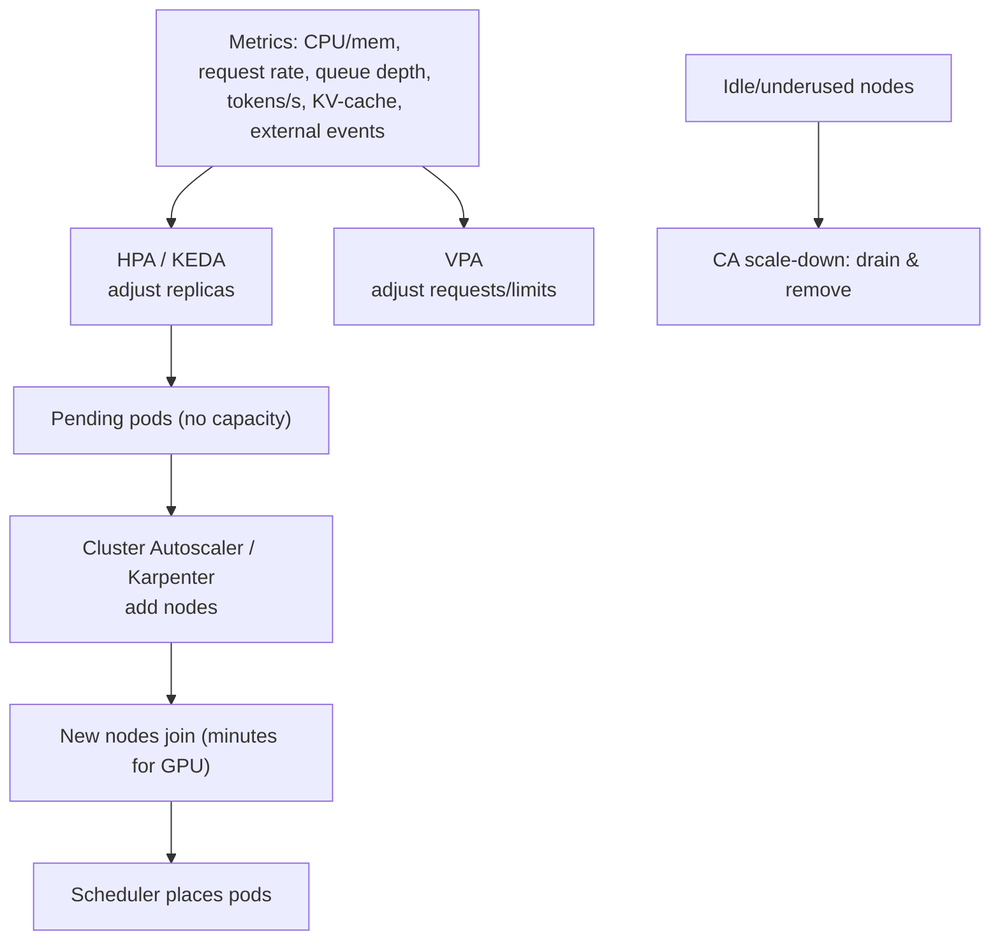

# 5.23 Autoscaling: HPA, VPA, KEDA and the cluster autoscaler

| | |
|---|---|
| Level | Intermediate |
| Priority tier | 1 |
| Lab venue | kind/minikube; metrics-server; Prometheus + Prometheus Adapter or KEDA; load generator (hey, k6, fortio); cluster autoscaler/Karpenter on a cloud cluster for node scaling |
| Part | Part 5: Kubernetes |
| Status | Drafted, labs **untested** |

## Why this matters for AI infrastructure

Inference traffic is bursty and expensive to over-provision: each replica of a 70B model occupies several GPUs and takes minutes to start, so scaling too late violates latency SLOs and scaling too early or never down burns thousands of dollars per day. Classic CPU-utilisation autoscaling is nearly useless for GPU model servers (CPU stays low while the GPU saturates; throughput is governed by request queues, batch sizes, and KV-cache pressure). Batch and training workloads need different scaling (queue-driven worker pools, elastic jobs, node pools that appear when jobs are admitted). This chapter explains how Kubernetes autoscaling works at the pod and node level, how to choose the right signals for AI services, and how to handle the slow-start and capacity-constraint realities of GPUs.

## Prerequisites and outcomes

Needs 5.7, 5.9, 5.18, and metrics/observability basics (5.24 preview). After this chapter you can:

- Explain the HPA control loop and algorithm, behaviours (stabilisation windows, policies), metric types (Resource, Pods, Object, External, ContainerResource), and write correct HPAv2 manifests.
- Expose custom/external metrics (Prometheus Adapter, KEDA metrics server) and choose scaling signals for LLM inference (queue length, concurrency, tokens/s, KV-cache utilisation, GPU utilisation caveats).
- Use VPA (modes, recommender) appropriately and understand the interplay with HPA and in-place resize.
- Use KEDA for event-driven scaling and scale-to-zero (Kafka/SQS/Prometheus/cron/HTTP add-on).
- Explain the cluster autoscaler (scale-up/down logic, node groups, expander, safe-to-evict, PDBs) and Karpenter (provisioner model); apply them to GPU pools; use ProvisioningRequest/Kueue for atomic multi-node capacity.
- Design autoscaling for model serving and batch pipelines, including warm pools, pre-pulled images, scale-to-zero trade-offs, and capacity reservations.
- Diagnose flapping, stuck scale-ups, and cost surprises.

## 1. Layers of autoscaling



Each layer reacts to a different signal with different latencies: HPA seconds to minutes; image pull and model load minutes; node provisioning minutes (cloud) to hours (hardware); scale-down conservative. The design problem is aligning them: replica scaling that cannot be satisfied by nodes just creates Pending pods.

## 2. Horizontal Pod Autoscaler (HPA)

### Controller and algorithm

The HPA controller (in kube-controller-manager, `--horizontal-pod-autoscaler-sync-period` default 15 s) reads metrics, computes desired replicas, and updates the target's `scale` subresource (Deployment, StatefulSet, ReplicaSet, or any CRD with scale). Core formula:

`desiredReplicas = ceil( currentReplicas × currentMetricValue / targetMetricValue )`

with details: for multiple metrics it computes each and uses the **maximum**; ignores a ±10% tolerance band (`--horizontal-pod-autoscaler-tolerance` 0.1) to avoid jitter; excludes unready pods and pods with missing metrics conservatively (treats missing as 0% for scale-up, 100% for scale-down); considers pod startup/readiness (`--horizontal-pod-autoscaler-cpu-initialization-period` 5 min, initial readiness delay) to avoid reacting to warm-up CPU; clamps to `minReplicas`/`maxReplicas`; and respects **behavior** policies.

```yaml
apiVersion: autoscaling/v2
kind: HorizontalPodAutoscaler
metadata: { name: embeddings, namespace: serving }
spec:
  scaleTargetRef: { apiVersion: apps/v1, kind: Deployment, name: embeddings }
  minReplicas: 2
  maxReplicas: 40
  metrics:
    - type: Resource
      resource: { name: cpu, target: { type: Utilization, averageUtilization: 60 } }      # % of CPU *request*
    - type: Pods
      pods:
        metric: { name: inflight_requests }                                               # custom metric per pod
        target: { type: AverageValue, averageValue: "8" }
    - type: External
      external:
        metric: { name: queue_depth, selector: { matchLabels: { queue: embed-jobs } } }
        target: { type: AverageValue, averageValue: "30" }                                # total/replicas
  behavior:
    scaleUp:
      stabilizationWindowSeconds: 0
      policies:
        - { type: Percent, value: 100, periodSeconds: 60 }                                # at most double per minute
        - { type: Pods, value: 4, periodSeconds: 60 }
      selectPolicy: Max
    scaleDown:
      stabilizationWindowSeconds: 600                                                     # use the highest recommendation over 10 min
      policies: [ { type: Percent, value: 10, periodSeconds: 120 } ]
```

### Metric types

| Type | Source API | Example |
|---|---|---|
| **Resource** | `metrics.k8s.io` (metrics-server, from kubelet/cAdvisor) | CPU/memory average utilisation (relative to **requests**) or average value |
| **ContainerResource** | `metrics.k8s.io` per container | Scale on the app container only, ignoring sidecars |
| **Pods** | `custom.metrics.k8s.io` (Prometheus Adapter, KEDA, vendor adapters) | Per-pod `requests_in_flight`, `queue_length_per_pod` |
| **Object** | `custom.metrics.k8s.io` for a single object | Ingress `requests_per_second`, a Service's metric |
| **External** | `external.metrics.k8s.io` (KEDA, Prometheus Adapter, cloud adapters) | SQS queue length, Pub/Sub backlog, global QPS |

Utilisation metrics require **requests set** on all containers (HPA computes percentages of requests; no requests → metric unavailable). Memory-based scaling rarely works (memory doesn't fall after load drops); use with care. Metrics freshness: metrics-server scrapes kubelets every ~15 s (resolution configurable) with a `--horizontal-pod-autoscaler-...` pipeline; custom metrics add Prometheus scrape interval (15–30 s) and adapter delay, so end-to-end lag from load to new replica is often 30–90 s plus pod startup.

### Behaviour tuning

- **Scale-up fast, scale-down slow**: short or zero scale-up stabilisation with generous policies; long scale-down window (5–15 min) to avoid flapping and wasteful churn of expensive-to-start pods (GPU model servers).
- `selectPolicy: Disabled` freezes scaling in one direction.
- Use `minReplicas` as the safety net for latency (cold start cost), `maxReplicas` as a cost/capacity cap tied to quotas and GPU availability.
- **Readiness matters**: new pods don't count until ready; if readiness takes 8 minutes (model load), the HPA may keep adding replicas (the metric stays high) → overshoot. Mitigations: `behavior.scaleUp` limits, startup/readiness probes accuracy, ignore not-ready pods (HPA already treats unready conservatively), pre-warmed capacity, predictive/ scheduled scaling (KEDA cron).

### Scaling signals for inference services

| Signal | Why | Notes |
|---|---|---|
| **Request concurrency / in-flight requests per replica** | Directly reflects load vs capacity; Knative/KServe default (`containerConcurrency`) | Needs instrumentation or sidecar/queue-proxy |
| **Queue depth / pending requests** (vLLM `vllm:num_requests_waiting`, Triton `nv_inference_pending_request_count`, TGI queue) | Leading indicator of saturation | Best primary signal for LLM servers; target waiting requests per replica ≈ small (e.g., 1–5) |
| **Tokens per second / time to first token (TTFT) / inter-token latency** | SLO-aligned | Use as guardrail (alert) or scale on p95 TTFT via custom metric |
| **KV-cache utilisation** (`vllm:gpu_cache_usage_perc`) | Saturation indicator for LLM memory | Scale up at ~70–80% sustained |
| **GPU utilisation (DCGM_FI_DEV_GPU_UTIL)** | Intuitive, but misleading: "busy" fraction; saturates early with batching; low-latency inference may show low util | Use with care; prefer SM activity/tensor pipe or app metrics |
| **CPU utilisation** | For preprocessing/tokenisation-heavy front-ends | Not for GPU backends |
| **RPS at the gateway** | Simple, predictable | Needs a per-replica capacity model (RPS/replica), brittle across prompt lengths |
| **External: queue lengths (Kafka/SQS)** | Batch inference workers | KEDA |

Practical pattern: scale on **queue depth per replica** (or concurrency) for the model server, with **min replicas** covering baseline, **max** bounded by GPU quota, plus alerts on TTFT and 5xx. For cost control, combine with **Kueue/ClusterQueue quotas** (so autoscaling cannot exceed team budgets) and node-pool limits.

### Exposing custom metrics (Prometheus Adapter example)

```yaml
# prometheus-adapter rules (values.yaml)
rules:
  custom:
    - seriesQuery: 'vllm:num_requests_waiting{namespace!="",pod!=""}'
      resources: { overrides: { namespace: { resource: namespace }, pod: { resource: pod } } }
      name: { as: "vllm_requests_waiting" }
      metricsQuery: 'sum(<<.Series>>{<<.LabelMatchers>>}) by (<<.GroupBy>>)'
  external:
    - seriesQuery: 'kafka_consumergroup_lag{topic="embed"}'
      resources: { namespaced: false }
      name: { as: "kafka_lag" }
      metricsQuery: 'sum(<<.Series>>{<<.LabelMatchers>>})'
```

```bash
kubectl get --raw "/apis/custom.metrics.k8s.io/v1beta1/namespaces/serving/pods/*/vllm_requests_waiting" | jq .
kubectl get --raw "/apis/external.metrics.k8s.io/v1beta1/namespaces/serving/kafka_lag" | jq .
kubectl describe hpa vllm -n serving         # conditions: AbleToScale, ScalingActive, ScalingLimited; events; current vs target
```

## 3. Vertical Pod Autoscaler (VPA)

VPA (kubernetes/autoscaler subproject; CRDs `VerticalPodAutoscaler`) has three components: **recommender** (analyses historical/live usage, produces target/lower/upper bounds), **updater** (evicts pods whose requests deviate to apply new values), **admission controller** (mutates new pods' requests). Modes: `Off` (recommendations only: best for sizing guidance), `Initial` (set at creation), `Recreate`/`Auto` (evict and recreate with new requests); `InPlaceOrRecreate`/in-place resize (newer, using the pod resize feature without restarts for CPU/memory when supported). Policies: `minAllowed`/`maxAllowed`, `controlledResources`, `controlledValues` (`RequestsOnly` or `RequestsAndLimits`).

Guidance: use VPA in **recommendation mode** to right-size requests for CPU/memory of services and data-prep jobs; avoid `Auto` for GPU model servers (restarts cost minutes; memory dominated by weights, fixed). Don't combine HPA and VPA on the *same* metric (CPU/memory): they fight; HPA on custom/external metrics with VPA on resources is acceptable. Run VPA as a cost-saving lens (compare requests to usage, 5.22) and combine with `LimitRange` bounds. Caveats: recommender history period, OOM events raising memory, JVM/PyTorch memory behaviours, bursty workloads. **Goldilocks** (Fairwinds) shows VPA recommendations per namespace.

## 4. KEDA: event-driven autoscaling

**KEDA** (CNCF) extends HPA: it installs an operator, a metrics adapter for the External Metrics API, and `ScaledObject` / `ScaledJob` CRDs. It creates and manages the HPA for you and adds **scale to/from zero** (the operator activates a Deployment from 0 → 1 when the trigger is active; HPA handles 1 → N). 60+ scalers: Kafka, RabbitMQ, SQS, Pub/Sub, Redis, Azure Service Bus, PostgreSQL/MySQL queries, Prometheus queries, cron, CPU/memory, GCP/AWS metrics, HTTP (add-on), Datadog, etc.

```yaml
apiVersion: keda.sh/v1alpha1
kind: ScaledObject
metadata: { name: batch-embed, namespace: data }
spec:
  scaleTargetRef: { name: embed-worker }
  minReplicaCount: 0
  maxReplicaCount: 50
  cooldownPeriod: 300
  pollingInterval: 15
  advanced:
    horizontalPodAutoscalerConfig:
      behavior:
        scaleDown: { stabilizationWindowSeconds: 600 }
  triggers:
    - type: kafka
      metadata: { bootstrapServers: kafka:9092, consumerGroup: embed, topic: docs, lagThreshold: "200" }
      authenticationRef: { name: kafka-auth }
    - type: prometheus
      metadata:
        serverAddress: http://prometheus.monitoring:9090
        query: 'sum(vllm:num_requests_waiting{app="vllm"})'
        threshold: "5"
    - type: cron
      metadata: { timezone: UTC, start: "0 8 * * 1-5", end: "0 20 * * 1-5", desiredReplicas: "4" }      # pre-warm business hours
---
apiVersion: keda.sh/v1alpha1
kind: ScaledJob
metadata: { name: transcribe-job, namespace: data }
spec:
  jobTargetRef: { template: { spec: { restartPolicy: Never, containers: [ { name: w, image: registry/whisper:1.2, resources: { limits: { nvidia.com/gpu: 1 } } } ] } } }
  pollingInterval: 10
  maxReplicaCount: 20
  scalingStrategy: { strategy: accurate }
  triggers: [ { type: aws-sqs-queue, metadata: { queueURL: https://sqs..., queueLength: "1" } } ]
```

Use cases: queue-driven batch workers, event-driven inference for infrequent endpoints, scheduled warmups (cron), scale-to-zero for dev/test model endpoints. Scale-to-zero for GPU services costs a cold start (node provisioning + image pull + model load = minutes): acceptable for batch, rarely for interactive; mitigate with **warm minimum of 1**, node warm pools, image caching, model weights on local NVMe/shared cache, and faster loaders (safetensors, tensorizer, fast checkpoint loading).

**Knative Serving / KServe** provide request-based autoscaling (KPA/concurrency, scale-to-zero with activator buffering requests during cold start), integrated routing, canary revisions; KServe's `InferenceService` + `serverless` mode uses Knative; "raw deployment" mode uses HPA/KEDA. Choose based on whether you need request buffering and revision management.

## 5. Cluster Autoscaler and Karpenter

### Cluster Autoscaler (CA)

Runs as a Deployment; manages **node groups** (cloud ASGs/MIGs/VMSS, or cluster-API MachineDeployments) with min/max sizes.

- **Scale up**: CA watches for **unschedulable Pods** (Pending with `FailedScheduling` due to resources), simulates adding a node of each group's template to see if the pod would fit (including node labels, taints, GPU resources), picks a group via an **expander** (`random`, `least-waste`, `most-pods`, `priority`, `price`), and requests more instances. New nodes register, the scheduler places the pending pods. Delays: provider API + boot + driver readiness (GPU nodes often 5–15 min); `--max-node-provision-time` (15 min) marks groups failed if nodes don't appear.
- **Scale down**: periodically evaluates nodes with utilisation (requests/allocatable) below `--scale-down-utilization-threshold` (0.5) for `--scale-down-unneeded-time` (10 min), checks that all pods can be moved elsewhere (respecting PDBs, `safe-to-evict` annotations, local storage, non-replicated pods, affinity), then cordons/drains and deletes the node. Blockers: pods without controllers, with local storage (`emptyDir` blocks unless annotated), PDBs, kube-system pods, `cluster-autoscaler.kubernetes.io/safe-to-evict: "false"`. GPU nodes: scale-down thresholds should consider GPU utilisation of requests (GPU requests are all-or-nothing, so a node with one running pod isn't "low utilisation" by GPU requests if it holds all GPUs).
- **Settings for GPU pools**: `--gpu-total` limits, node group min 0 for burst pools (but cold start), `--balance-similar-node-groups` for zone spreading, `--scale-down-delay-after-add`, `--max-graceful-termination-sec` (long for training pods or disable scale-down on training pools), priority expander preferring on-demand reservations over spot, taints/tolerations so only intended pods trigger GPU pool scale-up, and labelled pools per GPU type.
- **Limits**: reacts only to Pending pods (reactive), assumes node groups of homogeneous nodes, and doesn't understand multi-node gang needs (partial scale-ups) — hence ProvisioningRequest.
- **Overprovisioning ("pause pods")**: run low-priority placeholder pods (priority < 0) that reserve capacity; when real pods arrive they preempt placeholders, schedule instantly, and the placeholders go Pending triggering scale-up in the background: gives headroom and hides provisioning latency (use with cost awareness).

### Karpenter

Karpenter (AWS-originated, CNCF, multi-cloud providers emerging) replaces node-group-centric scaling with **just-in-time provisioning**: it watches Pending pods, batches them, computes the best set of instance types satisfying constraints (`NodePool` requirements, `NodeClass` for provider details), launches nodes directly via cloud APIs (including mixed instance types, spot/on-demand, GPUs), and consolidates/removes nodes proactively (`consolidationPolicy`, `disruption` budgets, `expireAfter` for node rotation, drift detection to replace nodes when AMIs change).

```yaml
apiVersion: karpenter.sh/v1
kind: NodePool
metadata: { name: gpu-inference }
spec:
  template:
    spec:
      requirements:
        - { key: karpenter.k8s.aws/instance-family, operator: In, values: [g6, g6e, p5] }
        - { key: karpenter.sh/capacity-type, operator: In, values: [on-demand] }
        - { key: topology.kubernetes.io/zone, operator: In, values: [us-east-1a, us-east-1b] }
      taints: [ { key: nvidia.com/gpu, value: present, effect: NoSchedule } ]
      nodeClassRef: { group: karpenter.k8s.aws, kind: EC2NodeClass, name: gpu }
      expireAfter: 720h
  limits: { "nvidia.com/gpu": 64 }
  disruption:
    consolidationPolicy: WhenEmptyOrUnderutilized
    consolidateAfter: 10m
    budgets: [ { nodes: "10%" } ]
```

Benefits: faster and more flexible provisioning, bin-packing across instance types, spot handling with interruption notices, automatic rotation/drift. Risks for GPU fleets: consolidation can disrupt long jobs (use `do-not-disrupt` annotations on training pods, disruption budgets), GPU capacity unavailability errors, topology requirements (EFA, placement groups) need NodeClass config, and cost surprises. Disable consolidation for training pools; use for inference and CPU pools.

### Atomic capacity for multi-node jobs

Reactive scale-up can supply some nodes but not all for a gang; waiting pods hold new nodes idle. **ProvisioningRequest** (cluster-autoscaler API, `autoscaling.x-k8s.io`) asks for capacity for N pods *atomically* (providers: GKE Dynamic Workload Scheduler flex-start/ calendar, queued provisioning); **Kueue** integrates via an `AdmissionCheck` of type `ProvisioningRequest`: the workload is admitted only after capacity is guaranteed, then nodes are held for it. Similar mechanisms exist in cloud-native schedulers (AWS capacity blocks for ML + Karpenter static capacity, Azure/GCP reservations). For on-prem fixed fleets the equivalent is Kueue quotas and maintenance windows rather than node autoscaling.

## 6. Autoscaling patterns for AI workloads

| Workload | Pod scaling | Node scaling | Notes |
|---|---|---|---|
| **LLM online inference** (vLLM/Triton/TGI) | HPA/KEDA on queue depth, concurrency, KV-cache; min ≥ 1–2; slow scale-down | Fixed reserved GPU pool + burst autoscaled pool; overprovision pause pods; pre-pulled images | Replica start 2–15 min; consider model-parallel replicas needing multiple GPUs/nodes; keep headroom 20–30% |
| **Embedding/reranker services** | HPA on CPU/GPU concurrency; smaller replicas; faster start | Autoscaled GPU pool (L4/L40S) | Cheaper to scale; batch-friendly |
| **Batch inference / offline scoring** | KEDA on queue backlog; Jobs with parallelism | Cluster autoscaler/Karpenter on Pending; spot allowed | Scale to zero; retries on preemption |
| **Training** | Not HPA-based; fixed job size; **elastic training** (TorchElastic/ Ray/ Kubeflow elastic policies) can scale workers within min/max | Admit with Kueue; provision nodes atomically | Preemption/scale events trigger rendezvous restarts; checkpoint cadence matters |
| **Data processing (Spark/Ray)** | Operator-driven dynamic allocation | CA/Karpenter or Ray autoscaler | Ray autoscaler talks to Kubernetes (KubeRay) to add/remove worker pods |
| **Interactive notebooks** | None (per-user) | Pool scaling + idle culling | Quotas to cap spend |
| **Gateways/ingress** | HPA on CPU/RPS/connections | CPU pool | Keep ≥3 for HA |

Special topics:

- **Warm pools & pre-pulled images**: DaemonSet pre-pulls model server images and (optionally) model weights onto local NVMe; scheduler's `ImageLocality` scores favour those nodes; reduce start from minutes to seconds.
- **Model load acceleration**: shared read-only weights volume, local NVMe cache, sharded/parallel loading, `tensorizer`/safetensors, CUDA graph warmup in readiness gating, snapshotting (CRIU/CUDA checkpoint, emerging) for faster restore.
- **Capacity reservations**: GPU capacity may be unobtainable on demand; autoscaling needs reservations or committed capacity (4.24); scale `maxReplicas` to available reserved GPUs.
- **Cost guardrails**: node pool `limits` (Karpenter), CA `--max-nodes-total`, Kueue quotas, budgets/alerts, scheduled scale-down for dev endpoints, scale-to-zero for non-prod.
- **Multi-metric safety**: scale-up on queue depth OR latency; scale-down only when both are comfortably low and for a long window.
- **Testing**: load tests that include prompt/response length distributions (autoscaling behaviour depends on token mix), cold-start tests, failure tests (scale-up impossible, spot interruption), and chaos for metrics outages (HPA falls back: if metrics unavailable it won't scale down and may hold).

## 7. Troubleshooting

| Symptom | Likely cause | Check/fix |
|---|---|---|
| HPA `<unknown>` metric / `FailedGetResourceMetric` | metrics-server missing/unhealthy, no CPU requests, kubelet cert issues | `kubectl top pods`, metrics-server logs, set requests |
| HPA not scaling despite load | Metric below target, tolerance band, readiness/initialisation delay, `maxReplicas` hit, pods unready | `kubectl describe hpa` conditions/events, raw metrics, behaviour policies |
| Flapping (scale up/down repeatedly) | Short scale-down window, noisy metric, readiness lag | Increase stabilisation, smooth metric (Prometheus `avg_over_time`), widen target |
| Scale-up creates Pending pods | No node capacity; CA not configured/disabled; quota | `kubectl get pods -o wide`, CA logs/status ConfigMap, quotas/Kueue |
| CA won't scale up | Pod can't fit any node group template (GPU label/taint mismatch), node group at max, CA lacks permissions, `unregistered` nodes | `kubectl -n kube-system logs deploy/cluster-autoscaler`, `kubectl get cm cluster-autoscaler-status -o yaml` |
| CA won't scale down | Blocking pods (local storage, PDB, annotations), utilisation above threshold, recently added | CA logs "cannot be removed" reasons; add `safe-to-evict`, adjust thresholds |
| Karpenter launches wrong instance | Requirements too loose; spot interruptions | Tighten requirements, set limits, capacity-type |
| Over-scaling inference | HPA reacts to queue spikes faster than model start; metrics double counting across replicas | Cap scale-up rate, scale on per-replica metric, pre-warm |
| Costs unexpectedly high | `minReplicas` high, no scale-down, idle node pools, spot fallback to on-demand | Dashboards for replicas/nodes vs load, budgets, schedules |
| VPA evicting pods repeatedly | Auto mode with fluctuating recommendations | Use Off/Initial; set bounds; PDBs |
| KEDA not scaling from zero | Trigger authentication, scaler errors, wrong namespace, HPA conflicts (existing HPA on same target) | `kubectl describe scaledobject`, operator logs; remove duplicate HPAs |

## 8. Lab (untested)

1. **HPA basics**: deploy a CPU-bound app with requests; HPA at 50% CPU; generate load with `hey`; watch replicas, `describe hpa`, and `kubectl top`; test tolerance band and stabilisation by dropping load; add `behavior` policies and compare.
2. **Missing requests**: remove CPU requests and observe `<unknown>`; fix.
3. **Custom metric**: instrument a toy inference server with a Prometheus gauge for queue length; install Prometheus + Adapter (or KEDA); scale on `queue_depth per pod`; run a load generator with variable prompt lengths; plot queue depth, replicas, latency, and tune target and behaviours.
4. **Slow-start overshoot**: add a 3-minute startup delay (sleep) and no startup probe; watch the HPA overshoot; add readiness probe and scale-up rate limits; compare.
5. **VPA**: run VPA in `Off` mode on a service and a batch job; read recommendations after load; compare with your requests; try `Auto` on a non-critical app and observe evictions; test in-place resize if available.
6. **KEDA**: scale a worker Deployment from 0 on a Kafka/Redis list/SQS-like queue; test cron pre-warming; configure a ScaledJob; compare with a plain HPA external metric.
7. **Cluster autoscaler**: on a cloud cluster (or kind with the `clusterapi` provider / `kwok` provider), create a node group with min 0; submit pods that don't fit; measure scale-up latency; delete pods and measure scale-down; test blockers (PDB, local storage); try the `priority` expander.
8. **Overprovisioning**: deploy low-priority pause pods sized to your typical burst; submit a high-priority pod that preempts them; measure time-to-run vs without headroom.
9. **Karpenter (optional)**: install in a lab cloud account; define a NodePool with consolidation; observe provisioning, consolidation, disruption budgets, `do-not-disrupt`.
10. **GPU inference scaling**: deploy vLLM (or a mock) with queue/KV-cache metrics; configure HPA/KEDA on `vllm:num_requests_waiting` and cache usage; run a bursty load; measure TTFT p95 and GPU-hours versus static provisioning; examine cold start components (node, image, load).
11. **Atomic provisioning**: with Kueue + ProvisioningRequest (on a provider supporting it) or simulated via a custom AdmissionCheck, submit a 16-GPU gang job and verify nodes appear before pods start.
12. **Cost experiment**: compute cost of static vs autoscaled inference for a diurnal traffic trace; adjust min/max and reserve policies; find the break-even.
13. **Failure drills**: kill Prometheus/adapter and observe HPA behaviour; exhaust cloud GPU quota and observe Pending; simulate spot interruption.
14. **Clean up**.

Mark tested only after execution.

## 9. Common mistakes

- Autoscaling GPU model servers on CPU utilisation; scaling on GPU utilisation alone; ignoring queue depth/KV-cache.
- No resource requests (HPA/CA can't compute); HPA and VPA fighting on CPU/memory.
- Scale-down windows too short for slow-start workloads; minReplicas 0 for latency-critical GPU services.
- Assuming node autoscaling is fast and guaranteed for GPUs; no reservations; `maxReplicas` above available capacity.
- CA blocked by PDBs/local storage/unannotated pods, then blamed for "not scaling down".
- Karpenter consolidation disrupting training; missing `do-not-disrupt`.
- Using HPA for training jobs; or expecting elastic training without checkpointing/rendezvous support.
- Forgetting to bound autoscaling with quotas/budgets; autoscaled costs exceeding plans.
- Metrics pipeline lag ignored; adapters not highly available.
- Testing autoscaling with uniform synthetic prompts only.

## 10. Interview angles

- "How does the HPA compute desired replicas? What are stabilisation windows and tolerance?" 
- "What metrics would you autoscale an LLM inference deployment on, and why not GPU utilisation?" 
- "HPA vs VPA vs KEDA vs cluster autoscaler vs Karpenter: roles and interactions." 
- "How do you handle slow model start times in autoscaling?" 
- "Why does the cluster autoscaler fail to scale down? How do you fix it?" 
- "How do you scale node pools for multi-node training jobs that need all-or-nothing capacity?" 
- "Scale to zero for GPU services: pros, cons, mitigations." 
- "Design autoscaling and cost controls for a shared GPU inference platform." 

## 11. Checkpoint questions (35)

1. HPA formula? **A:** `ceil(current × currentMetric / target)`.
2. HPA tolerance default? **A:** 10%.
3. HPA sync period? **A:** 15 s.
4. Multiple metrics rule? **A:** Take the max desired replicas.
5. Utilisation is relative to? **A:** Requests.
6. Metric APIs? **A:** metrics.k8s.io, custom.metrics.k8s.io, external.metrics.k8s.io.
7. Provider of resource metrics? **A:** metrics-server.
8. Adapter for Prometheus? **A:** prometheus-adapter.
9. Stabilisation window effect? **A:** Uses extreme recommendation over window.
10. Scale-down default window? **A:** 300 s.
11. Why slow scale-down for GPUs? **A:** Expensive to restart.
12. LLM primary signal? **A:** Queue depth/concurrency/KV-cache.
13. GPU util caveat? **A:** Busy fraction, not saturation.
14. VPA components? **A:** Recommender, updater, admission controller.
15. VPA safe mode? **A:** `Off`.
16. HPA+VPA conflict? **A:** Same CPU/memory metric.
17. KEDA CRDs? **A:** ScaledObject, ScaledJob.
18. KEDA special feature? **A:** Scale to/from zero.
19. KEDA creates? **A:** An HPA.
20. Knative feature? **A:** Request-based scale to zero with activator.
21. CA trigger? **A:** Unschedulable pending pods.
22. CA expanders? **A:** random, least-waste, most-pods, priority, price.
23. CA scale-down threshold default? **A:** 50% utilisation, 10 min.
24. CA scale-down blockers? **A:** PDBs, local storage, non-controlled pods.
25. safe-to-evict annotation? **A:** Controls eviction eligibility.
26. Overprovisioning technique? **A:** Low-priority pause pods.
27. Karpenter model? **A:** Just-in-time, constraint-based instances.
28. Karpenter disruption budget? **A:** Limits nodes disrupted at once.
29. do-not-disrupt purpose? **A:** Protect pods from consolidation.
30. ProvisioningRequest purpose? **A:** Atomic capacity for N pods.
31. Kueue AdmissionCheck purpose? **A:** Gate admission on capacity.
32. Elastic training needs? **A:** Rendezvous/checkpoint support.
33. Warm pools do? **A:** Hide provisioning/image pull latency.
34. Cold start components? **A:** Node, image pull, model load, warmup.
35. Cost guardrails? **A:** Quotas, limits, budgets, schedules.

## 12. Sources and review notes

**Written in original words.** Principal sources:

- Josh Rosso et al., *Production Kubernetes* (chapter 13 on autoscaling: HPA, VPA, cluster autoscaler).
- Kubernetes documentation on HPA, VPA, cluster-autoscaler, ProvisioningRequest; KEDA, Karpenter, Knative and KServe documentation; vLLM/Triton metrics documentation.
- Examples are the author's constructions.

**Flagged for verification before publishing:** HPA/VPA/KEDA/Karpenter API versions and fields, metric names exposed by vLLM/Triton in your versions, CA flag defaults, in-place resize and ProvisioningRequest status per release, and every manifest/command; all labs are **untested**.
