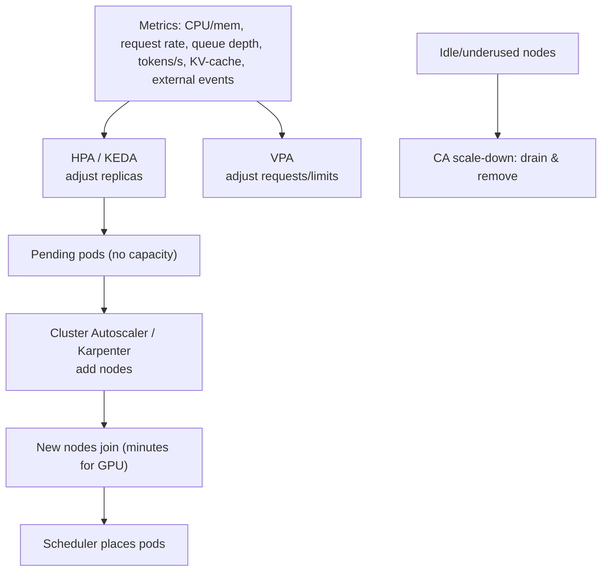

# 5.23 Autoscaling: HPA, VPA, KEDA and the cluster autoscaler

| | |
|---|---|
| Level | Intermediate |
| Priority tier | 1 |
| Lab venue | kind/minikube; metrics-server; Prometheus + Prometheus Adapter or KEDA; load generator (hey, k6, fortio); cluster autoscaler/Karpenter on a cloud cluster for node scaling |
| Part | Part 5: Kubernetes |
| Status | Drafted, labs **untested** |

## Why this matters for AI infrastructure

Inference traffic is bursty and expensive to over-provision: each replica of a 70B model occupies several GPUs and takes minutes to start, so scaling too late violates latency SLOs and scaling too early or never down burns thousands of dollars per day. Classic CPU-utilisation autoscaling is nearly useless for GPU model servers (CPU stays low while the GPU saturates; throughput is governed by request queues, batch sizes, and KV-cache pressure). Batch and training workloads need different scaling (queue-driven worker pools, elastic jobs, node pools that appear when jobs are admitted). This chapter explains how Kubernetes autoscaling works at the pod and node level, how to choose the right signals for AI services, and how to handle the slow-start and capacity-constraint realities of GPUs.

## Prerequisites and outcomes

Needs 5.7, 5.9, 5.18, and metrics/observability basics (5.24 preview). After this chapter you can:

- Explain the HPA control loop and algorithm, behaviours (stabilisation windows, policies), metric types (Resource, Pods, Object, External, ContainerResource), and write correct HPAv2 manifests.
- Expose custom/external metrics (Prometheus Adapter, KEDA metrics server) and choose scaling signals for LLM inference (queue length, concurrency, tokens/s, KV-cache utilisation, GPU utilisation caveats).
- Use VPA (modes, recommender) appropriately and understand the interplay with HPA and in-place resize.
- Use KEDA for event-driven scaling and scale-to-zero (Kafka/SQS/Prometheus/cron/HTTP add-on).
- Explain the cluster autoscaler (scale-up/down logic, node groups, expander, safe-to-evict, PDBs) and Karpenter (provisioner model); apply them to GPU pools; use ProvisioningRequest/Kueue for atomic multi-node capacity.
- Design autoscaling for model serving and batch pipelines, including warm pools, pre-pulled images, scale-to-zero trade-offs, and capacity reservations.
- Diagnose flapping, stuck scale-ups, and cost surprises.

## 1. Layers of autoscaling



Each layer reacts to a different signal with different latencies: HPA seconds to minutes; image pull and model load minutes; node provisioning minutes (cloud) to hours (hardware); scale-down conservative. The design problem is aligning them: replica scaling that cannot be satisfied by nodes just creates Pending pods.

## 2. Horizontal Pod Autoscaler (HPA)

### Controller and algorithm

The HPA controller (in kube-controller-manager, `--horizontal-pod-autoscaler-sync-period` default 15 s) reads metrics, computes desired replicas, and updates the target's `scale` subresource (Deployment, StatefulSet, ReplicaSet, or any CRD with scale). Core formula:

`desiredReplicas = ceil( currentReplicas × currentMetricValue / targetMetricValue )`

with details: for multiple metrics it computes each and uses the **maximum**; ignores a ±10% tolerance band (`--horizontal-pod-autoscaler-tolerance` 0.1) to avoid jitter; excludes unready pods and pods with missing metrics conservatively (treats missing as 0% for scale-up, 100% for scale-down); considers pod startup/readiness (`--horizontal-pod-autoscaler-cpu-initialization-period` 5 min, initial readiness delay) to avoid reacting to warm-up CPU; clamps to `minReplicas`/`maxReplicas`; and respects **behavior** policies.

```yaml
apiVersion: autoscaling/v2
kind: HorizontalPodAutoscaler
metadata: { name: embeddings, namespace: serving }
spec:
  scaleTargetRef: { apiVersion: apps/v1, kind: Deployment, name: embeddings }
  minReplicas: 2
  maxReplicas: 40
  metrics:
    - type: Resource
      resource: { name: cpu, target: { type: Utilization, averageUtilization: 60 } }      # % of CPU *request*
    - type: Pods
      pods:
        metric: { name: inflight_requests }                                               # custom metric per pod
        target: { type: AverageValue, averageValue: "8" }
    - type: External
      external:
        metric: { name: queue_depth, selector: { matchLabels: { queue: embed-jobs } } }
        target: { type: AverageValue, averageValue: "30" }                                # total/replicas
  behavior:
    scaleUp:
      stabilizationWindowSeconds: 0
      policies:
        - { type: Percent, value: 100, periodSeconds: 60 }                                # at most double per minute
        - { type: Pods, value: 4, periodSeconds: 60 }
      selectPolicy: Max
    scaleDown:
      stabilizationWindowSeconds: 600                                                     # use the highest recommendation over 10 min
      policies: [ { type: Percent, value: 10, periodSeconds: 120 } ]
```

### Metric types

| Type | Source API | Example |
|---|---|---|
| **Resource** | `metrics.k8s.io` (metrics-server, from kubelet/cAdvisor) | CPU/memory average utilisation (relative to **requests**) or average value |
| **ContainerResource** | `metrics.k8s.io` per container | Scale on the app container only, ignoring sidecars |
| **Pods** | `custom.metrics.k8s.io` (Prometheus Adapter, KEDA, vendor adapters) | Per-pod `requests_in_flight`, `queue_length_per_pod` |
| **Object** | `custom.metrics.k8s.io` for a single object | Ingress `requests_per_second`, a Service's metric |
| **External** | `external.metrics.k8s.io` (KEDA, Prometheus Adapter, cloud adapters) | SQS queue length, Pub/Sub backlog, global QPS |

Utilisation metrics require **requests set** on all containers (HPA computes percentages of requests; no requests → metric unavailable). Memory-based scaling rarely works (memory doesn't fall after load drops); use with care. Metrics freshness: metrics-server scrapes kubelets every ~15 s (resolution configurable) with a `--horizontal-pod-autoscaler-...` pipeline; custom metrics add Prometheus scrape interval (15–30 s) and adapter delay, so end-to-end lag from load to new replica is often 30–90 s plus pod startup.

### Behaviour tuning

- **Scale-up fast, scale-down slow**: short or zero scale-up stabilisation with generous policies; long scale-down window (5–15 min) to avoid flapping and wasteful churn of expensive-to-start pods (GPU model servers).
- `selectPolicy: Disabled` freezes scaling in one direction.
- Use `minReplicas` as the safety net for latency (cold start cost), `maxReplicas` as a cost/capacity cap tied to quotas and GPU availability.
- **Readiness matters**: new pods don't count until ready; if readiness takes 8 minutes (model load), the HPA may keep adding replicas (the metric stays high) → overshoot. Mitigations: `behavior.scaleUp` limits, startup/readiness probes accuracy, ignore not-ready pods (HPA already treats unready conservatively), pre-warmed capacity, predictive/ scheduled scaling (KEDA cron).

### Scaling signals for inference services

| Signal | Why | Notes |
|---|---|---|
| **Request concurrency / in-flight requests per replica** | Directly reflects load vs capacity; Knative/KServe default (`containerConcurrency`) | Needs instrumentation or sidecar/queue-proxy |
| **Queue depth / pending requests** (vLLM `vllm:num_requests_waiting`, Triton `nv_inference_pending_request_count`, TGI queue) | Leading indicator of saturation | Best primary signal for LLM servers; target waiting requests per replica ≈ small (e.g., 1–5) |
| **Tokens per second / time to first token (TTFT) / inter-token latency** | SLO-aligned | Use as guardrail (alert) or scale on p95 TTFT via custom metric |
| **KV-cache utilisation** (`vllm:gpu_cache_usage_perc`) | Saturation indicator for LLM memory | Scale up at ~70–80% sustained |
| **GPU utilisation (DCGM_FI_DEV_GPU_UTIL)** | Intuitive, but misleading: "busy" fraction; saturates early with batching; low-latency inference may show low util | Use with care; prefer SM activity/tensor pipe or app metrics |
| **CPU utilisation** | For preprocessing/tokenisation-heavy front-ends | Not for GPU backends |
| **RPS at the gateway** | Simple, predictable | Needs a per-replica capacity model (RPS/replica), brittle across prompt lengths |
| **External: queue lengths (Kafka/SQS)** | Batch inference workers | KEDA |

Practical pattern: scale on **queue depth per replica** (or concurrency) for the model server, with **min replicas** covering baseline, **max** bounded by GPU quota, plus alerts on TTFT and 5xx. For cost control, combine with **Kueue/ClusterQueue quotas** (so autoscaling cannot exceed team budgets) and node-pool limits.

### Exposing custom metrics (Prometheus Adapter example)

```yaml
# prometheus-adapter rules (values.yaml)
rules:
  custom:
    - seriesQuery: 'vllm:num_requests_waiting{namespace!="",pod!=""}'
      resources: { overrides: { namespace: { resource: namespace }, pod: { resource: pod } } }
      name: { as: "vllm_requests_waiting" }
      metricsQuery: 'sum(<<.Series>>{<<.LabelMatchers>>}) by (<<.GroupBy>>)'
  external:
    - seriesQuery: 'kafka_consumergroup_lag{topic="embed"}'
      resources: { namespaced: false }
      name: { as: "kafka_lag" }
      metricsQuery: 'sum(<<.Series>>{<<.LabelMatchers>>})'
```

```bash
kubectl get --raw "/apis/custom.metrics.k8s.io/v1beta1/namespaces/serving/pods/*/vllm_requests_waiting" | jq .
kubectl get --raw "/apis/external.metrics.k8s.io/v1beta1/namespaces/serving/kafka_lag" | jq .
kubectl describe hpa vllm -n serving         # conditions: AbleToScale, ScalingActive, ScalingLimited; events; current vs target
```

## 3. Vertical Pod Autoscaler (VPA)

VPA (kubernetes/autoscaler subproject; CRDs `VerticalPodAutoscaler`) has three components: **recommender** (analyses historical/live usage, produces target/lower/upper bounds), **updater** (evicts pods whose requests deviate to apply new values), **admission controller** (mutates new pods' requests). Modes: `Off` (recommendations only: best for sizing guidance), `Initial` (set at creation), `Recreate`/`Auto` (evict and recreate with new requests); `InPlaceOrRecreate`/in-place resize (newer, using the pod resize feature without restarts for CPU/memory when supported). Policies: `minAllowed`/`maxAllowed`, `controlledResources`, `controlledValues` (`RequestsOnly` or `RequestsAndLimits`).

Guidance: use VPA in **recommendation mode** to right-size requests for CPU/memory of services and data-prep jobs; avoid `Auto` for GPU model servers (restarts cost minutes; memory dominated by weights, fixed). Don't combine HPA and VPA on the *same* metric (CPU/memory): they fight; HPA on custom/external metrics with VPA on resources is acceptable. Run VPA as a cost-saving lens (compare requests to usage, 5.22) and combine with `LimitRange` bounds. Caveats: recommender history period, OOM events raising memory, JVM/PyTorch memory behaviours, bursty workloads. **Goldilocks** (Fairwinds) shows VPA recommendations per namespace.

## 4. KEDA: event-driven autoscaling

**KEDA** (CNCF) extends HPA: it installs an operator, a metrics adapter for the External Metrics API, and `ScaledObject` / `ScaledJob` CRDs. It creates and manages the HPA for you and adds **scale to/from zero** (the operator activates a Deployment from 0 → 1 when the trigger is active; HPA handles 1 → N). 60+ scalers: Kafka, RabbitMQ, SQS, Pub/Sub, Redis, Azure Service Bus, PostgreSQL/MySQL queries, Prometheus queries, cron, CPU/memory, GCP/AWS metrics, HTTP (add-on), Datadog, etc.

```yaml
apiVersion: keda.sh/v1alpha1
kind: ScaledObject
metadata: { name: batch-embed, namespace: data }
spec:
  scaleTargetRef: { name: embed-worker }
  minReplicaCount: 0
  maxReplicaCount: 50
  cooldownPeriod: 300
  pollingInterval: 15
  advanced:
    horizontalPodAutoscalerConfig:
      behavior:
        scaleDown: { stabilizationWindowSeconds: 600 }
  triggers:
    - type: kafka
      metadata: { bootstrapServers: kafka:9092, consumerGroup: embed, topic: docs, lagThreshold: "200" }
      authenticationRef: { name: kafka-auth }
    - type: prometheus
      metadata:
        serverAddress: http://prometheus.monitoring:9090
        query: 'sum(vllm:num_requests_waiting{app="vllm"})'
        threshold: "5"
    - type: cron
      metadata: { timezone: UTC, start: "0 8 * * 1-5", end: "0 20 * * 1-5", desiredReplicas: "4" }      # pre-warm business hours
---
apiVersion: keda.sh/v1alpha1
kind: ScaledJob
metadata: { name: transcribe-job, namespace: data }
spec:
  jobTargetRef: { template: { spec: { restartPolicy: Never, containers: [ { name: w, image: registry/whisper:1.2, resources: { limits: { nvidia.com/gpu: 1 } } } ] } } }
  pollingInterval: 10
  maxReplicaCount: 20
  scalingStrategy: { strategy: accurate }
  triggers: [ { type: aws-sqs-queue, metadata: { queueURL: https://sqs..., queueLength: "1" } } ]
```

Use cases: queue-driven batch workers, event-driven inference for infrequent endpoints, scheduled warmups (cron), scale-to-zero for dev/test model endpoints. Scale-to-zero for GPU services costs a cold start (node provisioning + image pull + model load = minutes): acceptable for batch, rarely for interactive; mitigate with **warm minimum of 1**, node warm pools, image caching, model weights on local NVMe/shared cache, and faster loaders (safetensors, tensorizer, fast checkpoint loading).

**Knative Serving / KServe** provide request-based autoscaling (KPA/concurrency, scale-to-zero with activator buffering requests during cold start), integrated routing, canary revisions; KServe's `InferenceService` + `serverless` mode uses Knative; "raw deployment" mode uses HPA/KEDA. Choose based on whether you need request buffering and revision management.

## 5. Cluster Autoscaler and Karpenter

### Cluster Autoscaler (CA)

Runs as a Deployment; manages **node groups** (cloud ASGs/MIGs/VMSS, or cluster-API MachineDeployments) with min/max sizes.

- **Scale up**: CA watches for **unschedulable Pods** (Pending with `FailedScheduling` due to resources), simulates adding a node of each group's template to see if the pod would fit (including node labels, taints, GPU resources), picks a group via an **expander** (`random`, `least-waste`, `most-pods`, `priority`, `price`), and requests more instances. New nodes register, the scheduler places the pending pods. Delays: provider API + boot + driver readiness (GPU nodes often 5–15 min); `--max-node-provision-time` (15 min) marks groups failed if nodes don't appear.
- **Scale down**: periodically evaluates nodes with utilisation (requests/allocatable) below `--scale-down-utilization-threshold` (0.5) for `--scale-down-unneeded-time` (10 min), checks that all pods can be moved elsewhere (respecting PDBs, `safe-to-evict` annotations, local storage, non-replicated pods, affinity), then cordons/drains and deletes the node. Blockers: pods without controllers, with local storage (`emptyDir` blocks unless annotated), PDBs, kube-system pods, `cluster-autoscaler.kubernetes.io/safe-to-evict: "false"`. GPU nodes: scale-down thresholds should consider GPU utilisation of requests (GPU requests are all-or-nothing, so a node with one running pod isn't "low utilisation" by GPU requests if it holds all GPUs).
- **Settings for GPU pools**: `--gpu-total` limits, node group min 0 for burst pools (but cold start), `--balance-similar-node-groups` for zone spreading, `--scale-down-delay-after-add`, `--max-graceful-termination-sec` (long for training pods or disable scale-down on training pools), priority expander preferring on-demand reservations over spot, taints/tolerations so only intended pods trigger GPU pool scale-up, and labelled pools per GPU type.
- **Limits**: reacts only to Pending pods (reactive), assumes node groups of homogeneous nodes, and doesn't understand multi-node gang needs (partial scale-ups) — hence ProvisioningRequest.
- **Overprovisioning ("pause pods")**: run low-priority placeholder pods (priority < 0) that reserve capacity; when real pods arrive they preempt placeholders, schedule instantly, and the placeholders go Pending triggering scale-up in the background: gives headroom and hides provisioning latency (use with cost awareness).

In *Production Kubernetes* Chapter 13 (*Autoscaling*), Josh Rosso et al. highlight four architectural lessons for combining pod-level and node-level autoscaling:
1. **Service Decomposition and When NOT to Autoscale (`PK` Chapter 13):** Decomposing a monolith into independent services (for example, separating CPU-bound tokenization/preprocessing from GPU-bound LLM prefill/decode) lets each tier scale on its own bottleneck metric. However, do **not** blindly enable autoscaling on stateful singleton services, workloads with predictable flat traffic, or workloads that have not yet been load-tested to determine their actual saturation point and startup latency.
2. **Cluster Autoscaler Configuration (`--nodes=1:10:worker-auto-scaling-group`) and Pod Shuffling (`PK` Chapter 13):** When configuring `cluster-autoscaler` against cloud node groups (such as `--cloud-provider=aws --nodes=1:10:worker-auto-scaling-group`), remember that adding and removing worker nodes inevitably shuffles Pod placement across the cluster—so every autoscaled workload must define `PodDisruptionBudget`s (`PDB`s), `readinessProbe`s, and `preStop` graceful drain hooks.
3. **Hiding Node Spin-Up Latency with `cluster-overprovisioner` (`PK` Chapter 13 Figures 13-6 & 13-7):** Because `Cluster Autoscaler` only reacts *after* a Pod becomes `Pending` (when existing nodes are already full), a sudden traffic spike normally waits 5–15 minutes for a cloud GPU VM to boot and install drivers. To eliminate this wait without setting artificially low HPA thresholds (`30%`), deploy a **`PriorityClass` with negative priority (`value: -10`)** and a `pause` (`registry.k8s.io/pause`) **`cluster-overprovisioner` Deployment** sized to 1–2 nodes' worth of resources (`modeled in simulate_overprovisioning_pause_pods()` in `code/part05/autoscaling_hpa_ca_simulator.py`):
   - In steady state, the negative-priority `pause` pods sit on warm, ready GPU nodes (`Figure 13-6`).
   - When real production inference Pods scale out (`priority >= 0`), `kube-scheduler` **immediately preempts the `pause` pods** (`0s` node wait) and places the real Pods on the warm nodes, while the preempted `pause` pods go `Pending` and trigger `Cluster Autoscaler` to provision replacement buffer nodes in the background (`Figure 13-7`).

### Karpenter

Karpenter (AWS-originated, CNCF, multi-cloud providers emerging) replaces node-group-centric scaling with **just-in-time provisioning**: it watches Pending pods, batches them, computes the best set of instance types satisfying constraints (`NodePool` requirements, `NodeClass` for provider details), launches nodes directly via cloud APIs (including mixed instance types, spot/on-demand, GPUs), and consolidates/removes nodes proactively (`consolidationPolicy`, `disruption` budgets, `expireAfter` for node rotation, drift detection to replace nodes when AMIs change).

```yaml
apiVersion: karpenter.sh/v1
kind: NodePool
metadata: { name: gpu-inference }
spec:
  template:
    spec:
      requirements:
        - { key: karpenter.k8s.aws/instance-family, operator: In, values: [g6, g6e, p5] }
        - { key: karpenter.sh/capacity-type, operator: In, values: [on-demand] }
        - { key: topology.kubernetes.io/zone, operator: In, values: [us-east-1a, us-east-1b] }
      taints: [ { key: nvidia.com/gpu, value: present, effect: NoSchedule } ]
      nodeClassRef: { group: karpenter.k8s.aws, kind: EC2NodeClass, name: gpu }
      expireAfter: 720h
  limits: { "nvidia.com/gpu": 64 }
  disruption:
    consolidationPolicy: WhenEmptyOrUnderutilized
    consolidateAfter: 10m
    budgets: [ { nodes: "10%" } ]
```

Benefits: faster and more flexible provisioning, bin-packing across instance types, spot handling with interruption notices, automatic rotation/drift. Risks for GPU fleets: consolidation can disrupt long jobs (use `do-not-disrupt` annotations on training pods, disruption budgets), GPU capacity unavailability errors, topology requirements (EFA, placement groups) need NodeClass config, and cost surprises. Disable consolidation for training pools; use for inference and CPU pools.

### Atomic capacity for multi-node jobs

Reactive scale-up can supply some nodes but not all for a gang; waiting pods hold new nodes idle. **ProvisioningRequest** (cluster-autoscaler API, `autoscaling.x-k8s.io`) asks for capacity for N pods *atomically* (providers: GKE Dynamic Workload Scheduler flex-start/ calendar, queued provisioning); **Kueue** integrates via an `AdmissionCheck` of type `ProvisioningRequest`: the workload is admitted only after capacity is guaranteed, then nodes are held for it. Similar mechanisms exist in cloud-native schedulers (AWS capacity blocks for ML + Karpenter static capacity, Azure/GCP reservations). For on-prem fixed fleets the equivalent is Kueue quotas and maintenance windows rather than node autoscaling.

## 6. Autoscaling patterns for AI workloads

| Workload | Pod scaling | Node scaling | Notes |
|---|---|---|---|
| **LLM online inference** (vLLM/Triton/TGI) | HPA/KEDA on queue depth, concurrency, KV-cache; min ≥ 1–2; slow scale-down | Fixed reserved GPU pool + burst autoscaled pool; overprovision pause pods; pre-pulled images | Replica start 2–15 min; consider model-parallel replicas needing multiple GPUs/nodes; keep headroom 20–30% |
| **Embedding/reranker services** | HPA on CPU/GPU concurrency; smaller replicas; faster start | Autoscaled GPU pool (L4/L40S) | Cheaper to scale; batch-friendly |
| **Batch inference / offline scoring** | KEDA on queue backlog; Jobs with parallelism | Cluster autoscaler/Karpenter on Pending; spot allowed | Scale to zero; retries on preemption |
| **Training** | Not HPA-based; fixed job size; **elastic training** (TorchElastic/ Ray/ Kubeflow elastic policies) can scale workers within min/max | Admit with Kueue; provision nodes atomically | Preemption/scale events trigger rendezvous restarts; checkpoint cadence matters |
| **Data processing (Spark/Ray)** | Operator-driven dynamic allocation | CA/Karpenter or Ray autoscaler | Ray autoscaler talks to Kubernetes (KubeRay) to add/remove worker pods |
| **Interactive notebooks** | None (per-user) | Pool scaling + idle culling | Quotas to cap spend |
| **Gateways/ingress** | HPA on CPU/RPS/connections | CPU pool | Keep ≥3 for HA |

Special topics:

- **Warm pools & pre-pulled images**: DaemonSet pre-pulls model server images and (optionally) model weights onto local NVMe; scheduler's `ImageLocality` scores favour those nodes; reduce start from minutes to seconds.
- **Model load acceleration**: shared read-only weights volume, local NVMe cache, sharded/parallel loading, `tensorizer`/safetensors, CUDA graph warmup in readiness gating, snapshotting (CRIU/CUDA checkpoint, emerging) for faster restore.
- **Capacity reservations**: GPU capacity may be unobtainable on demand; autoscaling needs reservations or committed capacity (4.24); scale `maxReplicas` to available reserved GPUs.
- **Cost guardrails**: node pool `limits` (Karpenter), CA `--max-nodes-total`, Kueue quotas, budgets/alerts, scheduled scale-down for dev endpoints, scale-to-zero for non-prod.
- **Multi-metric safety**: scale-up on queue depth OR latency; scale-down only when both are comfortably low and for a long window.
- **Testing**: load tests that include prompt/response length distributions (autoscaling behaviour depends on token mix), cold-start tests, failure tests (scale-up impossible, spot interruption), and chaos for metrics outages (HPA falls back: if metrics unavailable it won't scale down and may hold).

## 7. Troubleshooting

| Symptom | Likely cause | Check/fix |
|---|---|---|
| HPA `<unknown>` metric / `FailedGetResourceMetric` | metrics-server missing/unhealthy, no CPU requests, kubelet cert issues | `kubectl top pods`, metrics-server logs, set requests |
| HPA not scaling despite load | Metric below target, tolerance band, readiness/initialisation delay, `maxReplicas` hit, pods unready | `kubectl describe hpa` conditions/events, raw metrics, behaviour policies |
| Flapping (scale up/down repeatedly) | Short scale-down window, noisy metric, readiness lag | Increase stabilisation, smooth metric (Prometheus `avg_over_time`), widen target |
| Scale-up creates Pending pods | No node capacity; CA not configured/disabled; quota | `kubectl get pods -o wide`, CA logs/status ConfigMap, quotas/Kueue |
| CA won't scale up | Pod can't fit any node group template (GPU label/taint mismatch), node group at max, CA lacks permissions, `unregistered` nodes | `kubectl -n kube-system logs deploy/cluster-autoscaler`, `kubectl get cm cluster-autoscaler-status -o yaml` |
| CA won't scale down | Blocking pods (local storage, PDB, annotations), utilisation above threshold, recently added | CA logs "cannot be removed" reasons; add `safe-to-evict`, adjust thresholds |
| Karpenter launches wrong instance | Requirements too loose; spot interruptions | Tighten requirements, set limits, capacity-type |
| Over-scaling inference | HPA reacts to queue spikes faster than model start; metrics double counting across replicas | Cap scale-up rate, scale on per-replica metric, pre-warm |
| Costs unexpectedly high | `minReplicas` high, no scale-down, idle node pools, spot fallback to on-demand | Dashboards for replicas/nodes vs load, budgets, schedules |
| VPA evicting pods repeatedly | Auto mode with fluctuating recommendations | Use Off/Initial; set bounds; PDBs |
| KEDA not scaling from zero | Trigger authentication, scaler errors, wrong namespace, HPA conflicts (existing HPA on same target) | `kubectl describe scaledobject`, operator logs; remove duplicate HPAs |

## 8. Lab

First, run the self-checking Python lab (`code/part05/autoscaling_hpa_ca_simulator_lab.py`) locally. It verifies the HPAv2 multi-metric replica calculator (`compute_hpa_desired_replicas`: testing the $\pm 10\%$ tolerance band, `scaleUp` rate caps, and `scaleDown` stabilization window, `PK` Ch. 13), the Cluster Autoscaler node scale-down eligibility and blocker evaluator (`evaluate_ca_node_scale_down`), and the Cluster Overprovisioning negative-priority `pause` pod simulator (`simulate_overprovisioning_pause_pods`, `PK` Ch. 13 Figures 13-6 & 13-7).

```bash
python3 code/part05/autoscaling_hpa_ca_simulator_lab.py
```

Next, on a `kind` or cloud cluster (all interactive shell steps below are `untested here`), work through these exercises:

1. **HPA basics**: deploy a CPU-bound app with requests; HPA at 50% CPU; generate load with `hey`; watch replicas, `describe hpa`, and `kubectl top`; test tolerance band and stabilisation by dropping load; add `behavior` policies and compare.
2. **Missing requests**: remove CPU requests and observe `<unknown>`; fix.
3. **Custom metric**: instrument a toy inference server with a Prometheus gauge for queue length; install Prometheus + Adapter (or KEDA); scale on `queue_depth per pod`; run a load generator with variable prompt lengths; plot queue depth, replicas, latency, and tune target and behaviours.
4. **Slow-start overshoot**: add a 3-minute startup delay (sleep) and no startup probe; watch the HPA overshoot; add readiness probe and scale-up rate limits; compare.
5. **VPA**: run VPA in `Off` mode on a service and a batch job; read recommendations after load; compare with your requests; try `Auto` on a non-critical app and observe evictions; test in-place resize if available.
6. **KEDA**: scale a worker Deployment from 0 on a Kafka/Redis list/SQS-like queue; test cron pre-warming; configure a ScaledJob; compare with a plain HPA external metric.
7. **Cluster autoscaler**: on a cloud cluster (or kind with the `clusterapi` provider / `kwok` provider), create a node group with min 0; submit pods that don't fit; measure scale-up latency; delete pods and measure scale-down; test blockers (PDB, local storage); try the `priority` expander.
8. **Overprovisioning**: deploy low-priority pause pods sized to your typical burst; submit a high-priority pod that preempts them; measure time-to-run vs without headroom.
9. **Karpenter (optional)**: install in a lab cloud account; define a NodePool with consolidation; observe provisioning, consolidation, disruption budgets, `do-not-disrupt`.
10. **GPU inference scaling**: deploy vLLM (or a mock) with queue/KV-cache metrics; configure HPA/KEDA on `vllm:num_requests_waiting` and cache usage; run a bursty load; measure TTFT p95 and GPU-hours versus static provisioning; examine cold start components (node, image, load).
11. **Atomic provisioning**: with Kueue + ProvisioningRequest (on a provider supporting it) or simulated via a custom AdmissionCheck, submit a 16-GPU gang job and verify nodes appear before pods start.
12. **Cost experiment**: compute cost of static vs autoscaled inference for a diurnal traffic trace; adjust min/max and reserve policies; find the break-even.
13. **Failure drills**: kill Prometheus/adapter and observe HPA behaviour; exhaust cloud GPU quota and observe Pending; simulate spot interruption.
14. **Clean up**.

## 9. Common mistakes

- Autoscaling GPU model servers on CPU utilisation; scaling on GPU utilisation alone; ignoring queue depth/KV-cache.
- No resource requests (HPA/CA can't compute); HPA and VPA fighting on CPU/memory.
- Scale-down windows too short for slow-start workloads; minReplicas 0 for latency-critical GPU services.
- Assuming node autoscaling is fast and guaranteed for GPUs; no reservations; `maxReplicas` above available capacity.
- CA blocked by PDBs/local storage/unannotated pods, then blamed for "not scaling down".
- Karpenter consolidation disrupting training; missing `do-not-disrupt`.
- Using HPA for training jobs; or expecting elastic training without checkpointing/rendezvous support.
- Forgetting to bound autoscaling with quotas/budgets; autoscaled costs exceeding plans.
- Metrics pipeline lag ignored; adapters not highly available.
- Testing autoscaling with uniform synthetic prompts only.

## 10. Interview angles

- "How does the HPA compute desired replicas? What are stabilisation windows and tolerance?"
- "What metrics would you autoscale an LLM inference deployment on, and why not GPU utilisation?"
- "HPA vs VPA vs KEDA vs cluster autoscaler vs Karpenter: roles and interactions."
- "How do you handle slow model start times in autoscaling?"
- "Why does the cluster autoscaler fail to scale down? How do you fix it?"
- "How do you scale node pools for multi-node training jobs that need all-or-nothing capacity?"
- "Scale to zero for GPU services: pros, cons, mitigations."
- "Design autoscaling and cost controls for a shared GPU inference platform."

## Exercises

1. **The HPAv2 Algorithm, Metric APIs (`Resource`, `ContainerResource`, `Pods`, `Object`, `External`), and Behavior Tuning (`PK` Chapter 13):** Using `compute_hpa_desired_replicas()` in `code/part05/autoscaling_hpa_ca_simulator.py`, trace the `embeddings` `HorizontalPodAutoscaler` manifest in Section 2, explaining how HPA evaluates multiple metrics, why a $\pm 10\%$ tolerance band is applied, how `scaleUp` (`Percent: 100` vs `Pods: 4` with `selectPolicy: Max`) and `scaleDown` (`stabilizationWindowSeconds: 600`) prevent overshoot and flapping, and why missing `resources.requests` causes `<unknown>` utilization.
2. **Choosing Autoscaling Signals for LLM Inference (`vLLM` / `Triton` / `TGI`) and Exposing Custom Metrics via `prometheus-adapter`:** Explain why CPU utilization and raw `DCGM_FI_DEV_GPU_UTIL` are poor primary autoscaling signals for LLM serving compared to `vllm:num_requests_waiting` (queue depth), in-flight concurrency, and `vllm:gpu_cache_usage_perc` (KV-cache utilization), and trace the `prometheus-adapter` custom/external rules in Section 2.
3. **Vertical Pod Autoscaler (`VPA`: `Recommender`, `Updater`, `Admission Controller`) and In-Place Pod Resize (`PK` Chapter 13):** Compare VPA's update modes (`Off`, `Initial`, `Recreate`/`Auto`, `InPlaceOrRecreate`), explain why VPA in `Off` mode (`Goldilocks`) is the safest way to right-size requests, and explain why running VPA (`Auto`) and HPA on the same CPU/memory metric causes an oscillation loop.
4. **Event-Driven Autoscaling and Scale-to-Zero with `KEDA` (`ScaledObject`, `ScaledJob`, and `cron` Pre-Warming) vs. `Knative`/`KServe`:** Trace the `batch-embed` `ScaledObject` (combining `kafka`, `prometheus`, and business-hours `cron` triggers) and `transcribe-job` `ScaledJob` in Section 4, and explain how `Knative` / `KServe` (`activator` request buffering) differs from KEDA when scaling an inference endpoint from `0 -> 1`.
5. **Node-Level Autoscaling: `Cluster Autoscaler` vs. `Karpenter`, Scale-Down Blockers, and Overprovisioning Pause Pods (`PK` Chapter 13):** Using `evaluate_ca_node_scale_down()` and `simulate_overprovisioning_pause_pods()` in `code/part05/autoscaling_hpa_ca_simulator.py`, explain how Cluster Autoscaler's scale-up expanders and scale-down checks work, how Karpenter's `NodePool` consolidation (`WhenEmptyOrUnderutilized`, `do-not-disrupt`) works, and how negative-priority `pause` pods (`PK` Ch. 13 `Figures 13-6` & `13-7`) hide 10-minute GPU node boot delays.
6. **Atomic Multi-Node Gang Provisioning (`ProvisioningRequest` + `Kueue`) and Mitigating 70B LLM Cold Starts:** Explain why reactive pod-by-pod Cluster Autoscaler scale-up fails for 16-node synchronous training jobs, how `ProvisioningRequest` (`autoscaling.x-k8s.io`) + Kueue `AdmissionCheck` guarantees all-or-nothing node provisioning, and list 5 techniques to cut 70B model cold-start times from 12 minutes to under 60 seconds.

## Checkpoint questions (20)

<details>
<summary>1. State the core HPA replica formula (`PK` Chapter 13), and explain how HPA handles (a) the $\pm 10\%$ tolerance band and (b) multiple metrics defined on the same HPA.</summary>

- **Core formula:**
  $$\text{desiredReplicas} = \left\lceil \text{currentReplicas} \times \frac{\text{currentMetricValue}}{\text{targetMetricValue}} \right\rceil$$
- **$\pm 10\%$ tolerance band (`--horizontal-pod-autoscaler-tolerance=0.1`):** If the ratio $\text{currentMetricValue} / \text{targetMetricValue}$ is between **`0.90` and `1.10`**, HPA makes **no change** to replica count, preventing constant 1-pod jitter on minor load fluctuations.
- **Multiple metrics:** HPA evaluates the formula independently for each metric in `spec.metrics[]` and selects the **maximum** proposed replica count across all metrics.
</details>

<details>
<summary>2. Why does `kubectl get hpa` show `<unknown>/60%` for CPU utilization (`FailedGetResourceMetric`), and what two things must be present for `type: Resource` CPU scaling to work?</summary>

For HPA `type: Resource` (`averageUtilization: 60`) to compute a percentage:
1. **`metrics-server` (`metrics.k8s.io/v1beta1`) must be installed and healthy** in the cluster (verify with `kubectl top pods`).
2. **Every container in the target Pod MUST declare `resources.requests.cpu`** (because HPA defines "utilization" as $\text{current CPU usage} / \text{requested CPU}$, *not* usage over node capacity or limits; if any container in the Pod omits `requests.cpu`, HPA cannot compute the denominator and reports `<unknown>` unless you use `ContainerResource` scoped to a specific container).
</details>

<details>
<summary>3. In HPAv2 `spec.behavior`, how do `scaleUp.policies` (`selectPolicy: Max`) and `scaleDown.stabilizationWindowSeconds: 600` work?</summary>

- **`scaleUp.policies` with `selectPolicy: Max`:** Suppose `currentReplicas = 4`, `Percent: 100` (allows scaling to $4 \times 2 = 8$), and `Pods: 4` (allows scaling to $4 + 4 = 8$) per 60 seconds. `selectPolicy: Max` permits the **larger** of the two step sizes, while still capping scale-up at +100% per minute so a sudden queue spike while new 70B model Pods are still loading weights doesn't immediately spawn 40 replicas (**slow-start overshoot protection**).
- **`scaleDown.stabilizationWindowSeconds: 600` (10 minutes):** HPA records every desired-replica recommendation over the past 10 minutes and picks the **highest** recommendation in that 10-minute rolling window—ensuring replicas are only terminated after traffic has stayed consistently low for a full 10 minutes.
</details>

<details>
<summary>4. Why is `DCGM_FI_DEV_GPU_UTIL` (raw GPU utilization %) often a misleading metric for autoscaling an LLM inference server (`vLLM` / `Triton` / `TensorRT-LLM`), and what metrics should you use instead?</summary>

`DCGM_FI_DEV_GPU_UTIL` measures the percentage of time over the sample interval during which **at least one CUDA kernel was executing on the GPU**—regardless of whether 1 single token or a full batch of 128 requests was being processed.
Because continuous batching in `vLLM` runs decode iterations back-to-back even for **1 single active user stream**, `DCGM_FI_DEV_GPU_UTIL` quickly jumps to **90–100% with just 1–2 users** (when the GPU still has 95% of its KV-cache and compute throughput available).
**Better primary LLM autoscaling signals:**
1. **Waiting request queue depth per replica:** `vllm:num_requests_waiting` (or `nv_inference_pending_request_count` in Triton), targeting e.g. `1–5` waiting requests per pod.
2. **KV-cache memory utilization:** `vllm:gpu_cache_usage_perc` (scale up when sustained $> 75–80\%$).
3. **Active in-flight concurrency per replica (`vllm:num_requests_running`).**
</details>

<details>
<summary>5. What are the three Kubernetes Metrics APIs (`metrics.k8s.io`, `custom.metrics.k8s.io`, `external.metrics.k8s.io`), and which component serves each?</summary>

1. **`metrics.k8s.io` (Resource Metrics API):** Served by **`metrics-server`**; provides only current Pod and Node CPU and memory usage for `kubectl top` and HPA `Resource` / `ContainerResource` metrics.
2. **`custom.metrics.k8s.io` (Custom Metrics API):** Served by **`prometheus-adapter`** (or Datadog/custom adapter); provides arbitrary metrics associated with a **Kubernetes object** (`Pods` metric like `vllm_requests_waiting` per Pod, or `Object` metric per Ingress/Service).
3. **`external.metrics.k8s.io` (External Metrics API):** Served by **`keda-operator-metrics-apiserver`** or `prometheus-adapter`/cloud adapters; provides metrics from **outside Kubernetes** (`kafka_consumergroup_lag`, AWS SQS queue length, GCP Pub/Sub backlog).
</details>

<details>
<summary>6. What are the three components of the Vertical Pod Autoscaler (`VPA`), and what are its four `updateMode` values (`PK` Chapter 13)?</summary>

- **Three VPA components:**
  1. **`vpa-recommender`:** Watches historical and live resource usage from `metrics-server`/Prometheus and computes `target`, `lowerBound`, `upperBound`, and `uncappedTarget` CPU/memory requests.
  2. **`vpa-updater`:** Compares running Pods' current requests against the recommendation and **evicts** Pods that need resizing (when in `Recreate`/`Auto` mode).
  3. **`vpa-admission-controller` (Mutating Webhook):** Overwrites `resources.requests` (and proportionally `limits`) on newly created/recreated Pods with the VPA recommendation.
- **Four `updateMode` values:**
  - **`Off` (safest & most widely used in production, `PK` Chapter 13):** Only computes recommendations in `vpa.status.recommendation` (visualized via **Goldilocks**) without mutating or evicting Pods.
  - **`Initial`:** Only sets requests when a Pod is first created; never evicts running Pods.
  - **`Recreate` / `Auto`:** Evicts and recreates running Pods when recommendations diverge significantly.
  - **`InPlaceOrRecreate`:** Uses Kubernetes **In-Place Pod Vertical Scaling** to resize CPU/memory cgroups without restarting the container when possible.
</details>

<details>
<summary>7. Why must you NEVER run `HPA` and `VPA` (`Auto`/`Recreate`) on the same CPU or memory metric simultaneously (`PK` Chapter 13)?</summary>

If both HPA and VPA watch CPU utilization on the same Deployment: when load rises, **HPA adds more Pod replicas** (spreading load across more Pods) *at the exact same time* that **VPA evicts Pods to make each Pod's CPU request larger** (which lowers the percentage utilization `usage / request` seen by HPA, causing HPA to scale back down). The two controllers fight each other in an unstable oscillation loop. Only combine VPA (`Off` mode, or sizing memory) with HPA scaling on **custom/external request metrics** (queue depth / RPS).
</details>

<details>
<summary>8. How does `KEDA` achieve Scale-to-Zero (`0 <-> 1` replicas) when standard Kubernetes HPA has a minimum of `minReplicas: 1`?</summary>

Standard HPA (`autoscaling/v2`) cannot scale a Deployment to `0` by default (unless `HPAScaleToZero` alpha/beta feature gate is enabled for object/external metrics) because `0 * ratio = 0`.
**KEDA (`keda-operator`)** splits responsibility across two phases:
1. **`0 <-> 1` (Activation phase, owned by `keda-operator`):** KEDA polls the external trigger (`Kafka`, `SQS`, `Prometheus`, `Cron`). When all triggers are below `activationThreshold` for `cooldownPeriod` (default `300s`), KEDA scales the Deployment directly to **`0` replicas**. The instant a trigger becomes active (e.g., 1 message arrives in SQS), KEDA scales the Deployment from **`0` to `1` replica**.
2. **`1 <-> N` (Proportional scaling phase, owned by the KEDA-managed `HPA`):** Once at $\ge 1$ replica, the underlying `HorizontalPodAutoscaler` scales between `1` and `maxReplicaCount` using KEDA's external metrics server.
</details>

<details>
<summary>9. When should you use KEDA's `ScaledJob` instead of `ScaledObject` for GPU workloads?</summary>

- **`ScaledObject`:** Scales a long-running **`Deployment` or `StatefulSet`** up and down (best for online HTTP/gRPC inference servers or fast sub-second queue consumers).
- **`ScaledJob`:** Creates one-off **Kubernetes `Job` Pods** for each queued work item (up to `maxReplicaCount` parallel Jobs). **Best for long-running batch GPU tasks** (e.g., a 20-minute video transcoding, batch document OCR/embedding, or Whisper audio transcription job per SQS message), because scaling down a `Deployment` mid-task would kill a worker that is 18 minutes into a 20-minute job, whereas each `ScaledJob` Pod runs to completion and exits `0` cleanly.
</details>

<details>
<summary>10. How does `Knative Serving` / `KServe` serverless mode handle incoming HTTP requests while a scaled-to-zero GPU model server is cold-starting (`0 -> 1`)?</summary>

If KEDA scales a standard Kubernetes `Deployment` to `0`, any HTTP request arriving at its `Service` while `replicas == 0` fails immediately with **`Connection refused` / `503 Service Unavailable`** because `EndpointSlice` is empty.
**Knative Serving (used by `KServe` in serverless mode)** solves this with its **`Activator`** component: when a revision scales to `0` replicas, Knative switches the Service's network path to point to the **`activator` proxy**. When the first HTTP request arrives, the **`activator` holds/buffers the open HTTP request in memory**, triggers the autoscaler (`KPA`) to start a `vLLM` Pod (`0 -> 1`), waits for the Pod to pass readiness, and then forwards the buffered HTTP request to the newly started Pod without dropping it.
</details>

<details>
<summary>11. What triggers the `Cluster Autoscaler` (`CA`) to scale UP a node group, and what do its five `expander` strategies do?</summary>

- **Scale-up trigger:** Cluster Autoscaler **never looks at node CPU or GPU utilization % to scale up**. It only scales up when one or more Pods are **unschedulable (`Pending` with `FailedScheduling` due to insufficient resources)** and simulating adding a node from a managed node group shows the Pending Pod would pass all scheduler `Filter` predicates on that new node.
- **Five `--expander` strategies (when multiple node groups could fit the Pending Pod):**
  1. **`random` (default)**
  2. **`least-waste`:** Picks the node group that will have the least idle CPU/memory left over after placing the Pending Pods.
  3. **`most-pods`:** Picks the node group that can schedule the largest number of Pending Pods.
  4. **`price`:** Picks the cheapest node group.
  5. **`priority`:** Uses a user-defined priority ConfigMap (`kube-system/cluster-autoscaler-priority-expander`)—ideal for GPU clusters to prefer **reserved/committed GPU node groups** first, then **spot GPU pools**, and finally **on-demand burst pools**.
</details>

<details>
<summary>12. Under what conditions does `Cluster Autoscaler` scale DOWN a node, and what five things prevent a node from being scaled down?</summary>

A node becomes a candidate for scale-down when the sum of CPU and memory (and GPU) **requests** on the node is below **`--scale-down-utilization-threshold` (default `0.5` = 50%)** continuously for **`--scale-down-unneeded-time` (default `10m`)**, AND all movable Pods on the node can be simulated to fit onto other existing nodes in the cluster.
**Five scale-down blockers:**
1. A Pod has annotation **`cluster-autoscaler.kubernetes.io/safe-to-evict: "false"`**.
2. A Pod uses **local node storage (`emptyDir` or `hostPath`)** unless annotated with `safe-to-evict: "true"` (or `--skip-nodes-with-local-storage=false`).
3. A Pod's **`PodDisruptionBudget` (`PDB`)** has `disruptionsAllowed == 0`.
4. A **standalone Pod not owned by a controller** (`ReplicaSet`/`StatefulSet`/`Job`), or a non-DaemonSet `kube-system` Pod without a PDB (`--skip-nodes-with-system-pods=true`).
5. A Pod has hard node-affinity or anti-affinity that prevents it from fitting on any other node.
</details>

<details>
<summary>13. Walk through the `cluster-overprovisioner` ("Pause Pod") pattern from *Production Kubernetes* Chapter 13 (`Figures 13-6` & `13-7`).</summary>

Because spinning up a new cloud GPU VM and loading drivers takes **5 to 15 minutes**, waiting for a production traffic spike to create `Pending` Pods before starting node scale-up violates latency SLOs.
**The `cluster-overprovisioner` solution (`PK` Chapter 13):**
1. Create a `PriorityClass` named `overprovisioning` with a **negative priority value (`value: -10`)** while all real workloads use priority $\ge 0$.
2. Deploy a `Deployment` running the tiny `registry.k8s.io/pause` image with `priorityClassName: overprovisioning` and resource requests equal to 1 or 2 warm GPU nodes (`nvidia.com/gpu: 8`).
3. In steady state (`Figure 13-6`), the `pause` Pod occupies a warm, fully initialized GPU node.
4. When HPA scales out a real inference Deployment (`Figure 13-7`), `kube-scheduler` **immediately preempts the `-10` priority `pause` Pod** and schedules the real inference Pod onto the warm GPU node in **0 seconds**.
5. The preempted `pause` Pod becomes `Pending`, which immediately triggers `Cluster Autoscaler` to provision a new warm buffer node in the background for the *next* spike.
</details>

<details>
<summary>14. How does `Karpenter` differ from the `Cluster Autoscaler`, and why must you set `karpenter.sh/do-not-disrupt: "true"` on GPU training Pods?</summary>

- **Cluster Autoscaler:** Operates on pre-created, fixed-shape cloud **Auto Scaling Groups (`ASG`s / `MIG`s)** where every node in a group has the exact same instance type.
- **Karpenter:** Operates **node-group-less** by watching Pending Pods directly and calling cloud fleet APIs (`CreateFleet`) to launch the optimal mix of instance types, sizes, zones, and capacity types matching a declarative **`NodePool`** and **`EC2NodeClass`**.
- **Why `karpenter.sh/do-not-disrupt: "true"` is mandatory on training Pods:** Karpenter continuously runs **node consolidation** (`consolidationPolicy: WhenEmptyOrUnderutilized`), replacing nodes with cheaper/smaller instances or bin-packing pods onto fewer nodes. If Karpenter consolidates a node running a stateful or multi-node GPU training job, it evicts the training rank and restarts the training step. Annotating training Pods with **`karpenter.sh/do-not-disrupt: "true"`** (or setting `consolidationPolicy: WhenEmpty` on the training `NodePool`) forbids Karpenter from evicting them until the Job finishes.
</details>

<details>
<summary>15. Why does reactive `Cluster Autoscaler` scale-up fail for multi-node distributed GPU training jobs in scarce cloud regions, and how does `ProvisioningRequest` + `Kueue` solve it?</summary>

Suppose you submit a 16-node (128-GPU) `PyTorchJob` and the cloud region currently only has 10 H100 VMs available:
- With reactive `Cluster Autoscaler`, the cloud provisions 10 H100 VMs (which start billing immediately at ~$80/hour each) while the remaining 6 VMs fail with `InsufficientInstanceCapacity`. Your 16-node job cannot start with 10 nodes, so **10 expensive H100 nodes sit 100% idle burning money**.
- With **`ProvisioningRequest` (`autoscaling.x-k8s.io`) integrated via a Kueue `AdmissionCheck`** (such as GKE Dynamic Workload Scheduler / queued provisioning), Kueue keeps the job suspended (`0` Pods, `0` VMs billed) and submits an **atomic capacity request for all 16 nodes** to the cloud provider. Only when the cloud provider guarantees and provisions all 16 nodes together does Kueue admit the job.
</details>

<details>
<summary>16. What causes "Slow-Start HPA Overshoot" on a 70B LLM Deployment that takes 6 minutes to load weights, and what three settings prevent it?</summary>

Suppose 4 replicas are serving at 100% queue saturation, and HPA scales the Deployment from `4` to `8` replicas at `T=0`:
- During minutes `0..6`, the 4 new Pods are still downloading/loading 140 GB of weights (`Ready=False`), so **all incoming traffic still hits the original 4 Pods**, and the average waiting queue on the Ready Pods stays high.
- If `behavior.scaleUp` is unthrottled, on the next sync cycles (`T=1m, 2m, 3m`), HPA sees the metric is still high and scales `8 -> 16 -> 32`—vastly overshooting actual demand.
**Three fixes:**
1. **Rate-limit `behavior.scaleUp.policies`** to match your model startup time (e.g., allow scaling by at most `+50%` or `+4` Pods per **`periodSeconds: 300`** = 5 minutes).
2. **Use accurate `startupProbe` / `readinessProbe`** (HPAv2 automatically excludes unready Pods when averaging `Pods` / `Resource` metrics, and you should scale on **per-ready-pod average queue depth** rather than an un-normalized sum).
3. **Accelerate cold start** via pre-pulled images and local NVMe / parallel-FS weight caching + KEDA `cron` pre-warming before known traffic peaks.
</details>

<details>
<summary>17. How do you combine `KEDA` `cron` triggers and `prometheus` triggers on the same `ScaledObject` to handle predictable weekday morning traffic surges?</summary>

When a `ScaledObject` defines **multiple triggers** (e.g., a `prometheus` trigger on `vllm:num_requests_waiting > 5` AND a `cron` trigger for `0 8 * * 1-5` to `0 20 * * 1-5` with `desiredReplicas: "8"`), KEDA evaluates all triggers and scales to the **maximum** desired replica count across all active triggers:
- At **08:00 UTC Monday–Friday**, the `cron` trigger proactively scales the pool to a floor of **8 warm replicas** *before* user traffic arrives.
- If traffic spikes during the day so the `prometheus` trigger needs **16 replicas**, HPA scales up to 16 (and never drops below 8 until 20:00 UTC).
- After **20:00 UTC**, the `cron` trigger deactivates (`0`), allowing the pool to scale down to `minReplicaCount` overnight.
</details>

<details>
<summary>18. What happens to an `HPA`-managed Deployment if `metrics-server` or `prometheus-adapter` goes down?</summary>

When HPA cannot fetch metrics (`ScalingActive=False`, `Reason: FailedGetResourceMetric` or `FailedGetPodsMetric`), **HPA fails safe by freezing the current replica count**:
- It **refuses to scale down** (so a monitoring outage never terminates production serving capacity).
- However, it **also cannot scale up** in response to new traffic bursts until the metrics pipeline recovers. Always run `metrics-server` and `prometheus-adapter` / `keda-metrics-apiserver` with $\ge 2$ HA replicas and alert on `kube_horizontalpodautoscaler_status_condition{condition="ScalingActive", status="false"} == 1`.
</details>

<details>
<summary>19. Why does `GitOps` (`Argo CD` / `Flux`) revert `HPA`-scaled replicas back to the static number in Git if you aren't careful, and how do you fix it?</summary>

If your `Deployment` YAML in Git specifies `spec.replicas: 2` and an `HPA` scales the live Deployment up to `12` replicas during peak traffic, the next Argo CD sync sees a diff between Git (`2`) and live cluster (`12`) and **scales the Deployment back down to `2`**, causing an immediate production outage.
**Two mandatory fixes for any HPA/KEDA-managed Deployment in GitOps:**
1. **Omit `spec.replicas` from the `Deployment` YAML in Git** (letting `HPA.spec.minReplicas` set the initial floor), AND
2. Configure Argo CD to ignore `/spec/replicas` diffs (`ignoreDifferences: [{group: "apps", kind: "Deployment", jsonPointers: ["/spec/replicas"]}]`).
</details>

<details>
<summary>20. How does `KubeRay` autoscale a `RayCluster` or `RayService` on Kubernetes?</summary>

Instead of using a standard Kubernetes HPA, **KubeRay** runs an **in-cluster Ray Autoscaler sidecar container** inside the Ray Head Pod:\n1. The Ray Autoscaler monitors **logical resource demands** inside the Ray distributed scheduler (`ray.remote` tasks and actors requesting `num_gpus=1`, placement groups).\n2. When pending Ray tasks/actors exceed available Ray worker capacity, the Ray Autoscaler patches the `RayCluster` CRD's `workerGroupSpecs[].replicas` field (within `minReplicas`..`maxReplicas`).\n3. The `kuberay-operator` creates the new Ray worker Pods, which in turn trigger `Cluster Autoscaler` / `Karpenter` if new GPU nodes are needed; when a Ray worker sits idle for `idleTimeoutSeconds`, the Ray Autoscaler drains and removes that specific worker Pod.
</details>

## Sources and review notes

- **Sources read in full:**
  - `production-kubernetes` — Josh Rosso, Rich Lander, Alexander Brand & John Harris, *Production Kubernetes*, **Chapter 13: Autoscaling** (read in full: service decomposition for independent scaling, when NOT to autoscale, HPA algorithm and 10% tolerance band, custom metrics via `prometheus-adapter`, VPA `Recommender`/`Updater`/`Admission Controller` and `Off` vs `Recreate` mode, HPA + VPA conflict, `aws-cluster-autoscaler` `--nodes=1:10:worker-auto-scaling-group`, pod-shuffling impact, and `cluster-overprovisioner` negative-priority `pause` pods in `Figures 13-6` and `13-7`).
- **Run here:** `python3 code/part05/autoscaling_hpa_ca_simulator_lab.py` (3 passed, 0 failed).
- **Explicitly labelled inferences:** The `compute_hpa_desired_replicas`, `evaluate_ca_node_scale_down`, and `simulate_overprovisioning_pause_pods` models in `code/part05/autoscaling_hpa_ca_simulator.py` and the `embeddings` `HorizontalPodAutoscaler`, `prometheus-adapter` rules, `batch-embed` `ScaledObject`, `transcribe-job` `ScaledJob`, and `gpu-inference` Karpenter `NodePool` manifests are the author's constructions synthesizing `PK` Chapter 13 and upstream Kubernetes/KEDA/Karpenter documentation (plus original study items 21, 22, 23, 24, 25, 26, 27, 28, 29, 30, 31, 32, 33, 34, and 35).
- **Not verified on live hardware:** Live `HPA`, `VPA`, `KEDA`, `Cluster Autoscaler`, and `Karpenter` executions (`70B` model, `15 s` HPA sync, `0.1` tolerance, `5 min` initialization, `minReplicas: 2, maxReplicas: 40`, `averageUtilization: 60`, `stabilizationWindowSeconds: 600`, `70-80%` KV-cache, `cooldownPeriod: 300`, `0.5` CA threshold / `10 min` unneeded time, `expireAfter: 720h`, `limits: nvidia.com/gpu: 64`) are marked (`untested here`) where not executed by `autoscaling_hpa_ca_simulator_lab.py`.
