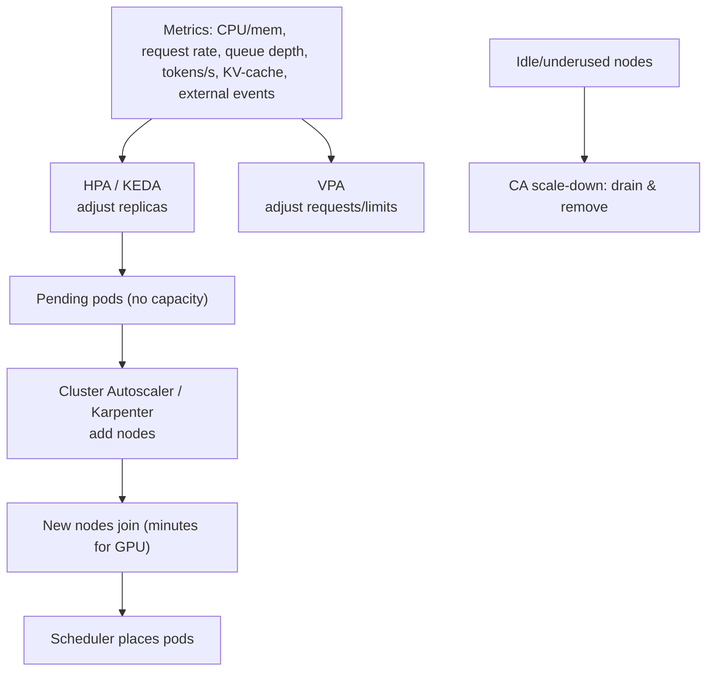

# 5.23 Autoscaling: HPA, VPA, KEDA and the cluster autoscaler

| | |
|---|---|
| Level | Intermediate |
| Priority tier | 1 |
| Lab venue | kind/minikube; metrics-server; Prometheus + Prometheus Adapter or KEDA; load generator (hey, k6, fortio); cluster autoscaler/Karpenter on a cloud cluster for node scaling |
| Part | Part 5: Kubernetes |
| Status | Drafted, labs **untested** |

## Why this matters for AI infrastructure

Picture an inference endpoint that suddenly gets a burst of traffic. Traffic like this is bursty, and over-provisioning for it is expensive. Each replica of a 70B model occupies several GPUs and takes minutes to start, so you cannot add replicas in a hurry. Scale too late and you break your latency SLOs. Scale too early, or never scale down, and you burn thousands of dollars per day.

CPU-utilisation autoscaling is nearly useless for GPU model servers. The CPU stays low while the GPU saturates. Throughput depends on request queues, batch sizes and KV-cache pressure, and none of those show up in CPU load.

Batch and training workloads need different scaling. Queue-driven worker pools, elastic jobs and node pools that appear when jobs are admitted each solve a different part of the problem.

This chapter explains how Kubernetes autoscaling works at the pod and node level. It shows how to choose the right signals for AI services, and how to handle the slow-start and capacity-constraint realities of GPUs.

## Prerequisites and outcomes

Before you start, read 5.7, 5.9 and 5.18. Know the basics of metrics and observability, which 5.24 previews. When you finish this chapter, you should be able to do the following.

- Explain the HPA control loop and algorithm, its behaviours (stabilisation windows and policies), and the metric types (Resource, Pods, Object, External and ContainerResource). Write correct HPAv2 manifests.
- Expose custom and external metrics through Prometheus Adapter or the KEDA metrics server. Choose scaling signals for LLM inference, such as queue length, concurrency, tokens/s and KV-cache utilisation, and know the caveats of GPU utilisation.
- Use VPA in the right modes, with its recommender, and understand how it interacts with HPA and in-place resize.
- Use KEDA for event-driven scaling and scale-to-zero, with Kafka, SQS, Prometheus, cron or the HTTP add-on as triggers.
- Explain how the cluster autoscaler works, covering scale-up and scale-down logic, node groups, the expander, safe-to-evict and PDBs.
- Explain Karpenter's provisioner model, apply both tools to GPU pools, and use ProvisioningRequest or Kueue for atomic multi-node capacity.
- Design autoscaling for model serving and batch pipelines, including warm pools, pre-pulled images, scale-to-zero trade-offs and capacity reservations.
- Diagnose flapping, stuck scale-ups and cost surprises.

## 1. Layers of autoscaling

A scaling decision passes through several layers before it helps anyone. Read the diagram from top to bottom to follow that path.



Each layer reacts to a different signal, and each one works at its own speed. HPA reacts in seconds to minutes. Image pull and model load take minutes. Node provisioning takes minutes in the cloud and hours on hardware, and scale-down stays conservative on purpose. The design problem is to line these speeds up. Replicas that the nodes cannot hold simply become Pending pods, so the layers have to be designed together.

Before you tune any single layer, check whether the layers around it can keep pace.

### When not to autoscale

Autoscaling sounds like a free win, but it adds a system you must set up, watch, and tune again. Ask first whether the payoff is worth that work. If your traffic stays fairly steady, the simplest plan may be to size the app for its busiest hours and leave it there.

The same logic applies to predictable load. If traffic rises at the same hours each day, adjusting capacity by hand at those times may take little effort. Adopt autoscaling when its long-term benefit outweighs the cost of building and maintaining it.

### Designing applications to scale

Autoscaling works best when an application is split into parts that can grow on their own. Many teams already separate a web app from its database, so the web tier can scale alone. Microservices go further. An online store can grow during a sale while a blog service stays the same size.

Splitting an app also adds management work, because you now run many workloads. Automation becomes more important with each one you add. At some point you cannot manage them by hand.

Small, quick workloads suit autoscaling best. If a container image is small and the app starts fast, a new replica joins the pool quickly. An image over a gigabyte, paired with a startup script that runs for minutes, responds slowly to load changes. Those apps make poor autoscaling candidates, so keep this in mind when you design them.

Scaling in means stopping running instances, and vertical scaling restarts the app to apply new resource values. So plan for graceful shutdown from the start. Anything that scales out must eventually scale back in.

## 2. Horizontal Pod Autoscaler (HPA)

### Controller and algorithm

Suppose a model server slows down as traffic grows. The Horizontal Pod Autoscaler, or HPA, is the piece that adds replicas in response. The HPA controller runs inside `kube-controller-manager`, and it checks metrics every 15 s by default. You can change that interval with `--horizontal-pod-autoscaler-sync-period`. On each cycle it reads the metrics, works out the desired replica count, and writes that count to the `scale` subresource of its target. The target can be a Deployment, a StatefulSet, a ReplicaSet, or any CRD with scale.

The core formula is a ratio. The desired count is the current count multiplied by the current metric value divided by the target value, rounded up.

`desiredReplicas = ceil(currentReplicas × currentMetricValue / targetMetricValue )`

When the metric sits above its target, the count goes up. When it sits below, the count comes down. The details matter as much as the formula. If you define several metrics, HPA computes each one and uses the largest result. A ±10% tolerance band (`--horizontal-pod-autoscaler-tolerance` 0.1) stops small fluctuations from causing jitter. HPA also handles pods it cannot measure conservatively. It excludes unready pods, and it treats missing metrics as 0% for scale-up and as 100% for scale-down.

HPA also avoids reacting to warm-up CPU. The `--horizontal-pod-autoscaler-cpu-initialization-period` of 5 min and the initial readiness delay give new pods time to settle. Finally, HPA clamps the result to `minReplicas` and `maxReplicas`, and it respects `behavior` policies.

The manifest below combines three metrics with a `behavior` block. Notice that the CPU target is a percentage of requests, while the custom and external targets are averages across pods or totals divided by replicas.

```yaml
apiVersion: autoscaling/v2
kind: HorizontalPodAutoscaler
metadata: { name: embeddings, namespace: serving }
spec:
  scaleTargetRef: { apiVersion: apps/v1, kind: Deployment, name: embeddings }
  minReplicas: 2
  maxReplicas: 40
  metrics:
    - type: Resource
      resource: { name: cpu, target: { type: Utilization, averageUtilization: 60 } }      # % of CPU *request*
    - type: Pods
      pods:
        metric: { name: inflight_requests }                                               # custom metric per pod
        target: { type: AverageValue, averageValue: "8" }
    - type: External
      external:
        metric: { name: queue_depth, selector: { matchLabels: { queue: embed-jobs } } }
        target: { type: AverageValue, averageValue: "30" }                                # total/replicas
  behavior:
    scaleUp:
      stabilizationWindowSeconds: 0
      policies:
        - { type: Percent, value: 100, periodSeconds: 60 }                                # at most double per minute
        - { type: Pods, value: 4, periodSeconds: 60 }
      selectPolicy: Max
    scaleDown:
      stabilizationWindowSeconds: 600                                                     # use the highest recommendation over 10 min
      policies: [ { type: Percent, value: 10, periodSeconds: 120 } ]
```

### Metric types

Each metric type reads from a different API, and that choice decides what you can scale on.

| Type | Source API | Example |
|---|---|---|
| **Resource** | `metrics.k8s.io` (metrics-server, from kubelet/cAdvisor) | CPU/memory average utilisation (relative to **requests**) or average value |
| **ContainerResource** | `metrics.k8s.io` per container | Scale on the app container only, ignoring sidecars |
| **Pods** | `custom.metrics.k8s.io` (Prometheus Adapter, KEDA, vendor adapters) | Per-pod `requests_in_flight`, `queue_length_per_pod` |
| **Object** | `custom.metrics.k8s.io` for a single object | Ingress `requests_per_second`, a Service's metric |
| **External** | `external.metrics.k8s.io` (KEDA, Prometheus Adapter, cloud adapters) | SQS queue length, Pub/Sub backlog, global QPS |

Utilisation metrics need **requests set** on all containers, because HPA computes percentages of requests. Without requests, the metric is unavailable. Memory is a poor scaling signal, since memory does not fall after load drops, so use it with care.

Freshness adds delay as well. Metrics-server scrapes kubelets every 15 s or so, and you can configure the resolution through a `--horizontal-pod-autoscaler-...` pipeline. Custom metrics add the Prometheus scrape interval of 15 to 30 s, plus the adapter delay. The lag from load to a new replica is therefore often 30 to 90 s, plus pod startup.

### Behaviour tuning

Tuning `behavior` comes down to a few choices. Scale up fast and scale down slowly. A short or zero scale-up stabilisation window with generous policies lets capacity arrive quickly. A long scale-down window of 5 to 15 minutes avoids flapping and the wasteful churn of expensive-to-start GPU model servers. Setting `selectPolicy: Disabled` freezes scaling in one direction.

Use `minReplicas` as the safety net for latency, because it pays the cold start cost up front. Use `maxReplicas` as a cost and capacity cap, tied to quotas and GPU availability.

Readiness matters most. A new pod does not count until it is ready. If readiness takes 8 minutes because the model has to load, the metric stays high while the pods start, and HPA may keep adding replicas and overshoot. The mitigations are rate limits in `behavior.scaleUp`, accurate startup and readiness probes, pre-warmed capacity, and predictive or scheduled scaling with KEDA cron. HPA already treats unready pods conservatively, so the readiness timing is the part you have to get right.

For a GPU model server, set the scale-down window and measure your readiness time before you change anything else.

### Scaling signals for inference services

Not every signal tells you the same thing about an inference service. The table lists the common choices, why each one matters, and what to watch for.

| Signal | Why | Notes |
|---|---|---|
| **Request concurrency / in-flight requests per replica** | Directly reflects load vs capacity; Knative/KServe default (`containerConcurrency`) | Needs instrumentation or sidecar/queue-proxy |
| **Queue depth / pending requests** (vLLM `vllm:num_requests_waiting`, Triton `nv_inference_pending_request_count`, TGI queue) | Leading indicator of saturation | Best primary signal for LLM servers; target waiting requests per replica ≈ small (e.g., 1–5) |
| **Tokens per second / time to first token (TTFT) / inter-token latency** | SLO-aligned | Use as guardrail (alert) or scale on p95 TTFT via custom metric |
| **KV-cache utilisation** (`vllm:gpu_cache_usage_perc`) | Saturation indicator for LLM memory | Scale up at ~70–80% sustained |
| **GPU utilisation (DCGM_FI_DEV_GPU_UTIL)** | Intuitive, but misleading: "busy" fraction; saturates early with batching; low-latency inference may show low util | Use with care; prefer SM activity/tensor pipe or app metrics |
| **CPU utilisation** | For preprocessing/tokenisation-heavy front-ends | Not for GPU backends |
| **RPS at the gateway** | Simple, predictable | Needs a per-replica capacity model (RPS/replica), brittle across prompt lengths |
| **External: queue lengths (Kafka/SQS)** | Batch inference workers | KEDA |

> **dcgm-exporter 4.9.0 version note.** dcgm-exporter 4.9.0 (2026-11-06) renamed many default metrics and changed some units. For example `DCGM_FI_DEV_GPU_UTIL` (percent) became `DCGM_FI_DEV_GPU_UTIL_RATIO` (0 to 1), and `DCGM_FI_DEV_FB_USED` (MiB) became `DCGM_FI_DEV_FB_USED_BYTES`. The metric names in this chapter are the 4.8.x names. On a 4.9.0 exporter use the [full mapping in 17.4](../part-17-operations/04-dcgm-exporter-and-interpreting-gpu-metrics.md#14-what-dcgm-exporter-490-renamed), and change thresholds together with the unit.

The practical pattern is to scale the model server on queue depth per replica, or on concurrency. Set `minReplicas` to cover the baseline, and bound `maxReplicas` by your GPU quota. Add alerts on TTFT and 5xx errors. For cost control, combine this with Kueue or ClusterQueue quotas, so autoscaling cannot exceed a team's budget, and with node pool limits.

### Exposing custom metrics (Prometheus Adapter example)

The rules below go in the Prometheus Adapter values file. They map a vLLM queue metric and a Kafka consumer lag metric into the APIs that HPA reads.

```yaml
# prometheus-adapter rules (values.yaml)
rules:
  custom:
    - seriesQuery: 'vllm:num_requests_waiting{namespace!="",pod!=""}'
      resources: { overrides: { namespace: { resource: namespace }, pod: { resource: pod } } }
      name: { as: "vllm_requests_waiting" }
      metricsQuery: 'sum(<<.Series>>{<<.LabelMatchers>>}) by (<<.GroupBy>>)'
  external:
    - seriesQuery: 'kafka_consumergroup_lag{topic="embed"}'
      resources: { namespaced: false }
      name: { as: "kafka_lag" }
      metricsQuery: 'sum(<<.Series>>{<<.LabelMatchers>>})'
```

```bash
kubectl get --raw "/apis/custom.metrics.k8s.io/v1beta1/namespaces/serving/pods/*/vllm_requests_waiting" | jq .
kubectl get --raw "/apis/external.metrics.k8s.io/v1beta1/namespaces/serving/kafka_lag" | jq .
kubectl describe hpa vllm -n serving         # conditions: AbleToScale, ScalingActive, ScalingLimited; events; current vs target
```

Run the first two commands to confirm that each metric is served. Then use `describe` to read the HPA conditions, events, and current and target values.

### Cluster proportional autoscaler

Some workloads should grow with the cluster itself, not with a load metric. Cluster DNS is one example. The Cluster Proportional Autoscaler (CPA) handles that case. It scales replicas based on the number of nodes, or a subset of nodes, in the cluster.

Unlike the HPA, the CPA does not read any metrics API. It needs no Metrics Server and no Prometheus Adapter. You do not write a Kubernetes resource for it either. You configure it with flags that name the target workload, plus a ConfigMap that holds the scaling rules.

The CPA has a narrow use case. Workloads that must scale with the cluster are usually platform services. Before you choose it, check whether an HPA would fit better. If you already run HPAs, the metrics APIs are in place, and a second autoscaler adds upkeep you may not need. If you run no HPAs and the CPA covers your need, its simple model is attractive.

The CPA offers two scaling methods.

- The linear method scales the application in direct proportion to the number of nodes or cores.
- The ladder method uses a step function to set a ratio of nodes to replicas, or cores to replicas.

Teams have used the CPA well for services such as cluster DNS, in clusters that grow to hundreds of worker nodes. Demand at 5 nodes differs a lot from demand at 300 nodes. A proportional rule keeps the service sized to match.

### Custom autoscaling

Autoscaling is not limited to the tools above. Any automated method that produces the scaling behavior you need counts. For example, if you know when traffic rises each day, a Kubernetes CronJob can update the replica count on the matching Deployment.

When a simple method like this works, choose it. A system with fewer moving parts is less likely to produce surprises.

That covers the main ways to autoscale workloads, from core Kubernetes to add-ons and custom code. The platform underneath the workloads can scale too, and section 5 covers that.

## 3. Vertical Pod Autoscaler (VPA)

Requests often drift away from real usage. The Vertical Pod Autoscaler, or VPA, fixes that by adjusting requests and limits rather than the replica count. It lives in the kubernetes/autoscaler subproject and uses the `VerticalPodAutoscaler` CRD.

VPA has three components. The recommender analyses historical and live usage and produces target, lower and upper bounds. The updater evicts pods whose requests deviate, to apply the new values. The admission controller sets requests on new pods.

`Off` only makes recommendations. `Initial` sets requests when a pod is created. `Recreate`/`Auto` evict and recreate pods with new requests. `InPlaceOrRecreate` uses the newer in-place resize, which changes CPU and memory without restarts where supported. Policies such as `minAllowed`, `maxAllowed`, `controlledResources` and `controlledValues` (`RequestsOnly` or `RequestsAndLimits`) set the boundaries.

Use recommendation mode to right-size the CPU and memory requests of services and data-prep jobs. Avoid `Auto` for GPU model servers. A restart costs minutes there, and model weights dominate their fixed memory.

If you let HPA and VPA act on the same CPU or memory metric, they fight each other. HPA on custom or external metrics with VPA on resources is acceptable.

VPA also works as a cost lens. Compare requests with actual usage, as described in 5.22, and bound the results with `LimitRange`. Watch the caveats: the recommender's history period, OOM events that raise memory, JVM and PyTorch memory behaviour, and bursty workloads. Goldilocks from Fairwinds shows VPA recommendations for each namespace.

Start with `Off` and read the recommendations before you let VPA change any pod.

### Off mode as a tuning aid

Many apps reach production before anyone knows how much CPU and memory they really use. Deadlines leave little time for load testing and profiling. Teams then request generous amounts as a safety margin, and the cluster ends up poorly utilized.

VPA in `Off` mode can close that gap. It studies real traffic and recommends values, but it never changes or evicts a pod. Engineers review the numbers and set the requests by hand. This keeps workloads from being evicted at peak times, which matters most when an app does not yet shut down gracefully. It also saves the work of reading usage metrics and calculating values yourself. In this role VPA is a tuning aid, not an autoscaler.

To read the recommendations, run `kubectl describe vpa <vpa name>` and look at the `Status` section. The output looks like this.

```
Recommendation:
  Container Recommendations:
    Container Name: coredns
      Lower Bound:
        Cpu: 25m
        Memory: 262144k
      Target:
        Cpu: 25m
        Memory: 262144k
      Uncapped Target:
        Cpu: 25m
        Memory: 262144k
      Upper Bound:
        Cpu: 427m
        Memory: 916943343
```

Each container gets its own recommendation. Use the `Target` value as the baseline for CPU and memory requests.

## 4. KEDA: event-driven autoscaling

A plain HPA cannot scale a Deployment to zero, because the scaling formula multiplies by zero. KEDA (CNCF) fills that gap. It installs an operator, a metrics adapter for the External Metrics API, and the `ScaledObject` and `ScaledJob` CRDs. KEDA creates and manages the HPA for you. It also adds scale to and from zero: the operator activates a Deployment from 0 to 1 when a trigger becomes active, and the HPA handles 1 to N. KEDA ships with more than 60 scalers, including Kafka, RabbitMQ, SQS, Pub/Sub, Redis, Azure Service Bus, PostgreSQL and MySQL queries, Prometheus queries, cron, CPU and memory, GCP and AWS metrics, the HTTP add-on, and Datadog.

```yaml
apiVersion: keda.sh/v1alpha1
kind: ScaledObject
metadata: { name: batch-embed, namespace: data }
spec:
  scaleTargetRef: { name: embed-worker }
  minReplicaCount: 0
  maxReplicaCount: 50
  cooldownPeriod: 300
  pollingInterval: 15
  advanced:
    horizontalPodAutoscalerConfig:
      behavior:
        scaleDown: { stabilizationWindowSeconds: 600 }
  triggers:
    - type: kafka
      metadata: { bootstrapServers: kafka:9092, consumerGroup: embed, topic: docs, lagThreshold: "200" }
      authenticationRef: { name: kafka-auth }
    - type: prometheus
      metadata:
        serverAddress: http://prometheus.monitoring:9090
        query: 'sum(vllm:num_requests_waiting{app="vllm"})'
        threshold: "5"
    - type: cron
      metadata: { timezone: UTC, start: "0 8 * * 1-5", end: "0 20 * * 1-5", desiredReplicas: "4" }      # pre-warm business hours
---
apiVersion: keda.sh/v1alpha1
kind: ScaledJob
metadata: { name: transcribe-job, namespace: data }
spec:
  jobTargetRef: { template: { spec: { restartPolicy: Never, containers: [ { name: w, image: registry/whisper:1.2, resources: { limits: { nvidia.com/gpu: 1 } } } ] } } }
  pollingInterval: 10
  maxReplicaCount: 20
  scalingStrategy: { strategy: accurate }
  triggers: [ { type: aws-sqs-queue, metadata: { queueURL: https://sqs..., queueLength: "1" } } ]
```

The manifest above has two parts. The `batch-embed` ScaledObject combines Kafka lag, a Prometheus query and a business-hours cron trigger. The `transcribe-job` ScaledJob starts one Job for each queued message. Read the trigger lists to see what each one watches.

KEDA suits queue-driven batch workers, event-driven inference on endpoints that are called only now and then, scheduled warm-ups with cron, and scale-to-zero for dev and test model endpoints. Scale-to-zero on a GPU service costs a cold start. Node provisioning, image pull and model load together take minutes. That trade is acceptable for batch work and rarely for interactive traffic. To soften it, keep a warm minimum of 1, use node warm pools and image caching, and put model weights on local NVMe or a shared cache. Faster loaders, such as safetensors, tensorizer and fast checkpoint loading, help too.

Knative Serving and KServe take a different route. They provide request-based autoscaling with scale-to-zero, where the activator buffers requests during a cold start. They also provide integrated routing and canary revisions. A KServe `InferenceService` in `serverless` mode uses Knative, while the "raw deployment" mode uses HPA or KEDA. Choose between them by asking whether you need request buffering and revision management.

For a GPU endpoint, decide whether a cold start is acceptable before you enable scale-to-zero.

## 5. Cluster Autoscaler and Karpenter

### Cluster Autoscaler (CA)

The Cluster Autoscaler runs as a Deployment, and it manages node groups with minimum and maximum sizes. A node group can be a cloud ASG, MIG or VMSS, or a cluster-API MachineDeployment.

Scale-up starts with Pending pods. The autoscaler watches for unschedulable pods, which are Pending with `FailedScheduling` because of insufficient resources. For each group, it simulates adding a node from that group's template, to see whether the pod would fit. The check includes node labels, taints and GPU resources. An **expander** then picks one group: `random`, `least-waste`, `most-pods`, `priority` or `price`. The autoscaler requests more instances, the new nodes register, and the scheduler places the waiting pods. The delays add up. Provider API calls, boot time and driver readiness often take 5 to 15 minutes for GPU nodes. The `--max-node-provision-time` flag is 15 min, and a group whose nodes never appear is marked as failed.

Scale-down runs periodically. The autoscaler looks for nodes whose utilisation, measured as requests against allocatable, stays below `--scale-down-utilization-threshold` (0.5) for `--scale-down-unneeded-time` (10 min). Before it removes such a node, it checks that every pod can move somewhere else. That check respects PDBs, `safe-to-evict` annotations, local storage, non-replicated pods and affinity. Only then does it cordon and drain the node and delete it.

Several things block scale-down. Pods without controllers block it, and so do pods with local storage (`emptyDir` blocks unless annotated), PDBs, kube-system pods, and pods annotated with `cluster-autoscaler.kubernetes.io/safe-to-evict: "false"`. GPU nodes need extra care. GPU requests are all-or-nothing, so a node with a single running pod is not low utilisation if that pod holds all of its GPUs. Set scale-down thresholds with GPU requests in mind.

Several settings suit GPU pools. `--gpu-total` limits the total number of GPUs. Give burst pools a minimum of 0, and accept the cold start that comes with it. Use `--balance-similar-node-groups` to spread across zones. `--scale-down-delay-after-add` and `--max-graceful-termination-sec` also matter here, and the grace period should be long for training pods, or you can disable scale-down on training pools. A priority expander can prefer on-demand reservations over spot capacity. Taints and tolerations make sure only the intended pods trigger a GPU pool scale-up, and each pool is labelled by GPU type.

The Cluster Autoscaler has limits. It reacts only to Pending pods. It assumes node groups of homogeneous nodes. It does not understand the all-or-nothing needs of a multi-node gang, so it can scale up only part of what a job needs. That gap is why ProvisioningRequest exists.

Overprovisioning, which uses pause pods, hides provisioning latency. You run low-priority placeholder pods that reserve capacity. When real pods arrive, they preempt the placeholders and start at once. The placeholders go Pending, which triggers the Cluster Autoscaler to add capacity in the background. You get headroom, and you pay for it, so weigh the cost.

In *Production Kubernetes* Chapter 13 (*Autoscaling*), Josh Rosso et al. highlight four architectural lessons for combining pod-level and node-level autoscaling.

1. **Service Decomposition and When NOT to Autoscale (Production Kubernetes Chapter 13):** Decomposing a monolith into independent services lets each tier scale on its own bottleneck metric. For example, you can separate CPU-bound tokenization and preprocessing from GPU-bound LLM prefill and decode. However, do **not** enable autoscaling blindly. Stateful singleton services, workloads with predictable flat traffic, and workloads that have not been load-tested are poor candidates, because you do not yet know their saturation point or startup latency.
2. **Cluster Autoscaler Configuration (`--nodes=1:10:worker-auto-scaling-group`) and Pod Shuffling (Production Kubernetes Chapter 13):** When you configure `cluster-autoscaler` against cloud node groups, such as with `--cloud-provider=aws --nodes=1:10:worker-auto-scaling-group`, expect pod placement to shift. Adding and removing worker nodes inevitably shuffles pods across the cluster. Every autoscaled workload should therefore define `PodDisruptionBudget`s (`PDB`s), `readinessProbe`s and `preStop` graceful drain hooks.
3. **Hiding Node Spin-Up Latency with `cluster-overprovisioner` (Production Kubernetes Chapter 13):** The Cluster Autoscaler reacts only after a pod becomes Pending, which happens once existing nodes are already full. A sudden traffic spike therefore normally waits 5 to 15 minutes for a cloud GPU VM to boot and install drivers. You can remove that wait without setting artificially low HPA thresholds (`30%`). Deploy a `PriorityClass` with negative priority (`value: -10`), and a `pause` (`registry.k8s.io/pause`) **`cluster-overprovisioner` Deployment** sized to 1 to 2 nodes' worth of resources. The model is in `simulate_overprovisioning_pause_pods()` in `code/part05/autoscaling_hpa_ca_simulator.py`.
   - In steady state, the negative-priority `pause` pods sit on warm, ready GPU nodes.
   - When real production inference pods scale out (`priority >= 0`), `kube-scheduler` immediately preempts the `pause` pods, with a `0s` node wait, and places the real pods on the warm nodes. The preempted `pause` pods go `Pending`, which triggers the `Cluster Autoscaler` to provision replacement buffer nodes in the background.

### Cluster Autoscaler configuration example

The CA is configured with flags, and its scaling behavior is highly configurable. The project's FAQ on GitHub documents the flags. The example below runs the CA against an AWS autoscaling group.

```yaml
apiVersion: apps/v1
kind: Deployment
metadata:
  name: aws-cluster-autoscaler
spec:
  replicas: 1
  selector:
    matchLabels:
      app.kubernetes.io/name: "aws-cluster-autoscaler"
  template:
    metadata:
      labels:
        app.kubernetes.io/name: "aws-cluster-autoscaler"
    spec:
      containers:
      - name: aws-cluster-autoscaler
        image: "us.gcr.io/k8s-artifacts-prod/autoscaling/cluster-autoscaler:v1.18"
        command:
        - ./cluster-autoscaler
        - --cloud-provider=aws
        - --namespace=kube-system
        - --nodes=1:10:worker-auto-scaling-group
        - --logtostderr=true
        - --stderrthreshold=info
        - --v=4
        env:
        - name: AWS_REGION
          value: "us-east-2"
        livenessProbe:
          httpGet:
            path: /health-check
            port: 8085
        ports:
        - containerPort: 8085
```

The `--cloud-provider=aws` flag names the supported cloud provider, which is AWS here. The `--nodes=1:10:worker-auto-scaling-group` flag tells the CA to manage an AWS autoscaling group called `worker-auto-scaling-group`. It lets the CA scale that group between 1 and 10 machines.

Cluster autoscaling is very useful. It delivers one of the main benefits of cloud native infrastructure. It also adds real complexity. Load test the setup, and learn how it behaves, before you trust it to scale business-critical production platforms.

Know the upper limits your cluster can reach. If you let it grow to hundreds of nodes, find the point where parts of the platform start to become bottlenecks.

Speed is another concern. Clusters need time to scale when demand arrives. This is where overprovisioning helps.

### Cluster overprovisioning

The CA reacts only to Pending pods, which are pods that cannot be scheduled because the cluster lacks resources. By the time it adds nodes, the cluster is already full. Scaling workloads can then wait for capacity while new nodes boot, join, and become ready. That delay can break your latency targets.

Start by measuring how long new nodes take to spin up, join the cluster, and become ready for workloads. With that number in hand, pick a fix.

- Set HPA target utilization low enough that workloads scale out well before the app is full. The headroom buys time for nodes to arrive. For sharp spikes you may need a very low target, which leaves workloads chronically overprovisioned to cover rare events.
- Use cluster overprovisioning. Keep empty nodes on standby as a buffer for scaling workloads. This removes the need to set HPA targets artificially low ahead of high-load events.

Cluster overprovisioning uses placeholder pods that do three things.

- They request enough resources to reserve nearly all of a node.
- They consume no actual resources.
- They use a priority class that gets them evicted as soon as another pod needs the space.

Because each placeholder reserves a whole node, the replica count of the overprovisioner Deployment sets how many standby nodes you hold. Preparing for a campaign or launch is as simple as raising that count.

Create a priority class with a negative value, for example `value: -1` as in *Production Kubernetes* (the lab below uses `-10`; any value below zero works), and apply it to the overprovisioner Deployment. Every other workload then outranks these pods by default. When a real pod needs the room, the overprovisioner pod is evicted immediately. The evicted pod goes Pending, which triggers the Cluster Autoscaler to provision a new node to stand by.

The placeholder setup uses one replica, but you can run as many as the buffer requires.

With the Cluster Autoscaler and cluster-overprovisioner, you have two solid ways to scale Kubernetes clusters horizontally. This fits well with horizontal workload scaling. Vertical cluster scaling is not covered here, because horizontal scaling has covered every use the authors found.

### Karpenter

Karpenter (AWS-originated, CNCF, with multi-cloud providers emerging) replaces node-group-centric scaling with just-in-time provisioning. It watches Pending pods and batches them. It then computes the best set of instance types that satisfy the constraints in a `NodePool`, with provider details in a `NodeClass`. It launches nodes directly through cloud APIs, including mixed instance types, spot and on-demand capacity, and GPUs. It also consolidates and removes nodes proactively, using `consolidationPolicy`, `disruption` budgets, `expireAfter` for node rotation, and drift detection that replaces nodes when AMIs change.

```yaml
apiVersion: karpenter.sh/v1
kind: NodePool
metadata: { name: gpu-inference }
spec:
  template:
    spec:
      requirements:
        - { key: karpenter.k8s.aws/instance-family, operator: In, values: [g6, g6e, p5] }
        - { key: karpenter.sh/capacity-type, operator: In, values: [on-demand] }
        - { key: topology.kubernetes.io/zone, operator: In, values: [us-east-1a, us-east-1b] }
      taints: [ { key: nvidia.com/gpu, value: present, effect: NoSchedule } ]
      nodeClassRef: { group: karpenter.k8s.aws, kind: EC2NodeClass, name: gpu }
      expireAfter: 720h
  limits: { "nvidia.com/gpu": 64 }
  disruption:
    consolidationPolicy: WhenEmptyOrUnderutilized
    consolidateAfter: 10m
    budgets: [ { nodes: "10%" } ]
```

Karpenter brings faster and more flexible provisioning, bin-packing across instance types, spot handling with interruption notices, and automatic rotation and drift correction. The risks for GPU fleets are real, though. Consolidation can disrupt long jobs, so use `do-not-disrupt` annotations on training pods and set disruption budgets. GPU capacity can be unavailable, and topology needs such as EFA or placement groups require NodeClass configuration. Cost surprises also happen. Disable consolidation for training pools, and use Karpenter for inference and CPU pools.

### Atomic capacity for multi-node jobs

Reactive scale-up can supply some of the nodes a gang needs but not all of them. Meanwhile, the pods that are waiting hold the new nodes idle. **ProvisioningRequest**, from the `autoscaling.x-k8s.io` API, asks for capacity for N pods atomically. Providers include GKE Dynamic Workload Scheduler flex-start/ calendar, and queued provisioning. Kueue integrates through an `AdmissionCheck` of type `ProvisioningRequest`. The workload is admitted only after capacity is guaranteed, and the nodes are then held for it. Cloud-native schedulers have similar mechanisms, such as AWS capacity blocks for ML with Karpenter static capacity, and Azure or GCP reservations. For on-prem fixed fleets, the equivalent is Kueue quotas and maintenance windows rather than node autoscaling.

Before you let an autoscaler manage a GPU pool, check that the pool's minimum, limit and taint match the pods you expect to run on it.

## 6. Autoscaling patterns for AI workloads

Each AI workload scales differently, so the right pattern depends on what the workload does. The table gives a pattern for each common workload, and the topics below it cover techniques that apply to several of them.

| Workload | Pod scaling | Node scaling | Notes |
|---|---|---|---|
| **LLM online inference** (vLLM/Triton/TGI) | HPA/KEDA on queue depth, concurrency, KV-cache; min ≥ 1–2; slow scale-down | Fixed reserved GPU pool + burst autoscaled pool; overprovision pause pods; pre-pulled images | Replica start 2–15 min; consider model-parallel replicas needing multiple GPUs/nodes; keep headroom 20–30% |
| **Embedding/reranker services** | HPA on CPU/GPU concurrency; smaller replicas; faster start | Autoscaled GPU pool (L4/L40S) | Cheaper to scale; batch-friendly |
| **Batch inference / offline scoring** | KEDA on queue backlog; Jobs with parallelism | Cluster autoscaler/Karpenter on Pending; spot allowed | Scale to zero; retries on preemption |
| **Training** | Not HPA-based; fixed job size; **elastic training** (TorchElastic/ Ray/ Kubeflow elastic policies) can scale workers within min/max | Admit with Kueue; provision nodes atomically | Preemption/scale events trigger rendezvous restarts; checkpoint cadence matters |
| **Data processing (Spark/Ray)** | Operator-driven dynamic allocation | CA/Karpenter or Ray autoscaler | Ray autoscaler talks to Kubernetes (KubeRay) to add/remove worker pods |
| **Interactive notebooks** | None (per-user) | Pool scaling + idle culling | Quotas to cap spend |
| **Gateways/ingress** | HPA on CPU/RPS/connections | CPU pool | Keep ≥3 for HA |

Read the table one row at a time, and check the last column before you settle on a pattern. The topics below apply across several of these workloads.

- **Warm pools & pre-pulled images:** A DaemonSet pre-pulls model server images and, optionally, model weights onto local NVMe. The scheduler's `ImageLocality` scores favour those nodes, which cuts start time from minutes to seconds.
- **Model load acceleration:** Use a shared read-only weights volume, a local NVMe cache, sharded or parallel loading, `tensorizer` or safetensors, and CUDA graph warmup in readiness gating. Snapshotting, through CRIU or CUDA checkpoint, is emerging and can speed up restore.
- **Capacity reservations:** GPU capacity may be unobtainable on demand, so autoscaling needs reservations or committed capacity (4.24). If you have reserved GPUs, scale `maxReplicas` to the ones that are actually available.
- **Cost guardrails:** Set node pool `limits` in Karpenter, `--max-nodes-total` on the CA, and Kueue quotas. Add budgets and alerts, scheduled scale-down for dev endpoints, and scale-to-zero for non-production.
- **Multi-metric safety:** Scale up on queue depth OR latency. Scale down only when both are comfortably low, and only over a long window.
- **Testing:** Load tests should include prompt and response length distributions, because autoscaling behaviour depends on the token mix. Also run cold-start tests, failure tests such as an impossible scale-up or a spot interruption, and chaos tests for metrics outages. When metrics disappear, HPA falls back, so it will not scale down and may hold.

Before you pick a pattern, write down how long the workload takes to start and whether reserved GPUs exist for it.

## 7. Troubleshooting

When autoscaling misbehaves, the symptom usually points to one layer. Find your symptom in the first column, then check the likely cause and the first thing to look at.

| Symptom | Likely cause | Check/fix |
|---|---|---|
| HPA `<unknown>` metric / `FailedGetResourceMetric` | metrics-server missing/unhealthy, no CPU requests, kubelet cert issues | `kubectl top pods`, metrics-server logs, set requests |
| HPA not scaling despite load | Metric below target, tolerance band, readiness/initialisation delay, `maxReplicas` hit, pods unready | `kubectl describe hpa` conditions/events, raw metrics, behaviour policies |
| Flapping (scale up/down repeatedly) | Short scale-down window, noisy metric, readiness lag | Increase stabilisation, smooth metric (Prometheus `avg_over_time`), widen target |
| Scale-up creates Pending pods | No node capacity; CA not configured/disabled; quota | `kubectl get pods -o wide`, CA logs/status ConfigMap, quotas/Kueue |
| CA won't scale up | Pod can't fit any node group template (GPU label/taint mismatch), node group at max, CA lacks permissions, `unregistered` nodes | `kubectl -n kube-system logs deploy/cluster-autoscaler`, `kubectl get cm cluster-autoscaler-status -o yaml` |
| CA won't scale down | Blocking pods (local storage, PDB, annotations), utilisation above threshold, recently added | CA logs "cannot be removed" reasons; add `safe-to-evict`, adjust thresholds |
| Karpenter launches wrong instance | Requirements too loose; spot interruptions | Tighten requirements, set limits, capacity-type |
| Over-scaling inference | HPA reacts to queue spikes faster than model start; metrics double counting across replicas | Cap scale-up rate, scale on per-replica metric, pre-warm |
| Costs unexpectedly high | `minReplicas` high, no scale-down, idle node pools, spot fallback to on-demand | Dashboards for replicas/nodes vs load, budgets, schedules |
| VPA evicting pods repeatedly | Auto mode with fluctuating recommendations | Use Off/Initial; set bounds; PDBs |
| KEDA not scaling from zero | Trigger authentication, scaler errors, wrong namespace, HPA conflicts (existing HPA on same target) | `kubectl describe scaledobject`, operator logs; remove duplicate HPAs |

Read the cause in your row before you change a threshold, because a threshold change can hide the real fault.

## 8. Lab

Start on your own machine. Run the self-checking Python lab first. It checks the HPAv2 multi-metric replica calculator (`compute_hpa_desired_replicas`), including the $\pm 10\%$ tolerance band, the `scaleUp` rate caps and the `scaleDown` stabilization window (Production Kubernetes Chapter 13). It also checks the Cluster Autoscaler scale-down eligibility and blocker evaluator (`evaluate_ca_node_scale_down`). Finally, it checks the Cluster Overprovisioning negative-priority `pause` pod simulator (`simulate_overprovisioning_pause_pods`, Production Kubernetes Chapter 13, Figures 13-6 & 13-7).

```bash
python3 code/part05/autoscaling_hpa_ca_simulator_lab.py
```

Next, move to a `kind` or cloud cluster and work through the exercises below. The shell steps have not been run against live hardware.

1. Deploy a CPU-bound app with requests and set the HPA to 50% CPU. Generate load with `hey`, and watch the replicas, `describe hpa` and `kubectl top`. Test the tolerance band and the stabilisation by dropping the load. Then add `behavior` policies and compare the results.
2. Remove the CPU requests and observe `<unknown>`. Then fix the requests and confirm that the metric comes back.
3. Instrument a toy inference server with a Prometheus gauge for queue length. Install Prometheus and Adapter, or KEDA, and scale on `queue_depth per pod`. Run a load generator with variable prompt lengths. Plot queue depth, replicas and latency, and tune the target and behaviours.
4. Add a 3-minute startup delay with `sleep` and no startup probe. Watch the HPA overshoot. Then add a readiness probe and scale-up rate limits, and compare the two runs.
5. Run VPA in `Off` mode on a service and on a batch job. Read the recommendations after load, and compare them with your requests. Try `Auto` on a non-critical app and observe the evictions. Test in-place resize if it is available.
6. Scale a worker Deployment from 0 on a Kafka, Redis list or SQS-like queue. Test cron pre-warming, configure a ScaledJob, and compare the result with a plain HPA external metric.
7. On a cloud cluster, or on kind with the `clusterapi` provider or the `kwok` provider, create a node group with min 0. Submit pods that do not fit, and measure the scale-up latency. Delete the pods and measure the scale-down. Test blockers such as PDBs and local storage, and try the `priority` expander.
8. Deploy low-priority pause pods sized to your typical burst. Submit a high-priority pod that preempts them. Measure the time to run, and compare it with a run that has no headroom.
9. Optionally, install Karpenter in a lab cloud account. Define a NodePool with consolidation, and observe provisioning, consolidation, disruption budgets and `do-not-disrupt`.
10. Deploy vLLM, or a mock, with queue and KV-cache metrics. Configure HPA or KEDA on `vllm:num_requests_waiting` and cache usage. Run a bursty load, measure TTFT p95 and GPU-hours, and compare them with static provisioning. Examine the cold-start parts: node, image and load.
11. With Kueue and ProvisioningRequest on a provider that supports it, or with a simulated custom AdmissionCheck, submit a 16-GPU gang job. Verify that the nodes appear before the pods start.
12. Compute the cost of static and autoscaled inference for a diurnal traffic trace. Adjust the min and max values and the reserve policies, and find the break-even point.
13. Kill Prometheus or the adapter and observe how HPA behaves. Exhaust your cloud GPU quota and watch for Pending pods. Simulate a spot interruption.
14. Clean up.

## 9. Common mistakes

- You autoscale GPU model servers on CPU utilisation, or on GPU utilisation alone, and ignore queue depth and KV-cache.
- You leave out resource requests, so HPA and CA have nothing to compute with. You also let HPA and VPA fight over CPU or memory.
- You set scale-down windows that are too short for slow-start workloads, or you set `minReplicas` to 0 for latency-critical GPU services.
- You assume node autoscaling is fast and guaranteed for GPUs, with no reservations and a `maxReplicas` above the capacity you have.
- PDBs, local storage or unannotated pods block the CA, and then you blame it for "not scaling down."
- Karpenter consolidation disrupts your training jobs because you forgot `do-not-disrupt`.
- You use HPA for training jobs, or you expect elastic training to work without checkpointing or rendezvous support.
- You forget to bound autoscaling with quotas or budgets, and the costs exceed your plans.
- You ignore metrics pipeline lag, or you run adapters that are not highly available.
- You test autoscaling only with uniform synthetic prompts.

## 10. Interview angles

- How does the HPA compute desired replicas? What are stabilisation windows and tolerance?
- What metrics would you autoscale an LLM inference deployment on, and why not GPU utilisation?
- HPA vs VPA vs KEDA vs cluster autoscaler vs Karpenter: what are the roles, and how do they interact?
- How do you handle slow model start times in autoscaling?
- Why does the cluster autoscaler fail to scale down? How do you fix it?
- How do you scale node pools for multi-node training jobs that need all-or-nothing capacity?
- Scale to zero for GPU services: what are the pros, the cons and the mitigations?
- How would you design autoscaling and cost controls for a shared GPU inference platform?

## Exercises

Check each answer against the code or manifest it names. The simulator lives in `code/part05/autoscaling_hpa_ca_simulator.py`.

1. Run `compute_hpa_desired_replicas()` on the `embeddings` HorizontalPodAutoscaler from Section 2. Explain how HPA handles several metrics, and why a 10 percent tolerance band applies.
2. Read the `scaleUp` and `scaleDown` settings in that manifest. Say how the 600-second stabilization window prevents flapping. Then say why missing `resources.requests` makes utilization show as `<unknown>`.
3. Explain why CPU and raw `DCGM_FI_DEV_GPU_UTIL` make poor signals for LLM serving. Compare them with queue depth and KV-cache utilization from vLLM. Then read the `prometheus-adapter` rules in Section 2.
4. Compare the VPA modes `Off`, `Initial`, `Recreate` and `InPlaceOrRecreate`. Explain why `Off` with Goldilocks is the safest way to right-size requests. Then explain why VPA in `Auto` and HPA on the same CPU metric fight each other.
5. Read the `batch-embed` `ScaledObject` and the `transcribe-job` `ScaledJob` in Section 4. Then explain how Knative and KServe differ from KEDA when an endpoint scales from 0 to 1.
6. Run `evaluate_ca_node_scale_down()` and say what blocks a scale-down. Then explain how Karpenter consolidation works with `WhenEmptyOrUnderutilized` and `do-not-disrupt`.
7. Run `simulate_overprovisioning_pause_pods()`. Say in your own words how low-priority pause pods hide a 10-minute GPU node boot. Production Kubernetes, Chapter 13, describes the idea.
8. Explain why pod-by-pod scale-up fails for a 16-node synchronous training job. Then explain how a `ProvisioningRequest` with a Kueue `AdmissionCheck` gives all-or-nothing provisioning.
9. List five ways to cut a 70B model cold start from 12 minutes to under 60 seconds, and say which you would try first.

## Checkpoint questions (20)

<details>
<summary>1. State the core HPA replica formula (Production Kubernetes Chapter 13), and explain how HPA handles (a) the $\pm 10\%$ tolerance band and (b) multiple metrics defined on the same HPA.</summary>

- **Core formula:**
  `desiredReplicas = ceil(currentReplicas * (currentMetricValue / targetMetricValue))`
- **$\pm 10\%$ tolerance band (`--horizontal-pod-autoscaler-tolerance=0.1`):** If the ratio `currentMetricValue / targetMetricValue` falls between **`0.90` and `1.10`**, HPA makes **no change** to the replica count. That stops constant one-pod jitter from minor load changes.
- **Multiple metrics:** HPA works out the formula for each metric in `spec.metrics[]`, and it picks the **maximum** proposed replica count.
</details>

<details>
<summary>2. Why does `kubectl get hpa` show `<unknown>/60%` for CPU utilization (`FailedGetResourceMetric`), and what two things must be present for `type: Resource` CPU scaling to work?</summary>

For `type: Resource` with `averageUtilization: 60` to compute a percentage, two things must be in place.
1. **`metrics-server` (`metrics.k8s.io/v1beta1`) must be installed and healthy** in the cluster. Check it with `kubectl top pods`.
2. **Every container in the target Pod must declare `resources.requests.cpu`.** HPA defines utilization as current CPU usage divided by requested CPU, not by node capacity or limits. If any container in the Pod omits `requests.cpu`, HPA has no denominator, so it reports `<unknown>`. The exception is `ContainerResource`, which you can scope to a specific container.
</details>

<details>
<summary>3. In HPAv2 `spec.behavior`, how do `scaleUp.policies` (`selectPolicy: Max`) and `scaleDown.stabilizationWindowSeconds: 600` work?</summary>

- **`scaleUp.policies` with `selectPolicy: Max`:** Suppose `currentReplicas = 4`. `Percent: 100` allows scaling to $4 \times 2 = 8$, and `Pods: 4` allows scaling to $4 + 4 = 8$, per 60 seconds. `selectPolicy: Max` takes the larger of the two step sizes, but scale-up is still capped at +100% per minute. A sudden queue spike, while new 70B Pods are still loading weights, therefore cannot spawn 40 replicas at once. That is the protection against slow-start overshoot.
- **`scaleDown.stabilizationWindowSeconds: 600` (10 minutes):** HPA keeps every desired-replica recommendation from the past 10 minutes, and it picks the **highest** one in that rolling window. Replicas go away only after traffic has stayed low for a full 10 minutes.
</details>

<details>
<summary>4. Why is `DCGM_FI_DEV_GPU_UTIL` (raw GPU utilization %) often a misleading metric for autoscaling an LLM inference server (`vLLM` / `Triton` / `TensorRT-LLM`), and what metrics should you use instead?</summary>

`DCGM_FI_DEV_GPU_UTIL` measures the share of time, over the sample interval, during which at least one CUDA kernel was running on the GPU. It does not distinguish between one token and a full batch of 128 requests. Continuous batching in `vLLM` runs decode iterations back to back, even for a single active user stream. So the metric often jumps to 90–100% with just one or two users, while the GPU still has 95% of its KV-cache and compute throughput available.

Use these signals instead.
1. **Waiting request queue depth per replica:** `vllm:num_requests_waiting` (or `nv_inference_pending_request_count` in Triton). A target of, for example, 1–5 waiting requests per pod works well.
2. **KV-cache memory utilization:** `vllm:gpu_cache_usage_perc`. Scale up when it stays above $> 75–80\%$.
3. **Active in-flight concurrency per replica** (`vllm:num_requests_running`).
</details>

<details>
<summary>5. What are the three Kubernetes Metrics APIs (`metrics.k8s.io`, `custom.metrics.k8s.io`, `external.metrics.k8s.io`), and which component serves each?</summary>

1. **`metrics.k8s.io` (Resource Metrics API):** `metrics-server` serves this API. It gives only current Pod and Node CPU and memory usage, which feeds `kubectl top` and the HPA `Resource` and `ContainerResource` metrics.
2. **`custom.metrics.k8s.io` (Custom Metrics API):** `prometheus-adapter` serves this API, or a Datadog or custom adapter. It gives you any metric tied to a Kubernetes object, such as a `Pods` metric like `vllm_requests_waiting` per Pod, or an `Object` metric on an Ingress or Service.
3. **`external.metrics.k8s.io` (External Metrics API):** `keda-operator-metrics-apiserver` serves this API, or `prometheus-adapter` or a cloud adapter does. It gives metrics from outside Kubernetes, such as `kafka_consumergroup_lag`, AWS SQS queue length, or GCP Pub/Sub backlog.
</details>

<details>
<summary>6. What are the three components of the Vertical Pod Autoscaler (`VPA`), and what are its four `updateMode` values (Production Kubernetes Chapter 13)?</summary>

- **Three VPA components:**
  1. **`vpa-recommender`** watches historical and live resource usage from `metrics-server` or Prometheus. It computes the `target`, `lowerBound`, `upperBound` and `uncappedTarget` CPU and memory requests.
  2. **`vpa-updater`** compares the running Pods' requests with the recommendation. In `Recreate` or `Auto` mode, it evicts the Pods that need resizing.
  3. **`vpa-admission-controller`** is a mutating webhook. It overwrites `resources.requests` (and, in proportion, `limits`) on new or recreated Pods with the recommendation.
- **Four `updateMode` values:**
  - **`Off`** is the safest option and the most widely used in production. It only computes recommendations in `vpa.status.recommendation`, which Goldilocks can visualize. It never changes or evicts Pods.
  - **`Initial`** sets requests only when a Pod is first created, and it never evicts running Pods.
  - **`Recreate` / `Auto`** evict and recreate running Pods when recommendations diverge significantly.
  - **`InPlaceOrRecreate`** uses Kubernetes In-Place Pod Vertical Scaling to resize the CPU and memory cgroups without restarting the container, when that is possible.
</details>

<details>
<summary>7. Why must you NEVER run `HPA` and `VPA` (`Auto`/`Recreate`) on the same CPU or memory metric simultaneously (Production Kubernetes Chapter 13)?</summary>

If both watch CPU utilization on the same Deployment, they work against each other. When load rises, HPA adds replicas to spread it out. At the same moment, VPA evicts Pods to give each one a larger CPU request. A larger request lowers the usage-to-request percentage that HPA sees, so HPA scales back down. The two controllers end up in an unstable oscillation loop. Use VPA in `Off` mode, or let it size memory, and pair HPA with custom or external request metrics such as queue depth or RPS.
</details>

<details>
<summary>8. How does `KEDA` achieve Scale-to-Zero (`0 <-> 1` replicas) when standard Kubernetes HPA has a minimum of `minReplicas: 1`?</summary>

Standard HPA (`autoscaling/v2`) cannot scale a Deployment to `0` by default. The exception is the `HPAScaleToZero` alpha or beta feature gate for object and external metrics. The reason is that `0 * ratio = 0`. KEDA (`keda-operator`) splits the work into two phases.
1. **`0 <-> 1`, the activation phase, is owned by `keda-operator`.** KEDA polls the external trigger, such as Kafka, SQS, Prometheus or Cron. When every trigger stays below `activationThreshold` for `cooldownPeriod` (default `300s`), KEDA scales the Deployment straight to `0` replicas. When a trigger becomes active, such as one message arriving in SQS, KEDA scales the Deployment from `0` to `1` replica.
2. **`1 <-> N`, the proportional phase, is owned by the KEDA-managed `HPA`.** Once there is at least $\ge 1$ replica, the underlying HorizontalPodAutoscaler scales between `1` and `maxReplicaCount`, using KEDA's external metrics server.
</details>

<details>
<summary>9. When should you use KEDA's `ScaledJob` instead of `ScaledObject` for GPU workloads?</summary>

- **`ScaledObject`** scales a long-running **`Deployment` or `StatefulSet`** up and down. It suits online HTTP or gRPC inference servers and fast consumers that work through queue items in under a second.
- **`ScaledJob`** creates one-off Kubernetes `Job` Pods, one for each queued work item, up to `maxReplicaCount` parallel Jobs. It suits **long-running batch GPU tasks**, such as a 20-minute video transcode, batch document OCR or embedding, or a Whisper transcription job for each SQS message. Scaling a Deployment down mid-task would kill a worker that is 18 minutes into a 20-minute job. Each `ScaledJob` Pod runs to completion and exits with `0` cleanly.
</details>

<details>
<summary>10. How does `Knative Serving` / `KServe` serverless mode handle incoming HTTP requests while a scaled-to-zero GPU model server is cold-starting (`0 -> 1`)?</summary>

If KEDA scales a standard Kubernetes `Deployment` to `0`, any HTTP request that reaches its `Service` while `replicas == 0` fails at once, with `Connection refused` or `503 Service Unavailable`. The reason is that the `EndpointSlice` is empty.

**Knative Serving**, which `KServe` uses in serverless mode, solves this with its `Activator` component. When a revision scales to `0` replicas, Knative points the Service's network path at the `activator` proxy. When the first HTTP request arrives, the `activator` holds it in memory and triggers the autoscaler (`KPA`) to start a `vLLM` Pod, from `0` to `1`. Once that Pod passes readiness, the `activator` forwards the held request to it, so the request is not dropped.
</details>

<details>
<summary>11. What triggers the `Cluster Autoscaler` (`CA`) to scale UP a node group, and what do its five `expander` strategies do?</summary>

- **Scale-up trigger:** The Cluster Autoscaler never looks at node CPU or GPU utilization to decide to scale up. It acts only when one or more Pods are unschedulable (Pending with `FailedScheduling` because of insufficient resources), and a simulated node from a managed node group would pass all the scheduler `Filter` predicates for that Pending Pod.
- **Five `--expander` strategies,** used when several node groups could fit the Pending Pod:
  1. **`random` (default)**
  2. **`least-waste`** picks the group that leaves the least idle CPU and memory after the Pending Pods are placed.
  3. **`most-pods`** picks the group that can schedule the most Pending Pods.
  4. **`price`** picks the cheapest group.
  5. **`priority`** uses a user-defined priority ConfigMap (`kube-system/cluster-autoscaler-priority-expander`). That suits GPU clusters well, because it prefers reserved or committed GPU groups first, then spot GPU pools, and finally on-demand burst pools.
</details>

<details>
<summary>12. Under what conditions does `Cluster Autoscaler` scale DOWN a node, and what five things prevent a node from being scaled down?</summary>

A node becomes a scale-down candidate when its CPU, memory and GPU requests stay below `--scale-down-utilization-threshold` (default `0.5`, or 50%) for `--scale-down-unneeded-time` (default `10m`). All the movable Pods on it must also be simulated onto other nodes in the cluster. Five things block that.
1. A Pod has the annotation `cluster-autoscaler.kubernetes.io/safe-to-evict: "false"`.
2. A Pod uses local node storage (`emptyDir` or `hostPath`), unless it is annotated `safe-to-evict: "true"` or `--skip-nodes-with-local-storage=false` is set.
3. A Pod's `PodDisruptionBudget` (`PDB`) has `disruptionsAllowed == 0`.
4. A standalone Pod not owned by a controller (`ReplicaSet`, `StatefulSet` or `Job`) blocks the node. So does a non-DaemonSet kube-system Pod without a PDB, when `--skip-nodes-with-system-pods=true` is set.
5. A Pod has hard node affinity or anti-affinity that stops it from fitting on any other node.
</details>

<details>
<summary>13. Walk through the `cluster-overprovisioner` ("Pause Pod") pattern from *Production Kubernetes* Chapter 13.</summary>

Starting a new cloud GPU VM and loading its drivers takes 5 to 15 minutes. If you wait for a production spike to create Pending Pods before scale-up begins, you break your latency SLOs. The `cluster-overprovisioner` pattern avoids that wait in five steps.
1. Create a `PriorityClass` named `overprovisioning` with a negative value (`value: -10`). Real workloads use priority $\ge 0$.
2. Deploy a `Deployment` that runs the small `registry.k8s.io/pause` image, with `priorityClassName: overprovisioning`. Its resource requests equal one or two warm GPU nodes (`nvidia.com/gpu: 8`).
3. In steady state, the `pause` Pod occupies a warm, fully initialized GPU node.
4. When HPA scales out a real inference Deployment, `kube-scheduler` immediately preempts the `-10` priority `pause` Pod. It then schedules the real inference Pod onto the warm GPU node in **0 seconds**.
5. The preempted `pause` Pod becomes Pending. That immediately triggers the Cluster Autoscaler to provision a new warm buffer node in the background, for the *next* spike.
</details>

<details>
<summary>14. How does `Karpenter` differ from the `Cluster Autoscaler`, and why must you set `karpenter.sh/do-not-disrupt: "true"` on GPU training Pods?</summary>

- **Cluster Autoscaler** works on pre-created, fixed-shape cloud **Auto Scaling Groups (`ASG`s / `MIG`s)**, where every node in a group has the same instance type.
- **Karpenter** works without node groups. It watches Pending Pods directly and calls cloud fleet APIs (`CreateFleet`) to launch the best mix of instance types, sizes, zones and capacity types. That mix matches a declarative **`NodePool`** and **`EC2NodeClass`**.
- **Why `karpenter.sh/do-not-disrupt: "true"` is required on training Pods:** Karpenter runs node consolidation all the time (`consolidationPolicy: WhenEmptyOrUnderutilized`). It replaces nodes with cheaper or smaller instances, or packs Pods onto fewer nodes. If it consolidates a node that runs a stateful or multi-node GPU training job, it evicts the training rank and restarts the training step. Set `karpenter.sh/do-not-disrupt: "true"` on the training Pods, or set `consolidationPolicy: WhenEmpty` on the training `NodePool`, so Karpenter leaves them alone until the Job finishes.
</details>

<details>
<summary>15. Why does reactive `Cluster Autoscaler` scale-up fail for multi-node distributed GPU training jobs in scarce cloud regions, and how does `ProvisioningRequest` + `Kueue` solve it?</summary>

Suppose you submit a 16-node (128-GPU) `PyTorchJob`, and the cloud region has only 10 H100 VMs available right now.
- With reactive `Cluster Autoscaler`, the cloud provisions 10 H100 VMs, which start billing at about $80 an hour each. The remaining 6 VMs fail with `InsufficientInstanceCapacity`. Your 16-node job cannot start on 10 nodes, so those 10 expensive H100 nodes sit 100% idle and keep burning money.
- With **`ProvisioningRequest` (`autoscaling.x-k8s.io`)** connected through a Kueue `AdmissionCheck`, such as GKE Dynamic Workload Scheduler or queued provisioning, Kueue keeps the job suspended, with `0` Pods and `0` VMs billed. It then sends an atomic capacity request for all 16 nodes to the cloud provider. Kueue admits the job only when the provider guarantees and provisions all 16 nodes together.
</details>

<details>
<summary>16. What causes "Slow-Start HPA Overshoot" on a 70B LLM Deployment that takes 6 minutes to load weights, and what three settings prevent it?</summary>

Suppose 4 replicas are serving at 100% queue saturation, and HPA scales the Deployment from `4` to `8` replicas at `T=0`.
- During minutes `0..6`, the four new Pods are still downloading and loading 140 GB of weights (`Ready=False`). All incoming traffic therefore still hits the original four Pods, and the average waiting queue on the Ready Pods stays high.
- If `behavior.scaleUp` is unthrottled, the next sync cycles (`T=1m, 2m, 3m`) still see a high metric. HPA then scales `8 -> 16 -> 32`, which overshoots actual demand by far.

Three settings prevent this.
1. **Rate-limit `behavior.scaleUp.policies`** to match your model's startup time. For example, allow at most `+50%` or `+4` Pods per `periodSeconds: 300`, which is 5 minutes.
2. **Use accurate `startupProbe` and `readinessProbe` settings.** HPAv2 leaves unready Pods out of `Pods` and `Resource` averages automatically. You should scale on the average queue depth per ready Pod, not on an un-normalized sum.
3. **Accelerate the cold start** with pre-pulled images, local NVMe and parallel-FS weight caching, and KEDA `cron` pre-warming before known traffic peaks.
</details>

<details>
<summary>17. How do you combine `KEDA` `cron` triggers and `prometheus` triggers on the same `ScaledObject` to handle predictable weekday morning traffic surges?</summary>

When a `ScaledObject` has several triggers, such as a `prometheus` trigger on `vllm:num_requests_waiting > 5` and a `cron` trigger for `0 8 * * 1-5` to `0 20 * * 1-5` with `desiredReplicas: "8"`, KEDA checks all of them. It scales to the **maximum** desired replica count across the active triggers.
- At 08:00 UTC, Monday to Friday, the `cron` trigger scales the pool to a floor of 8 warm replicas before user traffic arrives.
- If traffic spikes so the `prometheus` trigger needs 16 replicas, HPA scales up to 16. The pool never drops below 8 until 20:00 UTC.
- After 20:00 UTC the `cron` trigger deactivates (`0`), so the pool can scale down to `minReplicaCount` overnight.
</details>

<details>
<summary>18. What happens to an `HPA`-managed Deployment if `metrics-server` or `prometheus-adapter` goes down?</summary>

When HPA cannot fetch metrics (`ScalingActive=False`, `Reason: FailedGetResourceMetric` or `FailedGetPodsMetric`), it fails safe and freezes the current replica count.
- It refuses to scale down, so a monitoring outage never removes production serving capacity.
- It also cannot scale up for new bursts until the metrics pipeline recovers. Run `metrics-server` and `prometheus-adapter` (or `keda-metrics-apiserver`) with $\ge 2$ HA replicas. Alert on `kube_horizontalpodautoscaler_status_condition{condition="ScalingActive", status="false"} == 1`.
</details>

<details>
<summary>19. Why does `GitOps` (`Argo CD` / `Flux`) revert `HPA`-scaled replicas back to the static number in Git if you aren't careful, and how do you fix it?</summary>

If your `Deployment` YAML in Git sets `spec.replicas: 2`, and an `HPA` scales the live Deployment up to `12` replicas at peak, the next Argo CD sync sees a difference between Git (`2`) and the live cluster (`12`). It then scales the Deployment back down to `2`, which causes an immediate production outage.

Make two changes to any HPA- or KEDA-managed Deployment in GitOps.
1. **Omit `spec.replicas` from the `Deployment` YAML in Git**, and let `HPA.spec.minReplicas` set the starting floor.
2. **Tell Argo CD to ignore `/spec/replicas` differences**, with `ignoreDifferences: [{group: "apps", kind: "Deployment", jsonPointers: ["/spec/replicas"]}]`.
</details>

<details>
<summary>20. How does `KubeRay` autoscale a `RayCluster` or `RayService` on Kubernetes?</summary>

`KubeRay` does not use a standard Kubernetes HPA. Instead, it runs an in-cluster Ray Autoscaler sidecar container inside the Ray head Pod.
1. The Ray Autoscaler watches the logical resource demands in the Ray distributed scheduler. Those are `ray.remote` tasks and actors that request `num_gpus=1`, and placement groups.
2. When pending Ray tasks or actors need more capacity than the Ray workers provide, the Ray Autoscaler patches the `workerGroupSpecs[].replicas` field of the `RayCluster` CRD, within `minReplicas`..`maxReplicas`.
3. The `kuberay-operator` creates the new Ray worker Pods. Those can in turn trigger `Cluster Autoscaler` or `Karpenter` if new GPU nodes are needed. When a Ray worker sits idle for `idleTimeoutSeconds`, the Ray Autoscaler drains it and removes that worker Pod.
</details>

## Sources and review notes

- **Sources read in full:**
  - `production-kubernetes` — Josh Rosso, Rich Lander, Alexander Brand & John Harris, *Production Kubernetes*, **Chapter 13: Autoscaling** (read in full: service decomposition for independent scaling, when NOT to autoscale, HPA algorithm and 10% tolerance band, custom metrics via `prometheus-adapter`, VPA `Recommender`/`Updater`/`Admission Controller` and `Off` vs `Recreate` mode, HPA + VPA conflict, `aws-cluster-autoscaler` `--nodes=1:10:worker-auto-scaling-group`, pod-shuffling impact, and `cluster-overprovisioner` negative-priority `pause` pods in `Figures 13-6` and `13-7`).
- **Run here:** `python3 code/part05/autoscaling_hpa_ca_simulator_lab.py` (3 passed, 0 failed).
- **Explicitly labelled inferences:** The `compute_hpa_desired_replicas`, `evaluate_ca_node_scale_down`, and `simulate_overprovisioning_pause_pods` models in `code/part05/autoscaling_hpa_ca_simulator.py` and the `embeddings` `HorizontalPodAutoscaler`, `prometheus-adapter` rules, `batch-embed` `ScaledObject`, `transcribe-job` `ScaledJob`, and `gpu-inference` Karpenter `NodePool` manifests are the author's constructions synthesizing Production Kubernetes Chapter 13 and upstream Kubernetes/KEDA/Karpenter documentation (plus original study items 21, 22, 23, 24, 25, 26, 27, 28, 29, 30, 31, 32, 33, 34, and 35).
- **Not verified on live hardware:** Live `HPA`, `VPA`, `KEDA`, `Cluster Autoscaler`, and `Karpenter` executions (`70B` model, `15 s` HPA sync, `0.1` tolerance, `5 min` initialization, `minReplicas: 2, maxReplicas: 40`, `averageUtilization: 60`, `stabilizationWindowSeconds: 600`, `70-80%` KV-cache, `cooldownPeriod: 300`, `0.5` CA threshold / `10 min` unneeded time, `expireAfter: 720h`, `limits: nvidia.com/gpu: 64`) are marked (not run against live hardware here) where not executed by `autoscaling_hpa_ca_simulator_lab.py`.
